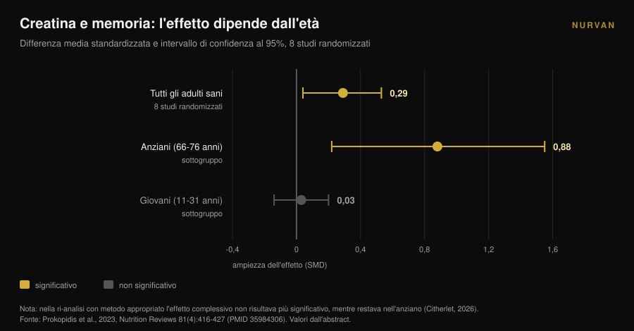
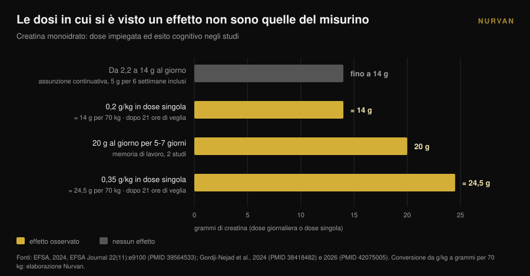

# Creatina e cervello: cosa dicono davvero gli studi

Di [Giammaria Loi](/autore/giammaria-loi) · aggiornato il 10 novembre 2026

Da un anno la creatina ha smesso di essere una faccenda da palestra: le ricerche su "creatina per il cervello" sono cresciute del 118% in dodici mesi e il misurino viene raccontato come un potenziatore mentale. Nello stesso periodo l'autorità europea per la sicurezza alimentare ha respinto il claim cognitivo e la meta-analisi più citata è finita sotto accusa per un errore di conteggio. Ecco cosa resta in piedi, per chi, e a quali dosi.

## In breve

- **L'EFSA ha detto no.** Nel 2024 il panel europeo ha concluso che **non è stato stabilito** un rapporto causa-effetto fra integrazione di creatina e miglioramento delle funzioni cognitive.
- **La meta-analisi più citata è contestata.** Xu e colleghi (2024) riportano un effetto sulla memoria (SMD 0,31), ma un commento del 2026 mostra che gli stessi partecipanti sono stati contati più volte: le osservazioni superano le persone randomizzate.
- **Ricalcolata bene, resta solo l'età.** Quando lo stesso problema è stato corretto in un'altra meta-analisi, l'effetto sulla memoria è sparito tranne che negli anziani: **SMD 0,88** nei 66-76 anni contro **0,03** nei giovani.
- **Le dosi che hanno mostrato qualcosa non sono quelle del misurino.** I segnali arrivano da 20 g al giorno per 5-7 giorni o da dosi singole di 0,2-0,35 g/kg — **14-24,5 g** per una persona di 70 kg — e dopo una notte senza dormire.
- **Il collo di bottiglia è la barriera emato-encefalica.** La creatina entra nel muscolo con facilità, nel cervello molto meno, e gli aumenti misurati restano modesti.

## Perché «creatina per il cervello» è ovunque adesso

Il segnale è misurabile. La query inglese "creatine for brain" è cresciuta del 118% su base annua e viaggia intorno alle 22.000 ricerche al mese (dati Glimpse aggiornati ad aprile 2025). Nello stesso arco di tempo la creatina è passata dallo scaffale degli integratori sportivi a quello della salute cerebrale, dell'umore e della menopausa.

Il mondo scientifico se n'è accorto. Nel 2025 il *Journal of Nutrition* ha pubblicato un articolo di prospettiva intitolato, letteralmente, «promessa, prova e percezione pubblica»: l'autore descrive un entusiasmo pubblico e commerciale che ha fatto impennare vendite, prescrizioni e interazioni sui social a fronte di un corpo di prove che — testuale — è rimasto paradossalmente limitato (Eckert, 2025).

Qui non si tratta di difendere o attaccare la creatina. Sul fronte muscolare resta uno degli integratori con il supporto più solido in circolazione, e infatti nella nostra [tier list degli integratori per la forza](/blog/classifica-integratori-forza-tier-list) sta in cima. La domanda è un'altra: quanto di ciò che leggi sul cervello è sostenuto dai dati?

## Il muscolo sì, il cervello è un'altra storia

Il motivo per cui le due cose non si equivalgono è anatomico. Il muscolo capta la creatina attraverso un trasportatore dedicato e la riserva sale in modo misurabile. Il cervello è protetto dalla **barriera emato-encefalica**, il filtro che decide cosa passa dal sangue al sistema nervoso, e quel filtro lascia entrare molta meno creatina.

Una rassegna del 2025 su *Nutrition and Health* mette esattamente questo al centro: l'incertezza chiave è se la creatina assunta per bocca arrivi al cervello in quantità sufficiente a modificare il metabolismo dei neuroni. Alcuni studi mostrano aumenti modesti della creatina cerebrale, ma limiti metodologici, variabilità individuale e assenza di protocolli standardizzati impediscono conclusioni ferme. L'autore chiude senza ambiguità: per ora l'integrazione a scopo cognitivo nell'anziano va considerata **un'ipotesi, non una pratica clinica consolidata** (Machado, 2025).

Tienilo a mente mentre leggi il resto. Tutto il dibattito sui numeri parte da un problema di consegna: se la molecola non arriva, l'effetto non può esserci, per quanto elegante sia il meccanismo sulla carta.

## La meta-analisi che tutti citano ha un problema di conteggio

Se cerchi «creatina e memoria», la fonte che compare quasi sempre è la revisione sistematica con meta-analisi di Xu e colleghi, pubblicata nel 2024 su *Frontiers in Nutrition*: 16 studi randomizzati, 492 partecipanti fra i 20,8 e i 76,4 anni. I risultati sembrano chiari — memoria SMD 0,31 (IC 95%: 0,18-0,44), tempo di attenzione -0,31, velocità di elaborazione -0,51 — con nessun effetto sulla cognizione globale né sulle funzioni esecutive.

Nell'aprile 2026 la stessa rivista ha pubblicato un commento che smonta il metodo. Diversi studi inclusi riportano più prove cognitive correlate sugli stessi partecipanti — in alcuni casi sette o più sottotest di memoria a testa — e quelle misure sono state trattate come effetti indipendenti. Il risultato è che nell'analisi aggregata **il numero di osservazioni supera il numero di persone effettivamente randomizzate** (Citherlet, 2026).

Si chiama doppio conteggio ed è un errore di unità di analisi. Gonfia artificialmente la precisione e la potenza statistica: l'intervallo di confidenza risulta più stretto di quanto i dati permettano e un effetto incerto sembra certo.

Non è una critica isolata. L'EFSA aveva sollevato lo stesso punto già nel 2024, osservando che l'aggregazione di risultati cognitivi non indipendenti in quella meta-analisi aveva gonfiato le dimensioni campionarie, e concludendo che da quei dati non si potevano trarre conclusioni.

La parte più istruttiva riguarda però un lavoro precedente. La meta-analisi di Prokopidis e colleghi del 2023, sulla memoria in persone sane, aveva lo stesso difetto. Quando gli autori hanno rifatto l'analisi con un metodo appropriato, l'effetto complessivo della creatina sulla memoria **non era più statisticamente significativo — tranne negli anziani**.

Quel dettaglio spiega gran parte della confusione, e si vedeva già nei sottogruppi pubblicati nel 2023: fra i 66 e i 76 anni l'effetto sulla memoria era SMD 0,88 (IC 95%: 0,22-1,55); fra gli 11 e i 31 anni era 0,03 (IC 95%: da -0,14 a 0,20), cioè zero. Dose (da 2,2 a 20 g al giorno), durata (da 5 giorni a 24 settimane), sesso e area geografica non cambiavano il risultato.

## Perché l'EFSA ha respinto il claim

Nel 2024 un'azienda ha chiesto all'Unione Europea di poter scrivere sulle confezioni che la creatina migliora le funzioni cognitive. Il panel NDA dell'EFSA ha esaminato 23 studi di intervento sull'uomo e ha detto no.

Il ragionamento vale più della conclusione, perché è una mappa delle dosi. L'effetto acuto sulla memoria di lavoro è stato osservato in **due studi, a 20 g al giorno per 5-7 giorni**. Non è comparso a dosi comprese fra 2,2 e 14 g al giorno. Non è comparso nemmeno con l'assunzione continuativa di **5 g al giorno per sei settimane** dopo una fase di carico di cinque giorni.

Un effetto sull'inibizione della risposta, sempre a 20 g al giorno per 7 giorni, è rimasto un risultato isolato fra dieci studi su persone sane, senza effetti sugli altri domini cognitivi. I tre studi su persone con patologie non sostenevano l'effetto, e il panel ha giudicato debole anche la plausibilità del meccanismo. Conclusione testuale: **non è stato stabilito un rapporto causa-effetto** (EFSA, 2024).

Tradotto nella pratica: la dose che quasi tutti prendono — il misurino da 5 grammi, quello che per il muscolo funziona benissimo — non è la dose in cui qualcuno ha misurato un effetto cognitivo.

## L'unico scenario in cui i numeri convincono: la notte in bianco

C'è una situazione in cui i dati sono più interessanti, ed è anche la meno glamour: la privazione di sonno.

Nel 2024 un gruppo del centro di ricerca di Jülich ha somministrato una **dose singola molto alta** di creatina monoidrato — 0,35 g per chilo di peso — a persone tenute sveglie per 21 ore, misurando con la spettroscopia a risonanza magnetica i fosfati ad alta energia del cervello. La creatina ha modificato quei parametri, ha evitato il calo del pH e ha migliorato prestazione cognitiva e velocità di elaborazione rispetto al placebo (Gordji-Nejad et al., 2024).

Nel 2026 lo stesso gruppo ha ripetuto l'esperimento con una dose più bassa, 0,2 g per chilo, su 29 persone. Il peggioramento cognitivo indotto dalla veglia prolungata è stato attenuato nei compiti logici e numerici, nella velocità di elaborazione linguistica e nel test di vigilanza psicomotoria, con un miglioramento **fino al 12%**. L'effetto era meno marcato che con la dose alta, e le donne ne traevano più beneficio degli uomini in logica, vigilanza e velocità (Gordji-Nejad et al., 2026).

Prima di correre a comprare il barattolo grande, fai il conto. Per una persona di 70 chili, 0,2 g/kg sono **14 grammi** in un colpo solo e 0,35 g/kg sono **24,5 grammi**: quasi tre e quasi cinque misurini da 5 g. Sono protocolli acuti da laboratorio, su campioni piccoli, prodotti dallo stesso gruppo di ricerca, e misurano il recupero da una notte in bianco — non un potenziamento cognitivo in chi dorme regolarmente.

C'è anche una lettura più onesta del dato: quello che vedi non è la creatina che ti rende più sveglio, è la creatina che compensa in parte un deficit energetico indotto. Notizia interessante per chi fa turni di notte, non una promessa per chi vuole studiare meglio.

## Cosa dice davvero la ricerca

| Affermazione diffusa | Verdetto | Fonte |
|---|---|---|
| «La creatina migliora le funzioni cognitive» | **Smentito come claim**: non è stato stabilito un rapporto causa-effetto | EFSA, 2024 |
| «Le meta-analisi dimostrano un effetto sulla memoria» | **Da precisare**: doppio conteggio dei partecipanti, serve una ri-analisi | Citherlet, 2026; EFSA, 2024 |
| «Funziona allo stesso modo a tutte le età» | **Smentito**: SMD 0,88 nei 66-76 anni contro 0,03 negli 11-31 anni | Prokopidis et al., 2023 |
| «Bastano 5 g al giorno anche per il cervello» | **Non supportato**: a 5 g/die per 6 settimane nessun effetto; i segnali sono a 20 g/die | EFSA, 2024 |
| «Aiuta dopo una notte insonne» | **Confermato in laboratorio**: fino a +12% con 0,2 g/kg in dose singola | Gordji-Nejad et al., 2024 e 2026 |
| «Arriva al cervello come arriva al muscolo» | **Smentito**: la barriera emato-encefalica limita l'ingresso, aumenti modesti | Machado, 2025 |
| «La creatina è un nootropo» | **Non verificabile oggi**: entusiasmo pubblico molto superiore alle prove | Eckert, 2025 |

## Come applicarlo

1. **Se la prendi per il muscolo, continua.** Niente in questo articolo mette in discussione l'uso sportivo della creatina: è il terreno in cui le prove sono solide. Quello che non regge è il claim cognitivo.
2. **Non aumentare la dose «per il cervello».** Le dosi in cui si è visto qualcosa — 20 g al giorno, o dosi singole da 14-24,5 g — vengono da protocolli di ricerca con monitoraggio, non da un'abitudine quotidiana. Fuori dallo studio non c'è alcuna indicazione a salirci, e le dosi alte si accompagnano spesso a disturbi gastrointestinali.
3. **Se hai più di 65 anni, sei nell'unico sottogruppo con un segnale.** Resta un segnale, non una terapia. Parlane con il medico prima di iniziare, soprattutto in presenza di problemi renali o di terapie in corso.
4. **Aspettati zero se dormi bene.** Negli adulti giovani e riposati l'effetto misurato sulla memoria è indistinguibile da zero. Il sonno, quello sì, sposta la stessa variabile, e costa meno.
5. **Diffida dei prodotti venduti come «creatina per la mente».** Se una formulazione costa di più deve dimostrarlo: chiedi a quale dose, per quanto tempo e su quale popolazione è stato misurato l'effetto.
6. **Registra quello che prendi davvero.** Fra ciò che pensi di assumere e ciò che assumi passano settimane dimenticate e misurini approssimativi. Se vuoi capire se un integratore sta facendo qualcosa, il dato va scritto. E se stai ancora scegliendo la forma, abbiamo confrontato [le gommose con la polvere](/blog/creatina-gommose-funzionano).

> ### Prova Nurvan — l'integrazione che tieni davvero sotto controllo
>
> Il modulo integrazione di Nurvan registra forma, dose e orario di quello che prendi, creatina compresa, e lo affianca a carichi, misure e sedute. Così smetti di valutare un integratore a sensazione e vedi cosa è cambiato, settimana per settimana, nel periodo in cui l'hai preso. [Prova Nurvan](https://nurvan.app)

## Domande frequenti

**La creatina migliora la memoria?**
Non abbastanza da poterlo affermare. Le meta-analisi che riportano un effetto hanno contato più volte gli stessi partecipanti e, quando il problema è stato corretto, l'effetto è rimasto solo negli anziani. L'EFSA nel 2024 ha concluso che il rapporto causa-effetto non è stabilito.

**Quanta creatina serve per il cervello?**
Non esiste una dose raccomandata, perché non esiste un effetto accertato. Negli studi in cui qualcosa si è visto le dosi erano 20 g al giorno per 5-7 giorni oppure dosi singole da 0,2-0,35 g/kg: molto più dei 5 g del misurino, e in contesti di ricerca controllati. Non è un'indicazione da applicare da soli.

**La creatina aiuta se dormo poco?**
Due studi randomizzati su privazione acuta di sonno hanno mostrato un recupero parziale della prestazione cognitiva, fino al 12% con 0,2 g/kg in dose singola. Sono campioni piccoli, dallo stesso gruppo di ricerca, e riguardano una notte in bianco: non dicono nulla su chi dorme regolarmente.

**Perché funziona sul muscolo e non sul cervello?**
Perché il muscolo la capta con facilità, mentre il cervello è protetto dalla barriera emato-encefalica, che ne lascia entrare molta meno. Gli aumenti di creatina cerebrale misurati dopo integrazione restano modesti e variano molto da persona a persona.

## Leggi anche

- [Creatina in gommose: funzionano come la polvere?](/blog/creatina-gommose-funzionano) — stessa molecola, forma che costa di più: cosa cambia davvero.
- [Creatina senza palestra dopo i 45: cosa dice lo studio](/blog/creatina-senza-allenamento-over-45) — l'altro caso in cui l'età cambia la risposta all'integrazione.
- [Tier list integratori forza: cosa dice la ricerca](/blog/classifica-integratori-forza-tier-list) — dove sta la creatina quando si parla di forza, e chi le sta vicino.

## Fonti

1. EFSA Panel on Nutrition, Novel Foods and Food Allergens (Turck D, Bohn T, Cámara M, et al.), 2024. Creatine and improvement in cognitive function: Evaluation of a health claim pursuant to article 13(5) of regulation (EC) No 1924/2006. *EFSA Journal* 22(11):e9100. PMID 39564533. [DOI 10.2903/j.efsa.2024.9100](https://doi.org/10.2903/j.efsa.2024.9100)
2. Eckert I, 2025. Creatine Supplementation for Cognition: A Critical Perspective on Promise, Proof, and Public Perception. *The Journal of Nutrition* 155(10):3143-3147. PMID 40744234. [DOI 10.1016/j.tjnut.2025.07.016](https://doi.org/10.1016/j.tjnut.2025.07.016)
3. Citherlet T, 2026. Commentary: The effects of creatine supplementation on cognitive function in adults: a systematic review and meta-analysis. *Frontiers in Nutrition* 13:1716285. PMID 42039906. [DOI 10.3389/fnut.2026.1716285](https://doi.org/10.3389/fnut.2026.1716285)
4. Xu C, Bi S, Zhang W, Luo L, 2024. The effects of creatine supplementation on cognitive function in adults: a systematic review and meta-analysis. *Frontiers in Nutrition* 11:1424972. PMID 39070254. [DOI 10.3389/fnut.2024.1424972](https://doi.org/10.3389/fnut.2024.1424972)
5. Prokopidis K, Giannos P, Triantafyllidis KK, Kechagias KS, Forbes SC, Candow DG, 2023. Effects of creatine supplementation on memory in healthy individuals: a systematic review and meta-analysis of randomized controlled trials. *Nutrition Reviews* 81(4):416-427. PMID 35984306. [DOI 10.1093/nutrit/nuac064](https://doi.org/10.1093/nutrit/nuac064)
6. Gordji-Nejad A, Matusch A, Kleedörfer S, Jayeshkumar Patel H, Drzezga A, Elmenhorst D, Binkofski F, Bauer A, 2024. Single dose creatine improves cognitive performance and induces changes in cerebral high energy phosphates during sleep deprivation. *Scientific Reports* 14(1):4937. PMID 38418482. [DOI 10.1038/s41598-024-54249-9](https://doi.org/10.1038/s41598-024-54249-9)
7. Gordji-Nejad A, Matusch A, Hengstler L, Beer S, Kroll T, Klein S, Elmenhorst D, Bauer A, Drzezga A, 2026. Single-Dose Creatine Reduces Sleep Deprivation-Induced Deterioration in Cognitive Performance. *Nutrients* 18(8):1192. PMID 42075005. [DOI 10.3390/nu18081192](https://doi.org/10.3390/nu18081192)
8. Machado M, 2025. Creatine supplementation and cognitive aging: The challenge of crossing the blood-brain barrier. *Nutrition and Health* 32(3):761-763. PMID 41359040. [DOI 10.1177/02601060251404327](https://doi.org/10.1177/02601060251404327)

Fonti bibliografiche reperite tramite PubMed. Tema scelto da un segnale di tendenza: la query "creatine for brain" cresciuta del 118% su base annua e intorno alle 22.000 ricerche mensili (Glimpse, dato ad aprile 2025), insieme all'articolo di prospettiva critica pubblicato sul *Journal of Nutrition* nel 2025 sullo scarto fra marketing e prove.

---

*Giammaria Loi è il fondatore di Nurvan. Si allena con i pesi dal 2012, lavora come personal trainer e coach certificato FIPE dal 2013 e gareggia nel powerlifting a livello nazionale dal 2018. Ogni articolo che firma parte dagli studi scientifici e arriva a ciò che funziona davvero in palestra.*

> Nota: contenuto informativo, non sostituisce il parere di un medico o professionista.
