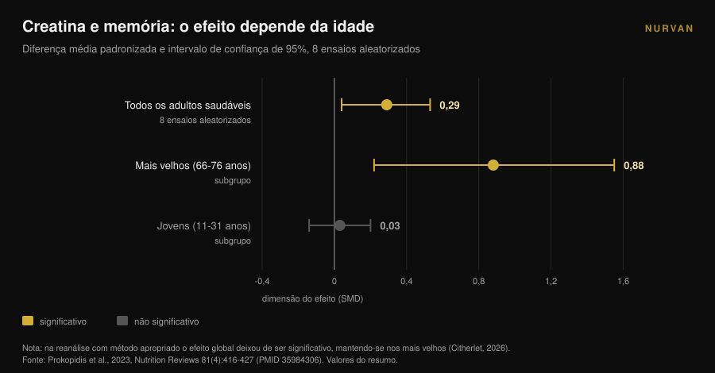
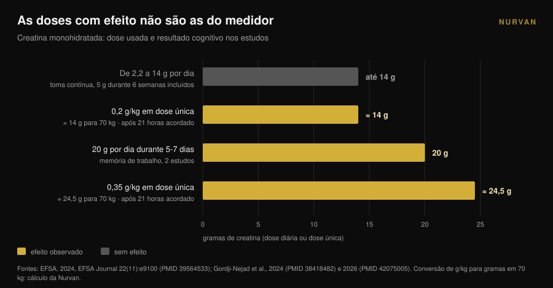

# Creatina e cérebro: o que dizem mesmo os estudos

Por [Giammaria Loi](/autore/giammaria-loi) · atualizado a 10 de novembro de 2026

Em cerca de um ano a creatina deixou de ser assunto de ginásio: as pesquisas por "creatina para o cérebro" cresceram 118% em doze meses e o medidor passou a ser vendido como melhoria mental. No mesmo período, a autoridade europeia para a segurança alimentar rejeitou a alegação cognitiva e a meta-análise mais citada foi apanhada num erro de contagem. Eis o que se sustenta, em quem e em que dose.

## Em resumo

- **A EFSA disse que não.** Em 2024 o painel europeu concluiu que **não foi estabelecida** uma relação de causa e efeito entre a suplementação com creatina e a melhoria da função cognitiva.
- **A meta-análise mais citada está contestada.** Xu e colegas (2024) relatam um efeito na memória (SMD 0,31), mas um comentário de 2026 mostra que os mesmos participantes foram contados várias vezes: as observações ultrapassam as pessoas aleatorizadas.
- **Recalculada bem, sobra apenas a idade.** Quando a mesma falha foi corrigida noutra meta-análise, o efeito na memória desapareceu exceto nos mais velhos: **SMD 0,88** entre os 66 e os 76 anos contra **0,03** nos jovens.
- **As doses com sinal não são as do medidor.** Os sinais vêm de 20 g por dia durante 5-7 dias ou de doses únicas de 0,2-0,35 g/kg — **14 a 24,5 g** para uma pessoa de 70 kg — e depois de uma noite sem dormir.
- **O estrangulamento é a barreira hematoencefálica.** A creatina entra com facilidade no músculo; no cérebro muito menos, e os aumentos medidos mantêm-se modestos.

## Porque é que «creatina para o cérebro» está em todo o lado

O sinal é mensurável. A pesquisa em inglês "creatine for brain" cresceu 118% em termos homólogos e ronda as 22.000 pesquisas por mês (dados Glimpse atualizados a abril de 2025). No mesmo período, a creatina passou da prateleira dos suplementos desportivos para a da saúde cerebral, do humor e da menopausa.

A investigação reparou. Em 2025 o *Journal of Nutrition* publicou um artigo de perspetiva intitulado, literalmente, «promessa, prova e perceção pública»: o autor descreve um entusiasmo público e comercial que disparou vendas, prescrições e interação nas redes perante um corpo de evidência que — palavras dele — se manteve paradoxalmente limitado (Eckert, 2025).

Não se trata de defender nem de atacar a creatina. Para o músculo continua a ser um dos suplementos com melhor suporte, e por isso lidera a nossa [tier list de suplementos para a força](/pt/blog/ranking-suplementos-forca-tier-list). A pergunta aqui é outra: quanto do que lê sobre o cérebro é realmente sustentado pelos dados?

## No músculo sim, no cérebro é outra história

A razão por que uma coisa não implica a outra é anatómica. O músculo capta a creatina através de um transportador próprio e a reserva sobe de forma mensurável. O cérebro está protegido pela **barreira hematoencefálica**, o filtro que decide o que passa do sangue para o sistema nervoso, e esse filtro deixa entrar muito menos creatina.

Uma revisão de 2025 na *Nutrition and Health* coloca exatamente isso no centro: a incerteza principal é se a creatina tomada por via oral chega ao cérebro em quantidade suficiente para alterar o metabolismo dos neurónios. Alguns estudos mostram aumentos modestos de creatina cerebral, mas limitações metodológicas, variabilidade individual e ausência de protocolos padronizados impedem conclusões firmes. O autor fecha sem rodeios: por agora, a suplementação com fim cognitivo em pessoas mais velhas deve ser considerada **uma hipótese, não uma prática clínica estabelecida** (Machado, 2025).

Tenha isso presente ao ler o resto. Todo o debate sobre números parte de um problema de entrega: se a molécula não chega, o efeito não pode existir, por mais elegante que o mecanismo pareça no papel.

## A meta-análise que toda a gente cita tem um problema de contagem

Se procurar «creatina e memória», a fonte que aparece quase sempre é a revisão sistemática com meta-análise de Xu e colegas, publicada em 2024 na *Frontiers in Nutrition*: 16 ensaios aleatorizados, 492 participantes entre os 20,8 e os 76,4 anos. Os resultados parecem claros — memória SMD 0,31 (IC 95%: 0,18-0,44), tempo de atenção -0,31, velocidade de processamento -0,51 — sem efeito na cognição global nem nas funções executivas.

Em abril de 2026 a mesma revista publicou um comentário que desmonta o método. Vários estudos incluídos reportam múltiplas provas cognitivas correlacionadas dos mesmos participantes — nalguns casos sete ou mais subtestes de memória cada — e essas medidas foram tratadas como efeitos independentes. O resultado é que, na análise agregada, **o número de observações ultrapassa o número de pessoas efetivamente aleatorizadas** (Citherlet, 2026).

Chama-se dupla contagem e é um erro de unidade de análise. Inflaciona artificialmente a precisão e a potência estatística: o intervalo de confiança sai mais estreito do que os dados permitem e um efeito incerto parece certo.

Não é uma crítica isolada. A EFSA já tinha levantado o mesmo ponto em 2024, notando que agregar resultados cognitivos não independentes naquela meta-análise inflacionou as dimensões amostrais, e concluindo que daqueles dados não se podiam tirar conclusões.

A parte mais instrutiva diz respeito, porém, a um trabalho anterior. A meta-análise de Prokopidis e colegas de 2023, sobre memória em pessoas saudáveis, tinha a mesma falha. Quando os autores refizeram a análise com um método apropriado, o efeito global da creatina na memória **deixou de ser estatisticamente significativo — exceto nos mais velhos**.

Esse pormenor explica grande parte da confusão, e já se via nos subgrupos publicados em 2023: entre os 66 e os 76 anos o efeito na memória era SMD 0,88 (IC 95%: 0,22-1,55); entre os 11 e os 31 anos era 0,03 (IC 95%: de -0,14 a 0,20), ou seja zero. A dose (de 2,2 a 20 g por dia), a duração (de 5 dias a 24 semanas), o sexo e a origem geográfica não alteravam o resultado.

## Porque é que a EFSA rejeitou a alegação

Em 2024 uma empresa pediu à União Europeia autorização para escrever na embalagem que a creatina melhora a função cognitiva. O painel NDA da EFSA analisou 23 estudos de intervenção em humanos e disse que não.

O raciocínio vale mais do que o veredicto, porque é um mapa de doses. O efeito agudo na memória de trabalho foi observado em **dois estudos, com 20 g por dia durante 5-7 dias**. Não apareceu com doses entre 2,2 e 14 g por dia. Também não apareceu com a toma contínua de **5 g por dia durante seis semanas** depois de uma fase de carga de cinco dias.

Um efeito na inibição da resposta, também com 20 g por dia durante 7 dias, foi um achado isolado entre dez estudos em pessoas saudáveis, sem efeitos nos restantes domínios cognitivos. Os três estudos em pessoas com doença não sustentavam o efeito, e o painel considerou fraca também a plausibilidade do mecanismo. Conclusão textual: **não foi estabelecida uma relação de causa e efeito** (EFSA, 2024).

Traduzido para a prática: a dose que quase toda a gente toma — o medidor de 5 gramas, o que funciona muito bem para o músculo — não é a dose em que alguém mediu um efeito cognitivo.

## O único cenário em que os números convencem: a noite em claro

Há uma situação em que os dados ficam mais interessantes, e é também a menos glamorosa: a privação de sono.

Em 2024 um grupo do centro de investigação de Jülich administrou uma **dose única muito elevada** de creatina monohidratada — 0,35 g por quilo de peso — a pessoas mantidas acordadas durante 21 horas, acompanhando por espetroscopia de ressonância magnética os fosfatos de alta energia do cérebro. A creatina alterou esses parâmetros, evitou a descida do pH e melhorou o desempenho cognitivo e a velocidade de processamento face ao placebo (Gordji-Nejad et al., 2024).

Em 2026 o mesmo grupo repetiu a experiência com uma dose mais baixa, 0,2 g por quilo, em 29 pessoas. A deterioração cognitiva provocada pela vigília prolongada foi atenuada em tarefas lógicas e numéricas, na velocidade de processamento da linguagem e no teste de vigilância psicomotora, com uma melhoria **até 12%**. O efeito foi menor do que com a dose alta, e as mulheres beneficiaram mais do que os homens em lógica, vigilância e velocidade (Gordji-Nejad et al., 2026).

Antes de comprar o frasco grande, faça as contas. Para uma pessoa de 70 quilos, 0,2 g/kg são **14 gramas** de uma vez e 0,35 g/kg são **24,5 gramas**: quase três e quase cinco medidores de 5 g. São protocolos agudos de laboratório, com amostras pequenas, do mesmo grupo de investigação, e medem a recuperação de uma noite em claro — não um reforço cognitivo em quem dorme normalmente.

Há ainda uma leitura mais honesta do dado: o que vê não é a creatina a torná-lo mais desperto, é a creatina a compensar em parte um défice energético induzido. Boa notícia para quem faz turnos noturnos; não é uma promessa para quem quer estudar melhor.

## O que diz mesmo a investigação

| Afirmação comum | Veredicto | Fonte |
|---|---|---|
| «A creatina melhora a função cognitiva» | **Rejeitado como alegação**: nenhuma relação de causa e efeito estabelecida | EFSA, 2024 |
| «As meta-análises provam um efeito na memória» | **A matizar**: dupla contagem de participantes, é preciso reanalisar | Citherlet, 2026; EFSA, 2024 |
| «Funciona igual em qualquer idade» | **Desmentido**: SMD 0,88 entre os 66 e os 76 anos contra 0,03 entre os 11 e os 31 | Prokopidis et al., 2023 |
| «5 g por dia chegam também para o cérebro» | **Sem suporte**: sem efeito a 5 g/dia durante 6 semanas; os sinais estão nos 20 g/dia | EFSA, 2024 |
| «Ajuda depois de uma noite sem dormir» | **Confirmado em laboratório**: até +12% com 0,2 g/kg em dose única | Gordji-Nejad et al., 2024 e 2026 |
| «Chega ao cérebro como chega ao músculo» | **Desmentido**: a barreira hematoencefálica limita a entrada, aumentos modestos | Machado, 2025 |
| «A creatina é um nootrópico» | **Hoje não verificável**: o entusiasmo público ultrapassa de longe a evidência | Eckert, 2025 |

## Como aplicar

1. **Se a toma pelo músculo, continue.** Nada neste artigo põe em causa o uso desportivo da creatina: é aí que a evidência é sólida. O que não se sustenta é a alegação cognitiva.
2. **Não aumente a dose «pelo cérebro».** As doses em que se viu algo — 20 g por dia, ou doses únicas de 14 a 24,5 g — vêm de protocolos de investigação com monitorização, não de um hábito diário. Fora do estudo não há indicação para subir, e as doses altas trazem muitas vezes desconforto gastrointestinal.
3. **Se tem mais de 65 anos, está no único subgrupo com sinal.** Continua a ser um sinal, não um tratamento. Fale com o seu médico antes de começar, sobretudo com problemas renais ou medicação em curso.
4. **Espere zero se dorme bem.** Em adultos jovens e descansados o efeito medido na memória é indistinguível de zero. O sono, esse, mexe mesmo na mesma variável, e custa menos.
5. **Desconfie de produtos vendidos como «creatina para a mente».** Se uma formulação custa mais, tem de o demonstrar: pergunte em que dose, durante quanto tempo e em que população o efeito foi medido.
6. **Registe o que toma mesmo.** Entre o que julga tomar e o que toma há semanas esquecidas e medidores aproximados. Para perceber se um suplemento está a fazer alguma coisa, o dado tem de ser escrito. E se ainda está a escolher o formato, comparámos [as gomas com o pó](/pt/blog/gomas-de-creatina-funcionam).

> ### Experimente a Nurvan — a suplementação que controla mesmo
>
> O módulo de suplementação da Nurvan regista forma, dose e horário do que toma, creatina incluída, e coloca-o ao lado das cargas, das medidas e dos treinos. Deixa de avaliar um suplemento pela sensação e vê o que mudou, semana a semana, no período em que o tomou. [Experimentar a Nurvan](https://nurvan.app)

## Perguntas frequentes

**A creatina melhora a memória?**
Não o suficiente para se poder afirmar. As meta-análises que descrevem um efeito contaram várias vezes os mesmos participantes e, corrigido o problema, o efeito só se manteve nos mais velhos. A EFSA concluiu em 2024 que a relação de causa e efeito não está estabelecida.

**Quanta creatina é precisa para o cérebro?**
Não há dose recomendada, porque não há efeito estabelecido. Nos estudos em que se viu alguma coisa as doses eram 20 g por dia durante 5-7 dias ou doses únicas de 0,2-0,35 g/kg: muito mais do que o medidor de 5 g, e em contextos de investigação controlados. Não é uma indicação para aplicar sozinho.

**A creatina ajuda se eu dormir pouco?**
Dois ensaios aleatorizados sobre privação aguda de sono mostraram recuperação parcial do desempenho cognitivo, até 12% com 0,2 g/kg em dose única. São amostras pequenas, do mesmo grupo de investigação, e dizem respeito a uma noite em claro: nada dizem sobre quem dorme normalmente.

**Porque funciona no músculo e não no cérebro?**
Porque o músculo capta-a com facilidade, enquanto o cérebro está protegido pela barreira hematoencefálica, que deixa passar muito menos. Os aumentos de creatina cerebral medidos depois da suplementação mantêm-se modestos e variam muito de pessoa para pessoa.

## Leia também

- [Gomas de creatina: funcionam como o pó?](/pt/blog/gomas-de-creatina-funcionam) — a mesma molécula, num formato mais caro: o que muda mesmo.
- [Creatina sem treino depois dos 45: o que diz o estudo](/pt/blog/creatina-sem-treino-depois-dos-45) — o outro caso em que a idade muda a resposta ao suplemento.
- [Tier list de suplementos para força: a evidência](/pt/blog/ranking-suplementos-forca-tier-list) — onde fica a creatina quando se fala de força, e quem está ao lado.

## Fontes

1. EFSA Panel on Nutrition, Novel Foods and Food Allergens (Turck D, Bohn T, Cámara M, et al.), 2024. Creatine and improvement in cognitive function: Evaluation of a health claim pursuant to article 13(5) of regulation (EC) No 1924/2006. *EFSA Journal* 22(11):e9100. PMID 39564533. [DOI 10.2903/j.efsa.2024.9100](https://doi.org/10.2903/j.efsa.2024.9100)
2. Eckert I, 2025. Creatine Supplementation for Cognition: A Critical Perspective on Promise, Proof, and Public Perception. *The Journal of Nutrition* 155(10):3143-3147. PMID 40744234. [DOI 10.1016/j.tjnut.2025.07.016](https://doi.org/10.1016/j.tjnut.2025.07.016)
3. Citherlet T, 2026. Commentary: The effects of creatine supplementation on cognitive function in adults: a systematic review and meta-analysis. *Frontiers in Nutrition* 13:1716285. PMID 42039906. [DOI 10.3389/fnut.2026.1716285](https://doi.org/10.3389/fnut.2026.1716285)
4. Xu C, Bi S, Zhang W, Luo L, 2024. The effects of creatine supplementation on cognitive function in adults: a systematic review and meta-analysis. *Frontiers in Nutrition* 11:1424972. PMID 39070254. [DOI 10.3389/fnut.2024.1424972](https://doi.org/10.3389/fnut.2024.1424972)
5. Prokopidis K, Giannos P, Triantafyllidis KK, Kechagias KS, Forbes SC, Candow DG, 2023. Effects of creatine supplementation on memory in healthy individuals: a systematic review and meta-analysis of randomized controlled trials. *Nutrition Reviews* 81(4):416-427. PMID 35984306. [DOI 10.1093/nutrit/nuac064](https://doi.org/10.1093/nutrit/nuac064)
6. Gordji-Nejad A, Matusch A, Kleedörfer S, Jayeshkumar Patel H, Drzezga A, Elmenhorst D, Binkofski F, Bauer A, 2024. Single dose creatine improves cognitive performance and induces changes in cerebral high energy phosphates during sleep deprivation. *Scientific Reports* 14(1):4937. PMID 38418482. [DOI 10.1038/s41598-024-54249-9](https://doi.org/10.1038/s41598-024-54249-9)
7. Gordji-Nejad A, Matusch A, Hengstler L, Beer S, Kroll T, Klein S, Elmenhorst D, Bauer A, Drzezga A, 2026. Single-Dose Creatine Reduces Sleep Deprivation-Induced Deterioration in Cognitive Performance. *Nutrients* 18(8):1192. PMID 42075005. [DOI 10.3390/nu18081192](https://doi.org/10.3390/nu18081192)
8. Machado M, 2025. Creatine supplementation and cognitive aging: The challenge of crossing the blood-brain barrier. *Nutrition and Health* 32(3):761-763. PMID 41359040. [DOI 10.1177/02601060251404327](https://doi.org/10.1177/02601060251404327)

Fontes bibliográficas obtidas através da PubMed. Tema escolhido a partir de um sinal de tendência: a pesquisa "creatine for brain", com +118% em termos homólogos e cerca de 22.000 pesquisas mensais (Glimpse, dado de abril de 2025), em conjunto com o artigo de perspetiva crítica publicado no *Journal of Nutrition* em 2025 sobre a distância entre marketing e evidência.

---

*Giammaria Loi é o fundador da Nurvan. Treina com pesos desde 2012, trabalha como personal trainer e coach certificado FIPE desde 2013 e compete em powerlifting a nível nacional desde 2018. Cada artigo que assina parte dos estudos científicos e chega ao que funciona mesmo no ginásio.*

> Nota: conteúdo informativo, não substitui a opinião de um médico ou profissional.
