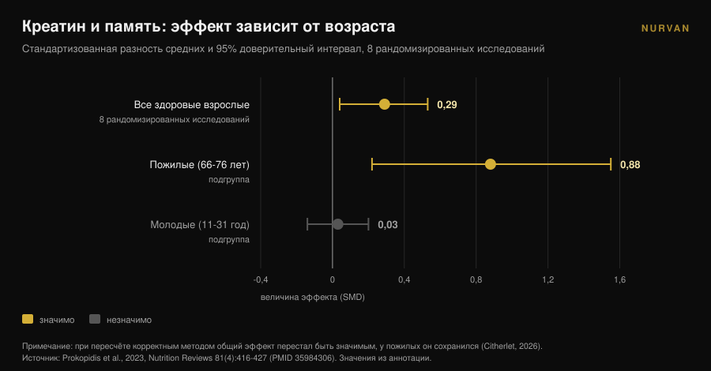
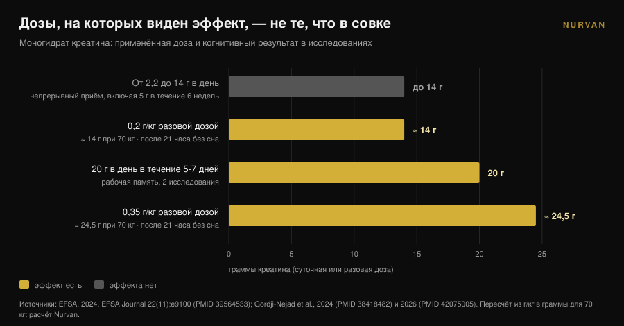

# Креатин и мозг: что на самом деле говорят исследования

Автор: [Giammaria Loi](/autore/giammaria-loi) · обновлено 10 ноября 2026

Примерно за год креатин перестал быть темой только для зала: запросы «креатин для мозга» выросли на 118% за двенадцать месяцев, а мерный совок продают как апгрейд для головы. В тот же период европейское ведомство по безопасности пищевых продуктов отклонило когнитивное заявление, а самый цитируемый метаанализ попался на ошибке подсчёта. Разбираем, что выдерживает проверку, у кого и в каких дозах.

## Коротко

- **EFSA сказала нет.** В 2024 году европейская панель заключила, что причинно-следственная связь между приёмом креатина и улучшением когнитивных функций **не установлена**.
- **Самый цитируемый метаанализ оспорен.** Xu с соавторами (2024) сообщают об эффекте на память (SMD 0,31), но комментарий 2026 года показывает, что одних и тех же участников посчитали несколько раз: наблюдений больше, чем рандомизированных людей.
- **При корректном пересчёте остаётся только возраст.** Когда ту же ошибку исправили в другом метаанализе, эффект на память исчез везде, кроме пожилых: **SMD 0,88** в 66-76 лет против **0,03** у молодых.
- **Дозы с сигналом — не те, что в совке.** Сигналы получены при 20 г в день в течение 5-7 дней или при разовых дозах 0,2-0,35 г/кг — **14-24,5 г** для человека в 70 кг — и только после бессонной ночи.
- **Узкое место — гематоэнцефалический барьер.** В мышцу креатин попадает легко, в мозг — гораздо хуже, и измеренный прирост остаётся скромным.

## Почему «креатин для мозга» сейчас повсюду

Сигнал измерим. Англоязычный запрос "creatine for brain" вырос на 118% за год и держится около 22 000 запросов в месяц (данные Glimpse на апрель 2025 года). За тот же период креатин перебрался с полки спортивных добавок на полки «здоровье мозга», «настроение» и «менопауза».

Наука это заметила. В 2025 году *Journal of Nutrition* опубликовал статью-перспективу с подзаголовком, буквально, «обещание, доказательство и общественное восприятие»: автор описывает общественный и коммерческий энтузиазм, который взвинтил продажи, назначения и вовлечённость в соцсетях — при массиве доказательств, который, его формулировка, парадоксальным образом остался ограниченным (Eckert, 2025).

Речь не о том, чтобы защищать или ругать креатин. Для мышц это по-прежнему одна из самых хорошо обоснованных добавок, поэтому она и возглавляет наш [тир-лист добавок для силы](/ru/blog/reyting-sportivnykh-dobavok-dlya-sily). Вопрос другой: сколько из того, что вы читаете про мозг, действительно опирается на данные?

## С мышцей да, с мозгом — другая история

Причина, по которой одно не следует из другого, анатомическая. Мышца забирает креатин через специальный переносчик, и запас растёт измеримо. Мозг защищён **гематоэнцефалическим барьером** — фильтром, который решает, что попадёт из крови в нервную систему, — и этот фильтр пропускает заметно меньше креатина.

Обзор 2025 года в *Nutrition and Health* ставит именно это в центр: ключевая неопределённость в том, доходит ли принятый внутрь креатин до мозга в количестве, достаточном для изменения метаболизма нейронов. Некоторые работы показывают скромный прирост мозгового креатина, но методические ограничения, индивидуальная вариабельность и отсутствие стандартизированных протоколов не дают сделать твёрдые выводы. Вывод автора однозначен: пока приём ради когнитивных эффектов у пожилых следует считать **гипотезой, а не устоявшейся клинической практикой** (Machado, 2025).

Держите это в голове дальше. Весь спор о цифрах начинается с проблемы доставки: если молекула не доходит, эффекта быть не может, каким бы изящным ни выглядел механизм на бумаге.

## У метаанализа, который все цитируют, проблема с подсчётом

Если искать «креатин и память», почти всегда попадается систематический обзор с метаанализом Xu с соавторами, опубликованный в 2024 году в *Frontiers in Nutrition*: 16 рандомизированных исследований, 492 участника в возрасте от 20,8 до 76,4 лет. Результаты выглядят ясно — память SMD 0,31 (95% ДИ: 0,18-0,44), время внимания -0,31, скорость обработки -0,51 — без эффекта на общую когнитивную функцию и исполнительные функции.

В апреле 2026 года тот же журнал опубликовал комментарий, разбирающий метод. Несколько включённых исследований сообщают о нескольких коррелированных когнитивных показателях у одних и тех же участников — местами по семь и более субтестов памяти на человека — и эти показатели трактовали как независимые размеры эффекта. В итоге в объединённом анализе **число наблюдений превышает число реально рандомизированных участников** (Citherlet, 2026).

Это двойной счёт, ошибка единицы анализа. Он искусственно завышает точность и статистическую мощность: доверительный интервал выходит уже, чем позволяют данные, и неопределённый эффект выглядит достоверным.

Критика не единичная. EFSA поднимала тот же вопрос ещё в 2024 году, отметив, что объединение неза­висимых только по видимости когнитивных результатов в этом метаанализе завысило объёмы выборок, и заключив, что из этих данных нельзя делать выводы.

Самое поучительное, впрочем, касается более ранней работы. Метаанализ Prokopidis с соавторами 2023 года о памяти у здоровых людей имел тот же изъян. Когда авторы пересчитали всё корректным методом, общий эффект креатина на память **перестал быть статистически значимым — кроме пожилых**.

Эта деталь объясняет почти всю путаницу, и её было видно уже в подгруппах, опубликованных в 2023 году: в 66-76 лет эффект на память составлял SMD 0,88 (95% ДИ: 0,22-1,55), в 11-31 год — 0,03 (95% ДИ: от -0,14 до 0,20), то есть ноль. Доза (от 2,2 до 20 г в день), длительность (от 5 дней до 24 недель), пол и география результат не меняли.

## Почему EFSA отклонила заявление

В 2024 году компания попросила Евросоюз разрешить писать на упаковке, что креатин улучшает когнитивные функции. Панель NDA в составе EFSA рассмотрела 23 интервенционных исследования на людях и ответила отказом.

Рассуждение ценнее вердикта, потому что это карта доз. Острый эффект на рабочую память наблюдали в **двух исследованиях, при 20 г в день в течение 5-7 дней**. При дозах от 2,2 до 14 г в день он не появлялся. Не появился он и при непрерывном приёме **5 г в день в течение шести недель** после пятидневной фазы загрузки.

Эффект на торможение реакции, опять же при 20 г в день в течение 7 дней, остался изолированной находкой среди десяти исследований на здоровых людях, без влияния на другие когнитивные домены. Три исследования на людях с заболеваниями эффект не подтверждали, а правдоподобность механизма панель тоже сочла слабой. Дословный вывод: **причинно-следственная связь не установлена** (EFSA, 2024).

В переводе на практику: доза, которую принимают почти все, — совок на 5 граммов, прекрасно работающий для мышц, — это не та доза, на которой кто-то измерил когнитивный эффект.

## Единственный сценарий, где цифры убеждают: бессонная ночь

Есть ситуация, в которой данные становятся интереснее, и она же наименее гламурная: депривация сна.

В 2024 году группа из исследовательского центра Юлих дала **очень высокую разовую дозу** моногидрата креатина — 0,35 г на килограмм массы тела — людям, которых держали без сна 21 час, отслеживая магнитно-резонансной спектроскопией высокоэнергетические фосфаты мозга. Креатин изменил эти параметры, предотвратил падение pH и улучшил когнитивную работоспособность и скорость обработки по сравнению с плацебо (Gordji-Nejad et al., 2024).

В 2026 году та же группа повторила эксперимент с меньшей дозой, 0,2 г на килограмм, на 29 людях. Ухудшение когнитивных функций от затянувшегося бодрствования было смягчено в логических и числовых задачах, в скорости обработки речи и в тесте психомоторной бдительности, с улучшением **до 12%**. Эффект был слабее, чем при высокой дозе, а женщины выигрывали больше мужчин в логике, бдительности и скорости (Gordji-Nejad et al., 2026).

Прежде чем бежать за большой банкой, посчитайте. Для человека в 70 килограммов 0,2 г/кг — это **14 граммов** за раз, а 0,35 г/кг — **24,5 грамма**: почти три и почти пять совков по 5 г. Это острые лабораторные протоколы на малых выборках, из одной и той же исследовательской группы, и они измеряют восстановление после бессонной ночи, а не улучшение когнитивных функций у того, кто нормально спит.

Есть и более честное прочтение: вы видите не креатин, который делает вас сообразительнее, а креатин, который частично компенсирует наведённый энергетический дефицит. Хорошая новость для ночных смен, но не обещание для тех, кто хочет лучше учиться.

## Что на самом деле говорят исследования

| Распространённое утверждение | Вердикт | Источник |
|---|---|---|
| «Креатин улучшает когнитивные функции» | **Отклонено как заявление**: причинно-следственная связь не установлена | EFSA, 2024 |
| «Метаанализы доказывают эффект на память» | **Требует уточнения**: двойной счёт участников, нужен пересчёт | Citherlet, 2026; EFSA, 2024 |
| «Работает одинаково в любом возрасте» | **Опровергнуто**: SMD 0,88 в 66-76 лет против 0,03 в 11-31 год | Prokopidis et al., 2023 |
| «5 г в день хватает и для мозга» | **Не подтверждено**: при 5 г/день в течение 6 недель эффекта нет; сигналы на 20 г/день | EFSA, 2024 |
| «Помогает после бессонной ночи» | **Подтверждено в лаборатории**: до +12% при разовой дозе 0,2 г/кг | Gordji-Nejad et al., 2024 и 2026 |
| «В мозг попадает так же, как в мышцу» | **Опровергнуто**: гематоэнцефалический барьер ограничивает вход, прирост скромный | Machado, 2025 |
| «Креатин — ноотроп» | **Сегодня не проверяемо**: общественный энтузиазм сильно опережает данные | Eckert, 2025 |

## Как применить

1. **Если принимаете ради мышц — продолжайте.** Ничто в этой статье не ставит под сомнение спортивное применение креатина: здесь доказательная база прочная. Не выдерживает проверки именно когнитивное заявление.
2. **Не поднимайте дозу «ради мозга».** Дозы, на которых что-то увидели, — 20 г в день или разовые 14-24,5 г — взяты из исследовательских протоколов с наблюдением, а не из бытовой привычки. Вне исследования поводов подниматься нет, а высокие дозы часто дают желудочно-кишечный дискомфорт.
3. **Если вам больше 65, вы в единственной подгруппе с сигналом.** Это по-прежнему сигнал, а не лечение. Обсудите приём с врачом, особенно при проблемах с почками или текущей терапии.
4. **Ждите нуля, если высыпаетесь.** У молодых отдохнувших взрослых измеренный эффект на память неотличим от нуля. А вот сон ту же переменную действительно двигает — и обходится дешевле.
5. **С осторожностью относитесь к продуктам «креатин для ума».** Если формула стоит дороже, пусть это докажет: спросите, при какой дозе, как долго и в какой популяции измеряли эффект.
6. **Записывайте то, что реально принимаете.** Между тем, что вы думаете, что принимаете, и тем, что принимаете, лежат забытые недели и приблизительные совки. Чтобы понять, делает ли добавка что-нибудь, данные надо фиксировать. А если ещё выбираете форму — мы сравнили [жевательные формы с порошком](/ru/blog/kreatin-zhevatelnye-marmeladki).

> ### Попробуйте Nurvan — добавки, которые реально под контролем
>
> Модуль добавок в Nurvan фиксирует форму, дозу и время приёма того, что вы пьёте, включая креатин, и ставит это рядом с рабочими весами, замерами и тренировками. Вместо оценки «по ощущениям» вы видите, что изменилось неделя за неделей за тот период, когда вы её принимали. [Попробовать Nurvan](https://nurvan.app)

## Частые вопросы

**Улучшает ли креатин память?**
Недостаточно, чтобы это утверждать. Метаанализы с положительным результатом посчитали одних и тех же участников несколько раз, а после исправления эффект остался только у пожилых. EFSA в 2024 году заключила, что причинно-следственная связь не установлена.

**Сколько креатина нужно для мозга?**
Рекомендованной дозы нет, потому что нет подтверждённого эффекта. В исследованиях, где что-то увидели, дозы были 20 г в день в течение 5-7 дней или разовые 0,2-0,35 г/кг: намного больше совка на 5 г и в контролируемых условиях. Это не инструкция для самостоятельного применения.

**Помогает ли креатин, если мало сплю?**
Два рандомизированных исследования острой депривации сна показали частичное восстановление когнитивной работоспособности, до 12% при разовой дозе 0,2 г/кг. Это малые выборки из одной группы, и речь об одной бессонной ночи: о тех, кто спит нормально, они ничего не говорят.

**Почему работает в мышце и не работает в мозге?**
Потому что мышца забирает креатин легко, а мозг защищён гематоэнцефалическим барьером, который пропускает намного меньше. Измеренный прирост мозгового креатина после приёма остаётся скромным и сильно различается у разных людей.

## Читайте также

- [Жевательный креатин: работает как порошок?](/ru/blog/kreatin-zhevatelnye-marmeladki) — та же молекула в более дорогой форме: что меняется на самом деле.
- [Креатин без тренировок после 45: что показало исследование](/ru/blog/kreatin-bez-trenirovok-posle-45) — другой случай, когда возраст меняет ответ на добавку.
- [Тир-лист добавок для силы: что говорит наука](/ru/blog/reyting-sportivnykh-dobavok-dlya-sily) — где стоит креатин, когда речь о силе, и кто рядом с ним.

## Источники

1. EFSA Panel on Nutrition, Novel Foods and Food Allergens (Turck D, Bohn T, Cámara M, et al.), 2024. Creatine and improvement in cognitive function: Evaluation of a health claim pursuant to article 13(5) of regulation (EC) No 1924/2006. *EFSA Journal* 22(11):e9100. PMID 39564533. [DOI 10.2903/j.efsa.2024.9100](https://doi.org/10.2903/j.efsa.2024.9100)
2. Eckert I, 2025. Creatine Supplementation for Cognition: A Critical Perspective on Promise, Proof, and Public Perception. *The Journal of Nutrition* 155(10):3143-3147. PMID 40744234. [DOI 10.1016/j.tjnut.2025.07.016](https://doi.org/10.1016/j.tjnut.2025.07.016)
3. Citherlet T, 2026. Commentary: The effects of creatine supplementation on cognitive function in adults: a systematic review and meta-analysis. *Frontiers in Nutrition* 13:1716285. PMID 42039906. [DOI 10.3389/fnut.2026.1716285](https://doi.org/10.3389/fnut.2026.1716285)
4. Xu C, Bi S, Zhang W, Luo L, 2024. The effects of creatine supplementation on cognitive function in adults: a systematic review and meta-analysis. *Frontiers in Nutrition* 11:1424972. PMID 39070254. [DOI 10.3389/fnut.2024.1424972](https://doi.org/10.3389/fnut.2024.1424972)
5. Prokopidis K, Giannos P, Triantafyllidis KK, Kechagias KS, Forbes SC, Candow DG, 2023. Effects of creatine supplementation on memory in healthy individuals: a systematic review and meta-analysis of randomized controlled trials. *Nutrition Reviews* 81(4):416-427. PMID 35984306. [DOI 10.1093/nutrit/nuac064](https://doi.org/10.1093/nutrit/nuac064)
6. Gordji-Nejad A, Matusch A, Kleedörfer S, Jayeshkumar Patel H, Drzezga A, Elmenhorst D, Binkofski F, Bauer A, 2024. Single dose creatine improves cognitive performance and induces changes in cerebral high energy phosphates during sleep deprivation. *Scientific Reports* 14(1):4937. PMID 38418482. [DOI 10.1038/s41598-024-54249-9](https://doi.org/10.1038/s41598-024-54249-9)
7. Gordji-Nejad A, Matusch A, Hengstler L, Beer S, Kroll T, Klein S, Elmenhorst D, Bauer A, Drzezga A, 2026. Single-Dose Creatine Reduces Sleep Deprivation-Induced Deterioration in Cognitive Performance. *Nutrients* 18(8):1192. PMID 42075005. [DOI 10.3390/nu18081192](https://doi.org/10.3390/nu18081192)
8. Machado M, 2025. Creatine supplementation and cognitive aging: The challenge of crossing the blood-brain barrier. *Nutrition and Health* 32(3):761-763. PMID 41359040. [DOI 10.1177/02601060251404327](https://doi.org/10.1177/02601060251404327)

Библиографические источники найдены через PubMed. Тема выбрана по трендовому сигналу: запрос "creatine for brain" с ростом 118% за год и примерно 22 000 запросов в месяц (Glimpse, данные на апрель 2025 года), вместе с критической статьёй-перспективой в *Journal of Nutrition* 2025 года о разрыве между маркетингом и доказательствами.

---

*Джаммария Лои — основатель Nurvan. Тренируется с отягощениями с 2012 года, работает персональным тренером и коучем с сертификатом FIPE с 2013 года и выступает в пауэрлифтинге на национальном уровне с 2018 года. Каждая его статья начинается с научных исследований и заканчивается тем, что действительно работает в зале.*

> Примечание: информационный материал, он не заменяет консультацию врача или специалиста.
