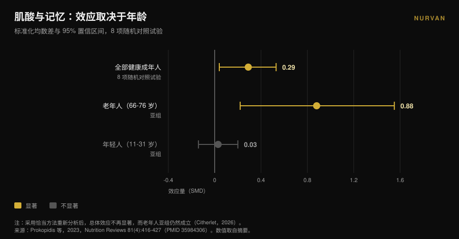
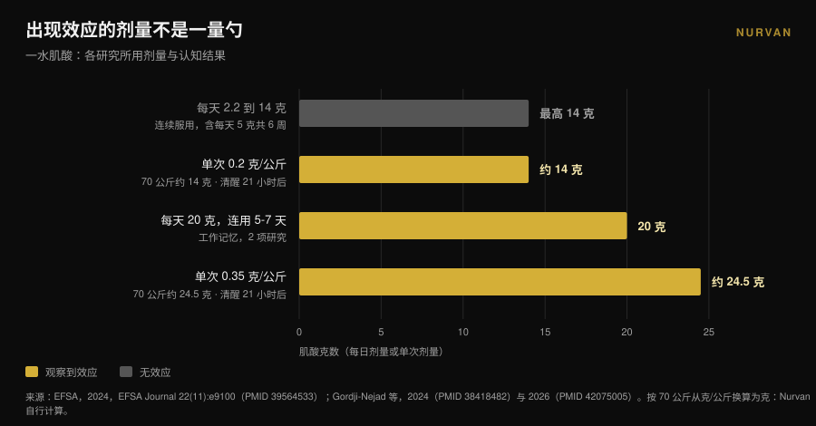

# 肌酸与大脑：研究到底怎么说

作者： [Giammaria Loi](/autore/giammaria-loi) · 更新于 2026 年 11 月 10 日

大约一年之内，肌酸不再只是健身房的事：英文搜索「creatine for brain」十二个月里增长了 118%，一勺粉被当成「大脑升级」在卖。同一时期，欧洲食品安全局否决了认知相关的健康宣称，最常被引用的那篇荟萃分析也被指出存在计数错误。下面看看哪些结论站得住、对谁成立、剂量是多少。

## 要点速览

- **EFSA 说不。** 2024 年欧洲专家组的结论是：补充肌酸与改善认知功能之间的因果关系**尚未确立**。
- **最常被引用的荟萃分析遭到质疑。** Xu 等人（2024）报告了对记忆的效应（SMD 0.31），但 2026 年的一篇评论指出同一批受试者被重复计数：观测数超过了随机化的人数。
- **重新算对之后，只剩年龄这一条。** 另一篇荟萃分析纠正同样的问题后，记忆效应除老年人外全部消失：66-76 岁为 **SMD 0.88**，年轻人只有 **0.03**。
- **出现信号的剂量不是一勺。** 信号来自每天 20 克、连用 5-7 天，或单次 0.2-0.35 克/公斤——70 公斤的人相当于 **14 到 24.5 克**——而且是在整夜没睡之后。
- **瓶颈是血脑屏障。** 肌酸进入肌肉很容易，进入大脑则难得多，实测的升幅一直不大。

## 为什么现在到处都是「肌酸补脑」

信号是可以量化的。英文搜索「creatine for brain」同比增长 118%，每月约 22,000 次（Glimpse 数据，截至 2025 年 4 月）。同一时期，肌酸从运动补剂货架挪到了脑健康、情绪和更年期的货架上。

学界注意到了。2025 年《Journal of Nutrition》刊登了一篇观点文章，副标题直译是「承诺、证据与公众认知」：作者描述了一场让销量、处方和社交媒体互动飙升的公众与商业热情，而对应的证据体系——用他的原话——却自相矛盾地仍然有限（Eckert，2025）。

这里不是要替肌酸辩护，也不是要唱衰它。在肌肉这一侧，它依然是证据最扎实的补剂之一，所以在我们的[力量补剂等级榜](/zh/blog/liliang-buji-dengji-bang)里它排在最前面。问题更窄：你读到的那些关于大脑的说法，有多少真的有数据支撑？

## 肌肉可以，大脑是另一回事

两者不能互推的原因是解剖学上的。肌肉通过专门的转运体摄取肌酸，储量会明显上升。大脑则被**血脑屏障**保护着——那是决定什么能从血液进入神经系统的过滤器——而这层过滤器放行的肌酸要少得多。

2025 年《Nutrition and Health》的一篇综述正是把这点放在中心：关键的不确定性在于口服肌酸是否能以足够的量到达大脑，从而改变神经元代谢。有些研究显示脑内肌酸有小幅上升，但方法学限制、个体差异和缺乏标准化方案，使人无法得出确定结论。作者的收尾毫不含糊：就目前而言，为认知目的在老年人中补充肌酸应被视为**一个假说，而不是已确立的临床实践**（Machado，2025）。

读下面的内容时请记住这一点。整场关于数字的争论，起点是一个「送达」问题：分子到不了，效应就不可能出现，哪怕纸面上的机制再漂亮。

## 人人引用的那篇荟萃分析，计数出了问题

搜索「肌酸 记忆」，几乎总会落到 Xu 等人 2024 年发表在《Frontiers in Nutrition》上的系统综述与荟萃分析：16 项随机对照试验，492 名 20.8 至 76.4 岁的受试者。结果看起来很干净——记忆 SMD 0.31（95% CI：0.18-0.44），注意时间 -0.31，信息处理速度 -0.51——而整体认知和执行功能没有效应。

2026 年 4 月，同一本期刊刊出了一篇拆解方法的评论。纳入的多项试验在同一批受试者身上报告了多个相互关联的认知指标——有的每人七个甚至更多记忆子测验——而这些指标被当作彼此独立的效应量处理。结果是，在合并分析中**观测数超过了实际被随机化的人数**（Citherlet，2026）。

这叫双重计数，属于分析单位错误。它会人为抬高精确度和统计功效：置信区间比数据允许的更窄，不确定的效应看起来像确定的。

这不是孤立的批评。EFSA 早在 2024 年就提出过同样的问题，指出在那篇荟萃分析中合并非独立的认知结果抬高了样本量，并据此认定无法从那些数据得出结论。

更有教益的是一篇更早的工作。Prokopidis 等人 2023 年关于健康人记忆的荟萃分析存在同样的缺陷。当作者用恰当的方法重做分析后，肌酸对记忆的总体效应**不再具有统计学显著性——老年人除外**。

这个细节解释了大部分混乱，而且在 2023 年公布的亚组里就能看到：66-76 岁的记忆效应为 SMD 0.88（95% CI：0.22-1.55）；11-31 岁为 0.03（95% CI：-0.14 至 0.20），也就是零。剂量（每天 2.2 到 20 克）、时长（5 天到 24 周）、性别和地域都不改变结果。

## EFSA 为什么否决了这项宣称

2024 年，一家企业向欧盟申请在包装上标注「肌酸改善认知功能」。EFSA 的 NDA 专家组审查了 23 项人体干预研究，给出的答复是否定的。

推理比结论更有用，因为那是一张剂量地图。对工作记忆的急性效应出现在**两项研究中，剂量为每天 20 克、连用 5-7 天**。在每天 2.2 到 14 克的区间没有出现。在五天负荷期之后以**每天 5 克连续服用六周**的方案中同样没有出现。

另一个关于反应抑制的效应，同样来自每天 20 克、连用 7 天，在十项健康人研究中只是孤立发现，对其他认知域没有影响。三项在患病人群中的研究并不支持该效应，专家组也认为机制的合理性偏弱。原话是：**因果关系尚未确立**（EFSA，2024）。

落到实际：几乎所有人都在用的那个剂量——5 克的量勺，对肌肉效果极好的那一勺——并不是任何人测到认知效应的剂量。

## 唯一让数字有说服力的场景：一夜未眠

有一种情形下数据确实更有意思，而它恰恰最不「高级」：睡眠剥夺。

2024 年，于利希研究中心的一个团队给被迫清醒 21 小时的受试者服用了**极高的单次剂量**一水肌酸——每公斤体重 0.35 克——同时用磁共振波谱追踪大脑的高能磷酸化合物。肌酸改变了这些参数，避免了 pH 下降，并且相比安慰剂提升了认知表现和处理速度（Gordji-Nejad 等，2024）。

2026 年同一团队用更低的剂量重复了实验，每公斤 0.2 克，受试者 29 人。长时间清醒带来的认知下降在逻辑与数字任务、语言处理速度和精神运动警觉测试中被减轻，改善**最高达 12%**。效应弱于高剂量，而女性在逻辑、警觉和速度上的获益大于男性（Gordji-Nejad 等，2026）。

在下单大桶之前先算一笔账。对 70 公斤的人来说，0.2 克/公斤是一次 **14 克**，0.35 克/公斤是 **24.5 克**：分别接近三勺和五勺 5 克。这些是实验室的急性方案，样本量小，出自同一个研究团队，衡量的是从一夜未眠中恢复——而不是让作息正常的人变聪明。

还有一种更诚实的读法：你看到的不是肌酸让人更清醒，而是肌酸部分补偿了人为造成的能量缺口。对上夜班的人是好消息，对想提高学习效率的人则算不上承诺。

## 研究到底怎么说

| 常见说法 | 结论 | 来源 |
|---|---|---|
| 「肌酸改善认知功能」 | **作为宣称被否决**：因果关系未确立 | EFSA，2024 |
| 「荟萃分析证明了对记忆的效应」 | **需要限定**：受试者重复计数，须重新分析 | Citherlet，2026；EFSA，2024 |
| 「任何年龄效果都一样」 | **被推翻**：66-76 岁 SMD 0.88，11-31 岁仅 0.03 | Prokopidis 等，2023 |
| 「每天 5 克对大脑也够了」 | **无支持**：每天 5 克用六周无效应；信号出现在每天 20 克 | EFSA，2024 |
| 「熬夜之后有帮助」 | **实验室中得到确认**：单次 0.2 克/公斤最高 +12% | Gordji-Nejad 等，2024 与 2026 |
| 「进大脑和进肌肉一样容易」 | **被推翻**：血脑屏障限制进入，升幅不大 | Machado，2025 |
| 「肌酸是益智药」 | **目前无法验证**：公众热情远超证据 | Eckert，2025 |

## 怎么落地

1. **如果你是为肌肉而吃，继续吃。** 本文没有任何内容质疑肌酸在运动上的用途：那一块证据扎实。站不住的是认知方面的宣称。
2. **不要为了「补脑」加量。** 出现效应的剂量——每天 20 克，或单次 14 到 24.5 克——来自有监测的研究方案，不是日常习惯。研究之外没有任何理由往上加，而高剂量常伴随胃肠不适。
3. **超过 65 岁，你属于唯一出现信号的亚组。** 那仍然只是信号，不是治疗。开始之前请与医生沟通，尤其是有肾脏问题或正在服药的情况。
4. **如果你睡得好，就别指望有效果。** 在年轻、休息充分的成年人身上，实测的记忆效应与零没有区别。真正能推动这个指标的是睡眠，而且更省钱。
5. **对标着「大脑专用肌酸」的产品保持怀疑。** 配方更贵就得拿出证据：问清楚效应是在什么剂量、持续多久、在什么人群里测到的。
6. **记录你真正吃下去的量。** 你以为吃了的和实际吃了的之间，隔着忘记的几周和不准的几勺。想知道一个补剂有没有起作用，数据必须写下来。如果你还在选剂型，我们比较过[软糖与粉剂](/zh/blog/jirousuan-ruanting-youxiao-ma)。

> ### 试试 Nurvan——真正能复盘的补剂记录
>
> Nurvan 的补剂模块会记录你所服用产品的剂型、剂量和时间，肌酸也包含在内，并把它和训练负荷、围度数据、训练课放在一起。你不必再凭感觉评价一个补剂，而是能一周一周看清楚服用期间到底发生了什么变化。 [试试 Nurvan](https://nurvan.app)

## 常见问题

**肌酸能改善记忆吗？**
还不足以这么说。报告有效应的荟萃分析把同一批受试者重复计数了，纠正之后效应只在老年人身上保留。EFSA 在 2024 年的结论是因果关系尚未确立。

**补脑需要多少肌酸？**
没有推荐剂量，因为没有确立的效应。在看到效应的研究里，剂量是每天 20 克连用 5-7 天，或单次 0.2-0.35 克/公斤：远高于 5 克的量勺，而且是在受控的研究环境中。这不是可以自行照搬的建议。

**睡得少的话肌酸有帮助吗？**
两项关于急性睡眠剥夺的随机对照试验显示认知表现部分恢复，单次 0.2 克/公斤最高达 12%。样本量小，出自同一个研究团队，而且针对的是一夜未眠：对作息正常的人没有任何结论。

**为什么对肌肉有用、对大脑没用？**
因为肌肉摄取它很容易，而大脑被血脑屏障保护，放行的量少得多。补充后实测的脑内肌酸升幅不大，而且个体差异很大。

## 延伸阅读

- [肌酸软糖有用吗？和肌酸粉比效果如何](/zh/blog/jirousuan-ruanting-youxiao-ma) — 同一个分子，更贵的剂型：到底差在哪里。
- [45岁后不健身也吃肌酸：研究到底说了什么](/zh/blog/jirousuan-bu-jianshen-45sui) — 另一个由年龄决定补剂反应的案例。
- [力量补剂等级榜：研究到底怎么说](/zh/blog/liliang-buji-dengji-bang) — 谈力量时肌酸排在哪里，旁边还有谁。

## 参考文献

1. EFSA Panel on Nutrition, Novel Foods and Food Allergens (Turck D, Bohn T, Cámara M, et al.), 2024. Creatine and improvement in cognitive function: Evaluation of a health claim pursuant to article 13(5) of regulation (EC) No 1924/2006. *EFSA Journal* 22(11):e9100. PMID 39564533. [DOI 10.2903/j.efsa.2024.9100](https://doi.org/10.2903/j.efsa.2024.9100)
2. Eckert I, 2025. Creatine Supplementation for Cognition: A Critical Perspective on Promise, Proof, and Public Perception. *The Journal of Nutrition* 155(10):3143-3147. PMID 40744234. [DOI 10.1016/j.tjnut.2025.07.016](https://doi.org/10.1016/j.tjnut.2025.07.016)
3. Citherlet T, 2026. Commentary: The effects of creatine supplementation on cognitive function in adults: a systematic review and meta-analysis. *Frontiers in Nutrition* 13:1716285. PMID 42039906. [DOI 10.3389/fnut.2026.1716285](https://doi.org/10.3389/fnut.2026.1716285)
4. Xu C, Bi S, Zhang W, Luo L, 2024. The effects of creatine supplementation on cognitive function in adults: a systematic review and meta-analysis. *Frontiers in Nutrition* 11:1424972. PMID 39070254. [DOI 10.3389/fnut.2024.1424972](https://doi.org/10.3389/fnut.2024.1424972)
5. Prokopidis K, Giannos P, Triantafyllidis KK, Kechagias KS, Forbes SC, Candow DG, 2023. Effects of creatine supplementation on memory in healthy individuals: a systematic review and meta-analysis of randomized controlled trials. *Nutrition Reviews* 81(4):416-427. PMID 35984306. [DOI 10.1093/nutrit/nuac064](https://doi.org/10.1093/nutrit/nuac064)
6. Gordji-Nejad A, Matusch A, Kleedörfer S, Jayeshkumar Patel H, Drzezga A, Elmenhorst D, Binkofski F, Bauer A, 2024. Single dose creatine improves cognitive performance and induces changes in cerebral high energy phosphates during sleep deprivation. *Scientific Reports* 14(1):4937. PMID 38418482. [DOI 10.1038/s41598-024-54249-9](https://doi.org/10.1038/s41598-024-54249-9)
7. Gordji-Nejad A, Matusch A, Hengstler L, Beer S, Kroll T, Klein S, Elmenhorst D, Bauer A, Drzezga A, 2026. Single-Dose Creatine Reduces Sleep Deprivation-Induced Deterioration in Cognitive Performance. *Nutrients* 18(8):1192. PMID 42075005. [DOI 10.3390/nu18081192](https://doi.org/10.3390/nu18081192)
8. Machado M, 2025. Creatine supplementation and cognitive aging: The challenge of crossing the blood-brain barrier. *Nutrition and Health* 32(3):761-763. PMID 41359040. [DOI 10.1177/02601060251404327](https://doi.org/10.1177/02601060251404327)

文献来源通过 PubMed 检索获得。选题来自一个趋势信号：英文搜索「creatine for brain」同比增长 118%、每月约 22,000 次（Glimpse，2025 年 4 月数据），以及 2025 年发表于《Journal of Nutrition》的那篇关于营销与证据落差的批评性观点文章。

---

*Giammaria Loi 是 Nurvan 的创始人。他自 2012 年开始力量训练，自 2013 年起担任 FIPE 认证私人教练，并自 2018 年起在全国级力量举比赛中参赛。他署名的每篇文章都从科研文献出发，最终落到健身房里真正有效的做法。*

> 注意：本文为科普内容，不能替代医生或专业人士的意见。
