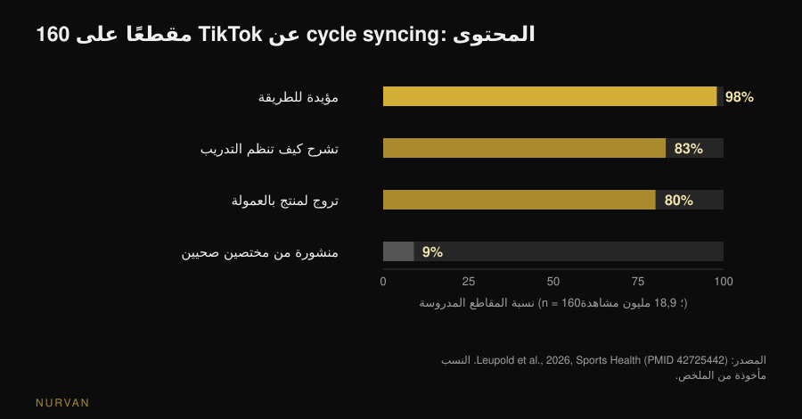
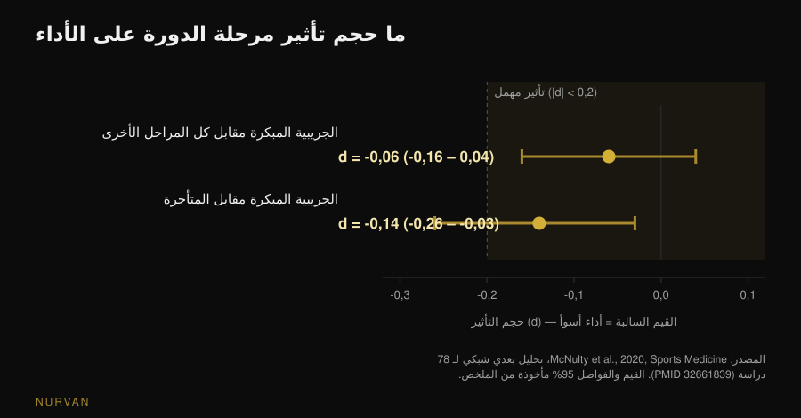

# التدريب حسب الدورة الشهرية: هل ينفع فعلاً؟

بقلم [Giammaria Loi](/autore/giammaria-loi) · حُدِّث في 11 نوفمبر 2026

أصبح *cycle syncing* في كل مكان: قوة في المرحلة الجريبية، يوغا ومشي في المرحلة الأصفرية، راحة أثناء الحيض. تبدو الفكرة بديهية — الهرمونات تتغير، إذن يجب أن يتغير التدريب. المشكلة أن هذه الفكرة حين تُقاس في المختبر، يبقى منها أقل بكثير مما يوحي به التقويم. إليك ما تقوله البيانات، وما يُفعل بدلاً من إعادة كتابة البرنامج أربع مرات في الشهر.

## باختصار

- **الأثر المقاس على الأداء مهمل.** تحليل بعدي شبكي لـ 78 دراسة يجد انخفاضاً مقداره **0,06** (على مقياس حجم الأثر) في المرحلة الجريبية المبكرة مقارنة بكل المراحل الأخرى: موجود نظرياً، بلا معنى عملياً.
- **العضلة ليست «أكثر بناءً» في مرحلة بعينها.** بقياس تخليق البروتين العضلي بالنظائر المستقرة وخزعات العضلات، تعطي المرحلتان الجريبية والأصفرية النتيجة نفسها: المهم هو التدريب، لا يوم الدورة.
- **المرحلة لا تحدد البرنامج، الأعراض تحدد الحصة.** بعد تدريب يُحدث تلفاً عضلياً، يكون الألم المتأخر وفقدان القوة أكبر في المرحلة الجريبية المبكرة: تُعدَّل الأحمال، لا الخطة.
- **القياسات تتحرك من تلقاء نفسها.** تغيّرات مساحة المقطع العضلي المسجَّلة عبر دورتين لا تُعزى إلى التدريب وحده: الوزن أو القياس في أيام مختلفة من الدورة غير قابل للمقارنة.
- **أغلب ما تجدينه على الإنترنت تسويق.** من 160 مقطعاً على TikTok، كان 98% مؤيداً للطريقة، و9% فقط من مختصين صحيين، و**80% يروّج لمنتج**. متوسط الجودة التعليمية: 0,8 من 5.

## من أين جاء cycle syncing

ليس من دراسة، بل من الإنترنت. في سبتمبر 2026 نشرت مجلة *Sports Health* أول تحليل منهجي لهذا المحتوى: 160 مقطعاً على TikTok حول الموضوع، بمجموع **18,9 مليون مشاهدة**. عبّر 98% عن موقف إيجابي تجاه الطريقة، وتناول 83% كيفية تنظيم التدريب في كل مرحلة، و9% فقط نُشرت من مختصين صحيين. وبتقييم خبيرتين في الطب الرياضي النسائي بمقياسين معياريين، بلغ متوسط الجودة التعليمية 0,8 من 5 (DISCERN المعدّل) و1,8 من 5 (Global Quality Score). و80% من المقاطع كانت تروّج لمنتج بالعمولة، وثلاثة أرباع تلك المنتجات مرتبطة بالطريقة نفسها (Leupold et al., 2026).

هذا لا يثبت أن الطريقة خاطئة. يثبت أن شعبيتها لم تنشأ من البيانات، وأن من يحدّثك عنها غالباً لديه ما يبيعه. يستحق الأمر أن تنظري إلى الأرقام بنفسك.

## ما الذي يتغير فعلاً في الهرمونات

مرجعان لفهم بقية المقال. تمتد **المرحلة الجريبية** من اليوم الأول للحيض حتى الإباضة: يرتفع الإستروجين ويبلغ ذروته قبيل الإباضة. وتمتد **المرحلة الأصفرية** من الإباضة إلى الحيض التالي: يرتفع البروجسترون ويبقى الإستروجين عند مستوى متوسط. أما *المرحلة الجريبية المبكرة* فهي أيام النزف، حين يكون الهرمونان منخفضين.

فرضية cycle syncing مباشرة: إستروجين مرتفع يدعم بناء العضلات، إذن المرحلة الجريبية هي وقت الدفع؛ وبروجسترون مرتفع يُعدّ هدّاماً، إذن في الأصفرية يُخفَّف. فرضية مشروعة، وهناك أدبيات تسندها على الورق: مراجعة في *Sports Medicine* عام 2022 ترى أن تدريب القوة المركّز في المرحلة الجريبية قد يتفوق على المركّز في الأصفرية من حيث القوة والكتلة (Kissow et al., 2022). لكنها مراجعة سردية لا دليل: تجمع دراسات صغيرة وتفسّرها. وحين تُختبر الفرضية نفسها مباشرة، تختلف النتيجة.

## هل يتغير الأداء مع المرحلة؟ أرقام 78 دراسة

هذا هو السؤال الأغزر مادة. في 2020 جمع فريق بين Northumbria وNottingham Trent وساو باولو 78 دراسة تجريبية قاست الأداء في مرحلتين محددتين على الأقل من الدورة، وحللها بطرائق بايزية وتحليل بعدي شبكي.

النتيجة: في المرحلة الجريبية المبكرة ينخفض الأداء — في القوة والتحمل — بأثر قدره **-0,06** (فاصل مصداقية 95%: من -0,16 إلى 0,04). على مقياس حجم الأثر، 0,2 هو العتبة المتعارف عليها التي يُسمّى الأثر تحتها *مهملاً*: و0,06 ثلث تلك العتبة، والفاصل يعبر الصفر. أما أسوأ مقارنة في الشبكة كلها، الجريبية المبكرة مقابل الجريبية المتأخرة، فتبلغ **-0,14** (من -0,26 إلى -0,03): ولا تزال تحت العتبة.

ويضيف المؤلفون تنبيهين لا يقلان أهمية عن الرقم. الأول: التباين **بين** الدراسات كبير، وجودة الأدلة الإجمالية صُنّفت *منخفضة* (42%). والثاني هو خلاصتهم الحرفية: لا يمكن وضع إرشادات عامة للأداء عبر الدورة، ويُفضَّل **نهج مخصص قائم على الاستجابة الفردية** (McNulty et al., 2020).

احتفظي بهذا، لأنه عكس الطريقة التي تُستخدم بها الدراسة على مواقع التواصل: ليس «المرحلة س هي مرحلة القوة»، بل «المتوسط لا يقول شيئاً مفيداً عنك».

## هل العضلة «أكثر بناءً» في المرحلة الجريبية؟

هنا الإجابة الحديثة هي الأوضح. في 2025 نشرت *Journal of Physiology* دراسة من فريق Stuart Phillips في جامعة McMaster صُمّمت للإجابة تحديداً: 12 امرأة، فترتان من ستة أيام تدريب مقاومة مضبوط — واحدة في المرحلة الجريبية المتأخرة (ذروة الإستروجين) وأخرى في منتصف الأصفرية (ذروة البروجسترون) — بترتيب عشوائي، بتدريب ساق واحدة واستخدام الأخرى كضابط. تم التحقق من المرحلة بتتبع الدورة وتحاليل الدم واختبارات البول؛ وقيس التخليق بالنظائر المستقرة، والهدم على مستوى الجسم كله، إضافة إلى الأيضوميات وخزعات العضلات.

النتيجة: رفع التمرين تخليق البروتين العضلي بدلالة إحصائية (p < 0,001)، **أما مرحلة الدورة فلا**. لا أثر على التخليق، ولا على الهدم (p = 0,24)، ولا فروق تُذكر في الأيضات الدائرة بين المرحلتين. وعبارة المؤلفين: العضلة الهيكلية ليست أكثر استجابة بنائية في مرحلة بعينها من الدورة (Colenso-Semple et al., 2025).

وقبل ذلك بعامين راجع الفريق نفسه، مع Kirsty Elliott-Sale، المراجعات المتاحة حول القوة والأداء والتضخم: نتائج شديدة التباين من مراجعة لأخرى، وقبل ذلك مشكلة منهجية متكررة — قليل من الأبحاث يتحقق فعلاً من مرحلة المشاركات بتحاليل هرمونية لا بالتقويم وحده. وخلاصتهم: من **السابق لأوانه** الاستنتاج بأن التقلبات الهرمونية قصيرة المدى تؤثر تأثيراً ملموساً في الأداء الحاد أو في التكيفات طويلة المدى (Colenso-Semple et al., 2023).

وهو السبب نفسه الذي يجعل الاستجابات الفردية للتدريب صعبة التنبؤ عموماً: التباين بين الأشخاص أكبر بكثير من التباين بين المراحل.

## ما الذي يتغير فعلاً: الأعراض والتعافي والقياسات

القول إن المرحلة لا تغيّر التكيفات لا يعني أن كل الأيام سواء. شيئان يتغيران بصورة قابلة للقياس.

**التلف العضلي المحسوس.** تحليل بعدي لـ 19 دراسة نُشر في *Journal of Strength and Conditioning Research* قارن الاستجابة لتدريب شديد عبر المراحل: اختلف الألم العضلي المتأخر وفقدان القوة بعد التمرين بين المراحل، وكانت أسوأ القيم في **المرحلة الجريبية المبكرة**، بينما لم يُظهر إنزيم الكرياتين كيناز — مؤشر التلف في الدم — فروقاً. ويقترح المؤلفون في تلك الأيام أحمالاً أقل قليلاً أو فترات تعافٍ أطول (Romero-Parra et al., 2021). لاحظي الفرق: تعديل التعافي حسب حالتك، لا تحريك هدف دورة التدريب.

**الأرقام التي تقيّمين بها نفسك.** دراسة من 2024 في *Applied Physiology, Nutrition, and Metabolism* تابعت 20 امرأة على مدى دورتين كاملتين، بتدريب ساق وترك الأخرى للراحة، مع قياس مساحة المقطع العضلي في ست لحظات. نمت الساق المدرَّبة؛ لكن 19 مشاركة من 20 أظهرن تغيّرات في المساحة فوق عتبة خطأ القياس أو تحتها خارج التدريب أيضاً، حتى خلص المؤلفون إلى أن التغيّرات الملاحظة عبر الدورتين **لا تُعزى حصراً إلى التدريب** (Dias et al., 2024). بعبارة أخرى: احتباس السوائل والتذبذبات الفسيولوجية تشوّش القياس. ومقارنة المحيطات أو الوزن أو المرآة في يومين مختلفين من الدورة هي مقارنة بين أشياء غير متكافئة.

## وماذا لو كنت تتناولين حبوب منع الحمل؟

سؤال شائع، وإجابته أمتن مما يُظن. تحليل بعدي لـ 42 دراسة و590 مشاركة قارن مستخدمات موانع الحمل الفموية بذوات الدورة الطبيعية، وقارن أيام التناول بأيام التوقف. قد يصاحب استخدام موانع الحمل الفموية أداء **أقل قليلاً** في المتوسط، لكن أي أثر على مستوى المجموعة مهمل على الأرجح، ويبقى الأداء ثابتاً عبر دورة الحبوب. وهنا أيضاً توصية المؤلفين الختامية فردية لا عامة (Elliott-Sale et al., 2020).

## ماذا تقول الأبحاث فعلاً

| ادعاء شائع | الحكم | المصدر |
|---|---|---|
| «أنتِ أقوى في المرحلة الجريبية» | **بحاجة إلى تدقيق**: فارق مقاس -0,06، تحت عتبة الأثر المهمل | McNulty et al., 2020 |
| «تبنين عضلات أكثر في المرحلة الجريبية» | **مُفنَّد**: تخليق البروتين وهدمه متطابقان بين المرحلتين | Colenso-Semple et al., 2025 |
| «تدريب القوة في المرحلة الصحيحة يعطي نتائج أكبر» | **غير مدعوم**: الفرضية موجودة في مراجعة سردية لا في أدلة مباشرة | Kissow et al., 2022؛ Colenso-Semple et al., 2023 |
| «الأفضل عدم التدريب أثناء الحيض» | **مُفنَّد**: لا سبب فسيولوجي؛ يمكن تعديل الحمل فقط | Colenso-Semple et al., 2023؛ McNulty et al., 2020 |
| «الألم العضلي أشد في أيام معينة» | **مؤكَّد**: الألم وفقدان القوة أكبر في الجريبية المبكرة | Romero-Parra et al., 2021 |
| «القياسات تتغير بسبب الدورة لا بسبب التقدم» | **مؤكَّد**: تغيّرات المساحة لا تُعزى إلى التدريب وحده | Dias et al., 2024 |
| «النتائج أسوأ مع حبوب منع الحمل» | **بحاجة إلى تدقيق**: فارق متوسط صغير وعلى الأرجح مهمل | Elliott-Sale et al., 2020 |
| «cycle syncing مدعوم علمياً» | **مُفنَّد كمحتوى**: متوسط الجودة التعليمية 0,8 من 5 | Leupold et al., 2026 |

## كيف تطبّقين ذلك

1. **احتفظي بالبرنامج، لا بتقويم الهرمونات.** التدرّج والتكرار الأسبوعي والحجم تبقى كما هي: لا بيانات تبرر أربعة برامج مختلفة في الشهر. ولمرجع عن بناء كتلة تدريبية شرحنا [كم تكراراً تحتاجين فعلاً للكتلة العضلية](/ar/blog/kam-takrar-lilkutla-aladalia).
2. **عدّلي الحصة الواحدة ذاتياً، لا دورة التدريب كلها.** في الأيام التي تشعرين فيها بحال أسوأ، احتفظي بالتمرين نفسه والمخطط نفسه، لكن أنقصي بعض الحمل أو توقفي عند RIR أبكر (الـ RIR هو عدد التكرارات المتبقية لديك في نهاية المجموعة). هذا هو الفرق بين التكيّف والتخلي.
3. **سجّلي الأعراض على مدى دورتين أو ثلاث قبل أي استنتاج.** شهر واحد لا يفصل الدورة عن النوم أو التوتر أو أسبوع حمل مرتفع. بعد دورتين أو ثلاث، إن وُجد نمط حقيقي فسيظهر في أرقامك.
4. **قيسي دائماً عند النقطة نفسها من الدورة.** الوزن والمحيطات تُقارن بفارق دورة كاملة لا أسبوع. مقارنة اليوم 5 باليوم 23 لا تقيس التدريب.
5. **إن كنت تتدربين مع مدرب، أعطيه بيانات لا إحساس الأمس.** الحمل المستخدم وRIR والنوم وملاحظة عن الأعراض تساوي أكثر من «هذا الأسبوع كان سيئاً». وعمّا يجب أن يراقبه المدرب عن بُعد ليعادل مدرب الصالة كتبنا مقالاً مستقلاً: [هل ينجح التدريب عن بُعد؟](/ar/blog/hal-yanjah-altadrib-an-bud)
6. **ألم يوقفك، أو دورات شديدة اللاانتظام أو غائبة: طبيب لا برنامج.** عسر الطمث الشديد أو النزف الغزير أو انقطاع الطمث ليست متغيرات تدريبية تُعدَّل ذاتياً: تُناقَش مع طبيب أو طبيب نساء. وانقطاع الطمث لدى من تتدربن كثيراً ينبغي تقييمه تحديداً كمسألة توافر طاقة.

> ### جرّب Nurvan — الدورة تُدار بأرقامك أنت، لا بتقويم جاهز
>
> في Nurvan تسجّلين الحمل وRIR مجموعة بمجموعة، وتضيفين ملاحظة إلى الحصة حين تشعرين بتراجع، وتحتفظين بالقياسات في السجل: بعد دورتين أو ثلاث ترين إن كان هناك نمط في أرقامك بدل الاعتماد على قاعدة عامة. وإن كنت تعملين مع مدرب، فهو يرى الجدول الزمني نفسه ويستطيع تعديل الأسبوع معك. [جرّب Nurvan](https://nurvan.app)

## أسئلة شائعة

**هل يجب أن أتدرب حسب الدورة الشهرية؟**
لا توجد بيانات تدعم ذلك. متوسط فارق الأداء بين المراحل المقاس في 78 دراسة هو -0,06، أي تحت العتبة المتعارف عليها للأثر المهمل، وتخليق البروتين العضلي بعد التدريب لا يتغير بين المرحلتين الجريبية والأصفرية. الأفضل الاحتفاظ بالبرنامج وتعديل الحصة الواحدة حسب حالتك.

**هل يمكن رفع الأثقال أثناء الحيض؟**
نعم. لا يوجد سبب فسيولوجي للتوقف، والتكيفات التدريبية لا تسوء. في تلك الأيام يكون الألم العضلي وفقدان القوة بعد الحصص الشاقة أكبر في المتوسط، لذا قد يكون من المنطقي خفض الحمل قليلاً أو إطالة فترات الراحة، دون تغيير التمارين أو الأهداف.

**في أي مرحلة من الدورة تُبنى عضلات أكثر؟**
في لا شيء منها، بحدود ما يمكن قياسه اليوم. أدق دراسة في الموضوع قاست تخليق البروتين العضلي وهدمه في المرحلتين المتقابلتين بالنظائر المستقرة والخزعات: التدريب هو ما صنع الفارق، لا المرحلة.

**لماذا يرتفع الوزن دائماً قبل الدورة؟**
لأن كمية السوائل تتغير، لا الكتلة العضلية ولا الدهون. الدراسة الممتدة على دورتين كاملتين تُظهر تغيّرات في مساحة المقطع العضلي مستقلة عن التدريب، وبالتالي يتحرك الوزن والمحيطات وحدهما أيضاً: المقارنة الوحيدة المعقولة هي بين النقطة نفسها من دورتين مختلفتين.

## اقرأ أيضاً

- [رفع الأثقال أثناء الحمل: ماذا تقول الدراسات فعلاً](/ar/blog/rafe-alathqal-athna-alhaml-madha-taqul-aldirasat) — الموضوع النسائي الآخر الذي تفوق فيه النصائح المتداولة تشدّداً ما تقوله البيانات.
- [كم تكراراً للكتلة العضلية: أسطورة 8-12](/ar/blog/kam-takrar-lilkutla-aladalia) — كيف تُبنى كتلة تدريبية لا تحتاج إعادة كتابة كل أسبوع.
- [هل ينجح التدريب عن بُعد؟ ماذا تقول الدراسات](/ar/blog/hal-yanjah-altadrib-an-bud) — ما الذي يجب أن يراقبه فعلاً من يتابعك عن بُعد.

## المصادر

1. McNulty KL, Elliott-Sale KJ, Dolan E, Swinton PA, Ansdell P, Goodall S, Thomas K, Hicks KM, 2020. The Effects of Menstrual Cycle Phase on Exercise Performance in Eumenorrheic Women: A Systematic Review and Meta-Analysis. *Sports Medicine* 50(10):1813-1827. PMID 32661839. [DOI 10.1007/s40279-020-01319-3](https://doi.org/10.1007/s40279-020-01319-3)
2. Colenso-Semple LM, McKendry J, Lim C, Atherton PJ, Wilkinson DJ, Smith K, Phillips SM, 2025. Menstrual cycle phase does not influence muscle protein synthesis or whole-body myofibrillar proteolysis in response to resistance exercise. *The Journal of Physiology* 603(5):1109-1121. PMID 39630025. [DOI 10.1113/JP287342](https://doi.org/10.1113/JP287342)
3. Colenso-Semple LM, D'Souza AC, Elliott-Sale KJ, Phillips SM, 2023. Current evidence shows no influence of women's menstrual cycle phase on acute strength performance or adaptations to resistance exercise training. *Frontiers in Sports and Active Living* 5:1054542. PMID 37033884. [DOI 10.3389/fspor.2023.1054542](https://doi.org/10.3389/fspor.2023.1054542)
4. Kissow J, Jacobsen KJ, Gunnarsson TP, Jessen S, Hostrup M, 2022. Effects of Follicular and Luteal Phase-Based Menstrual Cycle Resistance Training on Muscle Strength and Mass. *Sports Medicine* 52(12):2813-2819. PMID 35471634. [DOI 10.1007/s40279-022-01679-y](https://doi.org/10.1007/s40279-022-01679-y)
5. Romero-Parra N, Cupeiro R, Alfaro-Magallanes VM, Rael B, Rubio-Arias JÁ, Peinado AB, Benito PJ, 2021. Exercise-Induced Muscle Damage During the Menstrual Cycle: A Systematic Review and Meta-Analysis. *Journal of Strength and Conditioning Research* 35(2):549-561. PMID 33201156. [DOI 10.1519/JSC.0000000000003878](https://doi.org/10.1519/JSC.0000000000003878)
6. Dias NF, Bergamasco JGA, Scarpelli MC, Silva DG, Chaves TS, Bittencourt D, Medalha RA, Carello Filho PC, De Souza EO, Ugrinowitsch C, Libardi CA, 2024. Changes in muscle cross-sectional area during two menstrual cycles may not be exclusively attributed to resistance training. *Applied Physiology, Nutrition, and Metabolism* 49(12):1729-1739. PMID 39303293. [DOI 10.1139/apnm-2024-0004](https://doi.org/10.1139/apnm-2024-0004)
7. Elliott-Sale KJ, McNulty KL, Ansdell P, Goodall S, Hicks KM, Thomas K, Swinton PA, Dolan E, 2020. The Effects of Oral Contraceptives on Exercise Performance in Women: A Systematic Review and Meta-analysis. *Sports Medicine* 50(10):1785-1812. PMID 32666247. [DOI 10.1007/s40279-020-01317-5](https://doi.org/10.1007/s40279-020-01317-5)
8. Leupold O, Anderson OK, Giampaolo G, Cheng J, Casey EK, 2026. The Social Media Trend of Cycle Syncing: An Analysis of the Content and Quality of Videos on TikTok. *Sports Health*. PMID 42725442. [DOI 10.1177/19417381261479699](https://doi.org/10.1177/19417381261479699)

المصادر الببليوغرافية جُمعت عبر PubMed. اختير الموضوع من إشارة اتجاه: cycle syncing من أكثر مواضيع اللياقة النسائية انتشاراً على مواقع التواصل — 18,9 مليون مشاهدة في 160 مقطعاً فقط حللتها دراسة *Sports Health* في 11 سبتمبر 2026 — بينما تقدّم أوائل نتائج البحث الطريقة على أنها صالحة دون ذكر أحجام الأثر المقاسة.

---

*جياماريا لوي هو مؤسس Nurvan. يتدرب بالأثقال منذ 2012، ويعمل مدرباً شخصياً ومدرّباً معتمداً من FIPE منذ 2013، وينافس في رفع الأثقال القوة على المستوى الوطني منذ 2018. كل مقال يوقّعه ينطلق من الدراسات العلمية وينتهي إلى ما ينفع فعلاً في النادي.*

> ملاحظة: محتوى تثقيفي، لا يغني عن رأي الطبيب أو المختص.
