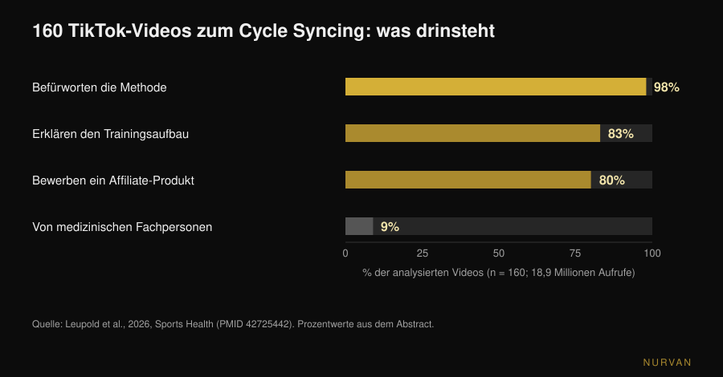
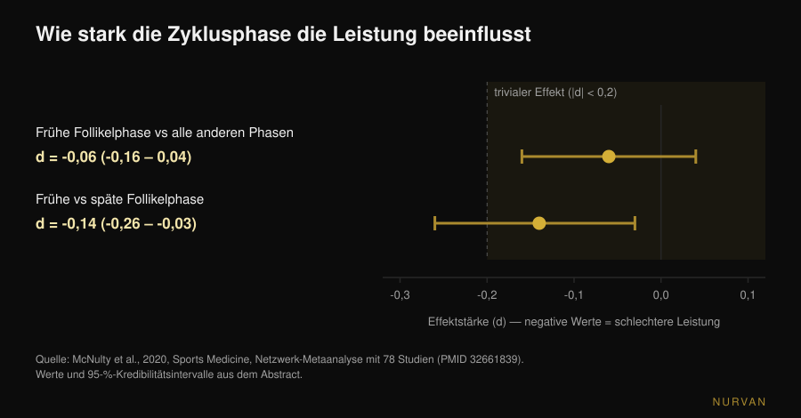

# Training nach dem Menstruationszyklus: bringt das was?

Von [Giammaria Loi](/autore/giammaria-loi) · aktualisiert am 11. November 2026

*Cycle Syncing* ist überall: schwer heben in der Follikelphase, Yoga und Spaziergänge in der Lutealphase, Pause während der Periode. So gesagt klingt es einleuchtend — die Hormone ändern sich, also sollte sich das Training ändern. Das Problem: Wenn diese Idee im Labor gemessen wird, bleibt viel weniger übrig, als der Kalender nahelegt. Hier stehen die Daten — und was du tun kannst, statt dein Programm viermal im Monat umzuschreiben.

## Kurz gefasst

- **Der gemessene Effekt auf die Leistung ist trivial.** Eine Netzwerk-Metaanalyse mit 78 Studien findet in der frühen Follikelphase eine Minderung von **0,06** (Effektstärken-Skala) gegenüber allen anderen Phasen: formal vorhanden, praktisch bedeutungslos.
- **Der Muskel ist in keiner Phase "anaboler".** Mit stabilen Isotopen und Muskelbiopsien gemessen, liefern Follikel- und Lutealphase dieselbe Muskelproteinsynthese: es zählt das Training, nicht der Zyklustag.
- **Die Phase bestimmt nicht das Programm, die Symptome bestimmen die Einheit.** Nach belastendem Training sind Muskelkater und Kraftverlust in der frühen Follikelphase größer: man steuert die Last, nicht den Plan.
- **Deine Messwerte schwanken von allein.** Veränderungen des Muskelquerschnitts über zwei Zyklen lassen sich nicht allein dem Training zuschreiben: Wiegen oder Messen an verschiedenen Zyklustagen ist nicht vergleichbar.
- **Was online steht, ist überwiegend Marketing.** Von 160 TikTok-Videos waren 98 % positiv zum Cycle Syncing, nur 9 % kamen von medizinischen Fachpersonen und **80 % bewarben ein Produkt**. Mittlere Bildungsqualität: 0,8 von 5.

## Woher Cycle Syncing kommt

Nicht aus einer Studie, sondern aus dem Internet. Im September 2026 veröffentlichte die Fachzeitschrift *Sports Health* die erste systematische Auswertung dieser Inhalte: 160 TikTok-Videos zum Thema, insgesamt **18,9 Millionen Aufrufe**. 98 % äußerten sich positiv zur Methode, 83 % behandelten den Trainingsaufbau in den einzelnen Phasen, und nur 9 % stammten von medizinischen Fachpersonen. Von zwei Expertinnen für Frauensportmedizin mit zwei Standardskalen bewertet, lag die mittlere Bildungsqualität bei 0,8 von 5 (modifizierter DISCERN) und 1,8 von 5 (Global Quality Score). 80 % der Videos bewarben ein Produkt über Affiliate-Marketing, drei Viertel davon mit Bezug zum Cycle Syncing (Leupold et al., 2026).

Das beweist nicht, dass die Methode falsch ist. Es beweist, dass ihre Beliebtheit nicht aus den Daten entstanden ist und dass, wer sie dir erklärt, oft etwas zu verkaufen hat. Ein Blick auf die Zahlen lohnt sich.

## Was sich hormonell wirklich ändert

Zwei Bezugspunkte für den Rest. Die **Follikelphase** reicht vom ersten Tag der Periode bis zum Eisprung: Östrogen steigt und erreicht kurz vor dem Eisprung seinen Höhepunkt. Die **Lutealphase** reicht vom Eisprung bis zur nächsten Periode: Progesteron steigt, Östrogen bleibt auf mittlerem Niveau. Die *frühe Follikelphase* sind die Blutungstage, an denen beide Hormone niedrig sind.

Die Cycle-Syncing-Hypothese ist geradlinig: hohes Östrogen begünstigt den Muskelaufbau, also wäre die Follikelphase die Zeit zum Pushen; hohes Progesteron wirke katabol, also in der Lutealphase zurückfahren. Das ist eine legitime Hypothese, und es gibt Literatur, die sie auf dem Papier stützt: eine Übersichtsarbeit in *Sports Medicine* von 2022 argumentiert, Krafttraining mit Schwerpunkt in der Follikelphase könne für Kraft und Masse besser sein als Training mit Schwerpunkt in der Lutealphase (Kissow et al., 2022). Es handelt sich aber um ein narratives Review, nicht um einen Nachweis: es sammelt kleine Studien und interpretiert sie. Wird dieselbe Hypothese direkt geprüft, sieht es anders aus.

## Ändert sich die Leistung mit der Phase? Die Zahlen aus 78 Studien

Das ist die Frage mit der größten Datenbasis. 2020 fasste eine Gruppe zwischen Northumbria, Nottingham Trent und São Paulo 78 experimentelle Studien zusammen, die Leistung in mindestens zwei definierten Zyklusphasen gemessen hatten — ausgewertet mit bayesianischen Methoden und einer Netzwerk-Metaanalyse.

Das Ergebnis: In der frühen Follikelphase ist die Leistung — Kraft wie Ausdauer — um einen Effekt von **-0,06** reduziert (95-%-Kredibilitätsintervall: -0,16 bis 0,04). Auf der Effektstärken-Skala gilt 0,2 als konventionelle Schwelle, unterhalb derer ein Effekt *trivial* heißt: 0,06 ist ein Drittel davon, und das Intervall schließt die Null ein. Der ungünstigste Vergleich im gesamten Netzwerk, frühe gegen späte Follikelphase, erreicht **-0,14** (-0,26 bis -0,03) — immer noch unter der Schwelle.

Die Autorinnen und Autoren ergänzen zwei Hinweise, die so viel wiegen wie die Zahl. Erstens: Die Streuung **zwischen** den Studien ist groß, und die Gesamtqualität der Evidenz wurde als *niedrig* eingestuft (42 %). Zweitens ihre wörtliche Schlussfolgerung: Allgemeine Leitlinien zur Leistung über den Zyklus lassen sich nicht aufstellen; vorzuziehen sei **ein personalisierter Ansatz auf Basis der individuellen Reaktion** (McNulty et al., 2020).

Das ist das Gegenteil davon, wie die Studie in den sozialen Medien benutzt wird: nicht "Phase X ist die starke Phase", sondern "der Mittelwert sagt nichts Brauchbares über dich".

## Ist der Muskel in der Follikelphase "anaboler"?

Hier ist die neuere Antwort am klarsten. 2025 veröffentlichte das *Journal of Physiology* eine Studie der Gruppe von Stuart Phillips an der McMaster University, genau dafür gebaut: 12 Frauen, zwei sechstägige Blöcke kontrollierten Krafttrainings — einer in der späten Follikelphase (Östrogengipfel), einer in der mittleren Lutealphase (Progesterongipfel) — in zufälliger Reihenfolge, jeweils ein Bein trainiert, das andere als Kontrolle. Phase geprüft mit Zyklus-Tracking, Blutproben und Urintests; Synthese mit stabilen Isotopen gemessen, Abbau auf Ganzkörperebene, dazu Metabolomik und Muskelbiopsien.

Ergebnis: Das Training steigerte die Muskelproteinsynthese signifikant (p < 0,001), **die Zyklusphase nicht**. Kein Effekt auf die Synthese, keiner auf den Abbau (p = 0,24), keine nennenswerten Unterschiede der zirkulierenden Metaboliten zwischen den Phasen. Der Satz der Autoren: Die Skelettmuskulatur reagiert in keiner bestimmten Zyklusphase anaboler (Colenso-Semple et al., 2025).

Zwei Jahre zuvor hatte dieselbe Gruppe mit Kirsty Elliott-Sale die vorhandenen Reviews zu Kraft, Leistung und Hypertrophie gesichtet: stark schwankende Befunde von Review zu Review und vor allem ein wiederkehrendes Methodenproblem — nur wenige Arbeiten prüfen wirklich, in welcher Phase die Teilnehmerinnen sind, mit Hormonbestimmung statt nur mit dem Kalender. Ihr Fazit: Es sei **verfrüht**, zu schließen, dass kurzfristige Hormonschwankungen die akute Leistung oder langfristige Anpassungen merklich beeinflussen (Colenso-Semple et al., 2023).

Aus demselben Grund sind individuelle Trainingsreaktionen generell schwer vorherzusagen: Die Variabilität zwischen Personen ist viel größer als die zwischen Phasen.

## Was sich wirklich ändert: Symptome, Erholung und Messwerte

Zu sagen, die Phase ändere die Anpassungen nicht, heißt nicht, dass sich alle Tage gleich anfühlen. Zwei Dinge ändern sich messbar.

**Der wahrgenommene Muskelschaden.** Eine Metaanalyse von 19 Studien im *Journal of Strength and Conditioning Research* verglich die Reaktion auf hartes Training über die Phasen: verzögerter Muskelkater und Kraftverlust nach der Belastung unterschieden sich zwischen den Phasen, mit den schlechtesten Werten in der **frühen Follikelphase**, während die Kreatinkinase — ein Blutmarker für Schädigung — keine Unterschiede zeigte. Die Autorinnen und Autoren schlagen für diese Tage etwas niedrigere Lasten oder längere Erholung vor (Romero-Parra et al., 2021). Beachte den Unterschied: die Erholung an das Befinden anpassen, nicht das Ziel des Mesozyklus verschieben.

**Die Zahlen, an denen du dich misst.** Eine Studie von 2024 in *Applied Physiology, Nutrition, and Metabolism* begleitete 20 Frauen über zwei vollständige Zyklen, trainierte ein Bein und ließ das andere ruhen, mit Messung des Muskelquerschnitts zu sechs Zeitpunkten. Das trainierte Bein wuchs; aber 19 von 20 Teilnehmerinnen zeigten auch außerhalb des Trainings Querschnittsveränderungen über oder unter der Messfehlerschwelle — so deutlich, dass die Autoren schließen, die über zwei Zyklen beobachteten Veränderungen seien **nicht ausschließlich dem Training zuzuschreiben** (Dias et al., 2024). Übersetzt: Wassereinlagerung und normale Schwankungen verfälschen die Messung. Wer Umfänge, Gewicht oder Spiegelbild an zwei verschiedenen Zyklustagen vergleicht, vergleicht Unvergleichbares.

## Und wenn du die Pille nimmst?

Häufige Frage, mit einer solideren Antwort als gedacht. Eine Metaanalyse aus 42 Studien und 590 Teilnehmerinnen verglich Anwenderinnen oraler Kontrazeptiva mit natürlich zyklierenden Frauen sowie Einnahme- gegen Pausentage. Die Einnahme oraler Kontrazeptiva kann im Mittel mit einer **leicht** geringeren Leistung einhergehen, doch jeder Effekt auf Gruppenebene ist höchstwahrscheinlich trivial, und die Leistung bleibt über den Pillenzyklus konstant. Auch hier ist die abschließende Empfehlung individuell, nicht allgemein (Elliott-Sale et al., 2020).

## Was die Forschung wirklich sagt

| Verbreitete Aussage | Urteil | Quelle |
|---|---|---|
| "In der Follikelphase bist du stärker" | **Zu präzisieren**: gemessener Unterschied -0,06, unter der Trivialschwelle | McNulty et al., 2020 |
| "In der Follikelphase baust du mehr Muskeln auf" | **Widerlegt**: Proteinsynthese und -abbau zwischen den Phasen identisch | Colenso-Semple et al., 2025 |
| "Krafttraining in der richtigen Phase bringt mehr" | **Nicht belegt**: die Hypothese lebt in einem narrativen Review, nicht in direkten Nachweisen | Kissow et al., 2022; Colenso-Semple et al., 2023 |
| "Während der Periode besser nicht trainieren" | **Widerlegt**: kein physiologischer Grund; allenfalls die Last anpassen | Colenso-Semple et al., 2023; McNulty et al., 2020 |
| "An manchen Tagen hat man mehr Muskelkater" | **Bestätigt**: Muskelkater und Kraftverlust in der frühen Follikelphase größer | Romero-Parra et al., 2021 |
| "Die Messwerte ändern sich durch den Zyklus, nicht durch Fortschritt" | **Bestätigt**: Querschnittsveränderungen nicht allein durch Training erklärbar | Dias et al., 2024 |
| "Mit der Pille sind die Ergebnisse schlechter" | **Zu präzisieren**: kleiner mittlerer Unterschied, wahrscheinlich trivial | Elliott-Sale et al., 2020 |
| "Cycle Syncing ist wissenschaftlich belegt" | **Als Inhalt widerlegt**: mittlere Bildungsqualität 0,8 von 5 | Leupold et al., 2026 |

## So setzt du es um

1. **Behalte das Programm, nicht den Hormonkalender.** Progression, Frequenz und Volumen bleiben: Keine Daten rechtfertigen vier verschiedene Programme pro Monat. Wie ein Block aufgebaut wird, haben wir hier erklärt: [wie viele Wiederholungen wirklich Muskeln aufbauen](/de/blog/wie-viele-wiederholungen-muskelaufbau).
2. **Autoreguliere die einzelne Einheit, nicht den Mesozyklus.** An Tagen, an denen es dir schlechter geht, bleib bei derselben Übung und demselben Schema, nimm aber etwas Last heraus oder hör einen RIR früher auf (RIR ist die Zahl der Wiederholungen, die dir am Satzende noch bleiben). Das ist der Unterschied zwischen Anpassen und Aufgeben.
3. **Tracke Symptome über zwei bis drei Zyklen, bevor du etwas schließt.** Ein einzelner Monat trennt den Zyklus nicht von Schlaf, Stress oder einer Woche mit hoher Belastung. Nach zwei bis drei Zyklen zeigt sich ein echtes Muster in deinen eigenen Zahlen.
4. **Miss dich immer am gleichen Zykluspunkt.** Gewicht und Umfänge vergleicht man im Abstand eines Zyklus, nicht einer Woche. Tag 5 gegen Tag 23 misst nicht das Training.
5. **Wenn du mit Coach trainierst, bring Daten statt dem Gefühl von gestern.** Verwendete Last, RIR, Schlaf und eine Notiz zu den Symptomen sind mehr wert als "diese Woche lief es schlecht". Was ein Remote-Coach kontrollieren muss, um einem Coach vor Ort gleichzukommen, steht in einem eigenen Beitrag: [funktioniert Online-Coaching?](/de/blog/funktioniert-online-coaching).
6. **Schmerzen, die dich stoppen, sehr unregelmäßige oder ausbleibende Zyklen: ärztlich abklären, nicht wegprogrammieren.** Starke Dysmenorrhoe, starke Blutungen oder Amenorrhoe sind keine Trainingsvariablen zum Autoregulieren, sondern gehören zu Ärztin, Arzt oder Gynäkologie. Amenorrhoe bei Menschen, die viel trainieren, sollte insbesondere als Frage der Energieverfügbarkeit abgeklärt werden.

> ### Nurvan testen — den Zyklus steuerst du mit deinen Daten, nicht mit einem Kalender
>
> In Nurvan protokollierst du Last und RIR Satz für Satz, fügst der Einheit eine Notiz hinzu, wenn du dich schlapp fühlst, und behältst deine Messwerte im Verlauf: Nach zwei bis drei Zyklen siehst du, ob in deinen Zahlen ein Muster steckt, statt dich auf eine allgemeine Regel zu verlassen. Mit Coach sieht dieser dieselbe Chronologie und kann die Woche gemeinsam mit dir autoregulieren. [Nurvan testen](https://nurvan.app)

## Häufige Fragen

**Soll ich nach meinem Menstruationszyklus trainieren?**
Dafür gibt es keine Datengrundlage. Der mittlere Leistungsunterschied zwischen den Phasen liegt über 78 Studien bei -0,06, also unter der konventionellen Schwelle für triviale Effekte, und die Muskelproteinsynthese nach dem Training unterscheidet sich nicht zwischen Follikel- und Lutealphase. Besser: Programm beibehalten und die einzelne Einheit nach Befinden autoregulieren.

**Darf ich während der Periode Krafttraining machen?**
Ja. Es gibt keinen physiologischen Grund aufzuhören, und die Trainingsanpassungen werden nicht schlechter. An diesen Tagen sind Muskelkater und Kraftverlust nach harten Einheiten im Mittel größer, daher kann es sinnvoll sein, die Last etwas zu reduzieren oder die Pausen zu verlängern — ohne Übungen oder Ziele zu ändern.

**In welcher Zyklusphase baut man am meisten Muskeln auf?**
In keiner, soweit heute messbar. Die genaueste Studie dazu hat Muskelproteinsynthese und -abbau in den beiden gegensätzlichen Phasen mit stabilen Isotopen und Biopsien gemessen: Das Training machte den Unterschied, die Phase nicht.

**Warum steigt das Gewicht immer vor der Periode?**
Weil sich die Flüssigkeitsmenge ändert, nicht Muskelmasse oder Fett. Die Studie über zwei vollständige Zyklen zeigt Querschnittsveränderungen unabhängig vom Training; entsprechend bewegen sich auch Gewicht und Umfänge von allein. Sinnvoll ist nur der Vergleich desselben Punkts zweier verschiedener Zyklen.

## Lies auch

- [Krafttraining in der Schwangerschaft: die Studienlage](/de/blog/krafttraining-in-der-schwangerschaft-studienlage) — das andere Frauenthema, bei dem die kursierenden Ratschläge viel strenger sind als die Daten.
- [Wie viele Wiederholungen für Muskelaufbau: der 8-12-Mythos](/de/blog/wie-viele-wiederholungen-muskelaufbau) — wie ein Block entsteht, den man nicht jede Woche umschreibt.
- [Funktioniert Online-Coaching? Was die Studien sagen](/de/blog/funktioniert-online-coaching) — was jemand, der dich aus der Ferne betreut, wirklich überwachen muss.

## Quellen

1. McNulty KL, Elliott-Sale KJ, Dolan E, Swinton PA, Ansdell P, Goodall S, Thomas K, Hicks KM, 2020. The Effects of Menstrual Cycle Phase on Exercise Performance in Eumenorrheic Women: A Systematic Review and Meta-Analysis. *Sports Medicine* 50(10):1813-1827. PMID 32661839. [DOI 10.1007/s40279-020-01319-3](https://doi.org/10.1007/s40279-020-01319-3)
2. Colenso-Semple LM, McKendry J, Lim C, Atherton PJ, Wilkinson DJ, Smith K, Phillips SM, 2025. Menstrual cycle phase does not influence muscle protein synthesis or whole-body myofibrillar proteolysis in response to resistance exercise. *The Journal of Physiology* 603(5):1109-1121. PMID 39630025. [DOI 10.1113/JP287342](https://doi.org/10.1113/JP287342)
3. Colenso-Semple LM, D'Souza AC, Elliott-Sale KJ, Phillips SM, 2023. Current evidence shows no influence of women's menstrual cycle phase on acute strength performance or adaptations to resistance exercise training. *Frontiers in Sports and Active Living* 5:1054542. PMID 37033884. [DOI 10.3389/fspor.2023.1054542](https://doi.org/10.3389/fspor.2023.1054542)
4. Kissow J, Jacobsen KJ, Gunnarsson TP, Jessen S, Hostrup M, 2022. Effects of Follicular and Luteal Phase-Based Menstrual Cycle Resistance Training on Muscle Strength and Mass. *Sports Medicine* 52(12):2813-2819. PMID 35471634. [DOI 10.1007/s40279-022-01679-y](https://doi.org/10.1007/s40279-022-01679-y)
5. Romero-Parra N, Cupeiro R, Alfaro-Magallanes VM, Rael B, Rubio-Arias JÁ, Peinado AB, Benito PJ, 2021. Exercise-Induced Muscle Damage During the Menstrual Cycle: A Systematic Review and Meta-Analysis. *Journal of Strength and Conditioning Research* 35(2):549-561. PMID 33201156. [DOI 10.1519/JSC.0000000000003878](https://doi.org/10.1519/JSC.0000000000003878)
6. Dias NF, Bergamasco JGA, Scarpelli MC, Silva DG, Chaves TS, Bittencourt D, Medalha RA, Carello Filho PC, De Souza EO, Ugrinowitsch C, Libardi CA, 2024. Changes in muscle cross-sectional area during two menstrual cycles may not be exclusively attributed to resistance training. *Applied Physiology, Nutrition, and Metabolism* 49(12):1729-1739. PMID 39303293. [DOI 10.1139/apnm-2024-0004](https://doi.org/10.1139/apnm-2024-0004)
7. Elliott-Sale KJ, McNulty KL, Ansdell P, Goodall S, Hicks KM, Thomas K, Swinton PA, Dolan E, 2020. The Effects of Oral Contraceptives on Exercise Performance in Women: A Systematic Review and Meta-analysis. *Sports Medicine* 50(10):1785-1812. PMID 32666247. [DOI 10.1007/s40279-020-01317-5](https://doi.org/10.1007/s40279-020-01317-5)
8. Leupold O, Anderson OK, Giampaolo G, Cheng J, Casey EK, 2026. The Social Media Trend of Cycle Syncing: An Analysis of the Content and Quality of Videos on TikTok. *Sports Health*. PMID 42725442. [DOI 10.1177/19417381261479699](https://doi.org/10.1177/19417381261479699)

Literatur über PubMed recherchiert. Thema aus einem Trendsignal gewählt: Cycle Syncing gehört zu den meistverbreiteten Themen im Frauenfitness in sozialen Medien — allein in den 160 analysierten Videos der *Sports Health*-Studie vom 11. September 2026 stecken 18,9 Millionen Aufrufe — während die vordersten Suchergebnisse die Methode als gültig darstellen, ohne die gemessenen Effektstärken zu nennen.

---

*Giammaria Loi ist der Gründer von Nurvan. Er trainiert seit 2012 mit Gewichten, arbeitet seit 2013 als FIPE-zertifizierter Personal Trainer und Coach und startet seit 2018 national im Powerlifting. Jeder Artikel von ihm beginnt bei den Studien und endet bei dem, was im Gym wirklich funktioniert.*

> Hinweis: Informativer Inhalt, er ersetzt nicht den Rat einer Ärztin, eines Arztes oder einer Fachperson.
