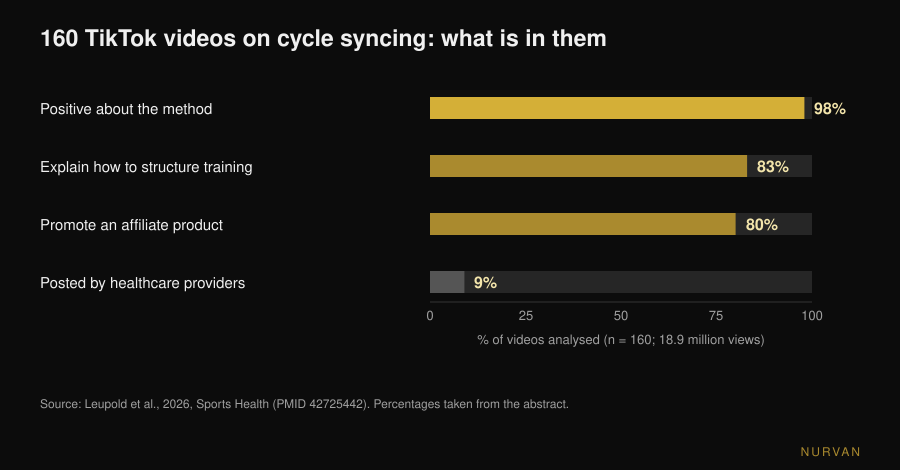
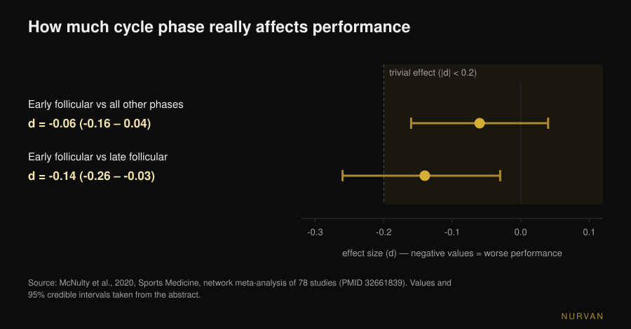

# Cycle syncing workouts: do they actually work?

By [Giammaria Loi](/autore/giammaria-loi) · updated 11 November 2026

*Cycle syncing* is everywhere: lift heavy in the follicular phase, switch to yoga and walking in the luteal phase, rest during your period. Put like that it sounds obvious — hormones change, so training should change too. The problem is that when the idea gets measured in a lab, what is left is far smaller than the calendar suggests. Here is what the data says, and what to do instead of rewriting your programme four times a month.

## In short

- **The measured effect on performance is trivial.** A network meta-analysis of 78 studies found a **0.06** reduction (effect-size scale) in the early follicular phase compared with every other phase: technically there, practically irrelevant.
- **Muscle is not "more anabolic" in one phase.** Measured with stable isotopes and muscle biopsies, follicular and luteal give the same muscle protein synthesis: the training matters, the day of your cycle does not.
- **Phase does not set your programme, symptoms set your session.** After damaging training, soreness and strength loss are larger in the early follicular phase: you manage the load, you don't change the plan.
- **Your measurements move on their own.** Changes in muscle cross-sectional area tracked across two cycles cannot be attributed to training alone: weighing or measuring on different cycle days is not a fair comparison.
- **Most of what you find online is marketing.** Across 160 TikTok videos, 98% were positive about cycle syncing, only 9% came from healthcare providers and **80% promoted a product**. Average educational quality: 0.8 out of 5.

## Where cycle syncing came from

Not from a study — from the internet. In September 2026 the journal *Sports Health* published the first systematic look at the content: 160 TikTok videos on the topic, **18.9 million views** in total. 98% expressed a positive attitude towards the method, 83% covered how to compose training across phases, and only 9% were posted by healthcare providers. Rated by two experts in women's sports medicine using two standard scales, average educational quality was 0.8 out of 5 (modified DISCERN) and 1.8 out of 5 (Global Quality Score). 80% of the videos promoted a product through affiliate marketing, and three quarters of those products were cycle-syncing related (Leupold et al., 2026).

That does not prove the method is wrong. It proves its popularity did not come from the data, and that whoever is telling you about it often has something to sell. Worth checking the numbers yourself.

## What actually changes in your hormones

Two reference points make the rest readable. The **follicular phase** runs from day one of your period to ovulation: oestrogen rises and peaks just before ovulation. The **luteal phase** runs from ovulation to the next period: progesterone rises while oestrogen sits at an intermediate level. The *early follicular phase* is the bleeding days, when both hormones are low.

The cycle-syncing hypothesis is straightforward: high oestrogen favours muscle anabolism, so the follicular phase is when you should push; high progesterone is catabolic, so the luteal phase is for backing off. It is a legitimate hypothesis, and there is literature arguing for it on paper: a 2022 review in *Sports Medicine* argues that resistance training concentrated in the follicular phase may be superior to luteal-phase-based training for strength and mass (Kissow et al., 2022). But it is a narrative review, not evidence: it collects small studies and interprets them. When the same hypothesis gets tested head-on, it goes differently.

## Does performance change with phase? The numbers from 78 studies

This is the question with the most material behind it. In 2020 a group spanning Northumbria, Nottingham Trent and São Paulo pooled 78 experimental studies that measured performance in at least two defined cycle phases, analysed with Bayesian methods and a network meta-analysis.

The result: in the early follicular phase, performance — both strength and endurance — is reduced by an effect of **-0.06** (95% credible interval: -0.16 to 0.04). On the effect-size scale, 0.2 is the conventional threshold below which an effect is called *trivial*: 0.06 is a third of that threshold and the interval crosses zero. The least favourable comparison in the whole network, early follicular versus late follicular, reaches **-0.14** (-0.26 to -0.03): still below the threshold.

The authors add two caveats that matter as much as the number. First: variation **between** studies is large, and the overall quality of evidence was graded *low* (42%). Second, their own wording: general guidelines on performance across the cycle cannot be formed, and **a personalised approach based on each individual's response** should be preferred (McNulty et al., 2020).

Keep that in mind, because it is the opposite of how the study gets used on social media: not "phase X is the strong phase", but "the average tells you nothing useful about you".

## Is muscle "more anabolic" in the follicular phase?

Here the recent answer is the clearest. In 2025 the *Journal of Physiology* published a study from Stuart Phillips' group at McMaster University built exactly to answer this: 12 women, two six-day blocks of controlled resistance exercise — one in the late follicular phase (peak oestrogen), one in the mid-luteal phase (peak progesterone) — in randomised order, training one leg at a time and using the other as a control. Phase verified with cycle tracking, blood samples and urinary test kits; synthesis measured with stable isotopes, breakdown measured whole-body, plus metabolomics and muscle biopsies.

Result: exercise raised muscle protein synthesis significantly (p < 0.001), **cycle phase did not**. No effect on synthesis, no effect on breakdown (p = 0.24), no notable difference in circulating metabolites between phases. The authors' line: skeletal muscle is not more anabolically responsive in a particular phase of the cycle (Colenso-Semple et al., 2025).

Two years earlier the same group, with Kirsty Elliott-Sale, reviewed the existing reviews on strength, performance and hypertrophy: highly variable findings from one review to the next and, above all, a recurring methodological problem — few studies actually verify which phase participants are in, with hormone sampling rather than the calendar alone. Their conclusion: it is **premature** to conclude that short-term hormonal fluctuations appreciably influence acute performance or longer-term adaptations (Colenso-Semple et al., 2023).

It is the same reason individual training responses are hard to predict in general, as we covered in [how much genetics decides high and low responders](/en/blog/genetics-high-low-responders): the variability between people is far bigger than the variability between phases.

## What does change: symptoms, recovery and measurements

Saying phase does not change adaptations is not the same as saying every day feels the same. Two things change measurably.

**Perceived muscle damage.** A meta-analysis of 19 studies in the *Journal of Strength and Conditioning Research* compared the response to hard training across phases: delayed onset muscle soreness and post-exercise strength loss differed between phases, with the worst values in the **early follicular phase**, while creatine kinase — a blood marker of damage — showed no differences. The authors suggest slightly lower loads or longer recovery on those days (Romero-Parra et al., 2021). Note the difference: adapting recovery to how you feel, not moving the goal of the training block.

**The numbers you judge yourself by.** A 2024 study in *Applied Physiology, Nutrition, and Metabolism* followed 20 women across two full cycles, training one leg and leaving the other to rest, measuring muscle cross-sectional area at six time points. The trained leg grew; but 19 of 20 participants showed changes in cross-sectional area above or below the minimum detectable difference outside training too, enough for the authors to conclude that the changes observed across two cycles **cannot be attributed exclusively to resistance training** (Dias et al., 2024). In plain terms: fluid retention and normal fluctuation blur the measurement. Comparing circumferences, weight or the mirror on two different cycle days means comparing things that are not comparable.

## What if you are on the pill?

Common question, with a firmer answer than most people expect. A meta-analysis of 42 studies and 590 participants compared oral contraceptive users with naturally menstruating women, and the taking days against the withdrawal days. Oral contraceptive use may come with **slightly** lower performance on average, but any group-level effect is most likely trivial, and performance is consistent across the pill cycle. Here too the authors' closing recommendation is individual, not general (Elliott-Sale et al., 2020).

## What the research actually says

| Common claim | Verdict | Source |
|---|---|---|
| "You are stronger in the follicular phase" | **Needs qualifying**: measured difference -0.06, below the trivial threshold | McNulty et al., 2020 |
| "You build more muscle in the follicular phase" | **Busted**: protein synthesis and breakdown identical across phases | Colenso-Semple et al., 2025 |
| "Training strength in the right phase gives more results" | **Unsupported**: the hypothesis lives in a narrative review, not in direct evidence | Kissow et al., 2022; Colenso-Semple et al., 2023 |
| "Better not to train during your period" | **Busted**: no physiological reason; adjust the load if needed | Colenso-Semple et al., 2023; McNulty et al., 2020 |
| "You get more sore on some days" | **Confirmed**: soreness and strength loss larger in the early follicular phase | Romero-Parra et al., 2021 |
| "Measurements move with the cycle, not with progress" | **Confirmed**: cross-sectional area changes not attributable to training alone | Dias et al., 2024 |
| "Results are worse on the pill" | **Needs qualifying**: small average difference, most likely trivial | Elliott-Sale et al., 2020 |
| "Cycle syncing is science-backed" | **Busted as content**: average educational quality 0.8 out of 5 | Leupold et al., 2026 |

## How to apply it

1. **Keep the programme, drop the hormonal calendar.** Progression, frequency and volume stay as they are: no data justifies four different programmes a month. For how a block is built, we covered [how many reps actually build muscle](/en/blog/how-many-reps-build-muscle).
2. **Autoregulate the session, not the mesocycle.** On days you feel worse, keep the same exercise and the same scheme but take some load off or stop one RIR earlier (RIR is the number of reps you have left in the tank at the end of a set). That is the difference between adapting and quitting.
3. **Track symptoms for two or three cycles before concluding anything.** One month cannot separate the cycle from sleep, stress or a high-volume week. After two or three cycles, if a pattern is real, it shows up in your own numbers.
4. **Always measure at the same point in your cycle.** Weight and circumferences should be compared a cycle apart, not a week apart. Comparing day 5 with day 23 is not measuring training.
5. **If you work with a coach, bring data, not yesterday's feeling.** Load used, RIR, sleep and a note on symptoms are worth more than "this week was bad". On what a remote coach has to monitor to match an in-person one, we wrote a separate piece: [does online coaching work?](/en/blog/does-online-coaching-work).
6. **Pain that stops you, very irregular or absent cycles: see a doctor, not a programme.** Severe dysmenorrhoea, heavy bleeding or amenorrhoea are not training variables to autoregulate — they are for a doctor or gynaecologist. Amenorrhoea in people who train a lot in particular should be assessed as a question of energy availability.

> ### Try Nurvan — manage your cycle with your data, not a calendar
>
> In Nurvan you log load and RIR set by set, add a note to the session when you feel off, and keep measurements in one history: after two or three cycles you can see whether a pattern exists in your own numbers instead of trusting a general rule. If you work with a coach, they see the same timeline and can autoregulate the week with you. [Try Nurvan](https://nurvan.app)

## FAQ

**Should I train according to my menstrual cycle?**
No data supports it. The average performance difference between phases, measured across 78 studies, is -0.06 — below the conventional threshold for a trivial effect — and muscle protein synthesis after training does not differ between the follicular and luteal phases. Keep the programme and autoregulate the single session based on how you feel.

**Can I lift weights on my period?**
Yes. There is no physiological reason to stop, and training adaptations do not get worse. On those days soreness and strength loss after hard sessions are on average larger, so trimming the load or lengthening rest periods can make sense, without changing exercises or goals.

**In which phase do you build the most muscle?**
In none, as far as anyone can currently measure. The most rigorous study on the topic measured muscle protein synthesis and breakdown in the two opposite phases using stable isotopes and biopsies: the exercise made the difference, the phase did not.

**Why does my weight always go up before my period?**
Because fluid levels change, not muscle or fat. The two-cycle study shows muscle cross-sectional area changing independently of training, so weight and circumferences move on their own too: the only sensible comparison is the same point in two different cycles.

## Read next

- [Lifting weights during pregnancy: what the research says](/en/blog/lifting-weights-during-pregnancy-what-research-says) — the other women's topic where the advice in circulation is far more restrictive than the data.
- [How many reps build muscle: the 8-12 myth](/en/blog/how-many-reps-build-muscle) — how to build a block you don't have to rewrite every week.
- [Does online coaching work? What the studies say](/en/blog/does-online-coaching-work) — what someone coaching you remotely actually has to monitor.

## Sources

1. McNulty KL, Elliott-Sale KJ, Dolan E, Swinton PA, Ansdell P, Goodall S, Thomas K, Hicks KM, 2020. The Effects of Menstrual Cycle Phase on Exercise Performance in Eumenorrheic Women: A Systematic Review and Meta-Analysis. *Sports Medicine* 50(10):1813-1827. PMID 32661839. [DOI 10.1007/s40279-020-01319-3](https://doi.org/10.1007/s40279-020-01319-3)
2. Colenso-Semple LM, McKendry J, Lim C, Atherton PJ, Wilkinson DJ, Smith K, Phillips SM, 2025. Menstrual cycle phase does not influence muscle protein synthesis or whole-body myofibrillar proteolysis in response to resistance exercise. *The Journal of Physiology* 603(5):1109-1121. PMID 39630025. [DOI 10.1113/JP287342](https://doi.org/10.1113/JP287342)
3. Colenso-Semple LM, D'Souza AC, Elliott-Sale KJ, Phillips SM, 2023. Current evidence shows no influence of women's menstrual cycle phase on acute strength performance or adaptations to resistance exercise training. *Frontiers in Sports and Active Living* 5:1054542. PMID 37033884. [DOI 10.3389/fspor.2023.1054542](https://doi.org/10.3389/fspor.2023.1054542)
4. Kissow J, Jacobsen KJ, Gunnarsson TP, Jessen S, Hostrup M, 2022. Effects of Follicular and Luteal Phase-Based Menstrual Cycle Resistance Training on Muscle Strength and Mass. *Sports Medicine* 52(12):2813-2819. PMID 35471634. [DOI 10.1007/s40279-022-01679-y](https://doi.org/10.1007/s40279-022-01679-y)
5. Romero-Parra N, Cupeiro R, Alfaro-Magallanes VM, Rael B, Rubio-Arias JÁ, Peinado AB, Benito PJ, 2021. Exercise-Induced Muscle Damage During the Menstrual Cycle: A Systematic Review and Meta-Analysis. *Journal of Strength and Conditioning Research* 35(2):549-561. PMID 33201156. [DOI 10.1519/JSC.0000000000003878](https://doi.org/10.1519/JSC.0000000000003878)
6. Dias NF, Bergamasco JGA, Scarpelli MC, Silva DG, Chaves TS, Bittencourt D, Medalha RA, Carello Filho PC, De Souza EO, Ugrinowitsch C, Libardi CA, 2024. Changes in muscle cross-sectional area during two menstrual cycles may not be exclusively attributed to resistance training. *Applied Physiology, Nutrition, and Metabolism* 49(12):1729-1739. PMID 39303293. [DOI 10.1139/apnm-2024-0004](https://doi.org/10.1139/apnm-2024-0004)
7. Elliott-Sale KJ, McNulty KL, Ansdell P, Goodall S, Hicks KM, Thomas K, Swinton PA, Dolan E, 2020. The Effects of Oral Contraceptives on Exercise Performance in Women: A Systematic Review and Meta-analysis. *Sports Medicine* 50(10):1785-1812. PMID 32666247. [DOI 10.1007/s40279-020-01317-5](https://doi.org/10.1007/s40279-020-01317-5)
8. Leupold O, Anderson OK, Giampaolo G, Cheng J, Casey EK, 2026. The Social Media Trend of Cycle Syncing: An Analysis of the Content and Quality of Videos on TikTok. *Sports Health*. PMID 42725442. [DOI 10.1177/19417381261479699](https://doi.org/10.1177/19417381261479699)

Bibliographic sources retrieved through PubMed. Topic chosen from a trend signal: cycle syncing is among the most widespread topics in women's fitness content — 18.9 million views across the 160 videos analysed in the *Sports Health* study of 11 September 2026 — while the top search results on training and the menstrual cycle present the method as valid without reporting the measured effect sizes.

---

*Giammaria Loi is the founder of Nurvan. He has been lifting since 2012, has worked as a FIPE-certified personal trainer and coach since 2013, and has competed in powerlifting at national level since 2018. Every article he writes starts from the research and ends with what actually works in the gym.*

> Note: educational content. It does not replace advice from a doctor or qualified professional.
