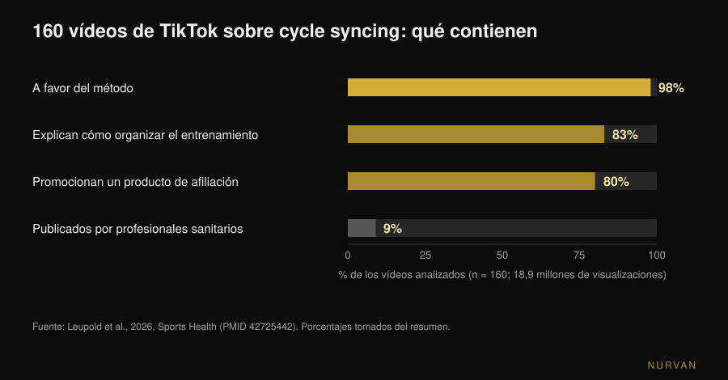

# ¿Entrenar según el ciclo menstrual funciona?

Por [Giammaria Loi](/autore/giammaria-loi) · actualizado el 11 de noviembre de 2026

El *cycle syncing* está en todas partes: fuerza en la fase folicular, yoga y caminatas en la lútea, descanso durante la regla. Dicho así parece evidente — las hormonas cambian, luego el entrenamiento debería cambiar. El problema es que cuando esa idea se mide en laboratorio, lo que queda es mucho más pequeño de lo que sugiere el calendario. Esto es lo que dicen los datos, y qué hacer en lugar de reescribir el programa cuatro veces al mes.

## En resumen

- **El efecto medido sobre el rendimiento es trivial.** Un metaanálisis en red de 78 estudios encuentra una reducción de **0,06** (escala de tamaño del efecto) en la fase folicular temprana frente a todas las demás: técnicamente existe, en la práctica es irrelevante.
- **El músculo no es "más anabólico" en una fase.** Midiendo la síntesis proteica muscular con isótopos estables y biopsias, folicular y lútea dan el mismo resultado: cuenta el entrenamiento, no el día del ciclo.
- **La fase no decide el programa, los síntomas sí la sesión.** Tras un entrenamiento con daño muscular, las agujetas y la pérdida de fuerza son mayores en la fase folicular temprana: se ajusta la carga, no el plan.
- **Las medidas se mueven solas.** Las variaciones de sección muscular registradas a lo largo de dos ciclos no se pueden atribuir solo al entrenamiento: pesarse o medirse en días distintos del ciclo no es comparable.
- **Lo que encuentras online es casi todo marketing.** De 160 vídeos de TikTok, el 98% era favorable al método, solo el 9% venía de profesionales sanitarios y el **80% promocionaba un producto**. Calidad educativa media: 0,8 sobre 5.

## De dónde sale el cycle syncing

No de un estudio: de internet. En septiembre de 2026 la revista *Sports Health* publicó el primer análisis sistemático de estos contenidos: 160 vídeos de TikTok sobre el tema, **18,9 millones de visualizaciones** en total. El 98% expresaba una actitud positiva hacia el método, el 83% hablaba de cómo componer el entrenamiento en cada fase y solo el 9% estaba publicado por profesionales sanitarios. Evaluados por dos expertas en medicina deportiva femenina con dos escalas estándar, la calidad educativa media fue de 0,8 sobre 5 (DISCERN modificado) y 1,8 sobre 5 (Global Quality Score). El 80% de los vídeos promocionaba un producto por afiliación, y tres cuartas partes de esos productos tenían que ver con el propio cycle syncing (Leupold et al., 2026).

Esto no demuestra que el método sea falso. Demuestra que su popularidad no nació de los datos, y que quien te lo cuenta a menudo tiene algo que venderte. Vale la pena mirar los números por tu cuenta.

## Qué cambia de verdad en las hormonas

Dos referencias para leer el resto. La **fase folicular** va del primer día de la regla a la ovulación: los estrógenos suben y alcanzan el pico poco antes de ovular. La **fase lútea** va de la ovulación a la regla siguiente: sube la progesterona y los estrógenos se quedan en un nivel intermedio. La *fase folicular temprana* son los días de sangrado, cuando ambas hormonas están bajas.

La hipótesis del cycle syncing es lineal: estrógenos altos favorecen el anabolismo muscular, así que la fase folicular sería el momento de apretar; progesterona alta sería catabólica, así que en la lútea toca bajar. Es una hipótesis legítima y hay literatura que la sostiene sobre el papel: una revisión de *Sports Medicine* de 2022 argumenta que el entrenamiento de fuerza concentrado en la fase folicular podría ser superior al concentrado en la lútea para fuerza y masa (Kissow et al., 2022). Pero es una revisión narrativa, no una prueba: recoge estudios pequeños y los interpreta. Cuando esa misma hipótesis se pone a prueba directamente, la cosa cambia.

## ¿Cambia el rendimiento con la fase? Los números de 78 estudios

Es la pregunta con más material detrás. En 2020 un grupo entre Northumbria, Nottingham Trent y São Paulo reunió 78 estudios experimentales que medían el rendimiento en al menos dos fases definidas del ciclo, analizados con métodos bayesianos y un metaanálisis en red.

El resultado: en la fase folicular temprana el rendimiento — de fuerza y de resistencia — resulta reducido en un efecto de **-0,06** (intervalo de credibilidad del 95%: de -0,16 a 0,04). En la escala de tamaño del efecto, 0,2 es el umbral convencional por debajo del cual un efecto se considera *trivial*: 0,06 es un tercio de ese umbral y el intervalo cruza el cero. La comparación más desfavorable de toda la red, folicular temprana contra folicular tardía, llega a **-0,14** (de -0,26 a -0,03): todavía por debajo del umbral.

Los autores añaden dos advertencias que pesan tanto como el número. La primera: la variabilidad **entre** estudios es grande y la calidad global de la evidencia se clasificó como *baja* (42%). La segunda, su conclusión textual: no se pueden formular pautas generales sobre el rendimiento a lo largo del ciclo, y debe preferirse **un enfoque personalizado basado en la respuesta individual** (McNulty et al., 2020).

Tenlo presente, porque es lo contrario de cómo se usa este estudio en redes: no "la fase X es la fase fuerte", sino "la media no dice nada útil sobre ti".

## ¿El músculo es "más anabólico" en la fase folicular?

Aquí la respuesta reciente es la más clara. En 2025 el *Journal of Physiology* publicó un estudio del grupo de Stuart Phillips en la McMaster University diseñado exactamente para responder: 12 mujeres, dos periodos de seis días de entrenamiento controlado — uno en fase folicular tardía (pico de estrógenos), otro en lútea media (pico de progesterona) — en orden aleatorio, entrenando una pierna y usando la otra como control. Fase verificada con seguimiento del ciclo, analíticas y test de orina; síntesis medida con isótopos estables, degradación medida a nivel de cuerpo entero, más metabolómica y biopsias musculares.

Resultado: el ejercicio aumentó la síntesis proteica muscular de forma significativa (p < 0,001), **la fase del ciclo no**. Ningún efecto sobre la síntesis, ninguno sobre la degradación (p = 0,24), ninguna diferencia en los metabolitos circulantes entre fases. La frase de los autores: el músculo esquelético no es más responsivo al anabolismo en una fase concreta del ciclo (Colenso-Semple et al., 2025).

Dos años antes el mismo grupo, con Kirsty Elliott-Sale, revisó las revisiones existentes sobre fuerza, rendimiento e hipertrofia: resultados muy variables de una a otra y, sobre todo, un problema recurrente de método — pocas investigaciones verifican de verdad en qué fase están las participantes, con analítica hormonal y no solo con el calendario. Su conclusión: es **prematuro** concluir que las fluctuaciones hormonales de corto plazo influyan de forma apreciable en el rendimiento agudo o en las adaptaciones a largo plazo (Colenso-Semple et al., 2023).

Es el mismo motivo por el que las respuestas individuales al entrenamiento son difíciles de predecir en general: la variabilidad entre personas es mucho mayor que la variabilidad entre fases.

## Lo que sí cambia: síntomas, recuperación y medidas

Decir que la fase no cambia las adaptaciones no es decir que todos los días sean iguales. Dos cosas cambian de forma medible.

**El daño muscular percibido.** Un metaanálisis de 19 estudios publicado en el *Journal of Strength and Conditioning Research* comparó la respuesta a un entrenamiento intenso en las distintas fases: las agujetas de aparición tardía y la pérdida de fuerza posterior diferían entre fases, con los peores valores en la **fase folicular temprana**, mientras que la creatina quinasa — un marcador de daño en sangre — no mostraba diferencias. Los autores sugieren considerar cargas algo más bajas o recuperaciones más largas esos días (Romero-Parra et al., 2021). Fíjate en la diferencia: adaptar la recuperación a cómo estás, no mover el objetivo del mesociclo.

**Los números con los que te evalúas.** Un estudio de 2024 en *Applied Physiology, Nutrition, and Metabolism* siguió a 20 mujeres durante dos ciclos completos, entrenando una pierna y dejando la otra en reposo, midiendo la sección transversal del músculo en seis momentos. La pierna entrenada creció; pero 19 de 20 participantes mostraron variaciones de sección por encima o por debajo del umbral de error de la medida también fuera del entrenamiento, hasta el punto de que los autores concluyen que las variaciones observadas en los dos ciclos **no son atribuibles exclusivamente al entrenamiento** (Dias et al., 2024). Traducido: la retención de líquidos y las oscilaciones fisiológicas ensucian la medida. Si comparas perímetros, peso o espejo en dos días distintos del ciclo, estás comparando cosas no comparables.

## ¿Y si tomas la píldora?

Pregunta frecuente, con una respuesta más sólida de lo que se cree. Un metaanálisis de 42 estudios y 590 participantes comparó a quienes usan anticonceptivos orales con quienes tienen ciclo natural, y además las fases de toma frente a las de descanso. El uso de anticonceptivos orales puede acompañarse de un rendimiento medio **ligeramente** inferior, pero cualquier efecto a nivel de grupo es con toda probabilidad trivial, y el rendimiento resulta constante a lo largo del ciclo de la píldora. También aquí la recomendación final de los autores es individual, no general (Elliott-Sale et al., 2020).

## Qué dice realmente la investigación

| Afirmación común | Veredicto | Fuente |
|---|---|---|
| «En la fase folicular eres más fuerte» | **Matizado**: diferencia medida -0,06, por debajo del umbral trivial | McNulty et al., 2020 |
| «En la fase folicular ganas más músculo» | **Desmentido**: síntesis y degradación proteica idénticas entre fases | Colenso-Semple et al., 2025 |
| «Entrenar fuerza en la fase correcta da más resultados» | **Sin respaldo**: la hipótesis vive en una revisión narrativa, no en pruebas directas | Kissow et al., 2022; Colenso-Semple et al., 2023 |
| «Durante la regla mejor no entrenar» | **Desmentido**: no hay motivo fisiológico; como mucho se adapta la carga | Colenso-Semple et al., 2023; McNulty et al., 2020 |
| «Hay días en que te duele más» | **Confirmado**: agujetas y pérdida de fuerza mayores en la folicular temprana | Romero-Parra et al., 2021 |
| «Las medidas cambian por el ciclo, no por los progresos» | **Confirmado**: variaciones de sección no atribuibles solo al entrenamiento | Dias et al., 2024 |
| «Con la píldora los resultados son peores» | **Matizado**: diferencia media pequeña y probablemente trivial | Elliott-Sale et al., 2020 |
| «El cycle syncing está validado por la ciencia» | **Desmentido como divulgación**: calidad media de los contenidos 0,8 sobre 5 | Leupold et al., 2026 |

## Cómo aplicarlo

1. **Mantén el programa, no el calendario hormonal.** Progresión, frecuencia y volumen siguen siendo los mismos: ningún dato justifica cuatro programas distintos al mes. Si quieres una referencia sobre cómo se construye un bloque, explicamos [cuántas repeticiones hacen falta de verdad para la masa](/es/blog/cuantas-repeticiones-masa-muscular).
2. **Autorregula la sesión, no el mesociclo.** Los días en que te encuentras peor usa el mismo ejercicio y el mismo esquema, pero quita algo de carga o párate un RIR antes (el RIR es el número de repeticiones que te quedan en recámara al acabar la serie). Esa es la diferencia entre adaptar y renunciar.
3. **Registra los síntomas durante dos o tres ciclos antes de concluir nada.** Un solo mes no distingue el ciclo del sueño, del estrés o de una semana de carga alta. Tras dos o tres ciclos, si el patrón existe de verdad, se ve en tus números.
4. **Mídete siempre en el mismo punto del ciclo.** Peso y perímetros se comparan a un ciclo de distancia, no a una semana. Si comparas el día 5 con el día 23 no estás midiendo el entrenamiento.
5. **Si entrenas con un coach, llévale datos, no la sensación de ayer.** Carga usada, RIR, sueño y una nota sobre los síntomas valen más que "esta semana iba mal". Sobre qué debe controlar un coach a distancia para valer lo mismo que uno presencial escribimos aparte: [¿funciona el coaching online?](/es/blog/funciona-el-coaching-online).
6. **Dolor que te frena, ciclos muy irregulares o ausentes: médico, no programa.** Dismenorrea severa, sangrados abundantes o amenorrea no son variables de entrenamiento que autorregular: se hablan con un médico o un ginecólogo. La amenorrea en quien entrena mucho, en particular, debe valorarse como un problema de disponibilidad energética.

> ### Prueba Nurvan — el ciclo se gestiona con tus datos, no con un calendario
>
> En Nurvan registras carga y RIR serie a serie, añades una nota a la sesión cuando te notas floja y guardas las medidas en el historial: después de dos o tres ciclos ves si existe un patrón en tus números en vez de fiarte de una regla general. Si trabajas con un coach, él ve la misma cronología y puede autorregular la semana contigo. [Prueba Nurvan](https://nurvan.app)

## Preguntas frecuentes

**¿Hay que entrenar según el ciclo menstrual?**
No hay datos que lo sostengan. La diferencia media de rendimiento entre fases medida en 78 estudios es -0,06, por debajo del umbral convencional de efecto trivial, y la síntesis proteica muscular tras el entrenamiento no cambia entre fase folicular y lútea. Conviene mantener el programa y autorregular cada sesión según cómo estés.

**¿Se puede entrenar con pesas durante la regla?**
Sí. No existe un motivo fisiológico para parar y las adaptaciones al entrenamiento no empeoran. Esos días las agujetas y la pérdida de fuerza tras sesiones exigentes resultan de media mayores, así que puede tener sentido bajar algo la carga o alargar las recuperaciones, sin cambiar ejercicios ni objetivos.

**¿En qué fase del ciclo se gana más músculo?**
En ninguna, hasta donde se puede medir hoy. El estudio más preciso sobre el tema midió síntesis y degradación proteica muscular en las dos fases opuestas con isótopos estables y biopsias: el entrenamiento marcó la diferencia, la fase no.

**¿Por qué el peso sube siempre antes de la regla?**
Porque cambia la cantidad de líquidos, no la masa muscular ni la grasa. El estudio sobre dos ciclos completos muestra variaciones de sección muscular que no dependen del entrenamiento, así que peso y perímetros también se mueven por su cuenta: la única comparación sensata es entre el mismo punto de dos ciclos distintos.

## Lee también

- [Pesas en el embarazo: qué dice realmente la ciencia](/es/blog/pesas-en-el-embarazo-que-dice-la-ciencia) — el otro tema femenino donde los consejos que circulan son mucho más restrictivos que los datos.
- [Cuántas repeticiones para la masa: el mito del 8-12](/es/blog/cuantas-repeticiones-masa-muscular) — cómo se construye un bloque que no hay que reescribir cada semana.
- [¿Funciona el coaching online? Qué dicen los estudios](/es/blog/funciona-el-coaching-online) — qué debe monitorizar de verdad quien te sigue a distancia.

## Fuentes

1. McNulty KL, Elliott-Sale KJ, Dolan E, Swinton PA, Ansdell P, Goodall S, Thomas K, Hicks KM, 2020. The Effects of Menstrual Cycle Phase on Exercise Performance in Eumenorrheic Women: A Systematic Review and Meta-Analysis. *Sports Medicine* 50(10):1813-1827. PMID 32661839. [DOI 10.1007/s40279-020-01319-3](https://doi.org/10.1007/s40279-020-01319-3)
2. Colenso-Semple LM, McKendry J, Lim C, Atherton PJ, Wilkinson DJ, Smith K, Phillips SM, 2025. Menstrual cycle phase does not influence muscle protein synthesis or whole-body myofibrillar proteolysis in response to resistance exercise. *The Journal of Physiology* 603(5):1109-1121. PMID 39630025. [DOI 10.1113/JP287342](https://doi.org/10.1113/JP287342)
3. Colenso-Semple LM, D'Souza AC, Elliott-Sale KJ, Phillips SM, 2023. Current evidence shows no influence of women's menstrual cycle phase on acute strength performance or adaptations to resistance exercise training. *Frontiers in Sports and Active Living* 5:1054542. PMID 37033884. [DOI 10.3389/fspor.2023.1054542](https://doi.org/10.3389/fspor.2023.1054542)
4. Kissow J, Jacobsen KJ, Gunnarsson TP, Jessen S, Hostrup M, 2022. Effects of Follicular and Luteal Phase-Based Menstrual Cycle Resistance Training on Muscle Strength and Mass. *Sports Medicine* 52(12):2813-2819. PMID 35471634. [DOI 10.1007/s40279-022-01679-y](https://doi.org/10.1007/s40279-022-01679-y)
5. Romero-Parra N, Cupeiro R, Alfaro-Magallanes VM, Rael B, Rubio-Arias JÁ, Peinado AB, Benito PJ, 2021. Exercise-Induced Muscle Damage During the Menstrual Cycle: A Systematic Review and Meta-Analysis. *Journal of Strength and Conditioning Research* 35(2):549-561. PMID 33201156. [DOI 10.1519/JSC.0000000000003878](https://doi.org/10.1519/JSC.0000000000003878)
6. Dias NF, Bergamasco JGA, Scarpelli MC, Silva DG, Chaves TS, Bittencourt D, Medalha RA, Carello Filho PC, De Souza EO, Ugrinowitsch C, Libardi CA, 2024. Changes in muscle cross-sectional area during two menstrual cycles may not be exclusively attributed to resistance training. *Applied Physiology, Nutrition, and Metabolism* 49(12):1729-1739. PMID 39303293. [DOI 10.1139/apnm-2024-0004](https://doi.org/10.1139/apnm-2024-0004)
7. Elliott-Sale KJ, McNulty KL, Ansdell P, Goodall S, Hicks KM, Thomas K, Swinton PA, Dolan E, 2020. The Effects of Oral Contraceptives on Exercise Performance in Women: A Systematic Review and Meta-analysis. *Sports Medicine* 50(10):1785-1812. PMID 32666247. [DOI 10.1007/s40279-020-01317-5](https://doi.org/10.1007/s40279-020-01317-5)
8. Leupold O, Anderson OK, Giampaolo G, Cheng J, Casey EK, 2026. The Social Media Trend of Cycle Syncing: An Analysis of the Content and Quality of Videos on TikTok. *Sports Health*. PMID 42725442. [DOI 10.1177/19417381261479699](https://doi.org/10.1177/19417381261479699)

Fuentes bibliográficas obtenidas a través de PubMed. Tema elegido a partir de una señal de tendencia: el cycle syncing está entre los temas más difundidos del fitness femenino en redes — 18,9 millones de visualizaciones solo en los 160 vídeos analizados en el estudio de *Sports Health* del 11 de septiembre de 2026 — mientras que los primeros resultados de búsqueda presentan el método como válido sin citar los tamaños de efecto medidos.

---

*Giammaria Loi es el fundador de Nurvan. Entrena con pesas desde 2012, trabaja como entrenador personal y coach certificado FIPE desde 2013 y compite en powerlifting a nivel nacional desde 2018. Cada artículo que firma parte de los estudios científicos y llega a lo que funciona de verdad en el gimnasio.*

> Nota: contenido informativo; no sustituye la opinión de un médico o profesional.
