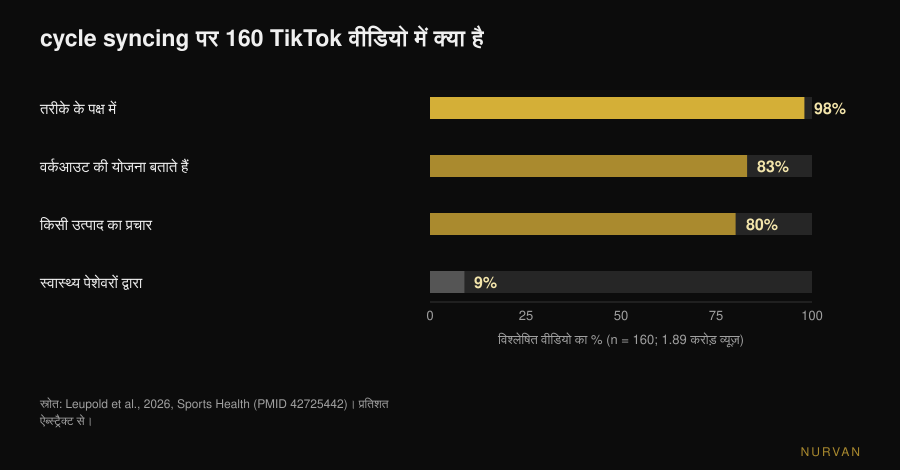
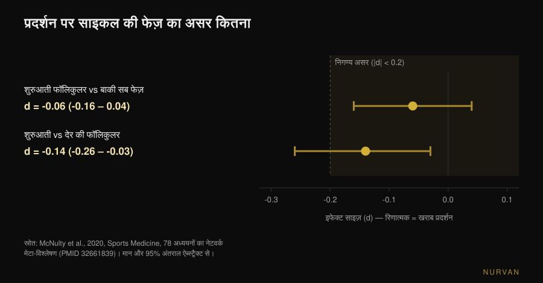

# मेंस्ट्रुअल साइकिल के हिसाब से वर्कआउट: फायदा है?

लेखक: [Giammaria Loi](/autore/giammaria-loi) · अपडेट: 11 नवंबर 2026

*साइकिल सिंकिंग* हर जगह है: फॉलिकुलर फेज़ में भारी ट्रेनिंग, लुटियल फेज़ में योग और वॉक, पीरियड में आराम। ऐसे कहने पर बात सीधी लगती है — हार्मोन बदलते हैं, तो ट्रेनिंग भी बदलनी चाहिए। दिक्कत यह है कि जब यही विचार लैब में मापा जाता है, तो जो बचता है वह कैलेंडर के वादे से कहीं छोटा है। यहाँ डेटा क्या कहता है, और महीने में चार बार प्रोग्राम दोबारा लिखने की जगह क्या करना चाहिए।

## संक्षेप में

- **प्रदर्शन पर मापा गया असर नगण्य है।** 78 स्टडी के नेटवर्क मेटा-विश्लेषण में शुरुआती फॉलिकुलर फेज़ में बाकी सब फेज़ के मुकाबले **0.06** की कमी मिली (इफेक्ट साइज़ पैमाने पर): तकनीकी रूप से मौजूद, व्यवहार में बेमानी।
- **किसी एक फेज़ में मांसपेशी "ज़्यादा एनाबोलिक" नहीं होती।** स्टेबल आइसोटोप और मसल बायोप्सी से मापने पर फॉलिकुलर और लुटियल दोनों में मसल प्रोटीन सिंथेसिस बराबर रहता है: मायने ट्रेनिंग रखती है, साइकिल का दिन नहीं।
- **फेज़ प्रोग्राम तय नहीं करता, लक्षण उस दिन की सेशन तय करते हैं।** मसल डैमेज वाली ट्रेनिंग के बाद दर्द और ताकत की कमी शुरुआती फॉलिकुलर फेज़ में ज़्यादा होती है: लोड एडजस्ट होता है, प्लान नहीं।
- **माप अपने आप ऊपर-नीचे होते हैं।** दो साइकिल में दर्ज मसल क्रॉस-सेक्शन के बदलाव सिर्फ ट्रेनिंग से नहीं जोड़े जा सकते: साइकिल के अलग-अलग दिनों पर वज़न या नाप लेना तुलना के लायक ही नहीं।
- **ऑनलाइन जो मिलता है वह ज़्यादातर मार्केटिंग है।** 160 TikTok वीडियो में 98% इस तरीके के पक्ष में थे, सिर्फ 9% स्वास्थ्य पेशेवरों के थे और **80% किसी उत्पाद का प्रचार कर रहे थे**। औसत शैक्षिक गुणवत्ता: 5 में से 0.8।

## साइकिल सिंकिंग आई कहाँ से

किसी स्टडी से नहीं, इंटरनेट से। सितंबर 2026 में जर्नल *Sports Health* ने इस सामग्री का पहला व्यवस्थित विश्लेषण छापा: विषय पर 160 TikTok वीडियो, कुल **1.89 करोड़ व्यूज़**। 98% ने तरीके के प्रति सकारात्मक रुख दिखाया, 83% ने बताया कि किस फेज़ में ट्रेनिंग कैसे रखें, और सिर्फ 9% स्वास्थ्य पेशेवरों ने पोस्ट किए थे। महिला खेल चिकित्सा की दो विशेषज्ञों ने दो मानक पैमानों पर आँका तो औसत शैक्षिक गुणवत्ता 5 में से 0.8 (संशोधित DISCERN) और 5 में से 1.8 (Global Quality Score) निकली। 80% वीडियो एफ़िलिएट मार्केटिंग से कोई उत्पाद बेच रहे थे, और उनमें से तीन-चौथाई उत्पाद साइकिल सिंकिंग से ही जुड़े थे (Leupold et al., 2026)।

इससे यह साबित नहीं होता कि तरीका गलत है। इससे यह साबित होता है कि इसकी लोकप्रियता डेटा से नहीं आई, और जो आपको यह बता रहा है उसके पास अक्सर बेचने को कुछ होता है। आँकड़े खुद देख लेना बेहतर है।

## हार्मोन में असल में बदलता क्या है

आगे पढ़ने के लिए दो संदर्भ। **फॉलिकुलर फेज़** पीरियड के पहले दिन से ओव्यूलेशन तक चलता है: एस्ट्रोजन बढ़ता है और ओव्यूलेशन से थोड़ा पहले चरम पर होता है। **लुटियल फेज़** ओव्यूलेशन से अगले पीरियड तक: प्रोजेस्टेरोन बढ़ता है, एस्ट्रोजन बीच के स्तर पर रहता है। *शुरुआती फॉलिकुलर फेज़* यानी ब्लीडिंग के दिन, जब दोनों हार्मोन कम होते हैं।

साइकिल सिंकिंग की परिकल्पना सीधी है: ज़्यादा एस्ट्रोजन मसल एनाबोलिज़्म के लिए अच्छा है, तो फॉलिकुलर फेज़ ज़ोर लगाने का समय; ज़्यादा प्रोजेस्टेरोन कैटाबोलिक है, तो लुटियल में हल्का। यह वैध परिकल्पना है और कागज़ पर इसका समर्थन करने वाला साहित्य भी है: *Sports Medicine* की 2022 की एक समीक्षा तर्क देती है कि फॉलिकुलर फेज़ पर केंद्रित स्ट्रेंथ ट्रेनिंग ताकत और मास के लिए लुटियल फेज़ पर केंद्रित ट्रेनिंग से बेहतर हो सकती है (Kissow et al., 2022)। पर वह नैरेटिव रिव्यू है, प्रमाण नहीं: वह छोटे अध्ययन जुटाकर उनकी व्याख्या करती है। जब यही परिकल्पना सीधे जाँची जाती है, नतीजा अलग निकलता है।

## क्या फेज़ से प्रदर्शन बदलता है? 78 स्टडी के आँकड़े

इस सवाल पर सबसे ज़्यादा सामग्री है। 2020 में Northumbria, Nottingham Trent और साओ पाउलो के समूह ने 78 प्रयोगात्मक अध्ययन जुटाए जिनमें साइकिल के कम से कम दो निर्धारित फेज़ में प्रदर्शन मापा गया था, और उन्हें बेज़ियन तरीकों व नेटवर्क मेटा-विश्लेषण से परखा।

नतीजा: शुरुआती फॉलिकुलर फेज़ में प्रदर्शन — ताकत और सहनशक्ति दोनों — **-0.06** के असर से घटा मिला (95% क्रेडिबल इंटरवल: -0.16 से 0.04)। इफेक्ट साइज़ के पैमाने पर 0.2 वह पारंपरिक सीमा है जिसके नीचे असर को *नगण्य* कहा जाता है: 0.06 उसका एक तिहाई है और इंटरवल शून्य को पार करता है। पूरे नेटवर्क की सबसे प्रतिकूल तुलना, शुरुआती बनाम देर की फॉलिकुलर, **-0.14** तक पहुँचती है (-0.26 से -0.03): फिर भी सीमा से नीचे।

लेखक दो चेतावनियाँ जोड़ते हैं जो आँकड़े जितनी ही अहम हैं। पहली: अध्ययनों **के बीच** भिन्नता बड़ी है और प्रमाणों की समग्र गुणवत्ता *निम्न* आँकी गई (42%)। दूसरी, उनका शब्दशः निष्कर्ष: पूरे साइकिल में प्रदर्शन पर सामान्य दिशानिर्देश नहीं बनाए जा सकते, और **व्यक्तिगत प्रतिक्रिया पर आधारित वैयक्तिक तरीका** अपनाना चाहिए (McNulty et al., 2020)।

यह याद रखिए, क्योंकि सोशल मीडिया पर इस स्टडी का उल्टा इस्तेमाल होता है: "फलाँ फेज़ ताकत वाला फेज़ है" नहीं, बल्कि "औसत आपके बारे में कुछ काम का नहीं कहता"।

## क्या फॉलिकुलर फेज़ में मांसपेशी "ज़्यादा एनाबोलिक" होती है?

यहाँ हाल का जवाब सबसे साफ है। 2025 में *Journal of Physiology* ने McMaster University में Stuart Phillips के समूह की स्टडी छापी, जो ठीक इसी सवाल के लिए बनी थी: 12 महिलाएँ, नियंत्रित रेज़िस्टेंस ट्रेनिंग के दो छह-दिवसीय चरण — एक देर की फॉलिकुलर फेज़ में (एस्ट्रोजन चरम) और एक मध्य लुटियल में (प्रोजेस्टेरोन चरम) — यादृच्छिक क्रम में, हर बार एक टाँग की ट्रेनिंग और दूसरी नियंत्रण के रूप में। फेज़ की पुष्टि साइकिल ट्रैकिंग, रक्त जाँच और यूरिन टेस्ट से; सिंथेसिस स्टेबल आइसोटोप से, ब्रेकडाउन पूरे शरीर के स्तर पर, साथ में मेटाबोलोमिक्स और मसल बायोप्सी।

नतीजा: व्यायाम ने मसल प्रोटीन सिंथेसिस को साफ तौर पर बढ़ाया (p < 0.001), **साइकिल फेज़ ने नहीं**। सिंथेसिस पर कोई असर नहीं, ब्रेकडाउन पर कोई असर नहीं (p = 0.24), दोनों फेज़ के बीच रक्त के मेटाबोलाइट्स में भी कोई उल्लेखनीय अंतर नहीं। लेखकों का वाक्य: कंकाल पेशी साइकिल के किसी खास फेज़ में एनाबोलिक रूप से ज़्यादा प्रतिक्रियाशील नहीं होती (Colenso-Semple et al., 2025)।

इससे दो साल पहले उसी समूह ने Kirsty Elliott-Sale के साथ ताकत, प्रदर्शन और हाइपरट्रॉफी पर मौजूद समीक्षाओं की जाँच की थी: एक समीक्षा से दूसरी तक नतीजे बहुत बदलते हैं और सबसे बड़ी बात, एक पद्धतिगत समस्या बार-बार दिखती है — बहुत कम शोध सचमुच हार्मोन जाँच से (सिर्फ कैलेंडर से नहीं) यह पुष्टि करते हैं कि प्रतिभागी किस फेज़ में हैं। उनका निष्कर्ष: यह कहना **जल्दबाज़ी** होगी कि अल्पकालिक हार्मोनल उतार-चढ़ाव तात्कालिक प्रदर्शन या दीर्घकालिक अनुकूलन को उल्लेखनीय रूप से प्रभावित करते हैं (Colenso-Semple et al., 2023)।

यही वजह है कि ट्रेनिंग पर व्यक्तिगत प्रतिक्रियाएँ आम तौर पर मुश्किल से अनुमानित होती हैं: लोगों के बीच का अंतर फेज़ के बीच के अंतर से कहीं बड़ा है।

## असल में क्या बदलता है: लक्षण, रिकवरी और माप

यह कहना कि फेज़ से अनुकूलन नहीं बदलते, यह कहना नहीं है कि हर दिन एक जैसा लगता है। दो चीज़ें मापने लायक बदलती हैं।

**महसूस होने वाला मसल डैमेज।** *Journal of Strength and Conditioning Research* में छपे 19 अध्ययनों के मेटा-विश्लेषण ने अलग-अलग फेज़ में कड़ी ट्रेनिंग की प्रतिक्रिया की तुलना की: देर से आने वाला मांसपेशीय दर्द और व्यायाम के बाद ताकत की कमी फेज़ के बीच अलग थी, सबसे खराब मान **शुरुआती फॉलिकुलर फेज़** में, जबकि क्रिएटिन काइनेज — रक्त में डैमेज का मार्कर — में कोई अंतर नहीं दिखा। लेखक उन दिनों थोड़ा कम लोड या लंबी रिकवरी पर विचार करने का सुझाव देते हैं (Romero-Parra et al., 2021)। अंतर पर ध्यान दीजिए: रिकवरी को हालत के मुताबिक ढालना, मेसोसाइकिल का लक्ष्य हिलाना नहीं।

**वे आँकड़े जिनसे आप खुद को आँकती हैं।** *Applied Physiology, Nutrition, and Metabolism* में 2024 की स्टडी ने 20 महिलाओं को दो पूरे साइकिल तक देखा, एक टाँग की ट्रेनिंग और दूसरी आराम पर, और छह मौकों पर मसल क्रॉस-सेक्शन मापा। ट्रेन की गई टाँग बढ़ी; लेकिन 20 में से 19 प्रतिभागियों में ट्रेनिंग के बाहर भी क्रॉस-सेक्शन के बदलाव माप की न्यूनतम पहचान-योग्य सीमा से ऊपर या नीचे दिखे — इतने कि लेखक निष्कर्ष देते हैं कि दो साइकिल में देखे गए बदलाव **सिर्फ ट्रेनिंग से नहीं जोड़े जा सकते** (Dias et al., 2024)। सीधे शब्दों में: पानी का जमाव और सामान्य उतार-चढ़ाव माप को गंदा कर देते हैं। साइकिल के दो अलग दिनों पर घेरा, वज़न या आईना मिलाना, तुलना ही गलत है।

## और अगर आप गोली लेती हैं?

आम सवाल, और जवाब सोच से ज़्यादा ठोस। 42 अध्ययनों और 590 प्रतिभागियों के मेटा-विश्लेषण ने ओरल कॉन्ट्रासेप्टिव लेने वालों की तुलना प्राकृतिक साइकिल वालों से की, और गोली लेने के दिनों की तुलना बंद रखने के दिनों से। ओरल कॉन्ट्रासेप्टिव के साथ औसतन **थोड़ा** कम प्रदर्शन हो सकता है, पर समूह स्तर पर कोई भी असर संभवतः नगण्य है, और गोली के पूरे चक्र में प्रदर्शन स्थिर रहता है। यहाँ भी लेखकों की अंतिम सिफारिश व्यक्तिगत है, सामान्य नहीं (Elliott-Sale et al., 2020)।

## शोध असल में क्या कहता है

| आम दावा | नतीजा | स्रोत |
|---|---|---|
| «फॉलिकुलर फेज़ में आप ज़्यादा ताकतवर हैं» | **स्पष्टीकरण ज़रूरी**: मापा अंतर -0.06, नगण्य की सीमा से नीचे | McNulty et al., 2020 |
| «फॉलिकुलर फेज़ में ज़्यादा मसल बनती है» | **खारिज**: दोनों फेज़ में प्रोटीन सिंथेसिस और ब्रेकडाउन एक जैसे | Colenso-Semple et al., 2025 |
| «सही फेज़ में स्ट्रेंथ ट्रेनिंग से ज़्यादा नतीजे» | **असमर्थित**: परिकल्पना नैरेटिव रिव्यू में है, सीधे प्रमाण में नहीं | Kissow et al., 2022; Colenso-Semple et al., 2023 |
| «पीरियड में ट्रेनिंग न करना बेहतर» | **खारिज**: कोई शारीरिक कारण नहीं; ज़रूरत हो तो लोड बदल लें | Colenso-Semple et al., 2023; McNulty et al., 2020 |
| «कुछ दिनों में दर्द ज़्यादा होता है» | **पुष्ट**: शुरुआती फॉलिकुलर में दर्द और ताकत की कमी ज़्यादा | Romero-Parra et al., 2021 |
| «माप साइकिल से बदलते हैं, प्रगति से नहीं» | **पुष्ट**: क्रॉस-सेक्शन के बदलाव सिर्फ ट्रेनिंग से नहीं | Dias et al., 2024 |
| «गोली के साथ नतीजे खराब होते हैं» | **स्पष्टीकरण ज़रूरी**: औसत अंतर छोटा और संभवतः नगण्य | Elliott-Sale et al., 2020 |
| «साइकिल सिंकिंग वैज्ञानिक रूप से सिद्ध है» | **सामग्री के तौर पर खारिज**: औसत शैक्षिक गुणवत्ता 5 में से 0.8 | Leupold et al., 2026 |

## इसे कैसे लागू करें

1. **प्रोग्राम रखिए, हार्मोनल कैलेंडर छोड़िए।** प्रोग्रेशन, फ्रीक्वेंसी और वॉल्यूम वही रहते हैं: महीने में चार अलग प्रोग्राम का कोई डेटा समर्थन नहीं करता। एक ब्लॉक कैसे बनता है, इस पर हमने लिखा है: [मसल के लिए असल में कितने रेप्स चाहिए](/hi/blog/kitne-reps-muscle-ke-liye)।
2. **एक सेशन को ऑटोरेगुलेट कीजिए, पूरे मेसोसाइकिल को नहीं।** जिन दिनों हालत खराब लगे, वही एक्सरसाइज़ और वही स्कीम रखिए, पर थोड़ा वज़न कम कीजिए या एक RIR पहले रुक जाइए (RIR यानी सेट के अंत में बची हुई रेप्स की संख्या)। यही फर्क है ढलने और छोड़ देने में।
3. **कोई नतीजा निकालने से पहले दो-तीन साइकिल तक लक्षण नोट कीजिए।** एक महीना साइकिल को नींद, तनाव या ज़्यादा लोड वाले हफ्ते से अलग नहीं कर सकता। दो-तीन साइकिल बाद, अगर पैटर्न सचमुच है तो आपके अपने आँकड़ों में दिखेगा।
4. **हमेशा साइकिल के एक ही बिंदु पर नापिए।** वज़न और घेरे एक साइकिल के फासले पर तुलना करने चाहिए, एक हफ्ते के नहीं। दिन 5 की दिन 23 से तुलना ट्रेनिंग नहीं नापती।
5. **कोच के साथ ट्रेनिंग करती हैं तो उन्हें डेटा दीजिए, कल का एहसास नहीं।** इस्तेमाल किया लोड, RIR, नींद और लक्षणों पर एक नोट — ये "इस हफ्ते ठीक नहीं चला" से कहीं ज़्यादा काम के हैं। दूर से ट्रेन कराने वाले को असल में क्या देखना चाहिए, इस पर अलग लेख है: [क्या ऑनलाइन कोचिंग काम करती है?](/hi/blog/online-coaching-kaam-karta-hai)
6. **रोक देने वाला दर्द, बहुत अनियमित या बंद पीरियड: डॉक्टर, प्रोग्राम नहीं।** तेज़ डिसमेनोरिया, बहुत ज़्यादा ब्लीडिंग या एमेनोरिया ऑटोरेगुलेट करने वाले ट्रेनिंग वेरिएबल नहीं हैं: इनकी बात डॉक्टर या स्त्री रोग विशेषज्ञ से होती है। खासकर ज़्यादा ट्रेनिंग करने वालों में एमेनोरिया को एनर्जी अवेलेबिलिटी की समस्या के रूप में परखा जाना चाहिए।

> ### Nurvan आज़माइए — साइकिल कैलेंडर से नहीं, अपने आँकड़ों से संभालिए
>
> Nurvan में आप हर सेट का लोड और RIR दर्ज करती हैं, जिस दिन हालत ठीक न लगे उस सेशन पर नोट जोड़ती हैं, और माप इतिहास में रखती हैं: दो-तीन साइकिल बाद किसी सामान्य नियम पर भरोसा करने के बजाय आप देख पाती हैं कि आपके आँकड़ों में पैटर्न है या नहीं। कोच के साथ काम करती हैं तो उन्हें वही टाइमलाइन दिखती है और वे आपके साथ हफ्ता ऑटोरेगुलेट कर सकते हैं। [Nurvan आज़माइए](https://nurvan.app)

## अक्सर पूछे जाने वाले सवाल

**क्या मुझे मेंस्ट्रुअल साइकिल के हिसाब से ट्रेनिंग करनी चाहिए?**
इसके पक्ष में कोई डेटा नहीं है। 78 अध्ययनों में फेज़ के बीच प्रदर्शन का औसत अंतर -0.06 है, जो नगण्य असर की पारंपरिक सीमा से नीचे है, और ट्रेनिंग के बाद मसल प्रोटीन सिंथेसिस फॉलिकुलर और लुटियल फेज़ में अलग नहीं होता। बेहतर है प्रोग्राम वही रखें और हर सेशन को अपनी हालत के हिसाब से ऑटोरेगुलेट करें।

**क्या पीरियड के दौरान वेट ट्रेनिंग कर सकते हैं?**
हाँ। रुकने की कोई शारीरिक वजह नहीं है और ट्रेनिंग के अनुकूलन खराब नहीं होते। उन दिनों कड़ी सेशन के बाद दर्द और ताकत की कमी औसतन ज़्यादा होती है, इसलिए थोड़ा लोड घटाना या रेस्ट लंबा करना समझदारी हो सकती है — एक्सरसाइज़ या लक्ष्य बदले बिना।

**साइकिल के किस फेज़ में सबसे ज़्यादा मसल बनती है?**
किसी में नहीं, जितना आज मापा जा सकता है। इस विषय की सबसे सटीक स्टडी ने स्टेबल आइसोटोप और बायोप्सी से दोनों विपरीत फेज़ में मसल प्रोटीन सिंथेसिस और ब्रेकडाउन मापा: फर्क ट्रेनिंग ने डाला, फेज़ ने नहीं।

**पीरियड से पहले वज़न हमेशा क्यों बढ़ जाता है?**
क्योंकि शरीर में पानी की मात्रा बदलती है, मसल या फैट नहीं। दो पूरे साइकिल वाली स्टडी दिखाती है कि मसल क्रॉस-सेक्शन ट्रेनिंग से स्वतंत्र रूप से बदलता है, तो वज़न और घेरे भी अपने आप हिलते हैं: समझदारी भरी तुलना सिर्फ दो अलग साइकिल के एक ही बिंदु के बीच होती है।

## यह भी पढ़ें

- [प्रेग्नेंसी में वेट ट्रेनिंग: रिसर्च क्या कहती है](/hi/blog/pregnancy-mein-weight-training-research-kya-kehti-hai) — महिलाओं से जुड़ा दूसरा विषय जहाँ चलन में मौजूद सलाह डेटा से कहीं ज़्यादा सख्त है।
- [मसल के लिए कितने रेप्स: 8-12 का मिथक](/hi/blog/kitne-reps-muscle-ke-liye) — ऐसा ब्लॉक कैसे बनाएँ जिसे हर हफ्ते दोबारा न लिखना पड़े।
- [क्या ऑनलाइन कोचिंग काम करती है? स्टडी क्या कहती हैं](/hi/blog/online-coaching-kaam-karta-hai) — दूर से आपको ट्रेन कराने वाले को असल में क्या मॉनिटर करना चाहिए।

## स्रोत

1. McNulty KL, Elliott-Sale KJ, Dolan E, Swinton PA, Ansdell P, Goodall S, Thomas K, Hicks KM, 2020. The Effects of Menstrual Cycle Phase on Exercise Performance in Eumenorrheic Women: A Systematic Review and Meta-Analysis. *Sports Medicine* 50(10):1813-1827. PMID 32661839. [DOI 10.1007/s40279-020-01319-3](https://doi.org/10.1007/s40279-020-01319-3)
2. Colenso-Semple LM, McKendry J, Lim C, Atherton PJ, Wilkinson DJ, Smith K, Phillips SM, 2025. Menstrual cycle phase does not influence muscle protein synthesis or whole-body myofibrillar proteolysis in response to resistance exercise. *The Journal of Physiology* 603(5):1109-1121. PMID 39630025. [DOI 10.1113/JP287342](https://doi.org/10.1113/JP287342)
3. Colenso-Semple LM, D'Souza AC, Elliott-Sale KJ, Phillips SM, 2023. Current evidence shows no influence of women's menstrual cycle phase on acute strength performance or adaptations to resistance exercise training. *Frontiers in Sports and Active Living* 5:1054542. PMID 37033884. [DOI 10.3389/fspor.2023.1054542](https://doi.org/10.3389/fspor.2023.1054542)
4. Kissow J, Jacobsen KJ, Gunnarsson TP, Jessen S, Hostrup M, 2022. Effects of Follicular and Luteal Phase-Based Menstrual Cycle Resistance Training on Muscle Strength and Mass. *Sports Medicine* 52(12):2813-2819. PMID 35471634. [DOI 10.1007/s40279-022-01679-y](https://doi.org/10.1007/s40279-022-01679-y)
5. Romero-Parra N, Cupeiro R, Alfaro-Magallanes VM, Rael B, Rubio-Arias JÁ, Peinado AB, Benito PJ, 2021. Exercise-Induced Muscle Damage During the Menstrual Cycle: A Systematic Review and Meta-Analysis. *Journal of Strength and Conditioning Research* 35(2):549-561. PMID 33201156. [DOI 10.1519/JSC.0000000000003878](https://doi.org/10.1519/JSC.0000000000003878)
6. Dias NF, Bergamasco JGA, Scarpelli MC, Silva DG, Chaves TS, Bittencourt D, Medalha RA, Carello Filho PC, De Souza EO, Ugrinowitsch C, Libardi CA, 2024. Changes in muscle cross-sectional area during two menstrual cycles may not be exclusively attributed to resistance training. *Applied Physiology, Nutrition, and Metabolism* 49(12):1729-1739. PMID 39303293. [DOI 10.1139/apnm-2024-0004](https://doi.org/10.1139/apnm-2024-0004)
7. Elliott-Sale KJ, McNulty KL, Ansdell P, Goodall S, Hicks KM, Thomas K, Swinton PA, Dolan E, 2020. The Effects of Oral Contraceptives on Exercise Performance in Women: A Systematic Review and Meta-analysis. *Sports Medicine* 50(10):1785-1812. PMID 32666247. [DOI 10.1007/s40279-020-01317-5](https://doi.org/10.1007/s40279-020-01317-5)
8. Leupold O, Anderson OK, Giampaolo G, Cheng J, Casey EK, 2026. The Social Media Trend of Cycle Syncing: An Analysis of the Content and Quality of Videos on TikTok. *Sports Health*. PMID 42725442. [DOI 10.1177/19417381261479699](https://doi.org/10.1177/19417381261479699)

ग्रंथसूची PubMed के ज़रिए जुटाई गई। विषय एक ट्रेंड संकेत से चुना गया: साइकिल सिंकिंग सोशल मीडिया पर महिला फिटनेस के सबसे ज़्यादा फैले विषयों में है — *Sports Health* की 11 सितंबर 2026 की स्टडी में जाँचे गए सिर्फ 160 वीडियो पर ही 1.89 करोड़ व्यूज़ — जबकि सर्च के शीर्ष नतीजे इस तरीके को मान्य बताकर पेश करते हैं और मापे गए इफेक्ट साइज़ का ज़िक्र नहीं करते।

---

*जियाम्मारिया लोई Nurvan के संस्थापक हैं। वे 2012 से वेट ट्रेनिंग करते हैं, 2013 से FIPE प्रमाणित पर्सनल ट्रेनर और कोच के रूप में काम करते हैं, और 2018 से राष्ट्रीय स्तर पर पावरलिफ्टिंग में प्रतिस्पर्धा करते हैं। उनके हर लेख की शुरुआत वैज्ञानिक अध्ययनों से होती है और अंत इस पर कि जिम में असल में क्या काम करता है।*

> नोट: यह जानकारीपरक सामग्री है, यह किसी डॉक्टर या पेशेवर की सलाह का विकल्प नहीं है।
