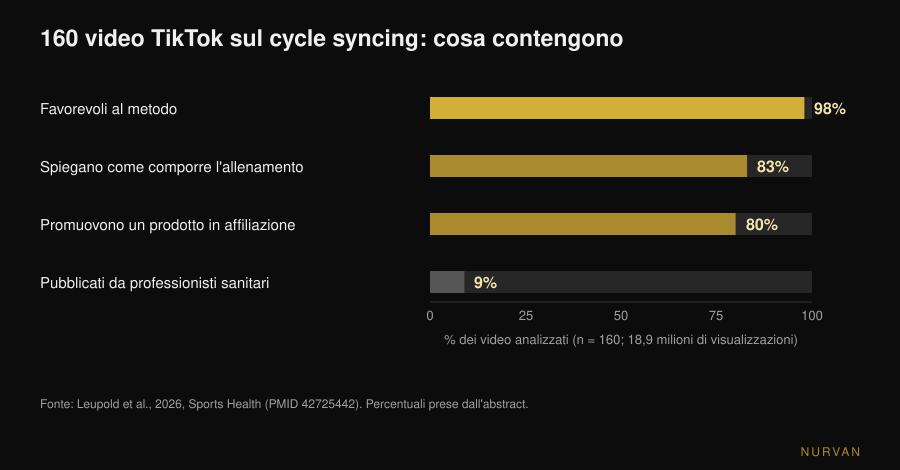

# Allenarsi in base al ciclo mestruale: funziona?

Di [Giammaria Loi](/autore/giammaria-loi) · aggiornato il 11 novembre 2026

Il *cycle syncing* è arrivato dappertutto: forza nella fase follicolare, yoga e camminate in quella luteale, riposo durante le mestruazioni. Detto così sembra ovvio — gli ormoni cambiano, quindi deve cambiare l'allenamento. Il problema è che quando quell'idea viene misurata in laboratorio, l'effetto che resta è molto più piccolo di quanto il calendario suggerisca. Ecco cosa dicono i dati, e cosa conviene fare al posto di riscrivere il programma quattro volte al mese.

## In breve

- **L'effetto misurato sulla prestazione è trivial.** Una meta-analisi in rete su 78 studi trova una riduzione di **0,06** (scala degli effect size) nella fase follicolare precoce rispetto a tutte le altre fasi: tecnicamente presente, praticamente irrilevante.
- **Il muscolo non è "più anabolico" in una fase.** Misurando la sintesi proteica muscolare con isotopi stabili e biopsie, follicolare e luteale danno lo stesso risultato: conta l'allenamento, non il giorno del ciclo.
- **La fase non decide la scheda, i sintomi sì.** Dopo un allenamento che fa danno muscolare, indolenzimento e perdita di forza sono maggiori nella fase follicolare precoce: si gestisce il carico, non si cambia programma.
- **Le misure oscillano senza che tu cresca o cali.** Le variazioni di sezione muscolare registrate lungo due cicli non sono attribuibili solo all'allenamento: pesarsi o misurarsi in giorni diversi del ciclo non è confrontabile.
- **Il contenuto che trovi online è quasi tutto marketing.** Su 160 video TikTok analizzati, il 98% era favorevole al cycle syncing, solo il 9% veniva da professionisti sanitari e l'**80% promuoveva un prodotto**. Qualità educativa media: 0,8 su 5.

## Da dove arriva il cycle syncing

Non da uno studio: da internet. Nel settembre 2026 la rivista *Sports Health* ha pubblicato la prima analisi sistematica dei contenuti: 160 video TikTok sul tema, **18,9 milioni di visualizzazioni** complessive. Il 98% esprimeva un atteggiamento positivo verso il metodo, l'83% parlava di come comporre l'allenamento nelle varie fasi, solo il 9% era pubblicato da professionisti sanitari. Valutata da due esperti di medicina dello sport femminile con due scale standard, la qualità educativa media era di 0,8 su 5 (DISCERN modificato) e 1,8 su 5 (Global Quality Score). L'80% dei video promuoveva un prodotto in affiliazione, e tre quarti di quei prodotti riguardavano proprio il cycle syncing (Leupold et al., 2026).

Questo non dimostra che il metodo sia sbagliato. Dimostra che la sua popolarità non nasce dai dati, e che chi te lo racconta spesso ha qualcosa da venderti. Vale la pena guardare i numeri per conto proprio.

## Cosa cambia davvero negli ormoni

Due riferimenti servono per leggere il resto. La **fase follicolare** va dal primo giorno delle mestruazioni all'ovulazione: gli estrogeni salgono e raggiungono il picco poco prima dell'ovulazione. La **fase luteale** va dall'ovulazione alla mestruazione successiva: il progesterone sale, gli estrogeni restano a un livello intermedio. La *fase follicolare precoce* è quella dei giorni di mestruazione, quando entrambi gli ormoni sono bassi.

L'ipotesi del cycle syncing è lineare: estrogeni alti favoriscono l'anabolismo muscolare, quindi la fase follicolare sarebbe il momento per spingere; progesterone alto sarebbe catabolico, quindi nella luteale si scarica. È un'ipotesi legittima, e c'è letteratura che la sostiene sulla carta: una rassegna su *Sports Medicine* del 2022 argomenta che l'allenamento concentrato nella fase follicolare possa essere superiore a quello concentrato nella luteale per forza e massa (Kissow et al., 2022). Ma è una rassegna narrativa, non una prova: raccoglie studi piccoli e li interpreta. Quando quella stessa ipotesi viene testata direttamente, va diversamente.

## La prestazione cambia con la fase? I numeri su 78 studi

È la domanda su cui esiste più materiale. Nel 2020 un gruppo fra Northumbria, Nottingham Trent e São Paulo ha raccolto 78 studi sperimentali che misuravano la prestazione in almeno due fasi definite del ciclo, analizzandoli con metodi bayesiani e una meta-analisi in rete.

Il risultato: nella fase follicolare precoce la prestazione — di forza e di resistenza — risulta ridotta di un effetto pari a **-0,06** (intervallo di credibilità 95%: da -0,16 a 0,04). Nella scala degli effect size, 0,2 è la soglia convenzionale sotto la quale un effetto si definisce *trivial*: 0,06 è un terzo di quella soglia e l'intervallo attraversa lo zero. Il confronto più sfavorevole dell'intera rete, follicolare precoce contro follicolare tardiva, arriva a **-0,14** (da -0,26 a -0,03): ancora sotto la soglia.

Gli autori aggiungono due avvertenze che contano quanto il numero. La prima: la variabilità **fra** gli studi è grande, e la qualità complessiva delle prove è stata classificata come *bassa* (42%). La seconda, la loro conclusione testuale: non si possono formulare linee guida generali sulla prestazione lungo il ciclo, e va preferito **un approccio personalizzato basato sulla risposta individuale** (McNulty et al., 2020).

Tienila a mente, perché è il contrario di come viene usato questo studio sui social: non "la fase X è la fase forte", ma "la media non dice niente di utile su di te".

## Il muscolo è "più anabolico" nella fase follicolare?

Qui la risposta recente è la più netta. Nel 2025 il *Journal of Physiology* ha pubblicato uno studio del gruppo di Stuart Phillips alla McMaster University costruito esattamente per rispondere: 12 donne, due periodi di sei giorni di allenamento controllato — uno nella fase follicolare tardiva (picco di estrogeni), uno nella luteale media (picco di progesterone) — in ordine casuale, allenando una gamba per volta e usando l'altra come controllo. Fase verificata con tracciamento del ciclo, prelievi e test urinari; sintesi proteica misurata con isotopi stabili, degradazione misurata sul corpo intero, più metabolomica e biopsie muscolari.

Risultato: l'esercizio ha aumentato la sintesi proteica muscolare in modo significativo (p < 0,001), **la fase del ciclo no**. Nessun effetto sulla sintesi, nessun effetto sulla degradazione (p = 0,24), nessuna differenza nei metaboliti circolanti fra le due fasi. La frase degli autori: il muscolo scheletrico non è più responsivo all'anabolismo in una particolare fase del ciclo (Colenso-Semple et al., 2025).

Due anni prima lo stesso gruppo, con Kirsty Elliott-Sale, aveva passato in rassegna le revisioni esistenti su forza, prestazione e ipertrofia: risultati molto variabili fra una review e l'altra, e soprattutto un problema ricorrente di metodo — poche ricerche verificano davvero in quale fase si trovano le partecipanti, con prelievi ormonali e non solo col calendario. La loro conclusione: è **prematuro** concludere che le fluttuazioni ormonali di breve periodo influenzino in modo apprezzabile la prestazione acuta o gli adattamenti a lungo termine (Colenso-Semple et al., 2023).

Questo è lo stesso motivo per cui le risposte individuali all'allenamento restano difficili da prevedere in generale, come abbiamo visto parlando di [quanto conta la genetica fra high e low responder](/blog/genetica-high-low-responder): la variabilità fra persone è molto più grande della variabilità fra fasi.

## Quello che cambia davvero: sintomi, recupero e misure

Dire che la fase non cambia gli adattamenti non significa dire che tutti i giorni sono uguali. Due cose cambiano in modo misurabile.

**Il danno muscolare percepito.** Una meta-analisi su 19 studi pubblicata sul *Journal of Strength and Conditioning Research* ha confrontato la risposta a un allenamento intenso nelle varie fasi: indolenzimento a insorgenza ritardata (i classici DOMS) e perdita di forza post-esercizio differivano fra le fasi, con i valori peggiori nella **fase follicolare precoce**, mentre la creatinchinasi — un marcatore di danno nel sangue — non mostrava differenze. Gli autori suggeriscono di considerare carichi un po' più bassi o recuperi più lunghi in quei giorni (Romero-Parra et al., 2021). Nota la differenza: adattare il recupero a come stai, non spostare l'obiettivo del mesociclo.

**I numeri che usi per valutarti.** Uno studio del 2024 su *Applied Physiology, Nutrition, and Metabolism* ha seguito 20 donne per due cicli completi, allenando una gamba e lasciando l'altra a riposo, e misurando la sezione trasversa del muscolo in sei momenti. La gamba allenata è cresciuta; ma 19 partecipanti su 20 hanno mostrato variazioni di sezione sopra o sotto la soglia di errore della misura anche fuori dall'allenamento, tanto che gli autori concludono che le variazioni osservate nei due cicli **non sono attribuibili esclusivamente all'allenamento** (Dias et al., 2024). Tradotto: ritenzione di liquidi e oscillazioni fisiologiche sporcano la misura. Se confronti circonferenze, peso o specchio in due giorni diversi del ciclo, stai confrontando cose non confrontabili.

## E se prendi la pillola?

Domanda frequente, e con una risposta più solida di quanto si creda. Una meta-analisi su 42 studi e 590 partecipanti ha confrontato chi usa contraccettivi orali con chi ha un ciclo naturale, e in più le fasi di assunzione contro quelle di sospensione. L'uso di contraccettivi orali può accompagnarsi a una prestazione in media **leggermente** inferiore, ma l'effetto a livello di gruppo è con ogni probabilità trascurabile, e la prestazione risulta costante lungo il ciclo della pillola. Anche qui, la raccomandazione finale degli autori è individuale, non generale (Elliott-Sale et al., 2020).

## Cosa dice davvero la ricerca

| Affermazione diffusa | Verdetto | Fonte |
|---|---|---|
| «Nella fase follicolare sei più forte» | **Da precisare**: differenza misurata -0,06, sotto la soglia del trascurabile | McNulty et al., 2020 |
| «Nella fase follicolare costruisci più muscolo» | **Smentito**: sintesi e degradazione proteica identiche fra follicolare e luteale | Colenso-Semple et al., 2025 |
| «Allenare la forza nella fase giusta dà più risultati» | **Non supportato**: l'ipotesi esiste in una rassegna narrativa, non in prove dirette | Kissow et al., 2022; Colenso-Semple et al., 2023 |
| «Durante le mestruazioni è meglio non allenarsi» | **Smentito**: nessun motivo fisiologico; eventualmente si adatta il carico | Colenso-Semple et al., 2023; McNulty et al., 2020 |
| «Ti indolenzisci di più in alcuni giorni» | **Confermato**: DOMS e perdita di forza maggiori nella follicolare precoce | Romero-Parra et al., 2021 |
| «Le misure cambiano per il ciclo, non per i progressi» | **Confermato**: variazioni di sezione non attribuibili solo all'allenamento | Dias et al., 2024 |
| «Con la pillola i risultati sono peggiori» | **Da precisare**: differenza media piccola e probabilmente trascurabile | Elliott-Sale et al., 2020 |
| «Il cycle syncing è validato dalla scienza» | **Smentito come divulgazione**: qualità media dei contenuti 0,8 su 5 | Leupold et al., 2026 |

## Come applicarlo

1. **Tieni il programma, non il calendario ormonale.** Progressione, frequenza e volume restano quelli: non esiste un dato che giustifichi quattro programmi diversi al mese. Se vuoi un riferimento su come si costruisce un blocco, abbiamo spiegato [quante ripetizioni servono davvero per la massa](/blog/ripetizioni-serie-recupero-ipertrofia).
2. **Autoregola la singola seduta, non il mesociclo.** Nei giorni in cui ti senti peggio usa lo stesso esercizio e lo stesso schema, ma togli un po' di carico o fermati un RIR prima (il RIR è il numero di ripetizioni che ti restano in canna a fine serie). È la differenza fra adattare e rinunciare.
3. **Traccia i sintomi per due o tre cicli prima di concludere qualcosa.** Un solo mese non distingue il ciclo dal sonno, dallo stress o da una settimana di carico alta. Dopo due o tre cicli, se un pattern esiste davvero, si vede nei tuoi numeri.
4. **Misurati sempre nello stesso punto del ciclo.** Peso e circonferenze vanno confrontati a distanza di un ciclo, non di una settimana. Se confronti giorno 5 con giorno 23 non stai misurando l'allenamento.
5. **Se ti alleni con un coach, portagli i dati, non le sensazioni di ieri.** Carico usato, RIR, sonno e una nota sui sintomi valgono più di "questa settimana andavo male". Su cosa deve controllare un coach a distanza perché valga quanto uno in sala abbiamo scritto un pezzo a parte: [coaching online funziona?](/blog/coaching-online-funziona-studi).
6. **Dolore che ti ferma, cicli molto irregolari o assenti: medico, non programma.** Dismenorrea severa, sanguinamenti abbondanti o amenorrea non sono variabili di allenamento da autoregolare: si parlano con un medico o un ginecologo. L'amenorrea in chi si allena molto, in particolare, va valutata come problema di disponibilità energetica.

> ### Prova Nurvan — il ciclo si gestisce con i tuoi dati, non con un calendario
>
> In Nurvan registri carico e RIR serie per serie, aggiungi una nota alla seduta quando ti senti sotto tono e tieni le misure nello storico: dopo due o tre cicli vedi se un pattern esiste nei tuoi numeri invece di affidarti a una regola generale. Se lavori con un coach, lui vede la stessa cronologia e può autoregolare la settimana con te. [Prova Nurvan](https://nurvan.app)

## Domande frequenti

**Devo allenarmi in base al ciclo mestruale?**
Non c'è un dato che lo sostenga. La differenza media di prestazione fra le fasi misurata su 78 studi è -0,06, cioè sotto la soglia convenzionale degli effetti trascurabili, e la sintesi proteica muscolare dopo l'allenamento non cambia fra fase follicolare e luteale. Conviene mantenere il programma e autoregolare la singola seduta in base a come stai.

**Posso allenarmi con i pesi durante le mestruazioni?**
Sì. Non esiste un motivo fisiologico per fermarsi, e gli adattamenti all'allenamento non peggiorano. In quei giorni indolenzimento e perdita di forza dopo sedute impegnative risultano in media maggiori, quindi può avere senso ridurre un po' il carico o allungare i recuperi, senza cambiare esercizi o obiettivi.

**In quale fase del ciclo si costruisce più muscolo?**
In nessuna, per quanto si può misurare oggi. Lo studio più accurato sul tema ha misurato sintesi e degradazione proteica muscolare nelle due fasi opposte con isotopi stabili e biopsie: l'allenamento ha fatto la differenza, la fase no.

**Perché il peso sale sempre prima del ciclo?**
Perché cambia la quantità di liquidi, non la massa muscolare o il grasso. Lo studio su due cicli completi mostra variazioni di sezione muscolare che non dipendono dall'allenamento, quindi anche peso e circonferenze si muovono per conto proprio: l'unico confronto sensato è fra lo stesso punto di due cicli diversi.

## Leggi anche

- [Pesi in gravidanza: cosa dicono davvero gli studi](/blog/pesi-in-gravidanza-cosa-dicono-gli-studi) — l'altro tema femminile dove i consigli circolanti sono molto più restrittivi dei dati.
- [Quante ripetizioni per la massa: il mito dell'8-12](/blog/ripetizioni-serie-recupero-ipertrofia) — come si costruisce un blocco che non va riscritto ogni settimana.
- [Coaching online funziona? Cosa dicono gli studi](/blog/coaching-online-funziona-studi) — cosa deve davvero monitorare chi ti segue a distanza.

## Fonti

1. McNulty KL, Elliott-Sale KJ, Dolan E, Swinton PA, Ansdell P, Goodall S, Thomas K, Hicks KM, 2020. The Effects of Menstrual Cycle Phase on Exercise Performance in Eumenorrheic Women: A Systematic Review and Meta-Analysis. *Sports Medicine* 50(10):1813-1827. PMID 32661839. [DOI 10.1007/s40279-020-01319-3](https://doi.org/10.1007/s40279-020-01319-3)
2. Colenso-Semple LM, McKendry J, Lim C, Atherton PJ, Wilkinson DJ, Smith K, Phillips SM, 2025. Menstrual cycle phase does not influence muscle protein synthesis or whole-body myofibrillar proteolysis in response to resistance exercise. *The Journal of Physiology* 603(5):1109-1121. PMID 39630025. [DOI 10.1113/JP287342](https://doi.org/10.1113/JP287342)
3. Colenso-Semple LM, D'Souza AC, Elliott-Sale KJ, Phillips SM, 2023. Current evidence shows no influence of women's menstrual cycle phase on acute strength performance or adaptations to resistance exercise training. *Frontiers in Sports and Active Living* 5:1054542. PMID 37033884. [DOI 10.3389/fspor.2023.1054542](https://doi.org/10.3389/fspor.2023.1054542)
4. Kissow J, Jacobsen KJ, Gunnarsson TP, Jessen S, Hostrup M, 2022. Effects of Follicular and Luteal Phase-Based Menstrual Cycle Resistance Training on Muscle Strength and Mass. *Sports Medicine* 52(12):2813-2819. PMID 35471634. [DOI 10.1007/s40279-022-01679-y](https://doi.org/10.1007/s40279-022-01679-y)
5. Romero-Parra N, Cupeiro R, Alfaro-Magallanes VM, Rael B, Rubio-Arias JÁ, Peinado AB, Benito PJ, 2021. Exercise-Induced Muscle Damage During the Menstrual Cycle: A Systematic Review and Meta-Analysis. *Journal of Strength and Conditioning Research* 35(2):549-561. PMID 33201156. [DOI 10.1519/JSC.0000000000003878](https://doi.org/10.1519/JSC.0000000000003878)
6. Dias NF, Bergamasco JGA, Scarpelli MC, Silva DG, Chaves TS, Bittencourt D, Medalha RA, Carello Filho PC, De Souza EO, Ugrinowitsch C, Libardi CA, 2024. Changes in muscle cross-sectional area during two menstrual cycles may not be exclusively attributed to resistance training. *Applied Physiology, Nutrition, and Metabolism* 49(12):1729-1739. PMID 39303293. [DOI 10.1139/apnm-2024-0004](https://doi.org/10.1139/apnm-2024-0004)
7. Elliott-Sale KJ, McNulty KL, Ansdell P, Goodall S, Hicks KM, Thomas K, Swinton PA, Dolan E, 2020. The Effects of Oral Contraceptives on Exercise Performance in Women: A Systematic Review and Meta-analysis. *Sports Medicine* 50(10):1785-1812. PMID 32666247. [DOI 10.1007/s40279-020-01317-5](https://doi.org/10.1007/s40279-020-01317-5)
8. Leupold O, Anderson OK, Giampaolo G, Cheng J, Casey EK, 2026. The Social Media Trend of Cycle Syncing: An Analysis of the Content and Quality of Videos on TikTok. *Sports Health*. PMID 42725442. [DOI 10.1177/19417381261479699](https://doi.org/10.1177/19417381261479699)

Fonti bibliografiche reperite tramite PubMed. Tema scelto da un segnale di tendenza: il cycle syncing è fra gli argomenti fitness femminili più diffusi sui social — 18,9 milioni di visualizzazioni sui soli 160 video analizzati nello studio di *Sports Health* dell'11 settembre 2026 — e in Italia le prime posizioni di Google sulla query "allenamento e ciclo mestruale" sono occupate da guide che presentano il metodo come valido senza riportare gli effect size misurati.

---

*Giammaria Loi è il fondatore di Nurvan. Si allena con i pesi dal 2012, lavora come personal trainer e coach certificato FIPE dal 2013 e gareggia nel powerlifting a livello nazionale dal 2018. Ogni articolo che firma parte dagli studi scientifici e arriva a ciò che funziona davvero in palestra.*

> Nota: contenuto informativo, non sostituisce il parere di un medico o professionista.
