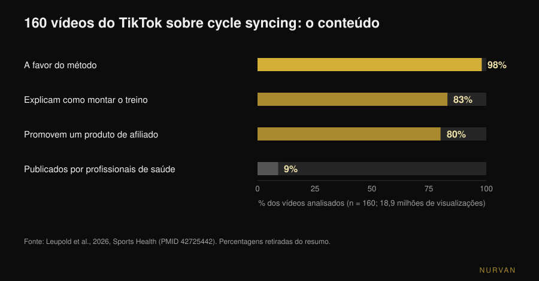
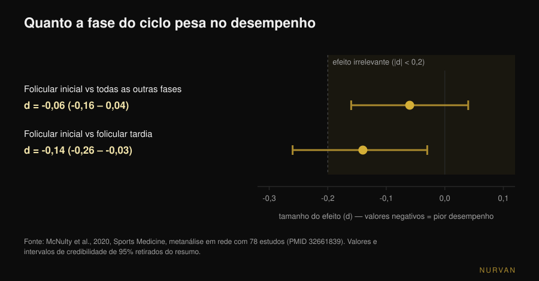

# Treinar de acordo com o ciclo menstrual funciona?

Por [Giammaria Loi](/autore/giammaria-loi) · atualizado a 11 de novembro de 2026

O *cycle syncing* está em todo o lado: força na fase folicular, ioga e caminhadas na fase lútea, descanso durante a menstruação. Dito assim parece óbvio — as hormonas mudam, logo o treino deveria mudar. O problema é que, quando essa ideia é medida em laboratório, o que sobra é muito mais pequeno do que o calendário sugere. Eis o que dizem os dados, e o que fazer em vez de reescrever o programa quatro vezes por mês.

## Em resumo

- **O efeito medido no desempenho é irrelevante.** Uma metanálise em rede com 78 estudos encontra uma redução de **0,06** (escala de tamanho de efeito) na fase folicular inicial face a todas as outras fases: tecnicamente existe, na prática não conta.
- **O músculo não é "mais anabólico" numa fase.** Medindo a síntese proteica muscular com isótopos estáveis e biópsias, folicular e lútea dão o mesmo resultado: conta o treino, não o dia do ciclo.
- **A fase não decide o programa, os sintomas decidem a sessão.** Depois de um treino com dano muscular, as dores tardias e a perda de força são maiores na fase folicular inicial: ajusta-se a carga, não o plano.
- **As medidas oscilam sozinhas.** As variações de secção muscular registadas ao longo de dois ciclos não são atribuíveis só ao treino: pesar-se ou medir-se em dias diferentes do ciclo não é comparável.
- **O que se encontra online é quase tudo marketing.** Em 160 vídeos do TikTok, 98% eram favoráveis ao método, só 9% vinham de profissionais de saúde e **80% promoviam um produto**. Qualidade educativa média: 0,8 em 5.

## De onde vem o cycle syncing

Não de um estudo: da internet. Em setembro de 2026 a revista *Sports Health* publicou a primeira análise sistemática destes conteúdos: 160 vídeos do TikTok sobre o tema, **18,9 milhões de visualizações** no total. 98% exprimiam uma atitude positiva face ao método, 83% falavam de como compor o treino em cada fase e apenas 9% tinham sido publicados por profissionais de saúde. Avaliados por duas especialistas em medicina desportiva feminina com duas escalas padrão, a qualidade educativa média foi de 0,8 em 5 (DISCERN modificado) e 1,8 em 5 (Global Quality Score). 80% dos vídeos promoviam um produto em afiliação, e três quartos desses produtos tinham a ver com o próprio cycle syncing (Leupold et al., 2026).

Isto não prova que o método esteja errado. Prova que a sua popularidade não nasceu dos dados e que quem to conta tem muitas vezes algo para te vender. Vale a pena olhar para os números por ti.

## O que muda mesmo nas hormonas

Duas referências para ler o resto. A **fase folicular** vai do primeiro dia da menstruação à ovulação: os estrogénios sobem e atingem o pico pouco antes de ovular. A **fase lútea** vai da ovulação à menstruação seguinte: a progesterona sobe e os estrogénios ficam num nível intermédio. A *fase folicular inicial* são os dias de menstruação, quando ambas as hormonas estão baixas.

A hipótese do cycle syncing é linear: estrogénios altos favorecem o anabolismo muscular, portanto a fase folicular seria o momento de carregar; progesterona alta seria catabólica, portanto na lútea alivia-se. É uma hipótese legítima e há literatura que a sustenta no papel: uma revisão da *Sports Medicine* de 2022 argumenta que o treino de força concentrado na fase folicular pode ser superior ao concentrado na lútea para força e massa (Kissow et al., 2022). Mas é uma revisão narrativa, não uma prova: reúne estudos pequenos e interpreta-os. Quando essa mesma hipótese é testada diretamente, o resultado é outro.

## O desempenho muda com a fase? Os números de 78 estudos

É a pergunta com mais material por trás. Em 2020 um grupo entre Northumbria, Nottingham Trent e São Paulo reuniu 78 estudos experimentais que mediam o desempenho em pelo menos duas fases definidas do ciclo, analisados com métodos bayesianos e uma metanálise em rede.

O resultado: na fase folicular inicial o desempenho — de força e de resistência — está reduzido num efeito de **-0,06** (intervalo de credibilidade de 95%: de -0,16 a 0,04). Na escala de tamanho de efeito, 0,2 é o limiar convencional abaixo do qual um efeito se diz *irrelevante*: 0,06 é um terço desse limiar e o intervalo atravessa o zero. A comparação mais desfavorável de toda a rede, folicular inicial contra folicular tardia, chega a **-0,14** (de -0,26 a -0,03): ainda abaixo do limiar.

Os autores acrescentam dois avisos que pesam tanto como o número. O primeiro: a variabilidade **entre** estudos é grande e a qualidade global da evidência foi classificada como *baixa* (42%). O segundo, a conclusão textual: não é possível formular orientações gerais sobre o desempenho ao longo do ciclo, devendo preferir-se **uma abordagem personalizada baseada na resposta individual** (McNulty et al., 2020).

Guarda isto, porque é o contrário de como o estudo é usado nas redes: não "a fase X é a fase forte", mas "a média não diz nada de útil sobre ti".

## O músculo é "mais anabólico" na fase folicular?

Aqui a resposta recente é a mais clara. Em 2025 o *Journal of Physiology* publicou um estudo do grupo de Stuart Phillips na McMaster University construído exatamente para responder: 12 mulheres, dois períodos de seis dias de treino controlado — um na fase folicular tardia (pico de estrogénios), outro na lútea média (pico de progesterona) — por ordem aleatória, treinando uma perna de cada vez e usando a outra como controlo. Fase verificada com registo do ciclo, análises e testes de urina; síntese medida com isótopos estáveis, degradação medida no corpo inteiro, mais metabolómica e biópsias musculares.

Resultado: o exercício aumentou a síntese proteica muscular de forma significativa (p < 0,001), **a fase do ciclo não**. Nenhum efeito na síntese, nenhum na degradação (p = 0,24), nenhuma diferença nos metabolitos circulantes entre as fases. A frase dos autores: o músculo esquelético não é mais responsivo ao anabolismo numa fase específica do ciclo (Colenso-Semple et al., 2025).

Dois anos antes o mesmo grupo, com Kirsty Elliott-Sale, revira as revisões existentes sobre força, desempenho e hipertrofia: resultados muito variáveis de uma para a outra e, sobretudo, um problema recorrente de método — poucas investigações verificam mesmo em que fase estão as participantes, com doseamento hormonal e não apenas com o calendário. A conclusão: é **prematuro** concluir que as flutuações hormonais de curto prazo influenciem de forma apreciável o desempenho agudo ou as adaptações a longo prazo (Colenso-Semple et al., 2023).

É a mesma razão pela qual as respostas individuais ao treino são difíceis de prever em geral: a variabilidade entre pessoas é muito maior do que a variabilidade entre fases.

## O que muda mesmo: sintomas, recuperação e medidas

Dizer que a fase não muda as adaptações não é dizer que todos os dias são iguais. Duas coisas mudam de forma mensurável.

**O dano muscular percebido.** Uma metanálise de 19 estudos publicada no *Journal of Strength and Conditioning Research* comparou a resposta a um treino intenso nas várias fases: as dores musculares tardias e a perda de força pós-exercício diferiam entre fases, com os piores valores na **fase folicular inicial**, enquanto a creatina quinase — um marcador de dano no sangue — não mostrava diferenças. Os autores sugerem considerar cargas algo mais baixas ou recuperações mais longas nesses dias (Romero-Parra et al., 2021). Repara na diferença: adaptar a recuperação ao estado, não mexer no objetivo do mesociclo.

**Os números com que te avalias.** Um estudo de 2024 em *Applied Physiology, Nutrition, and Metabolism* acompanhou 20 mulheres durante dois ciclos completos, treinando uma perna e deixando a outra em repouso, medindo a secção transversal do músculo em seis momentos. A perna treinada cresceu; mas 19 das 20 participantes mostraram variações de secção acima ou abaixo do limiar de erro da medida também fora do treino, ao ponto de os autores concluírem que as variações observadas nos dois ciclos **não são atribuíveis exclusivamente ao treino** (Dias et al., 2024). Traduzido: retenção de líquidos e oscilações fisiológicas sujam a medida. Comparar perímetros, peso ou espelho em dois dias diferentes do ciclo é comparar coisas não comparáveis.

## E se tomares a pílula?

Pergunta frequente, com uma resposta mais sólida do que se pensa. Uma metanálise de 42 estudos e 590 participantes comparou quem usa contracetivos orais com quem tem ciclo natural, e os dias de toma contra os dias de pausa. O uso de contracetivos orais pode acompanhar-se de um desempenho médio **ligeiramente** inferior, mas qualquer efeito ao nível do grupo é muito provavelmente irrelevante, e o desempenho mantém-se constante ao longo do ciclo da pílula. Também aqui a recomendação final dos autores é individual, não geral (Elliott-Sale et al., 2020).

## O que diz mesmo a investigação

| Afirmação comum | Veredicto | Fonte |
|---|---|---|
| «Na fase folicular és mais forte» | **A precisar**: diferença medida -0,06, abaixo do limiar do irrelevante | McNulty et al., 2020 |
| «Na fase folicular ganhas mais músculo» | **Desmentido**: síntese e degradação proteica idênticas entre fases | Colenso-Semple et al., 2025 |
| «Treinar força na fase certa dá mais resultados» | **Sem suporte**: a hipótese vive numa revisão narrativa, não em provas diretas | Kissow et al., 2022; Colenso-Semple et al., 2023 |
| «Durante a menstruação é melhor não treinar» | **Desmentido**: nenhuma razão fisiológica; quando muito ajusta-se a carga | Colenso-Semple et al., 2023; McNulty et al., 2020 |
| «Há dias em que doem mais os músculos» | **Confirmado**: dores e perda de força maiores na folicular inicial | Romero-Parra et al., 2021 |
| «As medidas mudam pelo ciclo, não pelos progressos» | **Confirmado**: variações de secção não atribuíveis só ao treino | Dias et al., 2024 |
| «Com a pílula os resultados são piores» | **A precisar**: diferença média pequena e provavelmente irrelevante | Elliott-Sale et al., 2020 |
| «O cycle syncing é validado pela ciência» | **Desmentido como divulgação**: qualidade média dos conteúdos 0,8 em 5 | Leupold et al., 2026 |

## Como aplicar

1. **Mantém o programa, não o calendário hormonal.** Progressão, frequência e volume continuam os mesmos: nenhum dado justifica quatro programas diferentes por mês. Para uma referência sobre como se constrói um bloco, explicámos [quantas repetições são precisas mesmo para a massa](/pt/blog/quantas-repeticoes-massa-muscular).
2. **Autorregula a sessão, não o mesociclo.** Nos dias em que te sentes pior usa o mesmo exercício e o mesmo esquema, mas tira alguma carga ou para um RIR antes (o RIR é o número de repetições que te sobram no fim da série). É a diferença entre adaptar e desistir.
3. **Regista os sintomas durante dois ou três ciclos antes de concluir seja o que for.** Um só mês não distingue o ciclo do sono, do stress ou de uma semana de carga alta. Ao fim de dois ou três ciclos, se um padrão existe mesmo, vê-se nos teus números.
4. **Mede-te sempre no mesmo ponto do ciclo.** Peso e perímetros comparam-se à distância de um ciclo, não de uma semana. Comparar o dia 5 com o dia 23 não é medir o treino.
5. **Se treinas com um coach, leva-lhe dados, não a sensação de ontem.** Carga usada, RIR, sono e uma nota sobre os sintomas valem mais do que "esta semana corri mal". Sobre o que um coach à distância tem de controlar para valer tanto como um presencial escrevemos à parte: [o coaching online funciona?](/pt/blog/o-coaching-online-funciona).
6. **Dor que te trava, ciclos muito irregulares ou ausentes: médico, não programa.** Dismenorreia severa, hemorragias abundantes ou amenorreia não são variáveis de treino para autorregular: falam-se com um médico ou ginecologista. A amenorreia em quem treina muito, em particular, deve ser avaliada como um problema de disponibilidade energética.

> ### Experimenta o Nurvan — o ciclo gere-se com os teus dados, não com um calendário
>
> No Nurvan registas carga e RIR série a série, acrescentas uma nota à sessão quando te sentes em baixo e guardas as medidas no histórico: ao fim de dois ou três ciclos vês se existe um padrão nos teus números em vez de confiares numa regra geral. Se trabalhas com um coach, ele vê a mesma cronologia e pode autorregular a semana contigo. [Experimenta o Nurvan](https://nurvan.app)

## Perguntas frequentes

**Devo treinar de acordo com o ciclo menstrual?**
Não há dados que o sustentem. A diferença média de desempenho entre fases medida em 78 estudos é -0,06, abaixo do limiar convencional de efeito irrelevante, e a síntese proteica muscular depois do treino não muda entre fase folicular e lútea. Convém manter o programa e autorregular cada sessão conforme o estado.

**Posso fazer musculação durante a menstruação?**
Sim. Não existe razão fisiológica para parar e as adaptações ao treino não pioram. Nesses dias as dores tardias e a perda de força após sessões exigentes são em média maiores, por isso pode fazer sentido baixar um pouco a carga ou alongar as pausas, sem mudar exercícios nem objetivos.

**Em que fase do ciclo se ganha mais músculo?**
Em nenhuma, tanto quanto hoje se consegue medir. O estudo mais rigoroso sobre o tema mediu síntese e degradação proteica muscular nas duas fases opostas com isótopos estáveis e biópsias: o treino fez a diferença, a fase não.

**Porque é que o peso sobe sempre antes da menstruação?**
Porque muda a quantidade de líquidos, não a massa muscular nem a gordura. O estudo sobre dois ciclos completos mostra variações de secção muscular independentes do treino, logo peso e perímetros também se mexem sozinhos: a única comparação sensata é entre o mesmo ponto de dois ciclos diferentes.

## Lê também

- [Musculação na gravidez: o que dizem mesmo os estudos](/pt/blog/musculacao-na-gravidez-o-que-dizem-os-estudos) — o outro tema feminino onde os conselhos que circulam são muito mais restritivos do que os dados.
- [Quantas repetições para a massa: o mito do 8-12](/pt/blog/quantas-repeticoes-massa-muscular) — como se constrói um bloco que não é preciso reescrever todas as semanas.
- [O coaching online funciona? O que dizem os estudos](/pt/blog/o-coaching-online-funciona) — o que tem mesmo de monitorizar quem te acompanha à distância.

## Fontes

1. McNulty KL, Elliott-Sale KJ, Dolan E, Swinton PA, Ansdell P, Goodall S, Thomas K, Hicks KM, 2020. The Effects of Menstrual Cycle Phase on Exercise Performance in Eumenorrheic Women: A Systematic Review and Meta-Analysis. *Sports Medicine* 50(10):1813-1827. PMID 32661839. [DOI 10.1007/s40279-020-01319-3](https://doi.org/10.1007/s40279-020-01319-3)
2. Colenso-Semple LM, McKendry J, Lim C, Atherton PJ, Wilkinson DJ, Smith K, Phillips SM, 2025. Menstrual cycle phase does not influence muscle protein synthesis or whole-body myofibrillar proteolysis in response to resistance exercise. *The Journal of Physiology* 603(5):1109-1121. PMID 39630025. [DOI 10.1113/JP287342](https://doi.org/10.1113/JP287342)
3. Colenso-Semple LM, D'Souza AC, Elliott-Sale KJ, Phillips SM, 2023. Current evidence shows no influence of women's menstrual cycle phase on acute strength performance or adaptations to resistance exercise training. *Frontiers in Sports and Active Living* 5:1054542. PMID 37033884. [DOI 10.3389/fspor.2023.1054542](https://doi.org/10.3389/fspor.2023.1054542)
4. Kissow J, Jacobsen KJ, Gunnarsson TP, Jessen S, Hostrup M, 2022. Effects of Follicular and Luteal Phase-Based Menstrual Cycle Resistance Training on Muscle Strength and Mass. *Sports Medicine* 52(12):2813-2819. PMID 35471634. [DOI 10.1007/s40279-022-01679-y](https://doi.org/10.1007/s40279-022-01679-y)
5. Romero-Parra N, Cupeiro R, Alfaro-Magallanes VM, Rael B, Rubio-Arias JÁ, Peinado AB, Benito PJ, 2021. Exercise-Induced Muscle Damage During the Menstrual Cycle: A Systematic Review and Meta-Analysis. *Journal of Strength and Conditioning Research* 35(2):549-561. PMID 33201156. [DOI 10.1519/JSC.0000000000003878](https://doi.org/10.1519/JSC.0000000000003878)
6. Dias NF, Bergamasco JGA, Scarpelli MC, Silva DG, Chaves TS, Bittencourt D, Medalha RA, Carello Filho PC, De Souza EO, Ugrinowitsch C, Libardi CA, 2024. Changes in muscle cross-sectional area during two menstrual cycles may not be exclusively attributed to resistance training. *Applied Physiology, Nutrition, and Metabolism* 49(12):1729-1739. PMID 39303293. [DOI 10.1139/apnm-2024-0004](https://doi.org/10.1139/apnm-2024-0004)
7. Elliott-Sale KJ, McNulty KL, Ansdell P, Goodall S, Hicks KM, Thomas K, Swinton PA, Dolan E, 2020. The Effects of Oral Contraceptives on Exercise Performance in Women: A Systematic Review and Meta-analysis. *Sports Medicine* 50(10):1785-1812. PMID 32666247. [DOI 10.1007/s40279-020-01317-5](https://doi.org/10.1007/s40279-020-01317-5)
8. Leupold O, Anderson OK, Giampaolo G, Cheng J, Casey EK, 2026. The Social Media Trend of Cycle Syncing: An Analysis of the Content and Quality of Videos on TikTok. *Sports Health*. PMID 42725442. [DOI 10.1177/19417381261479699](https://doi.org/10.1177/19417381261479699)

Fontes bibliográficas obtidas através da PubMed. Tema escolhido a partir de um sinal de tendência: o cycle syncing está entre os temas mais difundidos do fitness feminino nas redes — 18,9 milhões de visualizações só nos 160 vídeos analisados no estudo da *Sports Health* de 11 de setembro de 2026 — enquanto os primeiros resultados de pesquisa apresentam o método como válido sem citar os tamanhos de efeito medidos.

---

*Giammaria Loi é o fundador da Nurvan. Treina com pesos desde 2012, trabalha como personal trainer e coach certificado FIPE desde 2013 e compete em powerlifting a nível nacional desde 2018. Cada artigo que assina parte dos estudos científicos e chega ao que funciona mesmo no ginásio.*

> Nota: conteúdo informativo, não substitui a opinião de um médico ou profissional.
