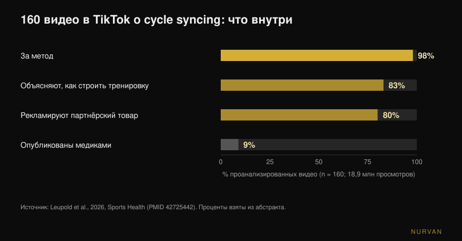
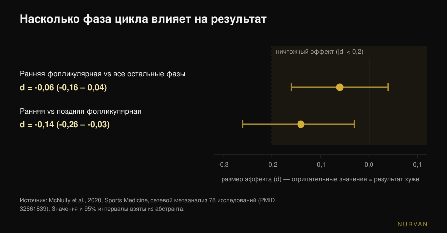

# Тренировки по фазам цикла: это работает?

Автор: [Giammaria Loi](/autore/giammaria-loi) · обновлено 11 ноября 2026

*Cycle syncing* звучит отовсюду: сила в фолликулярной фазе, йога и прогулки в лютеиновой, отдых во время менструации. Сформулировано так, звучит очевидно — гормоны меняются, значит, должны меняться и тренировки. Проблема в том, что когда эту идею измеряют в лаборатории, остаётся гораздо меньше, чем обещает календарь. Вот что говорят данные и что делать вместо того, чтобы переписывать программу четыре раза в месяц.

## Коротко

- **Измеренный эффект на результат ничтожен.** Сетевой метаанализ 78 исследований находит снижение на **0,06** (шкала размеров эффекта) в ранней фолликулярной фазе по сравнению со всеми остальными: формально есть, практически не значит ничего.
- **Мышца не «анаболичнее» в какой-то фазе.** При измерении синтеза мышечного белка стабильными изотопами и биопсией фолликулярная и лютеиновая фазы дают одинаковый результат: важна тренировка, а не день цикла.
- **Фаза не определяет программу, симптомы определяют занятие.** После тренировки с повреждением мышц болезненность и потеря силы выше в ранней фолликулярной фазе: корректируют нагрузку, а не план.
- **Замеры скачут сами по себе.** Изменения площади поперечного сечения мышцы за два цикла нельзя объяснить только тренировками: взвешиваться или измеряться в разные дни цикла — несопоставимо.
- **То, что вы находите онлайн, почти всегда маркетинг.** Из 160 роликов в TikTok 98% поддерживали метод, лишь 9% были опубликованы медиками, а **80% продвигали товар**. Среднее качество материала: 0,8 из 5.

## Откуда взялся cycle syncing

Не из исследования, а из интернета. В сентябре 2026 года журнал *Sports Health* опубликовал первый систематический анализ таких материалов: 160 роликов в TikTok по теме, суммарно **18,9 млн просмотров**. 98% выражали положительное отношение к методу, 83% рассказывали, как строить тренировку по фазам, и лишь 9% были опубликованы медицинскими специалистами. При оценке двумя экспертами по спортивной медицине для женщин по двум стандартным шкалам среднее качество составило 0,8 из 5 (модифицированный DISCERN) и 1,8 из 5 (Global Quality Score). 80% роликов продвигали товар по партнёрской программе, и три четверти этих товаров были связаны именно с cycle syncing (Leupold et al., 2026).

Это не доказывает, что метод ошибочен. Это доказывает, что его популярность выросла не из данных и что у того, кто вам о нём рассказывает, часто есть что продать. Числа стоит посмотреть самостоятельно.

## Что на самом деле меняется в гормонах

Два ориентира для дальнейшего. **Фолликулярная фаза** идёт от первого дня менструации до овуляции: эстрогены растут и достигают пика незадолго до овуляции. **Лютеиновая фаза** идёт от овуляции до следующей менструации: растёт прогестерон, эстрогены держатся на промежуточном уровне. *Ранняя фолликулярная фаза* — это дни менструации, когда оба гормона низкие.

Гипотеза cycle syncing прямолинейна: высокий эстроген способствует анаболизму, значит, в фолликулярной фазе нужно нагружаться; высокий прогестерон катаболичен, значит, в лютеиновой — разгружаться. Это законная гипотеза, и литература, поддерживающая её на бумаге, существует: обзор в *Sports Medicine* 2022 года утверждает, что силовая работа, сосредоточенная в фолликулярной фазе, может превосходить сосредоточенную в лютеиновой по силе и массе (Kissow et al., 2022). Но это нарративный обзор, а не доказательство: он собирает небольшие исследования и интерпретирует их. Когда ту же гипотезу проверяют напрямую, выходит иначе.

## Меняется ли результат с фазой? Цифры по 78 исследованиям

Это вопрос с наибольшей доказательной базой. В 2020 году группа из Нортумбрии, Ноттингем Трента и Сан-Паулу собрала 78 экспериментальных работ, измерявших результат как минимум в двух определённых фазах цикла, и проанализировала их байесовскими методами в сетевом метаанализе.

Результат: в ранней фолликулярной фазе результат — и силовой, и на выносливость — снижен на **-0,06** (95% интервал доверия: от -0,16 до 0,04). По шкале размеров эффекта 0,2 — условный порог, ниже которого эффект называют *ничтожным*: 0,06 — треть этого порога, а интервал пересекает ноль. Самое неблагоприятное сравнение во всей сети, ранняя фолликулярная против поздней фолликулярной, достигает **-0,14** (от -0,26 до -0,03) — всё ещё ниже порога.

Авторы добавляют две оговорки, которые весят не меньше самой цифры. Первая: разброс **между** исследованиями велик, а общее качество доказательств оценено как *низкое* (42%). Вторая — их дословный вывод: общие рекомендации по результативности в течение цикла сформулировать нельзя, предпочтителен **персонализированный подход, основанный на индивидуальной реакции** (McNulty et al., 2020).

Держите это в голове, потому что в соцсетях исследование используют ровно наоборот: не «фаза X — сильная фаза», а «среднее не говорит о вас ничего полезного».

## Мышца «анаболичнее» в фолликулярной фазе?

Здесь свежий ответ самый чёткий. В 2025 году *Journal of Physiology* опубликовал работу группы Стюарта Филлипса из Университета Макмастера, построенную именно для ответа: 12 женщин, два шестидневных блока контролируемых силовых тренировок — один в поздней фолликулярной фазе (пик эстрогенов), другой в средней лютеиновой (пик прогестерона) — в случайном порядке, с тренировкой одной ноги и второй в качестве контроля. Фазу подтверждали отслеживанием цикла, анализами крови и мочевыми тестами; синтез измеряли стабильными изотопами, распад — на уровне всего тела, плюс метаболомика и биопсии мышц.

Результат: упражнение значимо повысило синтез мышечного белка (p < 0,001), **фаза цикла — нет**. Никакого эффекта на синтез, никакого на распад (p = 0,24), никаких заметных различий в циркулирующих метаболитах между фазами. Фраза авторов: скелетная мышца не отвечает анаболически сильнее в какой-либо конкретной фазе цикла (Colenso-Semple et al., 2025).

За два года до этого та же группа вместе с Кирсти Эллиотт-Сейл разобрала существующие обзоры по силе, результативности и гипертрофии: выводы сильно расходятся от обзора к обзору, и главное — повторяется методическая проблема: мало кто действительно проверяет фазу у участниц анализами, а не только календарём. Их вывод: **преждевременно** заключать, что краткосрочные гормональные колебания заметно влияют на острую результативность или на долгосрочные адаптации (Colenso-Semple et al., 2023).

По той же причине индивидуальные реакции на тренировку в принципе плохо предсказуемы: разброс между людьми гораздо больше, чем разброс между фазами.

## Что действительно меняется: симптомы, восстановление и замеры

Сказать, что фаза не меняет адаптации, не значит сказать, что все дни одинаковы. Две вещи меняются измеримо.

**Ощущаемое повреждение мышц.** Метаанализ 19 исследований в *Journal of Strength and Conditioning Research* сравнил реакцию на тяжёлую тренировку в разных фазах: отсроченная мышечная болезненность и потеря силы после нагрузки различались между фазами, худшие значения — в **ранней фолликулярной фазе**, тогда как креатинкиназа, маркер повреждения в крови, различий не показала. Авторы предлагают в эти дни рассмотреть чуть меньшие нагрузки или более длительное восстановление (Romero-Parra et al., 2021). Обратите внимание на разницу: подстраивать восстановление под состояние, а не менять цель мезоцикла.

**Числа, по которым вы себя оцениваете.** Исследование 2024 года в *Applied Physiology, Nutrition, and Metabolism* наблюдало 20 женщин в течение двух полных циклов: одна нога тренировалась, вторая отдыхала, площадь поперечного сечения мышцы измеряли в шести точках. Тренированная нога выросла; но 19 участниц из 20 показали изменения сечения выше или ниже порога погрешности измерения и вне тренировок — настолько, что авторы заключают: наблюдаемые за два цикла изменения **нельзя отнести исключительно к тренировкам** (Dias et al., 2024). Проще говоря, задержка жидкости и обычные колебания портят измерение. Сравнивать обхваты, вес или отражение в зеркале в разные дни цикла — значит сравнивать несопоставимое.

## А если вы принимаете контрацептивы?

Частый вопрос с более твёрдым ответом, чем принято думать. Метаанализ 42 исследований и 590 участниц сравнил принимающих оральные контрацептивы с женщинами с естественным циклом, а также дни приёма с днями перерыва. Приём оральных контрацептивов может сопровождаться в среднем **слегка** более низкой результативностью, но любой эффект на уровне группы, скорее всего, ничтожен, а результативность остаётся стабильной на протяжении цикла приёма. И здесь итоговая рекомендация авторов индивидуальная, а не общая (Elliott-Sale et al., 2020).

## Что на самом деле говорит наука

| Распространённое утверждение | Вердикт | Источник |
|---|---|---|
| «В фолликулярной фазе вы сильнее» | **Требует уточнения**: измеренная разница -0,06, ниже порога ничтожности | McNulty et al., 2020 |
| «В фолликулярной фазе растёт больше мышц» | **Опровергнуто**: синтез и распад белка одинаковы в обеих фазах | Colenso-Semple et al., 2025 |
| «Силовая работа в нужной фазе даёт больше» | **Не подтверждено**: гипотеза живёт в нарративном обзоре, а не в прямых данных | Kissow et al., 2022; Colenso-Semple et al., 2023 |
| «Во время месячных лучше не тренироваться» | **Опровергнуто**: физиологических причин нет; при необходимости меняют нагрузку | Colenso-Semple et al., 2023; McNulty et al., 2020 |
| «В какие-то дни крепатура сильнее» | **Подтверждено**: болезненность и потеря силы выше в ранней фолликулярной фазе | Romero-Parra et al., 2021 |
| «Замеры меняются из-за цикла, а не из-за прогресса» | **Подтверждено**: изменения сечения нельзя объяснить только тренировками | Dias et al., 2024 |
| «На контрацептивах результаты хуже» | **Требует уточнения**: небольшая средняя разница, вероятно ничтожная | Elliott-Sale et al., 2020 |
| «Cycle syncing подтверждён наукой» | **Опровергнуто как контент**: среднее качество материалов 0,8 из 5 | Leupold et al., 2026 |

## Как применить

1. **Оставьте программу, уберите гормональный календарь.** Прогрессия, частота и объём остаются прежними: нет данных, оправдывающих четыре разные программы в месяц. Как строится блок, мы разбирали здесь: [сколько повторений нужно для массы](/ru/blog/skolko-povtoreniy-dlya-massy).
2. **Авторегулируйте отдельное занятие, а не мезоцикл.** В дни, когда хуже, оставьте то же упражнение и ту же схему, но снимите немного веса или остановитесь на один RIR раньше (RIR — число повторений, которые остаются в запасе в конце подхода). В этом разница между «подстроиться» и «отказаться».
3. **Ведите дневник симптомов два-три цикла, прежде чем делать выводы.** Один месяц не отделит цикл от сна, стресса или недели с высокой нагрузкой. Через два-три цикла реальная закономерность видна в ваших же числах.
4. **Измеряйтесь всегда в одной и той же точке цикла.** Вес и обхваты сравнивают с интервалом в цикл, а не в неделю. Сравнение 5-го дня с 23-м измеряет не тренировку.
5. **Если вы работаете с тренером, приносите данные, а не вчерашнее ощущение.** Использованный вес, RIR, сон и заметка о симптомах стоят больше, чем «эта неделя не пошла». О том, что должен контролировать тренер на удалёнке, чтобы не уступать залу, мы писали отдельно: [работает ли онлайн-коучинг?](/ru/blog/rabotaet-li-onlayn-kouching).
6. **Боль, которая вас останавливает, очень нерегулярные или отсутствующие циклы — к врачу, а не к программе.** Выраженная дисменорея, обильные кровотечения или аменорея — не тренировочные переменные для авторегуляции: с ними идут к врачу или гинекологу. Аменорею у тех, кто много тренируется, в частности, следует оценивать как вопрос доступности энергии.

> ### Попробуйте Nurvan — цикл ведут по своим данным, а не по календарю
>
> В Nurvan вы записываете вес и RIR подход за подходом, добавляете заметку к занятию, когда чувствуете себя хуже, и храните замеры в истории: через два-три цикла видно, есть ли закономерность в ваших числах, вместо доверия общему правилу. Если вы работаете с тренером, он видит ту же хронологию и может авторегулировать неделю вместе с вами. [Попробовать Nurvan](https://nurvan.app)

## Частые вопросы

**Нужно ли тренироваться по фазам менструального цикла?**
Данных в пользу этого нет. Средняя разница результативности между фазами по 78 исследованиям — -0,06, ниже условного порога ничтожного эффекта, а синтез мышечного белка после тренировки не различается между фолликулярной и лютеиновой фазами. Лучше сохранять программу и авторегулировать отдельное занятие по самочувствию.

**Можно ли заниматься с весами во время менструации?**
Да. Физиологических причин останавливаться нет, адаптации к тренировкам не ухудшаются. В эти дни крепатура и потеря силы после тяжёлых занятий в среднем выше, поэтому имеет смысл немного снизить вес или удлинить отдых, не меняя упражнений и целей.

**В какой фазе цикла растёт больше мышц?**
Ни в какой, насколько это можно измерить сегодня. Самое точное исследование по теме измерило синтез и распад мышечного белка в двух противоположных фазах стабильными изотопами и биопсией: разницу сделала тренировка, а не фаза.

**Почему вес всегда растёт перед месячными?**
Потому что меняется количество жидкости, а не мышцы или жир. Исследование двух полных циклов показывает изменения сечения мышцы независимо от тренировок, так что вес и обхваты тоже двигаются сами по себе: осмысленно сравнивать только одну и ту же точку двух разных циклов.

## Читайте также

- [Силовые тренировки при беременности: что говорят исследования](/ru/blog/silovye-trenirovki-pri-beremennosti-chto-govoryat-issledovaniya) — другая женская тема, где советы в обиходе гораздо строже данных.
- [Сколько повторений для массы: миф о 8-12](/ru/blog/skolko-povtoreniy-dlya-massy) — как построить блок, который не нужно переписывать каждую неделю.
- [Работает ли онлайн-коучинг? Что говорят исследования](/ru/blog/rabotaet-li-onlayn-kouching) — что на самом деле должен отслеживать тот, кто ведёт вас удалённо.

## Источники

1. McNulty KL, Elliott-Sale KJ, Dolan E, Swinton PA, Ansdell P, Goodall S, Thomas K, Hicks KM, 2020. The Effects of Menstrual Cycle Phase on Exercise Performance in Eumenorrheic Women: A Systematic Review and Meta-Analysis. *Sports Medicine* 50(10):1813-1827. PMID 32661839. [DOI 10.1007/s40279-020-01319-3](https://doi.org/10.1007/s40279-020-01319-3)
2. Colenso-Semple LM, McKendry J, Lim C, Atherton PJ, Wilkinson DJ, Smith K, Phillips SM, 2025. Menstrual cycle phase does not influence muscle protein synthesis or whole-body myofibrillar proteolysis in response to resistance exercise. *The Journal of Physiology* 603(5):1109-1121. PMID 39630025. [DOI 10.1113/JP287342](https://doi.org/10.1113/JP287342)
3. Colenso-Semple LM, D'Souza AC, Elliott-Sale KJ, Phillips SM, 2023. Current evidence shows no influence of women's menstrual cycle phase on acute strength performance or adaptations to resistance exercise training. *Frontiers in Sports and Active Living* 5:1054542. PMID 37033884. [DOI 10.3389/fspor.2023.1054542](https://doi.org/10.3389/fspor.2023.1054542)
4. Kissow J, Jacobsen KJ, Gunnarsson TP, Jessen S, Hostrup M, 2022. Effects of Follicular and Luteal Phase-Based Menstrual Cycle Resistance Training on Muscle Strength and Mass. *Sports Medicine* 52(12):2813-2819. PMID 35471634. [DOI 10.1007/s40279-022-01679-y](https://doi.org/10.1007/s40279-022-01679-y)
5. Romero-Parra N, Cupeiro R, Alfaro-Magallanes VM, Rael B, Rubio-Arias JÁ, Peinado AB, Benito PJ, 2021. Exercise-Induced Muscle Damage During the Menstrual Cycle: A Systematic Review and Meta-Analysis. *Journal of Strength and Conditioning Research* 35(2):549-561. PMID 33201156. [DOI 10.1519/JSC.0000000000003878](https://doi.org/10.1519/JSC.0000000000003878)
6. Dias NF, Bergamasco JGA, Scarpelli MC, Silva DG, Chaves TS, Bittencourt D, Medalha RA, Carello Filho PC, De Souza EO, Ugrinowitsch C, Libardi CA, 2024. Changes in muscle cross-sectional area during two menstrual cycles may not be exclusively attributed to resistance training. *Applied Physiology, Nutrition, and Metabolism* 49(12):1729-1739. PMID 39303293. [DOI 10.1139/apnm-2024-0004](https://doi.org/10.1139/apnm-2024-0004)
7. Elliott-Sale KJ, McNulty KL, Ansdell P, Goodall S, Hicks KM, Thomas K, Swinton PA, Dolan E, 2020. The Effects of Oral Contraceptives on Exercise Performance in Women: A Systematic Review and Meta-analysis. *Sports Medicine* 50(10):1785-1812. PMID 32666247. [DOI 10.1007/s40279-020-01317-5](https://doi.org/10.1007/s40279-020-01317-5)
8. Leupold O, Anderson OK, Giampaolo G, Cheng J, Casey EK, 2026. The Social Media Trend of Cycle Syncing: An Analysis of the Content and Quality of Videos on TikTok. *Sports Health*. PMID 42725442. [DOI 10.1177/19417381261479699](https://doi.org/10.1177/19417381261479699)

Библиографические источники найдены через PubMed. Тема выбрана по трендовому сигналу: cycle syncing входит в число самых распространённых тем женского фитнеса в соцсетях — 18,9 млн просмотров только у 160 роликов, проанализированных в исследовании *Sports Health* от 11 сентября 2026 года, — тогда как первые результаты поиска подают метод как рабочий, не приводя измеренных размеров эффекта.

---

*Джаммария Лои — основатель Nurvan. Тренируется с отягощениями с 2012 года, работает персональным тренером и коучем с сертификатом FIPE с 2013 года и выступает в пауэрлифтинге на национальном уровне с 2018 года. Каждая его статья начинается с научных исследований и заканчивается тем, что действительно работает в зале.*

> Примечание: информационный материал, он не заменяет консультацию врача или специалиста.
