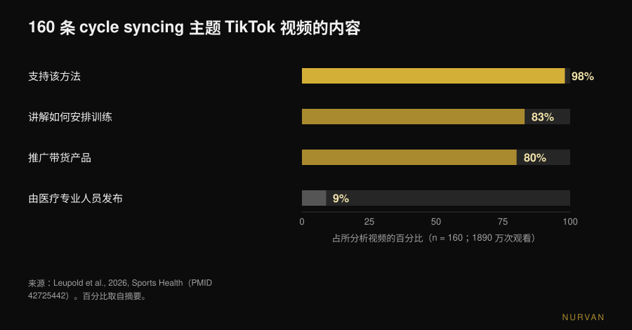
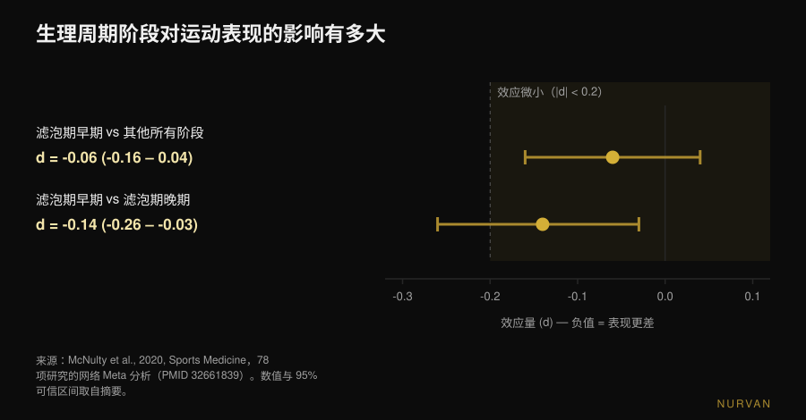

# 按生理周期安排训练，真的有用吗？

作者： [Giammaria Loi](/autore/giammaria-loi) · 更新于 2026 年 11 月 11 日

"周期同步训练"（cycle syncing）到处都是：卵泡期练力量，黄体期做瑜伽和散步，经期休息。这么说听起来顺理成章——激素在变，训练当然也该变。问题是，当这个想法真被放进实验室测量时，剩下的东西远比那张日历小得多。下面是数据怎么说，以及与其一个月改四次计划，不如做什么。

## 要点速览

- **测到的运动表现差异微不足道。** 一项纳入 78 项研究的网络 Meta 分析发现，卵泡期早期相对其他所有阶段的降幅为 **0.06**（效应量尺度）：理论上存在，实际上没有意义。
- **肌肉不会在某个阶段"更合成"。** 用稳定同位素和肌肉活检测量肌肉蛋白合成，卵泡期和黄体期结果一致：起作用的是训练，不是周期第几天。
- **决定计划的不是阶段，决定当天训练的是症状。** 在造成肌肉损伤的训练之后，酸痛和力量下降在卵泡期早期更明显：调整的是负荷，不是计划。
- **围度和体重本来就会自己波动。** 跨两个周期记录到的肌肉横截面积变化并不能只归因于训练：在周期的不同天称重或量围度，本身就不可比。
- **网上看到的内容大多是带货。** 160 条 TikTok 视频里，98% 支持这一方法，只有 9% 来自医疗专业人员，**80% 在推广产品**。平均教育质量：0.8 分（满分 5 分）。

## 周期同步训练从哪里来

不是来自某项研究，而是来自互联网。2026 年 9 月，《Sports Health》发表了对这类内容的第一份系统分析：160 条相关 TikTok 视频，合计 **1890 万次观看**。98% 对该方法持正面态度，83% 讲的是各阶段该如何安排训练，只有 9% 由医疗专业人员发布。由两位女性运动医学专家用两套标准量表评分，平均教育质量为 0.8 分（改良 DISCERN，满分 5 分）和 1.8 分（Global Quality Score，满分 5 分）。80% 的视频通过联盟营销推广产品，其中四分之三的产品正与周期同步训练有关（Leupold et al., 2026）。

这并不能证明方法本身是错的。它证明的是：这个方法的流行并非来自数据，而讲给你听的人往往有东西要卖。数字值得自己看一遍。

## 激素到底变了什么

先立两个坐标。**卵泡期**从月经第一天到排卵：雌激素上升，并在排卵前不久达到峰值。**黄体期**从排卵到下次月经：孕酮升高，雌激素维持在中间水平。*卵泡期早期*就是出血的那几天，两种激素都处于低位。

周期同步训练的假设很直：雌激素高有利于肌肉合成，所以卵泡期该加码；孕酮高偏分解，所以黄体期该减量。这是个合理的假设，纸面上也有文献支持：2022 年《Sports Medicine》的一篇综述认为，把力量训练集中在卵泡期，在力量和围度上可能优于集中在黄体期（Kissow et al., 2022）。但那是叙述性综述，不是证据：它汇集小样本研究并加以解读。当同一个假设被直接检验时，结论就不一样了。

## 阶段会影响表现吗？78 项研究的数字

这是材料最多的一个问题。2020 年，由诺森比亚大学、诺丁汉特伦特大学和圣保罗大学组成的团队汇总了 78 项在至少两个明确周期阶段测量表现的实验研究，用贝叶斯方法做了网络 Meta 分析。

结果：在卵泡期早期，无论力量还是耐力表现，降低幅度为 **-0.06**（95% 可信区间：-0.16 到 0.04）。在效应量尺度上，0.2 是公认的门槛，低于它的效应称为 *微不足道*：0.06 只有门槛的三分之一，而且区间跨过零。整个网络中最不利的比较——卵泡期早期对卵泡期晚期——为 **-0.14**（-0.26 到 -0.03），仍低于门槛。

作者另外给了两条和数字同样重要的提醒。第一：研究**之间**的差异很大，证据总体质量被评为*低*（42%）。第二是他们的原话：无法就整个周期的运动表现给出通用指南，更应采用**基于个体反应的个性化方式**（McNulty et al., 2020）。

记住这一点，因为社交媒体上对这项研究的用法恰好相反：不是"X 期是强势期"，而是"平均值说明不了你"。

## 卵泡期肌肉"更合成"吗？

这里最新的答案最干脆。2025 年，《Journal of Physiology》发表了麦克马斯特大学 Stuart Phillips 团队专为回答此问题设计的研究：12 名女性，两个为期六天的受控抗阻训练阶段——一个在卵泡期晚期（雌激素峰值），一个在黄体期中期（孕酮峰值）——顺序随机，每次训练一条腿，另一条作对照。阶段通过周期记录、抽血和尿检确认；合成用稳定同位素测量，分解在全身层面测量，另有代谢组学和肌肉活检。

结果：训练显著提高了肌肉蛋白合成（p < 0.001），**周期阶段没有**。对合成无影响，对分解无影响（p = 0.24），两个阶段之间循环代谢物也没有明显差异。作者的原话：骨骼肌并不会在某个特定周期阶段对合成更敏感（Colenso-Semple et al., 2025）。

两年前，同一团队与 Kirsty Elliott-Sale 一起复盘了关于力量、表现和肥大的既有综述：不同综述结论差异很大，更关键的是方法问题反复出现——很少有研究真正用激素检测而不只是日历来确认受试者处于哪个阶段。他们的结论是：现在就断言短期激素波动会明显影响急性表现或长期适应，为时**过早**（Colenso-Semple et al., 2023）。

这也正是个体训练反应普遍难以预测的原因：人与人之间的差异远大于阶段之间的差异。

## 真正会变的：症状、恢复和测量数据

说阶段不改变适应，并不等于说每天感觉都一样。有两件事确实会变，而且测得出来。

**主观的肌肉损伤。**《Journal of Strength and Conditioning Research》上一项纳入 19 项研究的 Meta 分析比较了不同阶段对大强度训练的反应：延迟性肌肉酸痛和运动后力量下降在各阶段之间存在差异，最差的数值出现在**卵泡期早期**，而血液损伤标志物肌酸激酶没有差异。作者建议这几天可以考虑略低的负荷或更长的恢复（Romero-Parra et al., 2021）。注意区别：按状态调整恢复，而不是改动整个中周期的目标。

**你用来评估自己的数字。** 2024 年《Applied Physiology, Nutrition, and Metabolism》的一项研究跟踪了 20 名女性两个完整周期，训练一条腿、另一条休息，在六个时间点测量肌肉横截面积。被训练的腿确实变粗了；但 20 人中有 19 人在训练之外也出现了超过或低于最小可检测差值的横截面积变化，以至于作者得出结论：两个周期中观察到的变化**不能完全归因于抗阻训练**（Dias et al., 2024）。换句话说，水分潴留和正常波动会把测量搞脏。在周期的两个不同日子比较围度、体重或镜子里的样子，比的本来就不是同一件事。

## 吃避孕药怎么办？

常见问题，答案比想象中扎实。一项纳入 42 项研究、590 名受试者的 Meta 分析，把口服避孕药使用者与自然周期女性作对比，并把服药日与停药日作对比。使用口服避孕药平均可能伴随**略低**的表现，但群体层面的任何效应极可能微不足道，且表现在整个服药周期中保持稳定。这里作者的最终建议同样是个体化，而不是通用规则（Elliott-Sale et al., 2020）。

## 研究到底怎么说

| 常见说法 | 结论 | 来源 |
|---|---|---|
| "卵泡期更有力气" | **需要澄清**：测得差异 -0.06，低于微小效应门槛 | McNulty et al., 2020 |
| "卵泡期更长肌肉" | **被推翻**：两阶段的蛋白合成与分解完全一致 | Colenso-Semple et al., 2025 |
| "在对的阶段练力量效果更好" | **缺乏支持**：该假设只存在于叙述性综述，没有直接证据 | Kissow et al., 2022；Colenso-Semple et al., 2023 |
| "经期最好别训练" | **被推翻**：没有生理学理由；必要时调整负荷即可 | Colenso-Semple et al., 2023；McNulty et al., 2020 |
| "有些日子酸痛更明显" | **被证实**：卵泡期早期酸痛和力量下降更大 | Romero-Parra et al., 2021 |
| "围度变化来自周期，不是进步" | **被证实**：横截面积变化不能只归因于训练 | Dias et al., 2024 |
| "吃避孕药效果更差" | **需要澄清**：平均差异很小，很可能微不足道 | Elliott-Sale et al., 2020 |
| "周期同步训练有科学依据" | **作为内容被推翻**：平均教育质量 0.8 分（满分 5 分） | Leupold et al., 2026 |

## 怎么落实

1. **留住计划，丢掉激素日历。** 进阶、频率和训练量保持不变：没有任何数据支持一个月用四套不同计划。关于一个训练块该怎么搭，我们写过[增肌到底需要多少次数](/zh/blog/duoshao-cishu-zengji)。
2. **自我调节的是单次训练，不是整个中周期。** 状态差的日子，动作和方案都不变，只是减一点重量或提前一个 RIR 收手（RIR 指一组结束时你还能再做的次数）。这就是"调整"和"放弃"的区别。
3. **先记录两到三个周期再下结论。** 单看一个月，分不清是周期、睡眠、压力还是一周的大训练量。两三个周期之后，真实存在的规律会出现在你自己的数字里。
4. **永远在周期的同一个位置测量。** 体重和围度要隔一个周期比，而不是隔一周。拿第 5 天和第 23 天比，量的不是训练。
5. **如果你跟教练训练，交给他数据，而不是昨天的感觉。** 用了多少重量、RIR、睡眠，再加一条症状备注，比"这周状态不好"有用得多。线上教练要监控什么才能和线下一样靠谱，我们另写过一篇：[线上教练有效吗？](/zh/blog/xianshang-jiaolian-youxiao-ma)
6. **疼到练不了、周期极不规律或停经：看医生，而不是改计划。** 重度痛经、经量过多或闭经不是可以靠自我调节处理的训练变量，要找医生或妇科医生。尤其是大训练量人群的闭经，应当按能量可用性问题来评估。

> ### 试试 Nurvan——周期要靠你自己的数据管理，而不是一张日历
>
> 在 Nurvan 里，你可以逐组记录重量和 RIR，状态不好时给这次训练加一条备注，并把围度体重留在历史记录中：两三个周期之后，你能看出自己的数字里到底有没有规律，而不是依赖一条通用规则。如果你有教练，他看到的是同一条时间线，可以和你一起自我调节这一周。[试试 Nurvan](https://nurvan.app)

## 常见问题

**需要按月经周期安排训练吗？**
没有数据支持。78 项研究汇总后，各阶段之间的平均表现差异是 -0.06，低于公认的微小效应门槛；训练后的肌肉蛋白合成在卵泡期与黄体期之间也没有差别。更合适的做法是保留计划，按当天状态自我调节单次训练。

**经期可以练力量吗？**
可以。没有生理学理由需要停练，训练适应也不会变差。这几天大强度训练后的酸痛和力量下降平均更明显，所以适当减一点重量或延长组间休息是合理的，但不必更换动作或目标。

**哪个阶段增肌最多？**
以目前能测量的范围来看，没有哪个阶段更好。该领域最严谨的研究用稳定同位素和活检，在两个相反阶段测量了肌肉蛋白的合成与分解：起作用的是训练，不是阶段。

**为什么经期前体重总会上升？**
因为变的是体内水分，而不是肌肉或脂肪。那项跨两个完整周期的研究显示，肌肉横截面积的变化与训练无关，因此体重和围度同样会自己波动：唯一合理的比较，是两个不同周期中的同一个位置。

## 延伸阅读

- [怀孕期间进行力量训练：研究怎么说](/zh/blog/huaiyun-qijian-liliang-xunlian-yanjiu) —— 另一个流行建议远比数据保守的女性话题。
- [增肌需要多少次数：8-12 的迷思](/zh/blog/duoshao-cishu-zengji) —— 如何搭一个不必每周重写的训练块。
- [线上教练有效吗？研究怎么说](/zh/blog/xianshang-jiaolian-youxiao-ma) —— 远程带你的人到底需要盯住什么。

## 参考文献

1. McNulty KL, Elliott-Sale KJ, Dolan E, Swinton PA, Ansdell P, Goodall S, Thomas K, Hicks KM, 2020. The Effects of Menstrual Cycle Phase on Exercise Performance in Eumenorrheic Women: A Systematic Review and Meta-Analysis. *Sports Medicine* 50(10):1813-1827. PMID 32661839. [DOI 10.1007/s40279-020-01319-3](https://doi.org/10.1007/s40279-020-01319-3)
2. Colenso-Semple LM, McKendry J, Lim C, Atherton PJ, Wilkinson DJ, Smith K, Phillips SM, 2025. Menstrual cycle phase does not influence muscle protein synthesis or whole-body myofibrillar proteolysis in response to resistance exercise. *The Journal of Physiology* 603(5):1109-1121. PMID 39630025. [DOI 10.1113/JP287342](https://doi.org/10.1113/JP287342)
3. Colenso-Semple LM, D'Souza AC, Elliott-Sale KJ, Phillips SM, 2023. Current evidence shows no influence of women's menstrual cycle phase on acute strength performance or adaptations to resistance exercise training. *Frontiers in Sports and Active Living* 5:1054542. PMID 37033884. [DOI 10.3389/fspor.2023.1054542](https://doi.org/10.3389/fspor.2023.1054542)
4. Kissow J, Jacobsen KJ, Gunnarsson TP, Jessen S, Hostrup M, 2022. Effects of Follicular and Luteal Phase-Based Menstrual Cycle Resistance Training on Muscle Strength and Mass. *Sports Medicine* 52(12):2813-2819. PMID 35471634. [DOI 10.1007/s40279-022-01679-y](https://doi.org/10.1007/s40279-022-01679-y)
5. Romero-Parra N, Cupeiro R, Alfaro-Magallanes VM, Rael B, Rubio-Arias JÁ, Peinado AB, Benito PJ, 2021. Exercise-Induced Muscle Damage During the Menstrual Cycle: A Systematic Review and Meta-Analysis. *Journal of Strength and Conditioning Research* 35(2):549-561. PMID 33201156. [DOI 10.1519/JSC.0000000000003878](https://doi.org/10.1519/JSC.0000000000003878)
6. Dias NF, Bergamasco JGA, Scarpelli MC, Silva DG, Chaves TS, Bittencourt D, Medalha RA, Carello Filho PC, De Souza EO, Ugrinowitsch C, Libardi CA, 2024. Changes in muscle cross-sectional area during two menstrual cycles may not be exclusively attributed to resistance training. *Applied Physiology, Nutrition, and Metabolism* 49(12):1729-1739. PMID 39303293. [DOI 10.1139/apnm-2024-0004](https://doi.org/10.1139/apnm-2024-0004)
7. Elliott-Sale KJ, McNulty KL, Ansdell P, Goodall S, Hicks KM, Thomas K, Swinton PA, Dolan E, 2020. The Effects of Oral Contraceptives on Exercise Performance in Women: A Systematic Review and Meta-analysis. *Sports Medicine* 50(10):1785-1812. PMID 32666247. [DOI 10.1007/s40279-020-01317-5](https://doi.org/10.1007/s40279-020-01317-5)
8. Leupold O, Anderson OK, Giampaolo G, Cheng J, Casey EK, 2026. The Social Media Trend of Cycle Syncing: An Analysis of the Content and Quality of Videos on TikTok. *Sports Health*. PMID 42725442. [DOI 10.1177/19417381261479699](https://doi.org/10.1177/19417381261479699)

文献通过 PubMed 检索获得。选题来自一个趋势信号：周期同步训练是社交媒体上女性健身传播最广的话题之一——仅《Sports Health》2026 年 9 月 11 日那项研究分析的 160 条视频就有 1890 万次观看——而搜索结果靠前的页面把这一方法当作已被验证的做法呈现，却不提测得的效应量。

---

*Giammaria Loi 是 Nurvan 的创始人。他自 2012 年开始力量训练，自 2013 年起担任 FIPE 认证私人教练，并自 2018 年起在全国级力量举比赛中参赛。他署名的每篇文章都从科研文献出发，最终落到健身房里真正有效的做法。*

> 注意：本文为科普内容，不能替代医生或专业人士的意见。
