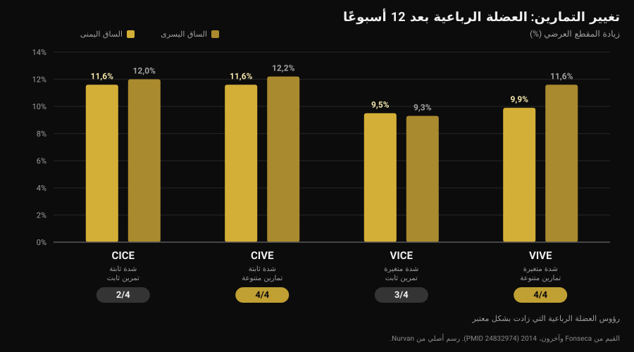
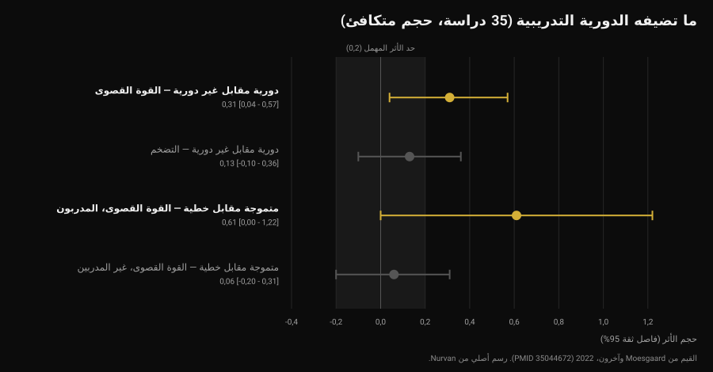

# كل كم تغيّر برنامج التدريب؟

بقلم [جياماريا لوي](/autore/giammaria-loi) · حُدِّث في 12 نوفمبر 2026

الرسالة تصل في موعدها: «كابتن، مرّ شهر، تغيّر لي البرنامج؟». خلفها فكرة منتشرة: العضلة تعتاد، إذن نحتاج إلى الجديد. الدراسات التي قارنت التمارين المتنوعة بالتمارين الثابتة تقول شيئًا أدق وأكثر فائدة: ما يجعلك تكبر ليس الجِدّة بل التدرّج. لكن اختيار التمارين يغيّر فعلًا *أين* تكبر. إليك كيف تقرّر، بالأرقام.

## باختصار

- **التقويم ليس معيارًا.** لا تقيس أي من الدراسات المجموعة هنا أفضلية لتبديل التمارين وفق موعد ثابت. مراجعة منهجية لثماني دراسات تخلص إلى أن التدوير المفرط، أي ارتفاع وتيرة التغيير، قد يعرقل التكيّفات.
- **تنويع التمارين لا يرفع النمو الكلي، بل يعيد توزيعه.** خلال 12 أسبوعًا زاد المقطع العرضي للعضلة الرباعية بين 9,5% و12,2% في كل المجموعات، لكن المجموعات التي نوّعت التمارين وحدها حققت تضخمًا في **الرؤوس الأربعة** كلها.
- **أفضل تركيبة للقوة: تمارين متنوعة مع شدة ثابتة.** هذه المجموعة زادت قوتها في السكوات أكثر من غيرها، بما فيها التي غيّرت الأحمال أيضًا.
- **الدورية التدريبية تساعد القوة لا التضخم.** مع تكافؤ الحجم، عبر 35 دراسة: أثر 0,31 على القوة القصوى و0,13 (غير دال) على الكتلة.
- **التقدّم لا يعني دائمًا زيادة الوزن.** زيادة التكرارات بالحمل نفسه تعطي نتائج مكافئة، لدى المتدربين والمبتدئين على السواء.

## من أين جاءت فكرة التغيير الشهري

العبارة المتداولة هي *إرباك العضلة*: الجسم يتكيّف مع محفّز متكرر، لذا يجب «إرباكه» بتمارين جديدة. الجزء الصحيح أن التكيّف موجود: المجموعة نفسها بالحمل نفسه تصبح أسهل مع الوقت. الخلاصة الخاطئة أن الحل هو تمرين آخر. الحل هو جعل تلك المجموعة أصعب، وهذا شيء مختلف.

هنا يختلط قراران:

- **اختيار التمارين**: أي حركات تؤدي؛
- **التدرّج**: كيف ينمو المحفّز داخل تلك التمارين، أسبوعًا بعد أسبوع.

الأدبيات تقول عن كل منهما شيئًا مختلفًا. من الأفضل النظر إليهما منفصلين.

## تنويع التمارين: ما الذي يتغير فعلًا

أكثر الدراسات إفادة هنا عمل برازيلي من 2014 على 49 شخصًا نشيطًا بدنيًا: 12 أسبوعًا، حصتان أسبوعيًا، وأربع مجموعات مبنية على تقاطع متغيرين: شدة ثابتة أو متغيرة، وتمرين ثابت أو متنوّع.

نتيجة التضخم تفاجئ من ينتظر فائزًا واضحًا: ازداد المقطع العرضي للعضلة الرباعية في كل المجموعات، بين 9,5% و12,2%. لم تتفوّق أي مجموعة في النمو الإجمالي.

الفرق يكمن في تفصيل يخفيه قياس واحد. للعضلة الرباعية أربعة رؤوس، وهي لا تنمو معًا بالضرورة. المجموعتان اللتان **نوّعتا التمارين** وحدهما حققتا تضخمًا في الرؤوس الأربعة: مجموعة التمرين الثابت لم تُظهر نموًا معتبرًا في العضلة المتسعة الإنسية ولا في المستقيمة الفخذية، والمجموعة التي غيّرت الشدة فقط لم تُظهره في المستقيمة الفخذية (Fonseca et al., 2014).

أما في القوة فهناك فائز: مجموعة **الشدة الثابتة والتمارين المتنوعة** زادت قوتها القصوى في السكوات أكثر من كل مجموعات التدريب الأخرى، بما فيها التي غيّرت التمارين والأحمال معًا. عنوان الدراسة صريح: تغيير التمارين أكثر فاعلية من تغيير مخططات الحمل.

انتبه لطريقة القراءة: «تمارين متنوعة» في تلك الدراسة تعني التناوب المنظّم بين حركات تحمّل العضلة بطرق مختلفة (ضغط الأرجل، السكوات، الطعنات)، لا اختيار تمرين عشوائي في كل مرة.

## التنويع المفرط: الحد

في 2022 جمعت مراجعة منهجية الدراسات المضبوطة الثماني الموجودة حول الموضوع، بإجمالي 241 مشاركًا، جميعهم رجال شباب. خلاصة الباحثين من أكثر الخلاصات عملية في الأدبيات: قدر من التنويع المنهجي يبدو أنه يحسّن التضخم الموضعي ويعظّم القوة الديناميكية، بينما التنويع المفرط والعشوائي قد يضرّ بالمكاسب. وتحديدًا، التمارين التي تعطي محفّزًا مكررًا وتدوير التمارين بوتيرة تغيير عالية قد يعرقلان التكيّفات (Kassiano et al., 2022).

كلمتان تقومان بالعمل كله: *منهجي* و*مكرر*. إضافة التفتيح إلى ضغط البنش تغيّر توزيع الحمل على الصدر. أما استبدال البنش بالبار ببنش الدمبل كل أسبوع فلا يضيف للعضلة شيئًا لم تعشه: هذا تنويع مكرر، وفي الأثناء فقدت خيط الحمل.

لكن هناك معطى لصالح التنويع لا ينبغي إغفاله. في دراسة على 21 رجلًا متدربًا، ثمانية أسابيع بأربع حصص أسبوعيًا، اتبعت مجموعة تمارين ثابتة بينما تلقّت الأخرى تمارين ونطاقات تكرار يسحبها تطبيق عشوائيًا في كل حصة. ارتفعت القوة القصوى في البنش والسكوات ارتفاعًا كبيرًا لدى المجموعتين، دون فرق بينهما. لكن **الدافعية الداخلية** تحسّنت بشكل دال في مجموعة التمارين المتنوعة، بينما تراجعت في مجموعة التمارين الثابتة، وإن بشكل غير دال (Baz-Valle et al., 2019).

بالترجمة: التنويع ليس مسرّعًا للنتائج، بل حليفًا للالتزام. وبما أن البرنامج الذي لا تتبعه لا ينتج شيئًا، فهذه ليست تفصيلة تُرمى — إنها الآلية نفسها التي تجعل [تحديات المواسم مثل Winter Arc تنجح إلى النصف فقط](/ar/blog/hal-yanjah-winter-arc).

## ماذا تقول الأبحاث فعلًا

**«العضلة تعتاد، والبرنامج يُغيَّر كل أربعة أسابيع» — غير صحيح.** لا تقارن أي من الدراسات المجموعة تغييرًا بموعد ثابت مع الإبقاء على التمارين نفسها وتجد أفضلية للأول. على العكس، المراجعة المنهجية الوحيدة حول الموضوع تشير إلى ارتفاع وتيرة التغيير كعائق محتمل (Kassiano et al., 2022).

**«تنويع التمارين يزيد النمو» — يحتاج إلى تدقيق.** النمو الإجمالي متشابه مع التمارين الثابتة أو المتنوعة. ما يتغير هو التوزيع داخل العضلة: مع التمارين المتنوعة تنمو أيضًا الرؤوس التي تتركها حركة واحدة خلفها (Fonseca et al., 2014).

**«تغيير التمارين يُفقد القوة» — يحتاج إلى تدقيق.** خلال ثمانية أسابيع، ولدى رجال متدربين، لم يخفض السحب العشوائي في كل حصة القوة القصوى (Baz-Valle et al., 2019). لكن أكبر مكسب في القوة في دراسة الاثني عشر أسبوعًا جاء من المجموعة التي نوّعت التمارين **مع تثبيت الشدة**: تغيير كل شيء دفعة واحدة أعطى أقل من تغيير شيء واحد في كل مرة.

**«بلا دورية تدريبية لا تقدّم» — يحتاج إلى تدقيق.** تحليل بعدي لـ35 دراسة متكافئة الحجم يجد أفضلية للبرمجة الدورية في القوة القصوى (أثر 0,31؛ فاصل ثقة 95% من 0,04 إلى 0,57)، لا في التضخم (0,13؛ من -0,10 إلى 0,36، غير دال). الدورية المتموجة تتفوق على الخطية في القوة القصوى (0,31)، غير أن الأفضلية تتركز لدى المتدربين (0,61) وتختفي لدى المبتدئين (0,06) (Moesgaard et al., 2022).

**«لكي تتقدّم عليك زيادة الوزن» — غير صحيح.** لدى 43 شخصًا بخبرة سنة على الأقل، أعطت ثمانية أسابيع من الحمل المتزايد بتكرارات ثابتة النتائج نفسها التي أعطتها التكرارات المتزايدة بحمل ثابت: فروق دون الملّيمتر في سماكات العضلات، وبحسب الباحثين أنفسهم فروق مشكوك في دلالتها العملية في القوة القصوى (Plotkin et al., 2022). والمقارنة نفسها لدى 39 مبتدئًا على عشرة أسابيع، مع عشوائية بين الساقين: القوة القصوى في تمديد الركبة من نحو 52 إلى 69 كجم مع الحمل المتزايد ومن نحو 52 إلى 67 كجم مع التكرارات المتزايدة، ومقطع العضلة المتسعة الوحشية من نحو 21 إلى 23,5 سم² في الحالتين، دون فرق (Chaves et al., 2024).

حدّ ينبغي تذكّره: عينات هذه الأبحاث في معظمها رجال شباب وبالغون نشيطون، وأقصى مدة 12 أسبوعًا. على آفاق السنوات، ولدى فئات مختلفة، تُقرأ هذه الأرقام كمؤشرات لا كقوانين.

## كيف تطبّق ذلك

السؤال الصحيح ليس «متى ينتهي البرنامج» بل «هل ما زال هذا التمرين ينتج تقدّمًا قابلًا للقياس؟». إذا كان الجواب نعم، فتغييره يرمي معلومات. وإذا كان لا، فالمشكلة تحتاج إلى فهم قبل الاستبدال.

تسلسل يعمل:

1. **أبقِ التمارين الأساسية المدة الكافية للتقدّم فيها.** الدراسات التي تُظهر مكاسب واضحة تمتد 8 إلى 12 أسبوعًا على الحركات الأساسية نفسها: أفق معقول قبل التفكير في التغيير، لا موعد نهائي يجب الالتزام به.
2. **قبل تغيير التمرين، غيّر التدرّج.** الحمل متوقف؟ أضف تكرارات بالحمل نفسه: الأدبيات تقول إنه يعمل بالمثل. ثم، حين يمتلئ النطاق، عُد إلى الحمل.
3. **ميّز بين الجمود الحقيقي والأسبوع السيئ.** حصتان باهتتان ليستا جمودًا. ثلاثة أو أربعة أسابيع بلا تقدّم في الحمل ولا في التكرارات، مع نوم وتغذية منتظمين، نعم.
4. **نوّع بشكل منهجي لا عشوائي.** تمرينان أو ثلاثة لكل مجموعة عضلية تحمّلها في أوضاع مختلفة، بتدوير على شكل كتل، لا باستبدال في كل حصة.
5. **لا تغيّر متغيرين معًا.** إذا غيّرت التمرين، أبقِ مخطط المجموعات والتكرارات ثابتًا. وإلا، حين يتوقف شيء عن العمل، لن تعرف ما هو.
6. **غيّر فورًا، دون انتظار، إذا سبّب التمرين ألمًا أو تعذّر أداؤه بشكل صحيح أو لم يكن متاحًا.** هنا لا موعد يُحترم: إنها مشكلة تُحَل.

القرار يحتاج بيانات، والبيانات هي بيانات الحصص — الحمل والتكرارات ومقدار الجهد، وهو بالضبط ما يقيسه [نظام التكرارات الاحتياطية (RIR) واختيار المجموعات والراحة](/ar/blog/kam-takrar-lilkutla-aladalia).

### ماذا تغيّر ومتى

| ماذا | كل كم | لماذا |
|---|---|---|
| الحمل أو التكرارات | كل أسبوع إن أمكن | هذا هو التدرّج: المحفّز الذي ينمو. الحمل والتكرارات متكافئان (Plotkin 2022؛ Chaves 2024) |
| التمارين المساعدة | في كتل من 6 إلى 8 أسابيع | تغطي رؤوس العضلة التي تتركها حركة واحدة خلفها (Fonseca 2014) |
| التمارين الأساسية | فقط عند تأكّد الجمود، أو بسبب الألم والتقنية | التدوير المتكرر قد يعرقل التكيّفات (Kassiano 2022) |
| مخطط المجموعات والتكرارات | على شكل كتل، لدى الرياضيين المتدربين | الدورية المتموجة تساعد القوة القصوى لدى المتدربين فقط (Moesgaard 2022) |
| كل شيء دفعة واحدة | أبدًا | تغيير متغيرين معًا يجعل البيانات غير قابلة للقراءة |

*جدول من إعداد Nurvan بالاعتماد على المصادر المذكورة في نهاية المقال.*

> ### مع Nurvan
> سجل Nurvan لكل تمرين يحفظ الحمل والتكرارات وRIR مجموعةً بمجموعة: يرى المدرب ما إذا كان التقدّم في تلك الحركة متوقفًا منذ أربعة أسابيع أم منذ حصة واحدة، فيقرر بالأرقام بدل التقويم. وحين يدخل تمرين إلى البرنامج أو يخرج منه، يبقى السجل: بنش قبل ثلاثة أشهر ما زال قابلًا للمقارنة ببنش اليوم. ومجموعات الإحماء تُقترح تلقائيًا انطلاقًا من حمل العمل، فلا يكلّفك تغيير التمرين حصة لإعادة إيجاد الأوزان. **[جرّب Nurvan](https://nurvan.app)**

## أسئلة شائعة

**كل كم يُغيَّر برنامج التدريب؟**
لا يوجد موعد ثابت تسنده البيانات. الدراسات التي تُظهر مكاسب واضحة تمتد 8 إلى 12 أسبوعًا على التمارين الأساسية نفسها، ومراجعة منهجية تشير إلى أن التغيير بوتيرة عالية قد يعرقل. المعيار هو التدرّج: ما دام الحمل أو التكرارات يرتفعان، فالبرنامج يعمل.

**هل تعتاد العضلة على التمارين؟**
تتكيّف مع المحفّز، ولهذا بالضبط يجب أن ينمو المحفّز. لكن «ينمو» تعني حملًا أكبر أو تكرارات أكثر، لا تمرينًا مختلفًا: لا تُظهر أي من الدراسات المجموعة هنا أن استبدال تمرين يعيد تشغيل المكاسب.

**إذا لم أستطع زيادة الوزن، هل أغيّر التمرين؟**
جرّب أولًا إضافة تكرارات بالحمل نفسه. في المقارنات المباشرة يعطي التدرّجان نتائج مكافئة لدى المتدربين والمبتدئين. يُدرس تغيير التمرين بعد ثلاثة أو أربعة أسابيع بلا تقدّم على أي من الجبهتين.

**هل يزيد تنويع التمارين النمو؟**
ليس في المجموع، لكن بتوزيع أفضل. مع تنويع منظّم تنمو أيضًا رؤوس العضلة التي تتركها حركة واحدة خلفها، ويستفيد كذلك دافعك للذهاب إلى النادي.

## اقرأ أيضًا

- [هل ينجح التدريب عن بُعد؟ ما تقوله الدراسات](/ar/blog/hal-yanjah-altadrib-an-bud) — كم تزن المتابعة، بالبرنامج نفسه.
- [برنامج تدريب بالذكاء الاصطناعي: ما تقوله الدراسات](/ar/blog/barnamij-tadrib-bialdhakaa-alistinaei) — أين يصيب الذكاء الاصطناعي في البرمجة وأين يخطئ.
- [كم تكرارًا للكتلة العضلية: خرافة 8-12](/ar/blog/kam-takrar-lilkutla-aladalia) — المجموعات والتكرارات والراحة، وما الذي يتغير فعلًا.

## المصادر

1. Kassiano W, Nunes JP, Costa B, Ribeiro AS, Schoenfeld BJ, Cyrino ES, 2022. *Does Varying Resistance Exercises Promote Superior Muscle Hypertrophy and Strength Gains? A Systematic Review.* Journal of Strength and Conditioning Research 36(6):1753-1762. PMID 35438660. [DOI 10.1519/JSC.0000000000004258](https://doi.org/10.1519/JSC.0000000000004258)
2. Fonseca RM, Roschel H, Tricoli V, de Souza EO, Wilson JM, Laurentino GC, Aihara AY, de Souza Leão AR, Ugrinowitsch C, 2014. *Changes in exercises are more effective than in loading schemes to improve muscle strength.* Journal of Strength and Conditioning Research 28(11):3085-3092. PMID 24832974. [DOI 10.1519/JSC.0000000000000539](https://doi.org/10.1519/JSC.0000000000000539)
3. Baz-Valle E, Schoenfeld BJ, Torres-Unda J, Santos-Concejero J, Balsalobre-Fernández C, 2019. *The effects of exercise variation in muscle thickness, maximal strength and motivation in resistance trained men.* PLoS ONE 14(12):e0226989. PMID 31881066. [DOI 10.1371/journal.pone.0226989](https://doi.org/10.1371/journal.pone.0226989)
4. Moesgaard L, Beck MM, Christiansen L, Aagaard P, Lundbye-Jensen J, 2022. *Effects of Periodization on Strength and Muscle Hypertrophy in Volume-Equated Resistance Training Programs: A Systematic Review and Meta-analysis.* Sports Medicine 52(7):1647-1666. PMID 35044672. [DOI 10.1007/s40279-021-01636-1](https://doi.org/10.1007/s40279-021-01636-1)
5. Plotkin D, Coleman M, Van Every D, Maldonado J, Oberlin D, Israetel M, Feather J, Alto A, Vigotsky AD, Schoenfeld BJ, 2022. *Progressive overload without progressing load? The effects of load or repetition progression on muscular adaptations.* PeerJ 10:e14142. PMID 36199287. [DOI 10.7717/peerj.14142](https://doi.org/10.7717/peerj.14142)
6. Chaves TS, Scarpelli MC, Bergamasco JGA, da Silva DG, Medalha Junior RA, Dias NF, Bittencourt D, Carello Filho PC, Angleri V, Nóbrega SR, Roberts MD, Ugrinowitsch C, Libardi CA, 2024. *Effects of Resistance Training Overload Progression Protocols on Strength and Muscle Mass.* International Journal of Sports Medicine 45(7):504-510. PMID 38286426. [DOI 10.1055/a-2256-5857](https://doi.org/10.1055/a-2256-5857)

مصادر ببليوغرافية عبر PubMed. الموضوع مختار من قائمة Nurvan التحريرية، انطلاقًا من أكثر الأسئلة التي تصل إلى المدربين.

---

*جياماريا لوي مؤسس Nurvan. يتدرب بالأثقال منذ 2012، ويعمل مدربًا شخصيًا ومدرب أداء معتمدًا من FIPE منذ 2013، وينافس في رفع الأثقال القوة على المستوى الوطني منذ 2018. كل مقال يوقّعه ينطلق من الدراسات العلمية ليصل إلى ما ينفع فعلًا في النادي.*

> ملاحظة: محتوى معلوماتي، لا يغني عن رأي طبيب أو مختص.
