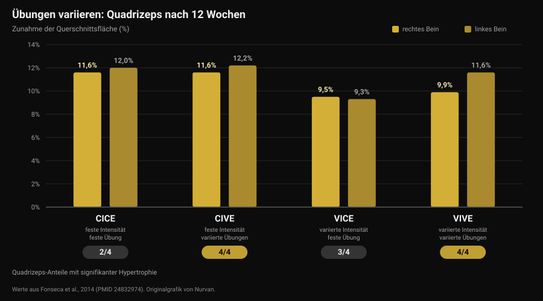
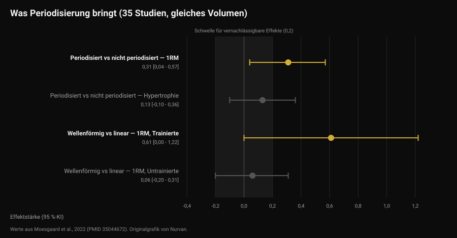

# Wie oft sollte man den Trainingsplan wechseln?

Von [Giammaria Loi](/autore/giammaria-loi) · aktualisiert am 12. November 2026

Die Nachricht kommt pünktlich: „Coach, es ist ein Monat um, gibst du mir einen neuen Plan?" Dahinter steckt eine verbreitete Idee: Der Muskel gewöhnt sich, also braucht es Abwechslung. Die Studien, die variierte gegen feste Übungen verglichen haben, erzählen etwas Genaueres und Nützlicheres: Nicht die Neuheit lässt wachsen, sondern die Progression. Die Übungsauswahl verändert aber sehr wohl, *wo* du wächst. So entscheidest du — mit Zahlen.

## Kurz gefasst

- **Der Kalender ist kein Kriterium.** Keine der hier gesammelten Studien misst einen Vorteil davon, Übungen nach festem Zeitplan zu tauschen. Eine systematische Übersicht über 8 Studien kommt zum Schluss, dass übermäßige Rotation — also eine hohe Wechselfrequenz — die Anpassungen sogar behindern kann.
- **Übungen zu variieren erhöht nicht das Gesamtwachstum, es verteilt es anders.** Über 12 Wochen stieg der Querschnitt des Quadrizeps in allen Gruppen um 9,5 bis 12,2 %, aber nur die Gruppen mit wechselnden Übungen hypertrophierten **alle vier** Anteile des Muskels.
- **Die beste Kombination für Kraft: wechselnde Übungen bei stabiler Intensität.** Diese Gruppe legte beim Kniebeugen-Maximum am stärksten zu — mehr als jene, die auch die Lasten wechselten.
- **Periodisierung hilft der Kraft, nicht der Hypertrophie.** Bei gleichem Volumen, über 35 Studien: Effekt 0,31 aufs Maximum, 0,13 (nicht signifikant) auf die Muskelmasse.
- **Progression heißt nicht immer mehr Gewicht.** Mehr Wiederholungen bei gleicher Last bringen gleichwertige Ergebnisse — bei Trainierten wie bei Anfängern.

## Woher die Idee vom Monatswechsel kommt

Das kursierende Schlagwort heißt *Muscle Confusion*: Der Körper passe sich an einen wiederholten Reiz an, also müsse man ihn mit neuen Übungen „verwirren". Richtig daran ist, dass es Anpassung gibt: Derselbe Satz mit derselben Last wird mit der Zeit leichter. Falsch ist der Schluss, die Antwort sei eine andere Übung. Die Antwort ist, diesen Satz schwerer zu machen — und das ist etwas anderes.

Hier werden zwei Entscheidungen vermischt:

- **die Übungsauswahl**: welche Bewegungen du machst;
- **die Progression**: wie der Reiz innerhalb dieser Übungen Woche für Woche wächst.

Die Literatur sagt zu beidem Unterschiedliches. Es lohnt sich, sie getrennt zu betrachten.

## Übungen variieren: was sich wirklich ändert

Die aufschlussreichste Arbeit dazu ist eine brasilianische Studie von 2014 mit 49 körperlich aktiven Personen: 12 Wochen, zwei Einheiten pro Woche, vier Gruppen aus der Kreuzung zweier Variablen — Intensität konstant oder variiert, Übung konstant oder variiert.

Das Hypertrophie-Ergebnis überrascht alle, die einen klaren Sieger erwarten: Der Querschnitt des Quadrizeps nahm in jeder Gruppe zu, zwischen 9,5 % und 12,2 %. Beim Gesamtwachstum gewann niemand.

Der Unterschied steckt in einem Detail, das eine einzelne Messung verdeckt. Der Quadrizeps hat vier Anteile, und sie wachsen nicht zwangsläufig gemeinsam. Nur die beiden Gruppen, die **die Übungen variierten**, hypertrophierten alle vier: Die Gruppe mit fester Übung zeigte kein signifikantes Wachstum im Vastus medialis und im Rectus femoris, die Gruppe, die nur die Intensität variierte, keines im Rectus femoris (Fonseca et al., 2014).

Bei der Kraft gibt es dagegen einen Sieger: Die Gruppe mit **konstanter Intensität und wechselnden Übungen** gewann mehr Kniebeugen-Maximum als alle anderen Trainingsgruppen, auch mehr als jene, die Übungen und Lasten zugleich wechselte. Der Titel der Studie sagt es direkt: Übungen zu wechseln ist wirksamer als Belastungsschemata zu wechseln.

Wichtig für die Lesart: „Wechselnde Übungen" heißt in dieser Studie, geordnet zwischen Bewegungen zu wechseln, die den Muskel unterschiedlich belasten (Beinpresse, Kniebeuge, Ausfallschritte) — nicht, jedes Mal eine zufällige Übung zu ziehen.

## Zu viel variieren: die Grenze

2022 hat eine systematische Übersichtsarbeit die acht existierenden kontrollierten Studien zum Thema zusammengetragen, insgesamt 241 Teilnehmer, alles junge Männer. Das Fazit der Autoren gehört zu den praktischsten der Literatur: Ein gewisses Maß an systematischer Variation scheint die regionale Hypertrophie zu verbessern und die dynamische Kraft zu maximieren, während übermäßige, zufällige Variation die Zuwächse beeinträchtigen kann. Konkret können Übungen mit redundantem Reiz und eine hohe Wechselfrequenz die Anpassungen behindern (Kassiano et al., 2022).

Zwei Wörter machen die Arbeit: *systematisch* und *redundant*. Fliegende zusätzlich zum Bankdrücken verändern das Belastungsprofil der Brust. Bankdrücken mit Langhantel jede Woche durch Kurzhantel-Bankdrücken zu ersetzen bringt dagegen nichts, was der Muskel nicht schon hatte: redundante Variation — und nebenbei hast du den Faden bei der Last verloren.

Ein Argument für Abwechslung sollte trotzdem nicht verloren gehen. In einer Studie mit 21 trainierten Männern, acht Wochen mit vier Einheiten pro Woche, folgte eine Gruppe festen Übungen, während die andere Übungen und Wiederholungsbereiche in jeder Einheit per App auslosen ließ. Die Maxima im Bankdrücken und in der Kniebeuge stiegen in beiden Gruppen deutlich, ohne Unterschied zwischen ihnen. Aber die **intrinsische Motivation** verbesserte sich in der Gruppe mit wechselnden Übungen signifikant, während sie in der festen Gruppe — nicht signifikant — sank (Baz-Valle et al., 2019).

Übersetzt: Abwechslung beschleunigt die Ergebnisse nicht, sie hilft beim Dranbleiben. Und da ein Plan, dem du nicht folgst, nichts bringt, ist das kein Nebensache — es ist derselbe Mechanismus, der [saisonale Challenges wie den Winter Arc nur halb funktionieren lässt](/de/blog/funktioniert-der-winter-arc).

## Was die Forschung wirklich sagt

**„Der Muskel gewöhnt sich, der Plan muss alle vier Wochen gewechselt werden" — Widerlegt.** Keine der gesammelten Studien vergleicht einen Wechsel nach festem Zeitplan mit dem Beibehalten derselben Übungen und findet einen Vorteil für Ersteres. Im Gegenteil: Die einzige systematische Übersicht zum Thema nennt die hohe Wechselfrequenz als mögliches Hindernis (Kassiano et al., 2022).

**„Übungen zu variieren lässt mehr wachsen" — Zu präzisieren.** Das Gesamtwachstum ist mit festen oder wechselnden Übungen ähnlich. Was sich ändert, ist die Verteilung im Muskel: Mit wechselnden Übungen wachsen auch die Anteile, die eine einzelne Bewegung zurücklässt (Fonseca et al., 2014).

**„Übungen zu wechseln kostet Kraft" — Zu präzisieren.** Über acht Wochen reduzierte das Auslosen in jeder Einheit bei trainierten Männern die Maxima nicht (Baz-Valle et al., 2019). Der größte Kraftzuwachs der 12-Wochen-Studie kam aber von der Gruppe, die die Übungen variierte und **die Intensität fest hielt**: alles auf einmal zu ändern brachte weniger als eine Sache nach der anderen.

**„Ohne Periodisierung gibt es keinen Fortschritt" — Zu präzisieren.** Eine Metaanalyse von 35 volumenangeglichenen Studien findet einen Vorteil periodisierter Programmierung beim Maximum (Effekt 0,31; 95-%-Konfidenzintervall 0,04 bis 0,57), aber nicht bei der Hypertrophie (0,13; -0,10 bis 0,36, nicht signifikant). Wellenförmige Periodisierung schlägt die lineare beim Maximum (0,31), der Vorteil konzentriert sich jedoch auf Trainierte (0,61) und verschwindet bei Untrainierten (0,06) (Moesgaard et al., 2022).

**„Um Fortschritte zu machen, musst du Gewicht auflegen" — Widerlegt.** Bei 43 Personen mit mindestens einem Jahr Trainingserfahrung brachten acht Wochen steigende Last bei festen Wiederholungen dieselben Ergebnisse wie steigende Wiederholungen bei fester Last: Unterschiede unter einem Millimeter bei den Muskeldicken und, nach Aussage der Autoren selbst, von fragwürdiger praktischer Bedeutung beim Maximum (Plotkin et al., 2022). Derselbe Vergleich bei 39 Anfängern über zehn Wochen, mit randomisierten Beinen: Maximum an der Beinstrecker-Maschine von rund 52 auf 69 kg mit steigender Last und von rund 52 auf 67 kg mit steigenden Wiederholungen, Querschnitt des Vastus lateralis von rund 21 auf 23,5 cm² in beiden Fällen, ohne Unterschied (Chaves et al., 2024).

Eine Einschränkung: Die Stichproben dieser Studien bestehen überwiegend aus jungen Männern und körperlich aktiven Erwachsenen, und die längste Dauer beträgt 12 Wochen. Über Jahre hinweg und in anderen Gruppen sind diese Zahlen Hinweise, keine Gesetze.

## Wie du es umsetzt

Die richtige Frage lautet nicht „wann läuft der Plan ab?", sondern „bringt diese Übung noch messbare Progression?". Lautet die Antwort ja, wirfst du mit einem Wechsel Informationen weg. Lautet sie nein, will das Problem verstanden werden, bevor die Übung ersetzt wird.

Eine Reihenfolge, die funktioniert:

1. **Behalte die Hauptübungen so lange, wie du darin Fortschritte machen kannst.** Die Studien mit klaren Zuwächsen laufen 8 bis 12 Wochen auf denselben Grundbewegungen: ein sinnvoller Horizont, bevor du einen Wechsel erwägst — keine Frist, die eingehalten werden muss.
2. **Bevor du die Übung wechselst, wechsle die Progression.** Last blockiert? Mehr Wiederholungen bei gleicher Last: Die Literatur sagt, das wirkt genauso. Ist der Bereich voll, geht es zurück zur Last.
3. **Unterscheide echte Stagnation von einer schlechten Woche.** Zwei flache Einheiten sind keine Stagnation. Drei oder vier Wochen ohne Fortschritt bei Last und Wiederholungen, mit Schlaf und Ernährung in Ordnung, schon.
4. **Variiere systematisch, nicht zufällig.** Zwei oder drei Übungen pro Muskelgruppe, die sie in verschiedenen Positionen belasten, blockweise rotiert — nicht in jeder Einheit ersetzt.
5. **Ändere nie zwei Variablen gleichzeitig.** Wenn du die Übung wechselst, lass Sätze und Wiederholungen gleich. Sonst weißt du nicht, woran es lag, wenn etwas nicht mehr funktioniert.
6. **Wechsle sofort, ohne zu warten, wenn eine Übung schmerzt, technisch nicht sauber läuft oder nicht verfügbar ist.** Hier gibt es keine Frist: Das ist ein Problem, das gelöst werden will.

Zum Entscheiden braucht es Daten, und die Daten sind die der Einheiten — Last, Wiederholungen und wie hart es war, also genau das, was [Wiederholungen in Reserve (RIR) und die Wahl von Sätzen und Pausen](/de/blog/wie-viele-wiederholungen-muskelaufbau) abbilden.

### Was wechseln und wann

| Was | Wie oft | Warum |
|---|---|---|
| Last oder Wiederholungen | Wöchentlich, wenn möglich | Das ist die Progression: der wachsende Reiz. Last und Wiederholungen sind gleichwertig (Plotkin 2022; Chaves 2024) |
| Ergänzungsübungen | In Blöcken von 6 bis 8 Wochen | Deckt die Muskelanteile ab, die eine einzelne Bewegung zurücklässt (Fonseca 2014) |
| Hauptübungen | Nur bei bestätigter Stagnation oder wegen Schmerz und Technik | Häufige Rotation kann Anpassungen behindern (Kassiano 2022) |
| Satz- und Wiederholungsschema | In Blöcken, bei trainierten Athletinnen und Athleten | Wellenförmige Periodisierung hilft dem Maximum nur bei bereits Trainierten (Moesgaard 2022) |
| Alles auf einmal | Nie | Zwei Variablen gleichzeitig zu ändern macht die Daten unlesbar |

*Nurvan-Tabelle, erstellt aus den am Ende des Artikels zitierten Quellen.*

> ### Mit Nurvan
> Die Übungshistorie von Nurvan protokolliert Last, Wiederholungen und RIR Satz für Satz: Der Coach sieht, ob die Progression bei dieser Übung seit vier Wochen steht oder nur seit einer Einheit, und entscheidet mit Zahlen statt mit dem Kalender. Kommt eine Übung in den Plan oder fällt sie heraus, bleibt die Historie: Das Bankdrücken von vor drei Monaten ist weiterhin mit dem heutigen vergleichbar. Aufwärmsätze werden automatisch aus der Arbeitslast vorgeschlagen, sodass ein Übungswechsel dich keine Einheit kostet, um die Gewichte wiederzufinden. **[Nurvan testen](https://nurvan.app)**

## Häufige Fragen

**Wie oft sollte man den Trainingsplan wechseln?**
Es gibt keine durch Daten gestützte feste Frist. Die Studien mit klaren Zuwächsen laufen 8 bis 12 Wochen auf denselben Hauptübungen, und eine systematische Übersicht nennt häufige Wechsel als mögliches Hindernis. Das Kriterium ist die Progression: Solange Last oder Wiederholungen steigen, funktioniert der Plan.

**Gewöhnt sich der Muskel an Übungen?**
Er passt sich an den Reiz an — genau deshalb muss der Reiz wachsen. „Wachsen" heißt aber mehr Last oder mehr Wiederholungen, nicht eine andere Übung: Keine der hier gesammelten Studien zeigt, dass ein Übungstausch die Zuwächse neu startet.

**Wenn ich kein Gewicht mehr drauflegen kann, muss ich die Übung wechseln?**
Versuche zuerst, Wiederholungen bei gleicher Last zu ergänzen. Im direkten Vergleich bringen beide Progressionen gleichwertige Ergebnisse, bei Trainierten wie bei Anfängern. Den Übungswechsel erwägst du nach drei oder vier Wochen ohne Fortschritt an beiden Fronten.

**Lässt Übungsvariation mehr wachsen?**
Nicht insgesamt, aber besser verteilt. Mit geordnet wechselnden Übungen wachsen auch die Muskelanteile, die eine einzelne Bewegung zurücklässt — und die Motivation, überhaupt hinzugehen, profitiert ebenfalls.

## Lies auch

- [Funktioniert Online-Coaching? Was die Studien sagen](/de/blog/funktioniert-online-coaching) — wie viel Betreuung ausmacht, bei gleichem Plan.
- [Trainingsplan mit KI: was die Studien sagen](/de/blog/trainingsplan-mit-ki-studien) — wo künstliche Intelligenz die Programmierung trifft und wo nicht.
- [Wie viele Wiederholungen für Muskelaufbau: der 8-12-Mythos](/de/blog/wie-viele-wiederholungen-muskelaufbau) — Sätze, Wiederholungen und Pausen, und was wirklich zählt.

## Quellen

1. Kassiano W, Nunes JP, Costa B, Ribeiro AS, Schoenfeld BJ, Cyrino ES, 2022. *Does Varying Resistance Exercises Promote Superior Muscle Hypertrophy and Strength Gains? A Systematic Review.* Journal of Strength and Conditioning Research 36(6):1753-1762. PMID 35438660. [DOI 10.1519/JSC.0000000000004258](https://doi.org/10.1519/JSC.0000000000004258)
2. Fonseca RM, Roschel H, Tricoli V, de Souza EO, Wilson JM, Laurentino GC, Aihara AY, de Souza Leão AR, Ugrinowitsch C, 2014. *Changes in exercises are more effective than in loading schemes to improve muscle strength.* Journal of Strength and Conditioning Research 28(11):3085-3092. PMID 24832974. [DOI 10.1519/JSC.0000000000000539](https://doi.org/10.1519/JSC.0000000000000539)
3. Baz-Valle E, Schoenfeld BJ, Torres-Unda J, Santos-Concejero J, Balsalobre-Fernández C, 2019. *The effects of exercise variation in muscle thickness, maximal strength and motivation in resistance trained men.* PLoS ONE 14(12):e0226989. PMID 31881066. [DOI 10.1371/journal.pone.0226989](https://doi.org/10.1371/journal.pone.0226989)
4. Moesgaard L, Beck MM, Christiansen L, Aagaard P, Lundbye-Jensen J, 2022. *Effects of Periodization on Strength and Muscle Hypertrophy in Volume-Equated Resistance Training Programs: A Systematic Review and Meta-analysis.* Sports Medicine 52(7):1647-1666. PMID 35044672. [DOI 10.1007/s40279-021-01636-1](https://doi.org/10.1007/s40279-021-01636-1)
5. Plotkin D, Coleman M, Van Every D, Maldonado J, Oberlin D, Israetel M, Feather J, Alto A, Vigotsky AD, Schoenfeld BJ, 2022. *Progressive overload without progressing load? The effects of load or repetition progression on muscular adaptations.* PeerJ 10:e14142. PMID 36199287. [DOI 10.7717/peerj.14142](https://doi.org/10.7717/peerj.14142)
6. Chaves TS, Scarpelli MC, Bergamasco JGA, da Silva DG, Medalha Junior RA, Dias NF, Bittencourt D, Carello Filho PC, Angleri V, Nóbrega SR, Roberts MD, Ugrinowitsch C, Libardi CA, 2024. *Effects of Resistance Training Overload Progression Protocols on Strength and Muscle Mass.* International Journal of Sports Medicine 45(7):504-510. PMID 38286426. [DOI 10.1055/a-2256-5857](https://doi.org/10.1055/a-2256-5857)

Bibliografische Quellen über PubMed recherchiert. Thema aus der redaktionellen Warteschlange von Nurvan, ausgewählt nach den Fragen, die Coaches am häufigsten gestellt bekommen.

---

*Giammaria Loi ist der Gründer von Nurvan. Er trainiert seit 2012 mit Gewichten, arbeitet seit 2013 als FIPE-zertifizierter Personal Trainer und Coach und startet seit 2018 national im Powerlifting. Jeder Artikel von ihm beginnt bei den Studien und endet bei dem, was im Gym wirklich funktioniert.*

> Hinweis: Informativer Inhalt, er ersetzt nicht den Rat einer Ärztin, eines Arztes oder einer Fachperson.
