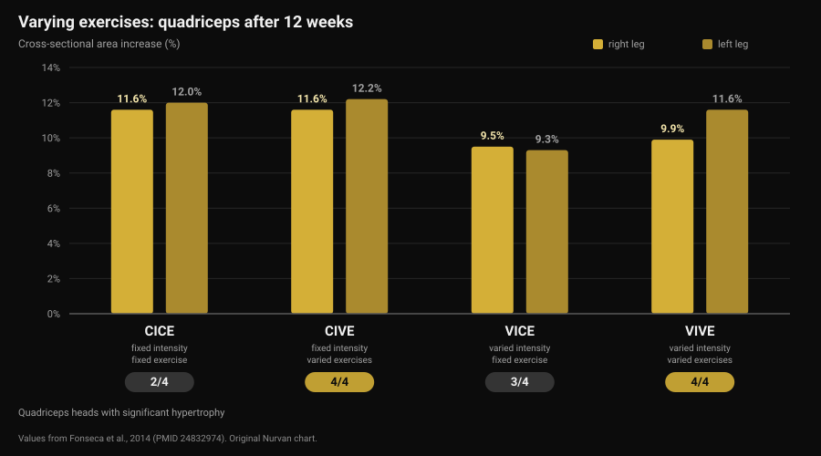
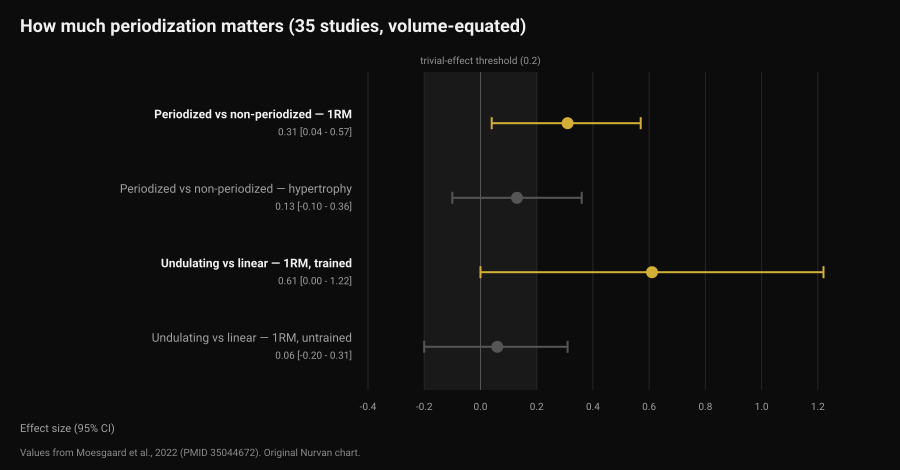

# How often should you change your workout program?

By [Giammaria Loi](/autore/giammaria-loi) · updated 12 November 2026

The message arrives right on schedule: "coach, it's been a month, can I get a new program?". Behind it sits a familiar idea — muscles adapt, so you need novelty. The studies that compared varied exercises against fixed ones tell a more precise, more useful story: novelty is not what makes you grow, progression is. But exercise choice does change *where* you grow. Here is how to decide, with the numbers.

## In short

- **The calendar is not a criterion.** None of the studies reviewed here shows an advantage to swapping exercises on a fixed schedule. A systematic review of 8 studies concludes that excessive rotation — a high frequency of change — may actually hinder adaptations.
- **Varying exercises doesn't raise total growth, it redistributes it.** Over 12 weeks quadriceps cross-sectional area grew 9.5-12.2% in every group, but only the varied-exercise groups grew **all four** heads of the muscle.
- **The best combination for strength was varied exercises with stable intensity.** That group added the most squat strength — more than the groups that also changed loads.
- **Periodization helps strength, not hypertrophy.** With volume equated, across 35 studies: effect 0.31 on 1RM, 0.13 (not significant) on muscle size.
- **Progressing doesn't always mean adding weight.** Adding reps at a fixed load produces equivalent results, in trained lifters and beginners alike.

## Where the monthly-change idea comes from

The phrase in circulation is *muscle confusion*: your body adapts to a repeated stimulus, so you have to "confuse" it with new exercises. The true part is that adaptation is real — the same set, with the same load, gets easier over time. The wrong conclusion is that the answer is a different exercise. The answer is to make that set harder, which is not the same thing.

Two decisions get blurred together here:

- **exercise selection**: which movements you do;
- **progression**: how the stimulus grows inside those movements, week by week.

The literature says different things about each. They are worth looking at separately.

## Varying exercises: what actually changes

The most informative study here is a 2014 Brazilian trial on 49 physically active people: 12 weeks, two sessions a week, four groups built by crossing two variables — intensity constant or varied, exercise constant or varied.

The hypertrophy result surprises anyone expecting a clear winner: quadriceps cross-sectional area increased in every group, between 9.5% and 12.2%. No group won on total growth.

The difference hides in a detail that a single measurement misses. The quadriceps has four heads, and they do not necessarily grow together. Only the two groups that **varied exercises** hypertrophied all four: the fixed-exercise group showed no significant growth in the vastus medialis or the rectus femoris, and the group that varied only intensity showed none in the rectus femoris (Fonseca et al., 2014).

On strength there is a winner: the group with **constant intensity and varied exercises** added more squat 1RM than every other training group, including the one that varied both exercises and loads. The study's title says it plainly: changing exercises is more effective than changing loading schemes.

Read it carefully, though. "Varied exercises" in that study means systematically alternating movements that load the muscle differently (leg press, squat, lunges), not picking a random exercise every time you walk in.

## Varying too much: the limit

In 2022 a systematic review collected the eight controlled studies that exist on the question, 241 participants in total, all young men. The authors' conclusion is one of the most practical in the literature: some degree of systematic variation appears to enhance regional hypertrophy and maximise dynamic strength, while excessive, random variation may compromise gains. Specifically, exercises that provide a redundant stimulus and a high frequency of exercise rotation may hinder adaptations (Kassiano et al., 2022).

Two words do the work: *systematic* and *redundant*. Adding dumbbell flyes to your bench press changes the loading profile on the chest. Swapping barbell bench for dumbbell bench every week does not add anything your chest hasn't already had — that is redundant variation, and meanwhile you've lost track of the load.

There is one point in favour of variety that shouldn't be lost. In a study on 21 trained men, eight weeks at four sessions a week, one group followed fixed exercises while the other had exercises and rep ranges drawn at random by an app every session. Bench and squat 1RM rose substantially in both, with no difference between groups. But **intrinsic motivation** improved significantly in the varied-exercise group, while it declined — non-significantly — in the fixed group (Baz-Valle et al., 2019).

Translated: variety is not a results accelerator, it's an adherence ally. And since a program you don't follow produces nothing, that is not a detail to throw away — the same mechanism that makes [seasonal challenges like the Winter Arc only half-right](/en/blog/does-the-winter-arc-work).

## What the research actually says

**"Muscles adapt, so change the program every four weeks" — Busted.** None of the studies reviewed compares a fixed-schedule swap against keeping the same exercises and finds an advantage for the former. The only systematic review on the topic flags high frequency of change as a possible obstacle (Kassiano et al., 2022).

**"Varying exercises builds more muscle" — Needs nuance.** Total growth is similar with fixed or varied exercises. What changes is the distribution inside the muscle: with varied exercises, the heads a single movement leaves behind grow too (Fonseca et al., 2014).

**"Changing exercises costs you strength" — Needs nuance.** Over eight weeks, in trained men, randomising every session did not reduce 1RM (Baz-Valle et al., 2019). But the largest strength gain in the 12-week study came from the group that varied exercises **while holding intensity fixed**: changing everything at once returned less than changing one thing at a time.

**"Without periodization you won't progress" — Needs nuance.** A meta-analysis of 35 volume-equated studies finds an advantage for periodized programming on 1RM (effect 0.31; 95% confidence interval 0.04 to 0.57) but not on hypertrophy (0.13; -0.10 to 0.36, not significant). Undulating periodization beats linear on 1RM (0.31), but the advantage sits in trained lifters (0.61) and disappears in untrained ones (0.06) (Moesgaard et al., 2022).

**"To progress you have to add weight" — Busted.** In 43 people with at least a year of training, eight weeks of rising load at fixed reps produced the same results as rising reps at fixed load: sub-millimetre differences in muscle thickness and, in the authors' own words, differences of questionable practical significance on 1RM (Plotkin et al., 2022). The same comparison in 39 beginners over ten weeks, with their two legs randomised: leg extension 1RM from about 52 to 69 kg with rising load and from about 52 to 67 kg with rising reps, vastus lateralis cross-sectional area from about 21 to 23.5 cm² either way, with no difference (Chaves et al., 2024).

One limit worth keeping in mind: these samples are mostly young, active men, and the longest study runs 12 weeks. Over years, and in different populations, treat these numbers as guidance rather than law.

## How to apply it

The right question is not "when does the program expire?" but "is this exercise still producing measurable progression?". If yes, changing it throws information away. If no, the problem needs to be understood before the exercise gets replaced.

A sequence that works:

1. **Keep your main lifts long enough to progress on them.** The studies showing clear gains run 8-12 weeks on the same core movements: that's a reasonable horizon before considering a change, not a deadline to meet.
2. **Before changing the exercise, change the progression.** Load stuck? Add reps at the same load — the literature says it works just as well. Then, once the rep range is full, go back to load.
3. **Separate a real plateau from a bad week.** Two flat sessions are not a plateau. Three or four weeks with no progress on load or reps, with sleep and food in order, is.
4. **Vary systematically, not randomly.** Two or three exercises per muscle group that load it in different positions, rotated in blocks, not swapped every session.
5. **Don't change two variables at once.** If you change the exercise, keep sets and reps fixed. Otherwise, when something stops working, you won't know what caused it.
6. **Change immediately, no waiting, if an exercise hurts, can't be performed well, or isn't available.** There's no schedule here: it's a problem to solve.

Deciding takes data, and the data is your sessions — load, reps and how hard it felt, which is exactly what [reps in reserve (RIR) and your choice of sets and rest](/en/blog/how-many-reps-build-muscle) are for.

### What to change, and when

| What | How often | Why |
|---|---|---|
| Load or reps | Every week, where possible | This is progression: the stimulus growing. Load and reps are equivalent (Plotkin 2022; Chaves 2024) |
| Accessory exercises | In blocks of 6-8 weeks | Covers the muscle heads a single movement leaves behind (Fonseca 2014) |
| Main lifts | Only on a confirmed plateau, or for pain and technique | Frequent rotation may hinder adaptations (Kassiano 2022) |
| Set and rep scheme | In blocks, for trained lifters | Undulating periodization helps 1RM only in those already trained (Moesgaard 2022) |
| All of it at once | Never | Changing two variables at a time makes your data unreadable |

*Nurvan table built from the sources listed at the end of this article.*

> ### With Nurvan
> Nurvan's per-exercise history logs load, reps and RIR set by set: your coach can see whether progression on that movement has been stuck for four weeks or just one session, and decide from the numbers instead of the calendar. When an exercise enters or leaves the program, the history stays: the bench press from three months ago is still comparable with today's. Warm-up sets are proposed automatically from your working load, so switching exercises doesn't cost you a session finding the weights again. **[Try Nurvan](https://nurvan.app)**

## FAQ

**How often should you change a workout program?**
There is no data-supported fixed deadline. The studies showing clear gains run 8-12 weeks on the same main exercises, and a systematic review flags high-frequency change as a possible obstacle. The criterion is progression: as long as load or reps are going up, the program is working.

**Do muscles get used to exercises?**
They adapt to the stimulus, which is exactly why the stimulus has to grow. But "grow" means more load or more reps, not a different exercise: no study reviewed here shows that swapping an exercise restarts gains.

**If I can't add weight, should I change the exercise?**
Try adding reps at the same load first. In head-to-head comparisons the two progressions give equivalent results in trained lifters and beginners alike. Consider changing the exercise after three or four weeks with no progress on either front.

**Does varying exercises build more muscle?**
Not in total, but better distributed. With systematically varied exercises the heads a single movement leaves behind grow too, and your motivation to show up benefits as well.

## Read next

- [Does online coaching work? What the studies say](/en/blog/does-online-coaching-work) — how much supervision matters, with the same program.
- [AI workout plans: what the research actually shows](/en/blog/ai-generated-workout-plans-research) — where artificial intelligence gets programming right and where it doesn't.
- [How many reps build muscle? The 8-12 myth](/en/blog/how-many-reps-build-muscle) — sets, reps and rest, and what really changes.

## Sources

1. Kassiano W, Nunes JP, Costa B, Ribeiro AS, Schoenfeld BJ, Cyrino ES, 2022. *Does Varying Resistance Exercises Promote Superior Muscle Hypertrophy and Strength Gains? A Systematic Review.* Journal of Strength and Conditioning Research 36(6):1753-1762. PMID 35438660. [DOI 10.1519/JSC.0000000000004258](https://doi.org/10.1519/JSC.0000000000004258)
2. Fonseca RM, Roschel H, Tricoli V, de Souza EO, Wilson JM, Laurentino GC, Aihara AY, de Souza Leão AR, Ugrinowitsch C, 2014. *Changes in exercises are more effective than in loading schemes to improve muscle strength.* Journal of Strength and Conditioning Research 28(11):3085-3092. PMID 24832974. [DOI 10.1519/JSC.0000000000000539](https://doi.org/10.1519/JSC.0000000000000539)
3. Baz-Valle E, Schoenfeld BJ, Torres-Unda J, Santos-Concejero J, Balsalobre-Fernández C, 2019. *The effects of exercise variation in muscle thickness, maximal strength and motivation in resistance trained men.* PLoS ONE 14(12):e0226989. PMID 31881066. [DOI 10.1371/journal.pone.0226989](https://doi.org/10.1371/journal.pone.0226989)
4. Moesgaard L, Beck MM, Christiansen L, Aagaard P, Lundbye-Jensen J, 2022. *Effects of Periodization on Strength and Muscle Hypertrophy in Volume-Equated Resistance Training Programs: A Systematic Review and Meta-analysis.* Sports Medicine 52(7):1647-1666. PMID 35044672. [DOI 10.1007/s40279-021-01636-1](https://doi.org/10.1007/s40279-021-01636-1)
5. Plotkin D, Coleman M, Van Every D, Maldonado J, Oberlin D, Israetel M, Feather J, Alto A, Vigotsky AD, Schoenfeld BJ, 2022. *Progressive overload without progressing load? The effects of load or repetition progression on muscular adaptations.* PeerJ 10:e14142. PMID 36199287. [DOI 10.7717/peerj.14142](https://doi.org/10.7717/peerj.14142)
6. Chaves TS, Scarpelli MC, Bergamasco JGA, da Silva DG, Medalha Junior RA, Dias NF, Bittencourt D, Carello Filho PC, Angleri V, Nóbrega SR, Roberts MD, Ugrinowitsch C, Libardi CA, 2024. *Effects of Resistance Training Overload Progression Protocols on Strength and Muscle Mass.* International Journal of Sports Medicine 45(7):504-510. PMID 38286426. [DOI 10.1055/a-2256-5857](https://doi.org/10.1055/a-2256-5857)

Bibliographic sources retrieved through PubMed. Topic chosen from the Nurvan editorial queue, based on the questions coaches are asked most often.

---

*Giammaria Loi is the founder of Nurvan. He has been lifting since 2012, has worked as a FIPE-certified personal trainer and coach since 2013, and has competed in powerlifting at national level since 2018. Every article he writes starts from the research and ends with what actually works in the gym.*

> Note: educational content. It does not replace advice from a doctor or qualified professional.
