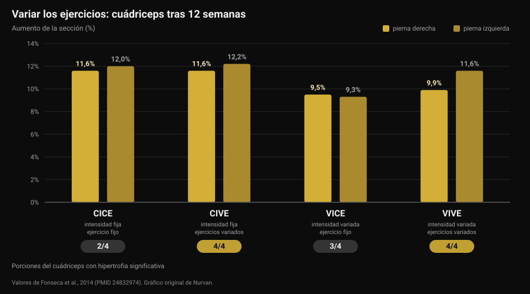
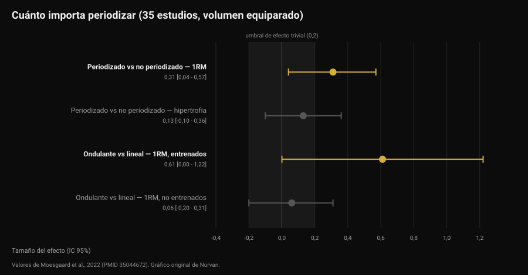

# ¿Cada cuánto hay que cambiar la rutina?

Por [Giammaria Loi](/autore/giammaria-loi) · actualizado el 12 de noviembre de 2026

El mensaje llega puntual: "entrenador, ha pasado un mes, ¿me cambias la rutina?". Detrás hay una idea muy extendida: el músculo se acostumbra, así que hace falta novedad. Los estudios que compararon ejercicios variados con ejercicios fijos cuentan algo más preciso y más útil: lo que hace crecer no es la novedad, es la progresión. Pero la elección de ejercicios sí cambia *dónde* creces. Así se decide, con los números.

## En resumen

- **El calendario no es un criterio.** Ninguno de los estudios recogidos aquí mide una ventaja de cambiar ejercicios con una periodicidad fija. Una revisión sistemática de 8 estudios concluye que la rotación excesiva, es decir una alta frecuencia de cambio, puede incluso dificultar las adaptaciones.
- **Variar los ejercicios no aumenta el crecimiento total, cambia su reparto.** En 12 semanas la sección del cuádriceps creció entre un 9,5% y un 12,2% en todos los grupos, pero solo los que variaban ejercicios hipertrofiaron **las cuatro** porciones del músculo.
- **La mejor combinación para la fuerza fue ejercicios variados con intensidad estable.** Ese grupo ganó más fuerza en sentadilla que los demás, incluido el que cambiaba también las cargas.
- **Periodizar ayuda a la fuerza, no a la hipertrofia.** Con el volumen equiparado, en 35 estudios: efecto 0,31 sobre el máximo, 0,13 (no significativo) sobre la masa.
- **Progresar no siempre es añadir peso.** Añadir repeticiones con la misma carga da resultados equivalentes, tanto en entrenados como en principiantes.

## De dónde sale la idea del cambio mensual

La expresión que circula es *confusión muscular*: el cuerpo se adaptaría a un estímulo repetido, así que hay que "confundirlo" con ejercicios nuevos. La parte cierta es que la adaptación existe: la misma serie, con la misma carga, con el tiempo se vuelve más fácil. La conclusión equivocada es que la solución sea cambiar de ejercicio. La solución es hacer esa serie más difícil, que no es lo mismo.

Aquí se mezclan dos decisiones distintas:

- **la selección de ejercicios**: qué movimientos haces;
- **la progresión**: cómo crece el estímulo dentro de esos ejercicios, semana a semana.

La literatura dice cosas distintas sobre cada una. Conviene mirarlas por separado.

## Variar los ejercicios: qué cambia de verdad

El estudio más informativo es un trabajo brasileño de 2014 con 49 personas activas: 12 semanas, dos sesiones por semana, cuatro grupos formados cruzando dos variables: intensidad constante o variada, ejercicio constante o variado.

El resultado sobre la hipertrofia sorprende a quien espera un ganador claro: la sección transversal del cuádriceps aumentó en todos los grupos, entre un 9,5% y un 12,2%. Ningún grupo ganó en crecimiento total.

La diferencia está en un detalle que una sola medición esconde. El cuádriceps tiene cuatro porciones y no crecen juntas por fuerza. Solo los dos grupos que **variaban los ejercicios** hipertrofiaron las cuatro: el grupo de ejercicio fijo no mostró crecimiento significativo en el vasto medial ni en el recto femoral, y el que variaba solo la intensidad no lo mostró en el recto femoral (Fonseca et al., 2014).

En fuerza sí hay un ganador: el grupo con **intensidad constante y ejercicios variados** ganó más máximo en sentadilla que el resto de grupos entrenados, incluido el que variaba ejercicios y cargas a la vez. El título del estudio lo dice sin rodeos: cambiar los ejercicios es más eficaz que cambiar los esquemas de carga.

Ojo con cómo se lee. "Ejercicios variados" en ese estudio significa alternar de forma ordenada movimientos que cargan el músculo de manera distinta (prensa, sentadilla, zancadas), no elegir un ejercicio al azar cada vez.

## Variar demasiado: el límite

En 2022 una revisión sistemática reunió los ocho estudios controlados que existen sobre el tema, 241 participantes en total, todos hombres jóvenes. La conclusión de los autores es de las más prácticas que hay en la literatura: cierta cantidad de variación sistemática parece mejorar la hipertrofia regional y maximizar la fuerza dinámica, mientras que una variación excesiva y aleatoria puede comprometer las ganancias. En concreto, usar ejercicios que dan un estímulo redundante y rotar los ejercicios con alta frecuencia de cambio puede dificultar las adaptaciones (Kassiano et al., 2022).

Dos palabras hacen el trabajo: *sistemática* y *redundante*. Añadir aperturas al press de banca cambia el perfil de carga sobre el pectoral. Sustituir el press con barra por el press con mancuernas cada semana no aporta nada que el músculo no haya tenido ya: es variación redundante, y mientras tanto has perdido el hilo de la carga.

Hay, eso sí, un dato a favor de la variedad que no conviene perder. En un estudio con 21 hombres entrenados, ocho semanas a cuatro sesiones por semana, un grupo seguía ejercicios fijos y el otro recibía ejercicios y rangos de repeticiones sorteados por una app en cada sesión. Los máximos de press de banca y sentadilla subieron mucho en ambos, sin diferencias entre grupos. Pero la **motivación intrínseca** mejoró de forma significativa en el grupo de ejercicios variados, mientras que en el de ejercicios fijos bajó, aunque no de forma significativa (Baz-Valle et al., 2019).

Traducido: la variedad no acelera los resultados, es una aliada de la adherencia. Y como el programa que no sigues no produce nada, no es un detalle menor: es el mismo mecanismo que hace que [los retos de temporada como el Winter Arc funcionen solo a medias](/es/blog/funciona-el-winter-arc).

## Qué dice realmente la investigación

**"El músculo se acostumbra, hay que cambiar la rutina cada cuatro semanas" — Desmentido.** Ninguno de los estudios recogidos compara un cambio con periodicidad fija frente a mantener los mismos ejercicios y encuentra ventaja para el primero. Al contrario, la única revisión sistemática del tema señala la alta frecuencia de cambio como posible obstáculo (Kassiano et al., 2022).

**"Variar los ejercicios hace crecer más" — Matizado.** El crecimiento total es similar con ejercicios fijos o variados. Cambia el reparto dentro del músculo: con ejercicios variados crecen también las porciones que un solo movimiento deja atrás (Fonseca et al., 2014).

**"Cambiar de ejercicios hace perder fuerza" — Matizado.** En ocho semanas, en hombres entrenados, sortear los ejercicios en cada sesión no redujo los máximos (Baz-Valle et al., 2019). Pero la mayor ganancia de fuerza del estudio de 12 semanas llegó del grupo que variaba los ejercicios **manteniendo fija la intensidad**: cambiarlo todo a la vez rindió menos que cambiar una cosa cada vez.

**"Sin periodización no se progresa" — Matizado.** Un metaanálisis de 35 estudios con volumen equiparado encuentra ventaja de la programación periodizada sobre el máximo (efecto 0,31; intervalo de confianza del 95% de 0,04 a 0,57), pero no sobre la hipertrofia (0,13; de -0,10 a 0,36, no significativo). La periodización ondulante supera a la lineal en el máximo (0,31), aunque la ventaja se concentra en los entrenados (0,61) y desaparece en los principiantes (0,06) (Moesgaard et al., 2022).

**"Para progresar hay que añadir peso" — Desmentido.** En 43 personas con al menos un año de entrenamiento, ocho semanas de carga creciente con repeticiones fijas dieron los mismos resultados que repeticiones crecientes con carga fija: diferencias por debajo del milímetro en los grosores musculares y, en palabras de los propios autores, de relevancia práctica discutible en el máximo (Plotkin et al., 2022). La misma comparación, en 39 principiantes y diez semanas, con las dos piernas aleatorizadas: máximo en extensión de rodilla de unos 52 a 69 kg con la carga creciente y de unos 52 a 67 kg con las repeticiones crecientes, sección del vasto lateral de unos 21 a 23,5 cm² en ambos casos, sin diferencias (Chaves et al., 2024).

Un límite a tener presente: las muestras de estas investigaciones son en su mayoría hombres jóvenes y adultos activos, y la duración máxima es de 12 semanas. En horizontes de años, y en poblaciones distintas, estos números son orientaciones, no leyes.

## Cómo aplicarlo

La pregunta correcta no es "cuándo caduca la rutina" sino "¿este ejercicio sigue produciendo progresión medible?". Si la respuesta es sí, cambiarlo tira información a la basura. Si es no, hay que entender el problema antes de sustituirlo.

Una secuencia que funciona:

1. **Mantén los ejercicios principales el tiempo necesario para progresar en ellos.** Los estudios que muestran ganancias claras duran de 8 a 12 semanas sobre los mismos movimientos básicos: es un horizonte razonable antes de valorar un cambio, no una fecha de caducidad.
2. **Antes de cambiar de ejercicio, cambia la progresión.** ¿Carga estancada? Añade repeticiones con la misma carga: la literatura dice que funciona igual. Luego, cuando el rango esté lleno, vuelve a la carga.
3. **Distingue el estancamiento real de la mala semana.** Dos sesiones planas no son un estancamiento. Tres o cuatro semanas sin progreso ni en carga ni en repeticiones, con el sueño y la comida en orden, sí.
4. **Varía de forma sistemática, no aleatoria.** Dos o tres ejercicios por grupo muscular que lo carguen en posiciones distintas, rotados por bloques, no sustituidos en cada sesión.
5. **No cambies dos variables a la vez.** Si cambias el ejercicio, deja fijo el esquema de series y repeticiones. Si no, cuando algo deje de funcionar no sabrás qué ha sido.
6. **Cambia enseguida, sin esperar, si el ejercicio duele, no se ejecuta bien o no está disponible.** Aquí no hay plazo que respetar: es un problema que resolver.

Para decidir hacen falta datos, y los datos son los de las sesiones: carga, repeticiones y cuánto ha costado, que es exactamente lo que se mide con [el sistema de repeticiones en reserva (RIR) y la elección de series y descanso](/es/blog/cuantas-repeticiones-masa-muscular).

### Qué cambiar y cuándo

| Qué | Cada cuánto | Por qué |
|---|---|---|
| Carga o repeticiones | Cada semana, si es posible | Es la progresión: el estímulo que crece. Carga y repeticiones son equivalentes (Plotkin 2022; Chaves 2024) |
| Ejercicios accesorios | En bloques de 6-8 semanas | Cubre las porciones del músculo que un solo movimiento deja atrás (Fonseca 2014) |
| Ejercicios principales | Solo con estancamiento confirmado, o por dolor y técnica | La rotación frecuente puede dificultar las adaptaciones (Kassiano 2022) |
| Esquema de series y repeticiones | Por bloques, en deportistas entrenados | La periodización ondulante ayuda al máximo solo en quien ya está entrenado (Moesgaard 2022) |
| Todo a la vez | Nunca | Cambiar dos variables a la vez hace ilegibles los datos |

*Tabla Nurvan elaborada con las fuentes citadas al final del artículo.*

> ### Con Nurvan
> El historial por ejercicio de Nurvan registra carga, repeticiones y RIR serie a serie: el entrenador ve si la progresión en ese ejercicio lleva cuatro semanas parada o solo una sesión, y decide con los números en vez de con el calendario. Cuando un ejercicio entra o sale de la rutina, el historial se queda: el press de banca de hace tres meses sigue siendo comparable con el de hoy. Las series de calentamiento se proponen automáticamente según la carga de trabajo, así cambiar de ejercicio no te cuesta una sesión para reencontrar los pesos. **[Prueba Nurvan](https://nurvan.app)**

## Preguntas frecuentes

**¿Cada cuánto se cambia la rutina de gimnasio?**
No hay un plazo fijo respaldado por los datos. Los estudios que muestran ganancias claras duran de 8 a 12 semanas sobre los mismos ejercicios principales, y una revisión sistemática señala que cambiar con alta frecuencia puede ser un obstáculo. El criterio es la progresión: mientras suban carga o repeticiones, la rutina está funcionando.

**¿El músculo se acostumbra a los ejercicios?**
Se adapta al estímulo, y por eso el estímulo tiene que crecer. Pero "crecer" significa más carga o más repeticiones, no un ejercicio distinto: ningún estudio recogido aquí muestra que sustituir un ejercicio reinicie las ganancias.

**Si no consigo añadir peso, ¿tengo que cambiar de ejercicio?**
Primero prueba a añadir repeticiones con la misma carga. En las comparaciones directas las dos progresiones dan resultados equivalentes, tanto en entrenados como en principiantes. El cambio de ejercicio se valora tras tres o cuatro semanas sin progreso por ninguno de los dos lados.

**¿Variar los ejercicios hace crecer más?**
No en total, pero sí mejor repartido. Con ejercicios variados de forma ordenada crecen también las porciones del músculo que un solo movimiento deja atrás, y la motivación para ir al gimnasio sale ganando.

## Lee también

- [¿Funciona el coaching online? Lo que dicen los estudios](/es/blog/funciona-el-coaching-online) — cuánto pesa la supervisión con la misma rutina.
- [Rutina de entrenamiento con IA: qué dicen los estudios](/es/blog/rutina-de-entrenamiento-con-ia) — dónde acierta la inteligencia artificial con la programación y dónde falla.
- [Cuántas repeticiones para masa muscular: el mito del 8-12](/es/blog/cuantas-repeticiones-masa-muscular) — series, repeticiones y descanso, y qué cambia de verdad.

## Fuentes

1. Kassiano W, Nunes JP, Costa B, Ribeiro AS, Schoenfeld BJ, Cyrino ES, 2022. *Does Varying Resistance Exercises Promote Superior Muscle Hypertrophy and Strength Gains? A Systematic Review.* Journal of Strength and Conditioning Research 36(6):1753-1762. PMID 35438660. [DOI 10.1519/JSC.0000000000004258](https://doi.org/10.1519/JSC.0000000000004258)
2. Fonseca RM, Roschel H, Tricoli V, de Souza EO, Wilson JM, Laurentino GC, Aihara AY, de Souza Leão AR, Ugrinowitsch C, 2014. *Changes in exercises are more effective than in loading schemes to improve muscle strength.* Journal of Strength and Conditioning Research 28(11):3085-3092. PMID 24832974. [DOI 10.1519/JSC.0000000000000539](https://doi.org/10.1519/JSC.0000000000000539)
3. Baz-Valle E, Schoenfeld BJ, Torres-Unda J, Santos-Concejero J, Balsalobre-Fernández C, 2019. *The effects of exercise variation in muscle thickness, maximal strength and motivation in resistance trained men.* PLoS ONE 14(12):e0226989. PMID 31881066. [DOI 10.1371/journal.pone.0226989](https://doi.org/10.1371/journal.pone.0226989)
4. Moesgaard L, Beck MM, Christiansen L, Aagaard P, Lundbye-Jensen J, 2022. *Effects of Periodization on Strength and Muscle Hypertrophy in Volume-Equated Resistance Training Programs: A Systematic Review and Meta-analysis.* Sports Medicine 52(7):1647-1666. PMID 35044672. [DOI 10.1007/s40279-021-01636-1](https://doi.org/10.1007/s40279-021-01636-1)
5. Plotkin D, Coleman M, Van Every D, Maldonado J, Oberlin D, Israetel M, Feather J, Alto A, Vigotsky AD, Schoenfeld BJ, 2022. *Progressive overload without progressing load? The effects of load or repetition progression on muscular adaptations.* PeerJ 10:e14142. PMID 36199287. [DOI 10.7717/peerj.14142](https://doi.org/10.7717/peerj.14142)
6. Chaves TS, Scarpelli MC, Bergamasco JGA, da Silva DG, Medalha Junior RA, Dias NF, Bittencourt D, Carello Filho PC, Angleri V, Nóbrega SR, Roberts MD, Ugrinowitsch C, Libardi CA, 2024. *Effects of Resistance Training Overload Progression Protocols on Strength and Muscle Mass.* International Journal of Sports Medicine 45(7):504-510. PMID 38286426. [DOI 10.1055/a-2256-5857](https://doi.org/10.1055/a-2256-5857)

Fuentes bibliográficas obtenidas a través de PubMed. Tema elegido de la cola editorial de Nurvan a partir de las preguntas más frecuentes que reciben los entrenadores.

---

*Giammaria Loi es el fundador de Nurvan. Entrena con pesas desde 2012, trabaja como entrenador personal y coach certificado por la FIPE desde 2013 y compite en powerlifting a nivel nacional desde 2018. Cada artículo que firma parte de los estudios científicos y llega a lo que funciona de verdad en el gimnasio.*

> Nota: contenido informativo, no sustituye la opinión de un médico o profesional.
