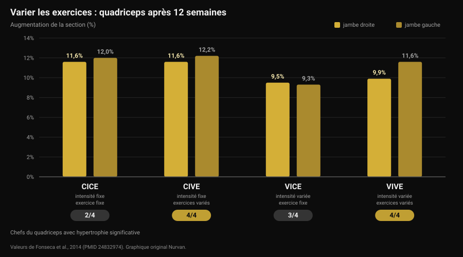
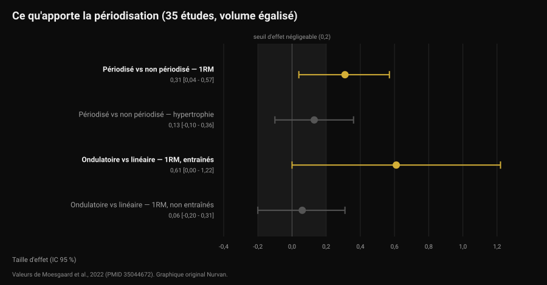

# À quelle fréquence changer son programme ?

Par [Giammaria Loi](/autore/giammaria-loi) · mis à jour le 12 novembre 2026

Le message arrive pile à l'heure : « coach, ça fait un mois, tu me changes le programme ? ». Derrière, une idée répandue : le muscle s'habitue, il faut donc de la nouveauté. Les études qui ont comparé exercices variés et exercices fixes racontent quelque chose de plus précis, et de plus utile : ce n'est pas la nouveauté qui fait progresser, c'est la progression. Mais le choix des exercices change bel et bien *où* vous progressez. Voici comment décider, chiffres à l'appui.

## En bref

- **Le calendrier n'est pas un critère.** Aucune des études réunies ici ne mesure un avantage à changer d'exercices à échéance fixe. Une revue systématique de 8 études conclut qu'une rotation excessive, c'est-à-dire une fréquence de changement élevée, peut même gêner les adaptations.
- **Varier les exercices n'augmente pas la croissance totale, il en change la répartition.** Sur 12 semaines, la section du quadriceps a augmenté de 9,5 à 12,2 % dans tous les groupes, mais seuls ceux à exercices variés ont hypertrophié **les quatre** chefs du muscle.
- **La meilleure combinaison pour la force : exercices variés, intensité stable.** C'est le groupe qui a le plus gagné en squat, davantage que ceux qui changeaient aussi les charges.
- **Périodiser aide la force, pas l'hypertrophie.** À volume égalisé, sur 35 études : effet 0,31 sur le maximal, 0,13 (non significatif) sur la masse.
- **Progresser ne veut pas toujours dire ajouter du poids.** Ajouter des répétitions à charge fixe donne des résultats équivalents, chez les pratiquants entraînés comme chez les débutants.

## D'où vient l'idée du changement mensuel

L'expression qui circule est *muscle confusion* : le corps s'adapterait à un stimulus répété, il faudrait donc le « confondre » avec de nouveaux exercices. Ce qui est vrai, c'est que l'adaptation existe : la même série, avec la même charge, devient plus facile avec le temps. La conclusion fausse, c'est que la réponse serait de changer d'exercice. La réponse, c'est de rendre cette série plus difficile — ce n'est pas la même chose.

Deux décisions sont ici souvent confondues :

- **la sélection des exercices** : quels mouvements vous faites ;
- **la progression** : comment le stimulus grandit à l'intérieur de ces exercices, semaine après semaine.

La littérature ne dit pas la même chose des deux. Mieux vaut les regarder séparément.

## Varier les exercices : ce qui change vraiment

L'étude la plus informative est un travail brésilien de 2014 mené sur 49 personnes actives : 12 semaines, deux séances par semaine, quatre groupes construits en croisant deux variables : intensité constante ou variée, exercice constant ou varié.

Le résultat sur l'hypertrophie surprend qui attendait un vainqueur net : la section transversale du quadriceps a augmenté dans tous les groupes, entre 9,5 % et 12,2 %. Aucun groupe n'a « gagné » sur la croissance globale.

La différence tient à un détail qu'une seule mesure masque. Le quadriceps a quatre chefs, et ils ne grossissent pas forcément ensemble. Seuls les deux groupes qui **variaient les exercices** ont hypertrophié les quatre : le groupe à exercice fixe n'a montré aucune croissance significative du vaste médial ni du droit fémoral, celui qui ne variait que l'intensité n'en a pas montré au droit fémoral (Fonseca et al., 2014).

Sur la force, en revanche, il y a un vainqueur : le groupe à **intensité constante et exercices variés** a gagné plus de maximal au squat que tous les autres groupes entraînés, y compris celui qui variait exercices et charges. Le titre de l'étude est explicite : changer les exercices est plus efficace que changer les schémas de charge.

Attention à la lecture : « exercices variés » signifie ici alterner de manière ordonnée des mouvements qui chargent le muscle différemment (presse, squat, fentes), pas piocher un exercice au hasard à chaque séance.

## Trop varier : la limite

En 2022, une revue systématique a réuni les huit études contrôlées existantes sur le sujet, 241 participants au total, tous des hommes jeunes. La conclusion des auteurs est l'une des plus pratiques de la littérature : une certaine variation systématique semble améliorer l'hypertrophie régionale et maximiser la force dynamique, tandis qu'une variation excessive et aléatoire peut compromettre les gains. En particulier, utiliser des exercices au stimulus redondant et faire tourner les exercices à fréquence élevée peut gêner les adaptations (Kassiano et al., 2022).

Deux mots font tout le travail : *systématique* et *redondant*. Ajouter des écartés au développé couché change le profil de charge sur le pectoral. Remplacer le développé à la barre par le développé aux haltères chaque semaine n'apporte rien que le muscle n'ait déjà eu : c'est de la variation redondante, et entre-temps vous avez perdu le fil de la charge.

Il y a tout de même un argument en faveur de la variété à ne pas perdre. Dans une étude sur 21 hommes entraînés, huit semaines à quatre séances par semaine, un groupe suivait des exercices fixes et l'autre recevait exercices et fourchettes de répétitions tirés au sort par une application à chaque séance. Les maximaux au développé couché et au squat ont nettement augmenté dans les deux groupes, sans différence entre eux. Mais la **motivation intrinsèque** s'est améliorée significativement dans le groupe à exercices variés, alors qu'elle baissait, de façon non significative, dans le groupe à exercices fixes (Baz-Valle et al., 2019).

Traduction : la variété n'accélère pas les résultats, elle sert l'assiduité. Et comme un programme qu'on ne suit pas ne produit rien, ce n'est pas un détail — c'est le même mécanisme qui rend [les défis saisonniers comme le Winter Arc à moitié efficaces](/fr/blog/le-winter-arc-fonctionne-t-il).

## Ce que dit vraiment la recherche

**« Le muscle s'habitue, il faut changer le programme toutes les quatre semaines » — Faux.** Aucune des études réunies ne compare un changement à échéance fixe au maintien des mêmes exercices en trouvant un avantage au premier. Au contraire, la seule revue systématique du sujet signale la fréquence de changement élevée comme obstacle possible (Kassiano et al., 2022).

**« Varier les exercices fait plus grossir » — À nuancer.** La croissance globale est similaire avec des exercices fixes ou variés. C'est la répartition dans le muscle qui change : avec des exercices variés, les chefs qu'un seul mouvement laisse de côté grossissent aussi (Fonseca et al., 2014).

**« Changer d'exercices fait perdre de la force » — À nuancer.** Sur huit semaines, chez des hommes entraînés, le tirage au sort à chaque séance n'a pas réduit les maximaux (Baz-Valle et al., 2019). Mais le plus gros gain de force de l'étude de 12 semaines vient du groupe qui variait les exercices **en gardant l'intensité fixe** : tout changer en même temps a moins rapporté que changer une chose à la fois.

**« Sans périodisation, pas de progrès » — À nuancer.** Une méta-analyse de 35 études à volume égalisé trouve un avantage de la programmation périodisée sur le maximal (effet 0,31 ; intervalle de confiance à 95 % de 0,04 à 0,57), mais pas sur l'hypertrophie (0,13 ; de -0,10 à 0,36, non significatif). La périodisation ondulatoire bat la linéaire sur le maximal (0,31), mais l'avantage se concentre chez les entraînés (0,61) et disparaît chez les débutants (0,06) (Moesgaard et al., 2022).

**« Pour progresser, il faut ajouter du poids » — Faux.** Chez 43 personnes avec au moins un an d'entraînement, huit semaines de charge croissante à répétitions fixes ont donné les mêmes résultats que des répétitions croissantes à charge fixe : des différences inférieures au millimètre sur les épaisseurs musculaires et, de l'aveu des auteurs, d'une pertinence pratique discutable sur le maximal (Plotkin et al., 2022). La même comparaison, chez 39 débutants et sur dix semaines, avec les deux jambes randomisées : maximal au leg extension d'environ 52 à 69 kg avec la charge croissante et d'environ 52 à 67 kg avec les répétitions croissantes, section du vaste latéral d'environ 21 à 23,5 cm² dans les deux cas, sans différence (Chaves et al., 2024).

Une limite à garder en tête : les échantillons de ces recherches sont en grande majorité des hommes jeunes et des adultes actifs, et la durée maximale est de 12 semaines. Sur des horizons de plusieurs années, et dans d'autres populations, ces chiffres sont des indications, pas des lois.

## Comment l'appliquer

La bonne question n'est pas « quand le programme expire-t-il ? » mais « cet exercice produit-il encore une progression mesurable ? ». Si oui, le changer jette de l'information à la poubelle. Si non, il faut comprendre le problème avant de le remplacer.

Une séquence qui fonctionne :

1. **Gardez vos exercices principaux le temps nécessaire pour y progresser.** Les études qui montrent des gains nets durent 8 à 12 semaines sur les mêmes mouvements de base : c'est un horizon raisonnable avant d'envisager un changement, pas une date de péremption.
2. **Avant de changer d'exercice, changez de progression.** Charge bloquée ? Ajoutez des répétitions à charge égale : la littérature dit que ça marche pareil. Puis, une fois la fourchette pleine, revenez à la charge.
3. **Distinguez le vrai plateau de la mauvaise semaine.** Deux séances plates ne sont pas un plateau. Trois ou quatre semaines sans progrès ni sur la charge ni sur les répétitions, avec sommeil et alimentation en ordre, oui.
4. **Variez de façon systématique, pas aléatoire.** Deux ou trois exercices par groupe musculaire qui le chargent dans des positions différentes, alternés par blocs, pas remplacés à chaque séance.
5. **Ne changez pas deux variables à la fois.** Si vous changez d'exercice, gardez le schéma de séries et de répétitions. Sinon, quand quelque chose cessera de marcher, vous ne saurez pas quoi.
6. **Changez tout de suite, sans attendre, si l'exercice fait mal, s'exécute mal ou n'est pas disponible.** Ici, pas d'échéance à respecter : c'est un problème à résoudre.

Décider demande des données, et ces données sont celles des séances — charge, répétitions et difficulté ressentie, c'est-à-dire exactement ce que mesurent [les répétitions en réserve (RIR) et le choix des séries et du repos](/fr/blog/combien-de-repetitions-masse-musculaire).

### Quoi changer, et quand

| Quoi | À quelle fréquence | Pourquoi |
|---|---|---|
| Charge ou répétitions | Chaque semaine si possible | C'est la progression : le stimulus qui grandit. Charge et répétitions sont équivalentes (Plotkin 2022 ; Chaves 2024) |
| Exercices complémentaires | Par blocs de 6 à 8 semaines | Couvre les chefs du muscle qu'un seul mouvement laisse de côté (Fonseca 2014) |
| Exercices principaux | Seulement si le plateau est confirmé, ou pour douleur et technique | La rotation fréquente peut gêner les adaptations (Kassiano 2022) |
| Schéma de séries et répétitions | Par blocs, chez les athlètes entraînés | La périodisation ondulatoire n'aide le maximal que chez les déjà entraînés (Moesgaard 2022) |
| Tout en même temps | Jamais | Changer deux variables à la fois rend les données illisibles |

*Tableau Nurvan construit à partir des sources citées en fin d'article.*

> ### Avec Nurvan
> L'historique par exercice de Nurvan enregistre charge, répétitions et RIR série par série : le coach voit si la progression sur ce mouvement est bloquée depuis quatre semaines ou depuis une seule séance, et décide avec les chiffres plutôt qu'avec le calendrier. Quand un exercice entre ou sort du programme, l'historique reste : le développé couché d'il y a trois mois reste comparable à celui d'aujourd'hui. Les séries d'échauffement sont proposées automatiquement à partir de la charge de travail, si bien que changer d'exercice ne vous coûte pas une séance à retrouver vos poids. **[Essayez Nurvan](https://nurvan.app)**

## Questions fréquentes

**À quelle fréquence changer son programme de musculation ?**
Il n'existe pas d'échéance fixe étayée par les données. Les études qui montrent des gains nets durent 8 à 12 semaines sur les mêmes exercices principaux, et une revue systématique signale qu'un changement à fréquence élevée peut gêner. Le critère, c'est la progression : tant que la charge ou les répétitions montent, le programme fonctionne.

**Le muscle s'habitue-t-il aux exercices ?**
Il s'adapte au stimulus, et c'est précisément pour cela que le stimulus doit grandir. Mais « grandir » veut dire plus de charge ou plus de répétitions, pas un autre exercice : aucune étude réunie ici ne montre que remplacer un exercice relance les gains.

**Si je n'arrive plus à ajouter du poids, dois-je changer d'exercice ?**
Essayez d'abord d'ajouter des répétitions à charge égale. Dans les comparaisons directes, les deux progressions donnent des résultats équivalents, chez les entraînés comme chez les débutants. Le changement d'exercice s'envisage après trois ou quatre semaines sans progrès sur aucun des deux fronts.

**Varier les exercices fait-il plus grossir ?**
Pas en volume total, mais mieux réparti. Avec des exercices variés de manière ordonnée, les chefs du muscle qu'un seul mouvement laisse de côté grossissent aussi, et la motivation à aller à la salle y gagne.

## À lire aussi

- [Le coaching en ligne fonctionne-t-il ? Ce que disent les études](/fr/blog/le-coaching-en-ligne-fonctionne) — le poids du suivi, à programme identique.
- [Programme d'entraînement généré par IA : ce que disent les études](/fr/blog/programme-entrainement-genere-par-ia) — là où l'intelligence artificielle réussit la programmation, et là où elle échoue.
- [Combien de répétitions pour la masse : le mythe du 8-12](/fr/blog/combien-de-repetitions-masse-musculaire) — séries, répétitions et repos, ce qui change vraiment.

## Sources

1. Kassiano W, Nunes JP, Costa B, Ribeiro AS, Schoenfeld BJ, Cyrino ES, 2022. *Does Varying Resistance Exercises Promote Superior Muscle Hypertrophy and Strength Gains? A Systematic Review.* Journal of Strength and Conditioning Research 36(6):1753-1762. PMID 35438660. [DOI 10.1519/JSC.0000000000004258](https://doi.org/10.1519/JSC.0000000000004258)
2. Fonseca RM, Roschel H, Tricoli V, de Souza EO, Wilson JM, Laurentino GC, Aihara AY, de Souza Leão AR, Ugrinowitsch C, 2014. *Changes in exercises are more effective than in loading schemes to improve muscle strength.* Journal of Strength and Conditioning Research 28(11):3085-3092. PMID 24832974. [DOI 10.1519/JSC.0000000000000539](https://doi.org/10.1519/JSC.0000000000000539)
3. Baz-Valle E, Schoenfeld BJ, Torres-Unda J, Santos-Concejero J, Balsalobre-Fernández C, 2019. *The effects of exercise variation in muscle thickness, maximal strength and motivation in resistance trained men.* PLoS ONE 14(12):e0226989. PMID 31881066. [DOI 10.1371/journal.pone.0226989](https://doi.org/10.1371/journal.pone.0226989)
4. Moesgaard L, Beck MM, Christiansen L, Aagaard P, Lundbye-Jensen J, 2022. *Effects of Periodization on Strength and Muscle Hypertrophy in Volume-Equated Resistance Training Programs: A Systematic Review and Meta-analysis.* Sports Medicine 52(7):1647-1666. PMID 35044672. [DOI 10.1007/s40279-021-01636-1](https://doi.org/10.1007/s40279-021-01636-1)
5. Plotkin D, Coleman M, Van Every D, Maldonado J, Oberlin D, Israetel M, Feather J, Alto A, Vigotsky AD, Schoenfeld BJ, 2022. *Progressive overload without progressing load? The effects of load or repetition progression on muscular adaptations.* PeerJ 10:e14142. PMID 36199287. [DOI 10.7717/peerj.14142](https://doi.org/10.7717/peerj.14142)
6. Chaves TS, Scarpelli MC, Bergamasco JGA, da Silva DG, Medalha Junior RA, Dias NF, Bittencourt D, Carello Filho PC, Angleri V, Nóbrega SR, Roberts MD, Ugrinowitsch C, Libardi CA, 2024. *Effects of Resistance Training Overload Progression Protocols on Strength and Muscle Mass.* International Journal of Sports Medicine 45(7):504-510. PMID 38286426. [DOI 10.1055/a-2256-5857](https://doi.org/10.1055/a-2256-5857)

Sources bibliographiques trouvées via PubMed. Sujet choisi dans la file éditoriale Nurvan, à partir des questions les plus fréquemment posées aux coachs.

---

*Giammaria Loi est le fondateur de Nurvan. Il soulève de la fonte depuis 2012, travaille comme coach et préparateur certifié FIPE depuis 2013 et compète en powerlifting au niveau national depuis 2018. Chaque article qu'il signe part des études scientifiques pour arriver à ce qui fonctionne vraiment en salle.*

> Note : contenu informatif, il ne remplace pas l'avis d'un médecin ou d'un professionnel.
