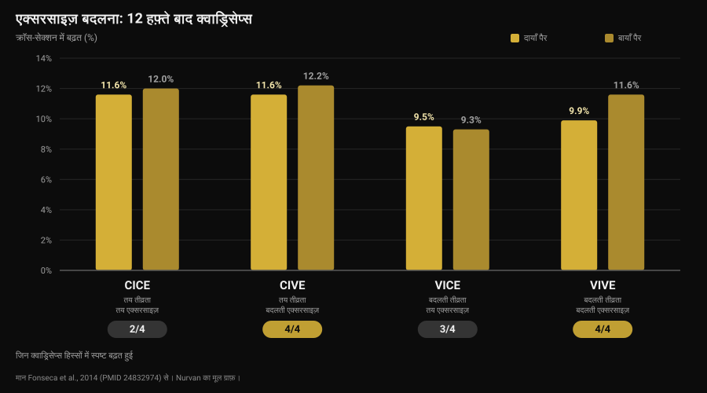
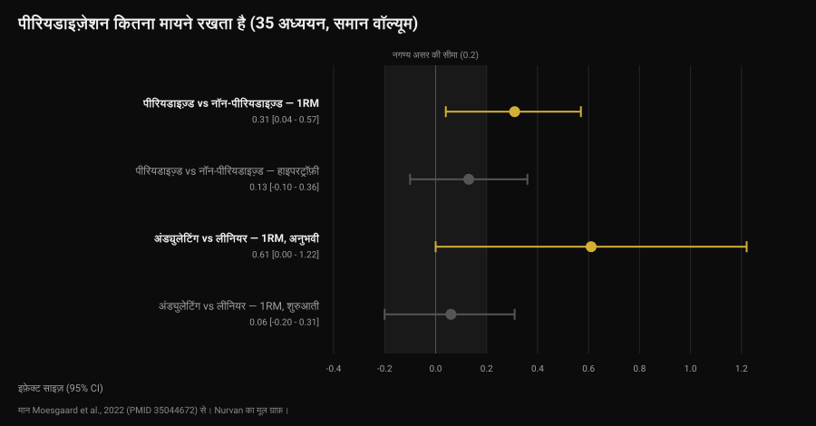

# वर्कआउट प्लान कितने समय में बदलें?

लेखक: [जियामारिया लोई](/autore/giammaria-loi) · अपडेट 12 नवंबर 2026

मैसेज ठीक समय पर आता है: "कोच, एक महीना हो गया, प्लान बदल दीजिए?" इसके पीछे एक आम सोच है — मसल आदत डाल लेती है, इसलिए नयापन चाहिए। जिन स्टडीज़ ने बदलती और तय एक्सरसाइज़ की तुलना की, उनका जवाब ज़्यादा सटीक और ज़्यादा काम का है: ग्रोथ नयापन से नहीं, प्रोग्रेशन से आती है। हाँ, एक्सरसाइज़ का चुनाव यह ज़रूर बदलता है कि आप *कहाँ* बढ़ते हैं। आँकड़ों के साथ तय करने का तरीक़ा यह रहा।

## सार

- **कैलेंडर कोई कसौटी नहीं है।** यहाँ जुटाई गई किसी भी स्टडी में तय समय पर एक्सरसाइज़ बदलने का फ़ायदा नहीं मिला। आठ स्टडीज़ की एक सिस्टेमैटिक रिव्यू कहती है कि ज़रूरत से ज़्यादा रोटेशन, यानी बदलाव की ऊँची फ़्रीक्वेंसी, अडैप्टेशन में रुकावट तक बन सकती है।
- **एक्सरसाइज़ बदलने से कुल ग्रोथ नहीं बढ़ती, बँटवारा बदलता है।** 12 हफ़्तों में क्वाड्रिसेप्स का क्रॉस-सेक्शन सभी ग्रुप में 9.5% से 12.2% बढ़ा, पर मांसपेशी के **चारों हिस्से** सिर्फ़ उन्हीं ग्रुप में बढ़े जिन्होंने एक्सरसाइज़ बदलीं।
- **ताक़त के लिए सबसे अच्छा मेल: एक्सरसाइज़ बदलें, तीव्रता स्थिर रखें।** इसी ग्रुप ने स्क्वाट में सबसे ज़्यादा ताक़त बढ़ाई — उन ग्रुप से भी ज़्यादा जो वज़न भी बदल रहे थे।
- **पीरियडाइज़ेशन ताक़त में मदद करता है, हाइपरट्रॉफ़ी में नहीं।** वॉल्यूम बराबर रखकर, 35 स्टडीज़ में: 1RM पर असर 0.31, मसल मास पर 0.13 (सांख्यिकीय रूप से नगण्य)।
- **प्रोग्रेस का मतलब हमेशा वज़न बढ़ाना नहीं है।** उसी वज़न पर रेप्स बढ़ाना बराबर नतीजे देता है — अनुभवी लिफ़्टर और शुरुआती, दोनों में।

## महीने भर वाली सोच कहाँ से आई

जो शब्द चलन में है वह है *मसल कन्फ़्यूज़न*: शरीर दोहराए गए स्टिमुलस का अभ्यस्त हो जाता है, इसलिए नई एक्सरसाइज़ से उसे "उलझाना" होगा। सच यह है कि अडैप्टेशन होता है: वही सेट, वही वज़न, समय के साथ आसान लगने लगता है। ग़लत नतीजा यह है कि इसका जवाब दूसरी एक्सरसाइज़ है। जवाब है उस सेट को कठिन बनाना — और यह अलग बात है।

यहाँ दो अलग फ़ैसले आपस में मिल जाते हैं:

- **एक्सरसाइज़ का चुनाव**: आप कौन-सी मूवमेंट करते हैं;
- **प्रोग्रेशन**: उन्हीं एक्सरसाइज़ के भीतर स्टिमुलस हफ़्ता-दर-हफ़्ता कैसे बढ़ता है।

साहित्य दोनों पर अलग बात कहता है। इन्हें अलग-अलग देखना बेहतर है।

## एक्सरसाइज़ बदलना: असल में क्या बदलता है

इस सवाल पर सबसे उपयोगी काम 2014 की एक ब्राज़ीली स्टडी है: 49 शारीरिक रूप से सक्रिय लोग, 12 हफ़्ते, हफ़्ते में दो सेशन, और दो वेरिएबल को क्रॉस करके बने चार ग्रुप — तीव्रता स्थिर या बदलती, एक्सरसाइज़ स्थिर या बदलती।

हाइपरट्रॉफ़ी का नतीजा उन्हें चौंकाएगा जो साफ़ विजेता की उम्मीद रखते हैं: क्वाड्रिसेप्स का क्रॉस-सेक्शन हर ग्रुप में बढ़ा, 9.5% से 12.2% के बीच। कुल ग्रोथ में कोई ग्रुप जीता नहीं।

फ़र्क़ उस ब्यौरे में छिपा है जिसे एक ही माप छिपा देती है। क्वाड्रिसेप्स के चार हिस्से हैं, और ज़रूरी नहीं कि वे साथ बढ़ें। चारों हिस्से सिर्फ़ उन दो ग्रुप में बढ़े जो **एक्सरसाइज़ बदल रहे थे**: स्थिर एक्सरसाइज़ वाले ग्रुप में वेस्टस मीडियालिस और रेक्टस फ़ेमोरिस में उल्लेखनीय बढ़त नहीं दिखी, और सिर्फ़ तीव्रता बदलने वाले ग्रुप में रेक्टस फ़ेमोरिस में नहीं (Fonseca et al., 2014)।

ताक़त में विजेता है: **स्थिर तीव्रता और बदलती एक्सरसाइज़** वाले ग्रुप ने स्क्वाट में बाक़ी सभी ट्रेनिंग ग्रुप से ज़्यादा 1RM बढ़ाया — उस ग्रुप से भी ज़्यादा जो एक्सरसाइज़ और वज़न दोनों बदल रहा था। स्टडी का शीर्षक साफ़ कहता है: एक्सरसाइज़ बदलना लोडिंग स्कीम बदलने से ज़्यादा असरदार है।

पढ़ते समय ध्यान रहे: उस स्टडी में "बदलती एक्सरसाइज़" का मतलब है उन मूवमेंट के बीच व्यवस्थित अदला-बदली जो मांसपेशी पर अलग तरह से भार डालती हैं (लेग प्रेस, स्क्वाट, लंज) — हर बार कोई भी एक्सरसाइज़ उठा लेना नहीं।

## बहुत ज़्यादा बदलना: सीमा कहाँ है

2022 में एक सिस्टेमैटिक रिव्यू ने इस विषय पर मौजूद आठों नियंत्रित स्टडीज़ जुटाईं — कुल 241 प्रतिभागी, सभी युवा पुरुष। लेखकों का निष्कर्ष साहित्य के सबसे व्यावहारिक निष्कर्षों में है: कुछ हद तक व्यवस्थित वैरिएशन क्षेत्रीय हाइपरट्रॉफ़ी सुधारता और डायनेमिक स्ट्रेंथ को अधिकतम करता दिखता है, जबकि ज़रूरत से ज़्यादा और बेतरतीब वैरिएशन नतीजों को नुक़सान पहुँचा सकता है। ख़ासकर, एक जैसा दोहराव वाला स्टिमुलस देने वाली एक्सरसाइज़ और ऊँची फ़्रीक्वेंसी पर एक्सरसाइज़ रोटेट करना अडैप्टेशन में रुकावट बन सकते हैं (Kassiano et al., 2022)।

दो शब्द सारा काम करते हैं: *व्यवस्थित* और *दोहराव वाला*। बेंच प्रेस के साथ फ़्लाय जोड़ना चेस्ट पर भार का प्रोफ़ाइल बदलता है। पर हर हफ़्ते बारबेल बेंच की जगह डंबल बेंच कर देना मांसपेशी को कुछ नया नहीं देता: यह दोहराव वाला वैरिएशन है, और इस बीच वज़न का सिरा आपके हाथ से छूट चुका होता है।

फिर भी विविधता के पक्ष में एक आँकड़ा है जिसे छोड़ना नहीं चाहिए। 21 अनुभवी पुरुषों पर हुई एक स्टडी में — आठ हफ़्ते, हफ़्ते में चार सेशन — एक ग्रुप तय एक्सरसाइज़ करता रहा जबकि दूसरे को हर सेशन में ऐप से रैंडम चुनी एक्सरसाइज़ और रेप रेंज मिलते थे। बेंच और स्क्वाट के 1RM दोनों ग्रुप में अच्छी तरह बढ़े, आपस में कोई फ़र्क़ नहीं। लेकिन **आंतरिक प्रेरणा** बदलती एक्सरसाइज़ वाले ग्रुप में उल्लेखनीय रूप से सुधरी, जबकि तय एक्सरसाइज़ वाले ग्रुप में घटी, हालाँकि उल्लेखनीय रूप से नहीं (Baz-Valle et al., 2019)।

मतलब: विविधता नतीजों की रफ़्तार नहीं बढ़ाती, वह निरंतरता की साथी है। और जिस प्लान पर आप टिकते ही नहीं वह कुछ नहीं देता, इसलिए यह छोटी बात नहीं — यही वजह है कि [Winter Arc जैसे मौसमी चैलेंज आधे ही काम करते हैं](/hi/blog/winter-arc-kaam-karta-hai)।

## रिसर्च असल में क्या कहती है

**"मसल आदत डाल लेती है, प्लान हर चार हफ़्ते बदलो" — ग़लत।** जुटाई गई किसी स्टडी में तय समय पर बदलाव बनाम वही एक्सरसाइज़ जारी रखने की तुलना करके पहले को बेहतर नहीं पाया गया। उलटे, विषय की इकलौती सिस्टेमैटिक रिव्यू ऊँची बदलाव-फ़्रीक्वेंसी को संभावित रुकावट बताती है (Kassiano et al., 2022)।

**"एक्सरसाइज़ बदलने से ज़्यादा मसल बनती है" — स्पष्टीकरण चाहिए।** कुल ग्रोथ तय और बदलती, दोनों तरह की एक्सरसाइज़ के साथ एक जैसी रहती है। बदलता है मांसपेशी के भीतर बँटवारा: बदलती एक्सरसाइज़ के साथ वे हिस्से भी बढ़ते हैं जिन्हें एक ही मूवमेंट पीछे छोड़ देती है (Fonseca et al., 2014)।

**"एक्सरसाइज़ बदलने से ताक़त घटती है" — स्पष्टीकरण चाहिए।** आठ हफ़्तों में, अनुभवी पुरुषों में, हर सेशन की रैंडम चयन-प्रक्रिया ने 1RM नहीं घटाया (Baz-Valle et al., 2019)। पर 12 हफ़्ते की स्टडी में ताक़त की सबसे बड़ी बढ़त उस ग्रुप से आई जिसने **तीव्रता तय रखकर** एक्सरसाइज़ बदलीं: सब कुछ एक साथ बदलने का नतीजा एक-एक चीज़ बदलने से कम रहा।

**"पीरियडाइज़ेशन के बिना प्रोग्रेस नहीं" — स्पष्टीकरण चाहिए।** वॉल्यूम बराबर रखने वाली 35 स्टडीज़ के मेटा-एनालिसिस में पीरियडाइज़्ड प्रोग्रामिंग का फ़ायदा 1RM पर मिलता है (असर 0.31; 95% विश्वास अंतराल 0.04 से 0.57), हाइपरट्रॉफ़ी पर नहीं (0.13; -0.10 से 0.36, नगण्य)। अंड्युलेटिंग पीरियडाइज़ेशन 1RM में लीनियर से बेहतर है (0.31), पर यह बढ़त अनुभवी लिफ़्टरों में केंद्रित है (0.61) और शुरुआती लोगों में ग़ायब हो जाती है (0.06) (Moesgaard et al., 2022)।

**"प्रोग्रेस के लिए वज़न बढ़ाना ही पड़ेगा" — ग़लत।** कम से कम एक साल की ट्रेनिंग वाले 43 लोगों में, तय रेप्स पर बढ़ते वज़न के आठ हफ़्तों ने वही नतीजे दिए जो तय वज़न पर बढ़ते रेप्स ने: मसल थिकनेस में एक मिलीमीटर से कम फ़र्क़, और 1RM पर लेखकों के अपने शब्दों में व्यावहारिक रूप से संदिग्ध महत्व का फ़र्क़ (Plotkin et al., 2022)। यही तुलना 39 शुरुआती लोगों पर दस हफ़्ते, दोनों टाँगों को रैंडम बाँटकर: लेग एक्सटेंशन का 1RM बढ़ते वज़न के साथ लगभग 52 से 69 किलो और बढ़ते रेप्स के साथ लगभग 52 से 67 किलो, वेस्टस लेटरालिस का क्रॉस-सेक्शन दोनों में लगभग 21 से 23.5 वर्ग सेमी, कोई फ़र्क़ नहीं (Chaves et al., 2024)।

एक सीमा याद रखें: इन शोधों के सैंपल ज़्यादातर युवा पुरुष और सक्रिय वयस्क हैं, और सबसे लंबी अवधि 12 हफ़्ते है। सालों के पैमाने पर और अलग आबादियों में ये आँकड़े संकेत हैं, नियम नहीं।

## इसे कैसे लागू करें

सही सवाल यह नहीं कि "प्लान कब ख़त्म होता है", बल्कि यह कि "क्या यह एक्सरसाइज़ अब भी मापी जा सकने वाली प्रोग्रेस दे रही है?" जवाब हाँ है तो उसे बदलना जानकारी फेंक देना है। जवाब ना है तो बदलने से पहले वजह समझनी होगी।

एक कारगर क्रम:

1. **मुख्य एक्सरसाइज़ उतने समय रखें जितना उन पर प्रोग्रेस करने के लिए चाहिए।** साफ़ नतीजे दिखाने वाली स्टडीज़ उन्हीं बुनियादी मूवमेंट पर 8 से 12 हफ़्ते चलती हैं: बदलाव सोचने से पहले यह एक ठीक-ठाक अवधि है, कोई निभानी पड़ने वाली डेडलाइन नहीं।
2. **एक्सरसाइज़ बदलने से पहले प्रोग्रेशन बदलें।** वज़न अटक गया? उसी वज़न पर रेप्स बढ़ाएँ — साहित्य कहता है असर बराबर है। रेप रेंज भर जाए तो वज़न पर लौटें।
3. **असली ठहराव और ख़राब हफ़्ते में फ़र्क़ करें।** दो सुस्त सेशन ठहराव नहीं हैं। नींद और खाना ठीक होते हुए भी तीन-चार हफ़्ते न वज़न बढ़े न रेप्स — वह ठहराव है।
4. **व्यवस्थित बदलें, बेतरतीब नहीं।** हर मसल ग्रुप के लिए दो-तीन एक्सरसाइज़ जो उसे अलग-अलग पोज़ीशन में लोड करें, ब्लॉक में रोटेट करें, हर सेशन में बदलें नहीं।
5. **दो वेरिएबल एक साथ न बदलें।** एक्सरसाइज़ बदली है तो सेट और रेप्स की स्कीम वही रखें। वरना कुछ काम करना बंद करे तो वजह पता नहीं चलेगी।
6. **दर्द हो, टेक्नीक सही न बन रही हो या मशीन उपलब्ध न हो तो तुरंत बदलें, इंतज़ार नहीं।** यहाँ कोई अवधि नहीं है: यह हल करने वाली समस्या है।

फ़ैसले के लिए डेटा चाहिए, और डेटा सेशन से आता है — वज़न, रेप्स और कितना मुश्किल लगा, यानी ठीक वही जो [रेप्स इन रिज़र्व (RIR) और सेट व रेस्ट के चुनाव](/hi/blog/kitne-reps-muscle-ke-liye) से मापा जाता है।

### क्या बदलें और कब

| क्या | कितने समय में | क्यों |
|---|---|---|
| वज़न या रेप्स | हर हफ़्ते, जहाँ संभव हो | यही प्रोग्रेशन है: बढ़ता हुआ स्टिमुलस। वज़न और रेप्स बराबर असरदार हैं (Plotkin 2022; Chaves 2024) |
| सहायक एक्सरसाइज़ | 6-8 हफ़्ते के ब्लॉक में | मांसपेशी के उन हिस्सों को कवर करती हैं जिन्हें एक मूवमेंट छोड़ देती है (Fonseca 2014) |
| मुख्य एक्सरसाइज़ | सिर्फ़ पक्के ठहराव पर, या दर्द और टेक्नीक की वजह से | बार-बार रोटेशन अडैप्टेशन में रुकावट बन सकता है (Kassiano 2022) |
| सेट और रेप स्कीम | ब्लॉक में, अनुभवी एथलीटों के लिए | अंड्युलेटिंग पीरियडाइज़ेशन 1RM में सिर्फ़ पहले से अनुभवी लोगों की मदद करता है (Moesgaard 2022) |
| सब कुछ एक साथ | कभी नहीं | एक बार में दो वेरिएबल बदलने से डेटा पढ़ा ही नहीं जा सकता |

*लेख के अंत में दिए स्रोतों से बनी Nurvan तालिका।*

> ### Nurvan के साथ
> Nurvan की हर एक्सरसाइज़ की हिस्ट्री सेट-दर-सेट वज़न, रेप्स और RIR दर्ज करती है: कोच देख सकता है कि उस मूवमेंट की प्रोग्रेस चार हफ़्ते से रुकी है या सिर्फ़ एक सेशन से, और कैलेंडर की जगह आँकड़ों से फ़ैसला करता है। कोई एक्सरसाइज़ प्लान में आए या निकले, हिस्ट्री बनी रहती है: तीन महीने पहले की बेंच प्रेस आज की बेंच से तुलना के लायक़ रहती है। वर्किंग लोड के आधार पर वॉर्म-अप सेट अपने-आप सुझाए जाते हैं, इसलिए एक्सरसाइज़ बदलने पर वज़न दोबारा ढूँढ़ने में एक सेशन बर्बाद नहीं होता। **[Nurvan आज़माएँ](https://nurvan.app)**

## अक्सर पूछे जाने वाले सवाल

**वर्कआउट प्लान कितने समय में बदलना चाहिए?**
आँकड़ों से समर्थित कोई तय अवधि नहीं है। साफ़ नतीजे दिखाने वाली स्टडीज़ उन्हीं मुख्य एक्सरसाइज़ पर 8 से 12 हफ़्ते चलती हैं, और एक सिस्टेमैटिक रिव्यू बताती है कि बहुत बार बदलना रुकावट बन सकता है। कसौटी प्रोग्रेशन है: जब तक वज़न या रेप्स बढ़ रहे हैं, प्लान काम कर रहा है।

**क्या मसल एक्सरसाइज़ की आदी हो जाती है?**
वह स्टिमुलस के अनुसार ढलती है, और इसीलिए स्टिमुलस को बढ़ना चाहिए। पर "बढ़ने" का मतलब ज़्यादा वज़न या ज़्यादा रेप्स है, अलग एक्सरसाइज़ नहीं: यहाँ जुटाई गई किसी स्टडी में एक्सरसाइज़ बदलने से नतीजे दोबारा शुरू होते नहीं दिखे।

**वज़न नहीं बढ़ा पा रहा, क्या एक्सरसाइज़ बदल दूँ?**
पहले उसी वज़न पर रेप्स बढ़ाकर देखें। सीधी तुलनाओं में दोनों प्रोग्रेशन अनुभवी और शुरुआती, दोनों में बराबर नतीजे देते हैं। तीन-चार हफ़्ते दोनों में से किसी भी तरफ़ प्रोग्रेस न हो, तब एक्सरसाइज़ बदलने पर विचार करें।

**क्या एक्सरसाइज़ बदलने से ज़्यादा ग्रोथ होती है?**
कुल मिलाकर नहीं, पर बँटवारा बेहतर होता है। व्यवस्थित ढंग से एक्सरसाइज़ बदलने पर मांसपेशी के वे हिस्से भी बढ़ते हैं जिन्हें एक ही मूवमेंट छोड़ देती है, और जिम जाने की प्रेरणा को भी फ़ायदा होता है।

## यह भी पढ़ें

- [ऑनलाइन कोचिंग काम करती है? स्टडीज़ क्या कहती हैं](/hi/blog/online-coaching-kaam-karta-hai) — एक ही प्लान पर सुपरविज़न का कितना असर पड़ता है।
- [AI से बना वर्कआउट प्लान: स्टडीज़ क्या कहती हैं](/hi/blog/ai-se-banaya-workout-plan) — प्रोग्रामिंग में आर्टिफ़िशियल इंटेलिजेंस कहाँ सही है और कहाँ ग़लत।
- [मसल के लिए कितने रेप्स: 8-12 का मिथक](/hi/blog/kitne-reps-muscle-ke-liye) — सेट, रेप्स और रेस्ट, असल में क्या बदलता है।

## स्रोत

1. Kassiano W, Nunes JP, Costa B, Ribeiro AS, Schoenfeld BJ, Cyrino ES, 2022. *Does Varying Resistance Exercises Promote Superior Muscle Hypertrophy and Strength Gains? A Systematic Review.* Journal of Strength and Conditioning Research 36(6):1753-1762. PMID 35438660. [DOI 10.1519/JSC.0000000000004258](https://doi.org/10.1519/JSC.0000000000004258)
2. Fonseca RM, Roschel H, Tricoli V, de Souza EO, Wilson JM, Laurentino GC, Aihara AY, de Souza Leão AR, Ugrinowitsch C, 2014. *Changes in exercises are more effective than in loading schemes to improve muscle strength.* Journal of Strength and Conditioning Research 28(11):3085-3092. PMID 24832974. [DOI 10.1519/JSC.0000000000000539](https://doi.org/10.1519/JSC.0000000000000539)
3. Baz-Valle E, Schoenfeld BJ, Torres-Unda J, Santos-Concejero J, Balsalobre-Fernández C, 2019. *The effects of exercise variation in muscle thickness, maximal strength and motivation in resistance trained men.* PLoS ONE 14(12):e0226989. PMID 31881066. [DOI 10.1371/journal.pone.0226989](https://doi.org/10.1371/journal.pone.0226989)
4. Moesgaard L, Beck MM, Christiansen L, Aagaard P, Lundbye-Jensen J, 2022. *Effects of Periodization on Strength and Muscle Hypertrophy in Volume-Equated Resistance Training Programs: A Systematic Review and Meta-analysis.* Sports Medicine 52(7):1647-1666. PMID 35044672. [DOI 10.1007/s40279-021-01636-1](https://doi.org/10.1007/s40279-021-01636-1)
5. Plotkin D, Coleman M, Van Every D, Maldonado J, Oberlin D, Israetel M, Feather J, Alto A, Vigotsky AD, Schoenfeld BJ, 2022. *Progressive overload without progressing load? The effects of load or repetition progression on muscular adaptations.* PeerJ 10:e14142. PMID 36199287. [DOI 10.7717/peerj.14142](https://doi.org/10.7717/peerj.14142)
6. Chaves TS, Scarpelli MC, Bergamasco JGA, da Silva DG, Medalha Junior RA, Dias NF, Bittencourt D, Carello Filho PC, Angleri V, Nóbrega SR, Roberts MD, Ugrinowitsch C, Libardi CA, 2024. *Effects of Resistance Training Overload Progression Protocols on Strength and Muscle Mass.* International Journal of Sports Medicine 45(7):504-510. PMID 38286426. [DOI 10.1055/a-2256-5857](https://doi.org/10.1055/a-2256-5857)

संदर्भ PubMed से लिए गए। विषय Nurvan की संपादकीय सूची से चुना गया, उन सवालों के आधार पर जो कोचों से सबसे ज़्यादा पूछे जाते हैं।

---

*जियामारिया लोई Nurvan के संस्थापक हैं। वे 2012 से वेट ट्रेनिंग करते हैं, 2013 से FIPE प्रमाणित पर्सनल ट्रेनर और कोच के रूप में काम करते हैं और 2018 से राष्ट्रीय स्तर पर पावरलिफ़्टिंग में भाग लेते हैं। उनके हर लेख की शुरुआत वैज्ञानिक अध्ययनों से होती है और अंत इस पर कि जिम में असल में क्या काम करता है।*

> नोट: यह जानकारी भर है, यह डॉक्टर या विशेषज्ञ की सलाह की जगह नहीं लेती।
