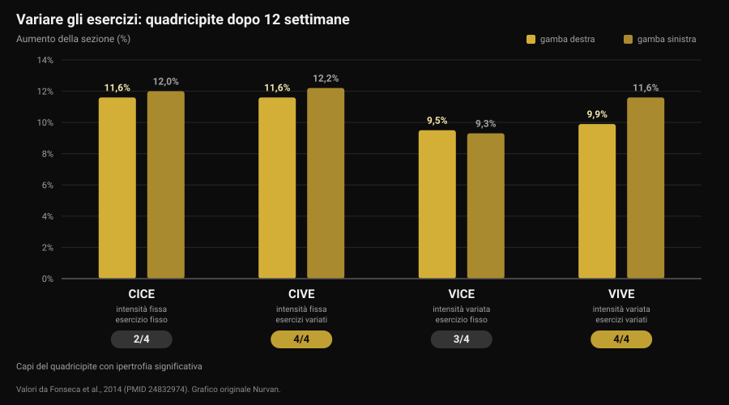
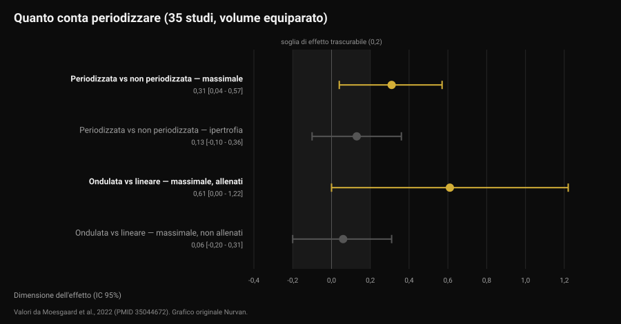

# Ogni quanto cambiare la scheda di allenamento?

Di [Giammaria Loi](/autore/giammaria-loi) · aggiornato il 12 novembre 2026

Arriva il messaggio puntuale: "coach, è passato un mese, mi cambi la scheda?". Dietro c'è un'idea diffusa — il muscolo si abitua, quindi serve novità. Gli studi che hanno confrontato esercizi variati ed esercizi fissi raccontano qualcosa di più preciso, e di più utile: non è la novità a far crescere, è la progressione. Ma la scelta degli esercizi cambia *dove* cresci. Ecco come si decide, con i numeri.

## In breve

- **Il calendario non è un criterio.** Nessuno degli studi raccolti misura un vantaggio del cambiare esercizi a scadenza fissa. Una revisione sistematica su 8 studi conclude che la rotazione eccessiva, cioè un'alta frequenza di cambio, può addirittura ostacolare gli adattamenti.
- **Variare gli esercizi non aumenta la crescita totale, ne cambia la distribuzione.** In 12 settimane la sezione del quadricipite è cresciuta del 9,5-12,2% in tutti i gruppi, ma solo quelli con esercizi variati hanno ipertrofizzato **tutti** i capi del muscolo.
- **La combinazione migliore per la forza è: esercizi variati, intensità stabile.** È il gruppo che ha guadagnato più forza nello squat, più dei gruppi che cambiavano anche i carichi.
- **Periodizzare aiuta la forza, non l'ipertrofia.** A volume equiparato, su 35 studi: effetto 0,31 sul massimale, 0,13 (non significativo) sulla massa.
- **Progredire non vuol dire sempre aggiungere peso.** Aggiungere ripetizioni a carico fisso dà risultati equivalenti, sia negli allenati sia nei principianti.

## Da dove nasce l'idea del cambio mensile

L'espressione che gira è *muscle confusion*: il corpo si adatterebbe a uno stimolo ripetuto, quindi bisogna "confonderlo" con esercizi nuovi. La parte vera è che l'adattamento esiste: la stessa serie, con lo stesso carico, nel tempo diventa più facile. La conclusione sbagliata è che la risposta sia cambiare esercizio. La risposta è rendere quella serie più difficile — ed è un'altra cosa.

Qui si separano due decisioni che spesso vengono confuse:

- **la selezione degli esercizi**: quali movimenti fai;
- **la progressione**: come lo stimolo cresce dentro quegli esercizi, settimana per settimana.

La letteratura dice cose diverse sulle due. Vale la pena guardarle separate.

## Variare gli esercizi: cosa cambia davvero

Lo studio più informativo su questo è un lavoro brasiliano del 2014 su 49 persone attive, 12 settimane, due sedute a settimana. Quattro gruppi, costruiti incrociando due variabili: intensità costante o variata, esercizio costante o variato.

Il risultato sull'ipertrofia è sorprendente per chi si aspetta un vincitore netto: la sezione trasversale del quadricipite è aumentata in tutti i gruppi, tra il 9,5% e il 12,2%. Nessun gruppo ha "vinto" sulla crescita complessiva.

La differenza sta in un dettaglio che una misura sola nasconde. Il quadricipite ha quattro capi, e non crescono insieme per forza. Solo i due gruppi che **variavano gli esercizi** hanno ipertrofizzato tutti e quattro: il gruppo a esercizio fisso non ha mostrato crescita significativa nel vasto mediale e nel retto femorale, quello che variava solo l'intensità non l'ha mostrata nel retto femorale (Fonseca et al., 2014).

Sulla forza, invece, un vincitore c'è: il gruppo con **intensità costante ed esercizi variati** ha guadagnato più massimale nello squat di tutti gli altri gruppi allenati, compreso quello che variava sia esercizi sia carichi. Il titolo dello studio è esplicito: cambiare gli esercizi è più efficace che cambiare gli schemi di carico.

Attenzione a come si legge: "esercizi variati" nello studio significa alternare in modo ordinato movimenti che caricano il muscolo in modo diverso (per esempio leg press, squat, affondi), non pescare un esercizio a caso ogni volta.

## Variare troppo: il limite

Nel 2022 una revisione sistematica ha raccolto gli otto studi controllati esistenti sull'argomento, per un totale di 241 partecipanti, tutti uomini giovani. La conclusione degli autori è una delle più pratiche che si trovino in letteratura: una certa quantità di variazione sistematica sembra migliorare l'ipertrofia regionale e massimizzare la forza dinamica, mentre una variazione eccessiva e casuale può compromettere i guadagni. In particolare, usare esercizi che danno uno stimolo ridondante e ruotare gli esercizi con alta frequenza di cambio può ostacolare gli adattamenti (Kassiano et al., 2022).

Due parole fanno il lavoro: *sistematica* e *ridondante*. Aggiungere le croci alla panca cambia il profilo di carico sul pettorale. Sostituire la panca con bilanciere con la panca con manubri ogni settimana, invece, non aggiunge niente che il muscolo non abbia già: è una variazione ridondante, e nel frattempo hai perso il filo del carico.

C'è però un dato a favore della varietà che non va perso. In uno studio su 21 uomini allenati, otto settimane a quattro sedute a settimana, un gruppo seguiva esercizi fissi e l'altro riceveva esercizi e range di ripetizioni estratti a caso da un'app a ogni seduta. Massimali di panca e squat sono cresciuti in modo ampio in entrambi, senza differenze fra i gruppi. Ma la **motivazione intrinseca** è migliorata in modo significativo nel gruppo a esercizi variati, mentre nel gruppo a esercizi fissi è calata, anche se non in modo significativo (Baz-Valle et al., 2019).

Tradotto: la varietà non è un acceleratore di risultati, è un alleato dell'aderenza. E dato che il programma che non segui non produce nulla, non è un dettaglio da buttare — lo stesso meccanismo che rende [le sfide stagionali come il Winter Arc utili solo a metà](/blog/winter-arc-funziona-studi).

## Cosa dice davvero la ricerca

**"Il muscolo si abitua, la scheda va cambiata ogni quattro settimane" — Smentito.** Nessuno studio fra quelli raccolti confronta un cambio a scadenza fissa con il mantenimento degli stessi esercizi e trova un vantaggio del primo. Al contrario, l'unica revisione sistematica sul tema segnala l'alta frequenza di cambio come possibile ostacolo (Kassiano et al., 2022).

**"Variare gli esercizi fa crescere più muscolo" — Da precisare.** La crescita complessiva è simile con esercizi fissi o variati. Cambia la distribuzione dentro il muscolo: con esercizi variati crescono anche i capi che un movimento solo lascia indietro (Fonseca et al., 2014).

**"Cambiare esercizi fa perdere forza" — Da precisare.** Su otto settimane, in uomini allenati, la randomizzazione a ogni seduta non ha ridotto i massimali (Baz-Valle et al., 2019). Però il massimo guadagno di forza nello studio di 12 settimane arriva dal gruppo che variava gli esercizi **tenendo fissa l'intensità**: cambiare tutto insieme ha reso meno di cambiare una cosa alla volta.

**"Senza periodizzazione non si progredisce" — Da precisare.** Una meta-analisi su 35 studi a volume equiparato trova un vantaggio della programmazione periodizzata sul massimale (effetto 0,31; intervallo di confidenza 95% da 0,04 a 0,57), ma non sull'ipertrofia (0,13; da -0,10 a 0,36, non significativo). La periodizzazione ondulata batte quella lineare sul massimale (0,31), però il vantaggio si concentra negli allenati (0,61) e scompare nei principianti (0,06) (Moesgaard et al., 2022).

**"Per progredire devi aggiungere peso" — Smentito.** In 43 persone con almeno un anno di allenamento, otto settimane di carico crescente a ripetizioni fisse hanno prodotto gli stessi risultati di ripetizioni crescenti a carico fisso: differenze sotto il millimetro sugli spessori muscolari e di rilevanza pratica discutibile sul massimale, secondo gli stessi autori (Plotkin et al., 2022). Lo stesso confronto, su 39 principianti e dieci settimane, con le due gambe randomizzate: massimale alla leg extension da circa 52 a 69 kg con il carico crescente e da circa 52 a 67 kg con le ripetizioni crescenti, sezione del vasto laterale da circa 21 a 23,5 cm² in entrambi i casi, senza differenze (Chaves et al., 2024).

Un limite da tenere presente: i campioni di queste ricerche sono per la gran parte uomini giovani e adulti attivi, e la durata massima è 12 settimane. Su orizzonti di anni, e su popolazioni diverse, questi numeri vanno letti come indicazioni, non come leggi.

## Come applicarlo

La domanda giusta non è "quando scade la scheda" ma "questo esercizio sta ancora producendo progressione misurabile?". Se la risposta è sì, cambiarlo butta via informazioni. Se è no, il problema va capito prima di sostituirlo.

Una sequenza che funziona:

1. **Tieni gli esercizi principali il tempo necessario per progredirci.** Gli studi che mostrano guadagni netti durano 8-12 settimane sugli stessi movimenti fondamentali: è un orizzonte ragionevole prima di valutare un cambio, non una scadenza da rispettare.
2. **Prima di cambiare esercizio, prova a cambiare progressione.** Carico fermo? Aggiungi ripetizioni a parità di carico: la letteratura dice che funziona uguale. Poi, quando il range è pieno, torna al carico.
3. **Distingui lo stallo vero dalla settimana brutta.** Due sedute piatte non sono uno stallo. Tre o quattro settimane senza progressione né sul carico né sulle ripetizioni, con sonno e cibo a posto, sì.
4. **Varia in modo sistematico, non casuale.** Due o tre esercizi per gruppo muscolare che caricano il muscolo in posizioni diverse, ruotati a blocchi, non sostituiti a ogni seduta.
5. **Non cambiare due variabili insieme.** Se cambi esercizio, tieni fermo lo schema di serie e ripetizioni. Altrimenti, quando qualcosa smette di funzionare, non saprai cosa.
6. **Cambia subito, senza aspettare, se l'esercizio dà dolore, non si esegue bene o non è disponibile.** Qui non c'è una scadenza da rispettare: è un problema da risolvere.

Per decidere servono dati, e i dati sono quelli delle sedute — carico, ripetizioni e quanto è stato duro, che è esattamente ciò che si misura con il [sistema a ripetizioni di riserva (RIR) e la scelta di serie e recupero](/blog/ripetizioni-serie-recupero-ipertrofia).

### Cosa cambiare, e quando

| Cosa | Ogni quanto | Perché |
|---|---|---|
| Carico o ripetizioni | Ogni settimana, se possibile | È la progressione: lo stimolo che cresce. Carico e ripetizioni sono equivalenti (Plotkin 2022; Chaves 2024) |
| Esercizi complementari | A blocchi di 6-8 settimane | Copre i capi del muscolo che un solo movimento lascia indietro (Fonseca 2014) |
| Esercizi principali | Solo se lo stallo è confermato, o per dolore e tecnica | La rotazione frequente può ostacolare gli adattamenti (Kassiano 2022) |
| Schema di serie e ripetizioni | A blocchi, negli atleti allenati | La periodizzazione ondulata aiuta il massimale solo in chi è già allenato (Moesgaard 2022) |
| Tutto insieme | Mai | Cambiare due variabili alla volta rende i dati illeggibili |

*Tabella Nurvan costruita sulle fonti citate in fondo all'articolo.*

> ### Con Nurvan
> Lo storico per esercizio di Nurvan registra carico, ripetizioni e RIR serie per serie: il coach vede se la progressione su quell'esercizio è ferma da quattro settimane o solo da una seduta, e decide con i numeri invece che con il calendario. Quando un esercizio entra o esce dalla scheda, lo storico resta: la panca di tre mesi fa è ancora confrontabile con quella di oggi. Le serie di riscaldamento vengono proposte in automatico sul carico di lavoro, così il cambio di esercizio non ti costa una seduta per ritrovare i carichi. **[Prova Nurvan](https://nurvan.app)**

## Domande frequenti

**Ogni quanto si cambia la scheda di allenamento?**
Non esiste una scadenza fissa supportata dai dati. Gli studi che mostrano guadagni netti durano 8-12 settimane sugli stessi esercizi principali, e una revisione sistematica segnala che cambiare con alta frequenza può ostacolare gli adattamenti. Il criterio è la progressione: finché carico o ripetizioni salgono, la scheda sta funzionando.

**Il muscolo si abitua agli esercizi?**
Si adatta allo stimolo, ed è il motivo per cui lo stimolo deve crescere. Ma "crescere" significa più carico o più ripetizioni, non un esercizio diverso: nessuno studio raccolto mostra che sostituire un esercizio riavvii i guadagni.

**Se non riesco ad aggiungere peso devo cambiare esercizio?**
Prima prova ad aggiungere ripetizioni allo stesso carico. Nei confronti diretti le due progressioni danno risultati equivalenti, sia negli allenati sia nei principianti. Il cambio di esercizio si valuta dopo tre o quattro settimane senza progressione su nessuno dei due fronti.

**Variare gli esercizi fa crescere di più?**
Non in totale, ma meglio distribuito. Con esercizi variati in modo ordinato crescono anche i capi del muscolo che un movimento solo lascia indietro, e la motivazione a presentarsi in palestra ne beneficia.

## Leggi anche

- [Coaching online: funziona davvero? Cosa dicono gli studi](/blog/coaching-online-funziona-studi) — quanto conta la supervisione, a parità di scheda.
- [Scheda di allenamento con l'AI: cosa dicono gli studi](/blog/scheda-allenamento-ai-studi) — dove l'intelligenza artificiale azzecca la programmazione e dove la sbaglia.
- [Quante ripetizioni per la massa: il mito dell'8-12](/blog/ripetizioni-serie-recupero-ipertrofia) — serie, ripetizioni e recupero, cosa cambia davvero.

## Fonti

- Kassiano W, Nunes JP, Costa B, Ribeiro AS, Schoenfeld BJ, Cyrino ES, 2022. *Does Varying Resistance Exercises Promote Superior Muscle Hypertrophy and Strength Gains? A Systematic Review.* Journal of Strength and Conditioning Research 36(6):1753-1762. PMID 35438660. [DOI: 10.1519/JSC.0000000000004258](https://doi.org/10.1519/JSC.0000000000004258)
- Fonseca RM, Roschel H, Tricoli V, de Souza EO, Wilson JM, Laurentino GC, Aihara AY, de Souza Leão AR, Ugrinowitsch C, 2014. *Changes in exercises are more effective than in loading schemes to improve muscle strength.* Journal of Strength and Conditioning Research 28(11):3085-3092. PMID 24832974. [DOI: 10.1519/JSC.0000000000000539](https://doi.org/10.1519/JSC.0000000000000539)
- Baz-Valle E, Schoenfeld BJ, Torres-Unda J, Santos-Concejero J, Balsalobre-Fernández C, 2019. *The effects of exercise variation in muscle thickness, maximal strength and motivation in resistance trained men.* PLoS ONE 14(12):e0226989. PMID 31881066. [DOI: 10.1371/journal.pone.0226989](https://doi.org/10.1371/journal.pone.0226989)
- Moesgaard L, Beck MM, Christiansen L, Aagaard P, Lundbye-Jensen J, 2022. *Effects of Periodization on Strength and Muscle Hypertrophy in Volume-Equated Resistance Training Programs: A Systematic Review and Meta-analysis.* Sports Medicine 52(7):1647-1666. PMID 35044672. [DOI: 10.1007/s40279-021-01636-1](https://doi.org/10.1007/s40279-021-01636-1)
- Plotkin D, Coleman M, Van Every D, Maldonado J, Oberlin D, Israetel M, Feather J, Alto A, Vigotsky AD, Schoenfeld BJ, 2022. *Progressive overload without progressing load? The effects of load or repetition progression on muscular adaptations.* PeerJ 10:e14142. PMID 36199287. [DOI: 10.7717/peerj.14142](https://doi.org/10.7717/peerj.14142)
- Chaves TS, Scarpelli MC, Bergamasco JGA, da Silva DG, Medalha Junior RA, Dias NF, Bittencourt D, Carello Filho PC, Angleri V, Nóbrega SR, Roberts MD, Ugrinowitsch C, Libardi CA, 2024. *Effects of Resistance Training Overload Progression Protocols on Strength and Muscle Mass.* International Journal of Sports Medicine 45(7):504-510. PMID 38286426. [DOI: 10.1055/a-2256-5857](https://doi.org/10.1055/a-2256-5857)

Fonti bibliografiche reperite su PubMed. Tema scelto dalla coda editoriale Nurvan sulla base delle domande più frequenti rivolte ai coach.

---

**Di [Giammaria Loi](/autore/giammaria-loi)** — Giammaria Loi è il fondatore di Nurvan. Si allena con i pesi dal 2012, lavora come personal trainer e coach certificato FIPE dal 2013 e gareggia nel powerlifting a livello nazionale dal 2018. Ogni articolo che firma parte dagli studi scientifici e arriva a ciò che funziona davvero in palestra.

> Nota: contenuto informativo, non sostituisce il parere di un medico o professionista.
