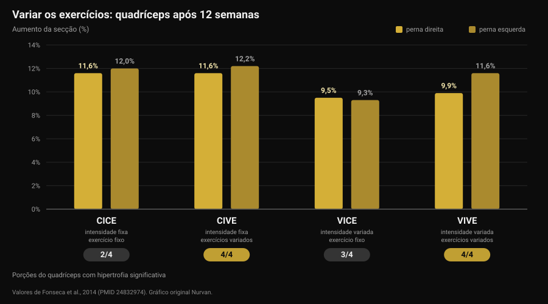
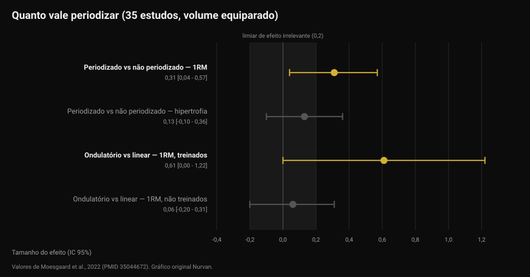

# De quanto em quanto tempo mudar o treino?

Por [Giammaria Loi](/autore/giammaria-loi) · atualizado em 12 de novembro de 2026

A mensagem chega pontualmente: "treinador, já faz um mês, muda a minha ficha?". Por trás há uma ideia muito difundida: o músculo se acostuma, logo é preciso novidade. Os estudos que compararam exercícios variados com exercícios fixos contam algo mais preciso e mais útil: não é a novidade que faz crescer, é a progressão. Mas a escolha dos exercícios muda, sim, *onde* você cresce. Veja como decidir, com os números.

## Em resumo

- **O calendário não é um critério.** Nenhum dos estudos reunidos aqui mede vantagem em trocar exercícios em prazo fixo. Uma revisão sistemática de 8 estudos conclui que a rotação excessiva, ou seja, uma alta frequência de troca, pode até atrapalhar as adaptações.
- **Variar os exercícios não aumenta o crescimento total, muda a distribuição.** Em 12 semanas a secção do quadríceps cresceu entre 9,5% e 12,2% em todos os grupos, mas só os de exercícios variados hipertrofiaram **as quatro** porções do músculo.
- **A melhor combinação para a força foi exercícios variados com intensidade estável.** Esse grupo ganhou mais força no agachamento do que os outros, incluindo o que mudava também as cargas.
- **Periodizar ajuda a força, não a hipertrofia.** Com volume equiparado, em 35 estudos: efeito 0,31 sobre o máximo, 0,13 (não significativo) sobre a massa.
- **Progredir nem sempre é adicionar peso.** Adicionar repetições com a mesma carga dá resultados equivalentes, tanto em treinados quanto em iniciantes.

## De onde vem a ideia da troca mensal

A expressão que circula é *confusão muscular*: o corpo se adaptaria a um estímulo repetido, então seria preciso "confundi-lo" com exercícios novos. A parte verdadeira é que a adaptação existe: a mesma série, com a mesma carga, com o tempo fica mais fácil. A conclusão errada é que a solução seja mudar de exercício. A solução é tornar aquela série mais difícil — e isso é outra coisa.

Aqui se misturam duas decisões:

- **a seleção dos exercícios**: quais movimentos você faz;
- **a progressão**: como o estímulo cresce dentro desses exercícios, semana após semana.

A literatura diz coisas diferentes sobre cada uma. Vale olhar separadamente.

## Variar os exercícios: o que muda de verdade

O estudo mais informativo é um trabalho brasileiro de 2014 com 49 pessoas ativas: 12 semanas, duas sessões por semana, quatro grupos formados cruzando duas variáveis — intensidade constante ou variada, exercício constante ou variado.

O resultado sobre a hipertrofia surpreende quem espera um vencedor claro: a área de secção transversa do quadríceps aumentou em todos os grupos, entre 9,5% e 12,2%. Nenhum grupo venceu no crescimento total.

A diferença está num detalhe que uma única medição esconde. O quadríceps tem quatro porções, e elas não crescem necessariamente juntas. Só os dois grupos que **variavam os exercícios** hipertrofiaram as quatro: o grupo de exercício fixo não mostrou crescimento significativo no vasto medial nem no reto femoral, e o que variava apenas a intensidade não mostrou no reto femoral (Fonseca et al., 2014).

Na força, por outro lado, há um vencedor: o grupo com **intensidade constante e exercícios variados** ganhou mais máximo no agachamento do que todos os outros grupos treinados, inclusive o que variava exercícios e cargas ao mesmo tempo. O título do estudo é explícito: mudar os exercícios é mais eficaz do que mudar os esquemas de carga.

Atenção à leitura: "exercícios variados" naquele estudo significa alternar de forma ordenada movimentos que carregam o músculo de maneira diferente (leg press, agachamento, afundos), não sortear um exercício a cada sessão.

## Variar demais: o limite

Em 2022 uma revisão sistemática reuniu os oito estudos controlados existentes sobre o tema, 241 participantes no total, todos homens jovens. A conclusão dos autores é das mais práticas da literatura: certa quantidade de variação sistemática parece melhorar a hipertrofia regional e maximizar a força dinâmica, enquanto uma variação excessiva e aleatória pode comprometer os ganhos. Em particular, usar exercícios que dão um estímulo redundante e rodar os exercícios com alta frequência de troca pode atrapalhar as adaptações (Kassiano et al., 2022).

Duas palavras fazem o trabalho: *sistemática* e *redundante*. Acrescentar crucifixo ao supino muda o perfil de carga sobre o peitoral. Substituir o supino com barra pelo supino com halteres toda semana não acrescenta nada que o músculo já não tenha tido: é variação redundante, e nesse meio-tempo você perdeu o fio da carga.

Há, porém, um dado a favor da variedade que não se deve perder. Num estudo com 21 homens treinados, oito semanas a quatro sessões por semana, um grupo seguia exercícios fixos e o outro recebia exercícios e faixas de repetições sorteados por um aplicativo a cada sessão. Os máximos de supino e agachamento subiram bastante em ambos, sem diferenças entre os grupos. Mas a **motivação intrínseca** melhorou de forma significativa no grupo de exercícios variados, enquanto no de exercícios fixos caiu, ainda que não de forma significativa (Baz-Valle et al., 2019).

Traduzindo: a variedade não acelera os resultados, é aliada da aderência. E como o programa que você não segue não produz nada, não é um detalhe a descartar — é o mesmo mecanismo que faz [os desafios sazonais como o Winter Arc funcionarem só pela metade](/pt/blog/o-winter-arc-funciona).

## O que a pesquisa realmente diz

**"O músculo se acostuma, a ficha deve mudar a cada quatro semanas" — Desmentido.** Nenhum dos estudos reunidos compara uma troca em prazo fixo com a manutenção dos mesmos exercícios e encontra vantagem para a primeira. Pelo contrário, a única revisão sistemática sobre o tema aponta a alta frequência de troca como possível obstáculo (Kassiano et al., 2022).

**"Variar os exercícios faz crescer mais" — A precisar.** O crescimento total é semelhante com exercícios fixos ou variados. O que muda é a distribuição dentro do músculo: com exercícios variados crescem também as porções que um único movimento deixa para trás (Fonseca et al., 2014).

**"Mudar de exercícios faz perder força" — A precisar.** Em oito semanas, em homens treinados, o sorteio a cada sessão não reduziu os máximos (Baz-Valle et al., 2019). Mas o maior ganho de força do estudo de 12 semanas veio do grupo que variava os exercícios **mantendo a intensidade fixa**: mudar tudo ao mesmo tempo rendeu menos do que mudar uma coisa de cada vez.

**"Sem periodização não se progride" — A precisar.** Uma meta-análise de 35 estudos com volume equiparado encontra vantagem da programação periodizada no máximo (efeito 0,31; intervalo de confiança de 95% de 0,04 a 0,57), mas não na hipertrofia (0,13; de -0,10 a 0,36, não significativo). A periodização ondulatória supera a linear no máximo (0,31), mas a vantagem se concentra nos treinados (0,61) e desaparece nos iniciantes (0,06) (Moesgaard et al., 2022).

**"Para progredir é preciso adicionar peso" — Desmentido.** Em 43 pessoas com pelo menos um ano de treino, oito semanas de carga crescente com repetições fixas produziram os mesmos resultados que repetições crescentes com carga fixa: diferenças abaixo do milímetro nas espessuras musculares e, nas palavras dos próprios autores, de relevância prática discutível no máximo (Plotkin et al., 2022). A mesma comparação, em 39 iniciantes e dez semanas, com as duas pernas randomizadas: máximo na cadeira extensora de cerca de 52 para 69 kg com a carga crescente e de cerca de 52 para 67 kg com as repetições crescentes, secção do vasto lateral de cerca de 21 para 23,5 cm² nos dois casos, sem diferenças (Chaves et al., 2024).

Um limite a ter em conta: as amostras destas pesquisas são na maioria homens jovens e adultos ativos, e a duração máxima é de 12 semanas. Em horizontes de anos, e em populações diferentes, estes números são indicações, não leis.

## Como aplicar

A pergunta certa não é "quando a ficha vence" mas "este exercício ainda está produzindo progressão mensurável?". Se a resposta for sim, trocá-lo joga informação fora. Se for não, o problema precisa ser entendido antes de substituí-lo.

Uma sequência que funciona:

1. **Mantenha os exercícios principais o tempo necessário para progredir neles.** Os estudos que mostram ganhos claros duram de 8 a 12 semanas sobre os mesmos movimentos básicos: é um horizonte razoável antes de avaliar uma troca, não um prazo a cumprir.
2. **Antes de mudar de exercício, mude a progressão.** Carga parada? Acrescente repetições com a mesma carga: a literatura diz que funciona igual. Depois, com a faixa cheia, volte à carga.
3. **Distinga a estagnação real da semana ruim.** Duas sessões planas não são estagnação. Três ou quatro semanas sem progresso nem na carga nem nas repetições, com sono e alimentação em ordem, sim.
4. **Varie de forma sistemática, não aleatória.** Dois ou três exercícios por grupo muscular que o carreguem em posições diferentes, rodados em blocos, não substituídos a cada sessão.
5. **Não mude duas variáveis ao mesmo tempo.** Se trocar o exercício, mantenha o esquema de séries e repetições. Caso contrário, quando algo parar de funcionar, você não saberá o quê.
6. **Mude já, sem esperar, se o exercício dói, não sai bem ou não está disponível.** Aqui não há prazo a respeitar: é um problema a resolver.

Para decidir são precisos dados, e os dados são os das sessões — carga, repetições e o quanto custou, que é exatamente o que se mede com [o sistema de repetições em reserva (RIR) e a escolha de séries e descanso](/pt/blog/quantas-repeticoes-massa-muscular).

### O que mudar, e quando

| O quê | De quanto em quanto tempo | Porquê |
|---|---|---|
| Carga ou repetições | Toda semana, se possível | É a progressão: o estímulo que cresce. Carga e repetições são equivalentes (Plotkin 2022; Chaves 2024) |
| Exercícios complementares | Em blocos de 6-8 semanas | Cobre as porções do músculo que um só movimento deixa para trás (Fonseca 2014) |
| Exercícios principais | Só com estagnação confirmada, ou por dor e técnica | A rotação frequente pode atrapalhar as adaptações (Kassiano 2022) |
| Esquema de séries e repetições | Em blocos, em atletas treinados | A periodização ondulatória ajuda o máximo só em quem já é treinado (Moesgaard 2022) |
| Tudo junto | Nunca | Mudar duas variáveis de cada vez torna os dados ilegíveis |

*Tabela Nurvan construída com as fontes citadas no fim do artigo.*

> ### Com a Nurvan
> O histórico por exercício da Nurvan regista carga, repetições e RIR série a série: o treinador vê se a progressão naquele exercício está parada há quatro semanas ou só há uma sessão, e decide com os números em vez do calendário. Quando um exercício entra ou sai da ficha, o histórico fica: o supino de três meses atrás continua comparável com o de hoje. As séries de aquecimento são propostas automaticamente a partir da carga de trabalho, por isso trocar de exercício não lhe custa uma sessão a reencontrar os pesos. **[Experimente a Nurvan](https://nurvan.app)**

## Perguntas frequentes

**De quanto em quanto tempo se muda a ficha de treino?**
Não existe um prazo fixo apoiado nos dados. Os estudos que mostram ganhos claros duram de 8 a 12 semanas sobre os mesmos exercícios principais, e uma revisão sistemática aponta que trocar com alta frequência pode atrapalhar. O critério é a progressão: enquanto carga ou repetições sobem, a ficha está funcionando.

**O músculo se acostuma aos exercícios?**
Ele se adapta ao estímulo, e é por isso que o estímulo tem de crescer. Mas "crescer" significa mais carga ou mais repetições, não um exercício diferente: nenhum estudo reunido aqui mostra que substituir um exercício reinicia os ganhos.

**Se não consigo adicionar peso, devo mudar de exercício?**
Tente primeiro acrescentar repetições com a mesma carga. Nas comparações diretas as duas progressões dão resultados equivalentes, tanto em treinados quanto em iniciantes. A troca de exercício avalia-se depois de três ou quatro semanas sem progresso em nenhuma das duas frentes.

**Variar os exercícios faz crescer mais?**
Não no total, mas melhor distribuído. Com exercícios variados de forma ordenada crescem também as porções do músculo que um só movimento deixa para trás, e a motivação para ir ao ginásio sai a ganhar.

## Leia também

- [O coaching online funciona? O que dizem os estudos](/pt/blog/o-coaching-online-funciona) — quanto pesa a supervisão, com a mesma ficha.
- [Treino gerado por IA: o que dizem os estudos](/pt/blog/treino-gerado-por-ia-estudos) — onde a inteligência artificial acerta a programação e onde erra.
- [Quantas repetições para massa muscular: o mito do 8-12](/pt/blog/quantas-repeticoes-massa-muscular) — séries, repetições e descanso, o que muda de verdade.

## Fontes

1. Kassiano W, Nunes JP, Costa B, Ribeiro AS, Schoenfeld BJ, Cyrino ES, 2022. *Does Varying Resistance Exercises Promote Superior Muscle Hypertrophy and Strength Gains? A Systematic Review.* Journal of Strength and Conditioning Research 36(6):1753-1762. PMID 35438660. [DOI 10.1519/JSC.0000000000004258](https://doi.org/10.1519/JSC.0000000000004258)
2. Fonseca RM, Roschel H, Tricoli V, de Souza EO, Wilson JM, Laurentino GC, Aihara AY, de Souza Leão AR, Ugrinowitsch C, 2014. *Changes in exercises are more effective than in loading schemes to improve muscle strength.* Journal of Strength and Conditioning Research 28(11):3085-3092. PMID 24832974. [DOI 10.1519/JSC.0000000000000539](https://doi.org/10.1519/JSC.0000000000000539)
3. Baz-Valle E, Schoenfeld BJ, Torres-Unda J, Santos-Concejero J, Balsalobre-Fernández C, 2019. *The effects of exercise variation in muscle thickness, maximal strength and motivation in resistance trained men.* PLoS ONE 14(12):e0226989. PMID 31881066. [DOI 10.1371/journal.pone.0226989](https://doi.org/10.1371/journal.pone.0226989)
4. Moesgaard L, Beck MM, Christiansen L, Aagaard P, Lundbye-Jensen J, 2022. *Effects of Periodization on Strength and Muscle Hypertrophy in Volume-Equated Resistance Training Programs: A Systematic Review and Meta-analysis.* Sports Medicine 52(7):1647-1666. PMID 35044672. [DOI 10.1007/s40279-021-01636-1](https://doi.org/10.1007/s40279-021-01636-1)
5. Plotkin D, Coleman M, Van Every D, Maldonado J, Oberlin D, Israetel M, Feather J, Alto A, Vigotsky AD, Schoenfeld BJ, 2022. *Progressive overload without progressing load? The effects of load or repetition progression on muscular adaptations.* PeerJ 10:e14142. PMID 36199287. [DOI 10.7717/peerj.14142](https://doi.org/10.7717/peerj.14142)
6. Chaves TS, Scarpelli MC, Bergamasco JGA, da Silva DG, Medalha Junior RA, Dias NF, Bittencourt D, Carello Filho PC, Angleri V, Nóbrega SR, Roberts MD, Ugrinowitsch C, Libardi CA, 2024. *Effects of Resistance Training Overload Progression Protocols on Strength and Muscle Mass.* International Journal of Sports Medicine 45(7):504-510. PMID 38286426. [DOI 10.1055/a-2256-5857](https://doi.org/10.1055/a-2256-5857)

Fontes bibliográficas obtidas através do PubMed. Tema escolhido na fila editorial da Nurvan, a partir das perguntas mais frequentes feitas aos treinadores.

---

*Giammaria Loi é o fundador da Nurvan. Treina com pesos desde 2012, trabalha como personal trainer e coach certificado pela FIPE desde 2013 e compete em powerlifting a nível nacional desde 2018. Cada artigo que assina parte dos estudos científicos e chega ao que funciona de verdade no ginásio.*

> Nota: conteúdo informativo, não substitui a opinião de um médico ou profissional.
