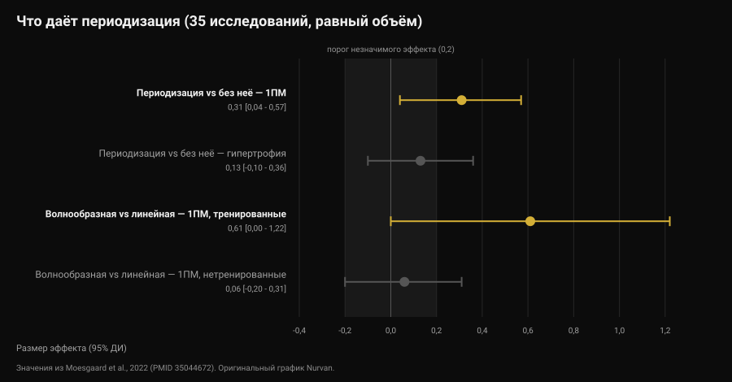

# Как часто менять программу тренировок?

Автор: [Джаммария Лои](/autore/giammaria-loi) · обновлено 12 ноября 2026

Сообщение приходит точно по расписанию: «тренер, прошёл месяц, поменяешь программу?». За ним стоит распространённая идея: мышца привыкает, значит нужна новизна. Исследования, сравнившие сменяемые упражнения с постоянными, рассказывают нечто более точное и более полезное: расти заставляет не новизна, а прогрессия. Но выбор упражнений действительно меняет то, *где* вы растёте. Вот как принимать решение — по цифрам.

## Коротко

- **Календарь — не критерий.** Ни одно из собранных здесь исследований не фиксирует выигрыша от смены упражнений по фиксированному сроку. Систематический обзор восьми работ заключает, что чрезмерная ротация, то есть высокая частота смены, может даже мешать адаптациям.
- **Смена упражнений не увеличивает общий прирост, она меняет его распределение.** За 12 недель площадь сечения квадрицепса выросла на 9,5-12,2% во всех группах, но все **четыре** пучка мышцы выросли только в группах со сменяемыми упражнениями.
- **Лучшее сочетание для силы — сменяемые упражнения при стабильной интенсивности.** Эта группа прибавила в приседе больше остальных, включая ту, что меняла ещё и веса.
- **Периодизация помогает силе, а не гипертрофии.** При равном объёме, по 35 исследованиям: эффект 0,31 на максимум и 0,13 (незначимо) на массу.
- **Прогрессировать — не всегда добавлять вес.** Добавление повторений при том же весе даёт равноценный результат и у тренированных, и у новичков.

## Откуда взялась идея ежемесячной смены

Ходовое выражение — *мышечная путаница*: тело якобы адаптируется к повторяющемуся стимулу, поэтому его нужно «запутать» новыми упражнениями. Верно здесь то, что адаптация существует: тот же подход с тем же весом со временем даётся легче. Ошибочен вывод, будто ответ — другое упражнение. Ответ — сделать этот подход труднее, а это не одно и то же.

Здесь смешивают два разных решения:

- **выбор упражнений**: какие движения вы делаете;
- **прогрессия**: как стимул растёт внутри этих упражнений, неделя за неделей.

Литература говорит о них разное. Их стоит рассматривать по отдельности.

## Смена упражнений: что меняется на самом деле

Самая информативная работа здесь — бразильское исследование 2014 года на 49 физически активных людях: 12 недель, две тренировки в неделю, четыре группы, построенные скрещиванием двух переменных — интенсивность постоянная или переменная, упражнение постоянное или сменяемое.

Результат по гипертрофии удивит того, кто ждёт явного победителя: площадь сечения квадрицепса выросла во всех группах, на 9,5-12,2%. По общему приросту не выиграл никто.

Разница прячется в детали, которую скрывает одно-единственное измерение. У квадрицепса четыре пучка, и они не обязаны расти вместе. Все четыре выросли только в двух группах, которые **меняли упражнения**: в группе с постоянным упражнением не было значимого роста медиальной широкой мышцы и прямой мышцы бедра, а в группе, менявшей только интенсивность, — прямой мышцы бедра (Fonseca et al., 2014).

А вот по силе победитель есть: группа с **постоянной интенсивностью и сменяемыми упражнениями** прибавила в приседе больше всех остальных тренировавшихся групп, включая ту, что меняла и упражнения, и веса. Заголовок исследования говорит прямо: менять упражнения эффективнее, чем менять схемы нагрузки.

Важно, как это читать. «Сменяемые упражнения» в той работе означают упорядоченное чередование движений, которые нагружают мышцу по-разному (жим ногами, присед, выпады), а не случайный выбор упражнения на каждой тренировке.

## Менять слишком часто: предел

В 2022 году систематический обзор собрал все восемь существующих контролируемых исследований по теме: 241 участник, все — молодые мужчины. Вывод авторов — один из самых практичных в литературе: некоторая доля систематической вариации, судя по всему, улучшает региональную гипертрофию и максимизирует динамическую силу, тогда как чрезмерная и случайная вариация может ухудшить прирост. В частности, упражнения с избыточным, дублирующим стимулом и высокая частота их ротации могут мешать адаптациям (Kassiano et al., 2022).

Всю работу делают два слова: *систематическая* и *дублирующая*. Добавить разведения к жиму лёжа — значит изменить профиль нагрузки на грудные. Менять жим со штангой на жим с гантелями каждую неделю — не добавить мышце ничего нового: это дублирующая вариация, и заодно вы потеряли нить по весам.

Есть, впрочем, довод в пользу разнообразия, который не стоит терять. В исследовании на 21 тренированном мужчине, восемь недель по четыре тренировки в неделю, одна группа работала по постоянному набору упражнений, а другой приложение каждый раз случайно выдавало упражнения и диапазоны повторений. Максимумы в жиме и приседе заметно выросли в обеих группах, без разницы между ними. Но **внутренняя мотивация** значимо улучшилась в группе со сменяемыми упражнениями, а в группе с постоянными снизилась, хотя и незначимо (Baz-Valle et al., 2019).

Перевод: разнообразие не ускоряет результат, оно помогает не бросать. А поскольку программа, которой вы не следуете, не даёт ничего, это не мелочь — тот же механизм делает [сезонные челленджи вроде Winter Arc рабочими лишь наполовину](/ru/blog/rabotaet-li-winter-arc).

## Что на самом деле говорят исследования

**«Мышца привыкает, программу надо менять раз в четыре недели» — Опровергнуто.** Ни одно из собранных исследований не сравнивает смену по фиксированному сроку с сохранением тех же упражнений и не находит преимущества у первой. Наоборот, единственный систематический обзор по теме называет высокую частоту смены возможным препятствием (Kassiano et al., 2022).

**«Смена упражнений даёт больше мышц» — Требует уточнения.** Общий прирост схож при постоянных и сменяемых упражнениях. Меняется распределение внутри мышцы: при сменяемых упражнениях растут и те пучки, которые одно движение оставляет без работы (Fonseca et al., 2014).

**«От смены упражнений теряешь силу» — Требует уточнения.** За восемь недель у тренированных мужчин случайный выбор на каждой тренировке не снизил максимумы (Baz-Valle et al., 2019). Но наибольший прирост силы в 12-недельном исследовании дала группа, которая меняла упражнения, **сохраняя интенсивность неизменной**: менять всё сразу оказалось хуже, чем менять по одному.

**«Без периодизации прогресса не будет» — Требует уточнения.** Метаанализ 35 исследований с уравненным объёмом находит преимущество периодизированного планирования по максимуму (эффект 0,31; 95% доверительный интервал от 0,04 до 0,57), но не по гипертрофии (0,13; от -0,10 до 0,36, незначимо). Волнообразная периодизация превосходит линейную по максимуму (0,31), однако преимущество сосредоточено у тренированных (0,61) и исчезает у новичков (0,06) (Moesgaard et al., 2022).

**«Чтобы прогрессировать, нужно добавлять вес» — Опровергнуто.** У 43 человек с минимум годом тренировок восемь недель растущего веса при фиксированных повторениях дали те же результаты, что и растущие повторения при фиксированном весе: различия меньше миллиметра по толщине мышц и, по словам самих авторов, сомнительной практической значимости по максимуму (Plotkin et al., 2022). То же сравнение у 39 новичков за десять недель, с рандомизацией двух ног: максимум в разгибании ног примерно с 52 до 69 кг при растущем весе и примерно с 52 до 67 кг при растущих повторениях, сечение латеральной широкой мышцы примерно с 21 до 23,5 см² в обоих случаях, без разницы (Chaves et al., 2024).

Важное ограничение: выборки этих работ — в основном молодые мужчины и физически активные взрослые, а максимальная длительность составляет 12 недель. На горизонте лет и в других группах эти цифры стоит читать как ориентиры, а не как законы.

## Как это применить

Правильный вопрос не «когда программа истекает», а «даёт ли это упражнение измеримую прогрессию?». Если да, менять его — значит выбрасывать информацию. Если нет, сначала стоит понять причину, а уже потом заменять.

Рабочая последовательность:

1. **Держите основные упражнения столько, сколько нужно, чтобы в них прогрессировать.** Исследования с явным приростом длятся 8-12 недель на одних и тех же базовых движениях: это разумный горизонт перед тем, как задуматься о смене, а не срок годности.
2. **Прежде чем менять упражнение, поменяйте прогрессию.** Вес встал? Добавьте повторений при том же весе: литература говорит, что работает так же. Затем, когда диапазон заполнен, вернитесь к весу.
3. **Отличайте настоящее плато от плохой недели.** Две вялые тренировки — не плато. Три-четыре недели без прогресса ни по весу, ни по повторениям, при нормальном сне и питании, — да.
4. **Меняйте систематически, а не случайно.** Два-три упражнения на мышечную группу, нагружающих её в разных положениях, ротация блоками, а не замена на каждой тренировке.
5. **Не меняйте две переменные сразу.** Меняете упражнение — оставьте схему подходов и повторений. Иначе, когда что-то перестанет работать, вы не поймёте что именно.
6. **Меняйте сразу, не дожидаясь срока, если упражнение болезненно, не получается технически или недоступно.** Здесь нет расписания: это задача, которую надо решить.

Для решения нужны данные, а данные — это тренировки: вес, повторения и то, насколько тяжело было, то есть ровно то, что описывают [повторения в запасе (RIR) и выбор подходов и отдыха](/ru/blog/skolko-povtoreniy-dlya-massy).

### Что менять и когда

| Что | Как часто | Почему |
|---|---|---|
| Вес или повторения | Каждую неделю, если получается | Это и есть прогрессия: растущий стимул. Вес и повторения равноценны (Plotkin 2022; Chaves 2024) |
| Дополнительные упражнения | Блоками по 6-8 недель | Покрывают пучки мышцы, которые одно движение оставляет без работы (Fonseca 2014) |
| Основные упражнения | Только при подтверждённом плато либо из-за боли и техники | Частая ротация может мешать адаптациям (Kassiano 2022) |
| Схема подходов и повторений | Блоками, у тренированных атлетов | Волнообразная периодизация помогает максимуму только уже тренированным (Moesgaard 2022) |
| Всё сразу | Никогда | Смена двух переменных одновременно делает данные нечитаемыми |

*Таблица Nurvan составлена по источникам, перечисленным в конце статьи.*

> ### С Nurvan
> История по каждому упражнению в Nurvan хранит вес, повторения и RIR подход за подходом: тренер видит, стоит ли прогрессия в этом движении четыре недели или всего одну тренировку, и решает по цифрам, а не по календарю. Когда упражнение входит в программу или уходит из неё, история остаётся: жим лёжа трёхмесячной давности по-прежнему сравним с сегодняшним. Разминочные подходы предлагаются автоматически от рабочего веса, поэтому смена упражнения не стоит вам тренировки на подбор весов. **[Попробовать Nurvan](https://nurvan.app)**

## Частые вопросы

**Как часто менять программу тренировок?**
Фиксированного срока, подтверждённого данными, не существует. Исследования с явным приростом длятся 8-12 недель на одних и тех же основных упражнениях, а систематический обзор указывает, что слишком частая смена может мешать. Критерий — прогрессия: пока растут вес или повторения, программа работает.

**Мышца привыкает к упражнениям?**
Она адаптируется к стимулу — именно поэтому стимул должен расти. Но «расти» означает больше веса или больше повторений, а не другое упражнение: ни одно из собранных здесь исследований не показывает, что замена упражнения перезапускает прирост.

**Если не получается добавить вес, надо менять упражнение?**
Сначала попробуйте добавить повторения при том же весе. В прямых сравнениях обе прогрессии дают равноценный результат и у тренированных, и у новичков. Смену упражнения стоит рассматривать после трёх-четырёх недель без прогресса ни по одному направлению.

**Смена упражнений даёт больше мышц?**
Не в сумме, но распределение лучше. При упорядоченной смене упражнений растут и те пучки мышцы, которые одно движение оставляет без работы, а мотивация приходить в зал только выигрывает.

## Читайте также

- [Работает ли онлайн-коучинг? Что говорят исследования](/ru/blog/rabotaet-li-onlayn-kouching) — сколько значит контроль тренера при одинаковой программе.
- [План тренировок от ИИ: что говорят исследования](/ru/blog/plan-trenirovok-ot-ii) — где искусственный интеллект справляется с программированием, а где ошибается.
- [Сколько повторений нужно для массы: миф о 8-12](/ru/blog/skolko-povtoreniy-dlya-massy) — подходы, повторения и отдых, и что меняется на самом деле.

## Источники

1. Kassiano W, Nunes JP, Costa B, Ribeiro AS, Schoenfeld BJ, Cyrino ES, 2022. *Does Varying Resistance Exercises Promote Superior Muscle Hypertrophy and Strength Gains? A Systematic Review.* Journal of Strength and Conditioning Research 36(6):1753-1762. PMID 35438660. [DOI 10.1519/JSC.0000000000004258](https://doi.org/10.1519/JSC.0000000000004258)
2. Fonseca RM, Roschel H, Tricoli V, de Souza EO, Wilson JM, Laurentino GC, Aihara AY, de Souza Leão AR, Ugrinowitsch C, 2014. *Changes in exercises are more effective than in loading schemes to improve muscle strength.* Journal of Strength and Conditioning Research 28(11):3085-3092. PMID 24832974. [DOI 10.1519/JSC.0000000000000539](https://doi.org/10.1519/JSC.0000000000000539)
3. Baz-Valle E, Schoenfeld BJ, Torres-Unda J, Santos-Concejero J, Balsalobre-Fernández C, 2019. *The effects of exercise variation in muscle thickness, maximal strength and motivation in resistance trained men.* PLoS ONE 14(12):e0226989. PMID 31881066. [DOI 10.1371/journal.pone.0226989](https://doi.org/10.1371/journal.pone.0226989)
4. Moesgaard L, Beck MM, Christiansen L, Aagaard P, Lundbye-Jensen J, 2022. *Effects of Periodization on Strength and Muscle Hypertrophy in Volume-Equated Resistance Training Programs: A Systematic Review and Meta-analysis.* Sports Medicine 52(7):1647-1666. PMID 35044672. [DOI 10.1007/s40279-021-01636-1](https://doi.org/10.1007/s40279-021-01636-1)
5. Plotkin D, Coleman M, Van Every D, Maldonado J, Oberlin D, Israetel M, Feather J, Alto A, Vigotsky AD, Schoenfeld BJ, 2022. *Progressive overload without progressing load? The effects of load or repetition progression on muscular adaptations.* PeerJ 10:e14142. PMID 36199287. [DOI 10.7717/peerj.14142](https://doi.org/10.7717/peerj.14142)
6. Chaves TS, Scarpelli MC, Bergamasco JGA, da Silva DG, Medalha Junior RA, Dias NF, Bittencourt D, Carello Filho PC, Angleri V, Nóbrega SR, Roberts MD, Ugrinowitsch C, Libardi CA, 2024. *Effects of Resistance Training Overload Progression Protocols on Strength and Muscle Mass.* International Journal of Sports Medicine 45(7):504-510. PMID 38286426. [DOI 10.1055/a-2256-5857](https://doi.org/10.1055/a-2256-5857)

Библиографические источники найдены через PubMed. Тема выбрана из редакционной очереди Nurvan — по вопросам, которые тренерам задают чаще всего.

---

*Джаммария Лои — основатель Nurvan. Тренируется с отягощениями с 2012 года, работает персональным тренером и коучем с сертификацией FIPE с 2013 года и выступает в пауэрлифтинге на национальном уровне с 2018 года. Каждая его статья начинается с научных работ и заканчивается тем, что действительно работает в зале.*

> Примечание: информационный материал, он не заменяет консультацию врача или профильного специалиста.
