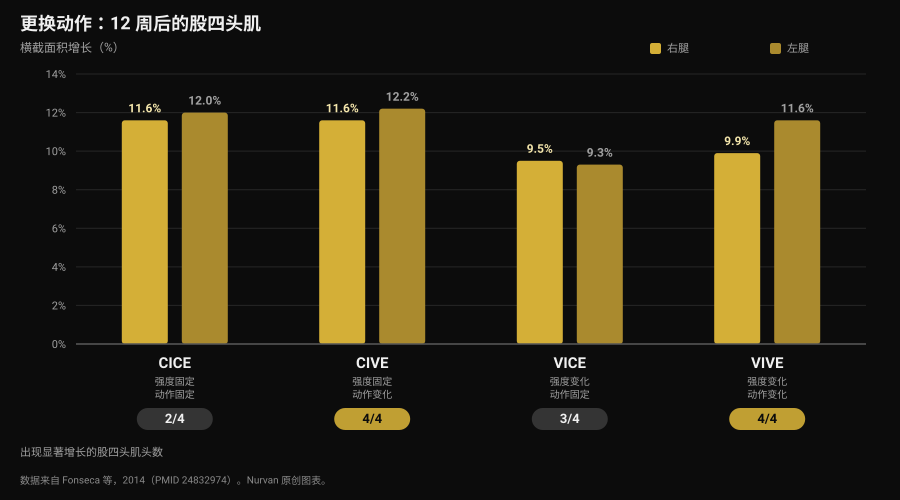
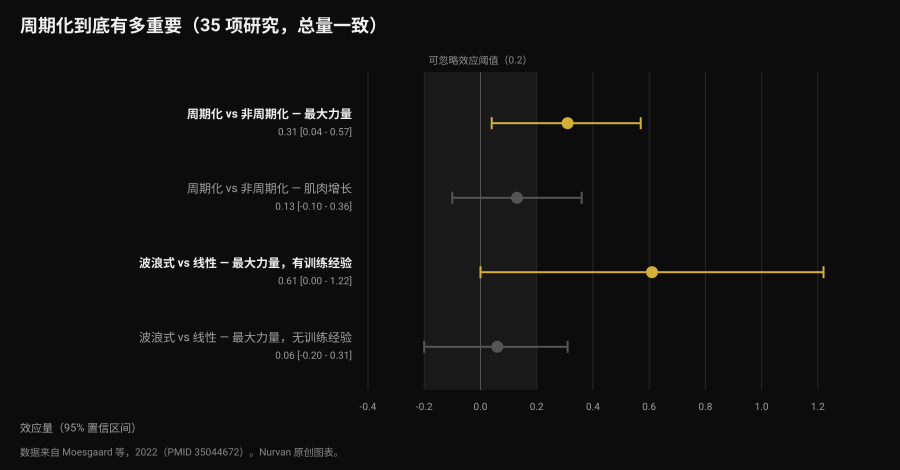

# 训练计划多久换一次？

作者：[Giammaria Loi](/autore/giammaria-loi) · 更新于 2026 年 11 月 12 日

消息总是准时到来：“教练，一个月了，给我换计划吧？”背后是一个流传很广的想法——肌肉会适应，所以需要新鲜感。而那些把“更换动作”和“固定动作”放在一起比较的研究，给出的答案更精确，也更有用：让你变强的不是新鲜感，是渐进。不过动作的选择确实会改变你*在哪里*变大。下面用数据来判断。

## 要点速览

- **日历不是判断标准。** 本文收集的研究中，没有一项测到“按固定周期换动作”更好。一篇纳入 8 项研究的系统综述反而指出，过度轮换——也就是更换频率过高——可能妨碍适应。
- **更换动作不会提高总增长，只会改变分布。** 12 周里，四组受试者的股四头肌横截面积都增长了 9.5%–12.2%，但只有更换动作的组别，**四个头**全部出现增长。
- **力量最好的组合是：动作更换、强度稳定。** 这一组深蹲力量涨幅最大，超过了那些同时改变负荷的组别。
- **周期化帮助力量，不帮助肌肥大。** 在总量一致的条件下，35 项研究汇总：对最大力量效应量 0.31，对肌肉量 0.13（不显著）。
- **渐进不等于必须加重量。** 在固定负荷下增加次数，效果与加重量相当，无论是有训练经验者还是初学者。

## “每月换一次”的说法从哪来

流传的说法叫*肌肉混淆*：身体会适应重复的刺激，所以要用新动作去“迷惑”它。其中成立的部分是：适应确实存在——同样的组数、同样的重量，时间久了会变轻松。错误的结论是：答案在于换一个动作。真正的答案是让那一组变得更难，这是两回事。

这里常常混淆两个不同的决定：

- **动作选择**：你做哪些动作；
- **渐进**：在这些动作里，刺激如何一周一周地增长。

文献对两者的说法并不相同，值得分开来看。

## 更换动作：真正改变的是什么

最有参考价值的是 2014 年一项巴西研究，49 名有运动习惯的受试者，12 周，每周两次，用两个变量交叉出四组：强度固定或变化，动作固定或更换。

肌肥大的结果会让期待“明显赢家”的人意外：四组的股四头肌横截面积全部增长，幅度在 9.5% 到 12.2% 之间。在总增长上没有谁胜出。

差别藏在单次测量会掩盖的细节里。股四头肌有四个头，它们未必一起长大。只有**更换动作**的两组四个头全部增长：动作固定的那组，股内侧肌和股直肌没有显著增长；只改变强度的那组，股直肌没有显著增长（Fonseca et al., 2014）。

力量方面则有明确赢家：**强度固定、动作更换**的那一组，深蹲最大力量的增幅超过其他所有训练组，包括同时更换动作和负荷的那一组。研究标题说得很直接：更换动作比更换负荷方案更有效。

但要注意读法。该研究里的“更换动作”，指的是有计划地轮换那些以不同方式负荷同一块肌肉的动作（腿举、深蹲、箭步蹲），而不是每次随便抽一个动作。

## 换得太勤：边界在哪

2022 年，一篇系统综述汇总了该主题现有的八项对照研究，合计 241 名受试者，全部为年轻男性。作者的结论是文献里最实用的一类：一定程度的系统性变化似乎能改善区域性肌肥大、最大化动态力量，而过度的、随机的变化可能损害增益。具体来说，使用刺激重复冗余的动作，以及以很高的频率轮换动作，可能妨碍适应（Kassiano et al., 2022）。

两个词是关键：*系统性*和*冗余*。在卧推之外加上飞鸟，改变的是胸肌的受力曲线；每周把杠铃卧推换成哑铃卧推，则没有给肌肉带来任何它没经历过的东西，属于冗余变化——与此同时，你已经把负荷的线索弄丢了。

不过有一个支持多样性的数据不该被忽略。一项针对 21 名有训练经验男性的研究，八周、每周四练，一组采用固定动作，另一组每次训练由应用随机抽取动作和次数区间。两组的卧推和深蹲最大力量都有明显提升，组间没有差异。但**内在动机**在更换动作的组别出现显著改善，而在固定动作组下降，只是未达显著（Baz-Valle et al., 2019）。

翻译过来就是：多样性不是结果的加速器，而是坚持的帮手。而既然不执行的计划什么也产生不了，这一点就不该丢掉——同样的机制也让[Winter Arc 这类季节性挑战只对了一半](/zh/blog/winter-arc-youxiao-ma)。

## 研究到底怎么说

**“肌肉会适应，计划每四周要换” —— 不成立。** 收集到的研究里，没有任何一项把“按固定周期更换”和“保持同样动作”做对比并发现前者更优。相反，该主题唯一的系统综述把高频更换列为可能的阻碍（Kassiano et al., 2022）。

**“更换动作能长更多肌肉” —— 需要补充。** 总增长在固定与更换之间相近，改变的是肌肉内部的分布：更换动作时，单一动作顾不到的那几个头也会长（Fonseca et al., 2014）。

**“换动作会掉力量” —— 需要补充。** 在八周内，对有训练经验的男性而言，每次随机抽取动作并没有降低最大力量（Baz-Valle et al., 2019）。但 12 周研究里力量涨幅最大的，是**保持强度固定**、只更换动作的那一组：同时改变所有变量，收益反而不如一次只改一个。

**“没有周期化就没有进步” —— 需要补充。** 一项纳入 35 项总量一致研究的荟萃分析发现，周期化安排对最大力量有优势（效应量 0.31；95% 置信区间 0.04 到 0.57），但对肌肥大没有（0.13；-0.10 到 0.36，不显著）。波浪式周期化在最大力量上优于线性（0.31），不过优势集中在有训练经验者（0.61），在初学者身上消失（0.06）（Moesgaard et al., 2022）。

**“想进步就得加重量” —— 不成立。** 在 43 名至少有一年训练经验的受试者中，八周“次数固定、负荷递增”与“负荷固定、次数递增”的结果相同：肌肉厚度差异不足 1 毫米，最大力量上的差异按作者自己的说法实际意义存疑（Plotkin et al., 2022）。同样的比较在 39 名初学者、十周、双腿随机分配的设计中：腿屈伸最大力量从约 52 公斤提高到 69 公斤（负荷递增）和约 52 公斤到 67 公斤（次数递增），股外侧肌横截面积两者都从约 21 平方厘米到 23.5 平方厘米，没有差异（Chaves et al., 2024）。

一个需要记住的局限：这些研究的样本大多是年轻男性和有运动习惯的成年人，最长周期为 12 周。放到数年的尺度上、放到不同人群里，这些数字是参考，不是定律。

## 怎么落地

正确的问题不是“计划什么时候到期”，而是“这个动作还在产生可测量的进步吗”。如果答案是肯定的，换掉它就等于扔掉信息；如果是否定的，要先弄清原因，再谈替换。

一个可行的顺序：

1. **主要动作保留到足以在上面取得进步。** 显示明确增益的研究，都在同样的基础动作上持续 8 到 12 周：这是考虑更换前的合理时间跨度，不是必须遵守的期限。
2. **换动作之前，先换渐进方式。** 重量卡住了？在同样负荷下增加次数：文献说效果一样。等次数区间填满，再回到加重量。
3. **区分真正的平台期和状态差的一周。** 两次平淡的训练不是平台期；睡眠和饮食都正常，却连续三到四周在重量和次数上都没有进展，才是。
4. **要系统地换，而不是随机地换。** 每个肌群保留两三个在不同位置施加负荷的动作，按训练块轮换，而不是每次训练都替换。
5. **不要同时改两个变量。** 换了动作，就保持组数和次数不变。否则当某样东西不再奏效，你无法判断是什么造成的。
6. **如果动作引起疼痛、做不标准或器械不可用，立刻换，不用等。** 这里没有期限可言：这是需要解决的问题。

要做判断就需要数据，而数据来自每一次训练——重量、次数和费力程度，这正是[储备次数（RIR）以及组数与组间休息的选择](/zh/blog/duoshao-cishu-zengji)所衡量的东西。

### 换什么，什么时候换

| 换什么 | 多久一次 | 为什么 |
|---|---|---|
| 负荷或次数 | 每周，如果条件允许 | 这就是渐进：不断增长的刺激。负荷与次数等效（Plotkin 2022；Chaves 2024） |
| 辅助动作 | 每 6–8 周一个训练块 | 覆盖单一动作顾不到的肌肉头（Fonseca 2014） |
| 主要动作 | 仅在平台期确认后，或因疼痛与技术问题 | 频繁轮换可能妨碍适应（Kassiano 2022） |
| 组数与次数方案 | 按训练块，面向有训练经验者 | 波浪式周期化只对已有训练经验者的最大力量有帮助（Moesgaard 2022） |
| 全部一起换 | 永远不要 | 一次改两个变量会让数据无法解读 |

*Nurvan 表格，依据文末引用的研究整理。*

> ### 用 Nurvan
> Nurvan 的单动作历史会逐组记录负荷、次数和 RIR：教练能看出这个动作的进步是卡了四周，还是只卡了一次训练，用数字而不是日历来决定。当一个动作加入或离开计划，历史依然保留：三个月前的卧推仍然可以和今天的比较。热身组会依据工作重量自动给出，所以更换动作不会让你浪费一次训练去重新找重量。**[试用 Nurvan](https://nurvan.app)**

## 常见问题

**训练计划多久换一次？**
没有任何数据支持某个固定期限。显示明确增益的研究都在同样的主要动作上持续 8 到 12 周，而一篇系统综述指出高频更换可能成为阻碍。判断标准是进步：只要重量或次数还在上升，计划就在起作用。

**肌肉会对动作产生适应吗？**
它适应的是刺激，这正是刺激必须增长的原因。但“增长”指的是更大的负荷或更多的次数，而不是换一个动作：本文收集的研究中，没有一项显示替换动作能让增益重新启动。

**加不上重量了，是不是该换动作？**
先试着在同样负荷下增加次数。在直接比较中，两种渐进方式在有训练经验者和初学者身上效果相当。连续三到四周两条路都没有进展，再考虑更换动作。

**更换动作能长更多肌肉吗？**
总量上不会，但分布更均衡。有计划地更换动作时，单一动作顾不到的肌肉头也会增长，而且去训练的动力也会因此受益。

## 延伸阅读

- [线上教练有效吗？研究怎么说](/zh/blog/xianshang-jiaolian-youxiao-ma) —— 计划相同时，监督到底有多重要。
- [AI 生成的健身计划：研究怎么说](/zh/blog/ai-shengcheng-jianshen-jihua) —— 人工智能在训练编排上做对了什么，又错在哪里。
- [增肌该做多少次数：8–12 的迷思](/zh/blog/duoshao-cishu-zengji) —— 组数、次数与休息，真正起作用的是什么。

## 参考文献

1. Kassiano W, Nunes JP, Costa B, Ribeiro AS, Schoenfeld BJ, Cyrino ES, 2022. *Does Varying Resistance Exercises Promote Superior Muscle Hypertrophy and Strength Gains? A Systematic Review.* Journal of Strength and Conditioning Research 36(6):1753-1762. PMID 35438660. [DOI 10.1519/JSC.0000000000004258](https://doi.org/10.1519/JSC.0000000000004258)
2. Fonseca RM, Roschel H, Tricoli V, de Souza EO, Wilson JM, Laurentino GC, Aihara AY, de Souza Leão AR, Ugrinowitsch C, 2014. *Changes in exercises are more effective than in loading schemes to improve muscle strength.* Journal of Strength and Conditioning Research 28(11):3085-3092. PMID 24832974. [DOI 10.1519/JSC.0000000000000539](https://doi.org/10.1519/JSC.0000000000000539)
3. Baz-Valle E, Schoenfeld BJ, Torres-Unda J, Santos-Concejero J, Balsalobre-Fernández C, 2019. *The effects of exercise variation in muscle thickness, maximal strength and motivation in resistance trained men.* PLoS ONE 14(12):e0226989. PMID 31881066. [DOI 10.1371/journal.pone.0226989](https://doi.org/10.1371/journal.pone.0226989)
4. Moesgaard L, Beck MM, Christiansen L, Aagaard P, Lundbye-Jensen J, 2022. *Effects of Periodization on Strength and Muscle Hypertrophy in Volume-Equated Resistance Training Programs: A Systematic Review and Meta-analysis.* Sports Medicine 52(7):1647-1666. PMID 35044672. [DOI 10.1007/s40279-021-01636-1](https://doi.org/10.1007/s40279-021-01636-1)
5. Plotkin D, Coleman M, Van Every D, Maldonado J, Oberlin D, Israetel M, Feather J, Alto A, Vigotsky AD, Schoenfeld BJ, 2022. *Progressive overload without progressing load? The effects of load or repetition progression on muscular adaptations.* PeerJ 10:e14142. PMID 36199287. [DOI 10.7717/peerj.14142](https://doi.org/10.7717/peerj.14142)
6. Chaves TS, Scarpelli MC, Bergamasco JGA, da Silva DG, Medalha Junior RA, Dias NF, Bittencourt D, Carello Filho PC, Angleri V, Nóbrega SR, Roberts MD, Ugrinowitsch C, Libardi CA, 2024. *Effects of Resistance Training Overload Progression Protocols on Strength and Muscle Mass.* International Journal of Sports Medicine 45(7):504-510. PMID 38286426. [DOI 10.1055/a-2256-5857](https://doi.org/10.1055/a-2256-5857)

文献来源通过 PubMed 检索。选题来自 Nurvan 的内容队列，依据的是教练最常被问到的问题。

---

*Giammaria Loi 是 Nurvan 的创始人。他自 2012 年起进行力量训练，自 2013 年起作为 FIPE 认证私人教练工作，并自 2018 年起在国家级别参加力量举比赛。他署名的每一篇文章都从科学研究出发，落到健身房里真正有效的做法。*

> 注：本文为科普内容，不能替代医生或专业人士的意见。
