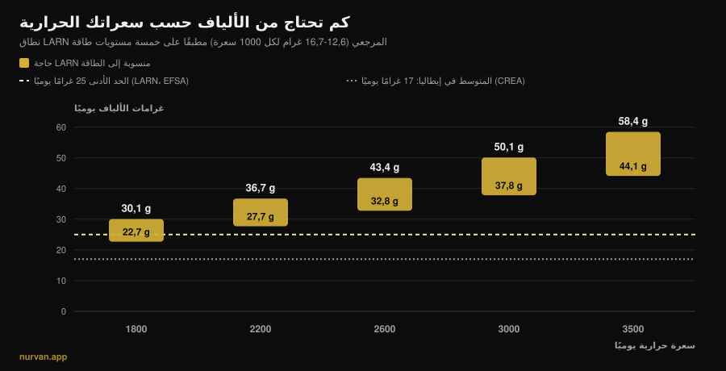
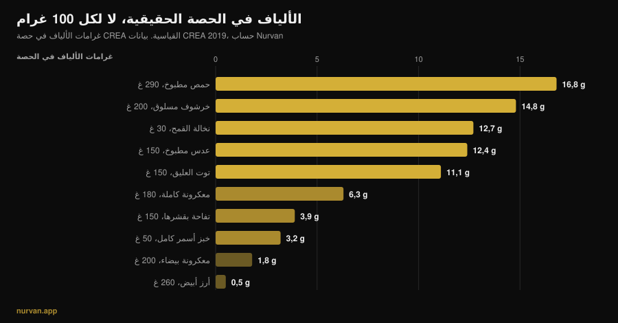

# كم غرامًا من الألياف تحتاج يوميًا؟

بقلم [جياماريا لوي](/autore/giammaria-loi) · حُدِّث في 13 نوفمبر 2026

بعد سنوات من «البروتين في كل شيء»، صار المغذّي الرائج هو الألياف: موضة الإكثار من الألياف (fibermaxxing) تدعوك إلى رفعها قدر المستطاع، ملعقة بذور شيا بعد الأخرى. المغذّي صحيح، لكن الاتجاه خاطئ. أدلة الألياف من أمتن ما في علم التغذية كله، غير أن الدراسات نفسها تقول أمرين يتجاهلهما هذا التيار: هناك نطاق تتركّز فيه معظم الفائدة، وهذا النطاق ليس واحدًا لمن يأكل 1800 سعرة ولمن يأكل 3200.

## باختصار

- **معظم الفائدة بين 25 و29 غرامًا يوميًا.** في المراجعة المنشورة في مجلة *Lancet* على 185 دراسة ترقّبية و58 تجربة، كان انخفاض خطر الوفاة الإجمالية وأمراض القلب والسكتة والسكري من النوع الثاني وسرطان القولون والمستقيم في أقصاه داخل هذا النطاق.
- **«25 غرامًا على الأقل» ليس رقمك إن كنت تتمرّن كثيرًا.** مرجعيات LARN الإيطالية تضع أيضًا قيمة منسوبة إلى الطاقة: 12,6 إلى 16,7 غرامًا لكل 1000 سعرة. عند 3000 سعرة تصبح 38 إلى 50 غرامًا يوميًا.
- **المتوسط في إيطاليا نحو 17 غرامًا يوميًا** بحسب بيانات CREA: المشكلة الحقيقية ليست الإفراط بل النقص.
- **الزيادة السريعة تسبّب الانتفاخ فعلًا.** في تجارب مكمّلات الألياف كانت الغازات أعلى بفارق معتدّ به في مجموعات الألياف: ليس انطباعًا، بل أثرًا مقيسًا.
- **ألياف الطعام وألياف المسحوق لا تفعلان الشيء نفسه.** الأولى أظهرت أثرًا على السكر *وعلى* الضغط، والثانية على السكر والكوليسترول أساسًا.

*رسم Nurvan: حساب أجريناه بتطبيق نطاق LARN المرجعي (SINU، 12,6–16,7 غرامًا لكل 1000 سعرة) على خمسة مستويات طاقة. الخط المتقطّع عند 25 غرامًا هو الحد الأدنى وفق LARN وEFSA. خط النقاط عند 17 غرامًا هو متوسط الاستهلاك في إيطاليا، من بيانات مسح CREA الرابع (IV SCAI) كما وردت لدى Marconi وزملائه، 2025.*

## من أين جاءت موضة الإكثار من الألياف

الآلية هي نفسها التي وضعت البروتين في كل شيء: مغذٍّ بسمعة علمية جيدة، واسم بلاحقة *-maxxing*، ثم استنتاج ضمني مفاده أن القليل إن كان نافعًا فالكثير أنفع. الفرق أن نقطة الانطلاق هنا صحيحة: لا أحد تقريبًا يبلغ الحد الأدنى، ورفع الألياف هو على الأرجح التغيير الأفضل من حيث نسبة الجهد إلى الفائدة على مائدة الشخص العادي.

المشكلة تبدأ في الانتقال من «معظم الناس يأكلون القليل منها» إلى «كلما أكثرت كان أفضل». هاتان جملتان مختلفتان، والدراسات تسند الأولى فقط.

## كم تحتاج فعلًا

أمتن مصدر هو سلسلة المراجعات المنهجية المنشورة في *Lancet* عام 2019: 185 دراسة ترقّبية، وما يقارب 135 مليون سنة-شخص، إضافة إلى 58 تجربة محكومة على 4635 بالغًا. وبمقارنة الأكثر استهلاكًا بالأقل، تُظهر البيانات الرصدية انخفاضًا يتراوح بين 15% و30% في الوفيات الإجمالية والقلبية الوعائية، وفي أمراض الشريان التاجي والسكتة والسكري من النوع الثاني وسرطان القولون والمستقيم.

وهنا يأتي الرقم الذي لا يذكره التيار أبدًا: **انخفاض الخطر يبلغ ذروته عند استهلاك يتراوح بين 25 و29 غرامًا يوميًا**. منحنيات الجرعة-الاستجابة توحي بأن تجاوز هذا النطاق قد يضيف شيئًا إضافيًا للقلب والسكري وبعض السرطانات، لكن القفزة الكبيرة هي تلك التي تُدخلك *إلى* النطاق، لا التي تتجاوزه.

ويؤكد ذلك التحليل البعدي للجرعة-الاستجابة المنشور عام 2023 في *Frontiers in Nutrition*: الخطر النسبي للوفاة الإجمالية 0,90 (فاصل ثقة 95%: 0,86–0,93)، والقلبي الوعائي 0,87، والسرطاني 0,91، مع علاقة **غير خطية** للوفاة الإجمالية. وغير خطية تعني بالضبط هذا: المنحنى يستوي.

وثمة حالتان يكون فيها الدفع إلى أعلى مسنودًا بأرقام. لدى المصابين بالسكري، الانتقال من 19 إلى 35 غرامًا يوميًا يرتبط بـ14 وفاة أقل لكل 1000 شخص خلال فترة المتابعة (فاصل ثقة 95%: 4–19). ولدى المصابين بارتفاع الضغط، خفضت زيادة الألياف الضغط الانقباضي 4,3 ملم زئبق والانبساطي 3,1 ملم زئبق، بدرجة يقين عالية وبصرف النظر عن الأدوية المستعملة. لكن هاتين فئتان سريريتان: فيهما يقرّر الطبيب الرقم المناسب، لا منشور على وسائل التواصل.

## حاجتك ترتفع مع السعرات

هذا هو الجزء الغائب في كل مكان تقريبًا، وهو الأهم لمن يتمرّن.

مرجعيات LARN الصادرة عن الجمعية الإيطالية لتغذية الإنسان لا تعطي حد «25 غرامًا على الأقل» فحسب، بل تعطي أيضًا قيمة منسوبة إلى الطاقة: **12,6 إلى 16,7 غرامًا من الألياف لكل 1000 سعرة**. وهو اختيار منطقي، لأن الألياف تأتي من الطعام، ومن يأكل أكثر يأكل طعامًا أكثر.

وتطبيق هذه القيمة على السعرات الفعلية يغيّر الهدف تمامًا، كما ترى في الرسم أعلاه. لشخص قليل الحركة يأكل 1800 سعرة يكون النطاق 23 إلى 30 غرامًا. ولمن يتمرّن أربع مرات أسبوعيًا ويأكل 3000 سعرة يصبح **38 إلى 50 غرامًا**. وفي مرحلة زيادة الوزن عند 3500 سعرة، 44 إلى 58 غرامًا. من يكرّر «25 غرامًا تكفي» يعطي لاعب قوة بدنية وزنه 95 كيلوغرامًا رقم شخص يأكل نصف ما يأكله؛ ومن يمارس الإكثار من الألياف عند 1600 سعرة في مرحلة التنشيف يدفع رقمًا هو أصلًا مرتفع بالنسبة إليه.

ومن أين تأتي تلك السعرات مسألة متشابكة مع نوعية الكربوهيدرات التي تختارها: تحدثنا عنها في [هل الكربوهيدرات تزيد الوزن؟](/ar/blog/hal-alkarbohidrat-tazid-alwazn-duhun-khafiya).

## ماذا تقول الأبحاث فعلًا

| العبارة الشائعة | الحكم | المصدر |
|---|---|---|
| «كلما زادت الألياف كان أفضل» | **يحتاج إلى تدقيق**: معظم الفائدة بين 25 و29 غرامًا، ثم يستوي المنحنى | Reynolds وزملاؤه، 2019؛ Yao وزملاؤه، 2023 |
| «25 غرامًا يوميًا تكفي الجميع» | **يحتاج إلى تدقيق**: LARN تعطي أيضًا 12,6–16,7 غرامًا لكل 1000 سعرة | LARN SINU؛ Marconi وزملاؤه، 2025 |
| «الألياف تُذهب انتفاخ البطن» | **غير صحيح** على المدى القصير: ألياف أكثر تعني غازات أكثر (SMD 0,80) | van der Schoot وزملاؤه، 2022 |
| «مكيال من قشور السيليوم يحلّ المسألة» | **يحتاج إلى تدقيق**: ينفع للانتظام، لكن ألياف الطعام أظهرت أثرًا أوسع | van der Schoot 2022؛ Jiang وزملاؤه، 2025 |
| «قبل التمرين كلما زادت الألياف كان أفضل» | **غير صحيح**: خفضها هو الأسلوب الأكثر استخدامًا ضد اضطرابات الهضم المرتبطة بالتمرين | Scrivin وزملاؤه، 2022 |

### لماذا تنتفخ في البداية (والذنب ليس ذنبك)

في التحليل البعدي الذي ضمّ 16 تجربة محكومة و1251 بالغًا يعانون إمساكًا مزمنًا، نجحت الألياف: استجاب 66% من المشاركين (311 من 473) مقابل 41% في المجموعات الضابطة (134 من 329)، بخطر نسبي 1,48. لكن في العمل نفسه كانت **الغازات أعلى بفارق معتدّ به في مجموعات الألياف**، بفارق متوسطات معياري قدره 0,80 (فاصل ثقة 95%: 0,47–1,13)، وهو أثر كبير.

لهذا فإن «زدت الخضار فانتفخت» ليس فشلًا، بل الاستجابة المتوقَّعة لتغيير سريع. وفي العمل نفسه لم يظهر التحسّن في عدد مرات التبرّز وقوامه إلا مع مدد لا تقل عن أربعة أسابيع. الانتفاخ هو الأسبوع الأول، والفائدة من الرابع فصاعدًا. والنتيجة العملية واحدة: **اصعد درجة درجة**، 3 إلى 5 غرامات أسبوعيًا.

### المكمّل أم الطعام

المسحوق ليس اختصارًا مكافئًا. في أوضح مقارنة متاحة، فصل تحليل بعدي من عام 2025 شمل 30 تجربة و1140 مشاركًا بين الألياف **الأصيلة** (الموجودة داخل الطعام الكامل) والألياف **المعزولة** (المستخلَصة والمضافة). الأولى خفّضت سكر الدم الصائم والضغط الانقباضي (−2,86 ملم زئبق). والثانية خفّضت السكر الصائم والكوليسترول الكلي، لكن ليس الضغط.

ليست هذه حجة ضد المكمّلات: لقشور السيليوم بيانات جيدة على انتظام الأمعاء، بجرعات تتجاوز 10 غرامات يوميًا ولمدة لا تقل عن أربعة أسابيع. إنها حجة ضد فكرة أن مكيالًا يحلّ محل طبق بقوليات. فبنية الطعام نفسها لها أثر، تمامًا كما يحدث عند [المقارنة بين البروتين النباتي والحيواني](/ar/blog/albrotin-alnabati-am-alhayawani-lilaadalat).

### الألياف والتمرين: التوقيت مهم

تفصيل لا يأخذه هذا التيار في الحسبان هو *متى*. في دراسة على 137 رياضي تحمّل لديهم تاريخ من أعراض هضمية مرتبطة بالتمرين، ومن أصل 277 أسلوبًا أبلغوا عنه، جاء **خفض الألياف الأسلوب الغذائي الأكثر استخدامًا** (15,2%، 42 إشارة) ومن بين الأعلى تقييمًا، بفاعلية وسيطة 4 من 5. تلاه تجنّب الألبان وحمية FODMAP المنخفضة.

تنبيهان لا بد منهما: هذه البيانات من رياضيي تحمّل لا من رافعي الأثقال، ولأعراض الجري مكوّنات ميكانيكية لا وجود لها في النادي. لكن المنطق يصمد تحت البار أيضًا: طبق يحتوي 15 غرامًا من الألياف قبل ساعتين من حصة سكوات ثقيلة خيار مشكوك فيه، بينما الطبق نفسه على العشاء لا يزعج أحدًا.

## كيف تطبّق ذلك

القاعدة الأولى: كفّ عن النظر إلى ترتيب «لكل 100 غرام». ففي قاعدة بيانات CREA يحتوي الفلفل الأسود على 25,9 غرامًا من الألياف لكل 100 غرام، لكن الحصة المرجعية غرام واحد: أي 0,26 غرامًا من الألياف. المهم هو كمية الألياف في حصة ستأكلها فعلًا.

*رسم Nurvan استنادًا إلى جداول CREA — مركز أبحاث الأغذية والتغذية، تحديث 2019. الألياف لكل حصة محسوبة من قبلنا بالصيغة: (الألياف لكل 100 غرام × الحصة) ÷ 100.*

القاعدة الثانية: القفزات الكبيرة تأتي من استبدالات قليلة، لا من عشرين تعديلًا صغيرًا.

| الاستبدال | قبل | بعد | المكسب |
|---|---|---|---|
| الطبق النشوي الجانبي | أرز أبيض مطبوخ، 260 غ: **0,5 غ** | معكرونة كاملة مطبوخة، 180 غ: **6,3 غ** | **+5,8 غ** |
| الخبز | خبز أبيض، 50 غ: **1,9 غ** | خبز أسمر كامل، 50 غ: **3,2 غ** | **+1,3 غ** |
| طبق إضافي | — | عدس مطبوخ، 150 غ: **12,4 غ** | **+12,4 غ** |
| | | | **+19,5 غ إجمالًا** |

*حساب Nurvan على بيانات CREA 2019. انطلاقًا من متوسط إيطاليا البالغ 17 غرامًا، تصل هذه الاستبدالات الثلاثة بك إلى نحو 36 أو 37 غرامًا يوميًا.*

القاعدة الثالثة: القشرة أهم مما تظن. تفاحة وزنها 150 غرامًا بقشرها تعطي 3,9 غرامًا من الألياف، والتفاحة نفسها مقشّرة 3,0 غرامات: الربع يذهب مع السكين.

أربع خطوات عملية:

1. **اعثر على رقمك أنت، لا على الرقم العام.** اضرب سعراتك في 0,0126 وفي 0,0167: ما بينهما هو نطاقك. عند 2500 سعرة يكون 32 إلى 42 غرامًا.
2. **اصعد 3 إلى 5 غرامات أسبوعيًا.** الانتفاخ الأولي حقيقي ويزول، لكن بشرط أن تمنحه وقتًا.
3. **طبق بقوليات واحد يفعل أكثر من كل ما عداه مجتمعًا.** 150 غرامًا من العدس المطبوخ تعادل أربع تفاحات.
4. **أبعد الألياف عن موعد التمرين.** وجبة ما قبل التمرين هي الوحيدة التي يستحق إبقاء الألياف فيها منخفضة؛ عوّض حصّة اليوم على العشاء.

وإن كنت تحسب البروتين وجبة بوجبة، فالألياف هي الرقم الثاني الذي يوضع إلى جانبه: [كم بروتينًا في الوجبة الواحدة](/ar/blog/kam-brotin-fi-alwajba-alwahida) هو المقال التوأم لهذا المقال.

> **Nurvan: الألياف تراها، لا تخمّنها**
>
> قسم التغذية في Nurvan يستخدم قاعدة بيانات CREA، وهي المصدر نفسه الذي جاءت منه أرقام هذا المقال: كل طعام تدخله يحمل معه ألياف حصته، ويتحدّث مجموع اليوم إلى جانب السعرات والبروتين. ولأن حاجتك من الطاقة موجودة أصلًا في التطبيق، تعرف فورًا إن كانت سعراتك الـ3000 قد بلغت 38 غرامًا أم توقّفت عند 18. [جرّب Nurvan](https://nurvan.app)

## أسئلة شائعة

**كم غرامًا من الألياف يجب أن آكل يوميًا؟**
الحد الأدنى لدى LARN وEFSA هو 25 غرامًا يوميًا للبالغ. وفي المراجعات يتركّز معظم انخفاض الخطر بين 25 و29 غرامًا. وإن كنت تتمرّن وتأكل كثيرًا فالقيمة المنسوبة إلى الطاقة أنفع: 12,6 إلى 16,7 غرامًا لكل 1000 سعرة، أي 38 إلى 50 غرامًا عند 3000 سعرة.

**هل الإكثار من الألياف مضرّ؟**
الأثر المقيس في الدراسات للزيادة السريعة هو غازات أكثر، لا ضرر. الخطر الحقيقي عملي: الزيادة السريعة تسبّب إزعاجًا يدفعك إلى التوقّف، ولا توجد دراسة تُظهر أن الدفع إلى ما هو أعلى بكثير من نطاق 25–29 غرامًا يعطي فائدة متناسبة. وإن كان لديك تشخيص لمرض معوي فكمية الألياف ليست قرارًا تتخذه وحدك.

**الألياف من المكمّلات أم من الطعام؟**
كلاهما ينفع لأهداف مختلفة. في التحليل البعدي لعام 2025 خفّضت ألياف الأطعمة الكاملة سكر الدم الصائم والضغط الانقباضي؛ أما الألياف المعزولة فخفّضت السكر الصائم والكوليسترول الكلي دون الضغط. ولقشور السيليوم أدلة جيدة على الانتظام، فوق 10 غرامات يوميًا ولأربعة أسابيع على الأقل.

**الألياف تنفخني قبل التمرين، ماذا أفعل؟**
انقل معظم ألياف اليوم بعيدًا عن الحصة، وأبقِ وجبة ما قبل التمرين خفيفة. فلدى رياضيي التحمّل الذين يعانون أعراضًا هضمية، خفض الألياف هو الأسلوب الغذائي الأكثر استخدامًا ومن بين الأكثر فاعلية.

## اقرأ أيضًا

- [كم بروتينًا في الوجبة الواحدة؟](/ar/blog/kam-brotin-fi-alwajba-alwahida) — الرقم الآخر الذي يستحق أن تحسبه وجبة بوجبة.
- [هل الكربوهيدرات تزيد الوزن؟ الدهون الخفية](/ar/blog/hal-alkarbohidrat-tazid-alwazn-duhun-khafiya) — من أين تأتي السعرات الزائدة فعلًا.
- [البروتين النباتي أم الحيواني للعضلات؟](/ar/blog/albrotin-alnabati-am-alhayawani-lilaadalat) — لماذا تهمّ بنية الطعام نفسها.

## المصادر

1. Reynolds A, Mann J, Cummings J, et al., 2019. *Carbohydrate quality and human health: a series of systematic reviews and meta-analyses.* Lancet 393(10170):434-445. [PMID 30638909](https://pubmed.ncbi.nlm.nih.gov/30638909/) · [DOI 10.1016/S0140-6736(18)31809-9](https://doi.org/10.1016/S0140-6736(18)31809-9)
2. Yao F, Ma J, Cui Y, et al., 2023. *Dietary intake of total, vegetable, fruit, cereal, soluble and insoluble fiber and risk of all-cause, cardiovascular, and cancer mortality.* Front Nutr 10:1153165. [PMID 37854351](https://pubmed.ncbi.nlm.nih.gov/37854351/) · [DOI 10.3389/fnut.2023.1153165](https://doi.org/10.3389/fnut.2023.1153165)
3. Reynolds AN, Akerman AP, Mann J, 2020. *Dietary fibre and whole grains in diabetes management: systematic review and meta-analyses.* PLoS Med 17(3):e1003053. [PMID 32142510](https://pubmed.ncbi.nlm.nih.gov/32142510/) · [DOI 10.1371/journal.pmed.1003053](https://doi.org/10.1371/journal.pmed.1003053)
4. Reynolds AN, Akerman A, Kumar S, et al., 2022. *Dietary fibre in hypertension and cardiovascular disease management: systematic review and meta-analyses.* BMC Med 20(1):139. [PMID 35449060](https://pubmed.ncbi.nlm.nih.gov/35449060/) · [DOI 10.1186/s12916-022-02328-x](https://doi.org/10.1186/s12916-022-02328-x)
5. van der Schoot A, Drysdale C, Whelan K, Dimidi E, 2022. *The effect of fiber supplementation on chronic constipation in adults: an updated systematic review and meta-analysis of randomized controlled trials.* Am J Clin Nutr 116(4):953-969. [PMID 35816465](https://pubmed.ncbi.nlm.nih.gov/35816465/) · [DOI 10.1093/ajcn/nqac184](https://doi.org/10.1093/ajcn/nqac184)
6. Jiang S, Cai C, Deehan EC, et al., 2025. *The physiological effects of intrinsic and isolated arabinoxylans on human immunometabolic response: a systematic review and meta-analysis.* Food Res Int 218:116866. [PMID 40790673](https://pubmed.ncbi.nlm.nih.gov/40790673/) · [DOI 10.1016/j.foodres.2025.116866](https://doi.org/10.1016/j.foodres.2025.116866)
7. Marconi S, Gilberti G, Romele E, et al., 2025. *Translation and cross-cultural adaptation of a validated questionnaire to assess dietary fiber intake among the Italian population.* Nutrients 17(6):1084. [PMID 40292515](https://pubmed.ncbi.nlm.nih.gov/40292515/) · [DOI 10.3390/nu17061084](https://doi.org/10.3390/nu17061084)
8. Scrivin R, Costa RJS, Pelly F, Lis D, Slater G, 2022. *An exploratory study of the management strategies reported by endurance athletes with exercise-associated gastrointestinal symptoms.* Front Nutr 9:1003445. [PMID 36438762](https://pubmed.ncbi.nlm.nih.gov/36438762/) · [DOI 10.3389/fnut.2022.1003445](https://doi.org/10.3389/fnut.2022.1003445)

القيم المرجعية: LARN — مستويات الاستهلاك المرجعية للمغذيات والطاقة، SINU، المراجعة الرابعة (25 غرامًا يوميًا على الأقل؛ 12,6–16,7 غرامًا لكل 1000 سعرة)؛ ورأي EFSA الصادر في 26 مارس 2010 (25 غرامًا يوميًا كافية لوظيفة أمعاء طبيعية لدى البالغين). بيانات الأطعمة: جداول CREA — مركز أبحاث الأغذية والتغذية، تحديث 2019. اختير الموضوع من مؤشرات اتجاهات نوفمبر 2026 حول «الإكثار من الألياف» (تغطية في الصحافة الدولية والإيطالية، وصفحة نتائج أولى يشغلها محتوى عام لا يربط الحاجة بالسعرات). روجعت المصادر العلمية عبر PubMed.

---

*جياماريا لوي هو مؤسس Nurvan. يتدرّب بالأثقال منذ 2012، ويعمل مدربًا شخصيًا ومدرّبًا معتمدًا من FIPE منذ 2013، وينافس في رفع القوة على المستوى الوطني منذ 2018. كل مقال يوقّعه يبدأ من الدراسات العلمية وينتهي عند ما ينفع فعلًا في النادي.*

> ملاحظة: محتوى إعلامي، لا يغني عن رأي الطبيب أو المختص.
