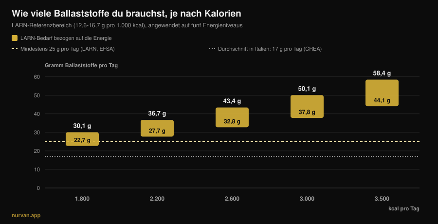
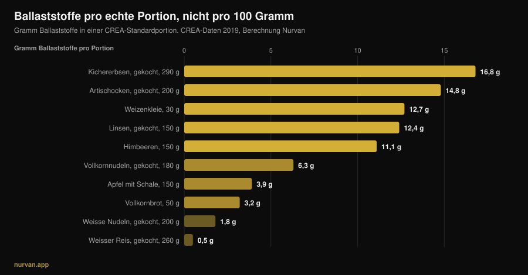

# Wie viele Ballaststoffe pro Tag? Fibermaxxing im Check

Von [Giammaria Loi](/autore/giammaria-loi) · aktualisiert am 13. November 2026

Nach Jahren von „Protein in allem" ist der neue Modenährstoff der Ballaststoff: *Fibermaxxing* heißt, ihn so weit wie möglich nach oben zu schieben, einen Löffel Chiasamen nach dem anderen. Der richtige Nährstoff, in die falsche Richtung gedreht. Die Evidenz zu Ballaststoffen gehört zum Solidesten, was die Ernährungsforschung zu bieten hat — aber genau diese Studien sagen zwei Dinge, die der Trend übergeht: Es gibt einen Bereich, in dem der größte Teil des Nutzens steckt, und dieser Bereich ist nicht derselbe für jemanden mit 1.800 kcal und jemanden mit 3.200 kcal.

## Kurz gefasst

- **Der größte Nutzen liegt zwischen 25 und 29 g pro Tag.** In der im *Lancet* veröffentlichten Übersicht über 185 prospektive Studien und 58 Trials ist die Risikosenkung bei Gesamtsterblichkeit, Herzkrankheit, Schlaganfall, Typ-2-Diabetes und Darmkrebs in diesem Bereich am größten.
- **„Mindestens 25 g" ist nicht deine Zahl, wenn du viel trainierst.** Die italienischen LARN nennen auch einen energiebezogenen Richtwert: 12,6-16,7 g je 1.000 kcal. Bei 3.000 kcal sind das 38-50 g am Tag.
- **Der italienische Durchschnitt liegt bei rund 17 g pro Tag** laut CREA-Daten: Das eigentliche Problem ist nicht das Zuviel, sondern die Lücke.
- **Zu schnell steigern bläht wirklich.** In den Trials zu Ballaststoffpräparaten ist Flatulenz in den Ballaststoffgruppen signifikant höher: kein Gefühl, ein gemessener Effekt.
- **Ballaststoffe aus Lebensmitteln und aus dem Pulver tun nicht dasselbe.** Erstere zeigten Effekte auf Blutzucker *und* Blutdruck, letztere vor allem auf Blutzucker und Cholesterin.

*Nurvan-Grafik: eigene Berechnung, der LARN-Referenzbereich (SINU, 12,6-16,7 g je 1.000 kcal) auf fünf Energieniveaus angewendet. Gestrichelte 25-g-Linie: Mindestwert nach LARN und EFSA. 17-g-Linie: italienischer Durchschnittsverzehr, CREA-Daten der IV-SCAI-Erhebung, zitiert nach Marconi et al., 2025.*

## Woher das Fibermaxxing kommt

Der Mechanismus ist derselbe, der Protein überall hingebracht hat: ein Nährstoff mit guten Referenzen, die Endung *-maxxing* und der stille Schluss, dass mehr immer besser sein muss, wenn ein bisschen schon gut ist. Der Unterschied: Hier hat der Ausgangspunkt recht. Kaum jemand erreicht den Mindestwert, und die Ballaststoffe anzuheben ist die Ernährungsänderung mit dem besten Verhältnis von Aufwand zu Nutzen, die ein durchschnittlicher Esser vornehmen kann.

Das Problem entsteht beim Sprung von „fast alle essen zu wenig" zu „je mehr, desto besser". Das sind zwei verschiedene Sätze, und die Studien stützen nur den ersten.

## Wie viele Ballaststoffe wirklich nötig sind

Die solideste Quelle ist die Serie systematischer Übersichtsarbeiten, die 2019 im *Lancet* erschien: 185 prospektive Studien, knapp 135 Millionen Personenjahre, dazu 58 kontrollierte Trials mit 4.635 Erwachsenen. Vergleicht man die Gruppe mit dem höchsten Verzehr mit der mit dem niedrigsten, zeigen die Beobachtungsdaten eine Senkung von 15-30 % bei Gesamt- und Herz-Kreislauf-Sterblichkeit sowie bei koronarer Herzkrankheit, Schlaganfall, Typ-2-Diabetes und Darmkrebs.

Und hier kommt die Zahl, die der Trend nicht zitiert: **die Risikosenkung war bei einer Zufuhr zwischen 25 und 29 g pro Tag am größten**. Die Dosis-Wirkungs-Kurven legen nahe, dass jenseits dieses Bereichs für Herz-Kreislauf, Diabetes und einige Krebsarten noch etwas zu holen ist — der große Sprung ist aber der *in* den Bereich hinein, nicht der darüber hinaus.

Die Dosis-Wirkungs-Metaanalyse von 2023 in *Frontiers in Nutrition* bestätigt das: relatives Risiko für Gesamtsterblichkeit 0,90 (95-%-KI 0,86-0,93), kardiovaskulär 0,87, für Krebs 0,91 — mit einem **nicht linearen** Zusammenhang bei der Gesamtsterblichkeit. Nicht linear heißt genau das: Die Kurve flacht ab.

Zwei Fälle, in denen höher zu gehen messbar sinnvoll ist. Bei Menschen mit Diabetes ist der Schritt von 19 auf 35 g pro Tag mit 14 Todesfällen weniger je 1.000 Personen verbunden (95-%-KI 4-19). Bei Bluthochdruck senkte mehr Ballaststoff den systolischen Wert um 4,3 mmHg und den diastolischen um 3,1 mmHg, mit hoher Evidenzsicherheit und unabhängig von den eingenommenen Medikamenten. Das sind allerdings klinische Gruppen: Dort entscheidet die Ärztin über die Zahl, nicht ein Karussell auf Instagram.

## Dein Bedarf steigt mit den Kalorien

Das ist der Teil, der praktisch überall fehlt — und der für Trainierende wichtigste.

Die LARN der Italienischen Gesellschaft für Humanernährung nennen nicht nur die Schwelle „mindestens 25 g pro Tag", sondern auch einen energiebezogenen Richtwert: **12,6-16,7 g Ballaststoff je 1.000 kcal**. Das ist logisch, denn Ballaststoffe kommen aus Lebensmitteln, und wer mehr isst, isst mehr Lebensmittel.

Auf echte Kalorien angewendet, verschiebt dieser Richtwert das Ziel deutlich, wie die Grafik oben zeigt. Für eine sitzende Person mit 1.800 kcal liegt der Bereich bei 23-30 g. Wer viermal pro Woche trainiert und 3.000 kcal isst, landet bei **38-50 g**. Im Aufbau mit 3.500 kcal bei 44-58 g. Wer „25 g reichen" wiederholt, gibt einem 95-kg-Powerlifter die Zahl eines Menschen, der halb so viel isst; und wer in der Diät mit 1.600 kcal Fibermaxxing betreibt, drückt eine Zahl hoch, die für ihn schon hoch ist.

Woher diese Kalorien kommen sollen, hängt direkt an der Qualität der Kohlenhydrate: Darüber haben wir in [machen Kohlenhydrate dick?](/de/blog/machen-kohlenhydrate-dick-verstecktes-fett) geschrieben.

## Was die Forschung wirklich sagt

| Verbreitete Aussage | Urteil | Quelle |
|---|---|---|
| „Mehr Ballaststoffe sind immer besser" | **Zu präzisieren**: Der Großteil des Nutzens liegt zwischen 25 und 29 g, danach flacht die Kurve ab | Reynolds et al., 2019; Yao et al., 2023 |
| „25 g pro Tag reichen für alle" | **Zu präzisieren**: Die LARN nennen auch 12,6-16,7 g je 1.000 kcal | LARN SINU; Marconi et al., 2025 |
| „Ballaststoffe machen den Bauch flach" | **Widerlegt** auf kurze Sicht: mehr Ballaststoff, mehr Flatulenz (SMD 0,80) | van der Schoot et al., 2022 |
| „Ein Messlöffel Flohsamen reicht" | **Zu präzisieren**: wirkt auf die Regelmäßigkeit, die Ballaststoffe aus Lebensmitteln zeigten breitere Effekte | van der Schoot 2022; Jiang et al., 2025 |
| „Vor dem Training mehr Ballaststoffe" | **Widerlegt**: Sie zu reduzieren ist die meistgenutzte Strategie gegen Magen-Darm-Beschwerden beim Sport | Scrivin et al., 2022 |

### Warum es am Anfang bläht (und das nicht dein Fehler ist)

In der Metaanalyse über 16 kontrollierte Trials und 1.251 Erwachsene mit chronischer Verstopfung haben Ballaststoffe gewirkt: 66 % der Teilnehmenden sprachen an (311 von 473) gegenüber 41 % in den Kontrollgruppen (134 von 329), relatives Risiko 1,48. In derselben Arbeit war die **Flatulenz in den Ballaststoffgruppen aber signifikant höher**, mit einer standardisierten Mittelwertdifferenz von 0,80 (95-%-KI 0,47-1,13) — ein großer Effekt.

Deshalb ist „ich habe mehr Gemüse gegessen und war aufgebläht" kein Scheitern, sondern die erwartete Reaktion auf eine schnelle Umstellung. In derselben Arbeit zeigten sich Verbesserungen bei Stuhlfrequenz und -konsistenz erst bei einer Dauer von mindestens vier Wochen. Das Blähen ist Woche eins, der Nutzen kommt ab Woche vier. Daraus folgt nur eines: **steigere in Stufen**, 3-5 g pro Woche.

### Präparat oder Lebensmittel

Das Pulver ist keine gleichwertige Abkürzung. Im klarsten Vergleich, den wir haben, trennte eine Metaanalyse von 2025 über 30 Trials und 1.140 Teilnehmende die **intrinsischen** Ballaststoffe (die im vollwertigen Lebensmittel) von den **isolierten** (extrahiert und zugesetzt). Die ersten senkten Nüchternblutzucker und systolischen Blutdruck (-2,86 mmHg). Die zweiten senkten Blutzucker und Gesamtcholesterin, aber nicht den Blutdruck.

Das ist kein Argument gegen Präparate: Flohsamenschalen haben gute Daten zur Regelmäßigkeit, bei Dosen über 10 g pro Tag und mindestens vier Wochen. Es ist ein Argument gegen die Vorstellung, ein Messlöffel ersetze einen Teller Hülsenfrüchte. Die Lebensmittelmatrix zählt — so wie auch beim [Vergleich von pflanzlichem und tierischem Protein](/de/blog/pflanzliches-oder-tierisches-protein-muskelaufbau).

### Ballaststoffe und Training: der Zeitpunkt zählt

Was Fibermaxxing nicht berücksichtigt, ist das *Wann*. In einer Untersuchung an 137 Ausdauersportlern mit Vorgeschichte belastungsbedingter Magen-Darm-Beschwerden war von 277 genannten Strategien die **Reduktion der Ballaststoffe die meistgenutzte Ernährungsstrategie** (15,2 %, 42 Nennungen) und eine der am besten bewerteten, mit einer medianen Wirksamkeit von 4 von 5. Es folgten der Verzicht auf Milchprodukte und die Low-FODMAP-Ernährung.

Zwei ehrliche Einschränkungen: Diese Daten stammen von Ausdauersportlern, nicht von Leuten an der Hantel, und Laufbeschwerden haben mechanische Anteile, die es im Gym nicht gibt. Die Logik hält aber auch unter der Langhantel: ein Teller mit 15 g Ballaststoff zwei Stunden vor einer schweren Kniebeugeneinheit ist fragwürdig — derselbe Teller am Abend stört niemanden.

## So setzt du es um

Erste Regel: Hör auf, auf „pro 100 Gramm"-Ranglisten zu schauen. In der CREA-Datenbank hat schwarzer Pfeffer 25,9 g Ballaststoff je 100 g, aber die Portion beträgt 1 Gramm: Das sind 0,26 g Ballaststoff. Entscheidend ist, wie viel Ballaststoff in einer Portion steckt, die du tatsächlich isst.

*Nurvan-Grafik auf Basis der CREA-Tabellen — Centro di ricerca Alimenti e Nutrizione, Stand 2019. Ballaststoff je Portion von uns berechnet als (Ballaststoff je 100 g × CREA-Portion) ÷ 100.*

Zweite Regel: Die großen Sprünge kommen aus wenigen Tauschs, nicht aus zwanzig kleinen Kniffen.

| Tausch | Vorher | Nachher | Gewinn |
|---|---|---|---|
| Die Stärkebeilage | Weißer Reis, gekocht, 260 g: **0,5 g** | Vollkornnudeln, gekocht, 180 g: **6,3 g** | **+5,8 g** |
| Das Brot | Weißbrot, 50 g: **1,9 g** | Vollkornbrot, 50 g: **3,2 g** | **+1,3 g** |
| Ein Gang mehr | — | Linsen, gekocht, 150 g: **12,4 g** | **+12,4 g** |
| | | | **+19,5 g insgesamt** |

*Nurvan-Auswertung der CREA-Daten 2019. Ausgehend von den 17 g des italienischen Durchschnitts bringen diese drei Tauschs auf rund 36-37 g pro Tag.*

Dritte Regel: Die Schale zählt mehr, als du denkst. Ein Apfel mit 150 g liefert mit Schale 3,9 g Ballaststoff, derselbe Apfel geschält 3,0 g — ein Viertel geht mit dem Messer weg.

Vier praktische Punkte:

1. **Finde deine Zahl, nicht die allgemeine.** Multipliziere deine Kalorien mit 0,0126 und mit 0,0167: Das ist dein Bereich. Bei 2.500 kcal sind das 32-42 g.
2. **Steigere um 3-5 g pro Woche.** Das anfängliche Blähen ist real und geht vorbei, aber nur, wenn du ihm Zeit gibst.
3. **Ein Gang Hülsenfrüchte bringt mehr als alles andere zusammen.** 150 g gekochte Linsen entsprechen vier Äpfeln.
4. **Leg die Ballaststoffe weg vom Training.** Die Mahlzeit vor dem Training ist die einzige, in der es sich lohnt, sie niedrig zu halten; hol die Tagesmenge abends nach.

Und wenn du das Protein pro Mahlzeit schon zählst, sind Ballaststoffe die zweite Zahl daneben: [wie viel Protein pro Mahlzeit](/de/blog/wie-viel-protein-pro-mahlzeit-grenze) ist das Schwesterstück zu diesem Text.

> **Nurvan: Ballaststoffe siehst du, du rätst sie nicht**
>
> Der Ernährungsbereich von Nurvan arbeitet mit der CREA-Datenbank — denselben Tabellen, aus denen die Zahlen dieses Artikels stammen. Jedes Lebensmittel, das du einträgst, bringt seinen Ballaststoffwert mit, und die Tagessumme steht direkt neben Kalorien und Protein. Mit deinem Energiebedarf schon in der App siehst du sofort, ob deine 3.000 kcal bei 38 g landen oder bei 18 stehen bleiben. [Nurvan testen](https://nurvan.app)

## Häufige Fragen

**Wie viele Ballaststoffe sollte ich pro Tag essen?**
Der Mindestwert von LARN und EFSA liegt bei 25 g pro Tag für Erwachsene. In den Übersichtsarbeiten konzentriert sich der Großteil der Risikosenkung zwischen 25 und 29 g. Wenn du trainierst und viel isst, ist der energiebezogene LARN-Richtwert nützlicher (12,6-16,7 g je 1.000 kcal): Bei 3.000 kcal sind das 38-50 g.

**Ist Fibermaxxing ungesund?**
Der in Studien gemessene Effekt einer schnellen Steigerung ist mehr Flatulenz, kein Schaden. Das echte Risiko ist praktisch: Zu schnell steigern erzeugt Beschwerden, die dich aufhören lassen, und keine Studie zeigt, dass deutlich über dem Bereich von 25-29 g der Nutzen proportional weiterwächst. Bei einer diagnostizierten Darmerkrankung ist die Ballaststoffmenge keine Entscheidung für den Alleingang.

**Ballaststoffe lieber aus Präparaten oder aus Lebensmitteln?**
Beide wirken, aber auf unterschiedliche Ziele. In der Metaanalyse von 2025 senkten die Ballaststoffe im vollwertigen Lebensmittel Nüchternblutzucker und systolischen Blutdruck; die isolierten senkten Blutzucker und Gesamtcholesterin, aber nicht den Blutdruck. Flohsamen haben gute Belege für die Regelmäßigkeit, über 10 g pro Tag und mindestens vier Wochen.

**Ballaststoffe blähen mich vor dem Training: was tun?**
Leg den Großteil der Ballaststoffe weg von der Einheit und halte die Mahlzeit davor leicht. Bei Ausdauersportlern mit Magen-Darm-Beschwerden ist die Reduktion der Ballaststoffe die meistgenutzte und eine der wirksamsten Ernährungsstrategien.

## Lies auch

- [Wie viel Protein pro Mahlzeit: gibt es eine Grenze?](/de/blog/wie-viel-protein-pro-mahlzeit-grenze) — die andere Zahl, die sich Mahlzeit für Mahlzeit zu zählen lohnt.
- [Machen Kohlenhydrate dick? Das versteckte Fett](/de/blog/machen-kohlenhydrate-dick-verstecktes-fett) — woher die überschüssigen Kalorien wirklich kommen.
- [Pflanzliches oder tierisches Protein für den Muskelaufbau?](/de/blog/pflanzliches-oder-tierisches-protein-muskelaufbau) — warum die Lebensmittelmatrix zählt.

## Quellen

1. Reynolds A, Mann J, Cummings J, et al., 2019. Carbohydrate quality and human health: a series of systematic reviews and meta-analyses. *Lancet* 393(10170):434-445. [PMID 30638909](https://pubmed.ncbi.nlm.nih.gov/30638909/) · [DOI 10.1016/S0140-6736(18)31809-9](https://doi.org/10.1016/S0140-6736(18)31809-9)
2. Yao F, Ma J, Cui Y, et al., 2023. Dietary intake of total, vegetable, fruit, cereal, soluble and insoluble fiber and risk of all-cause, cardiovascular, and cancer mortality. *Front Nutr* 10:1153165. [PMID 37854351](https://pubmed.ncbi.nlm.nih.gov/37854351/) · [DOI 10.3389/fnut.2023.1153165](https://doi.org/10.3389/fnut.2023.1153165)
3. Reynolds AN, Akerman AP, Mann J, 2020. Dietary fibre and whole grains in diabetes management: systematic review and meta-analyses. *PLoS Med* 17(3):e1003053. [PMID 32142510](https://pubmed.ncbi.nlm.nih.gov/32142510/) · [DOI 10.1371/journal.pmed.1003053](https://doi.org/10.1371/journal.pmed.1003053)
4. Reynolds AN, Akerman A, Kumar S, et al., 2022. Dietary fibre in hypertension and cardiovascular disease management: systematic review and meta-analyses. *BMC Med* 20(1):139. [PMID 35449060](https://pubmed.ncbi.nlm.nih.gov/35449060/) · [DOI 10.1186/s12916-022-02328-x](https://doi.org/10.1186/s12916-022-02328-x)
5. van der Schoot A, Drysdale C, Whelan K, Dimidi E, 2022. The effect of fiber supplementation on chronic constipation in adults: an updated systematic review and meta-analysis of randomized controlled trials. *Am J Clin Nutr* 116(4):953-969. [PMID 35816465](https://pubmed.ncbi.nlm.nih.gov/35816465/) · [DOI 10.1093/ajcn/nqac184](https://doi.org/10.1093/ajcn/nqac184)
6. Jiang S, Cai C, Deehan EC, et al., 2025. The physiological effects of intrinsic and isolated arabinoxylans on human immunometabolic response: a systematic review and meta-analysis. *Food Res Int* 218:116866. [PMID 40790673](https://pubmed.ncbi.nlm.nih.gov/40790673/) · [DOI 10.1016/j.foodres.2025.116866](https://doi.org/10.1016/j.foodres.2025.116866)
7. Marconi S, Gilberti G, Romele E, et al., 2025. Translation and cross-cultural adaptation of a validated questionnaire to assess dietary fiber intake among the Italian population. *Nutrients* 17(6):1084. [PMID 40292515](https://pubmed.ncbi.nlm.nih.gov/40292515/) · [DOI 10.3390/nu17061084](https://doi.org/10.3390/nu17061084)
8. Scrivin R, Costa RJS, Pelly F, Lis D, Slater G, 2022. An exploratory study of the management strategies reported by endurance athletes with exercise-associated gastrointestinal symptoms. *Front Nutr* 9:1003445. [PMID 36438762](https://pubmed.ncbi.nlm.nih.gov/36438762/) · [DOI 10.3389/fnut.2022.1003445](https://doi.org/10.3389/fnut.2022.1003445)

Referenzwerte: LARN — Livelli di Assunzione di Riferimento di Nutrienti ed energia, SINU, IV. Revision (mindestens 25 g pro Tag; 12,6-16,7 g je 1.000 kcal); EFSA, Stellungnahme vom 26. März 2010 (25 g pro Tag ausreichend für eine normale Darmfunktion bei Erwachsenen). Lebensmitteldaten: CREA-Tabellen — Centro di ricerca Alimenti e Nutrizione, Stand 2019. Thema ausgewählt nach Trendsignalen vom November 2026 zum „Fibermaxxing" (Berichterstattung in internationaler und italienischer Presse, dazu eine erste Suchergebnisseite voller allgemeiner Inhalte, die den Bedarf nicht auf die Kalorien beziehen). Wissenschaftliche Quellen über PubMed recherchiert.

---

*Giammaria Loi ist der Gründer von Nurvan. Er trainiert seit 2012 mit Gewichten, arbeitet seit 2013 als FIPE-zertifizierter Personal Trainer und Coach und startet seit 2018 national im Powerlifting. Jeder Artikel von ihm beginnt bei den Studien und endet bei dem, was im Gym wirklich funktioniert. [Autorenseite](/autore/giammaria-loi)*

> Hinweis: Informativer Inhalt, er ersetzt nicht den Rat einer Ärztin, eines Arztes oder einer Fachperson.
