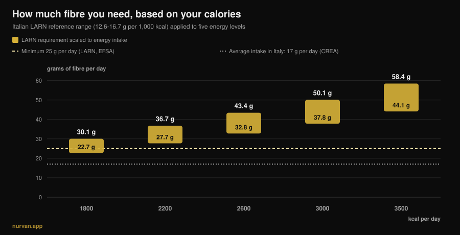
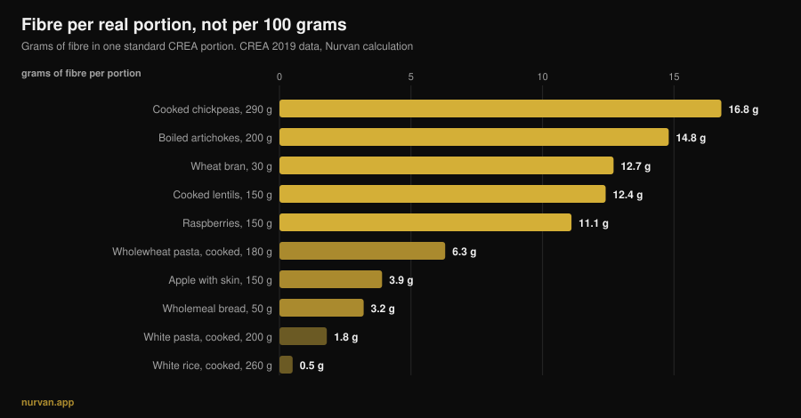

# How much fibre per day do you need if you lift?

By [Giammaria Loi](/autore/giammaria-loi) · updated 13 November 2026

After years of putting protein in everything, the nutrient of the moment is fibre: *fibermaxxing* tells you to push it as high as you can, one spoon of chia seeds at a time. Right nutrient, wrong direction. The evidence on fibre is some of the strongest in all of nutrition, and that same evidence says two things the trend skips: there is a band where most of the benefit sits, and that band is not the same for someone eating 1,800 kcal and someone eating 3,200.

## In short

- **Most of the benefit sits between 25 and 29 g a day.** In the *Lancet* review of 185 prospective studies and 58 trials, risk reduction for all-cause mortality, heart disease, stroke, type 2 diabetes and colorectal cancer peaked in that band.
- **"At least 25 g" is not your number if you train hard.** The Italian LARN reference also scales with energy: 12.6-16.7 g per 1,000 kcal. At 3,000 kcal that becomes 38-50 g a day.
- **Average intake in Italy is about 17 g a day** in the CREA data, and the picture is similar across Europe: the real problem is the gap, not the excess.
- **Ramping up fast really does bloat you.** In fibre supplement trials flatulence was significantly higher in the fibre groups. It is not in your head, it is a measured effect.
- **Fibre from food and fibre from a tub do different things.** The first moved both blood glucose *and* blood pressure; the second mainly glucose and cholesterol.

*Nurvan chart: our own calculation applying the LARN reference range (SINU, 12.6-16.7 g per 1,000 kcal) to five energy levels. Dashed 25 g line: the LARN and EFSA minimum. Dotted 17 g line: average Italian intake, CREA IV SCAI survey data as cited by Marconi et al., 2025.*

## Where fibermaxxing comes from

The mechanism is the one that put protein in everything: a nutrient with good credentials, the *-maxxing* suffix, and the unspoken conclusion that if some is good, a lot must be better. The difference here is that the starting point is correct. Hardly anyone hits the minimum, and raising fibre is the single change with the best effort-to-benefit ratio most people can make at the table.

The problem is the step from "almost everyone eats too little" to "the more the better". Those are two different sentences, and the research only supports the first.

## How much fibre you actually need

The strongest source is the series of systematic reviews published in *The Lancet* in 2019: 185 prospective studies, just under 135 million person-years, plus 58 controlled trials in 4,635 adults. Comparing the highest fibre consumers with the lowest, the observational data show a 15-30% reduction in all-cause and cardiovascular mortality, coronary heart disease, stroke, type 2 diabetes and colorectal cancer.

And here is the number the trend never quotes: **risk reduction was greatest at an intake between 25 and 29 g a day**. The dose-response curves suggest some further benefit beyond that band for cardiovascular disease, diabetes and certain cancers, but the big jump is the one that gets you *into* the band, not the one that takes you past it.

The 2023 dose-response meta-analysis in *Frontiers in Nutrition* says the same: relative risk of all-cause mortality 0.90 (95% CI 0.86-0.93), cardiovascular 0.87, cancer 0.91, with a **non-linear** relationship for all-cause mortality. Non-linear means exactly this: the curve flattens.

There are two cases where pushing higher has measured value. In people with diabetes, going from 19 to 35 g a day is associated with 14 fewer deaths per 1,000 (95% CI 4-19). In people with hypertension, increasing fibre lowered systolic pressure by 4.3 mmHg and diastolic by 3.1 mmHg, with high certainty of evidence and regardless of the drugs already in use. Both are clinical populations: there the right number is a decision for your doctor, not for a carousel.

## Your target rises with your calories

This is the part missing almost everywhere, and the part that matters most if you train.

The Italian LARN reference values do not only give the "at least 25 g a day" threshold. They also give a figure scaled to energy intake: **12.6-16.7 g of fibre per 1,000 kcal**. That is the logical way to do it, because fibre comes from food, and people who eat more eat more food.

Applied to real calories, that reference changes the target completely, as the chart above shows. For a sedentary person on 1,800 kcal the range is 23-30 g. For someone training four times a week on 3,000 kcal it becomes **38-50 g**. In a bulk at 3,500 kcal, 44-58 g. Anyone repeating "25 g is enough" is handing a 95 kg powerlifter the number meant for a person who eats half as much; anyone fibermaxxing on 1,600 kcal in a cut is pushing a number that is already high for them.

Where those calories come from is a separate conversation that runs into carbohydrate quality: we covered it in [do carbs make you gain weight?](/en/blog/do-carbs-make-you-gain-weight-hidden-fat).

## What the research actually says

| Common claim | Verdict | Source |
|---|---|---|
| "More fibre is always better" | **Needs nuance**: most of the benefit is between 25 and 29 g, then the curve flattens | Reynolds et al., 2019; Yao et al., 2023 |
| "25 g a day is enough for everyone" | **Needs nuance**: LARN also gives 12.6-16.7 g per 1,000 kcal | LARN SINU; Marconi et al., 2025 |
| "Fibre debloats you" | **Busted** in the short term: more fibre, more flatulence (SMD 0.80) | van der Schoot et al., 2022 |
| "One scoop of psyllium fixes it" | **Needs nuance**: it works on regularity, but food fibre showed broader effects | van der Schoot 2022; Jiang et al., 2025 |
| "More fibre before training is better" | **Busted**: cutting it is the most used strategy against exercise-related gut symptoms | Scrivin et al., 2022 |

### Why it bloats you at first (and that is not your fault)

In the meta-analysis of 16 controlled trials and 1,251 adults with chronic constipation, fibre worked: 66% of participants responded to treatment (311 of 473) against 41% of controls (134 of 329), relative risk 1.48. But in the same paper **flatulence was significantly higher in the fibre groups**, with a standardised mean difference of 0.80 (95% CI 0.47-1.13), which is a large effect.

This is why "I added vegetables and got bloated" is not a failure: it is the expected response to a fast change. In the same paper, improvements in stool frequency and consistency only showed up with treatment lasting at least four weeks. The bloating is week one, the benefit is from week four. The practical consequence is a single rule: **climb in steps**, 3-5 g per week.

### Supplement or food

Powder is not an equivalent shortcut. In the clearest comparison we have, a 2025 meta-analysis of 30 trials and 1,140 participants separated **intrinsic** fibre (inside the whole food) from **isolated** fibre (extracted and added). The first reduced fasting blood glucose and systolic blood pressure (-2.86 mmHg). The second reduced glucose and total cholesterol, but not blood pressure.

This is not an argument against supplements: psyllium has good data on regularity, at doses above 10 g a day and for at least four weeks. It is an argument against the idea that a scoop replaces a plate of lentils. The food matrix matters, the same way it does when you [compare plant and animal protein](/en/blog/plant-vs-animal-protein-for-muscle).

### Fibre and training: timing counts

One detail fibermaxxing ignores is *when*. In a study of 137 endurance athletes with a history of exercise-associated gastrointestinal symptoms, out of 277 reported strategies **cutting fibre was the most used dietary strategy** (15.2%, 42 reports) and among the best rated, with a median effectiveness of 4 out of 5. Dairy exclusion and a low-FODMAP diet came next.

Two honest caveats: that data comes from endurance athletes, not lifters, and running-related gut symptoms have mechanical causes that do not exist in a gym. But the logic holds under a barbell too: a 15 g fibre meal two hours before a heavy squat session is a questionable choice, while the same plate at dinner bothers nobody.

## How to apply it

First rule: stop reading "per 100 grams" rankings. In the CREA database black pepper has 25.9 g of fibre per 100 g, but the reference serving is 1 gram, so it delivers 0.26 g. What counts is how much fibre sits in a portion you would actually eat.

*Nurvan chart built on the CREA food composition tables — Research Centre for Food and Nutrition, 2019 update. Fibre per portion calculated by us as (fibre per 100 g × CREA portion) ÷ 100.*

Second rule: the big jumps come from a few swaps, not from twenty small tweaks.

| Swap | Before | After | Gain |
|---|---|---|---|
| The starch side | White rice, cooked, 260 g: **0.5 g** | Wholewheat pasta, cooked, 180 g: **6.3 g** | **+5.8 g** |
| The bread | White bread, 50 g: **1.9 g** | Wholemeal bread, 50 g: **3.2 g** | **+1.3 g** |
| One extra dish | — | Cooked lentils, 150 g: **12.4 g** | **+12.4 g** |
| | | | **+19.5 g in total** |

*Nurvan calculation on CREA 2019 data. Starting from the 17 g Italian average, these three swaps land you at roughly 36-37 g a day.*

Third rule: the skin matters more than you think. A 150 g apple with the skin gives 3.9 g of fibre, the same apple peeled gives 3.0 g: a quarter of it goes with the knife.

Four practical steps:

1. **Find your number, not the generic one.** Multiply your calories by 0.0126 and by 0.0167: that is your range. At 2,500 kcal it is 32-42 g.
2. **Add 3-5 g per week.** The early bloating is real and it passes, but only if you give it time.
3. **One serving of legumes beats everything else combined.** 150 g of cooked lentils is worth four apples.
4. **Move fibre away from training.** The pre-workout meal is the one place worth keeping it low; make the day's fibre back at dinner.

And if you are already counting protein meal by meal, fibre is the second number to track alongside it: [how much protein per meal](/en/blog/how-much-protein-per-meal-limit) is the companion piece to this one.

> **Nurvan: see your fibre, don't guess it**
>
> The nutrition section of Nurvan runs on the CREA database — the same tables the numbers in this article come from. Every food you log carries its fibre with it, and the daily total updates next to calories and protein. With your energy needs already in the app, you can see straight away whether your 3,000 kcal reach 38 g or stall at 18. [Try Nurvan](https://nurvan.app)

## Frequently asked questions

**How much fibre should I eat per day?**
The LARN and EFSA minimum is 25 g a day for an adult. In the reviews, most of the risk reduction is concentrated between 25 and 29 g. If you train and eat a lot, the energy-scaled LARN reference (12.6-16.7 g per 1,000 kcal) is more useful: at 3,000 kcal that is 38-50 g.

**Is fibermaxxing bad for you?**
The measured effect of ramping up fast is more flatulence, not harm. The real risk is practical: increasing too quickly causes discomfort that makes people quit, and no study shows that pushing far beyond the 25-29 g band delivers proportional benefits. If you have a diagnosed gut condition, how much fibre you eat is not a decision to make on your own.

**Fibre supplements or food: which is better?**
They work on different goals. In the 2025 meta-analysis, fibre inside whole foods reduced fasting glucose and systolic blood pressure; isolated fibre reduced glucose and total cholesterol but not blood pressure. Psyllium has good evidence on regularity, above 10 g a day and for at least four weeks.

**Fibre bloats me before training: what should I do?**
Move most of your fibre away from the session and keep the pre-workout meal light. In endurance athletes with gut symptoms, cutting fibre is the most used dietary strategy and among the most effective.

## Read next

- [How much protein per meal: is there a limit?](/en/blog/how-much-protein-per-meal-limit) — the other number worth counting meal by meal.
- [Do carbs make you gain weight? The hidden fat](/en/blog/do-carbs-make-you-gain-weight-hidden-fat) — where the extra calories actually come from.
- [Plant or animal protein for muscle?](/en/blog/plant-vs-animal-protein-for-muscle) — why the food matrix matters.

## Sources

1. Reynolds A, Mann J, Cummings J, et al., 2019. *Carbohydrate quality and human health: a series of systematic reviews and meta-analyses.* Lancet 393(10170):434-445. [PMID 30638909](https://pubmed.ncbi.nlm.nih.gov/30638909/) · [DOI 10.1016/S0140-6736(18)31809-9](https://doi.org/10.1016/S0140-6736(18)31809-9)
2. Yao F, Ma J, Cui Y, et al., 2023. *Dietary intake of total, vegetable, fruit, cereal, soluble and insoluble fiber and risk of all-cause, cardiovascular, and cancer mortality.* Front Nutr 10:1153165. [PMID 37854351](https://pubmed.ncbi.nlm.nih.gov/37854351/) · [DOI 10.3389/fnut.2023.1153165](https://doi.org/10.3389/fnut.2023.1153165)
3. Reynolds AN, Akerman AP, Mann J, 2020. *Dietary fibre and whole grains in diabetes management: systematic review and meta-analyses.* PLoS Med 17(3):e1003053. [PMID 32142510](https://pubmed.ncbi.nlm.nih.gov/32142510/) · [DOI 10.1371/journal.pmed.1003053](https://doi.org/10.1371/journal.pmed.1003053)
4. Reynolds AN, Akerman A, Kumar S, et al., 2022. *Dietary fibre in hypertension and cardiovascular disease management: systematic review and meta-analyses.* BMC Med 20(1):139. [PMID 35449060](https://pubmed.ncbi.nlm.nih.gov/35449060/) · [DOI 10.1186/s12916-022-02328-x](https://doi.org/10.1186/s12916-022-02328-x)
5. van der Schoot A, Drysdale C, Whelan K, Dimidi E, 2022. *The effect of fiber supplementation on chronic constipation in adults: an updated systematic review and meta-analysis of randomized controlled trials.* Am J Clin Nutr 116(4):953-969. [PMID 35816465](https://pubmed.ncbi.nlm.nih.gov/35816465/) · [DOI 10.1093/ajcn/nqac184](https://doi.org/10.1093/ajcn/nqac184)
6. Jiang S, Cai C, Deehan EC, et al., 2025. *The physiological effects of intrinsic and isolated arabinoxylans on human immunometabolic response: a systematic review and meta-analysis.* Food Res Int 218:116866. [PMID 40790673](https://pubmed.ncbi.nlm.nih.gov/40790673/) · [DOI 10.1016/j.foodres.2025.116866](https://doi.org/10.1016/j.foodres.2025.116866)
7. Marconi S, Gilberti G, Romele E, et al., 2025. *Translation and cross-cultural adaptation of a validated questionnaire to assess dietary fiber intake among the Italian population.* Nutrients 17(6):1084. [PMID 40292515](https://pubmed.ncbi.nlm.nih.gov/40292515/) · [DOI 10.3390/nu17061084](https://doi.org/10.3390/nu17061084)
8. Scrivin R, Costa RJS, Pelly F, Lis D, Slater G, 2022. *An exploratory study of the management strategies reported by endurance athletes with exercise-associated gastrointestinal symptoms.* Front Nutr 9:1003445. [PMID 36438762](https://pubmed.ncbi.nlm.nih.gov/36438762/) · [DOI 10.3389/fnut.2022.1003445](https://doi.org/10.3389/fnut.2022.1003445)

Reference values: LARN — Italian Reference Intake Levels for Nutrients and Energy, SINU, 4th revision (at least 25 g a day; 12.6-16.7 g per 1,000 kcal); EFSA opinion of 26 March 2010 (25 g a day adequate for normal bowel function in adults). Food data: CREA food composition tables — Research Centre for Food and Nutrition, 2019 update. Topic chosen from November 2026 trend signals around "fibermaxxing" (international and Italian press coverage, and a first search page filled with general wellness content that never scales the requirement to calorie intake). Scientific sources retrieved through PubMed.

---

*Giammaria Loi is the founder of Nurvan. He has been lifting since 2012, has worked as a FIPE-certified personal trainer and coach since 2013, and has competed in powerlifting at national level since 2018. Every article he writes starts from the research and ends with what actually works in the gym.* [Author page](/autore/giammaria-loi)

> Note: educational content. It does not replace advice from a doctor or qualified professional.
