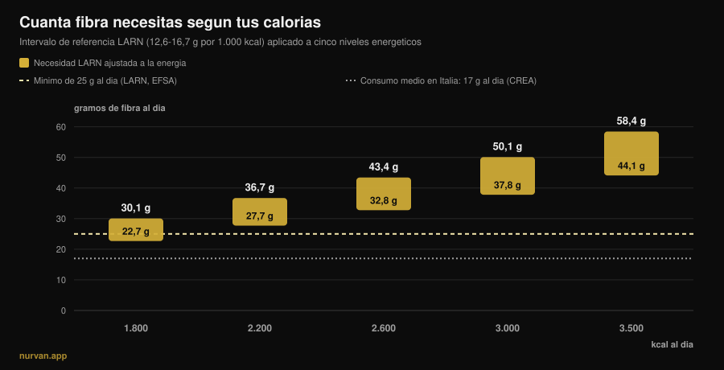
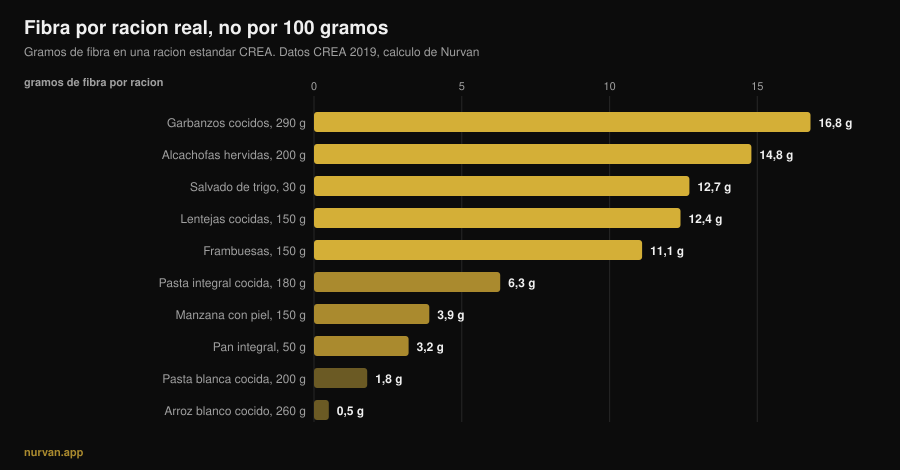

# ¿Cuánta fibra al día necesitas si entrenas?

Por [Giammaria Loi](/autore/giammaria-loi) · actualizado el 13 de noviembre de 2026

Después de años metiendo proteína en todo, el nutriente de moda es la fibra: el *fibermaxxing* te invita a subirla todo lo que puedas, una cucharada de semillas de chía tras otra. Nutriente correcto, dirección equivocada. Las pruebas sobre la fibra están entre las más sólidas de toda la nutrición, y esos mismos estudios dicen dos cosas que la moda se salta: hay una franja donde se concentra el grueso del beneficio, y esa franja no es la misma para quien come 1.800 kcal que para quien come 3.200.

## En resumen

- **El grueso del beneficio está entre 25 y 29 g al día.** En la revisión publicada en *Lancet* sobre 185 estudios prospectivos y 58 ensayos, la reducción del riesgo de mortalidad total, cardiopatía, ictus, diabetes tipo 2 y cáncer colorrectal es máxima en esa franja.
- **"Al menos 25 g" no es tu número si entrenas en serio.** Los LARN italianos fijan también una referencia por energía: 12,6-16,7 g por cada 1.000 kcal. Con 3.000 kcal son 38-50 g al día.
- **El consumo medio en Italia ronda los 17 g al día** según los datos del CREA, y el panorama europeo es parecido: el problema real es el hueco, no el exceso.
- **Subirla de golpe hincha de verdad.** En los ensayos con suplementos de fibra la flatulencia fue significativamente mayor en los grupos con fibra: no es una impresión, es un efecto medido.
- **La fibra de los alimentos y la del bote no hacen lo mismo.** La primera movió glucemia *y* tensión arterial; la segunda sobre todo glucemia y colesterol.

*Gráfico de Nurvan: cálculo propio aplicando el intervalo de referencia LARN (SINU, 12,6-16,7 g por 1.000 kcal) a cinco niveles energéticos. Línea discontinua de 25 g: umbral mínimo LARN y EFSA. Línea punteada de 17 g: consumo medio italiano, datos CREA de la encuesta IV SCAI citados por Marconi et al., 2025.*

## De dónde sale el fibermaxxing

El mecanismo es el mismo que llevó la proteína a todas partes: un nutriente con buenas credenciales, el sufijo *-maxxing* y la conclusión implícita de que si un poco va bien, mucho irá mejor. La diferencia es que aquí el punto de partida acierta: casi nadie llega al umbral mínimo, y subir la fibra es el cambio con la mejor relación esfuerzo-beneficio que puede hacer una persona media en la mesa.

El problema nace en el salto de "casi todo el mundo come poca" a "cuanta más, mejor". Son dos frases distintas, y los estudios solo sostienen la primera.

## Cuánta fibra necesitas de verdad

La fuente más sólida es la serie de revisiones sistemáticas publicada en *The Lancet* en 2019: 185 estudios prospectivos, algo menos de 135 millones de años-persona, más 58 ensayos controlados con 4.635 adultos. Comparando a quienes más fibra comen con quienes menos, los datos observacionales muestran una reducción del 15-30% de la mortalidad total y cardiovascular, de la cardiopatía coronaria, el ictus, la diabetes tipo 2 y el cáncer colorrectal.

Y aquí llega el número que la moda nunca cita: **la reducción del riesgo fue máxima con una ingesta de entre 25 y 29 g al día**. Las curvas dosis-respuesta sugieren que por encima de esa franja queda algún beneficio adicional para enfermedad cardiovascular, diabetes y ciertos tumores, pero el salto grande es el que te mete *dentro* de la franja, no el que te lleva más allá.

Lo confirma el metaanálisis dosis-respuesta de 2023 en *Frontiers in Nutrition*: riesgo relativo de mortalidad total 0,90 (IC 95% 0,86-0,93), cardiovascular 0,87, por cáncer 0,91, con una relación **no lineal** para la mortalidad total. No lineal significa exactamente esto: la curva se aplana.

Hay dos casos en los que subir más tiene un sentido medido. En personas con diabetes, pasar de 19 a 35 g al día se asocia con 14 muertes menos por cada 1.000 (IC 95% 4-19). En personas con hipertensión, aumentar la fibra bajó la tensión sistólica 4,3 mmHg y la diastólica 3,1 mmHg, con certeza alta de la evidencia e independientemente de los fármacos que ya tomaran. Son poblaciones clínicas: ahí el número correcto lo decide tu médico, no un carrusel.

## Tu objetivo sube con las calorías

Esta es la parte que falta casi en todas partes, y la que más importa si entrenas.

Los valores de referencia LARN de la Sociedad Italiana de Nutrición Humana no dan solo el umbral de "al menos 25 g al día": dan también una referencia ajustada a la energía, **12,6-16,7 g de fibra por cada 1.000 kcal**. Es la forma lógica de plantearlo, porque la fibra viene de la comida, y quien come más come más comida.

Aplicada a las calorías reales, esa referencia cambia el objetivo por completo, como ves en el gráfico de arriba. Para una persona sedentaria de 1.800 kcal el intervalo es 23-30 g. Para quien entrena cuatro veces por semana y come 3.000 kcal pasa a ser **38-50 g**. En volumen, con 3.500 kcal, 44-58 g. Quien repite "con 25 g basta" le está dando a un powerlifter de 95 kg la cifra pensada para alguien que come la mitad; y quien hace fibermaxxing con 1.600 kcal en definición está forzando un número que para él ya es alto.

De dónde salen esas calorías es otra conversación que se cruza con la calidad de los hidratos: la tratamos en [¿los carbohidratos engordan?](/es/blog/carbohidratos-engordan-grasa-oculta).

## Qué dice realmente la investigación

| Afirmación habitual | Veredicto | Fuente |
|---|---|---|
| "Cuanta más fibra, mejor" | **Matizable**: el grueso del beneficio está entre 25 y 29 g, luego la curva se aplana | Reynolds et al., 2019; Yao et al., 2023 |
| "Con 25 g al día basta para todos" | **Matizable**: los LARN dan también 12,6-16,7 g por 1.000 kcal | LARN SINU; Marconi et al., 2025 |
| "La fibra deshincha la barriga" | **Desmentido** a corto plazo: más fibra, más flatulencia (DME 0,80) | van der Schoot et al., 2022 |
| "Un cacito de psyllium lo arregla" | **Matizable**: funciona para la regularidad, pero la fibra de los alimentos mostró efectos más amplios | van der Schoot 2022; Jiang et al., 2025 |
| "Antes de entrenar, cuanta más fibra mejor" | **Desmentido**: reducirla es la estrategia más usada contra las molestias digestivas por ejercicio | Scrivin et al., 2022 |

### Por qué al principio te hincha (y no es culpa tuya)

En el metaanálisis de 16 ensayos controlados y 1.251 adultos con estreñimiento crónico, la fibra funcionó: respondió al tratamiento el 66% de los participantes (311 de 473) frente al 41% de los controles (134 de 329), riesgo relativo 1,48. Pero en ese mismo trabajo la **flatulencia fue significativamente mayor en los grupos con fibra**, con una diferencia media estandarizada de 0,80 (IC 95% 0,47-1,13), que es un efecto grande.

Por eso "subí la verdura y me hinché" no es un fracaso: es la respuesta esperada a un cambio rápido. En ese mismo trabajo, las mejoras en frecuencia y consistencia de las deposiciones solo aparecieron con tratamientos de al menos cuatro semanas. La hinchazón es la primera semana, el beneficio llega a partir de la cuarta. La consecuencia práctica es una sola: **sube por escalones**, 3-5 g por semana.

### ¿Suplemento o comida?

El polvo no es un atajo equivalente. En la comparación más clara que tenemos, un metaanálisis de 2025 sobre 30 ensayos y 1.140 participantes separó la fibra **intrínseca** (la que está dentro del alimento integral) de la fibra **aislada** (extraída y añadida). La primera redujo la glucemia en ayunas y la tensión sistólica (-2,86 mmHg). La segunda redujo glucemia y colesterol total, pero no la tensión.

No es un argumento contra los suplementos: el psyllium tiene buenos datos sobre la regularidad, a dosis superiores a 10 g al día y durante al menos cuatro semanas. Es un argumento contra la idea de que un cacito sustituye un plato de legumbres. La matriz del alimento cuenta, igual que cuando [comparas proteína vegetal y animal](/es/blog/proteina-vegetal-o-animal-para-el-musculo).

### Fibra y entrenamiento: el momento importa

Un detalle que el fibermaxxing no contempla es *cuándo*. En un estudio con 137 atletas de resistencia con historial de síntomas gastrointestinales por ejercicio, de 277 estrategias reportadas **reducir la fibra fue la estrategia dietética más usada** (15,2%, 42 menciones) y de las mejor valoradas, con una eficacia mediana de 4 sobre 5. Detrás quedaban excluir los lácteos y la dieta baja en FODMAP.

Dos advertencias honestas: esos datos vienen de atletas de resistencia, no de quien levanta pesas, y las molestias digestivas al correr tienen causas mecánicas que en el gimnasio no existen. Pero la lógica aguanta también bajo una barra: un plato con 15 g de fibra dos horas antes de una sesión pesada de sentadilla es una elección discutible, mientras que ese mismo plato en la cena no molesta a nadie.

## Cómo aplicarlo

Primera regla: deja de mirar las listas "por 100 gramos". En la base de datos del CREA la pimienta negra tiene 25,9 g de fibra por 100 g, pero la ración de referencia es 1 gramo: son 0,26 g de fibra. Lo que cuenta es cuánta fibra hay en una ración que te comerías de verdad.

*Gráfico de Nurvan sobre las tablas del CREA — Centro de Investigación en Alimentos y Nutrición, actualización de 2019. Fibra por ración calculada por nosotros como (fibra por 100 g × ración CREA) ÷ 100.*

Segunda regla: los saltos grandes vienen de unos pocos cambios, no de veinte ajustes pequeños.

| Cambio | Antes | Después | Ganancia |
|---|---|---|---|
| La guarnición de almidón | Arroz blanco cocido, 260 g: **0,5 g** | Pasta integral cocida, 180 g: **6,3 g** | **+5,8 g** |
| El pan | Pan blanco, 50 g: **1,9 g** | Pan integral, 50 g: **3,2 g** | **+1,3 g** |
| Un plato más | — | Lentejas cocidas, 150 g: **12,4 g** | **+12,4 g** |
| | | | **+19,5 g en total** |

*Elaboración de Nurvan con datos CREA 2019. Partiendo de los 17 g de la media italiana, estos tres cambios te dejan en torno a 36-37 g al día.*

Tercera regla: la piel cuenta más de lo que crees. Una manzana de 150 g con piel aporta 3,9 g de fibra; la misma manzana pelada, 3,0 g: un cuarto se va con el cuchillo.

Cuatro indicaciones prácticas:

1. **Busca tu número, no el genérico.** Multiplica tus calorías por 0,0126 y por 0,0167: ese es tu intervalo. Con 2.500 kcal son 32-42 g.
2. **Sube 3-5 g por semana.** La hinchazón inicial es real y pasa, pero solo si le das tiempo.
3. **Un plato de legumbres hace más que todo lo demás junto.** 150 g de lentejas cocidas valen lo que cuatro manzanas.
4. **Aleja la fibra del entrenamiento.** La comida previa al entreno es la única en la que conviene mantenerla baja; la fibra del día recupérala en la cena.

Y si ya estás contando la proteína comida a comida, la fibra es el segundo número que va al lado: [cuánta proteína por comida](/es/blog/cuanta-proteina-por-comida-limite) es la pieza gemela de esta.

> **Nurvan: la fibra se ve, no se adivina**
>
> La sección de nutrición de Nurvan funciona con la base de datos del CREA, las mismas tablas de las que salen los números de este artículo: cada alimento que registras lleva su fibra consigo, y el total del día se actualiza junto a las calorías y la proteína. Con tus necesidades energéticas ya en la app, sabes al momento si tus 3.000 kcal llegan a 38 g o se quedan en 18. [Prueba Nurvan](https://nurvan.app)

## Preguntas frecuentes

**¿Cuánta fibra hay que comer al día?**
El umbral mínimo de LARN y EFSA es de 25 g al día para un adulto. En las revisiones, el grueso de la reducción del riesgo se concentra entre 25 y 29 g. Si entrenas y comes bastante, la referencia LARN ajustada a la energía (12,6-16,7 g por 1.000 kcal) es más útil: con 3.000 kcal son 38-50 g.

**¿El fibermaxxing es malo?**
El efecto medido de subirla rápido es más flatulencia, no un daño. El riesgo real es práctico: aumentar demasiado deprisa da molestias que acaban haciéndote abandonar, y ningún estudio muestra que empujar mucho más allá de la franja de 25-29 g dé beneficios proporcionales. Si tienes una patología intestinal diagnosticada, la cantidad de fibra no es una decisión para tomar por tu cuenta.

**¿Mejor fibra en suplemento o en comida?**
Sirven para objetivos distintos. En el metaanálisis de 2025, la fibra dentro de los alimentos integrales redujo la glucemia en ayunas y la tensión sistólica; la aislada redujo glucemia y colesterol total, pero no la tensión. El psyllium tiene buenas pruebas sobre la regularidad, por encima de 10 g al día y durante al menos cuatro semanas.

**La fibra me hincha antes de entrenar: ¿qué hago?**
Aleja el grueso de la fibra de la sesión y deja ligera la comida previa. En atletas de resistencia con síntomas digestivos, reducir la fibra es la estrategia dietética más usada y de las más eficaces.

## Lee también

- [¿Cuánta proteína por comida? ¿Existe un límite?](/es/blog/cuanta-proteina-por-comida-limite) — el otro número que merece la pena contar comida a comida.
- [¿Los carbohidratos engordan? La grasa escondida](/es/blog/carbohidratos-engordan-grasa-oculta) — de dónde salen realmente las calorías de más.
- [¿Proteína vegetal o animal para el músculo?](/es/blog/proteina-vegetal-o-animal-para-el-musculo) — por qué la matriz del alimento cuenta.

## Fuentes

1. Reynolds A, Mann J, Cummings J, et al., 2019. *Carbohydrate quality and human health: a series of systematic reviews and meta-analyses.* Lancet 393(10170):434-445. [PMID 30638909](https://pubmed.ncbi.nlm.nih.gov/30638909/) · [DOI 10.1016/S0140-6736(18)31809-9](https://doi.org/10.1016/S0140-6736(18)31809-9)
2. Yao F, Ma J, Cui Y, et al., 2023. *Dietary intake of total, vegetable, fruit, cereal, soluble and insoluble fiber and risk of all-cause, cardiovascular, and cancer mortality.* Front Nutr 10:1153165. [PMID 37854351](https://pubmed.ncbi.nlm.nih.gov/37854351/) · [DOI 10.3389/fnut.2023.1153165](https://doi.org/10.3389/fnut.2023.1153165)
3. Reynolds AN, Akerman AP, Mann J, 2020. *Dietary fibre and whole grains in diabetes management: systematic review and meta-analyses.* PLoS Med 17(3):e1003053. [PMID 32142510](https://pubmed.ncbi.nlm.nih.gov/32142510/) · [DOI 10.1371/journal.pmed.1003053](https://doi.org/10.1371/journal.pmed.1003053)
4. Reynolds AN, Akerman A, Kumar S, et al., 2022. *Dietary fibre in hypertension and cardiovascular disease management: systematic review and meta-analyses.* BMC Med 20(1):139. [PMID 35449060](https://pubmed.ncbi.nlm.nih.gov/35449060/) · [DOI 10.1186/s12916-022-02328-x](https://doi.org/10.1186/s12916-022-02328-x)
5. van der Schoot A, Drysdale C, Whelan K, Dimidi E, 2022. *The effect of fiber supplementation on chronic constipation in adults: an updated systematic review and meta-analysis of randomized controlled trials.* Am J Clin Nutr 116(4):953-969. [PMID 35816465](https://pubmed.ncbi.nlm.nih.gov/35816465/) · [DOI 10.1093/ajcn/nqac184](https://doi.org/10.1093/ajcn/nqac184)
6. Jiang S, Cai C, Deehan EC, et al., 2025. *The physiological effects of intrinsic and isolated arabinoxylans on human immunometabolic response: a systematic review and meta-analysis.* Food Res Int 218:116866. [PMID 40790673](https://pubmed.ncbi.nlm.nih.gov/40790673/) · [DOI 10.1016/j.foodres.2025.116866](https://doi.org/10.1016/j.foodres.2025.116866)
7. Marconi S, Gilberti G, Romele E, et al., 2025. *Translation and cross-cultural adaptation of a validated questionnaire to assess dietary fiber intake among the Italian population.* Nutrients 17(6):1084. [PMID 40292515](https://pubmed.ncbi.nlm.nih.gov/40292515/) · [DOI 10.3390/nu17061084](https://doi.org/10.3390/nu17061084)
8. Scrivin R, Costa RJS, Pelly F, Lis D, Slater G, 2022. *An exploratory study of the management strategies reported by endurance athletes with exercise-associated gastrointestinal symptoms.* Front Nutr 9:1003445. [PMID 36438762](https://pubmed.ncbi.nlm.nih.gov/36438762/) · [DOI 10.3389/fnut.2022.1003445](https://doi.org/10.3389/fnut.2022.1003445)

Valores de referencia: LARN — Niveles de Ingesta de Referencia de Nutrientes y Energía, SINU, 4.ª revisión (al menos 25 g al día; 12,6-16,7 g por 1.000 kcal); dictamen de la EFSA del 26 de marzo de 2010 (25 g al día adecuados para la función intestinal normal en adultos). Datos de alimentos: tablas de composición del CREA — Centro de Investigación en Alimentos y Nutrición, actualización de 2019. Tema elegido a partir de señales de tendencia de noviembre de 2026 sobre el "fibermaxxing" (cobertura en prensa internacional e italiana y una primera página de búsqueda ocupada por contenidos generalistas que nunca ajustan la necesidad a las calorías). Fuentes científicas consultadas a través de PubMed.

---

*Giammaria Loi es el fundador de Nurvan. Entrena con pesas desde 2012, trabaja como entrenador personal y coach certificado por la FIPE desde 2013 y compite en powerlifting a nivel nacional desde 2018. Cada artículo que firma parte de los estudios científicos y llega a lo que funciona de verdad en el gimnasio.* [Página del autor](/autore/giammaria-loi)

> Nota: contenido informativo, no sustituye la opinión de un médico o de un profesional cualificado.
