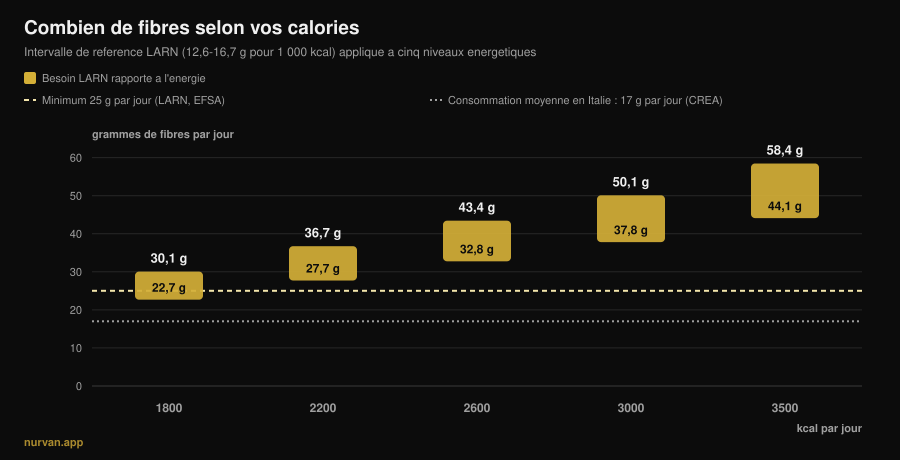
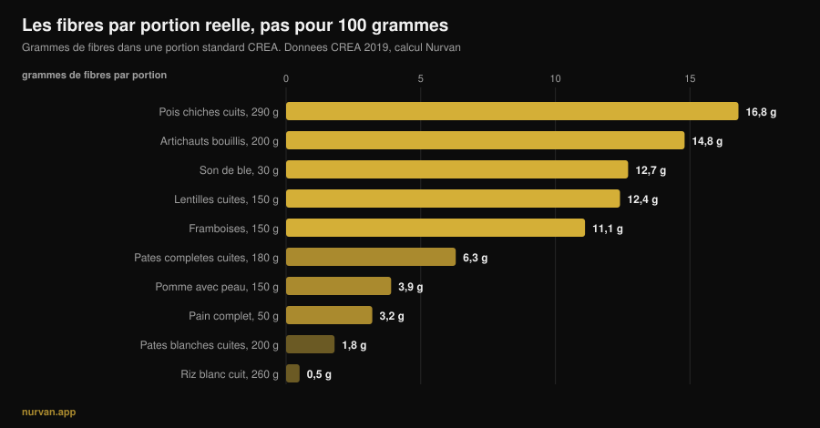

# Combien de fibres par jour quand on s'entraîne ?

Par [Giammaria Loi](/autore/giammaria-loi) · mis à jour le 13 novembre 2026

Après des années à mettre des protéines partout, le nutriment à la mode, ce sont les fibres : le *fibermaxxing* invite à les pousser le plus haut possible, une cuillère de graines de chia après l'autre. Le bon nutriment, dans la mauvaise direction. Les preuves sur les fibres comptent parmi les plus solides de toute la nutrition, et ces mêmes études disent deux choses que la tendance ignore : il existe une zone où se concentre l'essentiel du bénéfice, et cette zone n'est pas la même pour quelqu'un qui mange 1 800 kcal et pour quelqu'un qui en mange 3 200.

## En bref

- **L'essentiel du bénéfice se situe entre 25 et 29 g par jour.** Dans la revue publiée dans le *Lancet* sur 185 études prospectives et 58 essais, la réduction du risque de mortalité totale, de cardiopathie, d'AVC, de diabète de type 2 et de cancer colorectal est maximale dans cette zone.
- **« Au moins 25 g » n'est pas votre chiffre si vous vous entraînez beaucoup.** Les LARN italiens fixent aussi une référence rapportée à l'énergie : 12,6-16,7 g pour 1 000 kcal. À 3 000 kcal, cela fait 38-50 g par jour.
- **La consommation moyenne en Italie tourne autour de 17 g par jour** d'après les données du CREA, et le tableau européen est comparable : le vrai problème, c'est le manque, pas l'excès.
- **Augmenter trop vite ballonne vraiment.** Dans les essais sur les compléments de fibres, les flatulences étaient significativement plus fréquentes dans les groupes fibres : ce n'est pas une impression, c'est un effet mesuré.
- **Les fibres des aliments et celles en poudre ne font pas la même chose.** Les premières ont bougé la glycémie *et* la tension ; les secondes surtout la glycémie et le cholestérol.

*Graphique Nurvan : calcul maison appliquant l'intervalle de référence LARN (SINU, 12,6-16,7 g pour 1 000 kcal) à cinq niveaux énergétiques. Ligne tiretée à 25 g : seuil minimal LARN et EFSA. Ligne pointillée à 17 g : consommation moyenne italienne, données CREA de l'enquête IV SCAI citées par Marconi et al., 2025.*

## D'où vient le fibermaxxing

Le mécanisme est celui qui a mis les protéines partout : un nutriment aux bonnes références, le suffixe *-maxxing*, et la conclusion implicite que si un peu fait du bien, beaucoup fera mieux. La différence, ici, c'est que le point de départ a raison : presque personne n'atteint le seuil minimal, et augmenter les fibres est le changement au meilleur rapport effort/bénéfice qu'une personne moyenne puisse faire à table.

Le problème naît du passage de « presque tout le monde en mange trop peu » à « plus on en mange, mieux c'est ». Ce sont deux phrases différentes, et les études ne soutiennent que la première.

## Combien de fibres il vous faut vraiment

La source la plus solide est la série de revues systématiques publiée dans *The Lancet* en 2019 : 185 études prospectives, un peu moins de 135 millions d'années-personnes, plus 58 essais contrôlés sur 4 635 adultes. En comparant les plus gros consommateurs de fibres aux plus faibles, les données observationnelles montrent une réduction de 15-30 % de la mortalité totale et cardiovasculaire, des cardiopathies coronariennes, des AVC, du diabète de type 2 et du cancer colorectal.

Et voici le chiffre que la tendance ne cite jamais : **la réduction du risque était maximale pour un apport compris entre 25 et 29 g par jour**. Les courbes dose-réponse suggèrent qu'au-delà de cette zone il reste un bénéfice supplémentaire pour le cardiovasculaire, le diabète et certains cancers, mais le grand saut est celui qui vous fait *entrer* dans la zone, pas celui qui vous emmène au-delà.

La méta-analyse dose-réponse de 2023 dans *Frontiers in Nutrition* confirme : risque relatif de mortalité totale 0,90 (IC 95 % 0,86-0,93), cardiovasculaire 0,87, par cancer 0,91, avec une relation **non linéaire** pour la mortalité totale. Non linéaire veut dire exactement ceci : la courbe s'aplatit.

Il existe deux cas où pousser plus haut a un sens mesuré. Chez les personnes diabétiques, passer de 19 à 35 g par jour est associé à 14 décès de moins pour 1 000 personnes (IC 95 % 4-19). Chez les personnes hypertendues, augmenter les fibres a fait baisser la systolique de 4,3 mmHg et la diastolique de 3,1 mmHg, avec un niveau de preuve élevé et indépendamment des médicaments déjà pris. Ce sont deux populations cliniques : là, le bon chiffre, c'est votre médecin qui le fixe, pas un carrousel.

## Votre besoin monte avec vos calories

C'est la partie qui manque presque partout, et la plus importante quand on s'entraîne.

Les LARN de la Société italienne de nutrition humaine ne donnent pas seulement le seuil « au moins 25 g par jour » : ils donnent aussi une référence rapportée à l'énergie, **12,6-16,7 g de fibres pour 1 000 kcal**. C'est la façon logique de poser le problème, parce que les fibres viennent des aliments, et que celui qui mange plus mange plus d'aliments.

Appliquée aux calories réelles, cette référence change complètement la cible, comme le montre le graphique ci-dessus. Pour une personne sédentaire à 1 800 kcal, l'intervalle est de 23-30 g. Pour quelqu'un qui s'entraîne quatre fois par semaine et mange 3 000 kcal, il devient **38-50 g**. En prise de masse à 3 500 kcal, 44-58 g. Celui qui répète « 25 g suffisent » donne à un powerlifter de 95 kg le chiffre prévu pour quelqu'un qui mange moitié moins ; et celui qui fait du fibermaxxing à 1 600 kcal en sèche pousse un nombre qui est déjà haut pour lui.

D'où viennent ces calories est une autre conversation, qui croise la qualité des glucides : nous en avons parlé dans [les glucides font-ils grossir ?](/fr/blog/glucides-font-ils-grossir-gras-cache).

## Ce que dit vraiment la recherche

| Affirmation courante | Verdict | Source |
|---|---|---|
| « Plus de fibres, c'est toujours mieux » | **À nuancer** : l'essentiel du bénéfice est entre 25 et 29 g, ensuite la courbe s'aplatit | Reynolds et al., 2019 ; Yao et al., 2023 |
| « 25 g par jour suffisent à tout le monde » | **À nuancer** : les LARN donnent aussi 12,6-16,7 g pour 1 000 kcal | LARN SINU ; Marconi et al., 2025 |
| « Les fibres dégonflent le ventre » | **Démenti** à court terme : plus de fibres, plus de flatulences (DMS 0,80) | van der Schoot et al., 2022 |
| « Une dose de psyllium règle tout » | **À nuancer** : efficace sur le transit, mais les fibres des aliments ont montré des effets plus larges | van der Schoot 2022 ; Jiang et al., 2025 |
| « Avant l'entraînement, plus de fibres c'est mieux » | **Démenti** : les réduire est la stratégie la plus utilisée contre les troubles digestifs liés à l'effort | Scrivin et al., 2022 |

### Pourquoi ça ballonne au début (et ce n'est pas votre faute)

Dans la méta-analyse portant sur 16 essais contrôlés et 1 251 adultes souffrant de constipation chronique, les fibres ont fonctionné : 66 % des participants ont répondu au traitement (311 sur 473) contre 41 % des témoins (134 sur 329), risque relatif 1,48. Mais dans ce même travail, les **flatulences étaient significativement plus fréquentes dans les groupes fibres**, avec une différence moyenne standardisée de 0,80 (IC 95 % 0,47-1,13), ce qui est un effet important.

C'est pour cela que « j'ai augmenté les légumes et j'ai ballonné » n'est pas un échec : c'est la réponse attendue à un changement rapide. Dans ce même travail, les améliorations de la fréquence et de la consistance des selles ne sont apparues qu'avec des durées d'au moins quatre semaines. Les ballonnements, c'est la première semaine ; le bénéfice arrive à partir de la quatrième. La conséquence pratique tient en une règle : **montez par paliers**, 3-5 g par semaine.

### Complément ou aliment

La poudre n'est pas un raccourci équivalent. Dans la comparaison la plus claire dont nous disposons, une méta-analyse de 2025 sur 30 essais et 1 140 participants a séparé les fibres **intrinsèques** (celles contenues dans l'aliment complet) des fibres **isolées** (extraites et ajoutées). Les premières ont réduit la glycémie à jeun et la tension systolique (-2,86 mmHg). Les secondes ont réduit la glycémie et le cholestérol total, mais pas la tension.

Ce n'est pas un argument contre les compléments : le psyllium a de bonnes données sur le transit, à des doses supérieures à 10 g par jour et pendant au moins quatre semaines. C'est un argument contre l'idée qu'une dosette remplace une assiette de légumineuses. La matrice de l'aliment compte, comme lorsque vous [comparez protéines végétales et animales](/fr/blog/proteines-vegetales-ou-animales-pour-les-muscles).

### Fibres et entraînement : le moment compte

Un détail que le fibermaxxing ne prend pas en compte, c'est le *quand*. Dans une étude sur 137 athlètes d'endurance ayant des antécédents de troubles gastro-intestinaux liés à l'effort, sur 277 stratégies rapportées, **réduire les fibres est la stratégie alimentaire la plus utilisée** (15,2 %, 42 mentions) et parmi les mieux notées, avec une efficacité médiane de 4 sur 5. Venaient ensuite l'exclusion des produits laitiers et le régime pauvre en FODMAP.

Deux mises en garde honnêtes : ces données viennent d'athlètes d'endurance, pas de pratiquants de musculation, et les troubles digestifs en course ont des causes mécaniques qui n'existent pas en salle. Mais la logique tient aussi sous une barre : une assiette à 15 g de fibres deux heures avant une séance lourde de squat est un choix discutable, alors que la même assiette au dîner ne gêne personne.

## Comment l'appliquer

Première règle : arrêtez de regarder les classements « pour 100 grammes ». Dans la base de données du CREA, le poivre noir affiche 25,9 g de fibres pour 100 g, mais la portion de référence est de 1 gramme : cela fait 0,26 g de fibres. Ce qui compte, c'est la quantité de fibres dans une portion que vous mangeriez réellement.

*Graphique Nurvan d'après les tables du CREA — Centre de recherche sur les aliments et la nutrition, mise à jour 2019. Fibres par portion calculées par nos soins : (fibres pour 100 g × portion CREA) ÷ 100.*

Deuxième règle : les grands sauts viennent de quelques échanges, pas de vingt petits réglages.

| Échange | Avant | Après | Gain |
|---|---|---|---|
| L'accompagnement féculent | Riz blanc cuit, 260 g : **0,5 g** | Pâtes complètes cuites, 180 g : **6,3 g** | **+5,8 g** |
| Le pain | Pain blanc, 50 g : **1,9 g** | Pain complet, 50 g : **3,2 g** | **+1,3 g** |
| Un plat en plus | — | Lentilles cuites, 150 g : **12,4 g** | **+12,4 g** |
| | | | **+19,5 g au total** |

*Calcul Nurvan sur les données CREA 2019. En partant des 17 g de la moyenne italienne, ces trois échanges vous amènent autour de 36-37 g par jour.*

Troisième règle : la peau compte plus que vous ne le pensez. Une pomme de 150 g avec la peau apporte 3,9 g de fibres, la même pomme pelée 3,0 g : un quart part avec le couteau.

Quatre repères pratiques :

1. **Trouvez votre chiffre, pas le chiffre générique.** Multipliez vos calories par 0,0126 et par 0,0167 : voilà votre intervalle. À 2 500 kcal, cela fait 32-42 g.
2. **Montez de 3-5 g par semaine.** Les ballonnements du début sont réels et passent, mais seulement si vous leur laissez le temps.
3. **Une portion de légumineuses fait plus que tout le reste réuni.** 150 g de lentilles cuites valent quatre pommes.
4. **Éloignez les fibres de l'entraînement.** Le repas d'avant séance est le seul où il vaut la peine de les garder basses ; rattrapez les fibres de la journée au dîner.

Et si vous comptez déjà les protéines repas par repas, les fibres sont le deuxième chiffre à mettre à côté : [combien de protéines par repas](/fr/blog/combien-de-proteines-par-repas-limite) est l'article jumeau de celui-ci.

> **Nurvan : les fibres, vous les voyez, vous ne les devinez pas**
>
> La section nutrition de Nurvan s'appuie sur la base de données du CREA, les tables d'où viennent les chiffres de cet article : chaque aliment que vous saisissez apporte ses fibres avec lui, et le total du jour se met à jour à côté des calories et des protéines. Avec vos besoins énergétiques déjà dans l'app, vous voyez tout de suite si vos 3 000 kcal atteignent 38 g ou s'arrêtent à 18. [Essayez Nurvan](https://nurvan.app)

## Questions fréquentes

**Combien de fibres faut-il manger par jour ?**
Le seuil minimal des LARN et de l'EFSA est de 25 g par jour pour un adulte. Dans les revues, l'essentiel de la réduction du risque se concentre entre 25 et 29 g. Si vous vous entraînez et mangez beaucoup, la référence LARN rapportée à l'énergie (12,6-16,7 g pour 1 000 kcal) est plus utile : à 3 000 kcal, cela fait 38-50 g.

**Le fibermaxxing est-il mauvais pour la santé ?**
L'effet mesuré d'une augmentation rapide, c'est davantage de flatulences, pas un dommage. Le vrai risque est pratique : monter trop vite provoque des désagréments qui font abandonner, et aucune étude ne montre qu'aller bien au-delà de la zone 25-29 g apporte des bénéfices proportionnels. Si vous avez une pathologie intestinale diagnostiquée, la quantité de fibres n'est pas une décision à prendre seul.

**Fibres en complément ou dans les aliments ?**
Elles servent des objectifs différents. Dans la méta-analyse de 2025, les fibres contenues dans les aliments complets ont réduit la glycémie à jeun et la tension systolique ; les fibres isolées ont réduit la glycémie et le cholestérol total, mais pas la tension. Le psyllium a de bonnes preuves sur le transit, au-dessus de 10 g par jour et pendant au moins quatre semaines.

**Les fibres me ballonnent avant l'entraînement : que faire ?**
Éloignez l'essentiel des fibres de la séance et gardez le repas d'avant séance léger. Chez les athlètes d'endurance souffrant de troubles digestifs, réduire les fibres est la stratégie alimentaire la plus utilisée et parmi les plus efficaces.

## À lire aussi

- [Combien de protéines par repas : y a-t-il une limite ?](/fr/blog/combien-de-proteines-par-repas-limite) — l'autre chiffre qui mérite d'être compté repas par repas.
- [Les glucides font-ils grossir ? Le gras caché](/fr/blog/glucides-font-ils-grossir-gras-cache) — d'où viennent vraiment les calories en trop.
- [Protéines végétales ou animales pour les muscles ?](/fr/blog/proteines-vegetales-ou-animales-pour-les-muscles) — pourquoi la matrice de l'aliment compte.

## Sources

1. Reynolds A, Mann J, Cummings J, et al., 2019. *Carbohydrate quality and human health: a series of systematic reviews and meta-analyses.* Lancet 393(10170):434-445. [PMID 30638909](https://pubmed.ncbi.nlm.nih.gov/30638909/) · [DOI 10.1016/S0140-6736(18)31809-9](https://doi.org/10.1016/S0140-6736(18)31809-9)
2. Yao F, Ma J, Cui Y, et al., 2023. *Dietary intake of total, vegetable, fruit, cereal, soluble and insoluble fiber and risk of all-cause, cardiovascular, and cancer mortality.* Front Nutr 10:1153165. [PMID 37854351](https://pubmed.ncbi.nlm.nih.gov/37854351/) · [DOI 10.3389/fnut.2023.1153165](https://doi.org/10.3389/fnut.2023.1153165)
3. Reynolds AN, Akerman AP, Mann J, 2020. *Dietary fibre and whole grains in diabetes management: systematic review and meta-analyses.* PLoS Med 17(3):e1003053. [PMID 32142510](https://pubmed.ncbi.nlm.nih.gov/32142510/) · [DOI 10.1371/journal.pmed.1003053](https://doi.org/10.1371/journal.pmed.1003053)
4. Reynolds AN, Akerman A, Kumar S, et al., 2022. *Dietary fibre in hypertension and cardiovascular disease management: systematic review and meta-analyses.* BMC Med 20(1):139. [PMID 35449060](https://pubmed.ncbi.nlm.nih.gov/35449060/) · [DOI 10.1186/s12916-022-02328-x](https://doi.org/10.1186/s12916-022-02328-x)
5. van der Schoot A, Drysdale C, Whelan K, Dimidi E, 2022. *The effect of fiber supplementation on chronic constipation in adults: an updated systematic review and meta-analysis of randomized controlled trials.* Am J Clin Nutr 116(4):953-969. [PMID 35816465](https://pubmed.ncbi.nlm.nih.gov/35816465/) · [DOI 10.1093/ajcn/nqac184](https://doi.org/10.1093/ajcn/nqac184)
6. Jiang S, Cai C, Deehan EC, et al., 2025. *The physiological effects of intrinsic and isolated arabinoxylans on human immunometabolic response: a systematic review and meta-analysis.* Food Res Int 218:116866. [PMID 40790673](https://pubmed.ncbi.nlm.nih.gov/40790673/) · [DOI 10.1016/j.foodres.2025.116866](https://doi.org/10.1016/j.foodres.2025.116866)
7. Marconi S, Gilberti G, Romele E, et al., 2025. *Translation and cross-cultural adaptation of a validated questionnaire to assess dietary fiber intake among the Italian population.* Nutrients 17(6):1084. [PMID 40292515](https://pubmed.ncbi.nlm.nih.gov/40292515/) · [DOI 10.3390/nu17061084](https://doi.org/10.3390/nu17061084)
8. Scrivin R, Costa RJS, Pelly F, Lis D, Slater G, 2022. *An exploratory study of the management strategies reported by endurance athletes with exercise-associated gastrointestinal symptoms.* Front Nutr 9:1003445. [PMID 36438762](https://pubmed.ncbi.nlm.nih.gov/36438762/) · [DOI 10.3389/fnut.2022.1003445](https://doi.org/10.3389/fnut.2022.1003445)

Valeurs de référence : LARN — Niveaux d'apport de référence en nutriments et énergie, SINU, 4e révision (au moins 25 g par jour ; 12,6-16,7 g pour 1 000 kcal) ; avis de l'EFSA du 26 mars 2010 (25 g par jour suffisants pour un transit normal chez l'adulte). Données alimentaires : tables de composition du CREA — Centre de recherche sur les aliments et la nutrition, mise à jour 2019. Sujet choisi à partir des signaux de tendance de novembre 2026 autour du « fibermaxxing » (couverture dans la presse internationale et italienne, et première page de résultats occupée par des contenus bien-être généralistes qui ne rapportent jamais le besoin aux calories). Sources scientifiques consultées via PubMed.

---

*Giammaria Loi est le fondateur de Nurvan. Il s'entraîne avec des poids depuis 2012, travaille comme coach et entraîneur personnel certifié FIPE depuis 2013 et compète en powerlifting au niveau national depuis 2018. Chaque article qu'il signe part des études scientifiques et arrive à ce qui fonctionne vraiment en salle.* [Page auteur](/autore/giammaria-loi)

> Note : contenu informatif, il ne remplace pas l'avis d'un médecin ou d'un professionnel qualifié.
