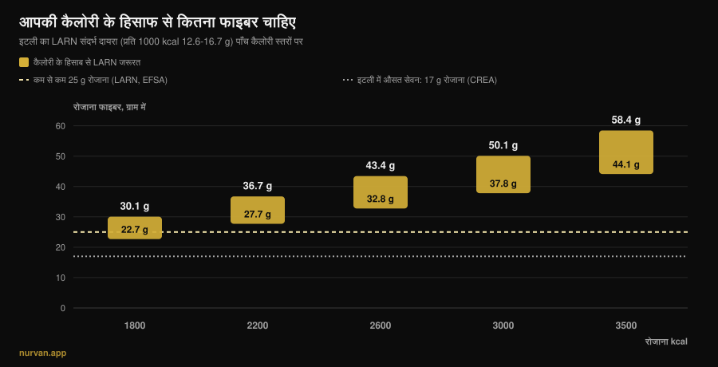
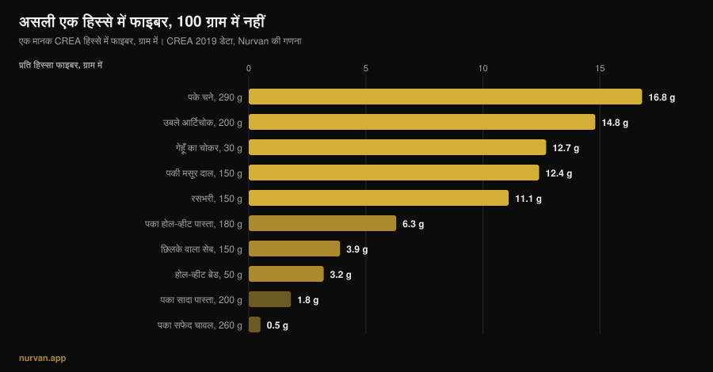

# एक दिन में कितना फाइबर चाहिए?

लेखक: [जियामारिया लोई](/autore/giammaria-loi) · अपडेट 13 नवंबर 2026

सालों तक "हर चीज़ में प्रोटीन" के बाद अब बारी फाइबर की है: फाइबरमैक्सिंग कहता है कि इसे जितना ऊपर ले जा सको ले जाओ — एक चम्मच चिया के बाद दूसरा। पोषक तत्व सही है, दिशा ग़लत। फाइबर के सबूत पूरे पोषण विज्ञान में सबसे मज़बूत सबूतों में से हैं, लेकिन वही स्टडीज़ दो बातें कहती हैं जिन्हें यह ट्रेंड अनदेखा करता है: फ़ायदे का बड़ा हिस्सा एक तय दायरे में है, और वह दायरा 1800 kcal खाने वाले और 3200 kcal खाने वाले के लिए एक जैसा नहीं है।

## सार

- **ज़्यादातर फ़ायदा रोज़ 25 से 29 ग्राम के बीच है।** *Lancet* में छपी समीक्षा में, जिसमें 185 प्रॉस्पेक्टिव स्टडीज़ और 58 ट्रायल शामिल थे, कुल मृत्यु दर, हृदय रोग, स्ट्रोक, टाइप 2 डायबिटीज़ और कोलोरेक्टल कैंसर के जोखिम में कमी इसी दायरे में सबसे ज़्यादा थी।
- **अगर आप ख़ूब ट्रेनिंग करते हैं तो "कम से कम 25 ग्राम" आपका नंबर नहीं है।** इटली के LARN एक कैलोरी-आधारित संदर्भ भी देते हैं: प्रति 1000 kcal 12.6 से 16.7 ग्राम। 3000 kcal पर यह रोज़ 38 से 50 ग्राम बनता है।
- **इटली में औसत सेवन क़रीब 17 ग्राम रोज़ है** (CREA डेटा): असली समस्या ज़्यादा खाना नहीं, कमी है।
- **तेज़ी से बढ़ाने पर पेट सचमुच फूलता है।** फाइबर सप्लीमेंट के ट्रायल्स में फाइबर ग्रुप में गैस सांख्यिकीय रूप से ज़्यादा थी: यह एहसास नहीं, मापा गया असर है।
- **खाने का फाइबर और पाउडर का फाइबर एक काम नहीं करते।** पहले ने ब्लड शुगर *और* ब्लड प्रेशर, दोनों पर असर दिखाया; दूसरे ने मुख्य रूप से शुगर और कोलेस्ट्रॉल पर।

*Nurvan ग्राफ़: LARN (SINU) के संदर्भ दायरे — प्रति 1000 kcal 12.6–16.7 ग्राम — को पाँच कैलोरी स्तरों पर लगाकर हमारी गणना। 25 ग्राम की धारीदार रेखा LARN और EFSA की न्यूनतम सीमा है। 17 ग्राम की बिंदुदार रेखा इटली का औसत सेवन है, CREA के चौथे SCAI सर्वे के आँकड़े, Marconi व अन्य (2025) के हवाले से।*

## फाइबरमैक्सिंग आया कहाँ से

तरीक़ा वही है जिसने प्रोटीन को हर चीज़ में पहुँचा दिया: एक ऐसा पोषक तत्व जिसके पीछे ठीकठाक विज्ञान है, नाम में *-maxxing* का पुछल्ला, और एक छिपा हुआ निष्कर्ष कि अगर थोड़ा अच्छा है तो बहुत और भी अच्छा होगा। फ़र्क़ यह है कि इस बार शुरुआत सही है: इटली में लगभग कोई भी न्यूनतम सीमा तक नहीं पहुँचता, और फाइबर बढ़ाना शायद वह बदलाव है जिसमें आम आदमी को मेहनत के मुक़ाबले सबसे ज़्यादा फ़ायदा मिलता है।

गड़बड़ अगले क़दम पर होती है: "ज़्यादातर लोग कम खाते हैं" से "जितना ज़्यादा खाओ उतना अच्छा" तक। ये दो अलग बातें हैं, और स्टडीज़ सिर्फ़ पहली वाली का साथ देती हैं।

## असल में कितना चाहिए

सबसे मज़बूत स्रोत 2019 में *Lancet* में छपी सिस्टेमैटिक रिव्यू की शृंखला है: 185 प्रॉस्पेक्टिव स्टडीज़, लगभग 13.5 करोड़ व्यक्ति-वर्ष, और 4635 वयस्कों पर 58 कंट्रोल्ड ट्रायल। सबसे ज़्यादा खाने वालों की तुलना सबसे कम खाने वालों से करने पर, ऑब्ज़र्वेशनल आँकड़े कुल और हृदय-संबंधी मृत्यु दर, कोरोनरी हृदय रोग, स्ट्रोक, टाइप 2 डायबिटीज़ और कोलोरेक्टल कैंसर में 15% से 30% तक कमी दिखाते हैं।

और यहाँ वह आँकड़ा आता है जिसका ज़िक्र ट्रेंड कभी नहीं करता: **जोखिम में कमी रोज़ 25 से 29 ग्राम के सेवन पर सबसे ज़्यादा मिली**। डोज़-रिस्पॉन्स वक्र बताते हैं कि इस दायरे के आगे हृदय रोग, डायबिटीज़ और कुछ कैंसर में थोड़ा और फ़ायदा हो सकता है, पर बड़ी छलाँग वह है जो आपको इस दायरे के *अंदर* लाती है, वह नहीं जो आपको इससे आगे ले जाती है।

2023 में *Frontiers in Nutrition* में छपी डोज़-रिस्पॉन्स मेटा-एनालिसिस भी यही कहती है: कुल मृत्यु दर का सापेक्ष जोखिम 0.90 (95% CI 0.86–0.93), हृदय-संबंधी 0.87, कैंसर 0.91, और कुल मृत्यु दर के लिए संबंध **नॉन-लीनियर** है। नॉन-लीनियर का मतलब ठीक यही है: वक्र समतल होने लगता है।

दो हालात ऐसे हैं जहाँ और ऊपर जाना आँकड़ों से समर्थित है। डायबिटीज़ वाले लोगों में रोज़ 19 से 35 ग्राम तक जाना अध्ययन अवधि में प्रति 1000 लोगों पर 14 मौतें कम होने से जुड़ा है (95% CI 4–19)। और हाई ब्लड प्रेशर वालों में फाइबर बढ़ाने से सिस्टोलिक 4.3 mmHg और डायस्टोलिक 3.1 mmHg गिरा, सबूत की निश्चितता ऊँची, और पहले से चल रही दवाओं से स्वतंत्र। पर ये दोनों क्लिनिकल आबादी हैं: वहाँ सही नंबर आपका डॉक्टर तय करेगा, कोई रील नहीं।

## आपकी ज़रूरत कैलोरी के साथ बढ़ती है

यह हिस्सा लगभग हर जगह ग़ायब है, और ट्रेनिंग करने वालों के लिए सबसे ज़रूरी है।

इटैलियन सोसाइटी ऑफ़ ह्यूमन न्यूट्रिशन के LARN सिर्फ़ "रोज़ कम से कम 25 ग्राम" नहीं देते, एक कैलोरी-आधारित संदर्भ भी देते हैं: **प्रति 1000 kcal 12.6 से 16.7 ग्राम फाइबर**। यह तार्किक है, क्योंकि फाइबर खाने से आता है, और जो ज़्यादा खाता है वह ज़्यादा खाना खाता है।

असली कैलोरी पर लगाते ही निशाना पूरी तरह बदल जाता है, जैसा ऊपर के ग्राफ़ में दिखता है। 1800 kcal खाने वाले बैठे-ठाले व्यक्ति के लिए दायरा 23 से 30 ग्राम है। हफ़्ते में चार बार ट्रेनिंग करने और 3000 kcal खाने वाले के लिए यह **38 से 50 ग्राम** हो जाता है। 3500 kcal पर बल्क कर रहे व्यक्ति के लिए 44 से 58 ग्राम। जो लोग "25 ग्राम काफ़ी है" दोहराते हैं, वे 95 किलो के पावरलिफ़्टर को उस आदमी का नंबर थमा रहे हैं जो आधा खाता है; और जो कटिंग में 1600 kcal पर फाइबरमैक्सिंग कर रहा है, वह पहले से ही ऊँचा नंबर और ऊपर धकेल रहा है।

वे कैलोरी कहाँ से आएँ, यह सवाल आपके चुने हुए कार्ब्स की क्वालिटी से जुड़ा है: इस पर हमने [क्या कार्ब्स से वज़न बढ़ता है?](/hi/blog/carbs-se-vajan-badhta-hai-chhipi-charbi) में लिखा है।

## रिसर्च असल में क्या कहती है

| आम दावा | नतीजा | स्रोत |
|---|---|---|
| "फाइबर जितना ज़्यादा उतना अच्छा" | **स्पष्ट करने लायक़**: बड़ा फ़ायदा 25 से 29 ग्राम में, उसके बाद वक्र समतल | Reynolds व अन्य, 2019; Yao व अन्य, 2023 |
| "रोज़ 25 ग्राम सबके लिए काफ़ी है" | **स्पष्ट करने लायक़**: LARN प्रति 1000 kcal 12.6–16.7 ग्राम भी देते हैं | LARN SINU; Marconi व अन्य, 2025 |
| "फाइबर से पेट की सूजन उतरती है" | छोटी अवधि में **ग़लत**: ज़्यादा फाइबर, ज़्यादा गैस (SMD 0.80) | van der Schoot व अन्य, 2022 |
| "एक स्कूप इसबगोल काफ़ी है" | **स्पष्ट करने लायक़**: पेट साफ़ रखने में कारगर, पर खाने का फाइबर ज़्यादा व्यापक असर दिखाता है | van der Schoot 2022; Jiang व अन्य, 2025 |
| "वर्कआउट से पहले जितना फाइबर उतना अच्छा" | **ग़लत**: एक्सरसाइज़ से जुड़ी पेट की दिक़्क़तों में फाइबर घटाना सबसे ज़्यादा इस्तेमाल होने वाला तरीक़ा है | Scrivin व अन्य, 2022 |

### शुरू में पेट क्यों फूलता है (और ग़लती आपकी नहीं)

क्रॉनिक क़ब्ज़ वाले 1251 वयस्कों पर 16 कंट्रोल्ड ट्रायल की मेटा-एनालिसिस में फाइबर ने काम किया: फाइबर ग्रुप में 66% (473 में से 311) ने जवाब दिया, कंट्रोल ग्रुप में 41% (329 में से 134), सापेक्ष जोखिम 1.48। पर उसी अध्ययन में **फाइबर ग्रुप में गैस काफ़ी ज़्यादा** रही, स्टैंडर्डाइज़्ड मीन डिफ़रेंस 0.80 (95% CI 0.47–1.13), जो एक बड़ा असर है।

इसीलिए "मैंने सब्ज़ियाँ बढ़ाईं और पेट फूल गया" नाकामी नहीं, तेज़ बदलाव की अपेक्षित प्रतिक्रिया है। उसी अध्ययन में मल की आवृत्ति और बनावट में सुधार तभी दिखा जब अवधि कम से कम चार हफ़्ते थी। फूलना पहले हफ़्ते की बात है, फ़ायदा चौथे हफ़्ते से शुरू होता है। व्यावहारिक नतीजा एक ही है: **सीढ़ी-दर-सीढ़ी चढ़िए**, हफ़्ते में 3 से 5 ग्राम।

### सप्लीमेंट या खाना

पाउडर कोई बराबर का शॉर्टकट नहीं है। सबसे साफ़ तुलना में, 30 ट्रायल और 1140 प्रतिभागियों पर 2025 की एक मेटा-एनालिसिस ने **इंट्रिंसिक** फाइबर (जो साबुत खाने के भीतर होता है) और **आइसोलेटेड** फाइबर (जो निकालकर मिलाया जाता है) को अलग करके देखा। पहले ने फ़ास्टिंग ब्लड शुगर और सिस्टोलिक ब्लड प्रेशर (−2.86 mmHg) घटाया। दूसरे ने फ़ास्टिंग शुगर और कुल कोलेस्ट्रॉल घटाया, पर ब्लड प्रेशर नहीं।

यह सप्लीमेंट के ख़िलाफ़ तर्क नहीं है: इसबगोल के पास पेट की नियमितता पर अच्छे आँकड़े हैं, रोज़ 10 ग्राम से ऊपर की मात्रा में और कम से कम चार हफ़्ते तक। यह इस सोच के ख़िलाफ़ तर्क है कि एक स्कूप दाल की एक प्लेट की जगह ले सकता है। खाने की बनावट ख़ुद मायने रखती है, ठीक वैसे ही जैसे [पौधों और पशु प्रोटीन की तुलना](/hi/blog/paudhon-ya-pashu-protein-muscle-ke-liye) में होता है।

### फाइबर और ट्रेनिंग: समय भी मायने रखता है

फाइबरमैक्सिंग जिस बात का हिसाब नहीं रखता वह है *कब*। एक्सरसाइज़ से जुड़े पेट के लक्षणों के इतिहास वाले 137 एंड्योरेंस एथलीटों पर हुई एक स्टडी में, उनके बताए 277 तरीक़ों में **फाइबर घटाना सबसे ज़्यादा इस्तेमाल होने वाला डाइट उपाय** रहा (15.2%, 42 बार), और सबसे अच्छे आँके गए उपायों में भी, जिसकी असरदारी का माध्य 5 में से 4 रहा। उसके बाद डेयरी छोड़ना और लो-FODMAP डाइट थे।

दो ईमानदार चेतावनियाँ: ये आँकड़े एंड्योरेंस एथलीटों के हैं, वेट ट्रेनिंग करने वालों के नहीं, और दौड़ने से होने वाली पेट की दिक़्क़तों में यांत्रिक कारण भी होते हैं जो जिम में नहीं होते। पर तर्क बारबेल के नीचे भी टिकता है: भारी स्क्वाट सेशन से दो घंटे पहले 15 ग्राम फाइबर वाली थाली सवालों के घेरे में है, जबकि वही थाली डिनर में किसी को परेशान नहीं करती।

## इसे कैसे लागू करें

पहला नियम: "प्रति 100 ग्राम" वाली लिस्ट देखना बंद कीजिए। CREA डेटाबेस में काली मिर्च में प्रति 100 ग्राम 25.9 ग्राम फाइबर है, पर उसका संदर्भ हिस्सा 1 ग्राम है: यानी 0.26 ग्राम फाइबर। मायने यह रखता है कि जो हिस्सा आप सचमुच खाएँगे उसमें कितना फाइबर है।

*Nurvan ग्राफ़, CREA — खाद्य एवं पोषण अनुसंधान केंद्र की 2019 में अपडेट हुई तालिकाओं पर आधारित। प्रति हिस्सा फाइबर हमारी गणना है: (प्रति 100 ग्राम फाइबर × CREA हिस्सा) ÷ 100।*

दूसरा नियम: बड़ी छलाँग कुछ अदला-बदली से आती है, बीस छोटे-छोटे टोटकों से नहीं।

| बदलाव | पहले | बाद में | बढ़त |
|---|---|---|---|
| स्टार्च वाला साइड | पका सफ़ेद चावल, 260 g: **0.5 g** | पका होल-व्हीट पास्ता, 180 g: **6.3 g** | **+5.8 g** |
| ब्रेड | सफ़ेद ब्रेड, 50 g: **1.9 g** | होल-व्हीट ब्रेड, 50 g: **3.2 g** | **+1.3 g** |
| एक और डिश | — | पकी मसूर दाल, 150 g: **12.4 g** | **+12.4 g** |
| | | | **कुल +19.5 g** |

*CREA 2019 डेटा पर Nurvan की गणना। इटली के औसत 17 ग्राम से शुरू करें तो ये तीन बदलाव रोज़ाना क़रीब 36–37 ग्राम तक पहुँचा देते हैं।*

तीसरा नियम: छिलका आपकी सोच से ज़्यादा मायने रखता है। 150 ग्राम का छिलके वाला सेब 3.9 ग्राम फाइबर देता है, वही सेब छीलकर 3.0 ग्राम: एक चौथाई चाक़ू के साथ चला जाता है।

चार व्यावहारिक बातें:

1. **अपना नंबर निकालिए, आम नंबर नहीं।** अपनी कैलोरी को 0.0126 और 0.0167 से गुणा कीजिए: वही आपका दायरा है। 2500 kcal पर यह 32 से 42 ग्राम है।
2. **हफ़्ते में 3 से 5 ग्राम बढ़ाइए।** शुरुआती फूलना असली है और चला जाता है, पर तभी जब आप उसे समय दें।
3. **दाल-फली की एक डिश बाक़ी सब मिलाकर जितना करती है, उससे ज़्यादा करती है।** 150 ग्राम पकी मसूर चार सेब के बराबर है।
4. **फाइबर को ट्रेनिंग से दूर रखिए।** प्री-वर्कआउट मील ही इकलौता है जिसमें फाइबर कम रखना सही है; दिन का हिस्सा डिनर में पूरा कर लीजिए।

और अगर आप पहले से हर मील का प्रोटीन गिन रहे हैं, तो फाइबर उसके साथ रखने वाला दूसरा नंबर है: [एक मील में कितना प्रोटीन](/hi/blog/ek-meal-mein-kitna-protein) इस लेख का जुड़वाँ है।

> **Nurvan: फाइबर दिखता है, अंदाज़ा नहीं लगाना पड़ता**
>
> Nurvan का न्यूट्रिशन सेक्शन CREA डेटाबेस इस्तेमाल करता है — वही स्रोत जिससे इस लेख के आँकड़े आए हैं: आप जो भी खाना डालते हैं वह अपना फाइबर साथ लाता है, और दिन का कुल जोड़ कैलोरी और प्रोटीन के साथ-साथ अपडेट होता रहता है। आपकी एनर्जी ज़रूरत पहले से ऐप में है, इसलिए तुरंत पता चलता है कि आपके 3000 kcal 38 ग्राम तक पहुँचे या 18 पर रुक गए। [Nurvan आज़माएँ](https://nurvan.app)

## अक्सर पूछे जाने वाले सवाल

**एक दिन में कितना फाइबर खाना चाहिए?**
LARN और EFSA की न्यूनतम सीमा एक वयस्क के लिए रोज़ 25 ग्राम है। समीक्षाओं में जोखिम में कमी का बड़ा हिस्सा 25 से 29 ग्राम के बीच है। अगर आप ट्रेनिंग करते हैं और ख़ूब खाते हैं, तो कैलोरी-आधारित LARN संदर्भ ज़्यादा काम का है: प्रति 1000 kcal 12.6–16.7 ग्राम, यानी 3000 kcal पर 38 से 50 ग्राम।

**क्या फाइबरमैक्सिंग नुक़सान करता है?**
स्टडीज़ में तेज़ बढ़ोतरी का मापा गया असर ज़्यादा गैस है, नुक़सान नहीं। असली जोखिम व्यावहारिक है: बहुत तेज़ी से बढ़ाने पर होने वाली तकलीफ़ आपसे यह छुड़वा देती है, और कोई स्टडी यह नहीं दिखाती कि 25–29 ग्राम के दायरे से बहुत आगे जाने पर उसी अनुपात में फ़ायदा मिलता है। अगर आपको आँत से जुड़ी कोई बीमारी डायग्नोज़ हुई है, तो फाइबर की मात्रा अकेले तय करने वाली चीज़ नहीं है।

**फाइबर सप्लीमेंट से लें या खाने से?**
दोनों अलग-अलग मक़सद पूरे करते हैं। 2025 की मेटा-एनालिसिस में साबुत खाने के भीतर का फाइबर फ़ास्टिंग ब्लड शुगर और सिस्टोलिक ब्लड प्रेशर घटाता मिला; आइसोलेटेड फाइबर ने शुगर और कुल कोलेस्ट्रॉल घटाया, ब्लड प्रेशर नहीं। इसबगोल के पास नियमितता पर अच्छे सबूत हैं, रोज़ 10 ग्राम से ऊपर और कम से कम चार हफ़्ते तक।

**वर्कआउट से पहले फाइबर से पेट फूल जाता है, क्या करूँ?**
दिन का ज़्यादातर फाइबर सेशन से दूर रखिए और प्री-वर्कआउट मील हल्का रखिए। पेट के लक्षणों वाले एंड्योरेंस एथलीटों में फाइबर घटाना सबसे ज़्यादा इस्तेमाल होने वाला और सबसे कारगर डाइट उपायों में से एक है।

## यह भी पढ़ें

- [एक मील में कितना प्रोटीन: क्या कोई सीमा है?](/hi/blog/ek-meal-mein-kitna-protein) — वह दूसरा नंबर जिसे मील-दर-मील गिनना फ़ायदेमंद है।
- [क्या कार्ब्स से वज़न बढ़ता है? छिपी हुई चर्बी](/hi/blog/carbs-se-vajan-badhta-hai-chhipi-charbi) — फ़ालतू कैलोरी असल में आती कहाँ से है।
- [मसल के लिए पौधों का प्रोटीन या पशु प्रोटीन?](/hi/blog/paudhon-ya-pashu-protein-muscle-ke-liye) — खाने की बनावट क्यों मायने रखती है।

## स्रोत

1. Reynolds A, Mann J, Cummings J, et al., 2019. *Carbohydrate quality and human health: a series of systematic reviews and meta-analyses.* Lancet 393(10170):434-445. [PMID 30638909](https://pubmed.ncbi.nlm.nih.gov/30638909/) · [DOI 10.1016/S0140-6736(18)31809-9](https://doi.org/10.1016/S0140-6736(18)31809-9)
2. Yao F, Ma J, Cui Y, et al., 2023. *Dietary intake of total, vegetable, fruit, cereal, soluble and insoluble fiber and risk of all-cause, cardiovascular, and cancer mortality.* Front Nutr 10:1153165. [PMID 37854351](https://pubmed.ncbi.nlm.nih.gov/37854351/) · [DOI 10.3389/fnut.2023.1153165](https://doi.org/10.3389/fnut.2023.1153165)
3. Reynolds AN, Akerman AP, Mann J, 2020. *Dietary fibre and whole grains in diabetes management: systematic review and meta-analyses.* PLoS Med 17(3):e1003053. [PMID 32142510](https://pubmed.ncbi.nlm.nih.gov/32142510/) · [DOI 10.1371/journal.pmed.1003053](https://doi.org/10.1371/journal.pmed.1003053)
4. Reynolds AN, Akerman A, Kumar S, et al., 2022. *Dietary fibre in hypertension and cardiovascular disease management: systematic review and meta-analyses.* BMC Med 20(1):139. [PMID 35449060](https://pubmed.ncbi.nlm.nih.gov/35449060/) · [DOI 10.1186/s12916-022-02328-x](https://doi.org/10.1186/s12916-022-02328-x)
5. van der Schoot A, Drysdale C, Whelan K, Dimidi E, 2022. *The effect of fiber supplementation on chronic constipation in adults: an updated systematic review and meta-analysis of randomized controlled trials.* Am J Clin Nutr 116(4):953-969. [PMID 35816465](https://pubmed.ncbi.nlm.nih.gov/35816465/) · [DOI 10.1093/ajcn/nqac184](https://doi.org/10.1093/ajcn/nqac184)
6. Jiang S, Cai C, Deehan EC, et al., 2025. *The physiological effects of intrinsic and isolated arabinoxylans on human immunometabolic response: a systematic review and meta-analysis.* Food Res Int 218:116866. [PMID 40790673](https://pubmed.ncbi.nlm.nih.gov/40790673/) · [DOI 10.1016/j.foodres.2025.116866](https://doi.org/10.1016/j.foodres.2025.116866)
7. Marconi S, Gilberti G, Romele E, et al., 2025. *Translation and cross-cultural adaptation of a validated questionnaire to assess dietary fiber intake among the Italian population.* Nutrients 17(6):1084. [PMID 40292515](https://pubmed.ncbi.nlm.nih.gov/40292515/) · [DOI 10.3390/nu17061084](https://doi.org/10.3390/nu17061084)
8. Scrivin R, Costa RJS, Pelly F, Lis D, Slater G, 2022. *An exploratory study of the management strategies reported by endurance athletes with exercise-associated gastrointestinal symptoms.* Front Nutr 9:1003445. [PMID 36438762](https://pubmed.ncbi.nlm.nih.gov/36438762/) · [DOI 10.3389/fnut.2022.1003445](https://doi.org/10.3389/fnut.2022.1003445)

संदर्भ मान: LARN — पोषक तत्वों और ऊर्जा के संदर्भ सेवन स्तर, SINU, चौथा संशोधन (रोज़ कम से कम 25 ग्राम; प्रति 1000 kcal 12.6–16.7 ग्राम); EFSA, 26 मार्च 2010 की राय (वयस्कों में सामान्य आँत क्रिया के लिए रोज़ 25 ग्राम पर्याप्त)। खाद्य आँकड़े: CREA — खाद्य एवं पोषण अनुसंधान केंद्र की तालिकाएँ, 2019 अपडेट। विषय नवंबर 2026 के "फाइबरमैक्सिंग" ट्रेंड संकेतों से चुना गया (अंतरराष्ट्रीय और इतालवी मीडिया कवरेज, और सर्च का पहला पन्ना ऐसे सामान्य कंटेंट से भरा जो ज़रूरत को कैलोरी से नहीं जोड़ता)। वैज्ञानिक स्रोत PubMed के ज़रिए देखे गए।

---

*जियामारिया लोई Nurvan के संस्थापक हैं। वे 2012 से वेट ट्रेनिंग करते हैं, 2013 से FIPE प्रमाणित पर्सनल ट्रेनर और कोच के रूप में काम करते हैं और 2018 से राष्ट्रीय स्तर पर पावरलिफ़्टिंग में भाग लेते हैं। उनके हर लेख की शुरुआत वैज्ञानिक अध्ययनों से होती है और अंत इस पर कि जिम में असल में क्या काम करता है।*

> नोट: यह जानकारी भर है, यह डॉक्टर या विशेषज्ञ की सलाह की जगह नहीं लेती।
