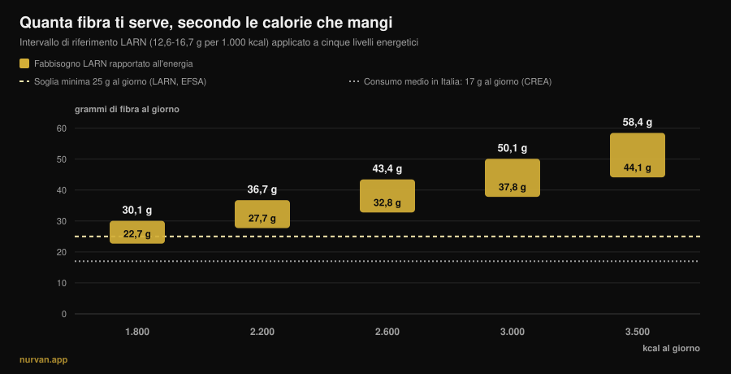
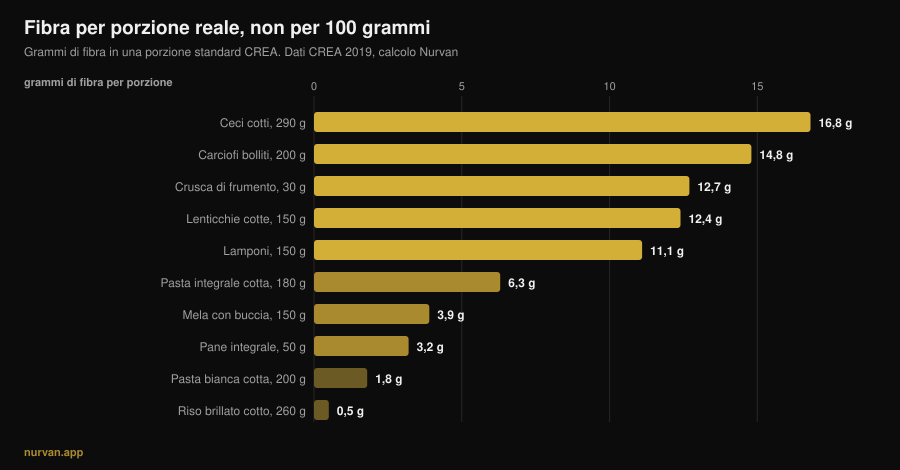

# Quanta fibra al giorno serve a chi si allena?

Di [Giammaria Loi](/autore/giammaria-loi) · aggiornato il 13 novembre 2026

Dopo anni di "proteine in tutto", il nuovo nutriente di moda è la fibra: il *fibermaxxing* invita a spingerla il più in alto possibile, un cucchiaio di semi di chia dopo l'altro. Il nutriente giusto, portato nella direzione sbagliata. Sulla fibra le prove sono fra le più solide di tutta la nutrizione, ma gli stessi studi dicono due cose che il trend ignora: esiste una fascia in cui si concentra il grosso del beneficio, e quella fascia non è uguale per chi mangia 1.800 kcal e per chi ne mangia 3.200.

## In breve

- **Il grosso del beneficio sta fra 25 e 29 g al giorno.** Nella revisione pubblicata su *Lancet* su 185 studi prospettici e 58 trial, la riduzione del rischio su mortalità totale, cardiopatia, ictus, diabete di tipo 2 e cancro del colon-retto è massima in quella fascia.
- **"Almeno 25 g" non è il tuo numero se ti alleni molto.** I LARN italiani fissano anche un riferimento per energia: 12,6-16,7 g ogni 1.000 kcal. A 3.000 kcal diventano 38-50 g al giorno.
- **La media italiana è circa 17 g al giorno** secondo i dati CREA: il problema vero del Paese non è l'eccesso, è il buco.
- **Aumentare in fretta gonfia davvero.** Nei trial sugli integratori di fibra la flatulenza è significativamente più alta nei gruppi fibra: non è un'impressione, è un effetto misurato.
- **La fibra degli alimenti e quella in polvere non fanno le stesse cose.** La prima ha mostrato effetti su glicemia *e* pressione, la seconda soprattutto su glicemia e colesterolo.

*Grafico Nurvan: calcolo nostro applicando l'intervallo di riferimento LARN (SINU, 12,6-16,7 g per 1.000 kcal) a cinque livelli energetici. Linea continua dei 25 g: soglia minima LARN ed EFSA. Linea dei 17 g: consumo medio italiano, dati CREA indagine IV SCAI citati da Marconi et al., 2025.*

## Da dove arriva il fibermaxxing

Il meccanismo è lo stesso che ha portato le proteine ovunque: un nutriente con buone credenziali, il suffisso *-maxxing*, e la conclusione implicita che se un po' fa bene, tanto farà meglio. La differenza è che qui il punto di partenza ha ragione: quasi nessuno in Italia arriva alla soglia minima, e alzare la fibra è il cambiamento con il miglior rapporto fra sforzo e beneficio che una persona media possa fare a tavola.

Il problema nasce nel passaggio da "quasi tutti ne mangiano poca" a "più ne mangi, meglio è". Sono due frasi diverse, e gli studi sostengono solo la prima.

## Quanta fibra serve davvero

La fonte più solida è la serie di revisioni sistematiche pubblicata su *Lancet* nel 2019: 185 studi prospettici, poco meno di 135 milioni di anni-persona, più 58 trial controllati su 4.635 adulti. Confrontando chi ne mangia di più con chi ne mangia di meno, i dati osservazionali mostrano una riduzione del 15-30% di mortalità totale e cardiovascolare, di cardiopatia coronarica, ictus, diabete di tipo 2 e tumore del colon-retto.

E qui arriva il numero che il trend non cita: **la riduzione del rischio è risultata massima con un'assunzione fra 25 e 29 g al giorno**. Le curve dose-risposta suggeriscono che oltre quella fascia qualche beneficio in più ci sia ancora per cardiovascolare, diabete e alcuni tumori, ma il salto grande è quello che ti porta *dentro* la fascia, non quello che ti porta oltre.

Lo conferma la meta-analisi dose-risposta del 2023 su *Frontiers in Nutrition*: rischio relativo di mortalità totale 0,90 (IC 95% 0,86-0,93), cardiovascolare 0,87, per cancro 0,91, con una relazione **non lineare** per la mortalità totale. Non lineare significa esattamente questo: la curva si appiattisce.

Ci sono due casi in cui spingere più in alto ha un senso misurato. Nelle persone con diabete, passare da 19 a 35 g al giorno è associato a 14 morti in meno ogni 1.000 (IC 95% 4-19). Negli ipertesi, aumentare la fibra ha abbassato la sistolica di 4,3 mmHg e la diastolica di 3,1 mmHg, con certezza alta e indipendentemente dai farmaci in uso. Sono però popolazioni cliniche: lì il numero giusto lo decide il medico, non un carosello.

## Il tuo fabbisogno sale con le calorie

Questa è la parte che manca praticamente ovunque, ed è la più rilevante per chi si allena.

I LARN della Società Italiana di Nutrizione Umana non danno solo la soglia "almeno 25 g al giorno": danno anche un riferimento rapportato all'energia, **12,6-16,7 g di fibra ogni 1.000 kcal**. È una scelta logica, perché la fibra arriva dal cibo, e chi mangia di più mangia più cibo.

Applicato alle calorie reali, quel riferimento cambia il bersaglio, come vedi nel grafico sopra. Per una persona sedentaria da 1.800 kcal l'intervallo è 23-30 g. Per chi si allena quattro volte a settimana e mangia 3.000 kcal diventa **38-50 g**. In fase di massa a 3.500 kcal, 44-58 g. Chi ripete "25 g bastano" sta dando a un powerlifter di 95 kg il numero di una persona che mangia la metà; chi fa fibermaxxing a 1.600 kcal in definizione sta spingendo un numero che per lui è già alto.

Da dove far arrivare quelle calorie è un discorso che si incrocia con la qualità dei carboidrati: ne abbiamo parlato in [i carboidrati fanno ingrassare?](/blog/carboidrati-fanno-ingrassare-grassi-nascosti).

## Cosa dice davvero la ricerca

| Affermazione diffusa | Verdetto | Fonte |
|---|---|---|
| "Più fibra è sempre meglio" | **Da precisare**: il grosso del beneficio è fra 25 e 29 g, poi la curva si appiattisce | Reynolds et al., 2019; Yao et al., 2023 |
| "25 g al giorno bastano a tutti" | **Da precisare**: i LARN danno anche 12,6-16,7 g per 1.000 kcal | LARN SINU; Marconi et al., 2025 |
| "La fibra sgonfia la pancia" | **Smentito** nel breve periodo: più fibra, più flatulenza (SMD 0,80) | van der Schoot et al., 2022 |
| "Un misurino di psyllium risolve" | **Da precisare**: funziona sulla regolarità, ma la fibra degli alimenti ha mostrato effetti più ampi | van der Schoot 2022; Jiang et al., 2025 |
| "Prima di allenarti, più fibra è meglio" | **Smentito**: ridurla è la strategia più usata contro i disturbi gastrointestinali da esercizio | Scrivin et al., 2022 |

### Perché all'inizio ti gonfia (e non è colpa tua)

Nella meta-analisi su 16 trial controllati e 1.251 adulti con stipsi cronica, la fibra ha funzionato: ha risposto al trattamento il 66% dei partecipanti (311 su 473) contro il 41% dei controlli (134 su 329), rischio relativo 1,48. Ma nello stesso lavoro la **flatulenza è risultata significativamente più alta nei gruppi fibra**, con una differenza media standardizzata di 0,80 (IC 95% 0,47-1,13), che è un effetto grande.

È il motivo per cui "ho aumentato le verdure e mi sono gonfiato" non è un fallimento: è la risposta attesa a un cambiamento rapido. Nello stesso lavoro i miglioramenti su frequenza e consistenza delle evacuazioni si sono visti solo con durate di almeno quattro settimane. Il gonfiore è la prima settimana, il beneficio è dalla quarta in poi. La conseguenza pratica è una sola: **sali per gradini**, 3-5 g a settimana.

### Integratore o cibo

La polvere non è una scorciatoia equivalente. Nel confronto più chiaro che abbiamo, una meta-analisi 2025 su 30 trial e 1.140 partecipanti ha separato la fibra **intrinseca** (quella dentro l'alimento integrale) dalla fibra **isolata** (estratta e aggiunta). La prima ha ridotto glicemia a digiuno e pressione sistolica (-2,86 mmHg). La seconda ha ridotto glicemia e colesterolo totale, ma non la pressione.

Non è un argomento contro gli integratori: lo psyllium ha dati buoni sulla regolarità, a dosi superiori a 10 g al giorno e per almeno quattro settimane. È un argomento contro l'idea che un misurino sostituisca un piatto di legumi. La matrice dell'alimento conta, come succede anche quando [confronti proteine vegetali e animali](/blog/proteine-vegetali-o-animali-per-i-muscoli).

### Fibra e allenamento: il momento conta

Un dettaglio che il fibermaxxing non considera è *quando*. In uno studio su 137 atleti di endurance con storia di sintomi gastrointestinali da esercizio, su 277 strategie riportate la **riduzione della fibra è risultata la strategia dietetica più usata** (15,2%, 42 segnalazioni) e fra le meglio valutate, con un'efficacia mediana di 4 su 5. Seguivano l'esclusione dei latticini e la dieta a basso contenuto di FODMAP.

Due avvertenze oneste: quei dati vengono da atleti di endurance, non da chi fa pesi, e i disturbi da corsa hanno componenti meccaniche che in palestra non ci sono. Ma la logica regge anche sotto un bilanciere: un piatto da 15 g di fibra due ore prima di una seduta pesante di squat è discutibile, lo stesso piatto a cena non dà fastidio a nessuno.

## Come applicarlo

Prima regola: smetti di guardare le classifiche "per 100 grammi". Nel database CREA il pepe nero ha 25,9 g di fibra per 100 g, ma la porzione è 1 grammo: sono 0,26 g di fibra. Quello che conta è quanta fibra c'è in una porzione che mangeresti davvero.

*Grafico Nurvan sulle tabelle CREA — Centro di ricerca Alimenti e Nutrizione, aggiornamento 2019. Fibra per porzione calcolata da noi come (fibra per 100 g × porzione CREA) ÷ 100.*

Seconda regola: i grandi salti vengono da pochi scambi, non da venti piccoli accorgimenti.

| Scambio | Prima | Dopo | Guadagno |
|---|---|---|---|
| Il contorno di amido | Riso brillato cotto, 260 g: **0,5 g** | Pasta integrale cotta, 180 g: **6,3 g** | **+5,8 g** |
| Il pane | Pane bianco, 50 g: **1,9 g** | Pane integrale, 50 g: **3,2 g** | **+1,3 g** |
| Una portata in più | — | Lenticchie cotte, 150 g: **12,4 g** | **+12,4 g** |
| | | | **+19,5 g in totale** |

*Elaborazione Nurvan sui dati CREA 2019. Partendo dai 17 g della media italiana, questi tre scambi portano a circa 36-37 g al giorno.*

Terza regola: la buccia conta più di quanto pensi. Una mela da 150 g con la buccia dà 3,9 g di fibra, la stessa mela sbucciata 3,0 g: un quarto se ne va con il coltello.

Quattro indicazioni pratiche:

1. **Trova il tuo numero, non quello generico.** Moltiplica le tue calorie per 0,0126 e per 0,0167: quello è il tuo intervallo. A 2.500 kcal sono 32-42 g.
2. **Sali di 3-5 g a settimana.** Il gonfiore iniziale è reale e passa, ma solo se gli dai tempo.
3. **Una portata di legumi fa più di tutto il resto messo insieme.** 150 g di lenticchie cotte valgono quanto quattro mele.
4. **Sposta la fibra lontano dall'allenamento.** Il pasto pre-workout è l'unico in cui vale la pena tenerla bassa; la fibra della giornata recuperala a cena.

E se stai già contando le proteine per pasto, la fibra è il secondo numero da affiancare: [quante proteine per pasto](/blog/quante-proteine-per-pasto-limite) è il pezzo gemello di questo.

> **Nurvan: la fibra la vedi, non la indovini**
>
> La sezione nutrizione di Nurvan usa il database CREA, le stesse tabelle da cui vengono i numeri di questo articolo: ogni alimento che inserisci porta con sé la sua fibra, e il totale del giorno ti si aggiorna accanto a calorie e proteine. Con il tuo fabbisogno energetico già in app, sai subito se i tuoi 3.000 kcal arrivano a 38 g o si fermano a 18. [Prova Nurvan](https://nurvan.app)

## Domande frequenti

**Quanta fibra al giorno devo mangiare?**
La soglia minima di LARN ed EFSA è 25 g al giorno per un adulto. Nelle revisioni il grosso della riduzione del rischio si concentra fra 25 e 29 g. Se ti alleni e mangi parecchio, il riferimento LARN rapportato all'energia (12,6-16,7 g per 1.000 kcal) è più utile: a 3.000 kcal sono 38-50 g.

**Il fibermaxxing fa male?**
Negli studi l'effetto misurato dell'aumento rapido è più flatulenza, non un danno. Il rischio vero è pratico: aumentare troppo in fretta dà fastidi che ti fanno mollare, e nessuno studio mostra che spingere molto oltre la fascia dei 25-29 g dia benefici proporzionali. Se hai una condizione intestinale diagnosticata, la quantità di fibra non è una decisione da prendere da solo.

**Meglio la fibra dagli integratori o dal cibo?**
Entrambe funzionano su obiettivi diversi. Nella meta-analisi 2025 la fibra dentro gli alimenti integrali ha ridotto glicemia a digiuno e pressione sistolica; quella isolata ha ridotto glicemia e colesterolo totale ma non la pressione. Lo psyllium ha buone prove sulla regolarità, sopra i 10 g al giorno e per almeno quattro settimane.

**La fibra mi gonfia prima di allenarmi: cosa faccio?**
Sposta il grosso della fibra lontano dalla seduta e tieni leggero il pasto pre-workout. Negli atleti di endurance con sintomi gastrointestinali la riduzione della fibra è la strategia dietetica più usata e fra le più efficaci.

## Leggi anche

- [Quante proteine per pasto: esiste un limite?](/blog/quante-proteine-per-pasto-limite) — l'altro numero che vale la pena contare pasto per pasto.
- [I carboidrati fanno ingrassare? Il grasso nascosto](/blog/carboidrati-fanno-ingrassare-grassi-nascosti) — da dove arrivano davvero le calorie di troppo.
- [Proteine vegetali o animali per i muscoli?](/blog/proteine-vegetali-o-animali-per-i-muscoli) — perché la matrice dell'alimento conta.

## Fonti

1. Reynolds A, Mann J, Cummings J, et al., 2019. Carbohydrate quality and human health: a series of systematic reviews and meta-analyses. *Lancet* 393(10170):434-445. [PMID 30638909](https://pubmed.ncbi.nlm.nih.gov/30638909/) · [DOI 10.1016/S0140-6736(18)31809-9](https://doi.org/10.1016/S0140-6736(18)31809-9)
2. Yao F, Ma J, Cui Y, et al., 2023. Dietary intake of total, vegetable, fruit, cereal, soluble and insoluble fiber and risk of all-cause, cardiovascular, and cancer mortality. *Front Nutr* 10:1153165. [PMID 37854351](https://pubmed.ncbi.nlm.nih.gov/37854351/) · [DOI 10.3389/fnut.2023.1153165](https://doi.org/10.3389/fnut.2023.1153165)
3. Reynolds AN, Akerman AP, Mann J, 2020. Dietary fibre and whole grains in diabetes management: systematic review and meta-analyses. *PLoS Med* 17(3):e1003053. [PMID 32142510](https://pubmed.ncbi.nlm.nih.gov/32142510/) · [DOI 10.1371/journal.pmed.1003053](https://doi.org/10.1371/journal.pmed.1003053)
4. Reynolds AN, Akerman A, Kumar S, et al., 2022. Dietary fibre in hypertension and cardiovascular disease management: systematic review and meta-analyses. *BMC Med* 20(1):139. [PMID 35449060](https://pubmed.ncbi.nlm.nih.gov/35449060/) · [DOI 10.1186/s12916-022-02328-x](https://doi.org/10.1186/s12916-022-02328-x)
5. van der Schoot A, Drysdale C, Whelan K, Dimidi E, 2022. The effect of fiber supplementation on chronic constipation in adults: an updated systematic review and meta-analysis of randomized controlled trials. *Am J Clin Nutr* 116(4):953-969. [PMID 35816465](https://pubmed.ncbi.nlm.nih.gov/35816465/) · [DOI 10.1093/ajcn/nqac184](https://doi.org/10.1093/ajcn/nqac184)
6. Jiang S, Cai C, Deehan EC, et al., 2025. The physiological effects of intrinsic and isolated arabinoxylans on human immunometabolic response: a systematic review and meta-analysis. *Food Res Int* 218:116866. [PMID 40790673](https://pubmed.ncbi.nlm.nih.gov/40790673/) · [DOI 10.1016/j.foodres.2025.116866](https://doi.org/10.1016/j.foodres.2025.116866)
7. Marconi S, Gilberti G, Romele E, et al., 2025. Translation and cross-cultural adaptation of a validated questionnaire to assess dietary fiber intake among the Italian population. *Nutrients* 17(6):1084. [PMID 40292515](https://pubmed.ncbi.nlm.nih.gov/40292515/) · [DOI 10.3390/nu17061084](https://doi.org/10.3390/nu17061084)
8. Scrivin R, Costa RJS, Pelly F, Lis D, Slater G, 2022. An exploratory study of the management strategies reported by endurance athletes with exercise-associated gastrointestinal symptoms. *Front Nutr* 9:1003445. [PMID 36438762](https://pubmed.ncbi.nlm.nih.gov/36438762/) · [DOI 10.3389/fnut.2022.1003445](https://doi.org/10.3389/fnut.2022.1003445)

Valori di riferimento: LARN — Livelli di Assunzione di Riferimento di Nutrienti ed energia, SINU, IV revisione (almeno 25 g al giorno; 12,6-16,7 g per 1.000 kcal); EFSA, parere del 26 marzo 2010 (25 g al giorno adeguati per la normale funzione intestinale negli adulti). Dati alimentari: tabelle CREA — Centro di ricerca Alimenti e Nutrizione, aggiornamento 2019. Tema scelto da segnali di tendenza di novembre 2026 sul "fibermaxxing" (copertura su stampa internazionale e italiana, e prima pagina di ricerca occupata da contenuti generalisti che non rapportano il fabbisogno alle calorie). Fonti scientifiche consultate tramite PubMed.

**Giammaria Loi** è il fondatore di Nurvan. Si allena con i pesi dal 2012, lavora come personal trainer e coach certificato FIPE dal 2013 e gareggia nel powerlifting a livello nazionale dal 2018. Ogni articolo che firma parte dagli studi scientifici e arriva a ciò che funziona davvero in palestra. [Pagina autore](/autore/giammaria-loi)

> Nota: contenuto informativo, non sostituisce il parere di un medico o di un professionista qualificato.
