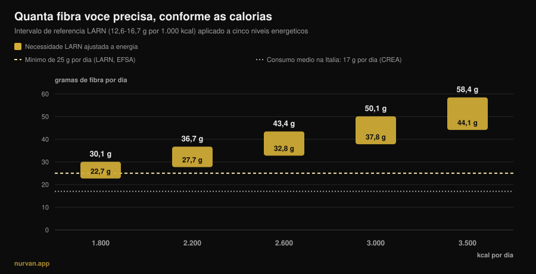
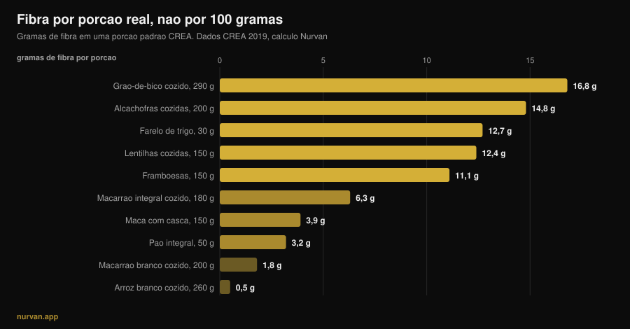

# Quanta fibra por dia? O que o fibermaxxing não diz

Por [Giammaria Loi](/autore/giammaria-loi) · atualizado em 13 de novembro de 2026

Depois de anos de "proteína em tudo", o novo nutriente da moda é a fibra: o *fibermaxxing* manda empurrá-la o mais alto possível, uma colher de chia atrás da outra. O nutriente certo, puxado na direção errada. A evidência sobre fibra é das mais sólidas de toda a nutrição, mas esses mesmos estudos dizem duas coisas que a tendência ignora: existe uma faixa onde se concentra o grosso do benefício, e essa faixa não é a mesma para quem come 1.800 kcal e para quem come 3.200.

## Em resumo

- **O grosso do benefício está entre 25 e 29 g por dia.** Na revisão publicada no *Lancet* sobre 185 estudos prospectivos e 58 ensaios, a redução de risco de mortalidade total, doença cardíaca, AVC, diabetes tipo 2 e câncer colorretal é máxima nessa faixa.
- **"Pelo menos 25 g" não é o seu número se você treina muito.** As LARN italianas também fixam uma referência por energia: 12,6-16,7 g a cada 1.000 kcal. Com 3.000 kcal viram 38-50 g por dia.
- **A média italiana é de cerca de 17 g por dia** segundo os dados do CREA: o problema real não é o excesso, é o buraco.
- **Aumentar rápido incha de verdade.** Nos ensaios com suplementos de fibra a flatulência é significativamente maior nos grupos de fibra: não é impressão, é efeito medido.
- **A fibra dos alimentos e a do pó não fazem a mesma coisa.** A primeira mostrou efeito sobre glicemia *e* pressão, a segunda sobretudo sobre glicemia e colesterol.

*Gráfico Nurvan: cálculo nosso aplicando o intervalo de referência LARN (SINU, 12,6-16,7 g por 1.000 kcal) a cinco níveis energéticos. Linha tracejada dos 25 g: mínimo LARN e EFSA. Linha dos 17 g: consumo médio italiano, dados CREA do inquérito IV SCAI citados por Marconi et al., 2025.*

## De onde vem o fibermaxxing

O mecanismo é o mesmo que levou a proteína para todo lado: um nutriente com boas credenciais, o sufixo *-maxxing* e a conclusão implícita de que, se um pouco faz bem, muito fará melhor. A diferença é que aqui o ponto de partida está certo: quase ninguém chega ao mínimo recomendado, e subir a fibra é a mudança com a melhor relação entre esforço e benefício que uma pessoa média pode fazer à mesa.

O problema nasce na passagem de "quase todo mundo come pouca" para "quanto mais, melhor". São duas frases diferentes, e os estudos sustentam apenas a primeira.

## Quanta fibra é realmente necessária

A fonte mais sólida é a série de revisões sistemáticas publicada no *Lancet* em 2019: 185 estudos prospectivos, pouco menos de 135 milhões de pessoas-ano, mais 58 ensaios controlados com 4.635 adultos. Comparando quem come mais com quem come menos, os dados observacionais mostram redução de 15-30% na mortalidade total e cardiovascular, na doença coronariana, no AVC, no diabetes tipo 2 e no câncer colorretal.

E aqui vem o número que a tendência não cita: **a redução de risco foi máxima com uma ingestão entre 25 e 29 g por dia**. As curvas dose-resposta sugerem que acima dessa faixa ainda há algum ganho para cardiovascular, diabetes e alguns tumores, mas o salto grande é o que leva você *para dentro* da faixa, não o que leva além dela.

A meta-análise dose-resposta de 2023 na *Frontiers in Nutrition* confirma: risco relativo de mortalidade total 0,90 (IC 95% 0,86-0,93), cardiovascular 0,87, por câncer 0,91, com relação **não linear** para a mortalidade total. Não linear significa exatamente isso: a curva achata.

Há dois casos em que subir mais tem sentido medido. Em pessoas com diabetes, passar de 19 para 35 g por dia está associado a 14 mortes a menos a cada 1.000 (IC 95% 4-19). Em hipertensos, aumentar a fibra baixou a sistólica em 4,3 mmHg e a diastólica em 3,1 mmHg, com certeza alta e independentemente dos medicamentos em uso. Mas são populações clínicas: ali quem decide o número é o médico, não um carrossel.

## Sua necessidade sobe com as calorias

Esta é a parte que falta em praticamente todo lugar, e a mais relevante para quem treina.

As LARN da Sociedade Italiana de Nutrição Humana não dão apenas o limiar de "pelo menos 25 g por dia": dão também uma referência relacionada à energia, **12,6-16,7 g de fibra a cada 1.000 kcal**. É uma escolha lógica, porque a fibra vem do alimento, e quem come mais come mais alimento.

Aplicada às calorias reais, essa referência muda o alvo, como se vê no gráfico acima. Para uma pessoa sedentária de 1.800 kcal, o intervalo é 23-30 g. Para quem treina quatro vezes por semana e come 3.000 kcal, vira **38-50 g**. Em fase de ganho, com 3.500 kcal, 44-58 g. Quem repete "25 g bastam" está dando a um powerlifter de 95 kg o número de alguém que come metade; e quem faz fibermaxxing com 1.600 kcal em definição está empurrando um número que para ele já é alto.

De onde tirar essas calorias é uma conversa que cruza com a qualidade dos carboidratos: falamos disso em [carboidratos engordam?](/pt/blog/carboidratos-engordam-gordura-escondida).

## O que a pesquisa diz de verdade

| Afirmação comum | Veredito | Fonte |
|---|---|---|
| "Mais fibra é sempre melhor" | **A precisar**: o grosso do benefício está entre 25 e 29 g, depois a curva achata | Reynolds et al., 2019; Yao et al., 2023 |
| "25 g por dia bastam para todo mundo" | **A precisar**: as LARN também dão 12,6-16,7 g por 1.000 kcal | LARN SINU; Marconi et al., 2025 |
| "A fibra desincha a barriga" | **Desmentido** no curto prazo: mais fibra, mais flatulência (SMD 0,80) | van der Schoot et al., 2022 |
| "Um scoop de psyllium resolve" | **A precisar**: funciona na regularidade, mas a fibra dos alimentos mostrou efeitos mais amplos | van der Schoot 2022; Jiang et al., 2025 |
| "Antes de treinar, quanto mais fibra melhor" | **Desmentido**: reduzi-la é a estratégia mais usada contra sintomas gastrointestinais no exercício | Scrivin et al., 2022 |

### Por que no começo incha (e a culpa não é sua)

Na meta-análise sobre 16 ensaios controlados e 1.251 adultos com constipação crônica, a fibra funcionou: responderam ao tratamento 66% dos participantes (311 de 473) contra 41% dos controles (134 de 329), risco relativo 1,48. Mas no mesmo trabalho a **flatulência foi significativamente maior nos grupos de fibra**, com diferença média padronizada de 0,80 (IC 95% 0,47-1,13), um efeito grande.

É por isso que "aumentei os vegetais e inchei" não é fracasso: é a resposta esperada a uma mudança rápida. No mesmo trabalho, as melhorias em frequência e consistência das evacuações só apareceram com duração de pelo menos quatro semanas. O inchaço é a primeira semana, o benefício vem da quarta em diante. A consequência prática é uma só: **suba em degraus**, 3-5 g por semana.

### Suplemento ou comida

O pó não é um atalho equivalente. Na comparação mais clara que temos, uma meta-análise de 2025 com 30 ensaios e 1.140 participantes separou a fibra **intrínseca** (a que está dentro do alimento integral) da fibra **isolada** (extraída e adicionada). A primeira reduziu a glicemia de jejum e a pressão sistólica (-2,86 mmHg). A segunda reduziu glicemia e colesterol total, mas não a pressão.

Não é um argumento contra suplementos: o psyllium tem bons dados sobre regularidade, em doses acima de 10 g por dia e por pelo menos quatro semanas. É um argumento contra a ideia de que um scoop substitui um prato de leguminosas. A matriz do alimento conta, como também acontece quando se [compara proteína vegetal e animal](/pt/blog/proteina-vegetal-ou-animal-para-musculos).

### Fibra e treino: a hora importa

Um detalhe que o fibermaxxing não considera é o *quando*. Num estudo com 137 atletas de endurance com histórico de sintomas gastrointestinais associados ao exercício, entre 277 estratégias relatadas a **redução da fibra foi a estratégia alimentar mais usada** (15,2%, 42 relatos) e uma das mais bem avaliadas, com eficácia mediana de 4 em 5. Depois vinham a exclusão de laticínios e a dieta com baixo teor de FODMAP.

Duas ressalvas honestas: esses dados vêm de atletas de endurance, não de quem levanta peso, e os sintomas da corrida têm componentes mecânicos que não existem na academia. Mas a lógica se sustenta também debaixo da barra: um prato com 15 g de fibra duas horas antes de uma sessão pesada de agachamento é discutível; o mesmo prato no jantar não incomoda ninguém.

## Como aplicar

Primeira regra: pare de olhar as listas "por 100 gramas". No banco de dados do CREA a pimenta-do-reino tem 25,9 g de fibra por 100 g, mas a porção é de 1 grama: são 0,26 g de fibra. O que conta é quanta fibra existe numa porção que você comeria de verdade.

*Gráfico Nurvan sobre as tabelas CREA — Centro di ricerca Alimenti e Nutrizione, atualização de 2019. Fibra por porção calculada por nós como (fibra por 100 g × porção CREA) ÷ 100.*

Segunda regra: os grandes saltos vêm de poucas trocas, não de vinte pequenos ajustes.

| Troca | Antes | Depois | Ganho |
|---|---|---|---|
| O acompanhamento de amido | Arroz branco cozido, 260 g: **0,5 g** | Macarrão integral cozido, 180 g: **6,3 g** | **+5,8 g** |
| O pão | Pão branco, 50 g: **1,9 g** | Pão integral, 50 g: **3,2 g** | **+1,3 g** |
| Um prato a mais | — | Lentilhas cozidas, 150 g: **12,4 g** | **+12,4 g** |
| | | | **+19,5 g no total** |

*Elaboração Nurvan com dados CREA 2019. Partindo dos 17 g da média italiana, essas três trocas levam a cerca de 36-37 g por dia.*

Terceira regra: a casca conta mais do que você pensa. Uma maçã de 150 g com casca dá 3,9 g de fibra, a mesma maçã descascada 3,0 g: um quarto vai embora com a faca.

Quatro pontos práticos:

1. **Ache o seu número, não o genérico.** Multiplique suas calorias por 0,0126 e por 0,0167: esse é o seu intervalo. Com 2.500 kcal são 32-42 g.
2. **Suba 3-5 g por semana.** O inchaço inicial é real e passa, mas só se você der tempo a ele.
3. **Um prato de leguminosas rende mais que todo o resto junto.** 150 g de lentilhas cozidas valem quatro maçãs.
4. **Afaste a fibra do treino.** A refeição pré-treino é a única em que vale a pena mantê-la baixa; recupere a fibra do dia no jantar.

E se você já conta a proteína por refeição, a fibra é o segundo número a colocar ao lado: [quanta proteína por refeição](/pt/blog/quanta-proteina-por-refeicao-limite) é o texto irmão deste.

> **Nurvan: a fibra você vê, não adivinha**
>
> A seção de nutrição do Nurvan usa o banco de dados CREA, as mesmas tabelas de onde vêm os números deste artigo: cada alimento que você lança traz junto a sua fibra, e o total do dia se atualiza ao lado de calorias e proteínas. Com a sua necessidade energética já no app, você vê na hora se as suas 3.000 kcal chegam a 38 g ou param em 18. [Experimente o Nurvan](https://nurvan.app)

## Perguntas frequentes

**Quanta fibra devo comer por dia?**
O mínimo da LARN e da EFSA é 25 g por dia para um adulto. Nas revisões, o grosso da redução de risco se concentra entre 25 e 29 g. Se você treina e come bastante, a referência LARN relacionada à energia (12,6-16,7 g por 1.000 kcal) é mais útil: com 3.000 kcal são 38-50 g.

**Fibermaxxing faz mal?**
Nos estudos, o efeito medido do aumento rápido é mais flatulência, não um dano. O risco real é prático: subir rápido demais gera desconforto que faz você desistir, e nenhum estudo mostra que ir muito além da faixa de 25-29 g traga benefício proporcional. Se você tem uma condição intestinal diagnosticada, a quantidade de fibra não é decisão para tomar sozinho.

**Melhor fibra de suplemento ou de comida?**
As duas funcionam, para objetivos diferentes. Na meta-análise de 2025 a fibra dentro dos alimentos integrais reduziu glicemia de jejum e pressão sistólica; a isolada reduziu glicemia e colesterol total, mas não a pressão. O psyllium tem boa evidência para a regularidade, acima de 10 g por dia e por pelo menos quatro semanas.

**A fibra me incha antes de treinar: o que faço?**
Afaste o grosso da fibra da sessão e deixe leve a refeição pré-treino. Em atletas de endurance com sintomas gastrointestinais, reduzir a fibra é a estratégia alimentar mais usada e uma das mais eficazes.

## Leia também

- [Quanta proteína por refeição: existe um limite?](/pt/blog/quanta-proteina-por-refeicao-limite) — o outro número que vale contar refeição a refeição.
- [Carboidratos engordam? A gordura escondida](/pt/blog/carboidratos-engordam-gordura-escondida) — de onde vêm de verdade as calorias a mais.
- [Proteína vegetal ou animal para os músculos?](/pt/blog/proteina-vegetal-ou-animal-para-musculos) — por que a matriz do alimento conta.

## Fontes

1. Reynolds A, Mann J, Cummings J, et al., 2019. Carbohydrate quality and human health: a series of systematic reviews and meta-analyses. *Lancet* 393(10170):434-445. [PMID 30638909](https://pubmed.ncbi.nlm.nih.gov/30638909/) · [DOI 10.1016/S0140-6736(18)31809-9](https://doi.org/10.1016/S0140-6736(18)31809-9)
2. Yao F, Ma J, Cui Y, et al., 2023. Dietary intake of total, vegetable, fruit, cereal, soluble and insoluble fiber and risk of all-cause, cardiovascular, and cancer mortality. *Front Nutr* 10:1153165. [PMID 37854351](https://pubmed.ncbi.nlm.nih.gov/37854351/) · [DOI 10.3389/fnut.2023.1153165](https://doi.org/10.3389/fnut.2023.1153165)
3. Reynolds AN, Akerman AP, Mann J, 2020. Dietary fibre and whole grains in diabetes management: systematic review and meta-analyses. *PLoS Med* 17(3):e1003053. [PMID 32142510](https://pubmed.ncbi.nlm.nih.gov/32142510/) · [DOI 10.1371/journal.pmed.1003053](https://doi.org/10.1371/journal.pmed.1003053)
4. Reynolds AN, Akerman A, Kumar S, et al., 2022. Dietary fibre in hypertension and cardiovascular disease management: systematic review and meta-analyses. *BMC Med* 20(1):139. [PMID 35449060](https://pubmed.ncbi.nlm.nih.gov/35449060/) · [DOI 10.1186/s12916-022-02328-x](https://doi.org/10.1186/s12916-022-02328-x)
5. van der Schoot A, Drysdale C, Whelan K, Dimidi E, 2022. The effect of fiber supplementation on chronic constipation in adults: an updated systematic review and meta-analysis of randomized controlled trials. *Am J Clin Nutr* 116(4):953-969. [PMID 35816465](https://pubmed.ncbi.nlm.nih.gov/35816465/) · [DOI 10.1093/ajcn/nqac184](https://doi.org/10.1093/ajcn/nqac184)
6. Jiang S, Cai C, Deehan EC, et al., 2025. The physiological effects of intrinsic and isolated arabinoxylans on human immunometabolic response: a systematic review and meta-analysis. *Food Res Int* 218:116866. [PMID 40790673](https://pubmed.ncbi.nlm.nih.gov/40790673/) · [DOI 10.1016/j.foodres.2025.116866](https://doi.org/10.1016/j.foodres.2025.116866)
7. Marconi S, Gilberti G, Romele E, et al., 2025. Translation and cross-cultural adaptation of a validated questionnaire to assess dietary fiber intake among the Italian population. *Nutrients* 17(6):1084. [PMID 40292515](https://pubmed.ncbi.nlm.nih.gov/40292515/) · [DOI 10.3390/nu17061084](https://doi.org/10.3390/nu17061084)
8. Scrivin R, Costa RJS, Pelly F, Lis D, Slater G, 2022. An exploratory study of the management strategies reported by endurance athletes with exercise-associated gastrointestinal symptoms. *Front Nutr* 9:1003445. [PMID 36438762](https://pubmed.ncbi.nlm.nih.gov/36438762/) · [DOI 10.3389/fnut.2022.1003445](https://doi.org/10.3389/fnut.2022.1003445)

Valores de referência: LARN — Livelli di Assunzione di Riferimento di Nutrienti ed energia, SINU, IV revisão (pelo menos 25 g por dia; 12,6-16,7 g por 1.000 kcal); EFSA, parecer de 26 de março de 2010 (25 g por dia adequados para a função intestinal normal em adultos). Dados alimentares: tabelas CREA — Centro di ricerca Alimenti e Nutrizione, atualização de 2019. Tema escolhido a partir de sinais de tendência de novembro de 2026 sobre o "fibermaxxing" (cobertura na imprensa internacional e italiana, e primeira página de busca ocupada por conteúdos genéricos que não relacionam a necessidade às calorias). Fontes científicas consultadas através do PubMed.

---

*Giammaria Loi é o fundador do Nurvan. Treina com pesos desde 2012, trabalha como personal trainer e coach certificado pela FIPE desde 2013 e compete em powerlifting em nível nacional desde 2018. Cada artigo que assina parte dos estudos científicos e chega ao que funciona de verdade na academia. [Página do autor](/autore/giammaria-loi)*

> Nota: conteúdo informativo, não substitui a opinião de um médico ou de um profissional qualificado.
