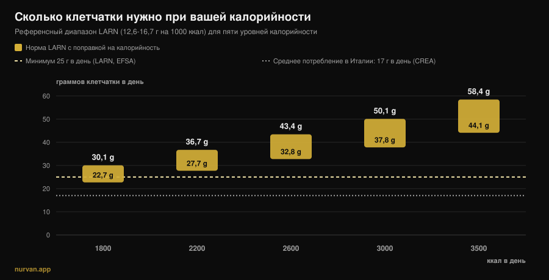
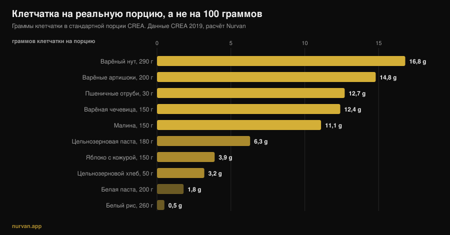

# Сколько клетчатки в день нужно тем, кто тренируется

Автор: [Джаммария Лои](/autore/giammaria-loi) · обновлено 13 ноября 2026

После нескольких лет «белок во всём» новый модный нутриент — клетчатка: *фибермаксинг* предлагает поднимать её как можно выше, одна ложка семян чиа за другой. Правильный нутриент, развёрнутый в неверную сторону. Доказательная база по клетчатке — одна из самых надёжных во всём питании, но те же исследования говорят две вещи, которые тренд не замечает: есть диапазон, в котором сосредоточена основная польза, и этот диапазон неодинаков для того, кто ест 1800 ккал, и для того, кто ест 3200.

## Коротко

- **Основная польза — между 25 и 29 г в день.** В обзоре, опубликованном в *Lancet* по 185 проспективным исследованиям и 58 испытаниям, снижение риска общей смертности, болезней сердца, инсульта, диабета 2 типа и колоректального рака максимально именно в этом диапазоне.
- **«Хотя бы 25 г» — не ваша цифра, если вы много тренируетесь.** Итальянские нормы LARN задают и энергетический ориентир: 12,6-16,7 г на каждые 1000 ккал. При 3000 ккал это 38-50 г в день.
- **Средний показатель в Италии — около 17 г в день** по данным CREA: настоящая проблема не избыток, а дефицит.
- **Резкий рост действительно даёт вздутие.** В испытаниях добавок с клетчаткой метеоризм значимо выше в группах клетчатки: это не ощущение, а измеренный эффект.
- **Клетчатка из еды и клетчатка из порошка делают разное.** Первая показала эффект на глюкозу *и* давление, вторая — в основном на глюкозу и холестерин.

*График Nurvan: наш расчёт, референсный диапазон LARN (SINU, 12,6-16,7 г на 1000 ккал) применён к пяти уровням калорийности. Пунктирная линия 25 г — минимум по LARN и EFSA. Линия 17 г — среднее потребление в Италии, данные CREA (обследование IV SCAI) по Marconi et al., 2025.*

## Откуда взялся фибермаксинг

Механизм тот же, что привёл белок во все продукты: нутриент с хорошей репутацией, суффикс *-maxxing* и негласный вывод, что если немного полезно, то много полезнее. Разница в том, что здесь отправная точка верна: почти никто не дотягивает до минимума, и поднять клетчатку — это изменение рациона с лучшим соотношением усилий и пользы, какое может сделать средний человек.

Проблема возникает при переходе от «почти все едят мало» к «чем больше, тем лучше». Это две разные фразы, и исследования подтверждают только первую.

## Сколько клетчатки нужно на самом деле

Самый надёжный источник — серия систематических обзоров, опубликованная в *Lancet* в 2019 году: 185 проспективных исследований, почти 135 миллионов человеко-лет, плюс 58 контролируемых испытаний с участием 4635 взрослых. При сравнении тех, кто ест больше всего, с теми, кто ест меньше всего, наблюдательные данные показывают снижение на 15-30% общей и сердечно-сосудистой смертности, а также ишемической болезни сердца, инсульта, диабета 2 типа и колоректального рака.

И вот цифра, которую тренд не цитирует: **снижение риска было максимальным при потреблении от 25 до 29 г в день**. Кривые «доза — эффект» указывают, что выше этого диапазона кое-что ещё можно выиграть для сердечно-сосудистой системы, диабета и части опухолей, но большой скачок — это тот, который заводит вас *внутрь* диапазона, а не тот, который выводит за его пределы.

Дозозависимый метаанализ 2023 года в *Frontiers in Nutrition* это подтверждает: относительный риск общей смертности 0,90 (95% ДИ 0,86-0,93), сердечно-сосудистой 0,87, онкологической 0,91, причём для общей смертности связь **нелинейная**. Нелинейная означает ровно это: кривая выполаживается.

Есть два случая, когда подниматься выше имеет измеренный смысл. У людей с диабетом переход с 19 на 35 г в день связан с 14 смертями меньше на 1000 человек (95% ДИ 4-19). При гипертонии увеличение клетчатки снизило систолическое давление на 4,3 мм рт. ст. и диастолическое на 3,1 мм рт. ст., с высокой достоверностью доказательств и независимо от принимаемых препаратов. Но это клинические группы: там цифру определяет врач, а не карусель в соцсети.

## Ваша норма растёт вместе с калориями

Это та часть, которой почти нигде нет, и самая важная для тех, кто тренируется.

Нормы LARN Итальянского общества питания человека дают не только порог «не менее 25 г в день», но и ориентир, привязанный к энергии: **12,6-16,7 г клетчатки на каждые 1000 ккал**. Это логично: клетчатка приходит из еды, а кто ест больше, тот ест больше еды.

Применённый к реальным калориям, этот ориентир меняет цель, как видно на графике выше. Для малоподвижного человека на 1800 ккал диапазон — 23-30 г. Для того, кто тренируется четыре раза в неделю и ест 3000 ккал, он становится **38-50 г**. На массе при 3500 ккал — 44-58 г. Тот, кто повторяет «25 г хватит», выдаёт пауэрлифтеру весом 95 кг цифру человека, который ест вдвое меньше; а тот, кто занимается фибермаксингом на 1600 ккал на сушке, тянет вверх число, которое для него и так высокое.

Откуда брать эти калории — вопрос, который упирается в качество углеводов: об этом мы писали в материале [от углеводов толстеют?](/ru/blog/uglevody-polnyat-skrytyy-zhir).

## Что на самом деле говорят исследования

| Распространённое утверждение | Вердикт | Источник |
|---|---|---|
| «Чем больше клетчатки, тем лучше» | **Требует уточнения**: основная польза между 25 и 29 г, дальше кривая выполаживается | Reynolds et al., 2019; Yao et al., 2023 |
| «25 г в день хватит всем» | **Требует уточнения**: LARN дают и 12,6-16,7 г на 1000 ккал | LARN SINU; Marconi et al., 2025 |
| «Клетчатка убирает вздутие живота» | **Опровергнуто** в коротком сроке: больше клетчатки — больше метеоризма (SMD 0,80) | van der Schoot et al., 2022 |
| «Мерной ложки псиллиума достаточно» | **Требует уточнения**: работает на регулярность, но у клетчатки из еды эффекты шире | van der Schoot 2022; Jiang et al., 2025 |
| «Перед тренировкой клетчатки побольше» | **Опровергнуто**: её снижение — самая используемая стратегия против желудочно-кишечных симптомов при нагрузке | Scrivin et al., 2022 |

### Почему сначала пучит (и вы тут ни при чём)

В метаанализе по 16 контролируемым испытаниям и 1251 взрослому с хроническим запором клетчатка сработала: на лечение ответили 66% участников (311 из 473) против 41% в контроле (134 из 329), относительный риск 1,48. Но в той же работе **метеоризм оказался значимо выше в группах клетчатки**, стандартизованная разность средних 0,80 (95% ДИ 0,47-1,13) — это большой эффект.

Поэтому «я добавил овощей и меня раздуло» — не провал, а ожидаемая реакция на быструю перемену. В той же работе улучшения частоты и консистенции стула появлялись только при длительности не менее четырёх недель. Вздутие — это первая неделя, польза — с четвёртой. Практический вывод один: **поднимайтесь ступенями**, по 3-5 г в неделю.

### Добавка или еда

Порошок — не равноценный короткий путь. В самом ясном сравнении, которое у нас есть, метаанализ 2025 года по 30 испытаниям и 1140 участникам разделил **нативную** клетчатку (ту, что внутри цельного продукта) и **выделенную** (извлечённую и добавленную). Первая снизила глюкозу натощак и систолическое давление (-2,86 мм рт. ст.). Вторая снизила глюкозу и общий холестерин, но не давление.

Это не аргумент против добавок: у псиллиума хорошие данные по регулярности стула, в дозах выше 10 г в день и не менее четырёх недель. Это аргумент против идеи, что мерная ложка заменяет тарелку бобовых. Матрица продукта имеет значение — как и когда [сравнивают растительный и животный белок](/ru/blog/rastitelnyy-ili-zhivotnyy-belok-dlya-myshts).

### Клетчатка и тренировка: момент имеет значение

Деталь, которую фибермаксинг не учитывает, — это *когда*. В исследовании с участием 137 спортсменов на выносливость с историей желудочно-кишечных симптомов при нагрузке из 277 названных стратегий **снижение клетчатки оказалось самой используемой пищевой стратегией** (15,2%, 42 упоминания) и одной из самых высоко оценённых: медиана эффективности 4 из 5. Дальше шли исключение молочных продуктов и диета с низким содержанием FODMAP.

Две честные оговорки: эти данные получены на спортсменах на выносливость, а не на тех, кто работает со штангой, и у беговых симптомов есть механическая составляющая, которой в зале нет. Но логика держится и под штангой: тарелка с 15 г клетчатки за два часа до тяжёлой тренировки приседа — спорное решение, а та же тарелка на ужин никому не мешает.

## Как это применить

Первое правило: перестаньте смотреть на рейтинги «на 100 граммов». В базе CREA у чёрного перца 25,9 г клетчатки на 100 г, но порция — 1 грамм: это 0,26 г клетчатки. Важно, сколько клетчатки в той порции, которую вы действительно съедите.

*График Nurvan по таблицам CREA — Centro di ricerca Alimenti e Nutrizione, обновление 2019. Клетчатка на порцию рассчитана нами как (клетчатка на 100 г × порция CREA) ÷ 100.*

Второе правило: большие прибавки дают несколько замен, а не двадцать мелких уловок.

| Замена | Было | Стало | Прибавка |
|---|---|---|---|
| Крахмалистый гарнир | Белый рис варёный, 260 г: **0,5 г** | Цельнозерновая паста варёная, 180 г: **6,3 г** | **+5,8 г** |
| Хлеб | Белый хлеб, 50 г: **1,9 г** | Цельнозерновой хлеб, 50 г: **3,2 г** | **+1,3 г** |
| Ещё одно блюдо | — | Чечевица варёная, 150 г: **12,4 г** | **+12,4 г** |
| | | | **+19,5 г суммарно** |

*Расчёт Nurvan по данным CREA 2019. Если отталкиваться от 17 г среднего потребления в Италии, эти три замены выводят примерно на 36-37 г в день.*

Третье правило: кожура значит больше, чем кажется. Яблоко весом 150 г с кожурой даёт 3,9 г клетчатки, то же яблоко очищенное — 3,0 г: четверть уходит вместе с ножом.

Четыре практических пункта:

1. **Найдите свою цифру, а не общую.** Умножьте свои калории на 0,0126 и на 0,0167: это ваш диапазон. При 2500 ккал — 32-42 г.
2. **Добавляйте по 3-5 г в неделю.** Начальное вздутие реально и проходит, но только если дать ему время.
3. **Одно блюдо из бобовых даёт больше, чем всё остальное вместе.** 150 г варёной чечевицы — это как четыре яблока.
4. **Отодвиньте клетчатку от тренировки.** Приём пищи перед занятием — единственный, где её стоит держать низкой; дневную норму доберите за ужином.

А если вы уже считаете белок по приёмам пищи, клетчатка — вторая цифра рядом: [сколько белка за один приём пищи](/ru/blog/skolko-belka-za-odin-priem-pishchi) — парный материал к этому.

> **Nurvan: клетчатку вы видите, а не угадываете**
>
> Раздел питания в Nurvan работает на базе CREA — тех самых таблицах, из которых взяты цифры этой статьи: каждый продукт, который вы вносите, приносит с собой свою клетчатку, а дневная сумма обновляется рядом с калориями и белком. Ваша потребность в энергии уже в приложении, поэтому сразу видно, дотягивают ли ваши 3000 ккал до 38 г или останавливаются на 18. [Попробуйте Nurvan](https://nurvan.app)

## Частые вопросы

**Сколько клетчатки нужно есть в день?**
Минимум по LARN и EFSA — 25 г в день для взрослого. В обзорах основная часть снижения риска приходится на 25-29 г. Если вы тренируетесь и много едите, полезнее энергетический ориентир LARN (12,6-16,7 г на 1000 ккал): при 3000 ккал это 38-50 г.

**Фибермаксинг вреден?**
Измеренный в исследованиях эффект быстрого наращивания — усиление метеоризма, а не вред. Настоящий риск практический: слишком резкий рост даёт дискомфорт, из-за которого бросают, и ни одно исследование не показывает, что намного выше диапазона 25-29 г польза растёт пропорционально. Если у вас диагностированное заболевание кишечника, количество клетчатки — не то решение, которое принимают в одиночку.

**Что лучше: клетчатка из добавок или из еды?**
Работают обе, но на разные цели. В метаанализе 2025 года клетчатка внутри цельных продуктов снизила глюкозу натощак и систолическое давление; выделенная снизила глюкозу и общий холестерин, но не давление. У псиллиума хорошие доказательства по регулярности стула — выше 10 г в день и не менее четырёх недель.

**От клетчатки пучит перед тренировкой: что делать?**
Отодвиньте основную часть клетчатки от занятия и сделайте предтренировочный приём пищи лёгким. У спортсменов на выносливость с желудочно-кишечными симптомами снижение клетчатки — самая используемая и одна из самых действенных пищевых стратегий.

## Читайте также

- [Сколько белка за один приём пищи: есть ли предел?](/ru/blog/skolko-belka-za-odin-priem-pishchi) — вторая цифра, которую стоит считать от приёма к приёму.
- [От углеводов толстеют? Скрытый жир](/ru/blog/uglevody-polnyat-skrytyy-zhir) — откуда на самом деле берутся лишние калории.
- [Растительный или животный белок для мышц?](/ru/blog/rastitelnyy-ili-zhivotnyy-belok-dlya-myshts) — почему матрица продукта имеет значение.

## Источники

1. Reynolds A, Mann J, Cummings J, et al., 2019. Carbohydrate quality and human health: a series of systematic reviews and meta-analyses. *Lancet* 393(10170):434-445. [PMID 30638909](https://pubmed.ncbi.nlm.nih.gov/30638909/) · [DOI 10.1016/S0140-6736(18)31809-9](https://doi.org/10.1016/S0140-6736(18)31809-9)
2. Yao F, Ma J, Cui Y, et al., 2023. Dietary intake of total, vegetable, fruit, cereal, soluble and insoluble fiber and risk of all-cause, cardiovascular, and cancer mortality. *Front Nutr* 10:1153165. [PMID 37854351](https://pubmed.ncbi.nlm.nih.gov/37854351/) · [DOI 10.3389/fnut.2023.1153165](https://doi.org/10.3389/fnut.2023.1153165)
3. Reynolds AN, Akerman AP, Mann J, 2020. Dietary fibre and whole grains in diabetes management: systematic review and meta-analyses. *PLoS Med* 17(3):e1003053. [PMID 32142510](https://pubmed.ncbi.nlm.nih.gov/32142510/) · [DOI 10.1371/journal.pmed.1003053](https://doi.org/10.1371/journal.pmed.1003053)
4. Reynolds AN, Akerman A, Kumar S, et al., 2022. Dietary fibre in hypertension and cardiovascular disease management: systematic review and meta-analyses. *BMC Med* 20(1):139. [PMID 35449060](https://pubmed.ncbi.nlm.nih.gov/35449060/) · [DOI 10.1186/s12916-022-02328-x](https://doi.org/10.1186/s12916-022-02328-x)
5. van der Schoot A, Drysdale C, Whelan K, Dimidi E, 2022. The effect of fiber supplementation on chronic constipation in adults: an updated systematic review and meta-analysis of randomized controlled trials. *Am J Clin Nutr* 116(4):953-969. [PMID 35816465](https://pubmed.ncbi.nlm.nih.gov/35816465/) · [DOI 10.1093/ajcn/nqac184](https://doi.org/10.1093/ajcn/nqac184)
6. Jiang S, Cai C, Deehan EC, et al., 2025. The physiological effects of intrinsic and isolated arabinoxylans on human immunometabolic response: a systematic review and meta-analysis. *Food Res Int* 218:116866. [PMID 40790673](https://pubmed.ncbi.nlm.nih.gov/40790673/) · [DOI 10.1016/j.foodres.2025.116866](https://doi.org/10.1016/j.foodres.2025.116866)
7. Marconi S, Gilberti G, Romele E, et al., 2025. Translation and cross-cultural adaptation of a validated questionnaire to assess dietary fiber intake among the Italian population. *Nutrients* 17(6):1084. [PMID 40292515](https://pubmed.ncbi.nlm.nih.gov/40292515/) · [DOI 10.3390/nu17061084](https://doi.org/10.3390/nu17061084)
8. Scrivin R, Costa RJS, Pelly F, Lis D, Slater G, 2022. An exploratory study of the management strategies reported by endurance athletes with exercise-associated gastrointestinal symptoms. *Front Nutr* 9:1003445. [PMID 36438762](https://pubmed.ncbi.nlm.nih.gov/36438762/) · [DOI 10.3389/fnut.2022.1003445](https://doi.org/10.3389/fnut.2022.1003445)

Референсные значения: LARN — Livelli di Assunzione di Riferimento di Nutrienti ed energia, SINU, IV редакция (не менее 25 г в день; 12,6-16,7 г на 1000 ккал); EFSA, заключение от 26 марта 2010 года (25 г в день достаточно для нормальной функции кишечника у взрослых). Данные о продуктах: таблицы CREA — Centro di ricerca Alimenti e Nutrizione, обновление 2019. Тема выбрана по трендовым сигналам ноября 2026 года о «фибермаксинге» (освещение в международной и итальянской прессе, а также первая страница поиска, занятая общими материалами, которые не связывают норму с калорийностью). Научные источники найдены через PubMed.

---

*Джаммария Лои — основатель Nurvan. Тренируется с отягощениями с 2012 года, работает персональным тренером и коучем с сертификацией FIPE с 2013 года и выступает в пауэрлифтинге на национальном уровне с 2018 года. Каждая его статья начинается с научных работ и заканчивается тем, что действительно работает в зале. [Страница автора](/autore/giammaria-loi)*

> Примечание: информационный материал, он не заменяет консультацию врача или квалифицированного специалиста.
