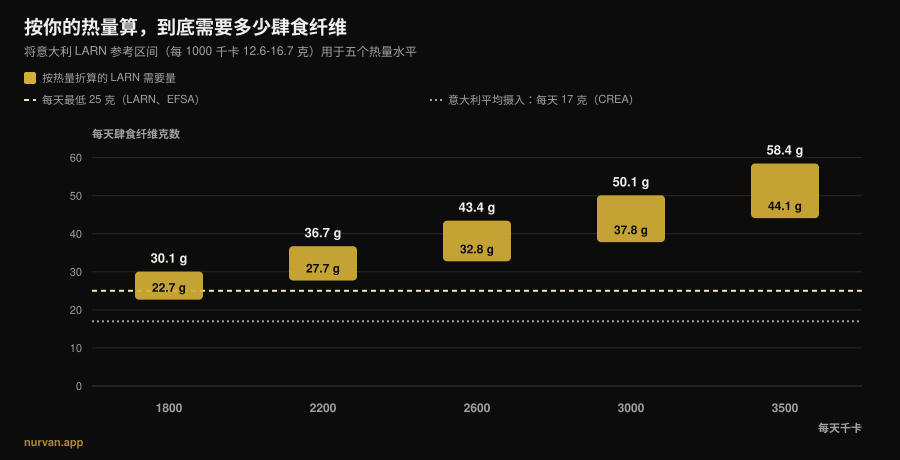
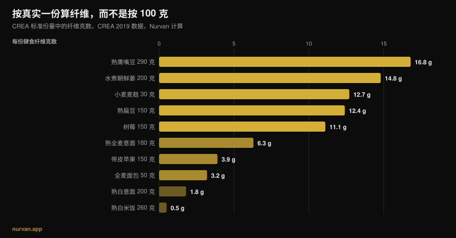

# 每天需要多少膳食纤维？

作者：[Giammaria Loi](/autore/giammaria-loi) · 更新于 2026 年 11 月 13 日

在“什么都要加蛋白”的几年之后，新的流行营养素轮到了膳食纤维：纤维最大化（fibermaxxing）鼓励你把它推得越高越好，奇亚籽一勺接一勺。方向对了，做法走偏了。膳食纤维的证据是整个营养学里最扎实的一批，但同样是这些研究，说了两件被潮流忽略的事：获益集中在一个区间里；而这个区间，对一天吃 1800 千卡的人和吃 3200 千卡的人，并不是同一个数字。

## 要点速览

- **大部分获益集中在每天 25 到 29 克。** 发表在《柳叶刀》上、汇总 185 项前瞻性研究和 58 项试验的综述里，总死亡率、冠心病、卒中、2 型糖尿病和结直肠癌的风险下降，在这一区间最大。
- **如果你训练量大，“至少 25 克”不是你的数字。** 意大利 LARN 还给了一个按热量折算的参考：每 1000 千卡 12.6 到 16.7 克。换成 3000 千卡，就是每天 38 到 50 克。
- **意大利人的平均摄入只有约 17 克**（CREA 数据）：真正的问题从来不是吃多了，是缺口。
- **加得太快，真的会胀气。** 在纤维补剂的试验里，纤维组的胀气显著更多：这不是错觉，是被量化的结果。
- **食物里的纤维和粉末里的纤维，作用并不一样。** 前者同时改善了血糖*和*血压，后者主要作用在血糖和胆固醇上。

*Nurvan 图表：我们把 LARN（SINU）的参考区间“每 1000 千卡 12.6–16.7 克”套用到五个热量水平计算而得。25 克虚线为 LARN 与 EFSA 的最低下限；17 克点线为意大利平均摄入，数据来自 CREA 第四次 SCAI 调查，经 Marconi 等（2025）引用。*

## “纤维最大化”从哪来

机制和当年把蛋白推到每一样食品上的逻辑一样：一个证据不错的营养素，一个带 *-maxxing* 后缀的名字，再加上一个默认结论——既然有点好，那就越多越好。不同的是，这次的起点是对的：几乎没有人达到最低下限，提高纤维摄入，大概是普通人在餐桌上投入产出比最高的一个改变。

问题出在从“大多数人吃得太少”滑到“吃得越多越好”这一步。这是两句话，研究只支持第一句。

## 到底需要多少

最扎实的来源，是 2019 年发表在《柳叶刀》上的系列系统综述：185 项前瞻性研究，接近 1.35 亿人年，外加 58 项针对 4635 名成年人的对照试验。把摄入最高的人群和最低的人群相比，观察性数据显示总死亡率和心血管死亡率、冠心病、卒中、2 型糖尿病和结直肠癌的发生率下降 15% 到 30%。

接下来是潮流从不引用的那个数字：**风险下降幅度在每天 25 到 29 克时最大**。剂量-反应曲线提示，超过这一区间之后，心血管疾病、糖尿病和部分癌症还能再多一点点获益，但真正的大台阶，是把你带*进*这个区间的那一步，不是带你越过它的那一步。

2023 年发表在《Frontiers in Nutrition》上的剂量-反应荟萃分析也是同一结论：总死亡率相对风险 0.90（95% CI 0.86–0.93），心血管 0.87，癌症 0.91，而且总死亡率呈**非线性**关系。非线性的意思很直白：曲线会变平。

有两种情况，往上推是有实测依据的。糖尿病人群里，从每天 19 克提高到 35 克，对应观察期内每 1000 人少 14 例死亡（95% CI 4–19）。高血压人群里，提高纤维摄入使收缩压下降 4.3 mmHg、舒张压下降 3.1 mmHg，证据确定性为高，且与是否已在服药无关。但这两类都是临床人群：真到了那一步，数字应该由医生来定，而不是由一条短视频来定。

## 你的需要量跟着热量走

这一段几乎在所有地方都缺席，而它对训练的人最重要。

意大利人类营养学会的 LARN 不只给了“每天至少 25 克”这条下限，还给了一个按热量折算的参考值：**每 1000 千卡 12.6 到 16.7 克**。这个做法很合理，因为纤维来自食物，吃得多的人本来就吃更多食物。

套到真实热量上，目标就完全变了，就像上面那张图显示的那样。一个每天 1800 千卡的久坐者，区间是 23 到 30 克。一个每周练四次、吃 3000 千卡的人，变成 **38 到 50 克**。增肌期吃 3500 千卡的人，是 44 到 58 克。那些重复“25 克就够了”的人，等于把一个食量减半的人的数字，递给了一名 95 公斤的力量举运动员；而一个在减脂期、每天只吃 1600 千卡还在做纤维最大化的人，推的其实已经是一个偏高的数字。

这些热量该从哪里来，和你选什么样的碳水是同一个问题，我们在[碳水化合物会让人变胖吗？](/zh/blog/tanshui-huahewu-bianpang-yincang-zhifang)里写过。

## 研究到底怎么说

| 流行说法 | 判定 | 来源 |
|---|---|---|
| “纤维越多越好” | **需要修正**：大部分获益在 25 到 29 克之间，之后曲线变平 | Reynolds 等，2019；Yao 等，2023 |
| “每天 25 克对所有人都够” | **需要修正**：LARN 还给了每 1000 千卡 12.6–16.7 克 | LARN SINU；Marconi 等，2025 |
| “吃纤维能消肚子” | 短期内**不成立**：纤维越多，胀气越多（SMD 0.80） | van der Schoot 等，2022 |
| “一勺洋车前子就解决了” | **需要修正**：对通便有效，但食物里的纤维作用面更广 | van der Schoot 2022；Jiang 等，2025 |
| “练之前纤维越多越好” | **不成立**：减少纤维是对抗运动相关胃肠症状最常用的办法 | Scrivin 等，2022 |

### 为什么一开始会胀（这不怪你）

在一项纳入 16 项对照试验、1251 名慢性便秘成年人的荟萃分析里，纤维确实有效：纤维组 66%（473 人中 311 人）出现应答，对照组 41%（329 人中 134 人），相对风险 1.48。但同一篇研究里，**纤维组的胀气显著更高**，标准化均数差为 0.80（95% CI 0.47–1.13），这是一个很大的效应。

所以“我多吃了蔬菜，结果更胀了”不是失败，而是快速改变之后应有的反应。同一篇研究里，排便频率和粪便性状的改善，只在干预至少四周时才出现。胀气是第一周的事，获益从第四周开始。实际结论只有一条：**一级一级往上加**，每周 3 到 5 克。

### 补剂还是食物

粉末不是一条等价的捷径。在目前最清楚的一次比较里，2025 年一项纳入 30 项试验、1140 名受试者的荟萃分析，把**内源性**纤维（存在于全食物里的）和**分离**纤维（提取出来再添加的）分开看。前者降低了空腹血糖和收缩压（−2.86 mmHg）。后者降低了空腹血糖和总胆固醇，但没有降低血压。

这不是反对补剂：洋车前子在通便上的数据不错，剂量需要每天超过 10 克、持续至少四周。这是反对“一勺粉末可以代替一盘豆子”的想法。食物的基质本身就有作用，这一点在[植物蛋白和动物蛋白的比较](/zh/blog/zhiwu-dongwu-danbai-zhi-zengji)里同样成立。

### 纤维和训练：时机也算数

纤维最大化没有考虑的一个细节是*什么时候吃*。在一项针对 137 名有运动相关胃肠症状史的耐力运动员的研究里，他们报告的 277 条应对策略中，**减少纤维是使用最多的饮食策略**（15.2%，42 次提及），也是评价最好的之一，有效性中位数为 5 分制的 4 分。其次是回避乳制品和低 FODMAP 饮食。

两点必须说清楚：这些数据来自耐力运动员，不是做力量训练的人，而且跑步引起的胃肠症状里有健身房中不存在的机械性因素。但逻辑在杠铃下同样成立：深蹲重训前两小时吃一盘 15 克纤维的食物，是个可疑的选择；同样这盘东西放在晚餐，谁都没事。

## 怎么落地

第一条：别再看“每 100 克”的排行榜。在 CREA 数据库里，黑胡椒每 100 克有 25.9 克纤维，但参考份量是 1 克，也就是 0.26 克纤维。真正重要的，是你真的会吃下去的那一份里有多少。

*Nurvan 图表，基于 CREA 食品与营养研究中心 2019 年更新的食物成分表。每份纤维由我们按（每 100 克纤维 × CREA 份量）÷ 100 计算。*

第二条：大的跳跃来自少数几次替换，而不是二十个小细节。

| 替换 | 之前 | 之后 | 增加 |
|---|---|---|---|
| 主食配菜 | 熟白米饭 260 克：**0.5 克** | 熟全麦意面 180 克：**6.3 克** | **+5.8 克** |
| 面包 | 白面包 50 克：**1.9 克** | 全麦面包 50 克：**3.2 克** | **+1.3 克** |
| 多加一道菜 | — | 熟扁豆 150 克：**12.4 克** | **+12.4 克** |
| | | | **合计 +19.5 克** |

*Nurvan 基于 CREA 2019 数据的计算。从意大利平均的 17 克出发，这三次替换把摄入带到每天约 36 到 37 克。*

第三条：果皮比你以为的重要。一个 150 克带皮苹果给你 3.9 克纤维，同一个苹果削皮后是 3.0 克：四分之一被刀削掉了。

四条可执行的建议：

1. **找到你的数字，而不是那个通用数字。** 把你的热量分别乘以 0.0126 和 0.0167，中间就是你的区间。2500 千卡对应 32 到 42 克。
2. **每周加 3 到 5 克。** 初期的胀气是真的，也会过去，但前提是你给它时间。
3. **一道豆类菜顶得上其他所有加起来。** 150 克熟扁豆，相当于四个苹果。
4. **把纤维安排在离训练远的时候。** 训练前那一餐是唯一值得把纤维压低的一餐；当天缺的份额，晚饭补回来。

如果你已经在按餐计算蛋白质，纤维就是第二个该放在旁边的数字：[一餐能吸收多少蛋白质](/zh/blog/yi-can-neng-xishou-duoshao-danbai)是这篇文章的姊妹篇。

> **Nurvan：纤维是看出来的，不是猜出来的**
>
> Nurvan 的营养模块使用 CREA 数据库，也就是本文数字的同一来源：你录入的每一样食物都带着它的纤维含量，当天的总量会和热量、蛋白质一起更新。你的热量需求本来就在应用里，所以你立刻知道自己这 3000 千卡吃到了 38 克，还是停在了 18 克。[试用 Nurvan](https://nurvan.app)

## 常见问题

**每天到底该吃多少克膳食纤维？**
LARN 和 EFSA 给成年人的最低下限是每天 25 克。在综述里，风险下降最集中的区间是 25 到 29 克。如果你有训练、吃得也多，LARN 按热量折算的参考更有用：每 1000 千卡 12.6 到 16.7 克，3000 千卡就是 38 到 50 克。

**纤维最大化有害吗？**
研究里测到的、由快速增加带来的后果是胀气更多，不是损害。真正的风险很现实：加得太快带来的不适会让你放弃，而且没有任何研究显示，推到远高于 25 到 29 克的水平能带来成比例的获益。如果你有确诊的肠道疾病，纤维吃多少不是一个该自己决定的问题。

**纤维从补剂里补，还是从食物里吃？**
两者针对的目标不同。2025 年那篇荟萃分析里，全食物中的内源性纤维降低了空腹血糖和收缩压；分离纤维降低了空腹血糖和总胆固醇，但没有降低血压。洋车前子在通便上证据不错，需要每天超过 10 克并持续至少四周。

**练之前吃纤维就胀，怎么办？**
把当天的大部分纤维安排到离训练远的时间，训练前那一餐吃得清淡些。在有胃肠症状的耐力运动员里，减少纤维是使用最多、评价也最好的饮食策略之一。

## 延伸阅读

- [一餐能吸收多少蛋白质？](/zh/blog/yi-can-neng-xishou-duoshao-danbai) —— 另一个值得按餐去数的数字。
- [碳水化合物会让人变胖吗？藏起来的脂肪](/zh/blog/tanshui-huahewu-bianpang-yincang-zhifang) —— 多出来的热量到底从哪来。
- [增肌该选植物蛋白还是动物蛋白？](/zh/blog/zhiwu-dongwu-danbai-zhi-zengji) —— 为什么食物的基质本身就有作用。

## 参考文献

1. Reynolds A, Mann J, Cummings J, et al., 2019. *Carbohydrate quality and human health: a series of systematic reviews and meta-analyses.* Lancet 393(10170):434-445. [PMID 30638909](https://pubmed.ncbi.nlm.nih.gov/30638909/) · [DOI 10.1016/S0140-6736(18)31809-9](https://doi.org/10.1016/S0140-6736(18)31809-9)
2. Yao F, Ma J, Cui Y, et al., 2023. *Dietary intake of total, vegetable, fruit, cereal, soluble and insoluble fiber and risk of all-cause, cardiovascular, and cancer mortality.* Front Nutr 10:1153165. [PMID 37854351](https://pubmed.ncbi.nlm.nih.gov/37854351/) · [DOI 10.3389/fnut.2023.1153165](https://doi.org/10.3389/fnut.2023.1153165)
3. Reynolds AN, Akerman AP, Mann J, 2020. *Dietary fibre and whole grains in diabetes management: systematic review and meta-analyses.* PLoS Med 17(3):e1003053. [PMID 32142510](https://pubmed.ncbi.nlm.nih.gov/32142510/) · [DOI 10.1371/journal.pmed.1003053](https://doi.org/10.1371/journal.pmed.1003053)
4. Reynolds AN, Akerman A, Kumar S, et al., 2022. *Dietary fibre in hypertension and cardiovascular disease management: systematic review and meta-analyses.* BMC Med 20(1):139. [PMID 35449060](https://pubmed.ncbi.nlm.nih.gov/35449060/) · [DOI 10.1186/s12916-022-02328-x](https://doi.org/10.1186/s12916-022-02328-x)
5. van der Schoot A, Drysdale C, Whelan K, Dimidi E, 2022. *The effect of fiber supplementation on chronic constipation in adults: an updated systematic review and meta-analysis of randomized controlled trials.* Am J Clin Nutr 116(4):953-969. [PMID 35816465](https://pubmed.ncbi.nlm.nih.gov/35816465/) · [DOI 10.1093/ajcn/nqac184](https://doi.org/10.1093/ajcn/nqac184)
6. Jiang S, Cai C, Deehan EC, et al., 2025. *The physiological effects of intrinsic and isolated arabinoxylans on human immunometabolic response: a systematic review and meta-analysis.* Food Res Int 218:116866. [PMID 40790673](https://pubmed.ncbi.nlm.nih.gov/40790673/) · [DOI 10.1016/j.foodres.2025.116866](https://doi.org/10.1016/j.foodres.2025.116866)
7. Marconi S, Gilberti G, Romele E, et al., 2025. *Translation and cross-cultural adaptation of a validated questionnaire to assess dietary fiber intake among the Italian population.* Nutrients 17(6):1084. [PMID 40292515](https://pubmed.ncbi.nlm.nih.gov/40292515/) · [DOI 10.3390/nu17061084](https://doi.org/10.3390/nu17061084)
8. Scrivin R, Costa RJS, Pelly F, Lis D, Slater G, 2022. *An exploratory study of the management strategies reported by endurance athletes with exercise-associated gastrointestinal symptoms.* Front Nutr 9:1003445. [PMID 36438762](https://pubmed.ncbi.nlm.nih.gov/36438762/) · [DOI 10.3389/fnut.2022.1003445](https://doi.org/10.3389/fnut.2022.1003445)

参考值：LARN —— 意大利人类营养学会（SINU）第四版营养素与能量参考摄入量（每天至少 25 克；每 1000 千卡 12.6–16.7 克）；EFSA 2010 年 3 月 26 日意见（成年人每天 25 克足以维持正常肠道功能）。食物数据：CREA 食品与营养研究中心食物成分表，2019 年更新。选题来自 2026 年 11 月关于“纤维最大化”的趋势信号（国际与意大利媒体的报道，以及搜索首页被不把需要量和热量挂钩的泛泛内容占据）。文献通过 PubMed 检索。

---

*Giammaria Loi 是 Nurvan 的创始人。他自 2012 年起进行力量训练，自 2013 年起作为 FIPE 认证私人教练工作，并自 2018 年起在国家级别参加力量举比赛。他署名的每一篇文章都从科学研究出发，落到健身房里真正有效的做法。*

> 注：本文为科普内容，不能替代医生或专业人士的意见。
