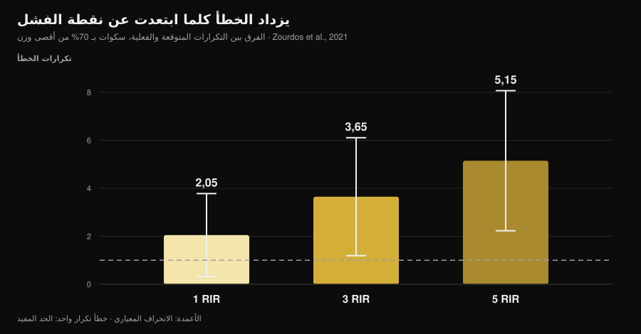
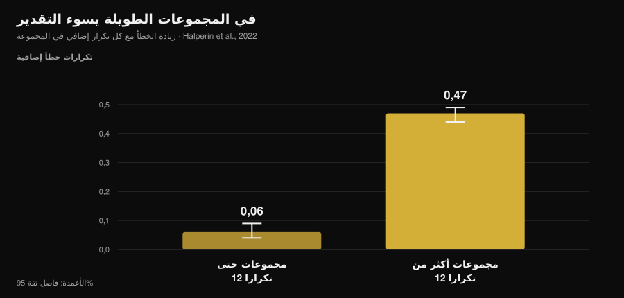

# ما مدى دقة تقديرك لـ RIR؟ ما تقوله الدراسات

بقلم [جياماريا لوي](/autore/giammaria-loi) · حُدِّث في 14 نوفمبر 2026

«توقّف وقد بقي لك تكرارتان قبل الفشل.» هذه أشهر تعليمة في البرامج الحديثة، وبرامجي منها، وهي تنفع بشرط واحد: أن تعرف التعرّف على تلك النقطة. وفي هذا تحديدًا جمعت الأبحاث عشر سنوات من البيانات، والصورة أطرف من الرواية الشائعة: نحن لا نخطئ كثيرًا، لكننا نخطئ **دائمًا في الاتجاه نفسه** وبشكل متوقَّع. ومعرفة مكان تمركز الخطأ هي ما يفصل RIR نافعًا عن رقم يُكتب في المفكرة بحكم العادة.

## باختصار

- **في المتوسط نقلّل التقدير بنحو تكرار واحد.** في التحليل البعدي الذي ضمّ 12 دراسة و414 مشاركًا كان الخطأ المتوسط 0,95 تكرار (فاصل ثقة 95%: 0,17-1,73): كان المتبقّي لديك أكثر مما ظننت في كل مرة تقريبًا.
- **الخطأ يكبر مع البعد عن الفشل.** في السكوات عند 70% من الحد الأقصى بلغ الفارق بين التكرارات المتوقّعة والفعلية 2,05 عند 1 RIR، و3,65 عند 3 RIR، و**5,15 عند 5 RIR**: عند 5 RIR لم يبقَ للرقم أي معنى.
- **المجموعات الطويلة تُفسد التقدير.** فوق 12 تكرارًا في المجموعة يزيد الخطأ 0,47 تكرار مع كل تكرار إضافي، مقابل 0,06 في المجموعات القصيرة: أسرع بثماني مرات.
- **الخبرة لا تحلّ المسألة.** في الدراسات لا تؤثّر حالة التدريب في الدقة، وستة أسابيع من التدريب مع تغذية راجعة لم تُحسّن الخطأ المطلق.
- **وحيث ينفع RIR، ينفع جيدًا.** في البنش عند 1 و3 RIR أخطأ رياضيون مدرَّبون بمقدار 0,65 ± 0,78 تكرار في المتوسط. النافذة ضيقة، لكن الأداة تصمد داخلها.

*رسم Nurvan على بيانات Zourdos وزملائه، 2021 (25 رجلًا مدرَّبًا، سكوات عند 70% من الحد الأقصى، مجموعات حتى الفشل بمتوسط 16 ± 4 تكرارًا). الأعمدة الرأسية هي الانحراف المعياري. الخط المتقطّع: خطأ بمقدار تكرار واحد، وهو الهامش الذي يبقى التقدير داخله قابلًا للاستخدام.*

## ما الذي يقيسه RIR، ولماذا صار الرقم المركزي

RIR اختصار لـ *repetitions in reserve*، أي التكرارات التي تظن أنها بقيت لك قبل الفشل الفني. وهي أبسط طريقة لوصف المجهود دون الاعتماد على الحد الأقصى في ذلك اليوم، وهو حدّ يتغيّر مع النوم والتوتر والقهوة. مراجعة من 2024 على 31 دراسة و855 مشاركًا تؤكد أن مقاييس RIR قابلة للتطبيق ونافعة في ضبط الشدة، وأن استخدامها الغالب في المراجع هو بالضبط استخدام البرامج: تحديد RIR مستهدف وتحريك الوزن وفقًا له.

نقطة الضعف أن RIR ليس قياسًا، بل **توقّعًا**. والتوقّع لا يُقيَّم إلا بطريقة واحدة: مقارنته بما يحدث فعلًا.

## كم نخطئ فعلًا

أفضل مرجع هو التحليل البعدي لـ Halperin وزملائه في *Sports Medicine*: 12 دراسة، 414 مشاركًا، 262 أثرًا. النتيجة الأساسية: المشاركون **يقلّلون تقدير** التكرارات الباقية حتى الفشل بمقدار 0,95 تكرار في المتوسط (فاصل ثقة 95%: 0,17-1,73).

خطأ بمقدار تكرار واحد يبدو قليلًا، وهو كذلك جزئيًا. لكن هناك تفصيلين أهمّ من المتوسط نفسه.

الأول هو التباين: 97,9%. ومعناه أن هذا المتوسط يلخّص حالات مختلفة جدًا بعضها عن بعض، وأن «تكرارًا واحدًا تقريبًا» ليس خطأك في كل مجموعة تؤديها. أما التباين بين الأشخاص فمحدود: انحراف معياري قدره 1,45 تكرار. لا يوجد كثير من «الموهوبين في RIR»: الخطأ يتبع الموقف، لا هوية الشخص.

الثاني هو الاتجاه. تقليل التقدير يعني أنك حين تتوقّف مقتنعًا بأن لديك تكرارين في المخزون، كان المتبقّي ثلاثة. وهذا ليس خطأً عشوائيًا يعوّض نفسه: إنه يُدرّبك **بعيدًا عن الفشل بصورة منهجية** أكثر مما ينصّ البرنامج.

ويظهر الاتجاه نفسه في الأعمال المفردة بأرقام أكبر. في 141 شخصًا خُضعوا لاختبار في حصة شاملة للجسم كله، جاء الخطأ المعياري للقياس بين 2,64 و3,38 تكرار. وفي تجربة بتصميم مخادع على من لديهم سنة تدريب على الأقل، كان تقليل التقدير 2,0 تكرار (فاصل ثقة 95%: 0,0-4,0) في تمرين بسط الساقين.

## حيث ينفع RIR وحيث لا ينفع

هنا تكمن إضافة الأبحاث النافعة، وهي الجزء الذي يتخطّاه المحتوى المتداول: الدقة **ليست صفة في الشخص، بل صفة في الموقف**.

ثلاثة شروط تُسوّئها بشكل موثّق.

**البعد عن الفشل.** في دراسة السكوات عند 70% من الحد الأقصى، كان على 25 رجلًا مدرَّبًا (بخبرة متوسطها 4,7 سنوات) أن يعلنوا لحظة وصولهم إلى 5 و3 و1 تكرار من الفشل، ثم يكملوا حتى الفشل الحقيقي. وكبر الخطأ كلما ابتعدت نقطة الإعلان عن الفشل: 2,05 ± 1,73 تكرار عند 1 RIR، و3,65 ± 2,46 عند 3 RIR، و5,15 ± 2,92 عند 5 RIR. ووصف «5 RIR» في سكوات من 16 تكرارًا لا يصف شيئًا في الواقع.

**طول المجموعة.** وهو أوضح معدِّل في التحليل البعدي. في المجموعات حتى 12 تكرارًا يزيد الخطأ 0,06 تكرار مع كل تكرار يُنفَّذ (فاصل ثقة 95%: 0,04-0,09)؛ وفوق 12 تكرارًا يزيد 0,47 (فاصل ثقة 95%: 0,44-0,49). وفي دراسة السكوات كان الارتباط بين مجموع التكرارات والخطأ r = 0,65 عند 5 RIR وr = 0,01 عند 1 RIR: كلما طالت المجموعة ساء التقدير، ولم تكن خبرة التدريب عاملًا تنبؤيًا.

*رسم Nurvan على معاملات الانحدار البعدي لدى Halperin وزملائه، 2022 (12 دراسة، 414 مشاركًا). الأعمدة الرأسية هي فاصل الثقة 95%. القيمة تبيّن مقدار زيادة خطأ التقدير مع كل تكرار إضافي يُنفَّذ في المجموعة.*

**رقم المجموعة.** تتحسّن التقديرات قليلًا في المجموعات التالية داخل الحصة نفسها (0,07 تكرار أقل من الخطأ لكل مجموعة)، ربما لأن مرجع المجموعة الأولى يعيد معايرة الإحساس. أثر صغير لكنه في الاتجاه النافع: المجموعة الأولى من أي تمرين هي الأقل موثوقية.

وهناك شرط يُحسّنها بالمقابل: **القرب من الفشل** مقترنًا بتمارين وأوزان لا تُنتج مجموعات طويلة جدًا. في البنش عند 75% من الحد الأقصى، ومع 24 رياضيًا مدرَّبًا (12 رجلًا و12 امرأة) أعلنوا 1 و3 RIR، كان متوسط الخطأ المطلق 0,65 ± 0,78 تكرار، بتكافؤ إحصائي داخل ±1 تكرار ودون أي علاقة بالجنس أو سنوات الخبرة أو القوة النسبية. وفي تمارين المفصل الواحد على الأجهزة، ومع 58 شخصًا بين مدرَّبين وغير مدرَّبين، جاءت التقديرات أدقّ قرب الفشل وفي المجموعات التالية، دون فروق بين الرجال والنساء ولا بين التمارين.

بعبارة أخرى: RIR ليس «غير دقيق». إنه دقيق **من 3 نزولًا وفي مجموعات غير طويلة**، ويتحوّل إلى ضجيج في غير ذلك.

## الخبرة لن تنقذك (وهذا يغيّر طريقة استخدامه)

هذا أشيع اعتقاد بين من يتمرّنون منذ سنوات: «الإحساس بـ RIR يُتعلَّم.» البيانات لا تسنده.

في التحليل البعدي لا تؤثّر حالة التدريب في الدقة (β = -0,006، فاصل ثقة 95%: -0,02 إلى 0,007). وفي دراسة السكوات لم يتنبّأ عمر التدريب بجودة التقديرات. وعلى الأجهزة لم يكن لخبرة التدريب ولا للخبرة المحدَّدة في إعطاء RIR أي أثر.

وأوضح اختبار مباشر هو عمل على 9 رجال مدرَّبين أدّوا البنش ثلاث مرات أسبوعيًا لمدة ستة أسابيع، معلنين 4 RIR و1 RIR في المجموعة الأخيرة من كل حصة. وبعد ستة أسابيع لم يتحسّن الخطأ **المطلق** بفارق معتدّ به؛ ما تغيّر هو الاتجاه، بميل أكبر إلى تقليل التقدير في الحصص الأخيرة وفي المجموعات الأطول.

وثمة إشارة واحدة معاكسة، من العمل على 141 شخصًا: ميل إلى التحسّن مع الخبرة. ميل، لا أثر صريح. والحصيلة الأمينة أن المدرّب الخبير والمبتدئ يخطئان بصورة متشابهة، وأن الحل ليس انتظار «تكوّن الإحساس»، بل بناء RIR حيث يكون موثوقًا والتحقّق منه.

## لماذا يغيّر رقم خاطئ النتائج

يعتمد على ما تبحث عنه، والمراجع هنا واضحة بصورة مفاجئة.

لـ**القوة** لا يهمّ البعد عن الفشل كثيرًا: في سلسلة الانحدارات البعدية لعام 2024 تحتوي فواصل الثقة لميول RIR المقدَّر على الصفر، أي علاقة مهملة بمكاسب القوة. إن كنت تدرّب القوة فخطأ تقديرك يكلّفك قليلًا.

ولـ**تضخّم العضلات** يجد التحليل نفسه ميولًا سلبية بفواصل لا تحتوي على الصفر: النمو العضلي يزيد كلما انتهت المجموعات أقرب إلى الفشل. لكن احذر من تحويل ذلك إلى «التمرين حتى الفشل أفضل»: التحليل البعدي لعام 2023 على 15 دراسة لا يجد ميزة للفشل الفني على عدم الفشل (ES 0,12؛ فاصل ثقة 95%: -0,13 إلى 0,37)، ولا لعتبات فقد السرعة المرتفعة على المعتدلة، ويفترض علاقة **غير خطية**.

وبجمع الأمرين: تقليل التقدير المنهجي يدفعك في الاتجاه الذي يكلّف شيئًا في التضخّم (أبعد عن الفشل مما هو مقرَّر)، والعلاج ليس الذهاب إلى الفشل بل تقليل عدم اليقين. وعن عدد التكرارات ومدة الراحة المناسبين حول هذا المجهود كتبنا مقالًا منفصلًا: [كم تكرارًا للكتلة العضلية](/ar/blog/kam-takrar-lilkutla-aladalia).

## ماذا تقول الأبحاث فعلًا

| العبارة الشائعة | الحكم | المصدر |
|---|---|---|
| «تمرّن عند 2 RIR وستعرف ما تفعل» | **يحتاج إلى تدقيق**: بين 1 و3 RIR يصمد التقدير (خطأ 0,65-2 تكرار)، وعند 5 RIR لا يصمد (5,15) | Refalo وزملاؤه، 2024؛ Zourdos وزملاؤه، 2021 |
| «مع الخبرة تتعلّم الإحساس بـ RIR» | **غير صحيح**: حالة التدريب لا تؤثّر في الدقة، وستة أسابيع من التدريب لم تُقلّص الخطأ المطلق | Halperin وزملاؤه، 2022؛ Remmert وزملاؤه، 2023 |
| «إن أخطأت فأنا أخطئ في الاتجاهين» | **غير صحيح**: الخطأ منهجي نحو تقليل التقدير (0,95 تكرار في المتوسط) | Halperin وزملاؤه، 2022 |
| «RIR يصلح بالقدر نفسه في كل مجموعة» | **غير صحيح**: فوق 12 تكرارًا يكبر الخطأ أسرع بثماني مرات | Halperin وزملاؤه، 2022 |
| «التوقّف بعيدًا عن الفشل لا يغيّر شيئًا» | **يحتاج إلى تدقيق**: مهمل للقوة، وقابل للقياس للتضخّم | Robinson وزملاؤه، 2024؛ Refalo وزملاؤه، 2023 |
| «سرعة البار تحلّ المسألة» | **غير صحيح** في الديدليفت بالبار السداسي: لم يستوفِ أي شرط معايير الدقة | Chen وزملاؤه، 2026 |

### وماذا عن التقنية؟

البديل المطروح منذ سنوات هو قياس سرعة البار: السرعة تنخفض مع الاقتراب من الفشل، فيُفترض أن عتبة سرعة معيّنة تخبرك بعدد التكرارات الباقية. عمل نُشر في عدد نوفمبر 2026 من *Journal of Strength and Conditioning Research* اختبر الفكرة في الديدليفت بالبار السداسي: 19 رجلًا جيّدي التدريب، ومجموعات حتى الفشل عند 65% و85% من الحد الأقصى، وثلاثة معايير مُعلنة مسبقًا (خطأ وسيط ≤ 2 تكرار، واحتمال 75% على الأقل لكلٍّ من أن يكون التقدير مقبولًا وأن تظهر عتبة السرعة فعلًا).

لم يستوفِ أي شرط المعايير الثلاثة جميعًا، وكان احتمال ظهور العتبة المتوقَّعة منخفضًا إلى حدّ يجعل النماذج غير قابلة للاستخدام في الزمن الحقيقي. هذا يصحّ على ذلك التمرين وذلك السياق، لا على التدريب القائم على السرعة كله، لكن الدرس عام: حتى الأداة الموضوعية تحتاج إلى التحقّق منها على التمرين الذي تستخدمها فيه.

## كيف تطبّق ذلك

1. **لا تصف RIR إلا من 3 نزولًا.** فوق 3 RIR استخدم وزنًا وتكرارات ثابتة أو نسبة مئوية: أن تطلب «توقّف عند 5 RIR» هو أن تطلب رقمًا يخطئ بـ5 في الدراسات.
2. **أبقِ مجموعات «الـ RIR» داخل 10 إلى 12 تكرارًا.** هذه هي العتبة التي يتسارع الخطأ بعدها. مجموعة من 20 تكرارًا مع RIR معلن هي خيال محاسبي.
3. **أعلن أولًا وتحقّق لاحقًا.** اكتب RIR المتوقَّع *أثناء* إغلاق المجموعة، لا عند تدوين المفكرة مساءً: التقدير بأثر رجعي شيء آخر.
4. **عاير نفسك كل 4 إلى 6 أسابيع.** مجموعة واحدة حتى الفشل الفني على تمرين آمن (جهاز، أو بنش بالمصدّات) مع إعلان التوقّع قبل تكرارين أو نحو ذلك. والفارق بين المتوقَّع والفعلي هو انحيازك الشخصي، ويُقرأ هكذا: إن أعلنت 2 وأدّيت 4، فإن «2» عندك تساوي 4.
5. **لا تثق بالمجموعة الأولى.** هي الأقل دقة في الحصة. وإن كان عليك ضبط الوزن فاضبطه على الثانية.
6. **إن كان الهدف التضخّم فصحّح في الاتجاه الصحيح.** وبما أن الميل هو التوقّف مبكرًا، فإن «تكرارًا واحدًا أكثر مما يبدو لي» في المجموعات الأخيرة من تمرين آمن يعيد مواءمة الواقع مع البرنامج.

### إن كنت تدرّب آخرين عن بُعد

الـ RIR الذي يكتبه لك المتدرّب ليس معطى، بل ترجمة. ثلاث احتياطات تغيّر جودة المعلومات التي تصلك:

- **اطلب التكرارات، لا الدرجة.** «كم تكرارًا كنت ستؤدّي بعد؟» يعطي إجابات أنفع من «على أي RIR كنت؟»، لأن السؤال الثاني يدعو إلى تعبئة خانة.
- **تعامل مع قيم RIR المرتفعة كضجيج.** الرقم 4 أو 5 المُبلَّغ يقول «لم أكن قريبًا من الفشل» ولا شيء غير ذلك. لا تبنِ عليه تدرّجًا في الأوزان.
- **ضع المعايرة داخل البرنامج، لا عند الطلب.** مجموعة اختبار مجدولة كل شهر تعطيك انحياز المتدرّب وتعطيه الدليل على أنه لم يكن «قريبًا من الفشل». وعن الإيقاع الذي يستحق عنده إعادة النظر في البرنامج والأوزان تحدثنا في [كم مرة تغيّر برنامج التدريب](/ar/blog/kam-marra-tughayir-barnamij-altadrib).

> **Nurvan: الـ RIR المتوقَّع إلى جانب الفعلي**
>
> في Nurvan تسجّل RIR مجموعةً بمجموعة مع الوزن، وفي مجموعات المعايرة تدوّن التوقّع والتكرارات الفعلية: فيبقى الفارق في سجل التمرين لا في الذاكرة. بهذا يتحوّل رقم معلن إلى معطى قابل للاستخدام، لك أو للمدرّب الذي يتابعك. [جرّب Nurvan](https://nurvan.app)

## أسئلة شائعة

**ما مدى دقة تقدير RIR؟**
في المتوسط يقلّ التقدير بنحو تكرار واحد (0,95؛ فاصل ثقة 95%: 0,17-1,73 في التحليل البعدي على 414 مشاركًا)، لكن المتوسط يخفي كثيرًا. قرب الفشل وفي المجموعات القصيرة ينزل الخطأ تحت التكرار الواحد؛ وعلى بعد 5 تكرارات من الفشل، في السكوات، كان 5,15 تكرار.

**هل الأفضل التمرين عند RIR 2 أم حتى الفشل؟**
للقوة الفارق مهمل. وللتضخّم تُظهر المجموعات التي تنتهي أقرب إلى الفشل نموًا أكبر قليلًا، لكن الفشل الفني لم يتفوّق على عدم الفشل في التحليل البعدي على 15 دراسة: العلاقة تبدو غير خطية. والعمل بين 1 و3 RIR مع بعض مجموعات التحقّق هو الحل الوسط الذي تسنده المراجع أكثر من غيره.

**كيف أعرف أن RIR عندي صحيح؟**
بمجموعة معايرة: تعلن RIR قبل النهاية بتكرارين تقريبًا ثم تمضي إلى الفشل الفني على تمرين آمن. والفارق بين التوقّع والواقع هو انحيازك، وهو يميل عادة إلى تقليل التقدير.

**هل ينفع RIR للمبتدئين أيضًا؟**
في البيانات المتاحة لا تتبع دقة التقديرات حالة التدريب: المبتدئون والمتقدّمون يخطئون بصورة متشابهة. الفرق في أمان الأداء لا في التقدير: من يبدأ يُحسن به أن يحصر RIR في الأجهزة والتمارين البسيطة.

## اقرأ أيضًا

- [كم تكرارًا للكتلة العضلية: أسطورة 8-12](/ar/blog/kam-takrar-lilkutla-aladalia) — أين تضع المجهود الذي تحاول قياسه.
- [كم مرة تغيّر برنامج التدريب؟](/ar/blog/kam-marra-tughayir-barnamij-altadrib) — كم تُبقي البرنامج ثابتًا حتى ترى إن كان ينفع.
- [برنامج تدريب بالذكاء الاصطناعي: ما تقوله الدراسات](/ar/blog/barnamij-tadrib-bialdhakaa-alistinaei) — ما يستطيع الخوارزم أن يقرّره عنك وما لا يستطيع.

## المصادر

1. Halperin I, Malleron T, Har-Nir I, Androulakis-Korakakis P, Wolf M, Fisher J, Steele J, 2022. Accuracy in Predicting Repetitions to Task Failure in Resistance Exercise: A Scoping Review and Exploratory Meta-analysis. *Sports Med* 52(2):377-390. [PMID 34542869](https://pubmed.ncbi.nlm.nih.gov/34542869/) · [DOI 10.1007/s40279-021-01559-x](https://doi.org/10.1007/s40279-021-01559-x)
2. Zourdos MC, Goldsmith JA, Helms ER, et al., 2021. Proximity to Failure and Total Repetitions Performed in a Set Influences Accuracy of Intraset Repetitions in Reserve-Based Rating of Perceived Exertion. *J Strength Cond Res* 35(Suppl 1):S158-S165. [PMID 30747900](https://pubmed.ncbi.nlm.nih.gov/30747900/) · [DOI 10.1519/JSC.0000000000002995](https://doi.org/10.1519/JSC.0000000000002995)
3. Refalo MC, Remmert JF, Pelland JC, Robinson ZP, Zourdos MC, Hamilton DL, Fyfe JJ, Helms ER, 2024. Accuracy of Intraset Repetitions-in-Reserve Predictions During the Bench Press Exercise in Resistance-Trained Male and Female Subjects. *J Strength Cond Res* 38(3):e78-e85. [PMID 37967832](https://pubmed.ncbi.nlm.nih.gov/37967832/) · [DOI 10.1519/JSC.0000000000004653](https://doi.org/10.1519/JSC.0000000000004653)
4. Steele J, Endres A, Fisher J, Gentil P, Giessing J, 2017. Ability to predict repetitions to momentary failure is not perfectly accurate, though improves with resistance training experience. *PeerJ* 5:e4105. [PMID 29204323](https://pubmed.ncbi.nlm.nih.gov/29204323/) · [DOI 10.7717/peerj.4105](https://doi.org/10.7717/peerj.4105)
5. Armes C, Standish-Hunt H, Androulakis-Korakakis P, et al., 2020. "Just One More Rep!" - Ability to Predict Proximity to Task Failure in Resistance Trained Persons. *Front Psychol* 11:565416. [PMID 33424678](https://pubmed.ncbi.nlm.nih.gov/33424678/) · [DOI 10.3389/fpsyg.2020.565416](https://doi.org/10.3389/fpsyg.2020.565416)
6. Remmert JF, Laurson KR, Zourdos MC, 2023. Accuracy of Predicted Intraset Repetitions in Reserve (RIR) in Single- and Multi-Joint Resistance Exercises Among Trained and Untrained Men and Women. *Percept Mot Skills* 130(3):1239-1254. [PMID 37036795](https://pubmed.ncbi.nlm.nih.gov/37036795/) · [DOI 10.1177/00315125231169868](https://doi.org/10.1177/00315125231169868)
7. Remmert JF, Robinson ZP, Pelland JC, et al., 2023. Changes in Intraset Repetitions in Reserve Prediction Accuracy During Six Weeks of Bench Press Training in Trained Men. *Percept Mot Skills* 130(5):2139-2160. [PMID 37436724](https://pubmed.ncbi.nlm.nih.gov/37436724/) · [DOI 10.1177/00315125231189098](https://doi.org/10.1177/00315125231189098)
8. Robinson ZP, Pelland JC, Remmert JF, Refalo MC, Jukic I, Steele J, Zourdos MC, 2024. Exploring the Dose-Response Relationship Between Estimated Resistance Training Proximity to Failure, Strength Gain, and Muscle Hypertrophy: A Series of Meta-Regressions. *Sports Med* 54(9):2209-2231. [PMID 38970765](https://pubmed.ncbi.nlm.nih.gov/38970765/) · [DOI 10.1007/s40279-024-02069-2](https://doi.org/10.1007/s40279-024-02069-2)
9. Refalo MC, Helms ER, Trexler ET, Hamilton DL, Fyfe JJ, 2023. Influence of Resistance Training Proximity-to-Failure on Skeletal Muscle Hypertrophy: A Systematic Review with Meta-analysis. *Sports Med* 53(3):649-665. [PMID 36334240](https://pubmed.ncbi.nlm.nih.gov/36334240/) · [DOI 10.1007/s40279-022-01784-y](https://doi.org/10.1007/s40279-022-01784-y)
10. Chen W, Zhang H, Li R, et al., 2026. Velocity-Based Monitoring Lacks Both Accuracy and Applicability for Estimating Repetitions in Reserve During the Hexagonal Bar Deadlift. *J Strength Cond Res* 40(11):1335-1341. [PMID 42328880](https://pubmed.ncbi.nlm.nih.gov/42328880/) · [DOI 10.1519/JSC.0000000000005549](https://doi.org/10.1519/JSC.0000000000005549)

مصدر إضافي روجع: Bastos V, Machado S, Teixeira DS, 2024. Feasibility and Usefulness of Repetitions-In-Reserve Scales for Selecting Exercise Intensity: A Scoping Review. *Percept Mot Skills* 131(3):940-970. [PMID 38563729](https://pubmed.ncbi.nlm.nih.gov/38563729/). اختير الموضوع من مؤشرات اتجاهات نوفمبر 2026 حول الشدة مقيسة بـ RIR وحول المقارنة بين الفشل وRIR، مع محتوى منافس يصف RIR مستهدفًا دون أن يذكر كم نحن دقيقون في تقديره. روجعت المصادر العلمية عبر PubMed.

---

*جياماريا لوي هو مؤسس Nurvan. يتدرّب بالأثقال منذ 2012، ويعمل مدربًا شخصيًا ومدرّبًا معتمدًا من FIPE منذ 2013، وينافس في رفع القوة على المستوى الوطني منذ 2018. كل مقال يوقّعه يبدأ من الدراسات العلمية وينتهي عند ما ينفع فعلًا في النادي.*

> ملاحظة: محتوى إعلامي، لا يغني عن رأي الطبيب أو المختص.
