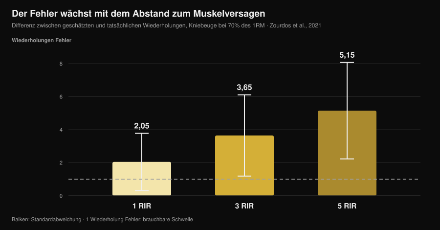
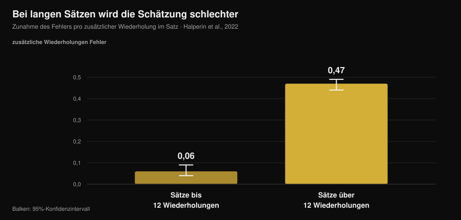

# Wie genau ist dein RIR? Das sagen die Studien

Von [Giammaria Loi](/autore/giammaria-loi) · aktualisiert am 14. November 2026

„Hör 2 Wiederholungen vor dem Muskelversagen auf." Das ist die häufigste Vorgabe in modernen Trainingsplänen, meinen eingeschlossen, und sie funktioniert unter einer Bedingung: dass du diesen Punkt erkennst. Dazu hat die Forschung zehn Jahre Daten gesammelt, und das Bild ist interessanter als die üblichen Erzählungen: Wir liegen nicht weit daneben, aber wir liegen **immer in dieselbe Richtung** daneben, und das vorhersehbar. Zu wissen, wo sich der Fehler sammelt, trennt einen brauchbaren RIR von einer Zahl, die aus Gewohnheit im Logbuch steht.

## Kurz gefasst

- **Im Schnitt unterschätzen wir um etwa 1 Wiederholung.** In der Metaanalyse über 12 Studien und 414 Teilnehmende liegt der mittlere Fehler bei 0,95 Wiederholungen (95-%-KI 0,17-1,73): Du hattest fast immer mehr übrig, als du dachtest.
- **Der Fehler wächst mit dem Abstand zum Versagen.** In der Kniebeuge bei 70 % des Maximalgewichts betrug der Unterschied zwischen vorhergesagten und tatsächlichen Wiederholungen 2,05 bei 1 RIR, 3,65 bei 3 RIR und **5,15 bei 5 RIR**: Bei 5 RIR sagt die Zahl nichts mehr aus.
- **Lange Sätze ruinieren die Schätzung.** Über 12 Wiederholungen pro Satz steigt der Fehler um 0,47 Wiederholungen je zusätzlicher Wiederholung, gegenüber 0,06 in kurzen Sätzen: achtmal schneller.
- **Erfahrung löst das Problem nicht.** In den Studien beeinflusst der Trainingsstatus die Genauigkeit nicht, und sechs Wochen Übung mit Feedback haben den absoluten Fehler nicht verbessert.
- **Wo der RIR funktioniert, funktioniert er gut.** Auf der Bank, bei 1 und 3 RIR, lagen trainierte Athletinnen und Athleten im Mittel um 0,65 ± 0,78 Wiederholungen daneben. Das brauchbare Fenster ist schmal, aber darin hält das Werkzeug.

*Nurvan-Grafik auf den Daten von Zourdos et al., 2021 (25 trainierte Männer, Kniebeuge bei 70 % des Maximalgewichts, Sätze bis zum Versagen mit 16 ± 4 Wiederholungen). Die vertikalen Balken sind die Standardabweichung. Gestrichelte Linie: eine Wiederholung Fehler, der Rahmen, in dem eine Schätzung noch brauchbar bleibt.*

## Was der RIR misst und warum er zur zentralen Zahl wurde

RIR steht für *repetitions in reserve*: die Wiederholungen, die du vor dem technischen Muskelversagen noch zu haben glaubst. Es ist der einfachste Weg, Anstrengung vorzugeben, ohne vom Tagesmaximum abhängig zu sein, das mit Schlaf, Stress und Kaffee schwankt. Eine Übersichtsarbeit von 2024 über 31 Studien und 855 Teilnehmende bestätigt, dass RIR-Skalen praktikabel und nützlich sind, um die Intensität zu steuern, und dass die Literatur sie genau so verwendet wie Trainingspläne: einen Ziel-RIR festlegen und das Gewicht daran anpassen.

Die Schwachstelle: Der RIR ist keine Messung, er ist eine **Vorhersage**. Und eine Vorhersage bewertet man nur auf eine Weise — man vergleicht sie mit dem, was wirklich passiert.

## Wie weit wir tatsächlich daneben liegen

Der beste Bezugspunkt ist die Metaanalyse von Halperin und Kollegen in *Sports Medicine*: 12 Studien, 414 Teilnehmende, 262 Effekte. Hauptergebnis: Die Teilnehmenden **unterschätzen** die bis zum Versagen verbleibenden Wiederholungen im Mittel um 0,95 Wiederholungen (95-%-KI 0,17-1,73).

Eine Wiederholung Fehler klingt wenig, und teilweise ist sie das auch. Aber zwei Details zählen mehr als der Mittelwert.

Das erste ist die Heterogenität: 97,9 %. Dieser Mittelwert fasst also sehr unterschiedliche Situationen zusammen, und „etwa eine Wiederholung" ist nicht dein Fehler in jedem Satz, den du machst. Die Streuung zwischen Personen ist dagegen gering: Standardabweichung von 1,45 Wiederholungen. Es gibt kaum „RIR-Talente" — der Fehler hängt von der Situation ab, nicht davon, wer du bist.

Das zweite ist die Richtung. Unterschätzen heißt: Wenn du überzeugt abbrichst, noch 2 Wiederholungen in Reserve zu haben, waren es in Wirklichkeit 3. Das ist kein Zufallsfehler, der sich ausgleicht — er trainiert dich **systematisch weiter vom Versagen entfernt**, als der Plan sagt.

Dasselbe Vorzeichen findet sich in den Einzelarbeiten, mit größeren Zahlen. Bei 141 Personen in einer Ganzkörpereinheit lag der Standardmessfehler zwischen 2,64 und 3,38 Wiederholungen. In einem Experiment mit Täuschungsdesign bei Menschen mit mindestens einem Jahr Trainingserfahrung betrug die Unterschätzung an der Beinstrecker-Maschine 2,0 Wiederholungen (95-%-KI 0,0-4,0).

## Wo der RIR funktioniert und wo nicht

Hier liegt der nützliche Beitrag der Forschung, und genau diesen Teil überspringen die Inhalte zum Thema: Genauigkeit ist **keine Eigenschaft der Person, sie ist eine Eigenschaft der Situation**.

Drei Bedingungen verschlechtern sie nachweislich.

**Der Abstand zum Versagen.** In der Studie zur Kniebeuge bei 70 % des Maximalgewichts sollten 25 trainierte Männer (im Mittel 4,7 Jahre Erfahrung) ansagen, wann sie 5, 3 und 1 Wiederholung vor dem Versagen waren, und dann bis zum echten Versagen weitermachen. Der Fehler wuchs, je weiter der Ansagepunkt vom Versagen entfernt lag: 2,05 ± 1,73 Wiederholungen bei 1 RIR, 3,65 ± 2,46 bei 3 RIR, 5,15 ± 2,92 bei 5 RIR. Eine Vorgabe „5 RIR" in einer Kniebeuge mit 16 möglichen Wiederholungen gibt faktisch nichts vor.

**Die Satzlänge.** Das ist der klarste Moderator der Metaanalyse. In Sätzen bis 12 Wiederholungen wächst der Fehler um 0,06 Wiederholungen je ausgeführter Wiederholung (95-%-KI 0,04-0,09); über 12 Wiederholungen wächst er um 0,47 (95-%-KI 0,44-0,49). In der Kniebeugenstudie betrug die Korrelation zwischen Gesamtwiederholungen und Fehler r = 0,65 bei 5 RIR und r = 0,01 bei 1 RIR: Je länger der Satz, desto schlechter die Schätzung — und die Trainingserfahrung war kein Prädiktor.

*Nurvan-Grafik auf den Koeffizienten der Metaregression von Halperin et al., 2022 (12 Studien, 414 Teilnehmende). Die vertikalen Balken sind das 95-%-Konfidenzintervall. Der Wert zeigt, um wie viel der Schätzfehler je zusätzlich ausgeführter Wiederholung im Satz steigt.*

**Die Nummer des Satzes.** Die Schätzungen werden in den späteren Sätzen derselben Einheit leicht besser (0,07 Wiederholungen weniger Fehler pro Satz), wahrscheinlich weil der erste Satz die Wahrnehmung neu kalibriert. Ein kleiner Effekt, aber in der nützlichen Richtung: Der erste Satz einer Übung ist der unzuverlässigste.

Und eine Bedingung, die sie verbessert: die **Nähe zum Versagen**, kombiniert mit Übungen und Gewichten, die keine sehr langen Sätze erzeugen. Auf der Bank bei 75 % des Maximalgewichts lag der mittlere absolute Fehler von 24 trainierten Athletinnen und Athleten (12 Männer, 12 Frauen), die 1 und 3 RIR ansagten, bei 0,65 ± 0,78 Wiederholungen — mit statistischer Äquivalenz innerhalb von ±1 Wiederholung und ohne Zusammenhang mit Geschlecht, Trainingsjahren oder Relativkraft. Bei eingelenkigen Maschinenübungen waren die Schätzungen von 58 trainierten und untrainierten Personen näher am Versagen und in späteren Sätzen präziser, ohne Unterschiede zwischen Männern und Frauen oder zwischen Übungen.

Übersetzt: Der RIR ist nicht „ungenau". Er ist **ab 3 abwärts und in nicht zu langen Sätzen** genau — und wird überall sonst zu Rauschen.

## Erfahrung rettet dich nicht (und das ändert den Gebrauch)

Das ist der verbreitetste Glaube unter Leuten, die seit Jahren trainieren: „Den RIR lernt man zu fühlen." Die Daten stützen ihn nicht.

In der Metaanalyse beeinflusst der Trainingsstatus die Genauigkeit nicht (β = -0,006; 95-%-KI -0,02 bis 0,007). In der Kniebeugenstudie sagte das Trainingsalter die Qualität der Schätzungen nicht vorher. An den Maschinen hatten weder die Trainingserfahrung noch die spezifische Erfahrung mit dem Angeben eines RIR einen Effekt.

Der direkteste Test ist eine Arbeit mit 9 trainierten Männern, die sechs Wochen lang dreimal pro Woche Bankdrücken machten und im letzten Satz jeder Einheit 4 RIR und 1 RIR ansagten. Nach sechs Wochen hatte sich der **absolute** Fehler nicht signifikant verbessert; verändert hatte sich die Richtung, mit stärkerer Tendenz zur Unterschätzung in den späteren Einheiten und in den längeren Sätzen.

Ein einziges Gegensignal, aus der Arbeit mit 141 Personen: eine Tendenz zur Verbesserung mit der Erfahrung. Tendenz, kein klarer Effekt. Die ehrliche Bilanz: Erfahrene Trainer und Einsteiger liegen ähnlich daneben, und die Lösung ist nicht, auf das „Gefühl" zu warten — sie besteht darin, den RIR dort einzusetzen, wo er verlässlich ist, und ihn zu überprüfen.

## Warum eine falsche Zahl die Ergebnisse verändert

Das hängt davon ab, was du suchst, und hier ist die Literatur überraschend klar.

Für die **Kraft** zählt der Abstand zum Versagen wenig: In der Metaregressionsserie von 2024 enthalten die Konfidenzintervalle der Steigungen für den geschätzten RIR die Null, also eine vernachlässigbare Beziehung zu den Kraftzuwächsen. Wenn du Kraft trainierst, kostet dein Schätzfehler kaum etwas.

Für die **Hypertrophie** findet dieselbe Analyse negative Steigungen mit Intervallen, die die Null nicht enthalten: Das Muskelwachstum nimmt zu, je näher die Sätze am Versagen enden. Mach daraus aber kein „bis zum Versagen ist besser": Die Metaanalyse von 2023 über 15 Studien findet keinen Vorteil des technischen Versagens gegenüber dem Nicht-Versagen (ES 0,12; 95-%-KI -0,13 bis 0,37) und auch keinen hoher gegenüber moderaten Geschwindigkeitsverlust-Schwellen, und sie vermutet eine **nicht lineare** Beziehung.

Beides zusammen: Die systematische Unterschätzung verschiebt dich in die Richtung, die bei der Hypertrophie etwas kostet (weiter vom Versagen entfernt als geplant), und das Gegenmittel ist nicht, bis zum Versagen zu gehen, sondern die Unsicherheit zu verkleinern. Wie viele Wiederholungen und wie viel Pause rund um diese Anstrengung sinnvoll sind, steht in einem eigenen Text: [wie viele Wiederholungen für den Muskelaufbau](/de/blog/wie-viele-wiederholungen-muskelaufbau).

## Was die Forschung wirklich sagt

| Verbreitete Aussage | Urteil | Quelle |
|---|---|---|
| „Trainiere bei 2 RIR, dann weißt du, was du tust" | **Zu präzisieren**: Bei 1-3 RIR hält die Schätzung (Fehler 0,65-2 Wiederholungen), bei 5 RIR nicht (5,15) | Refalo et al., 2024; Zourdos et al., 2021 |
| „Mit Erfahrung lernt man, den RIR zu fühlen" | **Widerlegt**: Der Trainingsstatus beeinflusst die Genauigkeit nicht, und 6 Wochen Übung senkten den absoluten Fehler nicht | Halperin et al., 2022; Remmert et al., 2023 |
| „Wenn ich falsch liege, dann in beide Richtungen" | **Widerlegt**: Der Fehler geht systematisch zur Unterschätzung (0,95 Wiederholungen im Mittel) | Halperin et al., 2022 |
| „Der RIR gilt in jedem Satz gleich" | **Widerlegt**: Über 12 Wiederholungen wächst der Fehler achtmal schneller | Halperin et al., 2022 |
| „Weit vom Versagen aufzuhören ändert nichts" | **Zu präzisieren**: vernachlässigbar für die Kraft, messbar für die Hypertrophie | Robinson et al., 2024; Refalo et al., 2023 |
| „Die Hantelgeschwindigkeit löst das Problem" | **Widerlegt** beim Kreuzheben mit Hexbar: keine Bedingung erfüllte die Genauigkeitskriterien | Chen et al., 2026 |

### Und die Technik?

Die seit Jahren angebotene Alternative ist, die Hantelgeschwindigkeit zu messen: Die Geschwindigkeit sinkt in Richtung Versagen, also sollte eine Geschwindigkeitsschwelle sagen, wie viele Wiederholungen noch übrig sind. Eine Arbeit in der Novemberausgabe 2026 des *Journal of Strength and Conditioning Research* hat die Idee am Kreuzheben mit Hexbar geprüft: 19 gut trainierte Männer, Sätze bis zum Versagen bei 65 % und 85 % des Maximalgewichts, drei vorab festgelegte Kriterien (Medianfehler ≤ 2 Wiederholungen und mindestens 75 % Wahrscheinlichkeit sowohl für eine akzeptable Schätzung als auch dafür, dass die Geschwindigkeitsschwelle überhaupt auftritt).

Keine Bedingung erfüllte alle drei Kriterien, und die Wahrscheinlichkeit, dass die erwartete Schwelle auftrat, war so niedrig, dass die Modelle in Echtzeit unbrauchbar waren. Das gilt für diese Übung und diesen Kontext, nicht für das gesamte geschwindigkeitsbasierte Training — aber die Lehre ist allgemein: Auch das objektive Werkzeug muss für die Übung validiert werden, in der du es benutzt.

## So setzt du es um

1. **Gib RIR nur ab 3 abwärts vor.** Über 3 RIR arbeite mit festem Gewicht und fester Wiederholungszahl oder mit einer Prozentangabe: „Hör bei 5 RIR auf" verlangt eine Zahl, die in den Studien um 5 danebenliegt.
2. **Halte „RIR-Sätze" bei 10-12 Wiederholungen.** Das ist die Schwelle, ab der der Fehler beschleunigt. 20er-Sätze mit angesagtem RIR sind Buchhaltungsfiktion.
3. **Erst ansagen, dann prüfen.** Schreib den vorhergesagten RIR auf, *während* du den Satz beendest, nicht abends beim Ausfüllen des Logbuchs: Die rückblickende Schätzung ist etwas anderes.
4. **Kalibriere alle 4-6 Wochen.** Ein Satz bis zum technischen Versagen in einer sicheren Übung (Maschine oder Bank mit Ablagen), mit der Vorhersage ein paar Wiederholungen vorher angesagt. Der Unterschied zwischen vorhergesagt und tatsächlich ist deine persönliche Abweichung, und sie will gelesen werden: Wenn du 2 ansagst und 4 schaffst, ist deine „2" eine 4.
5. **Trau dem ersten Satz nicht.** Er ist der unpräziseste der Einheit. Wenn du das Gewicht einstellen musst, stell es am zweiten ein.
6. **Geht es um Hypertrophie, korrigiere in die richtige Richtung.** Da die Tendenz ist, zu früh aufzuhören, bringt ein „eine Wiederholung mehr, als es sich anfühlt" in den letzten Sätzen einer sicheren Übung die Realität wieder mit dem Plan zusammen.

### Wenn du andere aus der Ferne betreust

Der RIR, den dir ein Kunde schreibt, ist kein Messwert, sondern eine Übersetzung. Drei Punkte, die die Qualität der Rückmeldungen verändern:

- **Frag nach Wiederholungen, nicht nach der Punktzahl.** „Wie viele hättest du noch gemacht?" liefert brauchbarere Antworten als „Bei welchem RIR warst du?", weil die zweite Frage dazu einlädt, ein Feld zu füllen.
- **Behandle hohe RIR-Werte als Rauschen.** Eine gemeldete 4 oder 5 sagt „ich war nicht nah am Versagen" und sonst nichts. Bau darauf keine Gewichtssteigerung auf.
- **Plane die Kalibrierung ein, statt sie anzufordern.** Ein monatlich eingeplanter Testsatz gibt dir die Abweichung des Kunden und ihm den Beweis, dass er nicht „fast am Versagen" war. Über das Tempo, in dem sich Plan und Gewichte überhaupt überprüfen lassen, haben wir hier geschrieben: [wie oft den Trainingsplan wechseln](/de/blog/wie-oft-trainingsplan-wechseln).

> **Nurvan: der vorhergesagte RIR neben dem echten**
>
> In Nurvan trägst du den RIR Satz für Satz zusammen mit dem Gewicht ein, und in den Kalibrierungssätzen notierst du die Vorhersage und die tatsächlichen Wiederholungen: Die Abweichung bleibt in der Historie der Übung, nicht im Gedächtnis. So wird aus einer angesagten Zahl ein verwertbares Datum — für dich oder für den Coach, der dich betreut. [Nurvan testen](https://nurvan.app)

## Häufige Fragen

**Wie genau ist der RIR?**
Im Mittel wird um etwa 1 Wiederholung unterschätzt (0,95; 95-%-KI 0,17-1,73 in der Metaanalyse über 414 Teilnehmende), aber der Mittelwert verdeckt viel. Nah am Versagen und in kurzen Sätzen sinkt der Fehler unter eine Wiederholung; 5 Wiederholungen vor dem Versagen lag er in der Kniebeuge bei 5,15 Wiederholungen.

**Besser bei RIR 2 trainieren oder bis zum Muskelversagen?**
Für die Kraft ist der Unterschied vernachlässigbar. Für die Hypertrophie zeigen Sätze, die näher am Versagen enden, etwas mehr Wachstum, aber das technische Versagen war dem Nicht-Versagen in der Metaanalyse über 15 Studien nicht überlegen: Die Beziehung scheint nicht linear zu sein. Bei 1-3 RIR mit einigen Kontrollsätzen zu arbeiten ist der Kompromiss, den die Literatur am besten stützt.

**Wie finde ich heraus, ob mein RIR stimmt?**
Mit einem Kalibrierungssatz: Du sagst den RIR ein paar Wiederholungen vor dem Ende an und gehst dann in einer sicheren Übung bis zum technischen Versagen. Der Unterschied zwischen Vorhersage und Realität ist deine Abweichung, und sie liegt meist in Richtung Unterschätzung.

**Funktioniert der RIR auch für Anfänger?**
In den verfügbaren Daten hängt die Genauigkeit der Schätzungen nicht vom Trainingsstatus ab: Anfänger und Fortgeschrittene liegen ähnlich daneben. Der Unterschied liegt in der Ausführungssicherheit, nicht in der Schätzung — wer anfängt, sollte den RIR auf Maschinen und einfache Übungen begrenzen.

## Lies auch

- [Wie viele Wiederholungen für den Muskelaufbau: der 8-12-Mythos](/de/blog/wie-viele-wiederholungen-muskelaufbau) — wohin die Anstrengung gehört, die du gerade zu messen versuchst.
- [Wie oft sollte man den Trainingsplan wechseln?](/de/blog/wie-oft-trainingsplan-wechseln) — wie lange ein Programm stabil bleiben muss, damit du siehst, ob es wirkt.
- [Trainingsplan mit KI: was die Studien sagen](/de/blog/trainingsplan-mit-ki-studien) — was ein Algorithmus an deiner Stelle entscheiden kann und was nicht.

## Quellen

1. Halperin I, Malleron T, Har-Nir I, Androulakis-Korakakis P, Wolf M, Fisher J, Steele J, 2022. Accuracy in Predicting Repetitions to Task Failure in Resistance Exercise: A Scoping Review and Exploratory Meta-analysis. *Sports Med* 52(2):377-390. [PMID 34542869](https://pubmed.ncbi.nlm.nih.gov/34542869/) · [DOI 10.1007/s40279-021-01559-x](https://doi.org/10.1007/s40279-021-01559-x)
2. Zourdos MC, Goldsmith JA, Helms ER, et al., 2021. Proximity to Failure and Total Repetitions Performed in a Set Influences Accuracy of Intraset Repetitions in Reserve-Based Rating of Perceived Exertion. *J Strength Cond Res* 35(Suppl 1):S158-S165. [PMID 30747900](https://pubmed.ncbi.nlm.nih.gov/30747900/) · [DOI 10.1519/JSC.0000000000002995](https://doi.org/10.1519/JSC.0000000000002995)
3. Refalo MC, Remmert JF, Pelland JC, Robinson ZP, Zourdos MC, Hamilton DL, Fyfe JJ, Helms ER, 2024. Accuracy of Intraset Repetitions-in-Reserve Predictions During the Bench Press Exercise in Resistance-Trained Male and Female Subjects. *J Strength Cond Res* 38(3):e78-e85. [PMID 37967832](https://pubmed.ncbi.nlm.nih.gov/37967832/) · [DOI 10.1519/JSC.0000000000004653](https://doi.org/10.1519/JSC.0000000000004653)
4. Steele J, Endres A, Fisher J, Gentil P, Giessing J, 2017. Ability to predict repetitions to momentary failure is not perfectly accurate, though improves with resistance training experience. *PeerJ* 5:e4105. [PMID 29204323](https://pubmed.ncbi.nlm.nih.gov/29204323/) · [DOI 10.7717/peerj.4105](https://doi.org/10.7717/peerj.4105)
5. Armes C, Standish-Hunt H, Androulakis-Korakakis P, et al., 2020. "Just One More Rep!" - Ability to Predict Proximity to Task Failure in Resistance Trained Persons. *Front Psychol* 11:565416. [PMID 33424678](https://pubmed.ncbi.nlm.nih.gov/33424678/) · [DOI 10.3389/fpsyg.2020.565416](https://doi.org/10.3389/fpsyg.2020.565416)
6. Remmert JF, Laurson KR, Zourdos MC, 2023. Accuracy of Predicted Intraset Repetitions in Reserve (RIR) in Single- and Multi-Joint Resistance Exercises Among Trained and Untrained Men and Women. *Percept Mot Skills* 130(3):1239-1254. [PMID 37036795](https://pubmed.ncbi.nlm.nih.gov/37036795/) · [DOI 10.1177/00315125231169868](https://doi.org/10.1177/00315125231169868)
7. Remmert JF, Robinson ZP, Pelland JC, et al., 2023. Changes in Intraset Repetitions in Reserve Prediction Accuracy During Six Weeks of Bench Press Training in Trained Men. *Percept Mot Skills* 130(5):2139-2160. [PMID 37436724](https://pubmed.ncbi.nlm.nih.gov/37436724/) · [DOI 10.1177/00315125231189098](https://doi.org/10.1177/00315125231189098)
8. Robinson ZP, Pelland JC, Remmert JF, Refalo MC, Jukic I, Steele J, Zourdos MC, 2024. Exploring the Dose-Response Relationship Between Estimated Resistance Training Proximity to Failure, Strength Gain, and Muscle Hypertrophy: A Series of Meta-Regressions. *Sports Med* 54(9):2209-2231. [PMID 38970765](https://pubmed.ncbi.nlm.nih.gov/38970765/) · [DOI 10.1007/s40279-024-02069-2](https://doi.org/10.1007/s40279-024-02069-2)
9. Refalo MC, Helms ER, Trexler ET, Hamilton DL, Fyfe JJ, 2023. Influence of Resistance Training Proximity-to-Failure on Skeletal Muscle Hypertrophy: A Systematic Review with Meta-analysis. *Sports Med* 53(3):649-665. [PMID 36334240](https://pubmed.ncbi.nlm.nih.gov/36334240/) · [DOI 10.1007/s40279-022-01784-y](https://doi.org/10.1007/s40279-022-01784-y)
10. Chen W, Zhang H, Li R, et al., 2026. Velocity-Based Monitoring Lacks Both Accuracy and Applicability for Estimating Repetitions in Reserve During the Hexagonal Bar Deadlift. *J Strength Cond Res* 40(11):1335-1341. [PMID 42328880](https://pubmed.ncbi.nlm.nih.gov/42328880/) · [DOI 10.1519/JSC.0000000000005549](https://doi.org/10.1519/JSC.0000000000005549)

Zusätzlich konsultierte Quelle: Bastos V, Machado S, Teixeira DS, 2024. Feasibility and Usefulness of Repetitions-In-Reserve Scales for Selecting Exercise Intensity: A Scoping Review. *Percept Mot Skills* 131(3):940-970. [PMID 38563729](https://pubmed.ncbi.nlm.nih.gov/38563729/). Thema ausgewählt nach Trendsignalen vom November 2026 zur über RIR gesteuerten Intensität und zum Vergleich Muskelversagen/RIR, mit konkurrierenden Inhalten, die einen Ziel-RIR vorgeben, ohne zu berichten, wie genau wir ihn überhaupt schätzen. Wissenschaftliche Quellen über PubMed recherchiert.

---

*Giammaria Loi ist der Gründer von Nurvan. Er trainiert seit 2012 mit Gewichten, arbeitet seit 2013 als FIPE-zertifizierter Personal Trainer und Coach und startet seit 2018 national im Powerlifting. Jeder Artikel von ihm beginnt bei den Studien und endet bei dem, was im Gym wirklich funktioniert. [Autorenseite](/autore/giammaria-loi)*

> Hinweis: Informativer Inhalt, er ersetzt nicht den Rat einer Ärztin, eines Arztes oder einer Fachperson.
