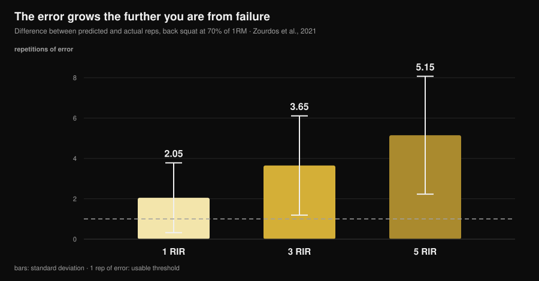
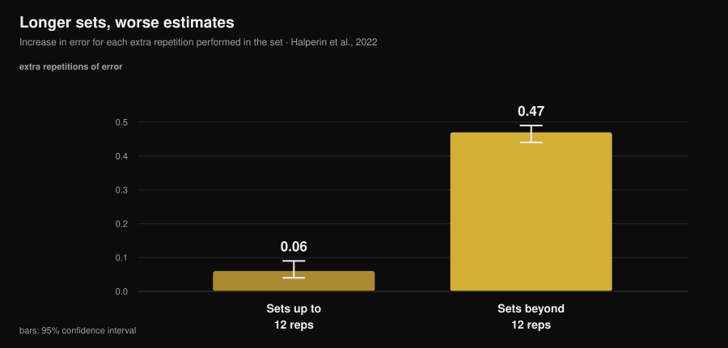

# How accurate is your RIR? What the studies say

By [Giammaria Loi](/autore/giammaria-loi) · updated 14 November 2026

"Stop two reps short of failure." It is the most common instruction in modern programming, mine included, and it works on one condition: that you can actually recognise that point. Ten years of data have piled up on this, and the picture is more interesting than the way it gets told. We are not wildly wrong. We are wrong **always in the same direction**, and predictably so. Knowing where the error sits is what separates a useful RIR from a number you write in your log out of habit.

## In short

- **On average we underestimate by about 1 rep.** Across a meta-analysis of 12 studies and 414 participants the mean error is 0.95 reps (95% CI 0.17-1.73): you nearly always had more left than you thought.
- **The error grows with distance from failure.** In the squat at 70% of 1RM the gap between predicted and actual reps was 2.05 at 1 RIR, 3.65 at 3 RIR and **5.15 at 5 RIR**: at 5 RIR the number stops meaning anything.
- **Long sets wreck the estimate.** Past 12 reps per set the error grows by 0.47 reps for every extra rep, against 0.06 in short sets: eight times faster.
- **Experience does not fix it.** Training status does not affect accuracy in the studies, and six weeks of practice with feedback did not improve absolute error.
- **Where RIR works, it works well.** On the bench press, at 1 and 3 RIR, trained lifters were off by 0.65 ± 0.78 reps on average. The useful window is narrow, but inside it the tool holds up.

*Nurvan chart on data from Zourdos et al., 2021 (25 trained men, squat at 70% of 1RM, sets to failure of 16 ± 4 reps). Vertical bars are the standard deviation. Dashed line: one rep of error, the margin within which an estimate stays usable.*

## What RIR measures, and why it became the number that matters

RIR stands for *repetitions in reserve*: the reps you think you still have before technical failure. It is the simplest way to prescribe effort without depending on the day's one-rep max, which moves with sleep, stress and coffee. A 2024 review of 31 studies and 855 participants confirms that RIR scales are feasible and useful for regulating intensity, and that the dominant use in the literature is exactly the one your program uses: set a target RIR and move the load to match it.

The weak spot is that RIR is not a measurement. It is a **prediction**. And a prediction can only be judged one way: against what actually happens.

## How far off we really are

The best reference is the meta-analysis by Halperin and colleagues in *Sports Medicine*: 12 studies, 414 participants, 262 effects. Headline result: participants **underestimate** the reps remaining until failure by 0.95 reps on average (95% CI 0.17-1.73).

One rep of error sounds small, and in part it is. But two details matter more than the average.

The first is the heterogeneity: 97.9%. That means the average is summarising wildly different situations, and that "about one rep" is not your error on every set you perform. Variability between people, on the other hand, is modest: a standard deviation of 1.45 reps. There are not many natural talents at RIR. The error depends on the situation, not on who you are.

The second is the direction. Underestimating means that when you rack the bar convinced you had 2 reps in reserve, you really had 3. This is not random noise that cancels out: it trains you **systematically further from failure** than the program says.

The same sign shows up in individual studies, with bigger numbers. In 141 people tested on a full-body session the standard error of measurement came out between 2.64 and 3.38 reps. In a deception-design experiment on people with at least a year of training, underestimation was 2.0 reps (95% CI 0.0-4.0) on the leg extension.

## Where RIR works and where it does not

This is the genuinely useful contribution of the research, and the part most content on the topic skips: accuracy **is not a property of the person, it is a property of the situation**.

Three conditions make it worse, and we can document all three.

**Distance from failure.** In the squat study at 70% of 1RM, 25 trained men (4.7 years of experience on average) had to call out when they were 5, 3 and 1 rep from failure, then carry on to real failure. The error grew the further the call sat from failure: 2.05 ± 1.73 reps at 1 RIR, 3.65 ± 2.46 at 3 RIR, 5.15 ± 2.92 at 5 RIR. A "5 RIR" prescription in a 16-rep squat prescribes nothing at all.

**Set length.** This is the sharpest moderator in the meta-analysis. In sets up to 12 reps the error grows by 0.06 reps for every rep performed (95% CI 0.04-0.09); past 12 reps it grows by 0.47 (95% CI 0.44-0.49). In the squat study the correlation between total reps and error was r = 0.65 at 5 RIR and r = 0.01 at 1 RIR: the longer the set, the worse the estimate, and training experience was not predictive.

*Nurvan chart on the meta-regression coefficients from Halperin et al., 2022 (12 studies, 414 participants). Vertical bars are the 95% confidence interval. The value shows how much the estimation error rises for each extra rep performed in the set.*

**Set number.** Estimates improve slightly in later sets of the same session (0.07 reps less error per set), probably because the first set recalibrates perception. A small effect, but pointing the useful way: the first set of an exercise is the least reliable one.

And one condition that improves it: **proximity to failure** combined with exercises and loads that do not produce very long sets. On the bench press at 75% of 1RM, with 24 trained athletes (12 men and 12 women) calling 1 and 3 RIR, mean absolute error was 0.65 ± 0.78 reps, with statistical equivalence within ±1 rep and no relationship with sex, years of experience or relative strength. On single-joint machine exercises, across 58 trained and untrained people, estimates were more accurate close to failure and in later sets, with no differences between men and women or between exercises.

Translated: RIR is not "inaccurate". It is accurate **from 3 down, in sets that are not too long**, and it turns into noise everywhere else.

## Experience will not save you (and that changes how you use it)

It is the most widespread belief among people who have trained for years: "you learn to feel RIR". The data do not support it.

In the meta-analysis, training status does not affect accuracy (β = -0.006, 95% CI -0.02 to 0.007). In the squat study, training age did not predict how good the estimates were. On machines, neither training experience nor specific experience in giving a RIR had any effect.

The most direct test is a study on 9 trained men who benched three times a week for six weeks, calling 4 RIR and 1 RIR on the final set of every session. After six weeks **absolute** error had not improved significantly; what changed was the direction, with a greater tendency to underestimate in later sessions and in longer sets.

One signal runs the other way, from the study on 141 people: a trend towards improvement with experience. A trend, not a clear effect. The honest balance is that the experienced coach and the beginner are wrong in similar ways, and that the fix is not waiting to "develop a feel" for it. It is building RIR where it is reliable and then checking it.

## Why a wrong number changes your results

It depends what you are after, and here the literature is surprisingly clear.

For **strength**, distance from failure matters little: in the 2024 series of meta-regressions the confidence intervals of the slopes for estimated RIR contain zero, meaning a negligible relationship with strength gains. If you train for strength, your estimation error costs you little.

For **hypertrophy** the same analysis finds negative slopes with intervals that do not contain zero: muscle growth rises as sets finish closer to failure. Careful, though, not to turn that into "training to failure is better": the 2023 meta-analysis of 15 studies finds no advantage of technical failure over non-failure (ES 0.12; 95% CI -0.13 to 0.37), nor of high velocity-loss thresholds over moderate ones, and it hypothesises a **non-linear** relationship.

Putting the two together: the systematic underestimation shifts you in the direction that costs something for hypertrophy (further from failure than intended), and the remedy is not going to failure, it is reducing the uncertainty. On how many reps and how much rest to build around that effort, we wrote a separate piece: [how many reps to build muscle](/en/blog/how-many-reps-build-muscle).

## What the research actually says

| Common claim | Verdict | Source |
|---|---|---|
| "Train at 2 RIR and you know what you are doing" | **Needs nuance**: at 1-3 RIR the estimate holds (error 0.65-2 reps), at 5 RIR it does not (5.15) | Refalo et al., 2024; Zourdos et al., 2021 |
| "With experience you learn to feel RIR" | **Busted**: training status does not affect accuracy and 6 weeks of practice did not reduce absolute error | Halperin et al., 2022; Remmert et al., 2023 |
| "If I am wrong, I am wrong in both directions" | **Busted**: the error is systematic towards underestimation (0.95 reps on average) | Halperin et al., 2022 |
| "RIR means the same thing in every set" | **Busted**: past 12 reps the error grows 8 times faster | Halperin et al., 2022 |
| "Stopping far from failure changes nothing" | **Needs nuance**: negligible for strength, measurable for hypertrophy | Robinson et al., 2024; Refalo et al., 2023 |
| "Barbell velocity solves the problem" | **Busted** on the hexagonal bar deadlift: no condition passed the accuracy criteria | Chen et al., 2026 |

### What about technology?

The alternative proposed for years is measuring barbell velocity: velocity drops as you approach failure, so a velocity threshold should tell you how many reps you have left. A paper published in the November 2026 issue of the *Journal of Strength and Conditioning Research* tested the idea on the hexagonal bar deadlift: 19 well-trained men, sets to failure at 65% and 85% of 1RM, three criteria declared in advance (median error ≤ 2 reps, and at least 75% probability both that the estimate was acceptable and that the velocity threshold actually appeared).

No condition met all three criteria, and the probability that the expected threshold showed up was so low that the models were unusable in real time. That applies to that exercise and that context, not to velocity-based training as a whole, but the lesson is general: even the objective tool needs validating on the exercise you use it in.

## How to apply it

1. **Only prescribe RIR from 3 down.** Above 3 RIR use fixed load and reps, or a percentage: asking for "stop at 5 RIR" is asking for a number the studies get wrong by 5.
2. **Keep "RIR sets" within 10-12 reps.** That is the threshold past which the error accelerates. A set of 20 with a stated RIR is creative accounting.
3. **Call it first, check it after.** Write the predicted RIR *while* you finish the set, not when you fill in your log at night: a retrospective estimate is not the same thing.
4. **Calibrate every 4-6 weeks.** One set to technical failure on a safe exercise (a machine, or bench with the pins set), with the prediction called a couple of reps earlier. The gap between predicted and actual is your personal offset, and it has to be read as such: if you call 2 and do 4, your "2" is worth 4.
5. **Do not trust the first set.** It is the least accurate of the session. If you need to dial in the load, dial it in on the second.
6. **If the goal is hypertrophy, correct in the right direction.** Knowing the tendency is to stop too early, "one more rep than it feels like" on the last sets of a safe exercise brings reality back in line with the program.

### If you coach people remotely

The RIR a client writes down is not data, it is a translation. Three habits that change the quality of what reaches you:

- **Ask for the reps, not the score.** "How many more could you have done?" gets more useful answers than "what RIR were you at?", because the second question invites someone to fill in a field.
- **Treat high RIR as noise.** A reported 4 or 5 means "I was not close to failure" and nothing else. Do not build a load progression on it.
- **Put calibration in the program, not on request.** A scheduled test set every month gives you the client's offset and gives them proof they were not "almost at failure". On how often it is worth revisiting the program and the loads, we covered it in [how often to change your workout program](/en/blog/how-often-change-workout-program).

> **Nurvan: your predicted RIR next to the real one**
>
> In Nurvan you log RIR set by set alongside the load, and in calibration sets you record both the prediction and the reps you actually hit: the gap stays in that exercise's history instead of in your memory. That is how a number you call out becomes usable data, for you or for the coach following you. [Try Nurvan](https://nurvan.app)

## Frequently asked questions

**How accurate is RIR?**
On average people underestimate by about 1 rep (0.95; 95% CI 0.17-1.73 in the meta-analysis of 414 participants), but the average hides a lot. Close to failure and in short sets the error drops below one rep; at 5 reps from failure, in the squat, it was 5.15 reps.

**Is it better to train at 2 RIR or to failure?**
For strength the difference is negligible. For hypertrophy, sets finishing closer to failure show slightly more growth, but technical failure did not come out superior to non-failure in the meta-analysis of 15 studies: the relationship looks non-linear. Working at 1-3 RIR with a few check sets is the compromise the literature supports best.

**How do I know whether my RIR is right?**
With a calibration set: you call the RIR a couple of reps before the end and then go to technical failure on a safe exercise. The gap between prediction and reality is your offset, and it tends to point towards underestimation.

**Does RIR work for beginners too?**
In the available data, estimate accuracy does not depend on training status: beginners and advanced lifters are wrong in similar ways. The difference is in safe execution, not in the estimate: if you are starting out, keep RIR to machines and simple exercises.

## Read also

- [How many reps to build muscle: the 8-12 myth](/en/blog/how-many-reps-build-muscle) — where to put the effort you are trying to measure.
- [How often should you change your workout program?](/en/blog/how-often-change-workout-program) — how long to keep a program stable to see whether it works.
- [AI-generated workout plans: what the studies say](/en/blog/ai-generated-workout-plans-research) — what an algorithm can and cannot decide for you.

## Sources

1. Halperin I, Malleron T, Har-Nir I, Androulakis-Korakakis P, Wolf M, Fisher J, Steele J, 2022. Accuracy in Predicting Repetitions to Task Failure in Resistance Exercise: A Scoping Review and Exploratory Meta-analysis. *Sports Med* 52(2):377-390. [PMID 34542869](https://pubmed.ncbi.nlm.nih.gov/34542869/) · [DOI 10.1007/s40279-021-01559-x](https://doi.org/10.1007/s40279-021-01559-x)
2. Zourdos MC, Goldsmith JA, Helms ER, et al., 2021. Proximity to Failure and Total Repetitions Performed in a Set Influences Accuracy of Intraset Repetitions in Reserve-Based Rating of Perceived Exertion. *J Strength Cond Res* 35(Suppl 1):S158-S165. [PMID 30747900](https://pubmed.ncbi.nlm.nih.gov/30747900/) · [DOI 10.1519/JSC.0000000000002995](https://doi.org/10.1519/JSC.0000000000002995)
3. Refalo MC, Remmert JF, Pelland JC, Robinson ZP, Zourdos MC, Hamilton DL, Fyfe JJ, Helms ER, 2024. Accuracy of Intraset Repetitions-in-Reserve Predictions During the Bench Press Exercise in Resistance-Trained Male and Female Subjects. *J Strength Cond Res* 38(3):e78-e85. [PMID 37967832](https://pubmed.ncbi.nlm.nih.gov/37967832/) · [DOI 10.1519/JSC.0000000000004653](https://doi.org/10.1519/JSC.0000000000004653)
4. Steele J, Endres A, Fisher J, Gentil P, Giessing J, 2017. Ability to predict repetitions to momentary failure is not perfectly accurate, though improves with resistance training experience. *PeerJ* 5:e4105. [PMID 29204323](https://pubmed.ncbi.nlm.nih.gov/29204323/) · [DOI 10.7717/peerj.4105](https://doi.org/10.7717/peerj.4105)
5. Armes C, Standish-Hunt H, Androulakis-Korakakis P, et al., 2020. "Just One More Rep!" - Ability to Predict Proximity to Task Failure in Resistance Trained Persons. *Front Psychol* 11:565416. [PMID 33424678](https://pubmed.ncbi.nlm.nih.gov/33424678/) · [DOI 10.3389/fpsyg.2020.565416](https://doi.org/10.3389/fpsyg.2020.565416)
6. Remmert JF, Laurson KR, Zourdos MC, 2023. Accuracy of Predicted Intraset Repetitions in Reserve (RIR) in Single- and Multi-Joint Resistance Exercises Among Trained and Untrained Men and Women. *Percept Mot Skills* 130(3):1239-1254. [PMID 37036795](https://pubmed.ncbi.nlm.nih.gov/37036795/) · [DOI 10.1177/00315125231169868](https://doi.org/10.1177/00315125231169868)
7. Remmert JF, Robinson ZP, Pelland JC, et al., 2023. Changes in Intraset Repetitions in Reserve Prediction Accuracy During Six Weeks of Bench Press Training in Trained Men. *Percept Mot Skills* 130(5):2139-2160. [PMID 37436724](https://pubmed.ncbi.nlm.nih.gov/37436724/) · [DOI 10.1177/00315125231189098](https://doi.org/10.1177/00315125231189098)
8. Robinson ZP, Pelland JC, Remmert JF, Refalo MC, Jukic I, Steele J, Zourdos MC, 2024. Exploring the Dose-Response Relationship Between Estimated Resistance Training Proximity to Failure, Strength Gain, and Muscle Hypertrophy: A Series of Meta-Regressions. *Sports Med* 54(9):2209-2231. [PMID 38970765](https://pubmed.ncbi.nlm.nih.gov/38970765/) · [DOI 10.1007/s40279-024-02069-2](https://doi.org/10.1007/s40279-024-02069-2)
9. Refalo MC, Helms ER, Trexler ET, Hamilton DL, Fyfe JJ, 2023. Influence of Resistance Training Proximity-to-Failure on Skeletal Muscle Hypertrophy: A Systematic Review with Meta-analysis. *Sports Med* 53(3):649-665. [PMID 36334240](https://pubmed.ncbi.nlm.nih.gov/36334240/) · [DOI 10.1007/s40279-022-01784-y](https://doi.org/10.1007/s40279-022-01784-y)
10. Chen W, Zhang H, Li R, et al., 2026. Velocity-Based Monitoring Lacks Both Accuracy and Applicability for Estimating Repetitions in Reserve During the Hexagonal Bar Deadlift. *J Strength Cond Res* 40(11):1335-1341. [PMID 42328880](https://pubmed.ncbi.nlm.nih.gov/42328880/) · [DOI 10.1519/JSC.0000000000005549](https://doi.org/10.1519/JSC.0000000000005549)

Additional source consulted: Bastos V, Machado S, Teixeira DS, 2024. Feasibility and Usefulness of Repetitions-In-Reserve Scales for Selecting Exercise Intensity: A Scoping Review. *Percept Mot Skills* 131(3):940-970. [PMID 38563729](https://pubmed.ncbi.nlm.nih.gov/38563729/). Topic chosen from November 2026 trend signals on RIR-based intensity and the failure-versus-RIR comparison, with competing content prescribing a target RIR without reporting how accurate we are at estimating it. Scientific sources retrieved through PubMed.

---

*Giammaria Loi is the founder of Nurvan. He has been lifting since 2012, has worked as a FIPE-certified personal trainer and coach since 2013, and has competed in powerlifting at national level since 2018. Every article he writes starts from the research and ends with what actually works in the gym.* [Author page](/autore/giammaria-loi)

> Note: educational content. It does not replace advice from a doctor or qualified professional.
