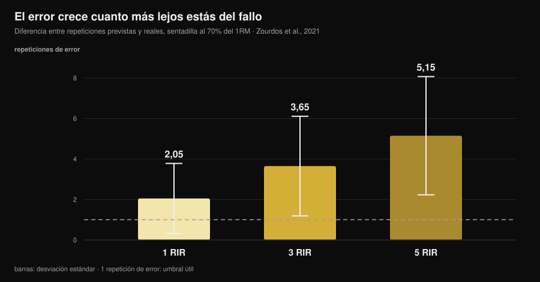
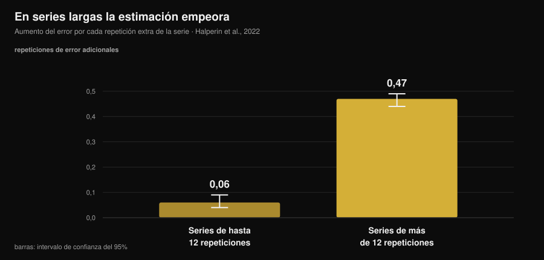

# ¿Cuánto de preciso es el RIR? Qué dicen los estudios

Por [Giammaria Loi](/autore/giammaria-loi) · actualizado el 14 de noviembre de 2026

"Párate a 2 repeticiones del fallo." Es la indicación más repetida en las rutinas modernas, incluidas las mías, y funciona con una condición: que sepas reconocer ese punto. Ahí la investigación ya acumula diez años de datos, y el cuadro es más interesante de lo que se cuenta: no nos equivocamos tanto, nos equivocamos **siempre en la misma dirección** y de forma previsible. Saber dónde se concentra el error es lo que separa un RIR útil de un número que apuntas en la libreta por costumbre.

## En resumen

- **De media subestimamos en torno a 1 repetición.** En el metaanálisis sobre 12 estudios y 414 participantes el error medio es de 0,95 repeticiones (IC 95% 0,17-1,73): casi siempre te quedaban más de las que creías.
- **El error crece con la distancia al fallo.** En sentadilla al 70% del máximo la diferencia entre repeticiones previstas y reales fue de 2,05 a 1 RIR, 3,65 a 3 RIR y **5,15 a 5 RIR**: a 5 RIR el número ya no significa nada.
- **Las series largas arruinan la estimación.** Por encima de 12 repeticiones por serie el error aumenta 0,47 repeticiones por cada repetición extra, frente a 0,06 en las series cortas: ocho veces más rápido.
- **La experiencia no lo arregla.** En los estudios el nivel de entrenamiento no influye en la precisión, y seis semanas de práctica con feedback no mejoraron el error absoluto.
- **Donde el RIR funciona, funciona bien.** En press de banca, a 1 y 3 RIR, atletas entrenados se equivocaron de media en 0,65 ± 0,78 repeticiones. La ventana útil es estrecha, pero dentro de ella la herramienta aguanta.

*Gráfico de Nurvan con los datos de Zourdos et al., 2021 (25 hombres entrenados, sentadilla al 70% del máximo, series al fallo de 16 ± 4 repeticiones). Las barras verticales son la desviación estándar. Línea discontinua: una repetición de error, el margen dentro del cual una estimación sigue siendo utilizable.*

## Qué mide el RIR y por qué se volvió el número central

RIR significa *repetitions in reserve*: las repeticiones que crees que te quedan antes del fallo técnico. Es la forma más simple de prescribir el esfuerzo sin depender del máximo del día, que cambia con el sueño, el estrés y el café. Una revisión de 2024 sobre 31 estudios y 855 participantes confirma que las escalas RIR son viables y útiles para regular la intensidad, y que el uso dominante en la literatura es justo el de las rutinas: fijar un RIR objetivo y mover la carga en consecuencia.

El punto débil es que el RIR no es una medida, es una **predicción**. Y una predicción solo se juzga de una manera: comparándola con lo que pasa de verdad.

## Cuánto nos equivocamos en realidad

La mejor referencia es el metaanálisis de Halperin y colegas en *Sports Medicine*: 12 estudios, 414 participantes, 262 efectos. Resultado principal: los participantes **subestiman** las repeticiones que les quedan hasta el fallo en 0,95 repeticiones de media (IC 95% 0,17-1,73).

Una repetición de error parece poco, y en parte lo es. Pero dos detalles pesan más que la media.

El primero es la heterogeneidad: 97,9%. Significa que esa media resume situaciones muy distintas entre sí, y que "en torno a una repetición" no es tu error en cada serie que haces. La variabilidad entre personas, en cambio, es contenida: desviación estándar de 1,45 repeticiones. No hay muchos "talentos del RIR": el error depende de la situación, no de quién eres.

El segundo es la dirección. Subestimar significa que cuando paras convencido de tener 2 repeticiones en reserva, en realidad te quedaban 3. No es un error aleatorio que se compensa: te entrena **sistemáticamente más lejos del fallo** de lo que dice la rutina.

El mismo signo del error aparece en los trabajos individuales, con cifras mayores. En 141 personas evaluadas en una sesión de cuerpo completo el error estándar de medida quedó entre 2,64 y 3,38 repeticiones. En un experimento con diseño de engaño sobre gente con al menos un año de entrenamiento, la subestimación fue de 2,0 repeticiones (IC 95% 0,0-4,0) en extensión de piernas.

## Dónde funciona el RIR y dónde no

Aquí está la aportación útil de la investigación, y la parte que los contenidos sobre el tema se saltan: la precisión **no es una propiedad de la persona, es una propiedad de la situación**.

Tres condiciones la empeoran de forma documentada.

**La distancia al fallo.** En el estudio de sentadilla al 70% del máximo, 25 hombres entrenados (4,7 años de experiencia media) tenían que avisar cuando estaban a 5, 3 y 1 repetición del fallo, y después seguir hasta el fallo real. El error creció a medida que el punto de aviso se alejaba del fallo: 2,05 ± 1,73 repeticiones a 1 RIR, 3,65 ± 2,46 a 3 RIR, 5,15 ± 2,92 a 5 RIR. Una prescripción de "5 RIR" en una sentadilla de 16 repeticiones, en la práctica, no prescribe nada.

**La longitud de la serie.** Es el moderador más claro del metaanálisis. En las series de hasta 12 repeticiones el error crece 0,06 repeticiones por cada repetición ejecutada (IC 95% 0,04-0,09); por encima de 12 repeticiones crece 0,47 (IC 95% 0,44-0,49). En el estudio de sentadilla la correlación entre repeticiones totales y error era r = 0,65 a 5 RIR y r = 0,01 a 1 RIR: cuanto más larga la serie, peor la estimación, y la experiencia de entrenamiento no era predictiva.

*Gráfico de Nurvan con los coeficientes de la metarregresión de Halperin et al., 2022 (12 estudios, 414 participantes). Las barras verticales son el intervalo de confianza al 95%. El valor indica cuánto aumenta el error de estimación por cada repetición extra ejecutada en la serie.*

**El número de la serie.** Las estimaciones mejoran algo en las series posteriores de la misma sesión (0,07 repeticiones menos de error por serie), probablemente porque la referencia de la primera serie recalibra la percepción. Un efecto pequeño, pero en la dirección útil: la primera serie de un ejercicio es la menos fiable.

Y una condición que sí la mejora: la **cercanía al fallo** combinada con ejercicios y cargas que no producen series larguísimas. En press de banca al 75% del máximo, con 24 atletas entrenados (12 hombres y 12 mujeres) que declaraban 1 y 3 RIR, el error absoluto medio fue de 0,65 ± 0,78 repeticiones, con equivalencia estadística dentro de ±1 repetición y sin relación con el sexo, los años de experiencia o la fuerza relativa. En ejercicios monoarticulares en máquina, sobre 58 personas entrenadas y no entrenadas, las estimaciones fueron más precisas cerca del fallo y en las series posteriores, sin diferencias entre hombres y mujeres ni entre ejercicios.

Traducido: el RIR no es "impreciso". Es preciso **de 3 para abajo, en series no demasiado largas**, y se vuelve ruido en el resto.

## La experiencia no te salva (y eso cambia cómo usarlo)

Es la creencia más extendida entre quien lleva años entrenando: "el RIR se aprende a sentir". Los datos no la sostienen.

En el metaanálisis el nivel de entrenamiento no influye en la precisión (β = -0,006, IC 95% de -0,02 a 0,007). En el estudio de sentadilla la edad de entrenamiento no predecía la calidad de las estimaciones. En máquinas, ni la experiencia de entrenamiento ni la experiencia específica dando un RIR tuvieron efecto.

La prueba más directa es un trabajo con 9 hombres entrenados que hicieron press de banca tres veces por semana durante seis semanas, declarando 4 RIR y 1 RIR en la serie final de cada sesión. Tras seis semanas el error **absoluto** no había mejorado de forma significativa; lo que cambió fue la dirección, con más tendencia a subestimar en las sesiones finales y en las series más largas.

Hay una única señal en sentido contrario, del trabajo sobre 141 personas: una tendencia a mejorar con la experiencia. Tendencia, no efecto claro. El balance honesto es que el entrenador veterano y el principiante se equivocan de forma parecida, y que la solución no es esperar a "cogerle el ojo": es construir el RIR donde es fiable y verificarlo.

## Por qué un número equivocado cambia los resultados

Depende de lo que busques, y aquí la literatura es sorprendentemente clara.

Para la **fuerza**, la distancia al fallo importa poco: en la serie de metarregresiones de 2024 los intervalos de confianza de las pendientes para el RIR estimado contienen el cero, es decir una relación despreciable con las ganancias de fuerza. Si entrenas fuerza, tu error de estimación cuesta poco.

Para la **hipertrofia** el mismo análisis encuentra pendientes negativas con intervalos que no contienen el cero: el crecimiento muscular aumenta a medida que las series terminan más cerca del fallo. Ojo con convertirlo en "entrenar al fallo es mejor": el metaanálisis de 2023 sobre 15 estudios no encuentra ventaja del fallo técnico frente al no-fallo (TE 0,12; IC 95% de -0,13 a 0,37), ni de umbrales altos de pérdida de velocidad frente a los moderados, y plantea una relación **no lineal**.

Juntando las dos cosas: la subestimación sistemática te desplaza en la dirección que cuesta algo en hipertrofia (más lejos del fallo de lo previsto), y el remedio no es ir al fallo, es reducir la incertidumbre. Sobre cuántas repeticiones y cuánto descanso poner alrededor de ese esfuerzo escribimos un artículo aparte: [cuántas repeticiones para ganar masa](/es/blog/cuantas-repeticiones-masa-muscular).

## Qué dice realmente la investigación

| Afirmación habitual | Veredicto | Fuente |
|---|---|---|
| "Entrena a 2 RIR y sabes lo que haces" | **Matizable**: a 1-3 RIR la estimación aguanta (error 0,65-2 repeticiones), a 5 RIR no (5,15) | Refalo et al., 2024; Zourdos et al., 2021 |
| "Con la experiencia aprendes a sentir el RIR" | **Desmentido**: el nivel de entrenamiento no influye en la precisión y 6 semanas de práctica no redujeron el error absoluto | Halperin et al., 2022; Remmert et al., 2023 |
| "Si me equivoco, me equivoco en las dos direcciones" | **Desmentido**: el error es sistemático hacia la subestimación (0,95 repeticiones de media) | Halperin et al., 2022 |
| "El RIR vale igual en cualquier serie" | **Desmentido**: por encima de 12 repeticiones el error crece 8 veces más rápido | Halperin et al., 2022 |
| "Pararse lejos del fallo no cambia nada" | **Matizable**: despreciable para la fuerza, medible para la hipertrofia | Robinson et al., 2024; Refalo et al., 2023 |
| "La velocidad de la barra resuelve el problema" | **Desmentido** en peso muerto con barra hexagonal: ninguna condición superó los criterios de precisión | Chen et al., 2026 |

### ¿Y la tecnología?

La alternativa que se propone desde años es medir la velocidad de la barra: la velocidad cae al acercarse al fallo, así que un umbral de velocidad debería decir a cuántas repeticiones estás. Un trabajo publicado en el número de noviembre de 2026 del *Journal of Strength and Conditioning Research* probó la idea en el peso muerto con barra hexagonal: 19 hombres bien entrenados, series al fallo al 65% y al 85% del máximo, tres criterios declarados de antemano (error mediano ≤ 2 repeticiones y al menos un 75% de probabilidad tanto de estimación aceptable como de que el umbral de velocidad aparezca de verdad).

Ninguna condición cumplió los tres criterios, y la probabilidad de que el umbral esperado apareciese era tan baja que dejaba los modelos inservibles en tiempo real. Vale para ese ejercicio y ese contexto, no para todo el entrenamiento basado en velocidad, pero la lección es general: incluso la herramienta objetiva necesita validarse en el ejercicio donde la usas.

## Cómo aplicarlo

1. **Prescribe RIR solo de 3 para abajo.** Por encima de 3 RIR usa carga y repeticiones fijas, o un porcentaje: pedir "párate a 5 RIR" es pedir un número que en los estudios se equivoca en 5.
2. **Mantén las series "a RIR" dentro de 10-12 repeticiones.** Es el umbral a partir del cual el error se acelera. Series de 20 con un RIR declarado son contabilidad creativa.
3. **Declara antes, verifica después.** Apunta el RIR previsto *mientras* cierras la serie, no cuando rellenas la libreta por la noche: la estimación retrospectiva no es lo mismo.
4. **Calibra cada 4-6 semanas.** Una serie al fallo técnico en un ejercicio seguro (máquina, o press de banca con topes) con la previsión declarada un par de repeticiones antes. La diferencia entre previsto y real es tu desvío personal, y hay que leerlo así: si declaras 2 y haces 4, tu "2" vale 4.
5. **No te fíes de la primera serie.** Es la menos precisa de la sesión. Si tienes que ajustar la carga, ajústala en la segunda.
6. **Si el objetivo es hipertrofia, corrige en la dirección correcta.** Sabiendo que la tendencia es pararse demasiado pronto, "una repetición más de lo que me parece" en las últimas series de un ejercicio seguro realinea la realidad con la rutina.

### Si entrenas a otras personas a distancia

El RIR que te escribe un cliente no es un dato, es una traducción. Tres cuidados que cambian la calidad de la información que recibes:

- **Pide las repeticiones, no la puntuación.** "¿Cuántas más habrías hecho?" produce respuestas más útiles que "¿a qué RIR estabas?", porque la segunda pregunta invita a rellenar un campo.
- **Trata los RIR altos como ruido.** Un 4 o un 5 reportado dice "no estaba cerca del fallo" y nada más. No construyas sobre eso una progresión de carga.
- **Mete una calibración en el programa, no a demanda.** Una serie de test programada cada mes te da a ti el desvío del cliente y a él la prueba de que no estaba "casi al fallo". Sobre el ritmo al que merece la pena revisar programa y cargas, lo tratamos en [cada cuánto cambiar la rutina](/es/blog/cada-cuanto-cambiar-la-rutina).

> **Nurvan: el RIR previsto junto al real**
>
> En Nurvan registras el RIR serie por serie junto a la carga, y en las series de calibración apuntas la previsión y las repeticiones reales: el desvío queda en el historial del ejercicio, no en la memoria. Así es como un número declarado se convierte en un dato utilizable, para ti o para el coach que te sigue. [Prueba Nurvan](https://nurvan.app)

## Preguntas frecuentes

**¿Cuánto de preciso es el RIR?**
De media se subestima en torno a 1 repetición (0,95; IC 95% 0,17-1,73 en el metaanálisis sobre 414 participantes), pero la media esconde mucho. Cerca del fallo y en series cortas el error baja de la repetición; a 5 repeticiones del fallo, en sentadilla, fue de 5,15 repeticiones.

**¿Mejor entrenar a RIR 2 o al fallo?**
Para la fuerza la diferencia es despreciable. Para la hipertrofia, las series que terminan más cerca del fallo muestran un crecimiento algo mayor, pero el fallo técnico no resultó superior al no-fallo en el metaanálisis sobre 15 estudios: la relación parece no lineal. Trabajar a 1-3 RIR con algunas series de verificación es el compromiso que la literatura sostiene mejor.

**¿Cómo sé si mi RIR es correcto?**
Con una serie de calibración: declaras el RIR un par de repeticiones antes del final y luego vas al fallo técnico en un ejercicio seguro. La diferencia entre previsión y realidad es tu desvío, y suele ir en la dirección de la subestimación.

**¿El RIR sirve también para principiantes?**
En los datos disponibles la precisión de las estimaciones no depende del nivel de entrenamiento: principiantes y avanzados se equivocan de forma parecida. La diferencia está en la seguridad de ejecución, no en la estimación: si empiezas, conviene limitar el RIR a máquinas y ejercicios sencillos.

## Lee también

- [Cuántas repeticiones para ganar masa: el mito del 8-12](/es/blog/cuantas-repeticiones-masa-muscular) — dónde colocar el esfuerzo que estás intentando medir.
- [¿Cada cuánto cambiar la rutina de entrenamiento?](/es/blog/cada-cuanto-cambiar-la-rutina) — cuánto mantener estable un programa para ver si funciona.
- [Rutina de entrenamiento con IA: qué dicen los estudios](/es/blog/rutina-de-entrenamiento-con-ia) — qué puede y qué no puede decidir un algoritmo por ti.

## Fuentes

1. Halperin I, Malleron T, Har-Nir I, Androulakis-Korakakis P, Wolf M, Fisher J, Steele J, 2022. Accuracy in Predicting Repetitions to Task Failure in Resistance Exercise: A Scoping Review and Exploratory Meta-analysis. *Sports Med* 52(2):377-390. [PMID 34542869](https://pubmed.ncbi.nlm.nih.gov/34542869/) · [DOI 10.1007/s40279-021-01559-x](https://doi.org/10.1007/s40279-021-01559-x)
2. Zourdos MC, Goldsmith JA, Helms ER, et al., 2021. Proximity to Failure and Total Repetitions Performed in a Set Influences Accuracy of Intraset Repetitions in Reserve-Based Rating of Perceived Exertion. *J Strength Cond Res* 35(Suppl 1):S158-S165. [PMID 30747900](https://pubmed.ncbi.nlm.nih.gov/30747900/) · [DOI 10.1519/JSC.0000000000002995](https://doi.org/10.1519/JSC.0000000000002995)
3. Refalo MC, Remmert JF, Pelland JC, Robinson ZP, Zourdos MC, Hamilton DL, Fyfe JJ, Helms ER, 2024. Accuracy of Intraset Repetitions-in-Reserve Predictions During the Bench Press Exercise in Resistance-Trained Male and Female Subjects. *J Strength Cond Res* 38(3):e78-e85. [PMID 37967832](https://pubmed.ncbi.nlm.nih.gov/37967832/) · [DOI 10.1519/JSC.0000000000004653](https://doi.org/10.1519/JSC.0000000000004653)
4. Steele J, Endres A, Fisher J, Gentil P, Giessing J, 2017. Ability to predict repetitions to momentary failure is not perfectly accurate, though improves with resistance training experience. *PeerJ* 5:e4105. [PMID 29204323](https://pubmed.ncbi.nlm.nih.gov/29204323/) · [DOI 10.7717/peerj.4105](https://doi.org/10.7717/peerj.4105)
5. Armes C, Standish-Hunt H, Androulakis-Korakakis P, et al., 2020. "Just One More Rep!" - Ability to Predict Proximity to Task Failure in Resistance Trained Persons. *Front Psychol* 11:565416. [PMID 33424678](https://pubmed.ncbi.nlm.nih.gov/33424678/) · [DOI 10.3389/fpsyg.2020.565416](https://doi.org/10.3389/fpsyg.2020.565416)
6. Remmert JF, Laurson KR, Zourdos MC, 2023. Accuracy of Predicted Intraset Repetitions in Reserve (RIR) in Single- and Multi-Joint Resistance Exercises Among Trained and Untrained Men and Women. *Percept Mot Skills* 130(3):1239-1254. [PMID 37036795](https://pubmed.ncbi.nlm.nih.gov/37036795/) · [DOI 10.1177/00315125231169868](https://doi.org/10.1177/00315125231169868)
7. Remmert JF, Robinson ZP, Pelland JC, et al., 2023. Changes in Intraset Repetitions in Reserve Prediction Accuracy During Six Weeks of Bench Press Training in Trained Men. *Percept Mot Skills* 130(5):2139-2160. [PMID 37436724](https://pubmed.ncbi.nlm.nih.gov/37436724/) · [DOI 10.1177/00315125231189098](https://doi.org/10.1177/00315125231189098)
8. Robinson ZP, Pelland JC, Remmert JF, Refalo MC, Jukic I, Steele J, Zourdos MC, 2024. Exploring the Dose-Response Relationship Between Estimated Resistance Training Proximity to Failure, Strength Gain, and Muscle Hypertrophy: A Series of Meta-Regressions. *Sports Med* 54(9):2209-2231. [PMID 38970765](https://pubmed.ncbi.nlm.nih.gov/38970765/) · [DOI 10.1007/s40279-024-02069-2](https://doi.org/10.1007/s40279-024-02069-2)
9. Refalo MC, Helms ER, Trexler ET, Hamilton DL, Fyfe JJ, 2023. Influence of Resistance Training Proximity-to-Failure on Skeletal Muscle Hypertrophy: A Systematic Review with Meta-analysis. *Sports Med* 53(3):649-665. [PMID 36334240](https://pubmed.ncbi.nlm.nih.gov/36334240/) · [DOI 10.1007/s40279-022-01784-y](https://doi.org/10.1007/s40279-022-01784-y)
10. Chen W, Zhang H, Li R, et al., 2026. Velocity-Based Monitoring Lacks Both Accuracy and Applicability for Estimating Repetitions in Reserve During the Hexagonal Bar Deadlift. *J Strength Cond Res* 40(11):1335-1341. [PMID 42328880](https://pubmed.ncbi.nlm.nih.gov/42328880/) · [DOI 10.1519/JSC.0000000000005549](https://doi.org/10.1519/JSC.0000000000005549)

Fuente adicional consultada: Bastos V, Machado S, Teixeira DS, 2024. Feasibility and Usefulness of Repetitions-In-Reserve Scales for Selecting Exercise Intensity: A Scoping Review. *Percept Mot Skills* 131(3):940-970. [PMID 38563729](https://pubmed.ncbi.nlm.nih.gov/38563729/). Tema elegido a partir de señales de tendencia de noviembre de 2026 sobre la intensidad medida en RIR y la comparación fallo/RIR, con contenidos competidores que prescriben un RIR objetivo sin indicar cuánto nos equivocamos al estimarlo. Fuentes científicas consultadas a través de PubMed.

---

*Giammaria Loi es el fundador de Nurvan. Entrena con pesas desde 2012, trabaja como entrenador personal y coach certificado por la FIPE desde 2013 y compite en powerlifting a nivel nacional desde 2018. Cada artículo que firma parte de los estudios científicos y llega a lo que funciona de verdad en el gimnasio.* [Página del autor](/autore/giammaria-loi)

> Nota: contenido informativo, no sustituye la opinión de un médico o de un profesional cualificado.
