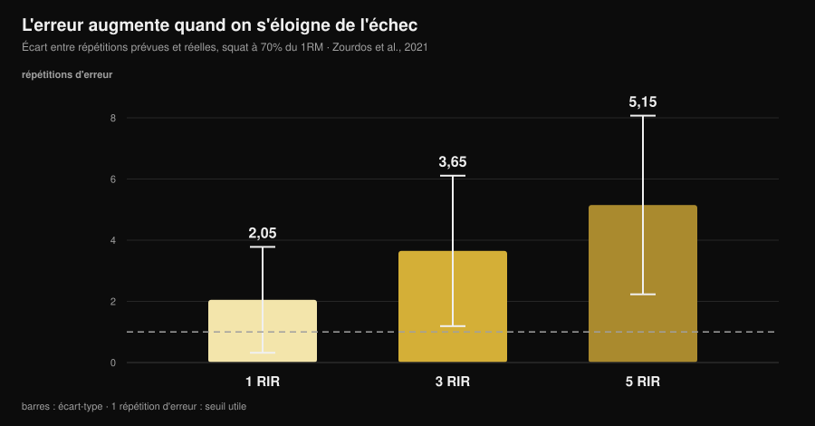
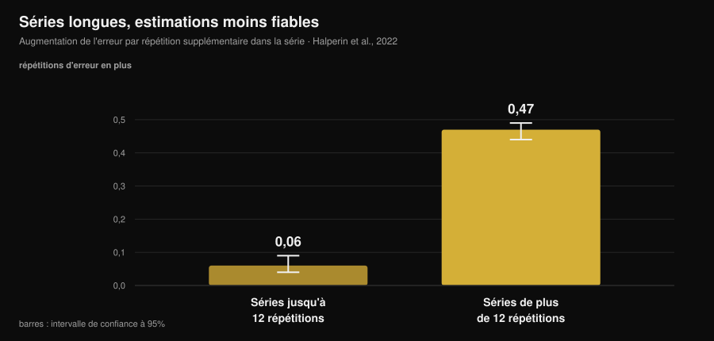

# Le RIR est-il fiable ? Ce que disent les études

Par [Giammaria Loi](/autore/giammaria-loi) · mis à jour le 14 novembre 2026

« Arrêtez-vous à 2 répétitions de l'échec. » C'est la consigne la plus courante des programmes modernes, les miens compris, et elle fonctionne à une condition : que vous sachiez reconnaître ce point. Sur ce terrain, la recherche a accumulé dix ans de données, et le tableau est plus intéressant que ce qu'on en raconte : nous ne nous trompons pas tant que ça, mais nous nous trompons **toujours dans le même sens**, et de façon prévisible. Savoir où l'erreur se concentre, c'est ce qui sépare un RIR utile d'un chiffre noté dans le carnet par habitude.

## En bref

- **En moyenne, nous sous-estimons d'environ 1 répétition.** Dans la méta-analyse portant sur 12 études et 414 participants, l'erreur moyenne est de 0,95 répétition (IC 95 % 0,17-1,73) : il vous en restait presque toujours plus que vous ne le pensiez.
- **L'erreur grandit avec la distance à l'échec.** Au squat à 70 % du maximum, l'écart entre répétitions prévues et réelles était de 2,05 à 1 RIR, 3,65 à 3 RIR et **5,15 à 5 RIR** : à 5 RIR, le chiffre ne veut plus rien dire.
- **Les séries longues ruinent l'estimation.** Au-delà de 12 répétitions par série, l'erreur augmente de 0,47 répétition par répétition supplémentaire, contre 0,06 dans les séries courtes : huit fois plus vite.
- **L'expérience ne règle rien.** Dans les études, le niveau d'entraînement n'influence pas la précision, et six semaines de pratique avec retour d'information n'ont pas amélioré l'erreur absolue.
- **Là où le RIR fonctionne, il fonctionne bien.** Au développé couché, à 1 et 3 RIR, des athlètes entraînés se sont trompés en moyenne de 0,65 ± 0,78 répétition. La fenêtre utile est étroite, mais dedans l'outil tient.

*Graphique Nurvan d'après les données de Zourdos et al., 2021 (25 hommes entraînés, squat à 70 % du maximum, séries à l'échec de 16 ± 4 répétitions). Les barres verticales sont l'écart type. Ligne en pointillés : une répétition d'erreur, la marge dans laquelle une estimation reste utilisable.*

## Ce que mesure le RIR, et pourquoi il est devenu le chiffre central

RIR signifie *repetitions in reserve* : les répétitions que vous pensez avoir encore avant l'échec technique. C'est la façon la plus simple de prescrire l'effort sans dépendre du maximum du jour, qui bouge avec le sommeil, le stress et le café. Une revue de 2024 portant sur 31 études et 855 participants confirme que les échelles RIR sont praticables et utiles pour régler l'intensité, et que leur usage dominant dans la littérature est exactement celui des programmes : fixer un RIR cible et déplacer la charge en conséquence.

Le point faible, c'est que le RIR n'est pas une mesure, c'est une **prévision**. Et une prévision ne s'évalue que d'une seule façon : en la comparant à ce qui se passe vraiment.

## À quel point nous nous trompons

La meilleure référence est la méta-analyse de Halperin et de ses collègues dans *Sports Medicine* : 12 études, 414 participants, 262 effets. Résultat principal : les participants **sous-estiment** les répétitions restantes jusqu'à l'échec de 0,95 répétition en moyenne (IC 95 % 0,17-1,73).

Une répétition d'erreur, cela paraît peu, et ça l'est en partie. Mais deux détails comptent plus que la moyenne.

Le premier, c'est l'hétérogénéité : 97,9 %. Cela veut dire que cette moyenne résume des situations très différentes entre elles, et qu'« environ une répétition » n'est pas votre erreur sur chaque série que vous faites. La variabilité entre personnes, en revanche, est contenue : un écart type de 1,45 répétition. Il n'existe pas beaucoup de « talents du RIR » : l'erreur dépend de la situation, pas de qui vous êtes.

Le second, c'est le sens de l'erreur. Sous-estimer signifie que quand vous arrêtez convaincu d'avoir 2 répétitions en réserve, vous en aviez en réalité 3. Ce n'est pas une erreur aléatoire qui se compense : elle vous entraîne **systématiquement plus loin de l'échec** que ce que dit le programme.

Le même signe revient dans les travaux isolés, avec des chiffres plus gros. Sur 141 personnes testées lors d'une séance full body, l'erreur standard de mesure se situe entre 2,64 et 3,38 répétitions. Dans une expérience à protocole trompeur menée sur des pratiquants ayant au moins un an d'entraînement, la sous-estimation a été de 2,0 répétitions (IC 95 % 0,0-4,0) à la leg extension.

## Où le RIR fonctionne et où il ne fonctionne pas

C'est là l'apport utile de la recherche, et la partie que les contenus sur le sujet sautent : la précision **n'est pas une propriété de la personne, c'est une propriété de la situation**.

Trois conditions la dégradent, et c'est documenté.

**La distance à l'échec.** Dans l'étude sur le squat à 70 % du maximum, 25 hommes entraînés (4,7 ans d'expérience en moyenne) devaient signaler le moment où ils se trouvaient à 5, 3 puis 1 répétition de l'échec, avant de continuer jusqu'au véritable échec. L'erreur a grandi à mesure que le point d'annonce s'éloignait de l'échec : 2,05 ± 1,73 répétition à 1 RIR, 3,65 ± 2,46 à 3 RIR, 5,15 ± 2,92 à 5 RIR. Une prescription « 5 RIR » sur un squat de 16 répétitions ne prescrit, dans les faits, rien du tout.

**La longueur de la série.** C'est le modérateur le plus net de la méta-analyse. Dans les séries allant jusqu'à 12 répétitions, l'erreur grandit de 0,06 répétition par répétition exécutée (IC 95 % 0,04-0,09) ; au-delà de 12 répétitions, elle grandit de 0,47 (IC 95 % 0,44-0,49). Dans l'étude sur le squat, la corrélation entre répétitions totales et erreur était de r = 0,65 à 5 RIR et r = 0,01 à 1 RIR : plus la série est longue, plus l'estimation est mauvaise, et l'expérience d'entraînement n'était pas prédictive.

*Graphique Nurvan d'après les coefficients de la méta-régression de Halperin et al., 2022 (12 études, 414 participants). Les barres verticales sont l'intervalle de confiance à 95 %. La valeur indique de combien augmente l'erreur d'estimation pour chaque répétition supplémentaire exécutée dans la série.*

**Le numéro de la série.** Les estimations s'améliorent légèrement dans les séries suivantes de la même séance (0,07 répétition d'erreur en moins par série), probablement parce que le repère de la première série recalibre la perception. Un petit effet, mais dans le sens utile : la première série d'un exercice est la moins fiable.

Et une condition qui l'améliore, elle : la **proximité de l'échec** combinée à des exercices et des charges qui ne produisent pas de séries interminables. Au développé couché à 75 % du maximum, avec 24 athlètes entraînés (12 hommes et 12 femmes) annonçant 1 et 3 RIR, l'erreur absolue moyenne a été de 0,65 ± 0,78 répétition, avec équivalence statistique à ±1 répétition près et aucune relation avec le sexe, les années d'expérience ou la force relative. Sur les exercices mono-articulaires aux machines, chez 58 personnes entraînées et non entraînées, les estimations se sont révélées plus précises près de l'échec et dans les séries suivantes, sans différence entre hommes et femmes ni entre exercices.

Traduit : le RIR n'est pas « imprécis ». Il est précis **de 3 vers le bas, dans des séries pas trop longues**, et il devient du bruit ailleurs.

## L'expérience ne vous sauve pas (et ça change la façon de l'utiliser)

C'est la croyance la plus répandue chez ceux qui s'entraînent depuis des années : « le RIR, ça s'apprend au ressenti ». Les données ne la soutiennent pas.

Dans la méta-analyse, le niveau d'entraînement n'influence pas la précision (β = -0,006, IC 95 % de -0,02 à 0,007). Dans l'étude sur le squat, l'âge d'entraînement ne prédisait pas la qualité des estimations. Aux machines, ni l'expérience d'entraînement ni l'expérience spécifique de l'annonce d'un RIR n'ont eu d'effet.

Le test le plus direct est un travail sur 9 hommes entraînés qui ont fait du développé couché trois fois par semaine pendant six semaines, en annonçant 4 RIR puis 1 RIR sur la série finale de chaque séance. Au bout de six semaines, l'erreur **absolue** ne s'était pas améliorée de façon significative ; ce qui avait changé, c'est le sens, avec une tendance plus marquée à sous-estimer lors des dernières séances et dans les séries les plus longues.

Un seul signal à contre-courant, issu du travail sur 141 personnes : une tendance à l'amélioration avec l'expérience. Une tendance, pas un effet net. Le bilan honnête, c'est que le coach expérimenté et le débutant se trompent de façon comparable, et que la solution n'est pas d'attendre de « se faire l'œil » : c'est de placer le RIR là où il est fiable, puis de le vérifier.

## Pourquoi un mauvais chiffre change les résultats

Cela dépend de ce que vous cherchez, et là la littérature est étonnamment claire.

Pour la **force**, la distance à l'échec compte peu : dans la série de méta-régressions de 2024, les intervalles de confiance des pentes pour le RIR estimé contiennent zéro, c'est-à-dire une relation négligeable avec les gains de force. Si vous entraînez la force, votre erreur d'estimation coûte peu.

Pour l'**hypertrophie**, la même analyse trouve des pentes négatives avec des intervalles qui ne contiennent pas zéro : la croissance musculaire augmente à mesure que les séries finissent plus près de l'échec. Attention toutefois à ne pas en faire « s'entraîner à l'échec, c'est mieux » : la méta-analyse de 2023 sur 15 études ne trouve pas d'avantage de l'échec technique par rapport au non-échec (TE 0,12 ; IC 95 % de -0,13 à 0,37), ni de seuils élevés de perte de vitesse par rapport aux seuils modérés, et elle avance une relation **non linéaire**.

En mettant les deux ensemble : la sous-estimation systématique vous déplace dans le sens qui coûte quelque chose en hypertrophie (plus loin de l'échec que prévu), et le remède n'est pas d'aller à l'échec, c'est de réduire l'incertitude. Sur le nombre de répétitions et le temps de repos à mettre autour de cet effort, nous avons écrit un article à part : [combien de répétitions pour la masse musculaire](/fr/blog/combien-de-repetitions-masse-musculaire).

## Ce que dit vraiment la recherche

| Affirmation courante | Verdict | Source |
|---|---|---|
| « Entraînez-vous à 2 RIR et vous savez ce que vous faites » | **À nuancer** : à 1-3 RIR l'estimation tient (erreur 0,65-2 répétitions), à 5 RIR non (5,15) | Refalo et al., 2024 ; Zourdos et al., 2021 |
| « Avec l'expérience, on apprend à sentir le RIR » | **Démenti** : le niveau d'entraînement n'influence pas la précision et 6 semaines de pratique n'ont pas réduit l'erreur absolue | Halperin et al., 2022 ; Remmert et al., 2023 |
| « Si je me trompe, je me trompe dans les deux sens » | **Démenti** : l'erreur est systématique vers la sous-estimation (0,95 répétition en moyenne) | Halperin et al., 2022 |
| « Le RIR vaut pareil dans chaque série » | **Démenti** : au-delà de 12 répétitions, l'erreur grandit 8 fois plus vite | Halperin et al., 2022 |
| « S'arrêter loin de l'échec ne change rien » | **À nuancer** : négligeable pour la force, mesurable pour l'hypertrophie | Robinson et al., 2024 ; Refalo et al., 2023 |
| « La vitesse de la barre règle le problème » | **Démenti** au soulevé de terre à la barre hexagonale : aucune condition n'a passé les critères de précision | Chen et al., 2026 |

### Et la technologie ?

L'alternative proposée depuis des années consiste à mesurer la vitesse de la barre : la vitesse baisse à l'approche de l'échec, donc un seuil de vitesse devrait indiquer à combien de répétitions vous êtes. Un travail publié dans le numéro de novembre 2026 du *Journal of Strength and Conditioning Research* a testé l'idée sur le soulevé de terre à la barre hexagonale : 19 hommes bien entraînés, séries à l'échec à 65 % et à 85 % du maximum, trois critères annoncés à l'avance (erreur médiane ≤ 2 répétitions et au moins 75 % de probabilité à la fois d'une estimation acceptable et d'une apparition réelle du seuil de vitesse).

Aucune condition n'a satisfait les trois critères, et la probabilité que le seuil attendu apparaisse était si faible qu'elle rendait les modèles inutilisables en temps réel. Cela vaut pour cet exercice et ce contexte, pas pour tout l'entraînement basé sur la vitesse, mais la leçon est générale : même l'outil objectif doit être validé sur l'exercice où vous l'utilisez.

## Comment l'appliquer

1. **Ne prescrivez le RIR que de 3 vers le bas.** Au-delà de 3 RIR, utilisez une charge et des répétitions fixes, ou un pourcentage : demander « arrête-toi à 5 RIR » revient à demander un chiffre que les études ratent de 5.
2. **Gardez les séries « à RIR » dans les 10-12 répétitions.** C'est le seuil au-delà duquel l'erreur accélère. Une série de 20 avec un RIR annoncé est une fiction comptable.
3. **Annoncez avant, vérifiez après.** Notez le RIR prévu *pendant* que vous terminez la série, pas le soir en remplissant le carnet : l'estimation rétrospective n'est pas la même chose.
4. **Calibrez toutes les 4-6 semaines.** Une série jusqu'à l'échec technique sur un exercice sûr (machine, ou développé couché avec les butées), avec la prévision annoncée deux répétitions avant. L'écart entre prévu et réel est votre décalage personnel, et il se lit comme tel : si vous annoncez 2 et que vous en faites 4, votre « 2 » vaut 4.
5. **Ne faites pas confiance à la première série.** C'est la moins précise de la séance. Si vous devez régler la charge, réglez-la sur la deuxième.
6. **Si l'objectif est l'hypertrophie, corrigez dans le bon sens.** Sachant que la tendance est de s'arrêter trop tôt, « une répétition de plus que ce qu'il me semble » sur les dernières séries d'un exercice sûr réaligne la réalité sur le programme.

### Si vous coachez d'autres personnes à distance

Le RIR qu'un client vous écrit n'est pas une donnée, c'est une traduction. Trois précautions qui changent la qualité des informations que vous recevez :

- **Demandez les répétitions, pas la note.** « Combien tu en aurais fait encore ? » produit des réponses plus utiles que « à quel RIR tu étais ? », parce que la seconde question invite à remplir une case.
- **Traitez les RIR élevés comme du bruit.** Un 4 ou un 5 rapporté dit « je n'étais pas près de l'échec » et rien de plus. Ne construisez pas de progression de charge là-dessus.
- **Mettez une calibration dans le programme, pas à la demande.** Une série de test planifiée chaque mois vous donne le décalage du client, et lui donne la preuve qu'il n'était pas « presque à l'échec ». Sur le rythme auquel il vaut la peine de revoir programme et charges, nous en avons parlé dans [à quelle fréquence changer son programme](/fr/blog/a-quelle-frequence-changer-son-programme).

> **Nurvan : le RIR prévu à côté du RIR réel**
>
> Dans Nurvan, vous enregistrez le RIR série par série en même temps que la charge, et dans les séries de calibration vous notez la prévision et les répétitions réelles : le décalage reste dans l'historique de l'exercice, pas dans votre mémoire. C'est ainsi qu'un chiffre annoncé devient une donnée utilisable, pour vous ou pour le coach qui vous suit. [Essayez Nurvan](https://nurvan.app)

## Questions fréquentes

**Le RIR est-il fiable ?**
En moyenne, on sous-estime d'environ 1 répétition (0,95 ; IC 95 % 0,17-1,73 dans la méta-analyse sur 414 participants), mais la moyenne cache beaucoup de choses. Près de l'échec et dans des séries courtes, l'erreur descend sous la répétition ; à 5 répétitions de l'échec, au squat, elle a été de 5,15 répétitions.

**Mieux vaut s'entraîner à 2 RIR ou à l'échec ?**
Pour la force, la différence est négligeable. Pour l'hypertrophie, les séries qui finissent plus près de l'échec montrent une croissance légèrement supérieure, mais l'échec technique ne s'est pas révélé supérieur au non-échec dans la méta-analyse sur 15 études : la relation semble non linéaire. Travailler à 1-3 RIR avec quelques séries de vérification est le compromis que la littérature soutient le mieux.

**Comment savoir si mon RIR est juste ?**
Avec une série de calibration : vous annoncez le RIR deux répétitions avant la fin, puis vous allez à l'échec technique sur un exercice sûr. L'écart entre prévision et réalité est votre décalage, et il va plutôt dans le sens de la sous-estimation.

**Le RIR fonctionne-t-il aussi pour les débutants ?**
Dans les données disponibles, la précision des estimations ne dépend pas du niveau d'entraînement : débutants et avancés se trompent de façon comparable. La différence est dans la sécurité d'exécution, pas dans l'estimation : si vous débutez, mieux vaut limiter le RIR aux machines et aux exercices simples.

## À lire aussi

- [Combien de répétitions pour la masse musculaire : le mythe du 8-12](/fr/blog/combien-de-repetitions-masse-musculaire) — où placer l'effort que vous essayez de mesurer.
- [À quelle fréquence changer son programme d'entraînement ?](/fr/blog/a-quelle-frequence-changer-son-programme) — combien de temps garder un programme stable pour voir s'il fonctionne.
- [Programme d'entraînement généré par IA : ce que disent les études](/fr/blog/programme-entrainement-genere-par-ia) — ce qu'un algorithme peut et ne peut pas décider à votre place.

## Sources

1. Halperin I, Malleron T, Har-Nir I, Androulakis-Korakakis P, Wolf M, Fisher J, Steele J, 2022. Accuracy in Predicting Repetitions to Task Failure in Resistance Exercise: A Scoping Review and Exploratory Meta-analysis. *Sports Med* 52(2):377-390. [PMID 34542869](https://pubmed.ncbi.nlm.nih.gov/34542869/) · [DOI 10.1007/s40279-021-01559-x](https://doi.org/10.1007/s40279-021-01559-x)
2. Zourdos MC, Goldsmith JA, Helms ER, et al., 2021. Proximity to Failure and Total Repetitions Performed in a Set Influences Accuracy of Intraset Repetitions in Reserve-Based Rating of Perceived Exertion. *J Strength Cond Res* 35(Suppl 1):S158-S165. [PMID 30747900](https://pubmed.ncbi.nlm.nih.gov/30747900/) · [DOI 10.1519/JSC.0000000000002995](https://doi.org/10.1519/JSC.0000000000002995)
3. Refalo MC, Remmert JF, Pelland JC, Robinson ZP, Zourdos MC, Hamilton DL, Fyfe JJ, Helms ER, 2024. Accuracy of Intraset Repetitions-in-Reserve Predictions During the Bench Press Exercise in Resistance-Trained Male and Female Subjects. *J Strength Cond Res* 38(3):e78-e85. [PMID 37967832](https://pubmed.ncbi.nlm.nih.gov/37967832/) · [DOI 10.1519/JSC.0000000000004653](https://doi.org/10.1519/JSC.0000000000004653)
4. Steele J, Endres A, Fisher J, Gentil P, Giessing J, 2017. Ability to predict repetitions to momentary failure is not perfectly accurate, though improves with resistance training experience. *PeerJ* 5:e4105. [PMID 29204323](https://pubmed.ncbi.nlm.nih.gov/29204323/) · [DOI 10.7717/peerj.4105](https://doi.org/10.7717/peerj.4105)
5. Armes C, Standish-Hunt H, Androulakis-Korakakis P, et al., 2020. "Just One More Rep!" - Ability to Predict Proximity to Task Failure in Resistance Trained Persons. *Front Psychol* 11:565416. [PMID 33424678](https://pubmed.ncbi.nlm.nih.gov/33424678/) · [DOI 10.3389/fpsyg.2020.565416](https://doi.org/10.3389/fpsyg.2020.565416)
6. Remmert JF, Laurson KR, Zourdos MC, 2023. Accuracy of Predicted Intraset Repetitions in Reserve (RIR) in Single- and Multi-Joint Resistance Exercises Among Trained and Untrained Men and Women. *Percept Mot Skills* 130(3):1239-1254. [PMID 37036795](https://pubmed.ncbi.nlm.nih.gov/37036795/) · [DOI 10.1177/00315125231169868](https://doi.org/10.1177/00315125231169868)
7. Remmert JF, Robinson ZP, Pelland JC, et al., 2023. Changes in Intraset Repetitions in Reserve Prediction Accuracy During Six Weeks of Bench Press Training in Trained Men. *Percept Mot Skills* 130(5):2139-2160. [PMID 37436724](https://pubmed.ncbi.nlm.nih.gov/37436724/) · [DOI 10.1177/00315125231189098](https://doi.org/10.1177/00315125231189098)
8. Robinson ZP, Pelland JC, Remmert JF, Refalo MC, Jukic I, Steele J, Zourdos MC, 2024. Exploring the Dose-Response Relationship Between Estimated Resistance Training Proximity to Failure, Strength Gain, and Muscle Hypertrophy: A Series of Meta-Regressions. *Sports Med* 54(9):2209-2231. [PMID 38970765](https://pubmed.ncbi.nlm.nih.gov/38970765/) · [DOI 10.1007/s40279-024-02069-2](https://doi.org/10.1007/s40279-024-02069-2)
9. Refalo MC, Helms ER, Trexler ET, Hamilton DL, Fyfe JJ, 2023. Influence of Resistance Training Proximity-to-Failure on Skeletal Muscle Hypertrophy: A Systematic Review with Meta-analysis. *Sports Med* 53(3):649-665. [PMID 36334240](https://pubmed.ncbi.nlm.nih.gov/36334240/) · [DOI 10.1007/s40279-022-01784-y](https://doi.org/10.1007/s40279-022-01784-y)
10. Chen W, Zhang H, Li R, et al., 2026. Velocity-Based Monitoring Lacks Both Accuracy and Applicability for Estimating Repetitions in Reserve During the Hexagonal Bar Deadlift. *J Strength Cond Res* 40(11):1335-1341. [PMID 42328880](https://pubmed.ncbi.nlm.nih.gov/42328880/) · [DOI 10.1519/JSC.0000000000005549](https://doi.org/10.1519/JSC.0000000000005549)

Source supplémentaire consultée : Bastos V, Machado S, Teixeira DS, 2024. Feasibility and Usefulness of Repetitions-In-Reserve Scales for Selecting Exercise Intensity: A Scoping Review. *Percept Mot Skills* 131(3):940-970. [PMID 38563729](https://pubmed.ncbi.nlm.nih.gov/38563729/). Sujet choisi à partir des signaux de tendance de novembre 2026 sur l'intensité mesurée en RIR et sur la comparaison échec/RIR, avec des contenus concurrents qui prescrivent un RIR cible sans indiquer à quel point nous savons l'estimer. Sources scientifiques consultées via PubMed.

---

*Giammaria Loi est le fondateur de Nurvan. Il s'entraîne avec des poids depuis 2012, travaille comme coach et entraîneur personnel certifié FIPE depuis 2013 et compète en powerlifting au niveau national depuis 2018. Chaque article qu'il signe part des études scientifiques et arrive à ce qui fonctionne vraiment en salle.* [Page auteur](/autore/giammaria-loi)

> Note : contenu informatif, il ne remplace pas l'avis d'un médecin ou d'un professionnel qualifié.
