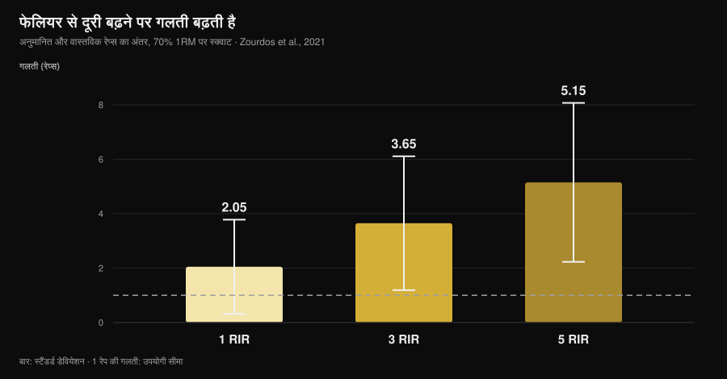
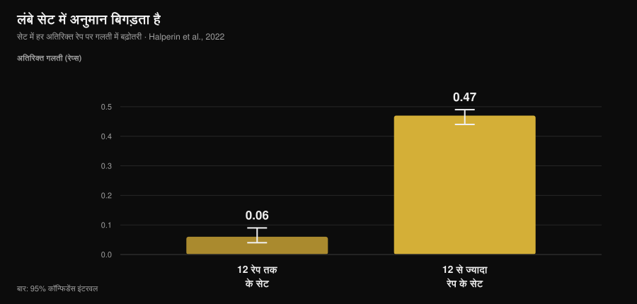

# आपका RIR कितना सही होता है? रिसर्च क्या कहती है

लेखक: [जियामारिया लोई](/autore/giammaria-loi) · अपडेट 14 नवंबर 2026

"फेलियर से दो रेप्स पहले रुक जाइए।" आज के वर्कआउट प्लान में यह सबसे आम हिदायत है, मेरे प्लान में भी, और यह एक शर्त पर काम करती है: आप उस पॉइंट को पहचान सकें। इसी बात पर रिसर्च ने दस साल का डेटा जमा कर लिया है, और तस्वीर उससे दिलचस्प है जैसी बताई जाती है: हम बहुत ज़्यादा ग़लत नहीं होते, लेकिन हम **हमेशा एक ही दिशा में** ग़लत होते हैं, और एक तय पैटर्न में। ग़लती कहाँ जमा होती है, यह जानना ही "काम का RIR" और "आदतन डायरी में लिख दिए गए नंबर" के बीच की लकीर है।

## सार

- **औसतन हम क़रीब 1 रेप कम आँकते हैं।** 12 स्टडीज़ और 414 प्रतिभागियों की मेटा-एनालिसिस में औसत ग़लती 0.95 रेप थी (95% CI 0.17-1.73): बचे हुए रेप्स लगभग हमेशा आपकी सोच से ज़्यादा थे।
- **फेलियर से दूरी बढ़ने पर ग़लती बढ़ती है।** 70% 1RM पर स्क्वाट में अनुमानित और असली रेप्स का फ़र्क़ 1 RIR पर 2.05, 3 RIR पर 3.65 और **5 RIR पर 5.15** रहा: 5 RIR पर यह नंबर कुछ नहीं कहता।
- **लंबे सेट अनुमान को बिगाड़ देते हैं।** एक सेट में 12 रेप्स के बाद हर अतिरिक्त रेप पर ग़लती 0.47 रेप बढ़ती है, जबकि छोटे सेट में 0.06: आठ गुना तेज़।
- **अनुभव इसे हल नहीं करता।** स्टडीज़ में ट्रेनिंग लेवल सटीकता पर असर नहीं डालता, और फ़ीडबैक के साथ छह हफ़्ते की प्रैक्टिस ने निरपेक्ष ग़लती घटाई नहीं।
- **जहाँ RIR काम करता है, वहाँ अच्छा काम करता है।** बेंच प्रेस में 1 और 3 RIR पर ट्रेन्ड एथलीटों की औसत ग़लती 0.65 ± 0.78 रेप रही। खिड़की तंग है, पर उसके अंदर यह औज़ार टिकता है।

*Nurvan ग्राफ़, Zourdos व अन्य, 2021 के डेटा पर (25 ट्रेन्ड पुरुष, 70% 1RM पर स्क्वाट, फेलियर तक के सेट 16 ± 4 रेप्स के)। खड़ी लाइनें स्टैंडर्ड डिविएशन हैं। धारीदार रेखा: एक रेप की ग़लती, यानी वह हद जिसके अंदर अनुमान काम का रहता है।*

## RIR क्या नापता है, और यह मुख्य नंबर कैसे बन गया

RIR का मतलब है *repetitions in reserve*, यानी रिज़र्व में बचे रेप्स: टेक्निकल फेलियर से पहले आपको लगता है कि कितने रेप्स और बचे हैं। मेहनत तय करने का यह सबसे आसान तरीक़ा है, और इसमें उस दिन के 1RM पर निर्भर नहीं रहना पड़ता — जो नींद, तनाव और कॉफ़ी के साथ बदलता रहता है। 2024 की एक समीक्षा, जिसमें 31 स्टडीज़ और 855 प्रतिभागी थे, पुष्टि करती है कि RIR स्केल इंटेंसिटी तय करने में व्यावहारिक और उपयोगी हैं, और साहित्य में इसका सबसे आम इस्तेमाल बिल्कुल वही है जो प्लान में होता है: एक टारगेट RIR तय कीजिए और वज़न उसी के हिसाब से घटाइए-बढ़ाइए।

कमज़ोरी यह है कि RIR कोई माप नहीं, एक **अनुमान** है। और अनुमान को आँकने का एक ही तरीक़ा है: उसे असल में हुई बात से मिलाना।

## हम असल में कितना ग़लत होते हैं

सबसे अच्छा हवाला Halperin व उनके साथियों की *Sports Medicine* में छपी मेटा-एनालिसिस है: 12 स्टडीज़, 414 प्रतिभागी, 262 इफ़ेक्ट। मुख्य नतीजा: प्रतिभागी फेलियर तक बचे रेप्स को औसतन 0.95 रेप **कम आँकते** हैं (95% CI 0.17-1.73)।

एक रेप की ग़लती कम लगती है, और कुछ हद तक है भी। पर दो बातें औसत से ज़्यादा मायने रखती हैं।

पहली है हेटरोजेनिटी: 97.9%। यानी वह औसत बहुत अलग-अलग हालात को एक में समेटता है, और "क़रीब एक रेप" आपके हर सेट की ग़लती नहीं है। लोगों के बीच का फ़र्क़ उलटे सीमित है: स्टैंडर्ड डिविएशन 1.45 रेप। "RIR के नैसर्गिक जानकार" ज़्यादा नहीं होते: ग़लती इस पर टिकी है कि हालात कैसे हैं, इस पर नहीं कि आप कौन हैं।

दूसरी है दिशा। कम आँकने का मतलब है कि जब आप यह मानकर रुकते हैं कि 2 रेप्स रिज़र्व में हैं, असल में 3 थे। यह ऐसी बेतरतीब ग़लती नहीं जो ख़ुद को संतुलित कर ले: यह आपको प्लान की लिखी दूरी से **व्यवस्थित रूप से फेलियर से और दूर** ट्रेनिंग कराती है।

वही दिशा अलग-अलग स्टडीज़ में भी दिखती है, बड़े आँकड़ों के साथ। एक फुल बॉडी सेशन पर टेस्ट किए गए 141 लोगों में माप की स्टैंडर्ड एरर 2.64 से 3.38 रेप के बीच निकली। और कम से कम एक साल की ट्रेनिंग वालों पर डिसेप्शन डिज़ाइन वाले एक प्रयोग में लेग एक्सटेंशन पर कम आँकना 2.0 रेप रहा (95% CI 0.0-4.0)।

## RIR कहाँ काम करता है और कहाँ नहीं

रिसर्च का काम का हिस्सा यहीं है, और यही हिस्सा इस विषय का कंटेंट छोड़ देता है: सटीकता **इंसान की ख़ासियत नहीं, हालात की ख़ासियत है**।

तीन शर्तें इसे साफ़ तौर पर बिगाड़ती हैं।

**फेलियर से दूरी।** 70% 1RM पर स्क्वाट की उस स्टडी में 25 ट्रेन्ड पुरुषों (औसत अनुभव 4.7 साल) को बताना था कि वे फेलियर से 5, 3 और 1 रेप दूर कब हैं, और फिर असली फेलियर तक जाना था। जैसे-जैसे बताने का पॉइंट फेलियर से दूर हुआ, ग़लती बढ़ी: 1 RIR पर 2.05 ± 1.73 रेप, 3 RIR पर 3.65 ± 2.46, और 5 RIR पर 5.15 ± 2.92। 16 रेप्स वाले स्क्वाट में "5 RIR" लिखना असल में कुछ भी तय नहीं करता।

**सेट की लंबाई।** मेटा-एनालिसिस में यह सबसे साफ़ मॉडरेटर है। 12 रेप्स तक के सेट में हर किए गए रेप पर ग़लती 0.06 रेप बढ़ती है (95% CI 0.04-0.09); 12 रेप्स के बाद 0.47 बढ़ती है (95% CI 0.44-0.49)। स्क्वाट की स्टडी में कुल रेप्स और ग़लती का सहसंबंध 5 RIR पर r = 0.65 और 1 RIR पर r = 0.01 था: सेट जितना लंबा, अनुमान उतना ख़राब, और ट्रेनिंग अनुभव से इसका अंदाज़ा नहीं लगता था।

*Nurvan ग्राफ़, Halperin व अन्य, 2022 की मेटा-रिग्रेशन के गुणांकों पर (12 स्टडीज़, 414 प्रतिभागी)। खड़ी लाइनें 95% कॉन्फ़िडेंस इंटरवल हैं। आँकड़ा बताता है कि सेट में हर अतिरिक्त रेप करने पर अनुमान की ग़लती कितनी बढ़ती है।*

**सेट का नंबर।** उसी सेशन के बाद वाले सेट में अनुमान थोड़ा सुधरता है (हर सेट पर 0.07 रेप कम ग़लती), शायद इसलिए कि पहले सेट का हवाला धारणा को फिर से कैलिब्रेट कर देता है। असर छोटा है, पर दिशा काम की: किसी भी एक्सरसाइज़ का पहला सेट सबसे कम भरोसेमंद होता है।

और एक शर्त इसे सुधारती है: **फेलियर के पास होना**, साथ में ऐसी एक्सरसाइज़ और वज़न जो बहुत लंबे सेट न बनाएँ। 75% 1RM पर बेंच प्रेस में, 24 ट्रेन्ड एथलीटों (12 पुरुष और 12 महिलाएँ) ने 1 और 3 RIR बताया, और औसत निरपेक्ष ग़लती 0.65 ± 0.78 रेप रही — ±1 रेप के अंदर सांख्यिकीय समतुल्यता के साथ, और लिंग, अनुभव के सालों या सापेक्ष ताक़त से कोई संबंध नहीं। मशीनों पर सिंगल-जॉइंट एक्सरसाइज़ में, 58 ट्रेन्ड और अनट्रेन्ड लोगों में, अनुमान फेलियर के पास और बाद वाले सेट में ज़्यादा सही निकले, और पुरुषों-महिलाओं में या एक्सरसाइज़ के बीच कोई फ़र्क़ नहीं था।

सीधे शब्दों में: RIR "ग़लत" नहीं है। यह **3 से नीचे और ज़्यादा लंबे न होने वाले सेट में** सही है, और बाक़ी जगह शोर बन जाता है।

## अनुभव आपको नहीं बचाएगा (और इससे इस्तेमाल का तरीक़ा बदलता है)

सालों से ट्रेनिंग करने वालों में यह सबसे आम यक़ीन है: "RIR महसूस करना आ जाता है।" डेटा इसका साथ नहीं देता।

मेटा-एनालिसिस में ट्रेनिंग लेवल सटीकता पर असर नहीं डालता (β = -0.006, 95% CI -0.02 से 0.007)। स्क्वाट की स्टडी में ट्रेनिंग की उम्र से अनुमान की गुणवत्ता का पता नहीं चलता था। मशीनों पर न ट्रेनिंग अनुभव का असर दिखा, न ख़ास तौर पर RIR बताने के अनुभव का।

सबसे सीधा टेस्ट 9 ट्रेन्ड पुरुषों पर हुआ काम है, जिन्होंने छह हफ़्ते तक हफ़्ते में तीन बार बेंच प्रेस किया और हर सेशन के आख़िरी सेट में 4 RIR और 1 RIR बताया। छह हफ़्ते बाद **निरपेक्ष** ग़लती में सार्थक सुधार नहीं था; दिशा बदली थी, और आख़िरी सेशनों तथा लंबे सेट में कम आँकने का रुझान ज़्यादा था।

उलटी दिशा का एक ही संकेत है, उन 141 लोगों वाले काम से: अनुभव के साथ सुधार का रुझान। रुझान, साफ़ असर नहीं। ईमानदार हिसाब यह है कि अनुभवी कोच और शुरुआती एक जैसी ग़लती करते हैं, और हल "नज़र बन जाने" का इंतज़ार नहीं है: हल यह है कि RIR वहाँ बनाइए जहाँ वह भरोसेमंद है, और उसे जाँचिए।

## एक ग़लत नंबर नतीजे क्यों बदल देता है

यह इस पर टिका है कि आप क्या चाहते हैं, और यहाँ साहित्य हैरानी की हद तक साफ़ है।

**ताक़त** के लिए फेलियर से दूरी कम मायने रखती है: 2024 की मेटा-रिग्रेशन शृंखला में अनुमानित RIR के ढालों के कॉन्फ़िडेंस इंटरवल शून्य को शामिल करते हैं, यानी ताक़त की बढ़त से संबंध नगण्य है। अगर आप ताक़त की ट्रेनिंग करते हैं, तो आपके अनुमान की ग़लती सस्ती पड़ती है।

**मसल ग्रोथ** के लिए वही विश्लेषण ऋणात्मक ढालें पाता है, और उनके इंटरवल शून्य को शामिल नहीं करते: सेट जितना फेलियर के पास ख़त्म होते हैं, मसल ग्रोथ उतनी बढ़ती है। पर इसे "फेलियर तक जाना बेहतर है" में न बदलिए: 15 स्टडीज़ पर 2023 की मेटा-एनालिसिस टेक्निकल फेलियर को नॉन-फेलियर से बेहतर नहीं पाती (ES 0.12; 95% CI -0.13 से 0.37), और न ऊँची वेलोसिटी-लॉस सीमा को मध्यम सीमा से बेहतर, और एक **नॉन-लीनियर** संबंध का अनुमान लगाती है।

दोनों बातें जोड़िए: व्यवस्थित रूप से कम आँकना आपको उसी दिशा में सरकाता है जो मसल ग्रोथ में कुछ क़ीमत वसूलती है (प्लान से ज़्यादा फेलियर से दूर), और इलाज फेलियर तक जाना नहीं, अनिश्चितता घटाना है। उस मेहनत के आसपास कितने रेप्स और कितना रेस्ट रखना चाहिए, इस पर हमने अलग लेख लिखा है: [मसल के लिए कितने रेप्स](/hi/blog/kitne-reps-muscle-ke-liye)।

## रिसर्च असल में क्या कहती है

| आम दावा | नतीजा | स्रोत |
|---|---|---|
| "2 RIR पर ट्रेनिंग कीजिए और आपको पता रहेगा आप क्या कर रहे हैं" | **स्पष्ट करने लायक़**: 1-3 RIR पर अनुमान टिकता है (ग़लती 0.65-2 रेप), 5 RIR पर नहीं (5.15) | Refalo व अन्य, 2024; Zourdos व अन्य, 2021 |
| "अनुभव के साथ RIR महसूस करना आ जाता है" | **ग़लत**: ट्रेनिंग लेवल सटीकता पर असर नहीं डालता और 6 हफ़्ते की प्रैक्टिस ने निरपेक्ष ग़लती घटाई नहीं | Halperin व अन्य, 2022; Remmert व अन्य, 2023 |
| "ग़लती होगी तो दोनों दिशाओं में होगी" | **ग़लत**: ग़लती व्यवस्थित रूप से कम आँकने की तरफ़ है (औसतन 0.95 रेप) | Halperin व अन्य, 2022 |
| "हर सेट में RIR की क़ीमत एक जैसी है" | **ग़लत**: 12 रेप्स के बाद ग़लती आठ गुना तेज़ी से बढ़ती है | Halperin व अन्य, 2022 |
| "फेलियर से दूर रुकने से कुछ नहीं बदलता" | **स्पष्ट करने लायक़**: ताक़त के लिए नगण्य, मसल ग्रोथ के लिए मापने लायक़ | Robinson व अन्य, 2024; Refalo व अन्य, 2023 |
| "बारबेल स्पीड इस समस्या का हल है" | हेक्सागोनल बार डेडलिफ़्ट पर **ग़लत**: कोई भी शर्त सटीकता के मानक पास नहीं कर पाई | Chen व अन्य, 2026 |

### और टेक्नोलॉजी का क्या?

सालों से सुझाया जा रहा विकल्प बारबेल की स्पीड नापना है: फेलियर के पास आते-आते स्पीड गिरती है, इसलिए एक स्पीड थ्रेशोल्ड को बताना चाहिए कि कितने रेप्स बचे हैं। *Journal of Strength and Conditioning Research* के नवंबर 2026 अंक में छपे एक काम ने यह विचार हेक्सागोनल बार डेडलिफ़्ट पर जाँचा: 19 अच्छी तरह ट्रेन्ड पुरुष, 65% और 85% 1RM पर फेलियर तक के सेट, और पहले से घोषित तीन मानक (ग़लती का माध्य ≤ 2 रेप, और कम से कम 75% संभावना दोनों बातों की — कि अनुमान स्वीकार्य हो और कि स्पीड थ्रेशोल्ड सचमुच आए)।

कोई भी शर्त तीनों मानक एक साथ पूरे नहीं कर पाई, और अपेक्षित थ्रेशोल्ड के आने की संभावना इतनी कम थी कि मॉडल रियल टाइम में इस्तेमाल के लायक़ नहीं बचे। यह उस एक्सरसाइज़ और उस संदर्भ पर लागू होता है, पूरी वेलोसिटी-बेस्ड ट्रेनिंग पर नहीं, पर सबक़ आम है: वस्तुनिष्ठ औज़ार को भी उसी एक्सरसाइज़ पर जाँचना पड़ता है जिस पर आप उसे इस्तेमाल करते हैं।

## इसे कैसे लागू करें

1. **RIR सिर्फ़ 3 से नीचे तय कीजिए।** 3 RIR से ऊपर तय वज़न और तय रेप्स इस्तेमाल कीजिए, या परसेंटेज: "5 RIR पर रुकिए" कहना एक ऐसा नंबर माँगना है जो स्टडीज़ में 5 से चूकता है।
2. **"RIR वाले" सेट 10-12 रेप्स के अंदर रखिए।** यही वह सीमा है जिसके बाद ग़लती तेज़ होती है। 20 रेप्स का सेट और उस पर लिखा RIR एक हिसाबी कल्पना है।
3. **पहले बताइए, बाद में जाँचिए।** अनुमानित RIR सेट ख़त्म करते *समय* लिखिए, शाम को डायरी भरते वक़्त नहीं: बाद में याद करके लगाया अनुमान वही चीज़ नहीं है।
4. **हर 4-6 हफ़्ते कैलिब्रेट कीजिए।** किसी सुरक्षित एक्सरसाइज़ पर (मशीन, या सेफ़्टी पिन लगी बेंच) टेक्निकल फेलियर तक एक सेट, और ख़त्म होने से क़रीब दो रेप पहले अनुमान बोलकर दर्ज कीजिए। अनुमान और असली में जो फ़र्क़ है वही आपका निजी झुकाव है, और उसे ऐसे पढ़ना है: अगर आप 2 बताते हैं और 4 करते हैं, तो आपका "2" असल में 4 है।
5. **पहले सेट पर भरोसा न कीजिए।** सेशन में वह सबसे कम सही होता है। वज़न सेट करना हो तो दूसरे सेट पर कीजिए।
6. **अगर लक्ष्य मसल ग्रोथ है, तो सही दिशा में सुधार कीजिए।** जब रुझान बहुत जल्दी रुकने का है, तो किसी सुरक्षित एक्सरसाइज़ के आख़िरी सेटों में "जितना लगता है उससे एक रेप ज़्यादा" हक़ीक़त को प्लान के साथ फिर से मिला देता है।

### अगर आप दूसरों को ऑनलाइन ट्रेन कराते हैं

क्लाइंट जो RIR आपको लिखकर भेजता है वह डेटा नहीं, एक अनुवाद है। तीन बातें जो आपको मिलने वाली जानकारी की क्वालिटी बदल देती हैं:

- **रेप्स पूछिए, स्कोर नहीं।** "और कितने रेप्स कर पाते?" का जवाब "आप किस RIR पर थे?" से ज़्यादा काम का होता है, क्योंकि दूसरा सवाल बस एक ख़ाना भरने का न्योता है।
- **ऊँचे RIR को शोर मानिए।** रिपोर्ट किया गया 4 या 5 इतना ही कहता है कि "मैं फेलियर के पास नहीं था", और कुछ नहीं। इसके ऊपर वज़न की प्रोग्रेशन न बनाइए।
- **कैलिब्रेशन प्लान में रखिए, माँगने पर नहीं।** महीने में एक बार का तय टेस्ट सेट आपको क्लाइंट का झुकाव देता है और उसे यह सबूत कि वह "लगभग फेलियर पर" नहीं था। प्लान और वज़न कितने समय बाद बदलने लायक़ होते हैं, इस पर हमने [वर्कआउट प्लान कितने समय में बदलें](/hi/blog/workout-plan-kitne-samay-mein-badlein) में बात की है।

> **Nurvan: अनुमानित RIR, असली RIR के बग़ल में**
>
> Nurvan में आप RIR सेट-दर-सेट वज़न के साथ दर्ज करते हैं, और कैलिब्रेशन सेट में अनुमान तथा असली रेप्स दोनों नोट करते हैं: इस तरह फ़र्क़ उस एक्सरसाइज़ के इतिहास में रह जाता है, याद में नहीं। बोलकर कहा गया एक नंबर इसी तरह काम का डेटा बनता है — आपके लिए, या उस कोच के लिए जो आपको देख रहा है। [Nurvan आज़माएँ](https://nurvan.app)

## अक्सर पूछे जाने वाले सवाल

**RIR कितना सही होता है?**
औसतन क़रीब 1 रेप कम आँका जाता है (0.95; 414 प्रतिभागियों की मेटा-एनालिसिस में 95% CI 0.17-1.73), पर औसत बहुत कुछ छिपा लेता है। फेलियर के पास और छोटे सेट में ग़लती एक रेप से नीचे चली जाती है; और स्क्वाट में फेलियर से 5 रेप दूर यह 5.15 रेप थी।

**RIR 2 पर ट्रेनिंग बेहतर है या फेलियर तक?**
ताक़त के लिए फ़र्क़ नगण्य है। मसल ग्रोथ के लिए फेलियर के पास ख़त्म होने वाले सेट थोड़ी ज़्यादा ग्रोथ दिखाते हैं, पर 15 स्टडीज़ की मेटा-एनालिसिस में टेक्निकल फेलियर नॉन-फेलियर से बेहतर नहीं निकला: संबंध नॉन-लीनियर लगता है। 1-3 RIR पर काम करना और बीच-बीच में कुछ जाँच सेट रखना वह बीच का रास्ता है जिसे साहित्य सबसे अच्छा सहारा देता है।

**कैसे पता करूँ कि मेरा RIR सही है?**
एक कैलिब्रेशन सेट से: ख़त्म होने से क़रीब दो रेप पहले RIR बताइए और फिर किसी सुरक्षित एक्सरसाइज़ पर टेक्निकल फेलियर तक जाइए। अनुमान और हक़ीक़त का फ़र्क़ आपका झुकाव है, और वह आम तौर पर कम आँकने की तरफ़ होता है।

**क्या RIR शुरुआती लोगों के लिए भी काम करता है?**
उपलब्ध डेटा में अनुमान की सटीकता ट्रेनिंग लेवल पर नहीं टिकती: शुरुआती और एडवांस्ड एक जैसी ग़लती करते हैं। फ़र्क़ अनुमान में नहीं, एक्सरसाइज़ करने की सुरक्षा में है: शुरू करने वालों के लिए RIR को मशीनों और आसान एक्सरसाइज़ तक सीमित रखना बेहतर है।

## यह भी पढ़ें

- [मसल के लिए कितने रेप्स: 8-12 का मिथक](/hi/blog/kitne-reps-muscle-ke-liye) — जिस मेहनत को आप नापने की कोशिश कर रहे हैं, उसे कहाँ लगाना है।
- [वर्कआउट प्लान कितने समय में बदलें?](/hi/blog/workout-plan-kitne-samay-mein-badlein) — एक प्लान कितना स्थिर रखें ताकि पता चले वह काम कर रहा है या नहीं।
- [AI से बनाया वर्कआउट प्लान: स्टडीज़ क्या कहती हैं](/hi/blog/ai-se-banaya-workout-plan) — एल्गोरिदम आपकी जगह क्या तय कर सकता है और क्या नहीं।

## स्रोत

1. Halperin I, Malleron T, Har-Nir I, Androulakis-Korakakis P, Wolf M, Fisher J, Steele J, 2022. Accuracy in Predicting Repetitions to Task Failure in Resistance Exercise: A Scoping Review and Exploratory Meta-analysis. *Sports Med* 52(2):377-390. [PMID 34542869](https://pubmed.ncbi.nlm.nih.gov/34542869/) · [DOI 10.1007/s40279-021-01559-x](https://doi.org/10.1007/s40279-021-01559-x)
2. Zourdos MC, Goldsmith JA, Helms ER, et al., 2021. Proximity to Failure and Total Repetitions Performed in a Set Influences Accuracy of Intraset Repetitions in Reserve-Based Rating of Perceived Exertion. *J Strength Cond Res* 35(Suppl 1):S158-S165. [PMID 30747900](https://pubmed.ncbi.nlm.nih.gov/30747900/) · [DOI 10.1519/JSC.0000000000002995](https://doi.org/10.1519/JSC.0000000000002995)
3. Refalo MC, Remmert JF, Pelland JC, Robinson ZP, Zourdos MC, Hamilton DL, Fyfe JJ, Helms ER, 2024. Accuracy of Intraset Repetitions-in-Reserve Predictions During the Bench Press Exercise in Resistance-Trained Male and Female Subjects. *J Strength Cond Res* 38(3):e78-e85. [PMID 37967832](https://pubmed.ncbi.nlm.nih.gov/37967832/) · [DOI 10.1519/JSC.0000000000004653](https://doi.org/10.1519/JSC.0000000000004653)
4. Steele J, Endres A, Fisher J, Gentil P, Giessing J, 2017. Ability to predict repetitions to momentary failure is not perfectly accurate, though improves with resistance training experience. *PeerJ* 5:e4105. [PMID 29204323](https://pubmed.ncbi.nlm.nih.gov/29204323/) · [DOI 10.7717/peerj.4105](https://doi.org/10.7717/peerj.4105)
5. Armes C, Standish-Hunt H, Androulakis-Korakakis P, et al., 2020. "Just One More Rep!" - Ability to Predict Proximity to Task Failure in Resistance Trained Persons. *Front Psychol* 11:565416. [PMID 33424678](https://pubmed.ncbi.nlm.nih.gov/33424678/) · [DOI 10.3389/fpsyg.2020.565416](https://doi.org/10.3389/fpsyg.2020.565416)
6. Remmert JF, Laurson KR, Zourdos MC, 2023. Accuracy of Predicted Intraset Repetitions in Reserve (RIR) in Single- and Multi-Joint Resistance Exercises Among Trained and Untrained Men and Women. *Percept Mot Skills* 130(3):1239-1254. [PMID 37036795](https://pubmed.ncbi.nlm.nih.gov/37036795/) · [DOI 10.1177/00315125231169868](https://doi.org/10.1177/00315125231169868)
7. Remmert JF, Robinson ZP, Pelland JC, et al., 2023. Changes in Intraset Repetitions in Reserve Prediction Accuracy During Six Weeks of Bench Press Training in Trained Men. *Percept Mot Skills* 130(5):2139-2160. [PMID 37436724](https://pubmed.ncbi.nlm.nih.gov/37436724/) · [DOI 10.1177/00315125231189098](https://doi.org/10.1177/00315125231189098)
8. Robinson ZP, Pelland JC, Remmert JF, Refalo MC, Jukic I, Steele J, Zourdos MC, 2024. Exploring the Dose-Response Relationship Between Estimated Resistance Training Proximity to Failure, Strength Gain, and Muscle Hypertrophy: A Series of Meta-Regressions. *Sports Med* 54(9):2209-2231. [PMID 38970765](https://pubmed.ncbi.nlm.nih.gov/38970765/) · [DOI 10.1007/s40279-024-02069-2](https://doi.org/10.1007/s40279-024-02069-2)
9. Refalo MC, Helms ER, Trexler ET, Hamilton DL, Fyfe JJ, 2023. Influence of Resistance Training Proximity-to-Failure on Skeletal Muscle Hypertrophy: A Systematic Review with Meta-analysis. *Sports Med* 53(3):649-665. [PMID 36334240](https://pubmed.ncbi.nlm.nih.gov/36334240/) · [DOI 10.1007/s40279-022-01784-y](https://doi.org/10.1007/s40279-022-01784-y)
10. Chen W, Zhang H, Li R, et al., 2026. Velocity-Based Monitoring Lacks Both Accuracy and Applicability for Estimating Repetitions in Reserve During the Hexagonal Bar Deadlift. *J Strength Cond Res* 40(11):1335-1341. [PMID 42328880](https://pubmed.ncbi.nlm.nih.gov/42328880/) · [DOI 10.1519/JSC.0000000000005549](https://doi.org/10.1519/JSC.0000000000005549)

अतिरिक्त देखा गया स्रोत: Bastos V, Machado S, Teixeira DS, 2024. Feasibility and Usefulness of Repetitions-In-Reserve Scales for Selecting Exercise Intensity: A Scoping Review. *Percept Mot Skills* 131(3):940-970. [PMID 38563729](https://pubmed.ncbi.nlm.nih.gov/38563729/)। विषय नवंबर 2026 के उन ट्रेंड संकेतों से चुना गया जो RIR से नापी गई इंटेंसिटी और फेलियर बनाम RIR की तुलना पर थे, जबकि प्रतिस्पर्धी कंटेंट एक टारगेट RIR बताता है और यह नहीं बताता कि उसका अंदाज़ा हम कितना सही लगाते हैं। वैज्ञानिक स्रोत PubMed के ज़रिए देखे गए।

---

*जियामारिया लोई Nurvan के संस्थापक हैं। वे 2012 से वेट ट्रेनिंग करते हैं, 2013 से FIPE प्रमाणित पर्सनल ट्रेनर और कोच के रूप में काम करते हैं और 2018 से राष्ट्रीय स्तर पर पावरलिफ़्टिंग में भाग लेते हैं। उनके हर लेख की शुरुआत वैज्ञानिक अध्ययनों से होती है और अंत इस पर कि जिम में असल में क्या काम करता है।*

> नोट: यह जानकारी भर है, यह डॉक्टर या विशेषज्ञ की सलाह की जगह नहीं लेती।
