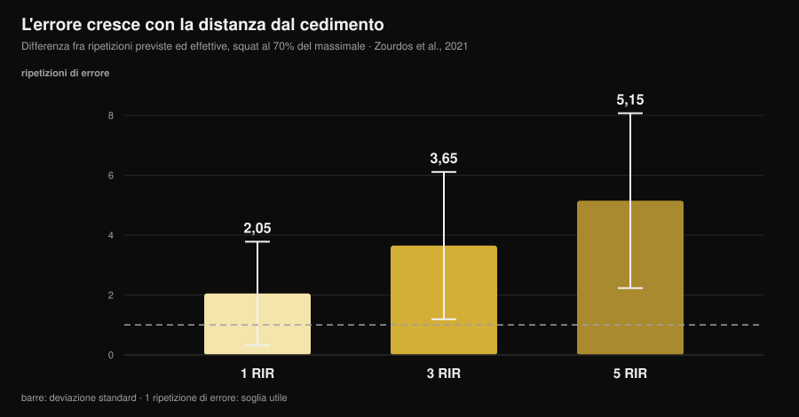
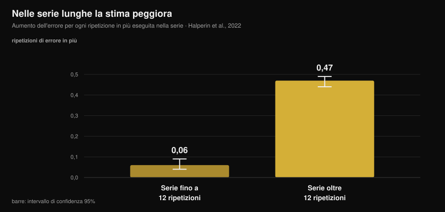

# Quanto è preciso il tuo RIR? Cosa dicono gli studi

Di [Giammaria Loi](/autore/giammaria-loi) · aggiornato il 14 novembre 2026

"Fermati a 2 ripetizioni dal cedimento." È l'indicazione più comune nelle schede moderne, la mia compresa, e funziona a una condizione: che tu sappia riconoscere quel punto. Su questo la ricerca ha accumulato dieci anni di dati, e il quadro è più interessante di come viene raccontato: non sbagliamo tanto, sbagliamo **sempre nella stessa direzione** e in modo prevedibile. Sapere dove si concentra l'errore è ciò che separa un RIR utile da un numero scritto sul diario per abitudine.

## In breve

- **In media sottostimiamo di circa 1 ripetizione.** Nella meta-analisi su 12 studi e 414 partecipanti l'errore medio è 0,95 ripetizioni (IC 95% 0,17-1,73): ne avevi quasi sempre più di quante pensavi.
- **L'errore cresce con la distanza dal cedimento.** Nello squat al 70% del massimale la differenza fra ripetizioni previste ed effettive è stata di 2,05 a 1 RIR, 3,65 a 3 RIR e **5,15 a 5 RIR**: a 5 RIR il numero non significa più niente.
- **Le serie lunghe rovinano la stima.** Oltre le 12 ripetizioni per serie l'errore aumenta di 0,47 ripetizioni per ogni ripetizione in più, contro 0,06 nelle serie corte: otto volte più in fretta.
- **L'esperienza non risolve.** Negli studi lo stato di allenamento non influenza la precisione, e sei settimane di pratica con feedback non hanno migliorato l'errore assoluto.
- **Dove il RIR funziona, funziona bene.** In panca, a 1 e 3 RIR, atleti allenati hanno sbagliato in media di 0,65 ± 0,78 ripetizioni. La finestra utile è stretta, ma dentro quella finestra lo strumento tiene.

*Grafico Nurvan sui dati di Zourdos et al., 2021 (25 uomini allenati, squat al 70% del massimale, serie a cedimento di 16 ± 4 ripetizioni). Le barre verticali sono la deviazione standard. Linea tratteggiata: una ripetizione di errore, il margine entro cui una stima resta utilizzabile.*

## Cosa misura il RIR, e perché è diventato il numero centrale

RIR sta per *repetitions in reserve*: le ripetizioni che pensi di avere ancora prima del cedimento tecnico. È il modo più semplice per prescrivere lo sforzo senza dipendere dal massimale del giorno, che cambia con sonno, stress e caffè. Una revisione del 2024 su 31 studi e 855 partecipanti conferma che le scale RIR sono praticabili e utili per regolare l'intensità, e che l'uso prevalente in letteratura è esattamente quello delle schede: fissare un RIR bersaglio e muovere il carico di conseguenza.

Il punto debole è che il RIR non è una misura, è una **previsione**. E una previsione si valuta solo in un modo: confrontandola con quello che succede davvero.

## Quanto sbagliamo davvero

Il riferimento migliore è la meta-analisi di Halperin e colleghi su *Sports Medicine*: 12 studi, 414 partecipanti, 262 effetti. Risultato principale: i partecipanti **sottostimano** le ripetizioni che restano fino al cedimento di 0,95 ripetizioni in media (IC 95% 0,17-1,73).

Una ripetizione di errore sembra poco, e in parte lo è. Ma due dettagli contano più della media.

Il primo è l'eterogeneità: 97,9%. Significa che quella media riassume situazioni molto diverse fra loro, e che "circa una ripetizione" non è il tuo errore in ogni serie che fai. La variabilità fra persone, invece, è contenuta: deviazione standard di 1,45 ripetizioni. Non esistono molti "talenti del RIR": l'errore dipende dalla situazione, non da chi sei.

Il secondo è la direzione. Sottostimare significa che quando ti fermi convinto di avere 2 ripetizioni in riserva, in realtà ne avevi 3. Non è un errore casuale che si compensa: ti allena **sistematicamente più lontano dal cedimento** di quanto dice la scheda.

Lo stesso segno dell'errore si ritrova nei singoli lavori, con numeri più grandi. In 141 persone testate su una seduta full body l'errore standard di misura è risultato fra 2,64 e 3,38 ripetizioni. In un esperimento con disegno a inganno su chi aveva almeno un anno di allenamento, la sottostima è stata di 2,0 ripetizioni (IC 95% 0,0-4,0) sulla leg extension.

## Dove il RIR funziona e dove no

Qui sta il contributo utile della ricerca, e la parte che i contenuti sul tema saltano: la precisione **non è una proprietà della persona, è una proprietà della situazione**.

Tre condizioni la peggiorano in modo documentato.

**La distanza dal cedimento.** Nello studio sullo squat al 70% del massimale, 25 uomini allenati (4,7 anni di esperienza media) dovevano dichiarare quando si trovavano a 5, 3 e 1 ripetizione dal cedimento, poi continuare fino al cedimento vero. L'errore è cresciuto man mano che il punto di chiamata si allontanava dal cedimento: 2,05 ± 1,73 ripetizioni a 1 RIR, 3,65 ± 2,46 a 3 RIR, 5,15 ± 2,92 a 5 RIR. Una prescrizione "5 RIR" in uno squat da 16 ripetizioni, nei fatti, non prescrive nulla.

**La lunghezza della serie.** È il moderatore più netto della meta-analisi. Nelle serie fino a 12 ripetizioni l'errore cresce di 0,06 ripetizioni per ogni ripetizione eseguita (IC 95% 0,04-0,09); oltre le 12 ripetizioni cresce di 0,47 (IC 95% 0,44-0,49). Nello studio sullo squat la correlazione fra ripetizioni totali ed errore era r = 0,65 a 5 RIR e r = 0,01 a 1 RIR: più lunga la serie, peggiore la stima, e l'esperienza di allenamento non era predittiva.

*Grafico Nurvan sui coefficienti della meta-regressione di Halperin et al., 2022 (12 studi, 414 partecipanti). Le barre verticali sono l'intervallo di confidenza al 95%. Il valore indica di quanto aumenta l'errore di stima per ogni ripetizione in più eseguita nella serie.*

**Il numero della serie.** Le stime migliorano leggermente nelle serie successive della stessa seduta (0,07 ripetizioni in meno di errore per serie), probabilmente perché il riferimento della prima serie ricalibra la percezione. Un effetto piccolo, ma nella direzione utile: la prima serie di un esercizio è la meno affidabile.

E una condizione che invece la migliora: la **vicinanza al cedimento** combinata con esercizi e carichi che non producono serie lunghissime. In panca al 75% del massimale, con 24 atleti allenati (12 uomini e 12 donne) che dichiaravano 1 e 3 RIR, l'errore assoluto medio è stato di 0,65 ± 0,78 ripetizioni, con equivalenza statistica entro ±1 ripetizione e nessuna relazione con sesso, anni di esperienza o forza relativa. Sugli esercizi a singola articolazione alle macchine, su 58 persone allenate e non allenate, le stime sono risultate più precise vicino al cedimento e nelle serie successive, senza differenze fra uomini e donne né fra esercizi.

Tradotto: il RIR non è "impreciso". È preciso **da 3 in giù, in serie non troppo lunghe**, e diventa rumore altrove.

## L'esperienza non ti salva (e questo cambia il modo di usarlo)

È la credenza più diffusa fra chi si allena da anni: "il RIR si impara a sentire". I dati non la sostengono.

Nella meta-analisi lo stato di allenamento non influenza la precisione (β = -0,006, IC 95% da -0,02 a 0,007). Nello studio sullo squat l'età di allenamento non prediceva la bontà delle stime. Sulle macchine, né l'esperienza di allenamento né l'esperienza specifica nel dare un RIR hanno avuto effetto.

Il test più diretto è un lavoro su 9 uomini allenati che hanno fatto panca tre volte a settimana per sei settimane, dichiarando 4 RIR e 1 RIR nella serie finale di ogni seduta. Dopo sei settimane l'errore **assoluto** non era migliorato in modo significativo; era cambiata la direzione, con una tendenza maggiore a sottostimare nelle sedute finali e nelle serie più lunghe.

Un unico segnale in controtendenza, dal lavoro su 141 persone: una tendenza al miglioramento con l'esperienza. Tendenza, non effetto netto. Il saldo onesto è che l'allenatore esperto e il principiante sbagliano in modo simile, e che la soluzione non è aspettare di "farsi l'occhio": è costruire il RIR dove è affidabile e verificarlo.

## Perché un numero sbagliato cambia i risultati

Dipende da cosa cerchi, e qui la letteratura è sorprendentemente chiara.

Per la **forza**, la distanza dal cedimento conta poco: nella serie di meta-regressioni del 2024 gli intervalli di confidenza delle pendenze per il RIR stimato contengono lo zero, cioè una relazione trascurabile con i guadagni di forza. Se alleni la forza, il tuo errore di stima costa poco.

Per l'**ipertrofia** la stessa analisi trova pendenze negative con intervalli che non contengono lo zero: la crescita muscolare aumenta man mano che le serie finiscono più vicine al cedimento. Attenzione però a non trasformarlo in "allenarsi a cedimento è meglio": la meta-analisi del 2023 su 15 studi non trova vantaggio del cedimento tecnico rispetto al non-cedimento (ES 0,12; IC 95% da -0,13 a 0,37), né di soglie di perdita di velocità alte rispetto a moderate, e ipotizza una relazione **non lineare**.

Mettendo insieme le due cose: la sottostima sistematica ti sposta nella direzione che costa qualcosa in ipertrofia (più lontano dal cedimento di quanto previsto), e il rimedio non è andare a cedimento, è ridurre l'incertezza. Su quante ripetizioni e quanto recupero mettere intorno a quello sforzo abbiamo scritto un pezzo a parte: [quante ripetizioni per la massa](/blog/ripetizioni-serie-recupero-ipertrofia).

## Cosa dice davvero la ricerca

| Affermazione diffusa | Verdetto | Fonte |
|---|---|---|
| "Allenati a 2 RIR e sai cosa stai facendo" | **Da precisare**: a 1-3 RIR la stima tiene (errore 0,65-2 ripetizioni), a 5 RIR no (5,15) | Refalo et al., 2024; Zourdos et al., 2021 |
| "Con l'esperienza impari a sentire il RIR" | **Smentito**: lo stato di allenamento non influenza la precisione e 6 settimane di pratica non hanno ridotto l'errore assoluto | Halperin et al., 2022; Remmert et al., 2023 |
| "Se sbaglio, sbaglio in entrambe le direzioni" | **Smentito**: l'errore è sistematico verso la sottostima (0,95 ripetizioni in media) | Halperin et al., 2022 |
| "Il RIR vale allo stesso modo in ogni serie" | **Smentito**: oltre le 12 ripetizioni l'errore cresce 8 volte più in fretta | Halperin et al., 2022 |
| "Fermarsi lontano dal cedimento non cambia nulla" | **Da precisare**: trascurabile per la forza, misurabile per l'ipertrofia | Robinson et al., 2024; Refalo et al., 2023 |
| "La velocità del bilanciere risolve il problema" | **Smentito** sullo stacco con bilanciere esagonale: nessuna condizione ha superato i criteri di accuratezza | Chen et al., 2026 |

### E la tecnologia?

L'alternativa proposta da anni è misurare la velocità del bilanciere: la velocità cala avvicinandosi al cedimento, quindi una soglia di velocità dovrebbe dire a quante ripetizioni sei. Un lavoro pubblicato nel numero di novembre 2026 del *Journal of Strength and Conditioning Research* ha testato l'idea sullo stacco con bilanciere esagonale: 19 uomini ben allenati, serie a cedimento al 65% e all'85% del massimale, tre criteri dichiarati in anticipo (errore mediano ≤ 2 ripetizioni e almeno il 75% di probabilità sia di stima accettabile sia che la soglia di velocità si presenti davvero).

Nessuna condizione ha soddisfatto tutti e tre i criteri, e la probabilità che la soglia attesa comparisse era così bassa da rendere i modelli inutilizzabili in tempo reale. Vale per quell'esercizio e quel contesto, non per tutto il velocity-based training, ma la lezione è generale: anche lo strumento oggettivo ha bisogno di essere validato sull'esercizio in cui lo usi.

## Come applicarlo

1. **Prescrivi il RIR solo da 3 in giù.** Sopra i 3 RIR usa carico e ripetizioni fisse, o una percentuale: chiedere "fermati a 5 RIR" è chiedere un numero che negli studi sbaglia di 5.
2. **Tieni le serie "a RIR" entro le 10-12 ripetizioni.** È la soglia oltre cui l'errore accelera. Serie da 20 con RIR dichiarato sono una finzione contabile.
3. **Dichiara prima, verifica dopo.** Scrivi il RIR previsto *mentre* chiudi la serie, non quando compili il diario la sera: la stima retrospettiva non è la stessa cosa.
4. **Calibra ogni 4-6 settimane.** Una serie fino al cedimento tecnico su un esercizio sicuro (macchina, o panca con i fermi) con la previsione dichiarata un paio di ripetizioni prima. La differenza fra previsto ed effettivo è il tuo scostamento personale, e va riletta: se dichiari 2 e ne fai 4, il tuo "2" vale 4.
5. **Non fidarti della prima serie.** È la meno precisa della seduta. Se devi tarare il carico, tara sulla seconda.
6. **Se l'obiettivo è ipertrofia, correggi nella direzione giusta.** Sapendo che la tendenza è fermarsi troppo presto, un "una ripetizione in più di quanto mi sembra" sulle ultime serie di un esercizio sicuro riallinea la realtà alla scheda.

### Se alleni altre persone a distanza

Il RIR che un cliente ti scrive non è un dato, è una traduzione. Tre accortezze che cambiano la qualità delle informazioni che ricevi:

- **Chiedi le ripetizioni, non il punteggio.** "Quante ne avresti fatte ancora?" produce risposte più utili di "a che RIR eri?", perché la seconda domanda invita a compilare un campo.
- **Tratta i RIR alti come rumore.** Un 4 o 5 riportato dice "non ero vicino al cedimento" e nient'altro. Non costruirci sopra una progressione di carico.
- **Metti una calibrazione nel programma, non a richiesta.** Una serie di test programmata ogni mese dà a te lo scostamento del cliente e a lui la prova che non era "quasi al cedimento". Sul ritmo con cui vale la pena rivedere programma e carichi, ne abbiamo parlato in [ogni quanto cambiare la scheda](/blog/ogni-quanto-cambiare-scheda-allenamento).

> **Nurvan: il RIR previsto accanto a quello reale**
>
> In Nurvan registri il RIR serie per serie insieme al carico, e nelle serie di calibrazione annoti la previsione e le ripetizioni effettive: lo scostamento resta nello storico dell'esercizio, non nella memoria. È così che un numero dichiarato diventa un dato utilizzabile, per te o per il coach che ti segue. [Prova Nurvan](https://nurvan.app)

## Domande frequenti

**Quanto è preciso il RIR?**
In media si sottostima di circa 1 ripetizione (0,95; IC 95% 0,17-1,73 nella meta-analisi su 414 partecipanti), ma la media nasconde molto. Vicino al cedimento e in serie corte l'errore scende sotto la ripetizione; a 5 ripetizioni dal cedimento, nello squat, è stato di 5,15 ripetizioni.

**Meglio allenarsi a RIR 2 o a cedimento?**
Per la forza la differenza è trascurabile. Per l'ipertrofia le serie che finiscono più vicine al cedimento mostrano una crescita leggermente maggiore, ma il cedimento tecnico non è risultato superiore al non-cedimento nella meta-analisi su 15 studi: la relazione sembra non lineare. Lavorare a 1-3 RIR con qualche serie di verifica è il compromesso che la letteratura sostiene meglio.

**Come faccio a capire se il mio RIR è giusto?**
Con una serie di calibrazione: dichiari il RIR un paio di ripetizioni prima della fine e poi vai al cedimento tecnico su un esercizio sicuro. La differenza fra previsione e realtà è il tuo scostamento, e tende a essere nella direzione della sottostima.

**Il RIR funziona anche per i principianti?**
Nei dati disponibili la precisione delle stime non dipende dallo stato di allenamento: principianti e avanzati sbagliano in modo simile. La differenza sta nella sicurezza di esecuzione, non nella stima: per chi inizia conviene limitare il RIR a macchine ed esercizi semplici.

## Leggi anche

- [Quante ripetizioni per la massa: il mito dell'8-12](/blog/ripetizioni-serie-recupero-ipertrofia) — dove mettere lo sforzo che stai cercando di misurare.
- [Ogni quanto cambiare la scheda di allenamento?](/blog/ogni-quanto-cambiare-scheda-allenamento) — quanto tenere stabile un programma per vedere se funziona.
- [Scheda di allenamento con l'AI: cosa dicono gli studi](/blog/scheda-allenamento-ai-studi) — cosa può e non può decidere un algoritmo al posto tuo.

## Fonti

1. Halperin I, Malleron T, Har-Nir I, Androulakis-Korakakis P, Wolf M, Fisher J, Steele J, 2022. Accuracy in Predicting Repetitions to Task Failure in Resistance Exercise: A Scoping Review and Exploratory Meta-analysis. *Sports Med* 52(2):377-390. [PMID 34542869](https://pubmed.ncbi.nlm.nih.gov/34542869/) · [DOI 10.1007/s40279-021-01559-x](https://doi.org/10.1007/s40279-021-01559-x)
2. Zourdos MC, Goldsmith JA, Helms ER, et al., 2021. Proximity to Failure and Total Repetitions Performed in a Set Influences Accuracy of Intraset Repetitions in Reserve-Based Rating of Perceived Exertion. *J Strength Cond Res* 35(Suppl 1):S158-S165. [PMID 30747900](https://pubmed.ncbi.nlm.nih.gov/30747900/) · [DOI 10.1519/JSC.0000000000002995](https://doi.org/10.1519/JSC.0000000000002995)
3. Refalo MC, Remmert JF, Pelland JC, Robinson ZP, Zourdos MC, Hamilton DL, Fyfe JJ, Helms ER, 2024. Accuracy of Intraset Repetitions-in-Reserve Predictions During the Bench Press Exercise in Resistance-Trained Male and Female Subjects. *J Strength Cond Res* 38(3):e78-e85. [PMID 37967832](https://pubmed.ncbi.nlm.nih.gov/37967832/) · [DOI 10.1519/JSC.0000000000004653](https://doi.org/10.1519/JSC.0000000000004653)
4. Steele J, Endres A, Fisher J, Gentil P, Giessing J, 2017. Ability to predict repetitions to momentary failure is not perfectly accurate, though improves with resistance training experience. *PeerJ* 5:e4105. [PMID 29204323](https://pubmed.ncbi.nlm.nih.gov/29204323/) · [DOI 10.7717/peerj.4105](https://doi.org/10.7717/peerj.4105)
5. Armes C, Standish-Hunt H, Androulakis-Korakakis P, et al., 2020. "Just One More Rep!" - Ability to Predict Proximity to Task Failure in Resistance Trained Persons. *Front Psychol* 11:565416. [PMID 33424678](https://pubmed.ncbi.nlm.nih.gov/33424678/) · [DOI 10.3389/fpsyg.2020.565416](https://doi.org/10.3389/fpsyg.2020.565416)
6. Remmert JF, Laurson KR, Zourdos MC, 2023. Accuracy of Predicted Intraset Repetitions in Reserve (RIR) in Single- and Multi-Joint Resistance Exercises Among Trained and Untrained Men and Women. *Percept Mot Skills* 130(3):1239-1254. [PMID 37036795](https://pubmed.ncbi.nlm.nih.gov/37036795/) · [DOI 10.1177/00315125231169868](https://doi.org/10.1177/00315125231169868)
7. Remmert JF, Robinson ZP, Pelland JC, et al., 2023. Changes in Intraset Repetitions in Reserve Prediction Accuracy During Six Weeks of Bench Press Training in Trained Men. *Percept Mot Skills* 130(5):2139-2160. [PMID 37436724](https://pubmed.ncbi.nlm.nih.gov/37436724/) · [DOI 10.1177/00315125231189098](https://doi.org/10.1177/00315125231189098)
8. Robinson ZP, Pelland JC, Remmert JF, Refalo MC, Jukic I, Steele J, Zourdos MC, 2024. Exploring the Dose-Response Relationship Between Estimated Resistance Training Proximity to Failure, Strength Gain, and Muscle Hypertrophy: A Series of Meta-Regressions. *Sports Med* 54(9):2209-2231. [PMID 38970765](https://pubmed.ncbi.nlm.nih.gov/38970765/) · [DOI 10.1007/s40279-024-02069-2](https://doi.org/10.1007/s40279-024-02069-2)
9. Refalo MC, Helms ER, Trexler ET, Hamilton DL, Fyfe JJ, 2023. Influence of Resistance Training Proximity-to-Failure on Skeletal Muscle Hypertrophy: A Systematic Review with Meta-analysis. *Sports Med* 53(3):649-665. [PMID 36334240](https://pubmed.ncbi.nlm.nih.gov/36334240/) · [DOI 10.1007/s40279-022-01784-y](https://doi.org/10.1007/s40279-022-01784-y)
10. Chen W, Zhang H, Li R, et al., 2026. Velocity-Based Monitoring Lacks Both Accuracy and Applicability for Estimating Repetitions in Reserve During the Hexagonal Bar Deadlift. *J Strength Cond Res* 40(11):1335-1341. [PMID 42328880](https://pubmed.ncbi.nlm.nih.gov/42328880/) · [DOI 10.1519/JSC.0000000000005549](https://doi.org/10.1519/JSC.0000000000005549)

Fonte aggiuntiva consultata: Bastos V, Machado S, Teixeira DS, 2024. Feasibility and Usefulness of Repetitions-In-Reserve Scales for Selecting Exercise Intensity: A Scoping Review. *Percept Mot Skills* 131(3):940-970. [PMID 38563729](https://pubmed.ncbi.nlm.nih.gov/38563729/). Tema scelto da segnali di tendenza di novembre 2026 sull'intensità misurata a RIR e sul confronto cedimento/RIR, con contenuti concorrenti che prescrivono un RIR bersaglio senza riportare quanto siamo precisi a stimarlo. Fonti scientifiche consultate tramite PubMed.

**Giammaria Loi** è il fondatore di Nurvan. Si allena con i pesi dal 2012, lavora come personal trainer e coach certificato FIPE dal 2013 e gareggia nel powerlifting a livello nazionale dal 2018. Ogni articolo che firma parte dagli studi scientifici e arriva a ciò che funziona davvero in palestra. [Pagina autore](/autore/giammaria-loi)

> Nota: contenuto informativo, non sostituisce il parere di un medico o di un professionista qualificato.
