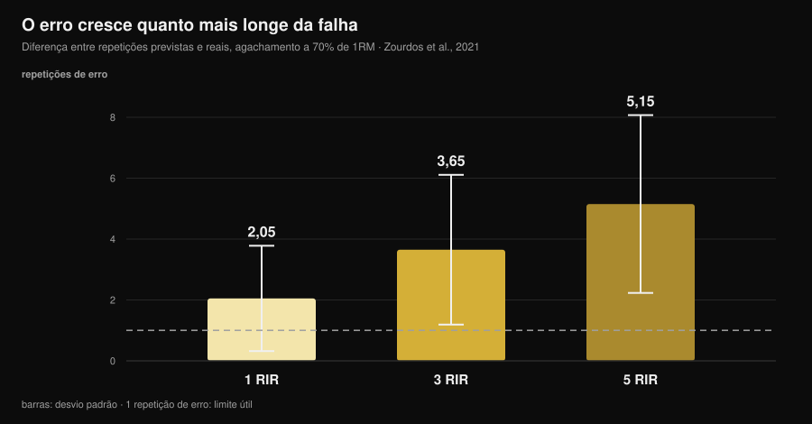
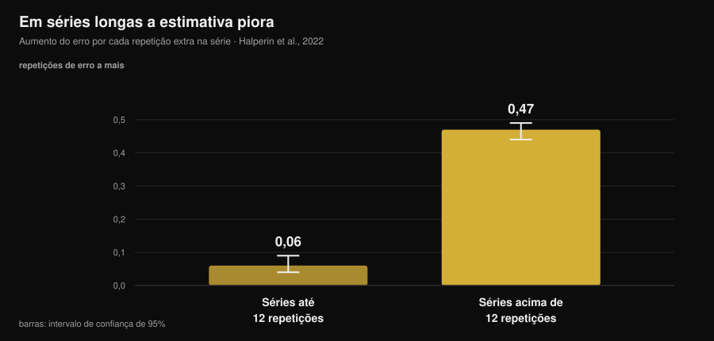

# Qual é a precisão do seu RIR? O que dizem os estudos

Por [Giammaria Loi](/autore/giammaria-loi) · atualizado em 14 de novembro de 2026

"Pare a 2 repetições da falha." É a instrução mais comum nos treinos modernos, incluindo os meus, e ela funciona com uma condição: que você reconheça esse ponto. Sobre isso a pesquisa acumulou dez anos de dados, e o quadro é mais interessante do que costuma ser contado: não erramos muito, erramos **sempre na mesma direção** e de forma previsível. Saber onde o erro se concentra é o que separa um RIR útil de um número anotado no diário por hábito.

## Em resumo

- **Em média subestimamos cerca de 1 repetição.** Na meta-análise com 12 estudos e 414 participantes o erro médio é de 0,95 repetições (IC 95% 0,17-1,73): você quase sempre tinha mais do que pensava.
- **O erro cresce com a distância da falha.** No agachamento a 70% do máximo, a diferença entre repetições previstas e efetivas foi de 2,05 a 1 RIR, 3,65 a 3 RIR e **5,15 a 5 RIR**: a 5 RIR o número já não significa nada.
- **Séries longas arruínam a estimativa.** Acima de 12 repetições por série o erro aumenta 0,47 repetições a cada repetição a mais, contra 0,06 nas séries curtas: oito vezes mais rápido.
- **A experiência não resolve.** Nos estudos o nível de treinamento não influencia a precisão, e seis semanas de prática com feedback não melhoraram o erro absoluto.
- **Onde o RIR funciona, funciona bem.** No supino, a 1 e 3 RIR, atletas treinados erraram em média 0,65 ± 0,78 repetições. A janela útil é estreita, mas dentro dela a ferramenta se sustenta.

*Gráfico Nurvan sobre os dados de Zourdos et al., 2021 (25 homens treinados, agachamento a 70% do máximo, séries até a falha de 16 ± 4 repetições). As barras verticais são o desvio padrão. Linha tracejada: uma repetição de erro, a margem dentro da qual uma estimativa continua utilizável.*

## O que o RIR mede, e por que virou o número central

RIR quer dizer *repetitions in reserve*: as repetições que você acha que ainda tem antes da falha técnica. É o jeito mais simples de prescrever esforço sem depender do máximo do dia, que muda com sono, estresse e café. Uma revisão de 2024 sobre 31 estudos e 855 participantes confirma que as escalas de RIR são praticáveis e úteis para regular a intensidade, e que o uso predominante na literatura é exatamente o dos treinos: fixar um RIR alvo e mover a carga de acordo.

O ponto fraco é que o RIR não é uma medida, é uma **previsão**. E uma previsão se avalia de um só jeito: comparando com o que acontece de fato.

## O quanto erramos de verdade

A melhor referência é a meta-análise de Halperin e colegas na *Sports Medicine*: 12 estudos, 414 participantes, 262 efeitos. Resultado principal: os participantes **subestimam** as repetições que faltam até a falha em 0,95 repetições em média (IC 95% 0,17-1,73).

Uma repetição de erro parece pouco, e em parte é. Mas dois detalhes contam mais do que a média.

O primeiro é a heterogeneidade: 97,9%. Isso quer dizer que essa média resume situações muito diferentes entre si, e que "mais ou menos uma repetição" não é o seu erro em cada série que você faz. A variabilidade entre pessoas, por outro lado, é contida: desvio padrão de 1,45 repetições. Não existem muitos "talentos do RIR" — o erro depende da situação, não de quem você é.

O segundo é a direção. Subestimar significa que, quando você para convencido de ter 2 repetições na reserva, na verdade tinha 3. Não é um erro aleatório que se compensa: ele te treina **sistematicamente mais longe da falha** do que o treino manda.

O mesmo sinal aparece nos trabalhos individuais, com números maiores. Em 141 pessoas testadas numa sessão de corpo inteiro, o erro padrão de medida ficou entre 2,64 e 3,38 repetições. Num experimento com desenho de engano em quem tinha pelo menos um ano de treino, a subestimação foi de 2,0 repetições (IC 95% 0,0-4,0) na cadeira extensora.

## Onde o RIR funciona e onde não

Aqui está a contribuição útil da pesquisa, e a parte que os conteúdos sobre o tema pulam: a precisão **não é uma propriedade da pessoa, é uma propriedade da situação**.

Três condições a pioram de forma documentada.

**A distância da falha.** No estudo sobre o agachamento a 70% do máximo, 25 homens treinados (4,7 anos de experiência média) deviam avisar quando estavam a 5, 3 e 1 repetição da falha, e depois seguir até a falha real. O erro cresceu conforme o ponto de aviso se afastava da falha: 2,05 ± 1,73 repetições a 1 RIR, 3,65 ± 2,46 a 3 RIR, 5,15 ± 2,92 a 5 RIR. Uma prescrição de "5 RIR" num agachamento de 16 repetições, na prática, não prescreve nada.

**O tamanho da série.** É o moderador mais nítido da meta-análise. Nas séries de até 12 repetições o erro cresce 0,06 repetições por cada repetição executada (IC 95% 0,04-0,09); acima de 12 repetições cresce 0,47 (IC 95% 0,44-0,49). No estudo do agachamento, a correlação entre repetições totais e erro era r = 0,65 a 5 RIR e r = 0,01 a 1 RIR: quanto mais longa a série, pior a estimativa — e a experiência de treino não era preditiva.

*Gráfico Nurvan sobre os coeficientes da meta-regressão de Halperin et al., 2022 (12 estudos, 414 participantes). As barras verticais são o intervalo de confiança de 95%. O valor indica quanto aumenta o erro de estimativa por cada repetição a mais executada na série.*

**O número da série.** As estimativas melhoram ligeiramente nas séries seguintes da mesma sessão (0,07 repetições a menos de erro por série), provavelmente porque a referência da primeira série recalibra a percepção. Um efeito pequeno, mas na direção útil: a primeira série de um exercício é a menos confiável.

E uma condição que melhora o cenário: a **proximidade da falha** combinada com exercícios e cargas que não produzem séries longuíssimas. No supino a 75% do máximo, com 24 atletas treinados (12 homens e 12 mulheres) avisando 1 e 3 RIR, o erro absoluto médio foi de 0,65 ± 0,78 repetições, com equivalência estatística dentro de ±1 repetição e nenhuma relação com sexo, anos de experiência ou força relativa. Nos exercícios de uma só articulação em máquinas, com 58 pessoas treinadas e não treinadas, as estimativas foram mais precisas perto da falha e nas séries seguintes, sem diferenças entre homens e mulheres nem entre exercícios.

Traduzindo: o RIR não é "impreciso". Ele é preciso **de 3 para baixo, em séries não muito longas**, e vira ruído no resto.

## A experiência não te salva (e isso muda o modo de usar)

É a crença mais difundida entre quem treina há anos: "o RIR a gente aprende a sentir". Os dados não sustentam isso.

Na meta-análise o nível de treinamento não influencia a precisão (β = -0,006; IC 95% de -0,02 a 0,007). No estudo do agachamento, a idade de treino não predizia a qualidade das estimativas. Nas máquinas, nem a experiência de treino nem a experiência específica em dar um RIR tiveram efeito.

O teste mais direto é um trabalho com 9 homens treinados que fizeram supino três vezes por semana durante seis semanas, avisando 4 RIR e 1 RIR na série final de cada sessão. Depois de seis semanas o erro **absoluto** não havia melhorado de forma significativa; o que mudou foi a direção, com maior tendência a subestimar nas sessões finais e nas séries mais longas.

Um único sinal na contramão, do trabalho com 141 pessoas: uma tendência de melhora com a experiência. Tendência, não efeito nítido. O saldo honesto é que o treinador experiente e o iniciante erram de modo parecido, e que a solução não é esperar para "pegar o jeito": é construir o RIR onde ele é confiável e verificá-lo.

## Por que um número errado muda os resultados

Depende do que você procura, e aqui a literatura é surpreendentemente clara.

Para a **força**, a distância da falha conta pouco: na série de meta-regressões de 2024 os intervalos de confiança das inclinações para o RIR estimado contêm o zero, ou seja, uma relação desprezível com os ganhos de força. Se você treina força, o seu erro de estimativa custa pouco.

Para a **hipertrofia** a mesma análise encontra inclinações negativas com intervalos que não contêm o zero: o crescimento muscular aumenta conforme as séries terminam mais perto da falha. Cuidado para não transformar isso em "treinar até a falha é melhor": a meta-análise de 2023 sobre 15 estudos não encontra vantagem da falha técnica em relação à não falha (ES 0,12; IC 95% de -0,13 a 0,37), nem de limiares altos de perda de velocidade em relação a moderados, e levanta a hipótese de uma relação **não linear**.

Juntando as duas coisas: a subestimação sistemática te desloca na direção que custa algo em hipertrofia (mais longe da falha do que o previsto), e o remédio não é ir até a falha, é reduzir a incerteza. Sobre quantas repetições e quanto descanso colocar em volta desse esforço escrevemos um texto à parte: [quantas repetições para ganhar massa](/pt/blog/quantas-repeticoes-massa-muscular).

## O que a pesquisa diz de verdade

| Afirmação comum | Veredito | Fonte |
|---|---|---|
| "Treine a 2 RIR e você sabe o que está fazendo" | **A precisar**: a 1-3 RIR a estimativa se sustenta (erro de 0,65-2 repetições), a 5 RIR não (5,15) | Refalo et al., 2024; Zourdos et al., 2021 |
| "Com a experiência você aprende a sentir o RIR" | **Desmentido**: o nível de treinamento não influencia a precisão e 6 semanas de prática não reduziram o erro absoluto | Halperin et al., 2022; Remmert et al., 2023 |
| "Se eu erro, erro nas duas direções" | **Desmentido**: o erro é sistemático no sentido da subestimação (0,95 repetições em média) | Halperin et al., 2022 |
| "O RIR vale do mesmo jeito em qualquer série" | **Desmentido**: acima de 12 repetições o erro cresce 8 vezes mais rápido | Halperin et al., 2022 |
| "Parar longe da falha não muda nada" | **A precisar**: desprezível para a força, mensurável para a hipertrofia | Robinson et al., 2024; Refalo et al., 2023 |
| "A velocidade da barra resolve o problema" | **Desmentido** no levantamento terra com barra hexagonal: nenhuma condição passou nos critérios de acurácia | Chen et al., 2026 |

### E a tecnologia?

A alternativa proposta há anos é medir a velocidade da barra: a velocidade cai à medida que a falha se aproxima, então um limiar de velocidade deveria dizer a quantas repetições você está. Um trabalho publicado na edição de novembro de 2026 do *Journal of Strength and Conditioning Research* testou a ideia no levantamento terra com barra hexagonal: 19 homens bem treinados, séries até a falha a 65% e a 85% do máximo, três critérios declarados com antecedência (erro mediano ≤ 2 repetições e pelo menos 75% de probabilidade tanto de estimativa aceitável quanto de o limiar de velocidade realmente aparecer).

Nenhuma condição satisfez os três critérios, e a probabilidade de o limiar esperado aparecer era tão baixa que tornava os modelos inutilizáveis em tempo real. Vale para aquele exercício e aquele contexto, não para todo o treino baseado em velocidade, mas a lição é geral: até a ferramenta objetiva precisa ser validada no exercício em que você a usa.

## Como aplicar

1. **Prescreva RIR só de 3 para baixo.** Acima de 3 RIR use carga e repetições fixas, ou uma porcentagem: pedir "pare a 5 RIR" é pedir um número que nos estudos erra por 5.
2. **Mantenha as séries "a RIR" dentro de 10-12 repetições.** É o limiar acima do qual o erro acelera. Séries de 20 com RIR declarado são ficção contábil.
3. **Declare antes, verifique depois.** Anote o RIR previsto *enquanto* fecha a série, não quando preenche o diário à noite: a estimativa retrospectiva não é a mesma coisa.
4. **Calibre a cada 4-6 semanas.** Uma série até a falha técnica num exercício seguro (máquina, ou supino com os pinos de segurança) com a previsão declarada umas duas repetições antes. A diferença entre previsto e efetivo é o seu desvio pessoal, e precisa ser relida: se você declara 2 e faz 4, o seu "2" vale 4.
5. **Não confie na primeira série.** É a menos precisa da sessão. Se precisa ajustar a carga, ajuste na segunda.
6. **Se o objetivo é hipertrofia, corrija na direção certa.** Sabendo que a tendência é parar cedo demais, um "uma repetição a mais do que me parece" nas últimas séries de um exercício seguro realinha a realidade ao treino.

### Se você treina outras pessoas a distância

O RIR que um cliente te escreve não é um dado, é uma tradução. Três cuidados que mudam a qualidade das informações que você recebe:

- **Pergunte as repetições, não a nota.** "Quantas você ainda faria?" produz respostas mais úteis do que "em que RIR você estava?", porque a segunda pergunta convida a preencher um campo.
- **Trate RIR altos como ruído.** Um 4 ou 5 relatado diz "eu não estava perto da falha" e mais nada. Não construa uma progressão de carga sobre isso.
- **Coloque uma calibração no programa, não a pedido.** Uma série de teste programada todo mês dá a você o desvio do cliente e a ele a prova de que não estava "quase na falha". Sobre o ritmo com que vale a pena revisar programa e cargas, falamos em [de quanto em quanto tempo mudar o treino](/pt/blog/de-quanto-em-quanto-tempo-mudar-o-treino).

> **Nurvan: o RIR previsto ao lado do real**
>
> No Nurvan você registra o RIR série por série junto com a carga, e nas séries de calibração anota a previsão e as repetições efetivas: o desvio fica no histórico do exercício, não na memória. É assim que um número declarado se torna um dado utilizável, para você ou para o coach que te acompanha. [Experimente o Nurvan](https://nurvan.app)

## Perguntas frequentes

**Qual é a precisão do RIR?**
Em média se subestima cerca de 1 repetição (0,95; IC 95% 0,17-1,73 na meta-análise com 414 participantes), mas a média esconde muito. Perto da falha e em séries curtas o erro cai abaixo de uma repetição; a 5 repetições da falha, no agachamento, foi de 5,15 repetições.

**É melhor treinar a RIR 2 ou até a falha?**
Para a força a diferença é desprezível. Para a hipertrofia, as séries que terminam mais perto da falha mostram um crescimento ligeiramente maior, mas a falha técnica não se mostrou superior à não falha na meta-análise com 15 estudos: a relação parece não linear. Trabalhar a 1-3 RIR com algumas séries de verificação é o meio-termo que a literatura sustenta melhor.

**Como sei se o meu RIR está certo?**
Com uma série de calibração: você declara o RIR umas duas repetições antes do fim e depois vai até a falha técnica num exercício seguro. A diferença entre previsão e realidade é o seu desvio, e ele tende a ir na direção da subestimação.

**O RIR funciona também para iniciantes?**
Nos dados disponíveis a precisão das estimativas não depende do nível de treinamento: iniciantes e avançados erram de forma parecida. A diferença está na segurança de execução, não na estimativa — para quem começa, vale limitar o RIR a máquinas e exercícios simples.

## Leia também

- [Quantas repetições para ganhar massa: o mito do 8-12](/pt/blog/quantas-repeticoes-massa-muscular) — onde colocar o esforço que você está tentando medir.
- [De quanto em quanto tempo mudar o treino?](/pt/blog/de-quanto-em-quanto-tempo-mudar-o-treino) — quanto manter um programa estável para ver se ele funciona.
- [Treino gerado por IA: o que dizem os estudos](/pt/blog/treino-gerado-por-ia-estudos) — o que um algoritmo pode e não pode decidir no seu lugar.

## Fontes

1. Halperin I, Malleron T, Har-Nir I, Androulakis-Korakakis P, Wolf M, Fisher J, Steele J, 2022. Accuracy in Predicting Repetitions to Task Failure in Resistance Exercise: A Scoping Review and Exploratory Meta-analysis. *Sports Med* 52(2):377-390. [PMID 34542869](https://pubmed.ncbi.nlm.nih.gov/34542869/) · [DOI 10.1007/s40279-021-01559-x](https://doi.org/10.1007/s40279-021-01559-x)
2. Zourdos MC, Goldsmith JA, Helms ER, et al., 2021. Proximity to Failure and Total Repetitions Performed in a Set Influences Accuracy of Intraset Repetitions in Reserve-Based Rating of Perceived Exertion. *J Strength Cond Res* 35(Suppl 1):S158-S165. [PMID 30747900](https://pubmed.ncbi.nlm.nih.gov/30747900/) · [DOI 10.1519/JSC.0000000000002995](https://doi.org/10.1519/JSC.0000000000002995)
3. Refalo MC, Remmert JF, Pelland JC, Robinson ZP, Zourdos MC, Hamilton DL, Fyfe JJ, Helms ER, 2024. Accuracy of Intraset Repetitions-in-Reserve Predictions During the Bench Press Exercise in Resistance-Trained Male and Female Subjects. *J Strength Cond Res* 38(3):e78-e85. [PMID 37967832](https://pubmed.ncbi.nlm.nih.gov/37967832/) · [DOI 10.1519/JSC.0000000000004653](https://doi.org/10.1519/JSC.0000000000004653)
4. Steele J, Endres A, Fisher J, Gentil P, Giessing J, 2017. Ability to predict repetitions to momentary failure is not perfectly accurate, though improves with resistance training experience. *PeerJ* 5:e4105. [PMID 29204323](https://pubmed.ncbi.nlm.nih.gov/29204323/) · [DOI 10.7717/peerj.4105](https://doi.org/10.7717/peerj.4105)
5. Armes C, Standish-Hunt H, Androulakis-Korakakis P, et al., 2020. "Just One More Rep!" - Ability to Predict Proximity to Task Failure in Resistance Trained Persons. *Front Psychol* 11:565416. [PMID 33424678](https://pubmed.ncbi.nlm.nih.gov/33424678/) · [DOI 10.3389/fpsyg.2020.565416](https://doi.org/10.3389/fpsyg.2020.565416)
6. Remmert JF, Laurson KR, Zourdos MC, 2023. Accuracy of Predicted Intraset Repetitions in Reserve (RIR) in Single- and Multi-Joint Resistance Exercises Among Trained and Untrained Men and Women. *Percept Mot Skills* 130(3):1239-1254. [PMID 37036795](https://pubmed.ncbi.nlm.nih.gov/37036795/) · [DOI 10.1177/00315125231169868](https://doi.org/10.1177/00315125231169868)
7. Remmert JF, Robinson ZP, Pelland JC, et al., 2023. Changes in Intraset Repetitions in Reserve Prediction Accuracy During Six Weeks of Bench Press Training in Trained Men. *Percept Mot Skills* 130(5):2139-2160. [PMID 37436724](https://pubmed.ncbi.nlm.nih.gov/37436724/) · [DOI 10.1177/00315125231189098](https://doi.org/10.1177/00315125231189098)
8. Robinson ZP, Pelland JC, Remmert JF, Refalo MC, Jukic I, Steele J, Zourdos MC, 2024. Exploring the Dose-Response Relationship Between Estimated Resistance Training Proximity to Failure, Strength Gain, and Muscle Hypertrophy: A Series of Meta-Regressions. *Sports Med* 54(9):2209-2231. [PMID 38970765](https://pubmed.ncbi.nlm.nih.gov/38970765/) · [DOI 10.1007/s40279-024-02069-2](https://doi.org/10.1007/s40279-024-02069-2)
9. Refalo MC, Helms ER, Trexler ET, Hamilton DL, Fyfe JJ, 2023. Influence of Resistance Training Proximity-to-Failure on Skeletal Muscle Hypertrophy: A Systematic Review with Meta-analysis. *Sports Med* 53(3):649-665. [PMID 36334240](https://pubmed.ncbi.nlm.nih.gov/36334240/) · [DOI 10.1007/s40279-022-01784-y](https://doi.org/10.1007/s40279-022-01784-y)
10. Chen W, Zhang H, Li R, et al., 2026. Velocity-Based Monitoring Lacks Both Accuracy and Applicability for Estimating Repetitions in Reserve During the Hexagonal Bar Deadlift. *J Strength Cond Res* 40(11):1335-1341. [PMID 42328880](https://pubmed.ncbi.nlm.nih.gov/42328880/) · [DOI 10.1519/JSC.0000000000005549](https://doi.org/10.1519/JSC.0000000000005549)

Fonte adicional consultada: Bastos V, Machado S, Teixeira DS, 2024. Feasibility and Usefulness of Repetitions-In-Reserve Scales for Selecting Exercise Intensity: A Scoping Review. *Percept Mot Skills* 131(3):940-970. [PMID 38563729](https://pubmed.ncbi.nlm.nih.gov/38563729/). Tema escolhido a partir de sinais de tendência de novembro de 2026 sobre a intensidade medida em RIR e sobre a comparação falha/RIR, com conteúdos concorrentes que prescrevem um RIR alvo sem relatar o quanto somos precisos ao estimá-lo. Fontes científicas consultadas através do PubMed.

---

*Giammaria Loi é o fundador do Nurvan. Treina com pesos desde 2012, trabalha como personal trainer e coach certificado pela FIPE desde 2013 e compete em powerlifting em nível nacional desde 2018. Cada artigo que assina parte dos estudos científicos e chega ao que funciona de verdade na academia. [Página do autor](/autore/giammaria-loi)*

> Nota: conteúdo informativo, não substitui a opinião de um médico ou de um profissional qualificado.
