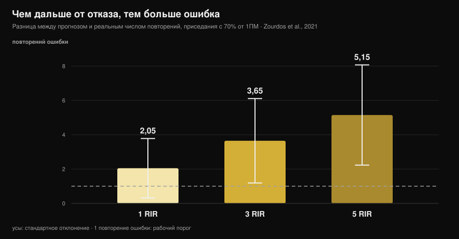
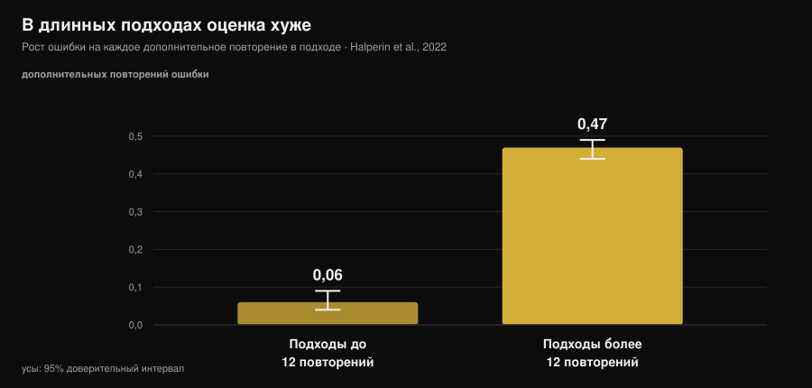

# Насколько точен ваш RIR? Что говорят исследования

Автор: [Джаммария Лои](/autore/giammaria-loi) · обновлено 14 ноября 2026

«Остановись за 2 повторения до отказа». Это самая частая формулировка в современных программах, включая мои, и она работает при одном условии: вы должны узнавать эту точку. На этот счёт исследования накопили десять лет данных, и картина интереснее, чем о ней рассказывают: мы ошибаемся не сильно, но ошибаемся **всегда в одну сторону** и предсказуемо. Понимание того, где накапливается ошибка, отличает полезный RIR от цифры, которую пишут в дневник по привычке.

## Коротко

- **В среднем мы недооцениваем примерно на 1 повторение.** В метаанализе по 12 исследованиям и 414 участникам средняя ошибка — 0,95 повторения (95% ДИ 0,17-1,73): запас почти всегда был больше, чем вам казалось.
- **Ошибка растёт с удалением от отказа.** В приседе с 70% от максимума разница между прогнозом и реальностью составила 2,05 повторения на 1 RIR, 3,65 на 3 RIR и **5,15 на 5 RIR**: на 5 RIR цифра уже ничего не значит.
- **Длинные подходы ломают оценку.** После 12 повторений в подходе ошибка растёт на 0,47 повторения с каждым дополнительным повторением против 0,06 в коротких подходах — в восемь раз быстрее.
- **Опыт не решает проблему.** В исследованиях тренировочный стаж не влияет на точность, а шесть недель практики с обратной связью не улучшили абсолютную ошибку.
- **Там, где RIR работает, он работает хорошо.** В жиме лёжа на 1 и 3 RIR тренированные атлеты ошибались в среднем на 0,65 ± 0,78 повторения. Полезное окно узкое, но внутри него инструмент держится.

*График Nurvan по данным Zourdos et al., 2021 (25 тренированных мужчин, присед с 70% от максимума, подходы до отказа по 16 ± 4 повторения). Вертикальные линии — стандартное отклонение. Пунктирная линия: одно повторение ошибки, предел, внутри которого оценка остаётся рабочей.*

## Что измеряет RIR и почему он стал главной цифрой

RIR — это *repetitions in reserve*, повторения, которые, как вам кажется, остались до технического отказа. Это самый простой способ задать усилие, не завязываясь на максимум конкретного дня, который меняется от сна, стресса и кофе. Обзор 2024 года по 31 исследованию и 855 участникам подтверждает, что шкалы RIR применимы и полезны для регулировки интенсивности и что в литературе их используют именно так, как в программах: задают целевой RIR и подбирают под него вес.

Слабое место в том, что RIR — не измерение, а **прогноз**. А прогноз оценивают единственным способом: сравнивают с тем, что происходит в реальности.

## Насколько мы ошибаемся на самом деле

Лучший ориентир — метаанализ Halperin с коллегами в *Sports Medicine*: 12 исследований, 414 участников, 262 эффекта. Главный результат: участники **недооценивают** остающиеся до отказа повторения в среднем на 0,95 повторения (95% ДИ 0,17-1,73).

Одно повторение ошибки кажется немногим, и отчасти это так. Но две детали важнее средней величины.

Первая — гетерогенность: 97,9%. Это значит, что среднее собрало вместе очень разные ситуации и что «примерно одно повторение» — не ваша ошибка в каждом подходе. А вот разброс между людьми небольшой: стандартное отклонение 1,45 повторения. «Талантов RIR» почти не бывает: ошибка зависит от ситуации, а не от того, кто вы.

Вторая — направление. Недооценивать значит, что, когда вы останавливаетесь в уверенности, что в запасе 2 повторения, на деле их было 3. Это не случайная ошибка, которая компенсируется: она **систематически уводит вас дальше от отказа**, чем написано в программе.

Тот же знак ошибки виден в отдельных работах, только с большими числами. У 141 человека в тесте на тренировке на всё тело стандартная ошибка измерения оказалась между 2,64 и 3,38 повторения. В эксперименте с обманным дизайном у тех, кто тренировался минимум год, недооценка в разгибании ног составила 2,0 повторения (95% ДИ 0,0-4,0).

## Где RIR работает, а где нет

Здесь и есть полезный вклад науки — и ровно эту часть материалы по теме пропускают: точность **не свойство человека, а свойство ситуации**.

Три условия задокументированно её ухудшают.

**Расстояние до отказа.** В исследовании приседа с 70% от максимума 25 тренированных мужчин (в среднем 4,7 года опыта) должны были объявлять, когда до отказа остаётся 5, 3 и 1 повторение, а затем продолжать до настоящего отказа. Ошибка росла по мере того, как точка объявления отодвигалась от отказа: 2,05 ± 1,73 повторения на 1 RIR, 3,65 ± 2,46 на 3 RIR, 5,15 ± 2,92 на 5 RIR. Указание «5 RIR» в приседе на 16 повторений на практике не указывает ничего.

**Длина подхода.** Это самый отчётливый модератор в метаанализе. В подходах до 12 повторений ошибка растёт на 0,06 повторения с каждым выполненным повторением (95% ДИ 0,04-0,09); свыше 12 повторений — на 0,47 (95% ДИ 0,44-0,49). В исследовании приседа корреляция между общим числом повторений и ошибкой была r = 0,65 на 5 RIR и r = 0,01 на 1 RIR: чем длиннее подход, тем хуже оценка, а тренировочный опыт ничего не предсказывал.

*График Nurvan по коэффициентам метарегрессии Halperin et al., 2022 (12 исследований, 414 участников). Вертикальные линии — 95-процентный доверительный интервал. Значение показывает, насколько увеличивается ошибка оценки с каждым дополнительным выполненным повторением в подходе.*

**Номер подхода.** Оценки слегка улучшаются в последующих подходах той же тренировки (на 0,07 повторения меньше ошибки на подход) — вероятно, потому что первый подход перекалибровывает восприятие. Эффект маленький, но в полезную сторону: первый подход в упражнении — наименее надёжный.

И одно условие, которое оценку улучшает: **близость к отказу** вместе с упражнениями и весами, которые не дают очень длинных подходов. В жиме лёжа с 75% от максимума у 24 тренированных атлетов (12 мужчин и 12 женщин), объявлявших 1 и 3 RIR, средняя абсолютная ошибка составила 0,65 ± 0,78 повторения — со статистической эквивалентностью в пределах ±1 повторения и без связи с полом, стажем и относительной силой. В односуставных упражнениях на тренажёрах у 58 тренированных и нетренированных людей оценки были точнее ближе к отказу и в последующих подходах, без различий между мужчинами и женщинами и между упражнениями.

Если перевести: RIR не «неточен». Он точен **от 3 и ниже, в не слишком длинных подходах**, а в остальных случаях превращается в шум.

## Опыт не спасает (и это меняет способ применения)

Это самое распространённое убеждение среди тех, кто тренируется годами: «RIR учишься чувствовать». Данные его не поддерживают.

В метаанализе тренировочный стаж не влияет на точность (β = -0,006; 95% ДИ от -0,02 до 0,007). В исследовании приседа тренировочный возраст не предсказывал качество оценок. На тренажёрах ни общий опыт тренировок, ни конкретный опыт в объявлении RIR эффекта не дали.

Самая прямая проверка — работа с 9 тренированными мужчинами, которые шесть недель жали лёжа трижды в неделю и объявляли 4 RIR и 1 RIR в последнем подходе каждой тренировки. Через шесть недель **абсолютная** ошибка значимо не улучшилась; изменилось направление: в поздних тренировках и в более длинных подходах недооценка стала сильнее.

Единственный сигнал в обратную сторону — из работы с 141 человеком: тенденция к улучшению с опытом. Тенденция, а не отчётливый эффект. Честный итог такой: опытный тренер и новичок ошибаются похоже, и решение не в том, чтобы ждать, пока «набьётся глаз», а в том, чтобы использовать RIR там, где он надёжен, и проверять его.

## Почему неверная цифра меняет результат

Зависит от того, что вам нужно, и здесь литература на удивление однозначна.

Для **силы** расстояние до отказа почти не важно: в серии метарегрессий 2024 года доверительные интервалы наклонов для оценённого RIR включают ноль, то есть связь с прибавкой силы пренебрежимая. Если вы тренируете силу, ваша ошибка оценки стоит немного.

Для **гипертрофии** тот же анализ находит отрицательные наклоны с интервалами, которые ноль не включают: рост мышц увеличивается по мере того, как подходы заканчиваются ближе к отказу. Но не стоит превращать это в «тренироваться до отказа лучше»: метаанализ 2023 года по 15 исследованиям не находит преимущества технического отказа над работой без отказа (ES 0,12; 95% ДИ от -0,13 до 0,37), как и высоких порогов потери скорости над умеренными, и предполагает **нелинейную** зависимость.

Если сложить два вывода: систематическая недооценка смещает вас в ту сторону, которая стоит чего-то в гипертрофии (дальше от отказа, чем задумано), и лекарство тут не в походе до отказа, а в снижении неопределённости. О том, сколько повторений и сколько отдыха ставить вокруг этого усилия, у нас есть отдельный материал: [сколько повторений делать для массы](/ru/blog/skolko-povtoreniy-dlya-massy).

## Что на самом деле говорят исследования

| Распространённое утверждение | Вердикт | Источник |
|---|---|---|
| «Тренируйся на 2 RIR и будешь понимать, что делаешь» | **Требует уточнения**: на 1-3 RIR оценка держится (ошибка 0,65-2 повторения), на 5 RIR нет (5,15) | Refalo et al., 2024; Zourdos et al., 2021 |
| «С опытом учишься чувствовать RIR» | **Опровергнуто**: тренировочный стаж не влияет на точность, а 6 недель практики не снизили абсолютную ошибку | Halperin et al., 2022; Remmert et al., 2023 |
| «Если ошибаюсь, то в обе стороны» | **Опровергнуто**: ошибка систематически идёт в недооценку (0,95 повторения в среднем) | Halperin et al., 2022 |
| «RIR одинаково работает в любом подходе» | **Опровергнуто**: свыше 12 повторений ошибка растёт в 8 раз быстрее | Halperin et al., 2022 |
| «Остановиться далеко от отказа ничего не меняет» | **Требует уточнения**: пренебрежимо для силы, измеримо для гипертрофии | Robinson et al., 2024; Refalo et al., 2023 |
| «Скорость штанги решает проблему» | **Опровергнуто** на тяге с шестигранной штангой: ни одно условие не прошло критерии точности | Chen et al., 2026 |

### А техника?

Альтернатива, которую предлагают годами, — измерять скорость штанги: скорость падает по мере приближения к отказу, значит порог скорости должен подсказывать, сколько повторений осталось. Работа в ноябрьском выпуске *Journal of Strength and Conditioning Research* за 2026 год проверила идею на тяге с шестигранной штангой: 19 хорошо тренированных мужчин, подходы до отказа с 65% и 85% от максимума, три заранее объявленных критерия (медианная ошибка ≤ 2 повторения и не менее 75% вероятности как приемлемой оценки, так и того, что порог скорости действительно появится).

Ни одно условие не выполнило все три критерия, а вероятность появления ожидаемого порога была настолько низкой, что модели оказались непригодны в реальном времени. Это касается того упражнения и того контекста, а не всего тренинга по скорости, но урок общий: даже объективный инструмент нужно валидировать на том упражнении, где вы его применяете.

## Как это применить

1. **Задавайте RIR только от 3 и ниже.** Выше 3 RIR используйте фиксированный вес и число повторений или процент: просьба «остановись на 5 RIR» — это просьба о цифре, которая в исследованиях ошибается на 5.
2. **Держите «подходы на RIR» в пределах 10-12 повторений.** Это порог, после которого ошибка ускоряется. Подходы на 20 повторений с объявленным RIR — бухгалтерская фикция.
3. **Сначала объявите, потом проверьте.** Записывайте прогноз RIR *пока* закрываете подход, а не вечером при заполнении дневника: оценка по памяти — это другое.
4. **Калибруйте каждые 4-6 недель.** Один подход до технического отказа в безопасном упражнении (тренажёр или жим со страховочными упорами), с прогнозом, объявленным за пару повторений до конца. Разница между прогнозом и фактом — ваше личное смещение, и его надо читать: если вы объявляете 2, а делаете 4, ваша «двойка» — это четвёрка.
5. **Не доверяйте первому подходу.** Он самый неточный за тренировку. Если нужно подобрать вес, подбирайте по второму.
6. **Если цель — гипертрофия, корректируйте в нужную сторону.** Зная, что тенденция — останавливаться слишком рано, установка «на одно повторение больше, чем кажется» в последних подходах безопасного упражнения возвращает реальность к программе.

### Если вы тренируете других онлайн

RIR, который клиент вам пишет, — не данные, а перевод. Три приёма, которые меняют качество получаемой информации:

- **Спрашивайте про повторения, а не про балл.** «Сколько бы ты сделал ещё?» даёт более полезные ответы, чем «на каком RIR ты был?»: второй вопрос приглашает просто заполнить поле.
- **Относитесь к высоким RIR как к шуму.** Сообщённые 4 или 5 означают «я был далеко от отказа» и ничего больше. Не стройте на этом прогрессию веса.
- **Ставьте калибровку в программу, а не по запросу.** Запланированный раз в месяц тестовый подход даёт вам смещение клиента, а ему — доказательство, что он был не «почти в отказе». О том, как часто вообще имеет смысл пересматривать программу и веса, мы писали в материале [как часто менять программу тренировок](/ru/blog/kak-chasto-menyat-programmu-trenirovok).

> **Nurvan: прогноз RIR рядом с фактом**
>
> В Nurvan вы вносите RIR подход за подходом вместе с весом, а в калибровочных подходах записываете прогноз и фактические повторения: смещение остаётся в истории упражнения, а не в памяти. Так объявленная цифра становится рабочими данными — для вас или для коуча, который вас ведёт. [Попробовать Nurvan](https://nurvan.app)

## Частые вопросы

**Насколько точен RIR?**
В среднем запас недооценивают примерно на 1 повторение (0,95; 95% ДИ 0,17-1,73 в метаанализе по 414 участникам), но среднее многое скрывает. Рядом с отказом и в коротких подходах ошибка падает ниже одного повторения; за 5 повторений до отказа в приседе она составила 5,15 повторения.

**Что лучше: тренироваться на RIR 2 или до отказа?**
Для силы разница пренебрежима. Для гипертрофии подходы, которые заканчиваются ближе к отказу, показывают немного больший рост, но технический отказ не оказался лучше работы без отказа в метаанализе по 15 исследованиям: зависимость выглядит нелинейной. Работать на 1-3 RIR с несколькими проверочными подходами — компромисс, который литература поддерживает лучше всего.

**Как понять, верен ли мой RIR?**
Калибровочным подходом: вы объявляете RIR за пару повторений до конца, а затем идёте до технического отказа в безопасном упражнении. Разница между прогнозом и реальностью — ваше смещение, и обычно оно идёт в сторону недооценки.

**Работает ли RIR у новичков?**
По доступным данным точность оценок не зависит от тренировочного стажа: новички и продвинутые ошибаются похоже. Разница в безопасности выполнения, а не в оценке: тем, кто начинает, лучше ограничить RIR тренажёрами и простыми упражнениями.

## Читайте также

- [Сколько повторений делать для массы: миф о 8-12](/ru/blog/skolko-povtoreniy-dlya-massy) — куда вкладывать то усилие, которое вы пытаетесь измерить.
- [Как часто менять программу тренировок?](/ru/blog/kak-chasto-menyat-programmu-trenirovok) — сколько держать программу неизменной, чтобы понять, работает ли она.
- [План тренировок от ИИ: что говорят исследования](/ru/blog/plan-trenirovok-ot-ii) — что алгоритм может и чего не может решить за вас.

## Источники

1. Halperin I, Malleron T, Har-Nir I, Androulakis-Korakakis P, Wolf M, Fisher J, Steele J, 2022. Accuracy in Predicting Repetitions to Task Failure in Resistance Exercise: A Scoping Review and Exploratory Meta-analysis. *Sports Med* 52(2):377-390. [PMID 34542869](https://pubmed.ncbi.nlm.nih.gov/34542869/) · [DOI 10.1007/s40279-021-01559-x](https://doi.org/10.1007/s40279-021-01559-x)
2. Zourdos MC, Goldsmith JA, Helms ER, et al., 2021. Proximity to Failure and Total Repetitions Performed in a Set Influences Accuracy of Intraset Repetitions in Reserve-Based Rating of Perceived Exertion. *J Strength Cond Res* 35(Suppl 1):S158-S165. [PMID 30747900](https://pubmed.ncbi.nlm.nih.gov/30747900/) · [DOI 10.1519/JSC.0000000000002995](https://doi.org/10.1519/JSC.0000000000002995)
3. Refalo MC, Remmert JF, Pelland JC, Robinson ZP, Zourdos MC, Hamilton DL, Fyfe JJ, Helms ER, 2024. Accuracy of Intraset Repetitions-in-Reserve Predictions During the Bench Press Exercise in Resistance-Trained Male and Female Subjects. *J Strength Cond Res* 38(3):e78-e85. [PMID 37967832](https://pubmed.ncbi.nlm.nih.gov/37967832/) · [DOI 10.1519/JSC.0000000000004653](https://doi.org/10.1519/JSC.0000000000004653)
4. Steele J, Endres A, Fisher J, Gentil P, Giessing J, 2017. Ability to predict repetitions to momentary failure is not perfectly accurate, though improves with resistance training experience. *PeerJ* 5:e4105. [PMID 29204323](https://pubmed.ncbi.nlm.nih.gov/29204323/) · [DOI 10.7717/peerj.4105](https://doi.org/10.7717/peerj.4105)
5. Armes C, Standish-Hunt H, Androulakis-Korakakis P, et al., 2020. "Just One More Rep!" - Ability to Predict Proximity to Task Failure in Resistance Trained Persons. *Front Psychol* 11:565416. [PMID 33424678](https://pubmed.ncbi.nlm.nih.gov/33424678/) · [DOI 10.3389/fpsyg.2020.565416](https://doi.org/10.3389/fpsyg.2020.565416)
6. Remmert JF, Laurson KR, Zourdos MC, 2023. Accuracy of Predicted Intraset Repetitions in Reserve (RIR) in Single- and Multi-Joint Resistance Exercises Among Trained and Untrained Men and Women. *Percept Mot Skills* 130(3):1239-1254. [PMID 37036795](https://pubmed.ncbi.nlm.nih.gov/37036795/) · [DOI 10.1177/00315125231169868](https://doi.org/10.1177/00315125231169868)
7. Remmert JF, Robinson ZP, Pelland JC, et al., 2023. Changes in Intraset Repetitions in Reserve Prediction Accuracy During Six Weeks of Bench Press Training in Trained Men. *Percept Mot Skills* 130(5):2139-2160. [PMID 37436724](https://pubmed.ncbi.nlm.nih.gov/37436724/) · [DOI 10.1177/00315125231189098](https://doi.org/10.1177/00315125231189098)
8. Robinson ZP, Pelland JC, Remmert JF, Refalo MC, Jukic I, Steele J, Zourdos MC, 2024. Exploring the Dose-Response Relationship Between Estimated Resistance Training Proximity to Failure, Strength Gain, and Muscle Hypertrophy: A Series of Meta-Regressions. *Sports Med* 54(9):2209-2231. [PMID 38970765](https://pubmed.ncbi.nlm.nih.gov/38970765/) · [DOI 10.1007/s40279-024-02069-2](https://doi.org/10.1007/s40279-024-02069-2)
9. Refalo MC, Helms ER, Trexler ET, Hamilton DL, Fyfe JJ, 2023. Influence of Resistance Training Proximity-to-Failure on Skeletal Muscle Hypertrophy: A Systematic Review with Meta-analysis. *Sports Med* 53(3):649-665. [PMID 36334240](https://pubmed.ncbi.nlm.nih.gov/36334240/) · [DOI 10.1007/s40279-022-01784-y](https://doi.org/10.1007/s40279-022-01784-y)
10. Chen W, Zhang H, Li R, et al., 2026. Velocity-Based Monitoring Lacks Both Accuracy and Applicability for Estimating Repetitions in Reserve During the Hexagonal Bar Deadlift. *J Strength Cond Res* 40(11):1335-1341. [PMID 42328880](https://pubmed.ncbi.nlm.nih.gov/42328880/) · [DOI 10.1519/JSC.0000000000005549](https://doi.org/10.1519/JSC.0000000000005549)

Дополнительно изученный источник: Bastos V, Machado S, Teixeira DS, 2024. Feasibility and Usefulness of Repetitions-In-Reserve Scales for Selecting Exercise Intensity: A Scoping Review. *Percept Mot Skills* 131(3):940-970. [PMID 38563729](https://pubmed.ncbi.nlm.nih.gov/38563729/). Тема выбрана по трендовым сигналам ноября 2026 года об интенсивности, заданной через RIR, и о сравнении отказа с RIR, где конкурирующие материалы задают целевой RIR, не сообщая, насколько точно мы его оцениваем. Научные источники найдены через PubMed.

---

*Джаммария Лои — основатель Nurvan. Тренируется с отягощениями с 2012 года, работает персональным тренером и коучем с сертификацией FIPE с 2013 года и выступает в пауэрлифтинге на национальном уровне с 2018 года. Каждая его статья начинается с научных работ и заканчивается тем, что действительно работает в зале. [Страница автора](/autore/giammaria-loi)*

> Примечание: информационный материал, он не заменяет консультацию врача или квалифицированного специалиста.
