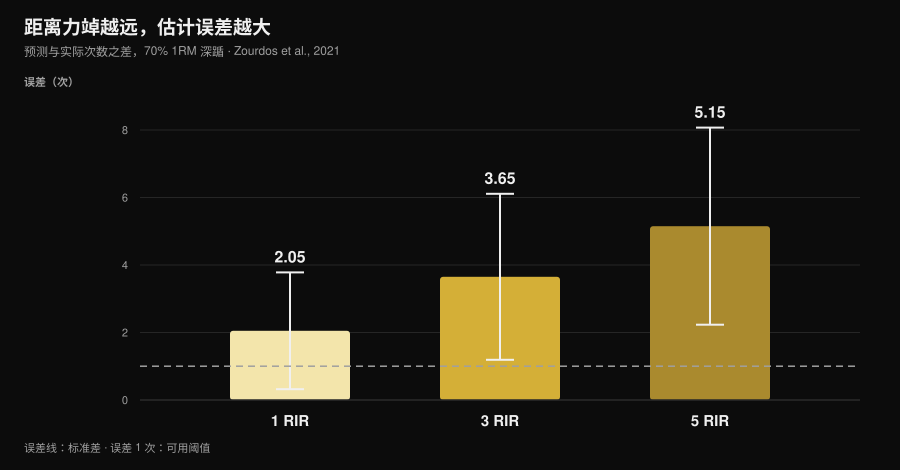
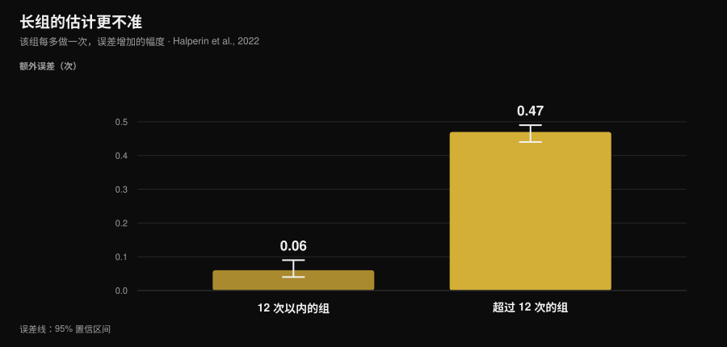

# 你的 RIR 估得准吗？研究怎么说

作者：[Giammaria Loi](/autore/giammaria-loi) · 更新于 2026 年 11 月 14 日

“离力竭还剩两次就停。”这是现代训练计划里最常见的一句指令，我自己写的计划也一样，而它成立有一个前提：你得认得出那个点。关于这件事，研究已经攒了十年的数据，而真实的图景比流传的版本更有意思：我们估得并不算离谱，但我们**几乎总是朝同一个方向错**，而且错得有规律。知道误差集中在哪里，才是“有用的 RIR”和“写在训练日志里凑数的一个数字”之间的分界线。

## 要点速览

- **平均来说我们会低估大约 1 次。** 汇总 12 项研究、414 名受试者的荟萃分析里，平均误差是 0.95 次（95% CI 0.17-1.73）：你剩下的次数几乎总比你以为的多。
- **离力竭越远，误差越大。** 在 70% 最大重量的深蹲里，预测次数和实际次数的差值是 1 RIR 时 2.05 次、3 RIR 时 3.65 次、**5 RIR 时 5.15 次**：到了 5 RIR，这个数字已经不表示任何东西。
- **长组会毁掉估计。** 每组超过 12 次之后，每多做一次，误差增加 0.47 次；短组里是 0.06 次。快八倍。
- **经验解决不了这件事。** 研究里训练水平不影响准确度，而六周带反馈的练习也没有改善绝对误差。
- **在它管用的地方，它真的管用。** 卧推上，1 RIR 和 3 RIR 时训练有素的运动员平均只错了 0.65 ± 0.78 次。可用窗口很窄，但在窗口之内，这个工具站得住。

*Nurvan 图表，数据来自 Zourdos 等，2021（25 名训练有素的男性，70% 最大重量深蹲，做到力竭的组为 16 ± 4 次）。竖线为标准差。虚线是 1 次误差，也就是一个估计还能拿来用的边界。*

## RIR 测的是什么，为什么它成了核心数字

RIR 是 *repetitions in reserve*，储备次数：在技术性力竭之前你认为自己还剩下的次数。它是最简单的强度处方方式，不必依赖当天的最大重量——而最大重量会随睡眠、压力和一杯咖啡而变。2024 年一篇纳入 31 项研究、855 名受试者的综述确认，RIR 量表在调节强度上可行且有用，而文献里最主流的用法恰恰就是训练计划里的那一种：定一个目标 RIR，再据此调负重。

它的软肋在于，RIR 不是一次测量，而是一次**预测**。而预测只有一种评价方式：拿它跟真实发生的事情比。

## 我们到底错多少

最好的参照是 Halperin 等人发表在 *Sports Medicine* 上的荟萃分析：12 项研究，414 名受试者，262 个效应量。主要结果是，受试者把“到力竭还剩几次”平均**低估**了 0.95 次（95% CI 0.17-1.73）。

一次的误差听上去不多，某种程度上也确实不多。但有两个细节比这个平均值更重要。

第一个是异质性：97.9%。意思是这个平均值概括的是彼此差别很大的一堆情境，“大约一次”并不是你每做一组的误差。相反，人与人之间的变异并不大：标准差 1.45 次。并不存在很多“RIR 天才”——误差取决于情境，不取决于你是谁。

第二个是方向。低估意味着，当你认为还剩 2 次而停下时，实际上还剩 3 次。这不是会互相抵消的随机误差：它让你**系统性地比计划写的更远离力竭**。

同样的误差方向在单项研究里也能看到，数值更大。在 141 人完成的一次全身训练测试里，测量标准误落在 2.64 到 3.38 次之间。在一项针对至少有一年训练经验者的欺骗设计实验里，腿屈伸上的低估是 2.0 次（95% CI 0.0-4.0）。

## RIR 在哪里管用，在哪里不管用

这里是研究真正有用的贡献，也是同类内容普遍跳过的部分：准确度**不是人的属性，而是情境的属性**。

有三个条件会明确地让它变差。

**离力竭的距离。** 在 70% 最大重量深蹲的那项研究里，25 名训练有素的男性（平均 4.7 年训练经验）需要在自己感觉离力竭还有 5 次、3 次、1 次时报出来，然后继续做到真正的力竭。报告点离力竭越远，误差越大：1 RIR 时 2.05 ± 1.73 次，3 RIR 时 3.65 ± 2.46 次，5 RIR 时 5.15 ± 2.92 次。在一个能做 16 次的深蹲里写“5 RIR”，实际上什么也没规定。

**组的长度。** 这是荟萃分析里最清晰的调节因素。在不超过 12 次的组里，每执行一次，误差增加 0.06 次（95% CI 0.04-0.09）；超过 12 次之后，增加 0.47 次（95% CI 0.44-0.49）。在深蹲那项研究里，总次数与误差的相关性在 5 RIR 时是 r = 0.65，在 1 RIR 时是 r = 0.01：组越长，估计越差，而训练经验并不能预测这件事。

*Nurvan 图表，基于 Halperin 等，2022 的元回归系数（12 项研究，414 名受试者）。竖线是 95% 置信区间。数值表示组内每多执行一次，估计误差增加多少。*

**第几组。** 同一次训练里，越往后的组估计会略微变好（每组误差少 0.07 次），大概是因为第一组留下的参照重新校准了感知。效应很小，但方向有用：一个动作的第一组是最不可靠的那一组。

还有一个条件反而让它变好：**靠近力竭**，再加上不会制造超长组的动作和负重。在 75% 最大重量的卧推上，24 名训练有素的运动员（12 名男性、12 名女性）报出 1 RIR 和 3 RIR 时，平均绝对误差是 0.65 ± 0.78 次，在 ±1 次范围内达到统计等效，而且与性别、训练年数或相对力量都没有关系。在器械上的单关节动作里，58 名有训练和无训练者的估计在靠近力竭时、以及在后面的组里更准，男女之间和不同动作之间都没有差别。

翻译成人话：RIR 并不是“不准”。它在**3 以下、而且组不太长**的时候很准，在其他地方就变成噪声。

## 经验救不了你（这会改变你用它的方式）

这是练了多年的人里最普遍的一个信念：“RIR 是能练出感觉的。”数据不支持这句话。

荟萃分析里训练水平不影响准确度（β = -0.006，95% CI -0.02 到 0.007）。深蹲那项研究里，训练年龄并不能预测估计的好坏。在器械上，训练经验和“报 RIR 的具体经验”都没有产生效果。

最直接的检验来自一项针对 9 名训练有素男性的研究：他们每周卧推三次、持续六周，在每次训练的最后一组报出 4 RIR 和 1 RIR。六周之后，**绝对**误差没有显著改善；变的是方向——在后期的训练和更长的组里，低估的倾向更强。

只有一个相反方向的信号，来自那项 141 人的研究：随经验出现改善的趋势。是趋势，不是明确的效应。老实的结论是，有经验的教练和新手错得差不多，而解决办法不是等着“练出眼力”，而是把 RIR 放在它可靠的地方，并且去验证它。

## 一个错掉的数字，为什么会改变结果

这取决于你想要什么，而文献在这一点上出乎意料地清楚。

对**力量**来说，离力竭的距离影响很小：在 2024 年那组元回归里，估计 RIR 对应斜率的置信区间包含零，也就是与力量增长的关系可以忽略。如果你训练的是力量，你的估计误差代价不大。

对**肌肉增长**，同一份分析得到的斜率为负，而且区间不包含零：组越接近力竭，肌肉生长越多。但别把它变成“练到力竭更好”：2023 年那篇纳入 15 项研究的荟萃分析没有发现技术性力竭优于非力竭（ES 0.12；95% CI -0.13 到 0.37），也没有发现高速度损失阈值优于中等阈值，并提出这个关系是**非线性**的。

把两件事放在一起：系统性的低估把你推向在增肌上要付代价的那个方向（比计划更远离力竭），而对策不是去练力竭，而是降低不确定性。围绕这个强度该安排多少次数、多长休息，我们另写过一篇：[增肌该做多少次数](/zh/blog/duoshao-cishu-zengji)。

## 研究到底怎么说

| 流行说法 | 判定 | 来源 |
|---|---|---|
| “练到 2 RIR，你就知道自己在干什么” | **需要修正**：1-3 RIR 时估计站得住（误差 0.65-2 次），5 RIR 时不行（5.15） | Refalo 等，2024；Zourdos 等，2021 |
| “有了经验就能感觉出 RIR” | **不成立**：训练水平不影响准确度，六周练习也没有减少绝对误差 | Halperin 等，2022；Remmert 等，2023 |
| “我要是错，两个方向都会错” | **不成立**：误差是系统性地偏向低估（平均 0.95 次） | Halperin 等，2022 |
| “每一组的 RIR 价值都一样” | **不成立**：超过 12 次之后，误差增长快八倍 | Halperin 等，2022 |
| “离力竭远一点没什么区别” | **需要修正**：对力量可以忽略，对增肌可以测到 | Robinson 等，2024；Refalo 等，2023 |
| “杠铃速度能解决这个问题” | 在六角杠硬拉上**不成立**：没有一个条件通过了准确性标准 | Chen 等，2026 |

### 那技术手段呢？

多年来被提出的替代方案是测杠铃速度：速度会随着接近力竭而下降，所以一个速度阈值应该能告诉你还剩几次。《Journal of Strength and Conditioning Research》2026 年 11 月号发表的一项研究在六角杠硬拉上检验了这个想法：19 名训练良好的男性，在 65% 和 85% 最大重量下做到力竭的组，以及三条事先声明的标准（误差中位数 ≤ 2 次，并且“估计可接受”和“速度阈值真的出现”两件事的概率都至少 75%）。

没有任何一个条件同时满足三条标准，而且预期阈值出现的概率低到让这些模型无法实时使用。这只适用于那个动作和那个场景，不能推及整个速度依据训练，但教训是通用的：就算是客观工具，也需要在你实际使用的那个动作上先被验证。

## 怎么落地

1. **只在 3 以下处方 RIR。** 超过 3 RIR 就用固定负重和次数，或者用百分比：要求“停在 5 RIR”，等于要求一个在研究里会错 5 次的数字。
2. **把“按 RIR 做”的组控制在 10-12 次以内。** 这是误差开始加速的门槛。一组 20 次还标着 RIR，是记账上的虚构。
3. **先报，后验。** 在你收尾那一组的*当时*写下预测的 RIR，而不是晚上补日志时再填：事后回忆的估计不是同一回事。
4. **每 4-6 周校准一次。** 在一个安全的动作上（器械，或带保护杠的卧推）做一组到技术性力竭，并在结束前两次左右把预测报出来。预测和实际之间的差，就是你个人的偏差，而且要这样读：如果你报 2 却做了 4，你的“2”实际上等于 4。
5. **别信第一组。** 它是一次训练里最不准的。如果要调负重，按第二组来调。
6. **如果目标是增肌，就往正确方向修正。** 既然倾向是停得太早，那么在一个安全动作的最后几组上“比感觉多做一次”，就能让现实重新对齐计划。

### 如果你在线带别人训练

学员写给你的 RIR 不是数据，是一次翻译。三个会改变你收到的信息质量的做法：

- **问次数，不要问分数。** “你还能再做几次？”比“你那组是几 RIR？”得到的回答更有用，因为后一个问题只是在请人填一个字段。
- **把高 RIR 当成噪声。** 报上来的 4 或 5 只说明“我离力竭不近”，别的什么也不说明。不要在它上面搭一条加重计划。
- **把校准写进计划，而不是等人要求。** 每月一次安排好的测试组，给你的是学员的偏差，给他的是“我当时并没有快到力竭”的证据。关于多久值得重新审视计划和负重，我们在[多久换一次训练计划](/zh/blog/duojiu-genghuan-xunlian-jihua)里谈过。

> **Nurvan：预测的 RIR 和真实的 RIR 并排放着**
>
> 在 Nurvan 里，你可以逐组记录 RIR 和负重；在校准组里，你把预测和实际完成的次数都记下来。这样一来，偏差留在这个动作的历史记录里，而不是留在记忆里。一个说出口的数字，就这样变成一个能用的数据——给你自己，或者给带你的教练。[试用 Nurvan](https://nurvan.app)

## 常见问题

**RIR 估计准不准？**
平均会低估大约 1 次（0.95 次；414 名受试者的荟萃分析里 95% CI 0.17-1.73），但这个平均值藏了很多东西。靠近力竭、组又短的时候，误差会降到一次以下；而在深蹲上离力竭 5 次时，误差是 5.15 次。

**练到 RIR 2 好还是练到力竭好？**
对力量来说差别可以忽略。对增肌来说，收尾更靠近力竭的组显示出略多一点的生长，但在纳入 15 项研究的荟萃分析里，技术性力竭并没有优于非力竭：这个关系看起来是非线性的。在 1-3 RIR 之间训练、再加上几组验证，是文献支持得最好的折中。

**怎么知道自己的 RIR 估得对不对？**
用一组校准：在结束前两次左右报出 RIR，然后在一个安全的动作上做到技术性力竭。预测和现实之间的差就是你的偏差，而它往往偏向低估。

**新手适合用 RIR 吗？**
在现有数据里，估计的准确度不取决于训练水平：新手和进阶者错得差不多。差别在动作执行的安全性上，不在估计上：刚开始的人最好把 RIR 限制在器械和简单动作上。

## 延伸阅读

- [增肌该做多少次数：8-12 的神话](/zh/blog/duoshao-cishu-zengji) —— 你正在试图测量的那份努力，该放在哪里。
- [多久换一次训练计划？](/zh/blog/duojiu-genghuan-xunlian-jihua) —— 一个计划要保持多久不变，才能看出它有没有用。
- [用 AI 生成健身计划：研究怎么说](/zh/blog/ai-shengcheng-jianshen-jihua) —— 算法能替你决定什么，又不能替你决定什么。

## 参考文献

1. Halperin I, Malleron T, Har-Nir I, Androulakis-Korakakis P, Wolf M, Fisher J, Steele J, 2022. Accuracy in Predicting Repetitions to Task Failure in Resistance Exercise: A Scoping Review and Exploratory Meta-analysis. *Sports Med* 52(2):377-390. [PMID 34542869](https://pubmed.ncbi.nlm.nih.gov/34542869/) · [DOI 10.1007/s40279-021-01559-x](https://doi.org/10.1007/s40279-021-01559-x)
2. Zourdos MC, Goldsmith JA, Helms ER, et al., 2021. Proximity to Failure and Total Repetitions Performed in a Set Influences Accuracy of Intraset Repetitions in Reserve-Based Rating of Perceived Exertion. *J Strength Cond Res* 35(Suppl 1):S158-S165. [PMID 30747900](https://pubmed.ncbi.nlm.nih.gov/30747900/) · [DOI 10.1519/JSC.0000000000002995](https://doi.org/10.1519/JSC.0000000000002995)
3. Refalo MC, Remmert JF, Pelland JC, Robinson ZP, Zourdos MC, Hamilton DL, Fyfe JJ, Helms ER, 2024. Accuracy of Intraset Repetitions-in-Reserve Predictions During the Bench Press Exercise in Resistance-Trained Male and Female Subjects. *J Strength Cond Res* 38(3):e78-e85. [PMID 37967832](https://pubmed.ncbi.nlm.nih.gov/37967832/) · [DOI 10.1519/JSC.0000000000004653](https://doi.org/10.1519/JSC.0000000000004653)
4. Steele J, Endres A, Fisher J, Gentil P, Giessing J, 2017. Ability to predict repetitions to momentary failure is not perfectly accurate, though improves with resistance training experience. *PeerJ* 5:e4105. [PMID 29204323](https://pubmed.ncbi.nlm.nih.gov/29204323/) · [DOI 10.7717/peerj.4105](https://doi.org/10.7717/peerj.4105)
5. Armes C, Standish-Hunt H, Androulakis-Korakakis P, et al., 2020. "Just One More Rep!" - Ability to Predict Proximity to Task Failure in Resistance Trained Persons. *Front Psychol* 11:565416. [PMID 33424678](https://pubmed.ncbi.nlm.nih.gov/33424678/) · [DOI 10.3389/fpsyg.2020.565416](https://doi.org/10.3389/fpsyg.2020.565416)
6. Remmert JF, Laurson KR, Zourdos MC, 2023. Accuracy of Predicted Intraset Repetitions in Reserve (RIR) in Single- and Multi-Joint Resistance Exercises Among Trained and Untrained Men and Women. *Percept Mot Skills* 130(3):1239-1254. [PMID 37036795](https://pubmed.ncbi.nlm.nih.gov/37036795/) · [DOI 10.1177/00315125231169868](https://doi.org/10.1177/00315125231169868)
7. Remmert JF, Robinson ZP, Pelland JC, et al., 2023. Changes in Intraset Repetitions in Reserve Prediction Accuracy During Six Weeks of Bench Press Training in Trained Men. *Percept Mot Skills* 130(5):2139-2160. [PMID 37436724](https://pubmed.ncbi.nlm.nih.gov/37436724/) · [DOI 10.1177/00315125231189098](https://doi.org/10.1177/00315125231189098)
8. Robinson ZP, Pelland JC, Remmert JF, Refalo MC, Jukic I, Steele J, Zourdos MC, 2024. Exploring the Dose-Response Relationship Between Estimated Resistance Training Proximity to Failure, Strength Gain, and Muscle Hypertrophy: A Series of Meta-Regressions. *Sports Med* 54(9):2209-2231. [PMID 38970765](https://pubmed.ncbi.nlm.nih.gov/38970765/) · [DOI 10.1007/s40279-024-02069-2](https://doi.org/10.1007/s40279-024-02069-2)
9. Refalo MC, Helms ER, Trexler ET, Hamilton DL, Fyfe JJ, 2023. Influence of Resistance Training Proximity-to-Failure on Skeletal Muscle Hypertrophy: A Systematic Review with Meta-analysis. *Sports Med* 53(3):649-665. [PMID 36334240](https://pubmed.ncbi.nlm.nih.gov/36334240/) · [DOI 10.1007/s40279-022-01784-y](https://doi.org/10.1007/s40279-022-01784-y)
10. Chen W, Zhang H, Li R, et al., 2026. Velocity-Based Monitoring Lacks Both Accuracy and Applicability for Estimating Repetitions in Reserve During the Hexagonal Bar Deadlift. *J Strength Cond Res* 40(11):1335-1341. [PMID 42328880](https://pubmed.ncbi.nlm.nih.gov/42328880/) · [DOI 10.1519/JSC.0000000000005549](https://doi.org/10.1519/JSC.0000000000005549)

另外查阅的来源：Bastos V, Machado S, Teixeira DS, 2024. Feasibility and Usefulness of Repetitions-In-Reserve Scales for Selecting Exercise Intensity: A Scoping Review. *Percept Mot Skills* 131(3):940-970. [PMID 38563729](https://pubmed.ncbi.nlm.nih.gov/38563729/)。选题来自 2026 年 11 月关于“按 RIR 衡量强度”和“力竭对比 RIR”的趋势信号，而同类内容都在给出一个目标 RIR，却不说我们估这个数字有多准。科学文献通过 PubMed 检索。

---

*Giammaria Loi 是 Nurvan 的创始人。他自 2012 年起进行力量训练，自 2013 年起作为 FIPE 认证私人教练和教练工作，并自 2018 年起在国家级别参加力量举比赛。他署名的每一篇文章都从科学研究出发，落到健身房里真正有效的做法。*

> 注：本文为科普内容，不能替代医生或专业人士的意见。
