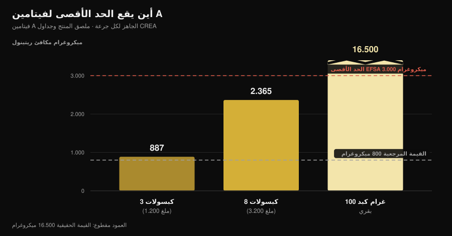
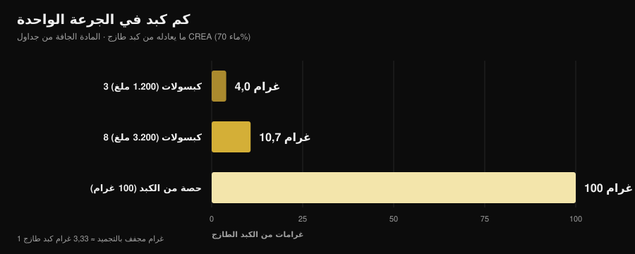

# مكملات كبد البقر: هل تنفع فعلاً؟

بقلم [Giammaria Loi](/autore/giammaria-loi) · حُدِّث في 15 نوفمبر 2026

الكبد المجفف في كبسولات هو أسرع فئات المكملات نموًا، ويُباع بجملة واحدة: «مكمل الطبيعة المتعدد». الجملة صحيحة عن الكبد. المشكلة أن الكبسولة لا تحتوي على كبد، بل على جزء ضئيل من حصة. وفي النقطة الوحيدة التي تهم فيها الكمية فعلاً — فيتامين A — فإن المسافة بين «مفيد» و«أكثر من اللازم» أضيق مما يقوله أي ملصق.

## باختصار

- **ثلاث كبسولات تعادل نحو 4 غرامات كبد.** الجرعة المعتادة تعلن 1.200 ملغ من الكبد المجفف بالتجميد. الكبد الطازج ماء بنسبة 70% (جداول CREA)، إذن 1.200 ملغ من المسحوق تعادل نحو **4 غرامات كبد حقيقي**: جزء من خمسة وعشرين من حصة وزنها 100 غرام.
- **فيتامين A هو المغذي الوحيد الذي يصل بجرعة مؤثرة.** منتج يُباع في أوروبا يعلن 887 ميكروغرامًا لكل 3 كبسولات، أي 111% من القيمة المرجعية اليومية. النحاس 0,38 ملغ (38%)، وب12 4,32 ميكروغرام (172%). ما عدا ذلك لا وزن له.
- **سقف الأمان قريب لا بعيد.** في 2024 أكدت EFSA لفيتامين A الجاهز حدًّا أعلى مقبولًا قدره **3.000 ميكروغرام مكافئ ريتينول يوميًا**، استنادًا إلى التأثير المشوّه للأجنّة. الجرعة القصوى المطبوعة على بعض الملصقات (8 كبسولات) تبلغ وحدها نحو 2.400 ميكروغرام.
- **الكبد الحقيقي يتجاوز الحد وحده.** 100 غرام من كبد البقر تحتوي على 16.500 ميكروغرام من فيتامين A (CREA): أكثر من **خمسة أضعاف** الحد اليومي. لذلك توصي EFSA بحصر الكبد والأحشاء في مرة واحدة شهريًا أو أقل، وبتجنّبها في الحمل.
- **لا توجد دراسة محكومة واحدة عن القوة أو الطاقة أو العضلات.** الأبحاث حول مكملات الكبد المجفف والتدريب معدومة: صفر تجارب عشوائية. كل ما يُقرأ في هذا الباب حكايات شخصية.

*رسم Nurvan. الكبسولات: القيم المعلنة على ملصق مكمل كبد مجفف بالتجميد يُباع في أوروبا (887 ميكروغرامًا من فيتامين A لكل 3 كبسولات بوزن 1.200 ملغ؛ رقم الكبسولات الثماني محسوب تناسبيًا على الجرعة القصوى التي يذكرها المنتج). الكبد الطازج: جداول تركيب الأغذية CREA، كبد الأبقار، 16.500 ميكروغرام مكافئ ريتينول لكل 100 غرام. الحد الأقصى: EFSA، 2024.*

## ما هي، وماذا تَعِد

تُباع باسم *organ supplements* أو ببساطة *beef liver*: كبد بقري مجفف بالتجميد أو مجفف عاديًا، معبأ في كبسولات، وغالبًا بعبارة *grass-fed*. الحجة أسلافية — أجدادنا كانوا يأكلون الأعضاء ونحن لا — وغذائية: الكبد فعلاً من أكثر الأطعمة كثافة بالمغذيات الدقيقة.

في هذه النقطة الأخيرة الأرقام في صالحهم. وفق جداول تركيب الأغذية الصادرة عن CREA، تعطي 100 غرام من كبد الأبقار 16.500 ميكروغرام من فيتامين A كمكافئ ريتينول، و3,7 ملغ نحاس، و3,30 ملغ ريبوفلافين، و8,8 ملغ حديد، و42 ميكروغرام سيلينيوم، و6 ملغ زنك، و20 غرام بروتين مقابل 142 سعرة. لا يوجد مكمل متعدد الفيتامينات يحاكي هذا التركيب بهذا الاكتمال.

القفزة المنطقية التي لا تُقال أبدًا هي الانتقال من الطعام إلى الكبسولة.

## كم كبدًا يوجد فعلاً في الجرعة

يحتوي الكبد الطازج على 70 غرامًا من الماء لكل 100 غرام. وعند التجفيف بالتجميد تبقى المادة الجافة: نحو 30 غرامًا لكل 100 غرام من الأصل. الحساب يتسع لسطر واحد.

الجرعة المعتادة — ثلاث كبسولات — تعلن **1.200 ملغ من الكبد المجفف بالتجميد**. بالقسمة على 0,30 نحصل على نحو **4 غرامات كبد طازج**. والجرعة القصوى التي يذكرها المنتج نفسه، ثماني كبسولات، تعادل 3.200 ملغ من المسحوق: **أقل من 11 غرامًا من الكبد**.

*رسم Nurvan. التحويل من المادة الجافة: كبد الأبقار يحتوي 70,0 غرامًا من الماء لكل 100 غرام (جداول CREA)، إذن 1 غرام مجفف بالتجميد ≈ 3,33 غرام كبد طازج. جرعات الملصق: 1.200 ملغ لثلاث كبسولات، و3.200 ملغ لثماني كبسولات.*

تذكّر هذه النسبة يحل نصف الأسئلة عن المنتج تلقائيًا. إذا كان ما تريده من الكبد يُحسب بالكمية — البروتين، الحديد، الزنك — فلن تعطيك الكبسولات إياه أبدًا: ستحتاج خمسًا وعشرين جرعة لتعادل حصة واحدة. أما إذا كان شيء ما في الكبد شديد التركيز، فإن الكبسولة تعطي منه ما يكفي ليُحسب. وهذا ينطبق على مغذٍّ واحد فقط من بينها.

## المغذي الوحيد الذي يُحسب: فيتامين A

مكمل كبد مجفف في السوق الأوروبية يعلن لكل ثلاث كبسولات: فيتامين A 887 ميكروغرامًا (111% من القيمة الغذائية المرجعية)، فيتامين ب12 4,32 ميكروغرام (172%)، نحاس 0,38 ملغ (38%). أما الحديد فلا يُعلَن أصلًا.

فيتامين A في الكبد هو الريتينول، أي فيتامين A **الجاهز**: ليس بيتا-كاروتين الجزر الذي يحوّله الجسم بقدر حاجته فقط. الريتينول يتراكم في كبدك، وليس له صمام تصريف.

في 2024 راجعت لجنة NDA في EFSA الأدبيات كلها وأكدت الحد الأعلى المقبول لفيتامين A الجاهز عند البالغين: **3.000 ميكروغرام مكافئ ريتينول يوميًا**، للرجال وللنساء في سن الإنجاب وللحوامل والمرضعات. والأثر الحرج الذي بُني عليه هذا الرقم هو **التشوّه الجنيني**، أي الضرر بنمو الجنين.

ثلاث كبسولات بـ887 ميكروغرامًا ليست مشكلة لبالغ سليم: إنها نحو ثلث الحد. المشكلة تبدأ حين تتراكم ثلاثة أمور، وهي تتراكم بسهولة: الجرعة القصوى التي يطبعها كثير من المنتجين أنفسهم على الملصق (8 كبسولات، نحو 2.400 ميكروغرام)، ومكمل متعدد الفيتامينات يحتوي أصلًا على فيتامين A، والكبد الحقيقي على المائدة. فالكبد الحقيقي يخرج عن المقياس وحده: 100 غرام تساوي 16.500 ميكروغرام، أي **5,5 أضعاف الحد اليومي**. هذه ليست تفصيلة نظرية — بل هي السبب في أن EFSA تكتب أن السكان في أوروبا يبقون تحت الحد فقط إذا أُكل الكبد والأحشاء مرة في الشهر أو أقل.

أن وجبة كبد تحرّك الكيمياء الحيوية فعلًا أمر قيس بالأرقام: في دراسة على نساء غير حوامل، رفعت وجبة كبد واحدة غنية بفيتامين A التعرّض خلال 24 ساعة لحمض 13-سيس-الريتينويك ومستقلبه 4-أوكسو — المركّبين الكامنين وراء السُّمية — بثلاثة إلى خمسة أضعاف. وأن الإفراط ليس فرضية تثبته الحالات السريرية: ثلاث حالات تسمّم بفيتامين A بعد تناول كبد سمك وصفها مركز مكافحة السموم في مرسيليا، مع صداع وغثيان وتقشّر الجلد، وإجهاض لدى امرأة حامل.

أما الإفراط المزمن، لا الحاد، فهدفه أقل وضوحًا: العظم. مراجعة 2024 في *Frontiers in Endocrinology* تلخّص الصورة بأمانة: في الدراسات ما قبل السريرية تخفض الجرعات العالية من فيتامين A كتلة العظم القشري بلا لبس، بينما الارتباطات السريرية لدى الإنسان متضاربة، وقد وجد تحليل تجميعي ارتفاع خطر كسر الورك عند المستويات المنخفضة والمرتفعة من فيتامين A في الدم معًا. ليست هذه إدانة — بل هي سبب أن «كلما زاد كان أفضل» لا ينطبق على هذا المغذي.

> **في الحمل أو عند التخطيط للحمل، لا تتناولي هذه المكملات قبل استشارة طبيبك.** توصي EFSA صراحةً بتجنّب منتجات الكبد في الحمل، وحدّ الـ3.000 ميكروغرام مبني تحديدًا على هذا الخطر.

## ماذا يقول البحث فعلاً

| الادعاء الشائع | الحكم | المصدر |
|---|---|---|
| «الكبد مكمل الطبيعة المتعدد» | **مؤكَّد** للطعام: 100 غرام تغطي فيتامين A والنحاس وب2 والحديد والسيلينيوم والزنك | CREA، جداول التركيب |
| «إذن الكبسولات مكمل متعدد» | **مفنَّد**: 3 كبسولات ≈ 4 غرامات كبد. فيتامين A وحده يصل بجرعة مؤثرة | ملصق المنتج + CREA |
| «إنه مجرد طعام، لا يضر» | **مفنَّد**: لفيتامين A الجاهز سقف 3.000 ميكروغرام يوميًا بسبب التشوّه الجنيني، وفرط فيتامين A من الكبد موثّق سريريًا | EFSA، 2024؛ Schmitt وزملاؤه، 2020 |
| «كلما تناولت أكثر كان أفضل» | **مفنَّد**: الإفراط المزمن يخفض كتلة العظم القشري في النماذج الحيوانية، وتحليل تجميعي يشير إلى كسور ورك أكثر عند الطرفين | Lerner، 2024 |
| «تمنح طاقة وتستوستيرون واستشفاء وكتلة» | **غير قابل للتحقق**: لا دراسة محكومة عن مكملات الكبد المجفف والأداء أو تركيب الجسم | بحث في PubMed، لا تجارب عشوائية |
| «ممتازة لتعب نقص الحديد» | **يحتاج تدقيقًا**: الحديد يحسّن الأداء لدى من يعانون نقصًا فقط، والدراسات تستخدم نحو 100 ملغ يوميًا من الحديد العنصري. والكبسولات لا تعلن الحديد أصلًا | Pengelly وزملاؤه، 2024 |
| «grass-fed تعني أكثر أمانًا» | **غير قابل للتحقق**: تغذية الحيوان لا تخفض محتوى فيتامين A، وهو النقطة الحرجة | — |

### السؤال الذي يسبق الجميع: ماذا داخل الكبسولة؟

هناك سؤال يسبق كل الأسئلة: هل يقول الملصق الحقيقة؟ لهذه الفئة تحديدًا لا توجد تحاليل مستقلة منشورة. الموجود صورة عامة غير مطمئنة عن المكملات غير المرخّصة كأدوية: في تحليل عام 2025 شمل 40 منتجًا من *Andrographis paniculata* اشتُريت في 13 بلدًا، تراوح المحتوى الفعلي للمادة الفعالة بين 29% و174% من الجرعة المعلنة — منتجان فقط كانا موسومين بدقة — واحتوت ثلاثة منتجات اشتُريت عبر الإنترنت على ملوثات سامة، من بينها الزئبق ومبيدات حشرية.

هذه ليست دراسة عن كبد البقر ولا ينبغي قراءتها هكذا. إنها السبب في أن منتجًا مغذيه المؤثر الوحيد له سقف أمان، يصبح فيه المصدر وفحوص التشغيلة أهم من العبارة المكتوبة على الواجهة.

## كيف تطبّق ذلك

1. **حدّد لماذا تتناوله.** إن كان الجواب «من أجل فيتامين A وب12»، فهذا سبب قائم ويصمد. وإن كان «من أجل القوة» أو «من أجل الطاقة»، فلا شيء يُقاس: لم تختبره أي دراسة.
2. **اجمع فيتامين A، لا تحسب متوسط الإحساس.** اكتب الكبسولات والمكمل المتعدد وعدد مرات أكل الكبد شهريًا. السقف 3.000 ميكروغرام يوميًا من فيتامين A الجاهز، والكبد الحقيقي يكسره وحده.
3. **لا تتجاوز الجرعة الدنيا المذكورة دون سبب.** «الكبسولات الثماني» كجرعة قصوى على بعض العبوات توصل إلى نحو 2.400 ميكروغرام: كل الهامش المتاح تقريبًا، يُنفق على منتج بلا دراسات فعالية.
4. **إن أكلت الكبد، فاعتبر ذلك اليوم مكتملًا.** حصة عادية تغطي الاحتياج أضعافًا: في ذلك اليوم لا لزوم للكبسولات، وفي الأسبوع التالي كذلك.
5. **الحمل، والتخطيط للحمل، وأمراض الكبد، وداء ترسّب الأصبغة الدموية، والعلاج بالريتينويدات: استشر الطبيب أولًا.** هنا لا يتعلق الأمر بالتحسين بل بالسلامة، والقرار ليس قرار مقال.
6. **إن كان هدفك الكتلة، فانظر إلى البروتين أولًا.** أربعة غرامات من الكبد ليست مصدرًا للبروتين. وعن مقارنة مساحيق اللحم بالواي كتبنا منفصلًا: [بروتين اللحم البقري أم الواي](/ar/blog/brotin-allahm-albaqari-am-alway).

> **Nurvan: التطبيق هو من يجمع فيتامين A، لا ذاكرتك**
>
> خطر هذه الفئة ليس كبسولة واحدة، بل مجموع عدة مصادر. في Nurvan تسجّل المكملات بالجرعة والتوقيت في وحدة المكملات، ويحتسب يوميات الطعام المبنية على بيانات CREA فيتامين A الآتي أصلًا من الغذاء، والكبد منه. هكذا يصبح مجموع اليوم رقمًا تراه، لا تقديرًا. [جرّب Nurvan](https://nurvan.app)

## أسئلة شائعة

**هل تنفع مكملات كبد البقر؟**
كمصدر لفيتامين A الجاهز وفيتامين ب12 نعم، والملصق يعلن ذلك. أما كمساعد للقوة أو الطاقة أو الاستشفاء أو الكتلة العضلية فلا توجد دراسات محكومة: الأبحاث عن الكبد المجفف والأداء معدومة. وكميات البروتين والحديد والزنك في الجرعة أقل من أن تُحسب.

**كم كبسولة كبد يمكن تناولها يوميًا؟**
يذكر المنتجون عادة من 3 إلى 8 كبسولات. القيد الحقيقي ليس الكبسولة بل مجموع فيتامين A الجاهز في اليوم، والذي لا ينبغي بحسب EFSA أن يتجاوز 3.000 ميكروغرام مكافئ ريتينول عند البالغين. وبمعدل 887 ميكروغرامًا لكل ثلاث كبسولات، تبلغ ثماني كبسولات نحو 2.400 ميكروغرام، قبل حساب المكملات المتعددة والطعام.

**الكبسولات أم أكل الكبد؟**
شيئان مختلفان. حصة الكبد تعطي التركيب الكامل من المغذيات الدقيقة، لكن 100 غرام تحتوي 16.500 ميكروغرام من فيتامين A، أي أكثر من خمسة أضعاف الحد اليومي؛ ولهذا تقترح EFSA مرة شهريًا أو أقل. والكبسولات تعطي جزءًا من التركيب بجرعة يمكن التحكم بها. إن كنت تريد المغذي فاختر بحسب التكرار الذي تريده؛ وإن كنت تريد الوجبة فاختر الكبد وضعه في التقويم، لا في الدورة اليومية.

**هل يمكن تناولها أثناء الحمل؟**
ليس دون استشارة الطبيب. توصي EFSA بتجنّب منتجات الكبد في الحمل وعند التخطيط له، والحد الأعلى لفيتامين A الجاهز مبني تحديدًا على خطر التشوهات الخلقية.

## اقرأ أيضًا

- [بروتين اللحم البقري أم الواي: ماذا تقول الأبحاث](/ar/blog/brotin-allahm-albaqari-am-alway) — المنتج البقري الآخر الذي يُباع بحجج أسلافية، مقيسًا بالبيانات.
- [تصنيف مكملات القوة: ماذا يقول البحث](/ar/blog/tasnif-mukammilat-alquwa) — أين تقع، بترتيب قوة الأدلة، المكملات التي تهم من يتدرب.
- [أي مغنيسيوم تختار وكم تحتاج](/ar/blog/ayyu-maghnisyum-takhtar-aljuraa-walashkal) — كيف يُقرأ الملصق حين يغيّر الشكل والجرعة كل شيء.

## المصادر

1. CREA — مركز البحوث للأغذية والتغذية. جداول تركيب الأغذية، بطاقة «Fegato di bovini» (كبد الأبقار؛ لكل 100 غرام من الجزء الصالح للأكل: ماء 70,0 غ؛ بروتين 20,0 غ؛ فيتامين A مكافئ ريتينول 16.500 ميكروغرام؛ ريبوفلافين 3,30 ملغ؛ حديد 8,8 ملغ؛ نحاس 3,7 ملغ؛ زنك 6 ملغ؛ سيلينيوم 42 ميكروغرام). [alimentinutrizione.it](https://www.alimentinutrizione.it/tabelle-nutrizionali/115320)
2. EFSA Panel on Nutrition, Novel Foods and Food Allergens (NDA); Turck D, Bohn T, Castenmiller J, et al., 2024. Scientific opinion on the tolerable upper intake level for preformed vitamin A and β-carotene. *EFSA Journal* 22(6):e8814. [PMID 38846679](https://pubmed.ncbi.nlm.nih.gov/38846679/) · [DOI 10.2903/j.efsa.2024.8814](https://doi.org/10.2903/j.efsa.2024.8814)
3. Lerner UH, 2024. Vitamin A — discovery, metabolism, receptor signaling and effects on bone mass and fracture susceptibility. *Front Endocrinol* 15:1298851. [PMID 38711977](https://pubmed.ncbi.nlm.nih.gov/38711977/) · [DOI 10.3389/fendo.2024.1298851](https://doi.org/10.3389/fendo.2024.1298851)
4. Hartmann S, Brørs O, Bock J, Blomhoff R, Bausch J, Wiegand UW, Hartmann D, Hornig DH, 2005. Exposure to retinoic acids in non-pregnant women following high vitamin A intake with a liver meal. *Int J Vitam Nutr Res* 75(3):187-194. [PMID 16028634](https://pubmed.ncbi.nlm.nih.gov/16028634/) · [DOI 10.1024/0300-9831.75.3.187](https://doi.org/10.1024/0300-9831.75.3.187)
5. Schmitt C, Domangé B, Torrents R, de Haro L, Simon N, 2020. Hypervitaminosis A Following the Ingestion of Fish Liver: Report on 3 Cases from the Poison Control Center in Marseille. *Wilderness Environ Med* 31(4):454-456. [PMID 32861618](https://pubmed.ncbi.nlm.nih.gov/32861618/) · [DOI 10.1016/j.wem.2020.06.003](https://doi.org/10.1016/j.wem.2020.06.003)
6. Pengelly M, Pumpa K, Pyne DB, Etxebarria N, 2024. Iron deficiency, supplementation, and sports performance in female athletes: A systematic review. *J Sport Health Sci* 14:101009. [PMID 39536912](https://pubmed.ncbi.nlm.nih.gov/39536912/) · [DOI 10.1016/j.jshs.2024.101009](https://doi.org/10.1016/j.jshs.2024.101009)
7. Bourqui A, Morin H, Huber R, Csajka C, Podmore C, Wolfender JL, Queiroz Ferreira E, Rodondi PY, 2025. Quality assessment of Andrographis paniculata products reveals significant labelling inaccuracies and contaminations. *Swiss Med Wkly* 155:4728. [PMID 41397381](https://pubmed.ncbi.nlm.nih.gov/41397381/) · [DOI 10.57187/s.4728](https://doi.org/10.57187/s.4728)

قيم الملصق المذكورة في النص والرسوم: صفحة منتج لمكمل كبد بقري مجفف بالتجميد يُباع في أوروبا (لكل 3 كبسولات: 1.200 ملغ كبد مجفف، فيتامين A 887 ميكروغرامًا، نحاس 0,38 ملغ، فيتامين ب12 4,32 ميكروغرام؛ الجرعة اليومية القصوى المذكورة 8 كبسولات). التحقق من غياب الأدلة: بحث في PubMed عن مكملات الكبد المجفف والتدريب أو الأداء، ولم تُعثر أي تجربة عشوائية. اختير الموضوع من إشارات الاتجاهات في نوفمبر 2026 حول فئة organ supplements، حيث تتكون المحتويات المنافسة من صفحات منتجات تقريبًا فقط. المصادر العلمية اطُّلع عليها عبر PubMed.

**جياماريا لوي** هو مؤسس Nurvan. يتدرّب بالأثقال منذ 2012، ويعمل مدربًا شخصيًا ومدرّبًا معتمدًا من FIPE منذ 2013، وينافس في رفع القوة على المستوى الوطني منذ 2018. كل مقال يوقّعه يبدأ من الدراسات العلمية وينتهي عند ما ينفع فعلًا في النادي. [صفحة الكاتب](/autore/giammaria-loi)

> ملاحظة: محتوى إعلامي، لا يغني عن رأي طبيب أو مختص مؤهل.
