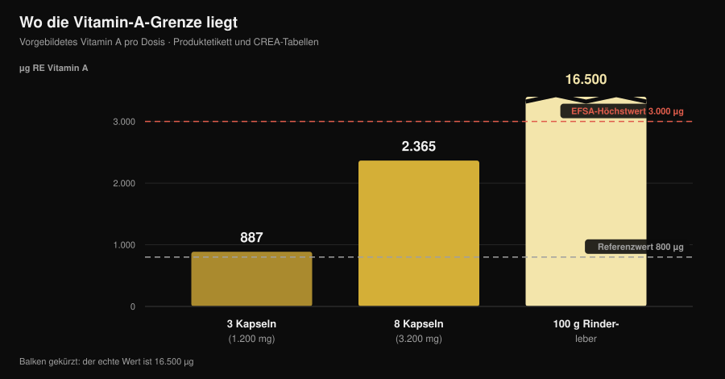
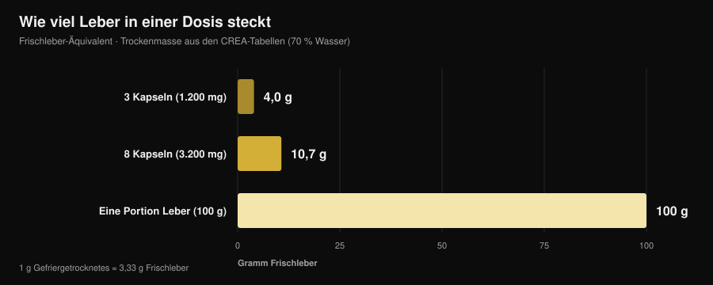

# Rinderleber-Kapseln: bringen sie wirklich etwas?

Von [Giammaria Loi](/autore/giammaria-loi) · aktualisiert am 15. November 2026

Getrocknete Leber in Kapseln ist die am schnellsten wachsende Supplement-Kategorie, und sie wird mit einem einzigen Satz verkauft: „das Multivitamin der Natur". Über Leber stimmt der Satz. Das Problem ist, dass in einer Kapsel keine Leber steckt, sondern ein Bruchteil einer Portion. Und genau dort, wo die Menge wirklich zählt — beim Vitamin A — ist der Abstand zwischen „nützlich" und „zu viel" schmaler, als jedes Etikett sagt.

## Kurz gefasst

- **Drei Kapseln entsprechen etwa 4 Gramm Leber.** Eine typische Dosis deklariert 1.200 mg gefriergetrocknete Leber. Frische Leber besteht zu 70 % aus Wasser (CREA-Tabellen), 1.200 mg Pulver entsprechen also rund **4 g echter Leber**: ein Fünfundzwanzigstel einer Portion von 100 g.
- **Vitamin A ist der einzige Nährstoff in relevanter Dosis.** Ein in Europa verkauftes Produkt deklariert 887 µg pro 3 Kapseln, also 111 % des Tagesreferenzwerts. Kupfer 0,38 mg (38 %), B12 4,32 µg (172 %). Alles andere fällt nicht ins Gewicht.
- **Die Sicherheitsgrenze ist nah, nicht fern.** Die EFSA hat 2024 für vorgebildetes Vitamin A eine tolerierbare Höchstmenge von **3.000 µg RE pro Tag** bestätigt, begründet mit der Teratogenität. Die auf manchen Etiketten gedruckte Maximaldosis (8 Kapseln) erreicht bereits rund 2.400 µg.
- **Echte Leber sprengt die Grenze allein.** 100 g Rinderleber enthalten 16.500 µg Vitamin A (CREA): mehr als das **Fünffache** der Tageshöchstmenge. Deshalb empfiehlt die EFSA, Leber und Innereien auf einmal im Monat oder seltener zu begrenzen und sie in der Schwangerschaft zu meiden.
- **Zu Kraft, Energie und Muskeln gibt es keine einzige kontrollierte Studie.** Forschung zu getrockneten Leberpräparaten und Training existiert nicht: null randomisierte Studien. Alles, was dazu kursiert, ist Anekdote.

*Nurvan-Grafik. Kapseln: deklarierte Etikettwerte eines in Europa verkauften Präparats aus gefriergetrockneter Leber (887 µg Vitamin A pro 3 Kapseln à 1.200 mg; der Wert für 8 Kapseln ist auf die vom Hersteller genannte Maximaldosis hochgerechnet). Frische Leber: CREA-Nährwerttabellen, Rinderleber, 16.500 µg RE pro 100 g. Höchstmenge: EFSA, 2024.*

## Was sie sind und was sie versprechen

Verkauft werden sie als *Organ Supplements* oder schlicht *Beef Liver*: gefriergetrocknete oder getrocknete Rinderleber in Kapseln, oft mit dem Zusatz *grass-fed*. Das Argument ist ahnengeschichtlich — unsere Vorfahren aßen die Organe, wir nicht — und ernährungsphysiologisch: Leber ist tatsächlich eines der mikronährstoffdichtesten Lebensmittel überhaupt.

Beim letzten Punkt sprechen die Zahlen für sie. Laut den CREA-Nährwerttabellen liefern 100 g Rinderleber 16.500 µg Vitamin A als Retinoläquivalent, 3,7 mg Kupfer, 3,30 mg Riboflavin, 8,8 mg Eisen, 42 µg Selen, 6 mg Zink und 20 g Protein bei 142 kcal. Kein Multivitaminpräparat bildet dieses Profil so vollständig nach.

Der gedankliche Sprung, der nie ausgesprochen wird, ist der vom Lebensmittel zur Kapsel.

## Wie viel Leber tatsächlich in einer Dosis steckt

Frische Leber enthält 70 g Wasser pro 100 g. Nach dem Gefriertrocknen bleibt die Trockenmasse: rund 30 g pro 100 g Ausgangsgewicht. Die Rechnung passt in eine Zeile.

Eine typische Dosis — drei Kapseln — deklariert **1.200 mg gefriergetrocknete Leber**. Geteilt durch 0,30 ergibt das etwa **4 g frische Leber**. Die vom selben Hersteller angegebene Maximaldosis von acht Kapseln entspricht 3.200 mg Pulver: **unter 11 g Leber**.

*Nurvan-Grafik. Umrechnung aus der Trockenmasse: Rinderleber mit 70,0 g Wasser pro 100 g (CREA-Tabellen), also 1 g Gefriergetrocknetes ≈ 3,33 g frische Leber. Etikettdosen: 1.200 mg für 3 Kapseln, 3.200 mg für 8 Kapseln.*

Wer dieses Verhältnis im Kopf behält, beantwortet die Hälfte der Fragen zum Produkt selbst. Was man aus der Leber in Mengen braucht — Protein, Eisen, Zink —, werden Kapseln nie liefern: man bräuchte fünfundzwanzig Dosen für eine Portion. Was in der Leber dagegen hochkonzentriert vorliegt, davon gibt die Kapsel genug, um zu zählen. Und das trifft auf genau einen dieser Nährstoffe zu.

## Der einzige Nährstoff, der zählt: Vitamin A

Ein Präparat aus gefriergetrockneter Leber auf dem europäischen Markt deklariert pro drei Kapseln: Vitamin A 887 µg (111 % des Nährstoffbezugswerts), Vitamin B12 4,32 µg (172 %), Kupfer 0,38 mg (38 %). Eisen wird nicht einmal angegeben.

Das Vitamin A der Leber ist Retinol, also **vorgebildetes** Vitamin A: nicht das Beta-Carotin der Karotten, das der Körper nur nach Bedarf umwandelt. Retinol sammelt sich in Ihrer Leber an und hat kein Überdruckventil.

2024 hat das NDA-Gremium der EFSA die gesamte Literatur neu bewertet und die tolerierbare Höchstmenge für vorgebildetes Vitamin A bei Erwachsenen bestätigt: **3.000 µg RE pro Tag**, gültig für Männer, Frauen im gebärfähigen Alter sowie Schwangere und Stillende. Der kritische Endpunkt, auf dem diese Zahl beruht, ist die **Teratogenität**, also die Schädigung der Embryonalentwicklung.

Drei Kapseln mit 887 µg sind für gesunde Erwachsene kein Problem: etwa ein Drittel der Grenze. Das Problem entsteht, wenn sich drei Dinge addieren, und sie addieren sich leicht: die Maximaldosis, die viele Hersteller selbst aufs Etikett drucken (8 Kapseln, rund 2.400 µg), ein Multivitaminpräparat, das bereits Vitamin A enthält, und echte Leber auf dem Teller. Denn echte Leber sprengt die Skala im Alleingang: 100 g sind 16.500 µg, das **5,5-Fache der Tageshöchstmenge**. Das ist kein theoretisches Detail — es ist der Grund, warum die EFSA schreibt, dass europäische Bevölkerungen nur dann unter der Grenze bleiben, wenn Leber und Innereien einmal im Monat oder seltener gegessen werden.

Dass eine Lebermahlzeit die Biochemie tatsächlich verschiebt, wurde gemessen: In einer Studie an nicht schwangeren Frauen erhöhte eine einzige vitamin-A-reiche Lebermahlzeit die 24-Stunden-Exposition gegenüber 13-cis-Retinsäure und ihrem 4-Oxo-Metaboliten — den Verbindungen hinter der Toxizität — um das Drei- bis Fünffache. Dass der Überschuss keine Hypothese ist, zeigt die Klinik: drei vom Giftinformationszentrum Marseille beschriebene Vitamin-A-Vergiftungen nach dem Verzehr von Fischleber, mit Kopfschmerzen, Übelkeit, Hautschuppung und, bei einer Schwangeren, einer Fehlgeburt.

Der chronische Überschuss hat ein weniger sichtbares Ziel: den Knochen. Eine Übersichtsarbeit von 2024 in *Frontiers in Endocrinology* fasst das Bild ehrlich zusammen: In präklinischen Studien senken hohe Vitamin-A-Dosen die kortikale Knochenmasse eindeutig, während die klinischen Zusammenhänge beim Menschen widersprüchlich sind; eine Metaanalyse fand ein erhöhtes Hüftfrakturrisiko sowohl bei niedrigen als auch bei hohen Vitamin-A-Blutspiegeln. Das ist kein Urteil — es ist der Grund, warum „viel hilft viel" bei diesem Nährstoff nicht gilt.

> **In der Schwangerschaft oder bei Kinderwunsch sollten Sie diese Präparate nicht ohne vorheriges Gespräch mit Ihrer Ärztin oder Ihrem Arzt einnehmen.** Die EFSA empfiehlt ausdrücklich, Leberprodukte in der Schwangerschaft zu meiden, und die Grenze von 3.000 µg beruht genau auf diesem Risiko.

## Was die Forschung wirklich sagt

| Verbreitete Behauptung | Urteil | Quelle |
|---|---|---|
| „Leber ist das Multivitamin der Natur" | **Bestätigt** für das Lebensmittel: 100 g decken Vitamin A, Kupfer, B2, Eisen, Selen und Zink | CREA-Nährwerttabellen |
| „Also sind die Kapseln ein Multivitamin" | **Widerlegt**: 3 Kapseln = rund 4 g Leber. Nur Vitamin A kommt in relevanter Dosis an | Produktetikett + CREA |
| „Das ist nur Essen, das kann nicht schaden" | **Widerlegt**: vorgebildetes Vitamin A hat eine Obergrenze von 3.000 µg/Tag wegen Teratogenität, und Hypervitaminose A durch Leber ist klinisch dokumentiert | EFSA, 2024; Schmitt et al., 2020 |
| „Je mehr, desto besser" | **Widerlegt**: chronischer Vitamin-A-Überschuss senkt im Tiermodell die kortikale Knochenmasse, und eine Metaanalyse zeigt mehr Hüftfrakturen an beiden Extremen | Lerner, 2024 |
| „Geben Energie, Testosteron, Regeneration, Masse" | **Nicht überprüfbar**: keine kontrollierte Studie zu getrockneten Leberpräparaten und Leistung oder Körperzusammensetzung | PubMed-Recherche, keine RCT |
| „Super gegen Müdigkeit durch Eisenmangel" | **Zu präzisieren**: Eisen verbessert die Leistung nur bei Mangel, und Studien nutzen rund 100 mg elementares Eisen pro Tag. Die Kapseln deklarieren Eisen nicht einmal | Pengelly et al., 2024 |
| „Grass-fed heißt sicherer" | **Nicht überprüfbar**: die Fütterung des Tieres senkt den Vitamin-A-Gehalt nicht, und der ist der kritische Punkt | — |

### Die Frage davor: Was ist in der Kapsel?

Eine Frage kommt vor allen anderen: Stimmt das Etikett? Für diese Kategorie gibt es keine veröffentlichten unabhängigen Analysen. Es gibt aber ein wenig beruhigendes Gesamtbild bei Supplementen, die nicht als Arzneimittel zugelassen sind: In einer Analyse von 2025 an 40 *Andrographis-paniculata*-Produkten aus 13 Ländern lag der tatsächliche Wirkstoffgehalt zwischen 29 % und 174 % der deklarierten Dosis — nur zwei Produkte waren korrekt etikettiert — und drei online gekaufte Produkte enthielten toxische Verunreinigungen, darunter Quecksilber und Pestizide.

Das ist keine Studie zu Rinderleber und darf nicht als solche gelesen werden. Es ist der Grund, warum bei einem Produkt, dessen einziger relevanter Nährstoff eine Sicherheitsgrenze hat, Herkunft und Chargenkontrollen mehr zählen als der Claim auf der Vorderseite.

## So setzen Sie es um

1. **Klären Sie, wofür Sie es nehmen.** Lautet die Antwort „für Vitamin A und B12", gibt es diesen Grund und er trägt. Lautet sie „für Kraft" oder „für Energie", gibt es nichts zu messen: Keine Studie hat das geprüft.
2. **Rechnen Sie Vitamin A zusammen, statt Gefühle zu mitteln.** Schreiben Sie Kapseln, Multivitamin und die Häufigkeit Ihrer Lebermahlzeiten auf. Die Obergrenze sind 3.000 µg vorgebildetes Vitamin A pro Tag, und echte Leber reißt sie allein.
3. **Überschreiten Sie die angegebene Mindestdosis nicht ohne Grund.** Die „8 Kapseln" Maximaldosis mancher Packungen führen zu rund 2.400 µg: fast der gesamte verfügbare Spielraum, ausgegeben für ein Produkt ohne Wirksamkeitsstudien.
4. **Wenn Sie Leber essen, behandeln Sie den Tag als voll.** Eine normale Portion deckt den Bedarf mehrfach: An diesem Tag sind Kapseln überflüssig, in der Woche danach ebenso.
5. **Schwangerschaft, Kinderwunsch, Lebererkrankungen, Hämochromatose, Retinoid-Therapie: vorher ärztlich abklären.** Hier geht es nicht um Optimierung, sondern um Sicherheit, und die Entscheidung trifft kein Artikel.
6. **Geht es um Masse, schauen Sie zuerst auf Protein.** Vier Gramm Leber sind keine Proteinquelle. Wie Fleischpulver gegen Whey abschneidet, haben wir separat behandelt: [Beef Protein gegen Whey](/de/blog/beef-protein-rinderprotein-vs-whey).

> **Nurvan: Vitamin A addiert die App, nicht Ihr Gedächtnis**
>
> Das Risiko dieser Kategorie ist nicht eine Kapsel, sondern die Summe mehrerer Quellen. In Nurvan erfassen Sie Supplemente mit Dosis und Uhrzeit im Supplementierungsmodul, und das auf CREA-Daten gebaute Ernährungstagebuch zählt das Vitamin A mit, das schon aus dem Essen kommt — Leber inklusive. So wird die Tagessumme eine Zahl, die Sie sehen, keine Schätzung. [Nurvan testen](https://nurvan.app)

## Häufige Fragen

**Wirken Rinderleber-Kapseln?**
Als Quelle für vorgebildetes Vitamin A und Vitamin B12 ja, und das Etikett deklariert es. Als Hilfe für Kraft, Energie, Regeneration oder Muskelmasse gibt es keine kontrollierten Studien: Forschung zu getrockneter Leber und Leistung existiert nicht. Die Mengen an Protein, Eisen und Zink pro Dosis sind viel zu gering, um ins Gewicht zu fallen.

**Wie viele Leberkapseln pro Tag darf man nehmen?**
Hersteller nennen meist 3 bis 8 Kapseln. Die eigentliche Grenze ist nicht die Kapsel, sondern die Tagessumme an vorgebildetem Vitamin A, die laut EFSA bei Erwachsenen 3.000 µg RE nicht überschreiten sollte. Bei 887 µg je drei Kapseln erreichen acht Kapseln schon rund 2.400 µg — ohne Multivitamine und Lebensmittel.

**Kapseln oder Leber essen?**
Das sind zwei verschiedene Dinge. Eine Portion Leber liefert das gesamte Mikronährstoffprofil, aber 100 g enthalten 16.500 µg Vitamin A, über das Fünffache der Tagesgrenze — deshalb rät die EFSA zu einmal im Monat oder seltener. Kapseln geben einen Bruchteil des Profils in einer steuerbaren Dosis. Geht es um den Nährstoff, entscheidet die gewünschte Häufigkeit; geht es um die Mahlzeit, nehmen Sie die Leber und setzen Sie sie in den Kalender, nicht in die Rotation.

**Darf man sie in der Schwangerschaft nehmen?**
Nicht ohne ärztliche Rücksprache. Die EFSA empfiehlt, Leberprodukte in der Schwangerschaft und bei Kinderwunsch zu meiden, und die Höchstmenge für vorgebildetes Vitamin A beruht genau auf dem Fehlbildungsrisiko.

## Lesen Sie auch

- [Beef Protein gegen Whey: was die Forschung sagt](/de/blog/beef-protein-rinderprotein-vs-whey) — das andere „Rinderprodukt", das mit ahnengeschichtlichen Argumenten verkauft wird, an Daten gemessen.
- [Tier-List der Kraftsport-Supplemente: was die Forschung sagt](/de/blog/kraftsport-supplemente-tier-list) — wo die Supplemente stehen, die beim Training zählen, nach Evidenz sortiert.
- [Welches Magnesium wählen und wie viel](/de/blog/welches-magnesium-waehlen-dosis-formen) — wie man ein Etikett liest, wenn Form und Dosis alles verändern.

## Quellen

1. CREA — Forschungszentrum für Lebensmittel und Ernährung. Nährwerttabellen, Eintrag „Fegato di bovini" (Rinderleber; je 100 g essbarer Anteil: Wasser 70,0 g; Protein 20,0 g; Vitamin A Retinoläquivalent 16.500 µg; Riboflavin 3,30 mg; Eisen 8,8 mg; Kupfer 3,7 mg; Zink 6 mg; Selen 42 µg). [alimentinutrizione.it](https://www.alimentinutrizione.it/tabelle-nutrizionali/115320)
2. EFSA Panel on Nutrition, Novel Foods and Food Allergens (NDA); Turck D, Bohn T, Castenmiller J, et al., 2024. Scientific opinion on the tolerable upper intake level for preformed vitamin A and β-carotene. *EFSA Journal* 22(6):e8814. [PMID 38846679](https://pubmed.ncbi.nlm.nih.gov/38846679/) · [DOI 10.2903/j.efsa.2024.8814](https://doi.org/10.2903/j.efsa.2024.8814)
3. Lerner UH, 2024. Vitamin A — discovery, metabolism, receptor signaling and effects on bone mass and fracture susceptibility. *Front Endocrinol* 15:1298851. [PMID 38711977](https://pubmed.ncbi.nlm.nih.gov/38711977/) · [DOI 10.3389/fendo.2024.1298851](https://doi.org/10.3389/fendo.2024.1298851)
4. Hartmann S, Brørs O, Bock J, Blomhoff R, Bausch J, Wiegand UW, Hartmann D, Hornig DH, 2005. Exposure to retinoic acids in non-pregnant women following high vitamin A intake with a liver meal. *Int J Vitam Nutr Res* 75(3):187-194. [PMID 16028634](https://pubmed.ncbi.nlm.nih.gov/16028634/) · [DOI 10.1024/0300-9831.75.3.187](https://doi.org/10.1024/0300-9831.75.3.187)
5. Schmitt C, Domangé B, Torrents R, de Haro L, Simon N, 2020. Hypervitaminosis A Following the Ingestion of Fish Liver: Report on 3 Cases from the Poison Control Center in Marseille. *Wilderness Environ Med* 31(4):454-456. [PMID 32861618](https://pubmed.ncbi.nlm.nih.gov/32861618/) · [DOI 10.1016/j.wem.2020.06.003](https://doi.org/10.1016/j.wem.2020.06.003)
6. Pengelly M, Pumpa K, Pyne DB, Etxebarria N, 2024. Iron deficiency, supplementation, and sports performance in female athletes: A systematic review. *J Sport Health Sci* 14:101009. [PMID 39536912](https://pubmed.ncbi.nlm.nih.gov/39536912/) · [DOI 10.1016/j.jshs.2024.101009](https://doi.org/10.1016/j.jshs.2024.101009)
7. Bourqui A, Morin H, Huber R, Csajka C, Podmore C, Wolfender JL, Queiroz Ferreira E, Rodondi PY, 2025. Quality assessment of Andrographis paniculata products reveals significant labelling inaccuracies and contaminations. *Swiss Med Wkly* 155:4728. [PMID 41397381](https://pubmed.ncbi.nlm.nih.gov/41397381/) · [DOI 10.57187/s.4728](https://doi.org/10.57187/s.4728)

Im Text und in den Grafiken zitierte Etikettwerte: Produktseite eines in Europa verkauften Präparats aus gefriergetrockneter Rinderleber (pro 3 Kapseln: 1.200 mg gefriergetrocknete Leber, Vitamin A 887 µg, Kupfer 0,38 mg, Vitamin B12 4,32 µg; angegebene maximale Tagesdosis 8 Kapseln). Prüfung auf fehlende Evidenz: PubMed-Recherche zu getrockneten Leberpräparaten und Training oder Leistung, keine randomisierte Studie gefunden. Thema gewählt anhand von Trendsignalen vom November 2026 zur Kategorie Organ Supplements, deren konkurrierende Inhalte fast nur aus Produktseiten bestehen. Wissenschaftliche Quellen über PubMed recherchiert.

**Giammaria Loi** ist der Gründer von Nurvan. Er trainiert seit 2012 mit Gewichten, arbeitet seit 2013 als FIPE-zertifizierter Personal Trainer und Coach und startet seit 2018 im Powerlifting auf nationalem Niveau. Jeder Artikel, den er zeichnet, geht von wissenschaftlichen Studien aus und endet bei dem, was im Gym wirklich funktioniert. [Autorenseite](/autore/giammaria-loi)

> Hinweis: informativer Inhalt, er ersetzt nicht die Beratung durch eine Ärztin, einen Arzt oder eine qualifizierte Fachkraft.
