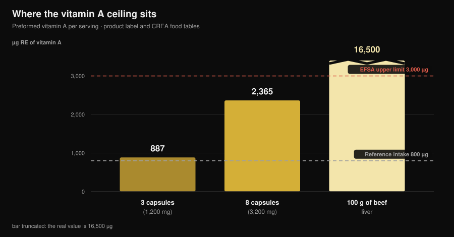
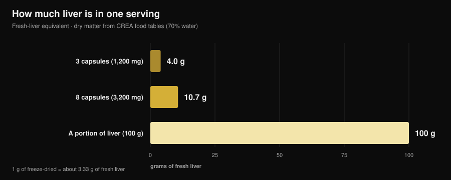

# Beef Liver Supplements: Do They Actually Work?

By [Giammaria Loi](/autore/giammaria-loi) · updated 15 November 2026

Dried liver in capsules is the fastest-growing supplement category of the moment, and it is sold with one phrase: "nature's multivitamin". The phrase is true about liver. The problem is that a capsule does not contain liver — it contains a fraction of a portion. And on the one nutrient where the dose genuinely matters, vitamin A, the gap between "useful" and "too much" is narrower than any label tells you.

## In short

- **Three capsules equal roughly 4 grams of liver.** A typical serving declares 1,200 mg of freeze-dried liver. Fresh liver is 70% water (CREA food tables), so 1,200 mg of powder corresponds to about **4 g of real liver**: one twenty-fifth of a 100 g portion.
- **Vitamin A is the only nutrient that arrives in a meaningful dose.** A product sold in Europe declares 887 µg per 3 capsules — 111% of the daily reference value. Copper 0.38 mg (38%), B12 4.32 µg (172%). Everything else is noise.
- **The safety ceiling is close, not far.** In 2024 EFSA confirmed a tolerable upper intake level for preformed vitamin A of **3,000 µg RE per day**, based on teratogenicity. The maximum daily dose printed on some labels (8 capsules) already reaches about 2,400 µg.
- **Real liver blows past the limit on its own.** 100 g of beef liver contains 16,500 µg of vitamin A (CREA): more than **five times** the daily maximum. That is why EFSA advises limiting liver and offal to once a month or less, and avoiding it in pregnancy.
- **There is not one controlled trial on strength, energy or muscle.** Research on desiccated liver supplements and training is absent: zero randomised trials. Everything you read on that is anecdote.

*Nurvan chart. Capsules: declared label values of a freeze-dried beef liver supplement sold in Europe (887 µg of vitamin A per 3 capsules of 1,200 mg; the 8-capsule figure is scaled to the maximum dose stated by the manufacturer). Fresh liver: CREA food composition tables, bovine liver, 16,500 µg RE per 100 g. Upper limit: EFSA, 2024.*

## What they are, and what they promise

They are sold as *organ supplements* or simply *beef liver*: freeze-dried or desiccated bovine liver in capsules, usually labelled grass-fed. The pitch is ancestral — our ancestors ate the organs, we don't — and nutritional: liver really is one of the most micronutrient-dense foods that exist.

On that last point the numbers are on their side. According to the CREA food composition tables, 100 g of bovine liver provides 16,500 µg of vitamin A as retinol equivalents, 3.7 mg of copper, 3.30 mg of riboflavin, 8.8 mg of iron, 42 µg of selenium, 6 mg of zinc and 20 g of protein for 142 kcal. No multivitamin imitates that profile so completely.

The step that never gets stated out loud is the one from food to capsule.

## How much liver is actually in a serving

Fresh liver contains 70 g of water per 100 g. Freeze-dry it and what remains is the dry matter: about 30 g per 100 g of starting weight. The arithmetic takes one line.

A typical serving — three capsules — declares **1,200 mg of freeze-dried liver**. Divided by 0.30, that is about **4 g of fresh liver**. The maximum dose stated by that same manufacturer, eight capsules, is 3,200 mg of powder: **under 11 g of liver**.

*Nurvan chart. Conversion from dry matter: bovine liver at 70.0 g of water per 100 g (CREA tables), so 1 g of freeze-dried powder ≈ 3.33 g of fresh liver. Label doses: 1,200 mg for 3 capsules, 3,200 mg for 8 capsules.*

Keep that ratio in mind and half the questions about the product answer themselves. If what you want from liver is something you need in quantity — protein, iron, zinc — capsules will never deliver it: you would need twenty-five servings to match one portion. If something in liver is extremely concentrated, the capsule gives you enough to matter. That applies to exactly one of those nutrients.

## The one nutrient that counts: vitamin A

A freeze-dried liver supplement on the European market declares, per three capsules: vitamin A 887 µg (111% of the nutrient reference value), vitamin B12 4.32 µg (172%), copper 0.38 mg (38%). Iron is not even declared.

The vitamin A in liver is retinol, that is **preformed** vitamin A. It is not the beta-carotene in carrots, which the body converts only as far as it needs. Retinol accumulates in your liver, and it has no release valve.

In 2024 EFSA's NDA Panel reviewed the whole literature and confirmed the tolerable upper intake level for preformed vitamin A in adults: **3,000 µg RE per day**, for men, women of childbearing age, and pregnant and lactating women alike. The critical effect that number is built on is **teratogenicity** — harm to embryonic development.

Three capsules at 887 µg are not a problem for a healthy adult: that is roughly a third of the limit. The problem starts when three things stack, and they stack easily: the maximum dose many manufacturers themselves print on the label (8 capsules, about 2,400 µg), a multivitamin that already contains vitamin A, and real liver on the plate. Because real liver is off the scale on its own: 100 g is 16,500 µg, **5.5 times the daily maximum**. That is not a theoretical detail — it is why EFSA states European populations stay below the limit only if liver and offal are eaten once a month or less.

That a liver meal genuinely moves the biochemistry has been measured: in a study on non-pregnant women, a single high-vitamin-A liver meal raised 24-hour exposure to 13-cis retinoic acid and its 4-oxo metabolite — the compounds behind the toxicity — by three to five times. That excess is not hypothetical is shown by the clinic: three cases of vitamin A poisoning from fish liver ingestion reported by the Marseille poison control centre, with headache, nausea, skin peeling and, in a pregnant woman, a miscarriage.

Chronic excess, as opposed to acute, has a less visible target: bone. A 2024 review in *Frontiers in Endocrinology* sums the picture up honestly: in preclinical studies high doses of vitamin A unequivocally reduce cortical bone mass, while in humans the clinical associations are inconsistent, and one meta-analysis found increased hip fracture risk at both low and high blood levels of vitamin A. It is not a conviction — it is why "more is better" does not apply to this nutrient.

> **If you are pregnant or trying to conceive, do not take these supplements without speaking to your doctor first.** EFSA explicitly advises avoiding liver products in pregnancy, and the 3,000 µg limit is built on precisely that risk.

## What the research actually says

| Common claim | Verdict | Source |
|---|---|---|
| "Liver is nature's multivitamin" | **Confirmed** for the food: 100 g covers vitamin A, copper, B2, iron, selenium and zinc | CREA food tables |
| "So the capsules are a multivitamin" | **Debunked**: 3 capsules = about 4 g of liver. Only vitamin A arrives in a meaningful dose | Product label + CREA |
| "It's just food, it can't hurt you" | **Debunked**: preformed vitamin A has a 3,000 µg/day ceiling set on teratogenicity, and hypervitaminosis A from liver is documented clinically | EFSA, 2024; Schmitt et al., 2020 |
| "The more I take the better" | **Debunked**: chronic vitamin A excess reduces cortical bone mass in animal models and a meta-analysis flags more hip fractures at both extremes | Lerner, 2024 |
| "They give you energy, testosterone, recovery, size" | **Unverifiable**: no controlled study on desiccated liver supplements and performance or body composition | PubMed search, no RCT found |
| "Great for iron-deficiency fatigue" | **Needs qualifying**: iron improves performance only in those who are deficient, and studies use around 100 mg of elemental iron a day. The capsules do not even declare iron | Pengelly et al., 2024 |
| "Grass-fed means safer" | **Unverifiable**: the animal's diet does not lower the vitamin A content, which is the critical point | — |

### The question before all the others: what is in the capsule?

Does the label tell the truth? For this specific category no independent analyses have been published. What does exist is an unreassuring general picture for supplements that are not authorised as medicines: in a 2025 analysis of 40 *Andrographis paniculata* products bought in 13 countries, the actual content of the active compound ranged from 29% to 174% of the declared dose — only two products were accurately labelled — and three products bought online contained toxic contaminants, including mercury and pesticides.

That is not a study on beef liver and should not be read as one. It is the reason why, for a product whose only meaningful nutrient has a safety ceiling, sourcing and batch testing matter more than the claim on the front.

## How to apply it

1. **Decide why you are taking it.** If the answer is "for vitamin A and B12", that reason exists and holds. If it is "for strength" or "for energy", there is nothing to measure: no study has tested it.
2. **Add up your vitamin A, don't average your feelings.** Put capsules, multivitamin and how often you eat liver on one page. The ceiling is 3,000 µg a day of preformed vitamin A, and real liver breaks it on its own.
3. **Don't exceed the minimum stated dose without a reason.** The "8 capsules" maximum printed on some packs reaches about 2,400 µg: nearly the whole available margin, spent on a product with no efficacy studies.
4. **If you eat liver, treat that day as full.** One normal portion covers the requirement several times over: no capsules that day, and none the following week either.
5. **Pregnancy, trying to conceive, liver disease, haemochromatosis, retinoid therapy: talk to your doctor first.** This is not optimisation, it is safety, and the decision is not an article's to make.
6. **If your goal is muscle, look at protein first.** Four grams of liver is not a protein source. On how meat powders compare with whey we wrote separately: [beef protein versus whey](/en/blog/beef-protein-powder-vs-whey).

> **Nurvan: the app adds up your vitamin A, not your memory**
>
> The risk in this category is not one capsule, it is the sum of several sources. In Nurvan you log supplements with dose and timing in the supplementation module, and the food diary built on CREA data counts the vitamin A already coming from food — liver included. The day's total becomes a number you can see, not a guess. [Try Nurvan](https://nurvan.app)

## Frequently asked questions

**Do beef liver supplements work?**
As a source of preformed vitamin A and vitamin B12, yes, and the label says so. As a help for strength, energy, recovery or muscle mass there are no controlled trials: research on desiccated liver supplements and performance is absent. The protein, iron and zinc in a serving are far too low to count.

**How many liver capsules a day can you take?**
Manufacturers usually state 3 to 8 capsules. The real constraint is not the capsule but your daily total of preformed vitamin A, which EFSA puts at no more than 3,000 µg RE in adults. At 887 µg per three capsules, eight capsules already reach about 2,400 µg, before any multivitamin or food.

**Capsules or eating liver?**
They are different things. One portion of liver gives you the whole micronutrient profile, but 100 g contains 16,500 µg of vitamin A — over five times the daily limit — which is why EFSA suggests once a month or less. Capsules give a fraction of the profile in a controllable dose. If you want the nutrient, choose based on how often you want to take it; if you want the meal, choose the liver and put it on the calendar, not in the rotation.

**Can you take them during pregnancy?**
Not without talking to your doctor. EFSA advises avoiding liver products in pregnancy and when planning a pregnancy, and the upper limit for preformed vitamin A is built on the risk of birth defects.

## Read also

- [Beef Protein Powder vs Whey: What Research Says](/en/blog/beef-protein-powder-vs-whey) — the other "bovine" product sold on ancestral arguments, measured against data.
- [Strength supplement tier list: what research says](/en/blog/strength-supplements-tier-list-evidence) — where the supplements that matter for lifters sit, in order of evidence.
- [Which magnesium to take, and how much you need](/en/blog/which-magnesium-to-choose-dose-forms) — how to read a label when the form and the dose change everything.

## Sources

1. CREA — Research Centre for Food and Nutrition. Food composition tables, "Fegato di bovini" (bovine liver) entry (per 100 g edible portion: water 70.0 g; protein 20.0 g; vitamin A retinol equivalents 16,500 µg; riboflavin 3.30 mg; iron 8.8 mg; copper 3.7 mg; zinc 6 mg; selenium 42 µg). [alimentinutrizione.it](https://www.alimentinutrizione.it/tabelle-nutrizionali/115320)
2. EFSA Panel on Nutrition, Novel Foods and Food Allergens (NDA); Turck D, Bohn T, Castenmiller J, et al., 2024. Scientific opinion on the tolerable upper intake level for preformed vitamin A and β-carotene. *EFSA Journal* 22(6):e8814. [PMID 38846679](https://pubmed.ncbi.nlm.nih.gov/38846679/) · [DOI 10.2903/j.efsa.2024.8814](https://doi.org/10.2903/j.efsa.2024.8814)
3. Lerner UH, 2024. Vitamin A — discovery, metabolism, receptor signaling and effects on bone mass and fracture susceptibility. *Front Endocrinol* 15:1298851. [PMID 38711977](https://pubmed.ncbi.nlm.nih.gov/38711977/) · [DOI 10.3389/fendo.2024.1298851](https://doi.org/10.3389/fendo.2024.1298851)
4. Hartmann S, Brørs O, Bock J, Blomhoff R, Bausch J, Wiegand UW, Hartmann D, Hornig DH, 2005. Exposure to retinoic acids in non-pregnant women following high vitamin A intake with a liver meal. *Int J Vitam Nutr Res* 75(3):187-194. [PMID 16028634](https://pubmed.ncbi.nlm.nih.gov/16028634/) · [DOI 10.1024/0300-9831.75.3.187](https://doi.org/10.1024/0300-9831.75.3.187)
5. Schmitt C, Domangé B, Torrents R, de Haro L, Simon N, 2020. Hypervitaminosis A Following the Ingestion of Fish Liver: Report on 3 Cases from the Poison Control Center in Marseille. *Wilderness Environ Med* 31(4):454-456. [PMID 32861618](https://pubmed.ncbi.nlm.nih.gov/32861618/) · [DOI 10.1016/j.wem.2020.06.003](https://doi.org/10.1016/j.wem.2020.06.003)
6. Pengelly M, Pumpa K, Pyne DB, Etxebarria N, 2024. Iron deficiency, supplementation, and sports performance in female athletes: A systematic review. *J Sport Health Sci* 14:101009. [PMID 39536912](https://pubmed.ncbi.nlm.nih.gov/39536912/) · [DOI 10.1016/j.jshs.2024.101009](https://doi.org/10.1016/j.jshs.2024.101009)
7. Bourqui A, Morin H, Huber R, Csajka C, Podmore C, Wolfender JL, Queiroz Ferreira E, Rodondi PY, 2025. Quality assessment of Andrographis paniculata products reveals significant labelling inaccuracies and contaminations. *Swiss Med Wkly* 155:4728. [PMID 41397381](https://pubmed.ncbi.nlm.nih.gov/41397381/) · [DOI 10.57187/s.4728](https://doi.org/10.57187/s.4728)

Label values quoted in the text and charts: product page of a freeze-dried beef liver supplement sold in Europe (per 3 capsules: 1,200 mg of freeze-dried liver, vitamin A 887 µg, copper 0.38 mg, vitamin B12 4.32 µg; stated maximum daily dose 8 capsules). Absence-of-evidence check: PubMed search for desiccated liver supplements and training or performance, no randomised trial found. Topic chosen from November 2026 trend signals on the organ supplements category, where competing content consists almost entirely of product pages. Scientific sources consulted through PubMed.

**Giammaria Loi** is the founder of Nurvan. He has been lifting since 2012, has worked as a FIPE-certified personal trainer and coach since 2013, and has competed in powerlifting at national level since 2018. Every article he writes starts from the research and ends with what actually works in the gym. [Author page](/autore/giammaria-loi)

> Note: informational content, it does not replace the advice of a doctor or qualified professional.
