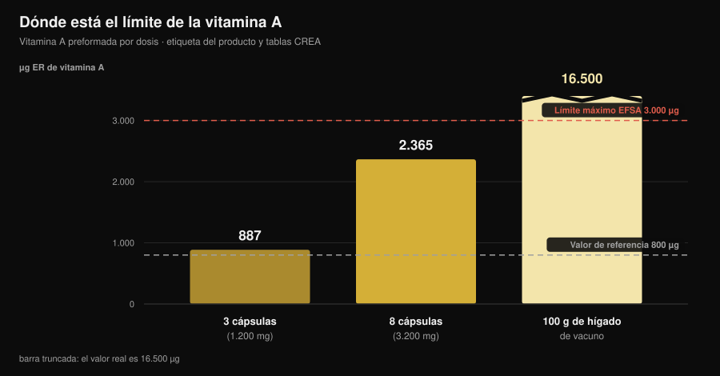
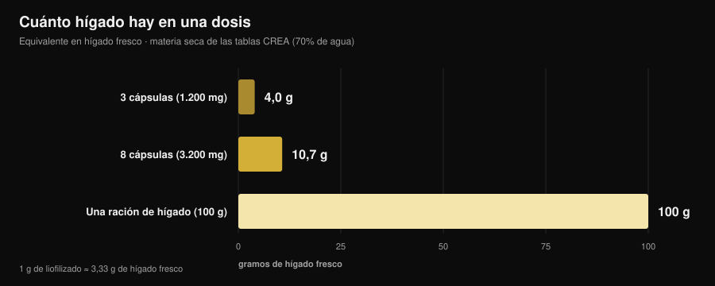

# Suplementos de hígado de vacuno: ¿sirven?

Por [Giammaria Loi](/autore/giammaria-loi) · actualizado el 15 de noviembre de 2026

El hígado desecado en cápsulas es la categoría de suplementos que más crece, y se vende con una sola frase: "el multivitamínico de la naturaleza". La frase es cierta sobre el hígado. El problema es que en una cápsula no hay hígado: hay una fracción de una ración. Y en el único punto donde la cantidad importa de verdad —la vitamina A— el margen entre "útil" y "demasiado" es más estrecho de lo que dice cualquier etiqueta.

## En resumen

- **Tres cápsulas equivalen a unos 4 gramos de hígado.** Una dosis típica declara 1.200 mg de hígado liofilizado. El hígado fresco es agua en un 70% (tablas CREA), así que 1.200 mg de polvo corresponden a unos **4 g de hígado real**: una veinticincoava parte de una ración de 100 g.
- **La vitamina A es el único nutriente que llega en dosis relevante.** Un producto a la venta en Europa declara 887 µg por 3 cápsulas, el 111% del valor de referencia diario. Cobre 0,38 mg (38%), B12 4,32 µg (172%). Todo lo demás es irrelevante.
- **El techo de seguridad está cerca, no lejos.** En 2024 la EFSA confirmó para la vitamina A preformada un nivel máximo tolerable de **3.000 µg ER al día**, basado en la teratogenicidad. La dosis máxima impresa en algunas etiquetas (8 cápsulas) ya llega a unos 2.400 µg.
- **El hígado real supera el límite por sí solo.** 100 g de hígado de vacuno contienen 16.500 µg de vitamina A (CREA): más de **cinco veces** el máximo diario. Por eso la EFSA recomienda limitar hígado y vísceras a una vez al mes o menos, y evitarlos en el embarazo.
- **Sobre fuerza, energía y músculo no hay ni un solo estudio controlado.** La investigación sobre suplementos de hígado desecado y entrenamiento es inexistente: cero ensayos aleatorizados. Todo lo que se lee al respecto es anécdota.

*Gráfico Nurvan. Cápsulas: valores declarados en la etiqueta de un suplemento de hígado liofilizado a la venta en Europa (887 µg de vitamina A por 3 cápsulas de 1.200 mg; la cifra de 8 cápsulas es proporcional a la dosis máxima indicada por el fabricante). Hígado fresco: tablas de composición CREA, hígado de bovino, 16.500 µg ER por 100 g. Límite máximo: EFSA, 2024.*

## Qué son y qué prometen

Se venden como *organ supplements* o simplemente *beef liver*: hígado de vacuno liofilizado o desecado y encapsulado, a menudo con la mención *grass-fed*. El argumento es ancestral —nuestros antepasados comían las vísceras, nosotros no— y nutricional: el hígado es de verdad uno de los alimentos más densos en micronutrientes que existen.

En eso último los números les dan la razón. Según las tablas de composición de alimentos del CREA, 100 g de hígado de bovino aportan 16.500 µg de vitamina A como equivalente de retinol, 3,7 mg de cobre, 3,30 mg de riboflavina, 8,8 mg de hierro, 42 µg de selenio, 6 mg de zinc y 20 g de proteína por 142 kcal. Ningún multivitamínico imita ese perfil de forma tan completa.

El salto lógico que nunca se declara es el paso del alimento a la cápsula.

## Cuánto hígado hay realmente en una dosis

El hígado fresco contiene 70 g de agua por cada 100 g. Al liofilizarlo queda la materia seca: unos 30 g por cada 100 g de partida. La cuenta cabe en una línea.

Una dosis típica —tres cápsulas— declara **1.200 mg de hígado liofilizado**. Dividido entre 0,30, equivale a unos **4 g de hígado fresco**. La dosis máxima que indica ese mismo fabricante, ocho cápsulas, son 3.200 mg de polvo: **menos de 11 g de hígado**.

*Gráfico Nurvan. Conversión desde la materia seca: hígado de bovino con 70,0 g de agua por 100 g (tablas CREA), por lo que 1 g de liofilizado ≈ 3,33 g de hígado fresco. Dosis de etiqueta: 1.200 mg por 3 cápsulas, 3.200 mg por 8 cápsulas.*

Con esa proporción en la cabeza, la mitad de las dudas sobre el producto se resuelven solas. Si lo que buscas del hígado lo necesitas en cantidad —proteína, hierro, zinc—, las cápsulas no te lo darán nunca: harían falta veinticinco dosis para igualar una ración. Si algo del hígado está concentradísimo, la cápsula te da suficiente para que cuente. Y eso ocurre con uno solo de esos nutrientes.

## El único nutriente que cuenta: la vitamina A

Un suplemento de hígado liofilizado del mercado europeo declara, por tres cápsulas: vitamina A 887 µg (111% del valor nutricional de referencia), vitamina B12 4,32 µg (172%), cobre 0,38 mg (38%). El hierro ni siquiera se declara.

La vitamina A del hígado es retinol, es decir vitamina A **preformada**: no es el betacaroteno de las zanahorias, que el cuerpo convierte solo en la medida en que lo necesita. El retinol se acumula en tu hígado y no tiene válvula de escape.

En 2024 el panel NDA de la EFSA revisó toda la literatura y confirmó el nivel máximo tolerable de vitamina A preformada en adultos: **3.000 µg ER al día**, válido para hombres, mujeres en edad fértil, embarazadas y lactantes. El efecto crítico sobre el que se construye esa cifra es la **teratogenicidad**, el daño al desarrollo embrionario.

Tres cápsulas con 887 µg no son un problema para un adulto sano: es alrededor de un tercio del límite. El problema aparece cuando se suman tres cosas que se suman con facilidad: la dosis máxima que muchos fabricantes indican en la propia etiqueta (8 cápsulas, unos 2.400 µg), un multivitamínico que ya lleva vitamina A, y el hígado de verdad en el plato. Porque el hígado real se sale de la escala por sí solo: 100 g son 16.500 µg, **5,5 veces el máximo diario**. No es un detalle teórico: es la razón por la que la EFSA escribe que las poblaciones europeas se mantienen por debajo del límite solo si el hígado y las vísceras se comen una vez al mes o menos.

Que una comida de hígado mueve de verdad la bioquímica está medido: en un estudio con mujeres no embarazadas, una sola comida de hígado con alto contenido de vitamina A multiplicó por tres a cinco la exposición en 24 horas al ácido 13-cis-retinoico y a su metabolito 4-oxo, los compuestos detrás de la toxicidad. Que el exceso no es una hipótesis lo muestran los casos clínicos: tres intoxicaciones por vitamina A tras ingerir hígado de pescado descritas por el centro antitóxico de Marsella, con cefalea, náuseas, descamación de la piel y, en una mujer embarazada, un aborto espontáneo.

Y el exceso crónico, no el agudo, tiene una diana menos visible: el hueso. Una revisión de 2024 en *Frontiers in Endocrinology* resume el cuadro con honestidad: en estudios preclínicos las dosis altas de vitamina A reducen de forma unívoca la masa ósea cortical, mientras que en humanos las asociaciones clínicas son discordantes, y un metaanálisis encontró mayor riesgo de fractura de cadera tanto con niveles bajos como altos de vitamina A en sangre. No es una condena: es el motivo por el que "cuanto más, mejor" no se aplica a este nutriente.

> **Si estás embarazada o buscando embarazo, no tomes estos suplementos sin hablarlo antes con tu médico o ginecólogo.** La EFSA recomienda explícitamente evitar los productos a base de hígado en el embarazo, y el límite de 3.000 µg se construyó justo sobre ese riesgo.

## Qué dice realmente la investigación

| Afirmación habitual | Veredicto | Fuente |
|---|---|---|
| "El hígado es el multivitamínico de la naturaleza" | **Confirmado** para el alimento: 100 g cubren vitamina A, cobre, B2, hierro, selenio y zinc | CREA, tablas de composición |
| "Entonces las cápsulas son un multivitamínico" | **Desmentido**: 3 cápsulas = unos 4 g de hígado. Solo la vitamina A llega en dosis relevante | Etiqueta del producto + CREA |
| "Es solo comida, no puede hacer daño" | **Desmentido**: la vitamina A preformada tiene un techo de 3.000 µg/día por teratogenicidad, y la hipervitaminosis A por hígado está documentada en clínica | EFSA, 2024; Schmitt et al., 2020 |
| "Cuanto más tome, mejor" | **Desmentido**: el exceso crónico de vitamina A reduce la masa ósea cortical en modelos animales y un metaanálisis señala más fracturas de cadera en los extremos | Lerner, 2024 |
| "Dan energía, testosterona, recuperación, masa" | **No verificable**: ningún estudio controlado sobre suplementos de hígado desecado y rendimiento o composición corporal | Búsqueda en PubMed, sin ECA |
| "Buenísimos contra el cansancio por falta de hierro" | **Matizable**: el hierro mejora el rendimiento solo en quien es deficiente, y los estudios usan unos 100 mg diarios de hierro elemental. Las cápsulas ni declaran el hierro | Pengelly et al., 2024 |
| "Grass-fed significa más seguro" | **No verificable**: la alimentación del animal no reduce el contenido de vitamina A, que es el punto crítico | — |

### El problema previo: qué hay dentro de la cápsula

Hay una pregunta anterior a todas: ¿la etiqueta dice la verdad? Para esta categoría concreta no existen análisis independientes publicados. Lo que sí existe es un panorama general poco tranquilizador sobre suplementos no autorizados como medicamentos: en un análisis de 2025 sobre 40 productos de *Andrographis paniculata* comprados en 13 países, el contenido real del principio activo iba del 29% al 174% de lo declarado —solo dos productos estaban etiquetados con precisión— y tres productos comprados online contenían contaminantes tóxicos, entre ellos mercurio y pesticidas.

No es un estudio sobre hígado de vacuno y no debe leerse como tal. Es el motivo por el que, en un producto cuyo único nutriente relevante tiene un techo de seguridad, el origen y los controles de lote importan más que el reclamo de la portada.

## Cómo aplicarlo

1. **Decide por qué lo tomas.** Si la respuesta es "por la vitamina A y la B12", ese motivo existe y se sostiene. Si es "por la fuerza" o "por la energía", no hay nada que medir: ningún estudio lo ha probado.
2. **Suma la vitamina A, no promedies sensaciones.** Pon por escrito cápsulas, multivitamínico y cuántas veces al mes comes hígado. El techo son 3.000 µg al día de vitamina A preformada, y el hígado real lo rompe solo.
3. **No superes la dosis mínima indicada sin un motivo.** Las "8 cápsulas" de dosis máxima que aparecen en algunos envases llevan a unos 2.400 µg: casi todo el margen disponible, gastado en un producto sin estudios de eficacia.
4. **Si comes hígado, trata ese día como día completo.** Una ración normal cubre el requerimiento varias veces: ese día las cápsulas sobran, y la semana siguiente también.
5. **Embarazo, búsqueda de embarazo, hepatopatías, hemocromatosis, tratamientos con retinoides: háblalo con tu médico antes.** Aquí no se trata de optimizar, se trata de seguridad, y la decisión no es de un artículo.
6. **Si tu objetivo es la masa, mira primero la proteína.** Cuatro gramos de hígado no son una fuente proteica. Sobre cómo quedan los polvos de carne frente al whey escribimos aparte: [beef protein frente al whey](/es/blog/beef-protein-proteina-de-carne-vs-whey).

> **Nurvan: la vitamina A la suma la app, no tu memoria**
>
> El riesgo de esta categoría no es una cápsula, es la suma de varias fuentes. En Nurvan registras los suplementos con dosis y horario en el módulo de suplementación, y el diario de alimentación construido sobre los datos CREA cuenta la vitamina A que ya llega de la comida, hígado incluido. Así el total del día es un número que ves, no una estimación. [Prueba Nurvan](https://nurvan.app)

## Preguntas frecuentes

**¿Funcionan los suplementos de hígado de vacuno?**
Como fuente de vitamina A preformada y de vitamina B12 sí, y la etiqueta lo declara. Como ayuda para fuerza, energía, recuperación o masa muscular no hay estudios controlados: la investigación sobre hígado desecado y rendimiento es inexistente. Las cantidades de proteína, hierro y zinc de una dosis son demasiado bajas para contar.

**¿Cuántas cápsulas de hígado al día se pueden tomar?**
Los fabricantes suelen indicar de 3 a 8 cápsulas. El límite real no es la cápsula sino el total diario de vitamina A preformada, que para la EFSA no debería superar los 3.000 µg ER en adultos. Con 887 µg cada tres cápsulas, ocho cápsulas ya llegan a unos 2.400 µg, sin contar multivitamínicos ni alimentos.

**¿Mejor las cápsulas o comer hígado?**
Son cosas distintas. Una ración de hígado da todo el perfil de micronutrientes, pero 100 g contienen 16.500 µg de vitamina A, más de cinco veces el límite diario: por eso la EFSA sugiere limitarlo a una vez al mes o menos. Las cápsulas dan una fracción del perfil en una dosis controlable. Si buscas el nutriente, elige según la frecuencia con la que quieras tomarlo; si buscas la comida, elige el hígado y ponlo en el calendario, no en la rotación.

**¿Se pueden tomar en el embarazo?**
No sin hablarlo con el médico. La EFSA recomienda evitar los productos a base de hígado en el embarazo y en quien está buscando embarazo, y el límite máximo de vitamina A preformada se construyó justo sobre el riesgo de malformaciones.

## Lee también

- [Beef protein: ¿la proteína de carne vale lo que el whey?](/es/blog/beef-protein-proteina-de-carne-vs-whey) — el otro producto "de origen bovino" vendido con argumentos ancestrales, medido con datos.
- [Clasificación de suplementos para la fuerza: qué dice la ciencia](/es/blog/clasificacion-suplementos-fuerza-tier-list) — dónde están, por orden de evidencia, los suplementos que cuentan para quien entrena.
- [Qué magnesio elegir y cuánto hace falta](/es/blog/que-magnesio-elegir-dosis-y-formas) — cómo se lee una etiqueta cuando la forma y la dosis lo cambian todo.

## Fuentes

1. CREA — Centro de investigación Alimentos y Nutrición. Tablas de composición de alimentos, ficha "Fegato di bovini" (hígado de bovino; por 100 g de parte comestible: agua 70,0 g; proteína 20,0 g; vitamina A equivalente de retinol 16.500 µg; riboflavina 3,30 mg; hierro 8,8 mg; cobre 3,7 mg; zinc 6 mg; selenio 42 µg). [alimentinutrizione.it](https://www.alimentinutrizione.it/tabelle-nutrizionali/115320)
2. EFSA Panel on Nutrition, Novel Foods and Food Allergens (NDA); Turck D, Bohn T, Castenmiller J, et al., 2024. Scientific opinion on the tolerable upper intake level for preformed vitamin A and β-carotene. *EFSA Journal* 22(6):e8814. [PMID 38846679](https://pubmed.ncbi.nlm.nih.gov/38846679/) · [DOI 10.2903/j.efsa.2024.8814](https://doi.org/10.2903/j.efsa.2024.8814)
3. Lerner UH, 2024. Vitamin A — discovery, metabolism, receptor signaling and effects on bone mass and fracture susceptibility. *Front Endocrinol* 15:1298851. [PMID 38711977](https://pubmed.ncbi.nlm.nih.gov/38711977/) · [DOI 10.3389/fendo.2024.1298851](https://doi.org/10.3389/fendo.2024.1298851)
4. Hartmann S, Brørs O, Bock J, Blomhoff R, Bausch J, Wiegand UW, Hartmann D, Hornig DH, 2005. Exposure to retinoic acids in non-pregnant women following high vitamin A intake with a liver meal. *Int J Vitam Nutr Res* 75(3):187-194. [PMID 16028634](https://pubmed.ncbi.nlm.nih.gov/16028634/) · [DOI 10.1024/0300-9831.75.3.187](https://doi.org/10.1024/0300-9831.75.3.187)
5. Schmitt C, Domangé B, Torrents R, de Haro L, Simon N, 2020. Hypervitaminosis A Following the Ingestion of Fish Liver: Report on 3 Cases from the Poison Control Center in Marseille. *Wilderness Environ Med* 31(4):454-456. [PMID 32861618](https://pubmed.ncbi.nlm.nih.gov/32861618/) · [DOI 10.1016/j.wem.2020.06.003](https://doi.org/10.1016/j.wem.2020.06.003)
6. Pengelly M, Pumpa K, Pyne DB, Etxebarria N, 2024. Iron deficiency, supplementation, and sports performance in female athletes: A systematic review. *J Sport Health Sci* 14:101009. [PMID 39536912](https://pubmed.ncbi.nlm.nih.gov/39536912/) · [DOI 10.1016/j.jshs.2024.101009](https://doi.org/10.1016/j.jshs.2024.101009)
7. Bourqui A, Morin H, Huber R, Csajka C, Podmore C, Wolfender JL, Queiroz Ferreira E, Rodondi PY, 2025. Quality assessment of Andrographis paniculata products reveals significant labelling inaccuracies and contaminations. *Swiss Med Wkly* 155:4728. [PMID 41397381](https://pubmed.ncbi.nlm.nih.gov/41397381/) · [DOI 10.57187/s.4728](https://doi.org/10.57187/s.4728)

Valores de etiqueta citados en el texto y los gráficos: ficha de producto de un suplemento de hígado de vacuno liofilizado a la venta en Europa (por 3 cápsulas: 1.200 mg de hígado liofilizado, vitamina A 887 µg, cobre 0,38 mg, vitamina B12 4,32 µg; dosis máxima diaria indicada 8 cápsulas). Verificación de ausencia de estudios: búsqueda en PubMed de suplementos de hígado desecado y entrenamiento o rendimiento, sin ningún ensayo aleatorizado. Tema elegido a partir de señales de tendencia de noviembre de 2026 sobre la categoría organ supplements, con contenidos competidores formados casi solo por fichas de producto. Fuentes científicas consultadas a través de PubMed.

**Giammaria Loi** es el fundador de Nurvan. Entrena con pesas desde 2012, trabaja como entrenador personal y coach certificado FIPE desde 2013 y compite en powerlifting a nivel nacional desde 2018. Cada artículo que firma parte de los estudios científicos y llega a lo que funciona de verdad en el gimnasio. [Página del autor](/autore/giammaria-loi)

> Nota: contenido informativo, no sustituye la opinión de un médico o profesional cualificado.
