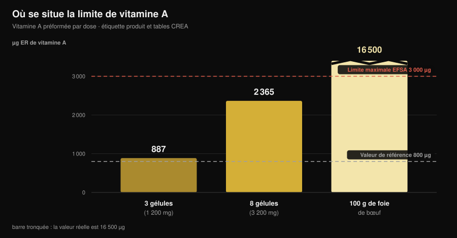
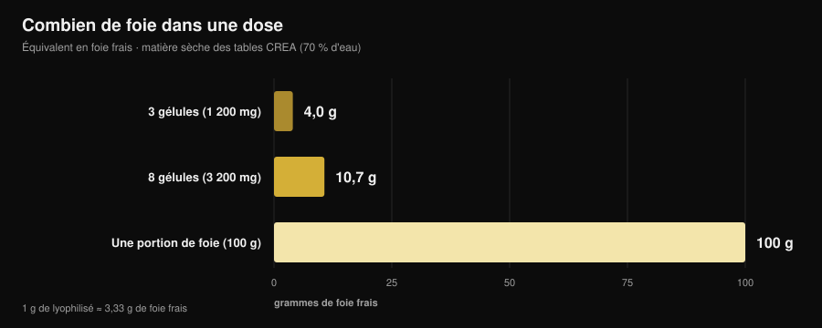

# Compléments de foie de bœuf : utiles ou pas ?

Par [Giammaria Loi](/autore/giammaria-loi) · mis à jour le 15 novembre 2026

Le foie séché en gélules est la catégorie de compléments qui progresse le plus vite, et elle se vend avec une seule phrase : « le multivitamine de la nature ». La phrase est vraie à propos du foie. Le problème, c'est que dans une gélule il n'y a pas de foie : il y a une fraction de portion. Et sur le seul point où la quantité compte vraiment — la vitamine A — la marge entre « utile » et « trop » est plus étroite que ce que dit n'importe quelle étiquette.

## En bref

- **Trois gélules valent environ 4 grammes de foie.** Une dose type déclare 1 200 mg de foie lyophilisé. Le foie frais, c'est 70 % d'eau (tables CREA) : 1 200 mg de poudre correspondent donc à environ **4 g de foie réel**, soit un vingt-cinquième d'une portion de 100 g.
- **La vitamine A est le seul nutriment qui arrive à dose utile.** Un produit vendu en Europe déclare 887 µg pour 3 gélules, soit 111 % de la valeur de référence journalière. Cuivre 0,38 mg (38 %), B12 4,32 µg (172 %). Le reste est négligeable.
- **Le plafond de sécurité est proche, pas lointain.** En 2024, l'EFSA a confirmé pour la vitamine A préformée une limite supérieure tolérable de **3 000 µg ER par jour**, fondée sur la tératogénicité. La dose maximale imprimée sur certaines étiquettes (8 gélules) atteint déjà environ 2 400 µg.
- **Le foie réel dépasse la limite à lui seul.** 100 g de foie de bœuf contiennent 16 500 µg de vitamine A (CREA) : plus de **cinq fois** le maximum quotidien. C'est pourquoi l'EFSA recommande de limiter foie et abats à une fois par mois ou moins, et de les éviter pendant la grossesse.
- **Sur la force, l'énergie et le muscle, pas une seule étude contrôlée.** La recherche sur les compléments de foie séché et l'entraînement est inexistante : zéro essai randomisé. Tout ce qui circule là-dessus relève de l'anecdote.

*Graphique Nurvan. Gélules : valeurs déclarées sur l'étiquette d'un complément de foie lyophilisé vendu en Europe (887 µg de vitamine A pour 3 gélules de 1 200 mg ; le chiffre à 8 gélules est proportionnel à la dose maximale indiquée par le fabricant). Foie frais : tables de composition CREA, foie de bovin, 16 500 µg ER pour 100 g. Limite maximale : EFSA, 2024.*

## Ce que c'est, et ce que ça promet

On les vend sous le nom d'*organ supplements* ou simplement *beef liver* : foie de bœuf lyophilisé ou séché, mis en gélules, souvent avec la mention *grass-fed*. L'argument est ancestral — nos ancêtres mangeaient les abats, nous non — et nutritionnel : le foie est réellement l'un des aliments les plus denses en micronutriments qui existent.

Sur ce dernier point, les chiffres leur donnent raison. D'après les tables de composition des aliments du CREA, 100 g de foie de bovin apportent 16 500 µg de vitamine A en équivalent rétinol, 3,7 mg de cuivre, 3,30 mg de riboflavine, 8,8 mg de fer, 42 µg de sélénium, 6 mg de zinc et 20 g de protéines pour 142 kcal. Aucun multivitamine n'imite ce profil aussi complètement.

Le saut logique qui n'est jamais énoncé, c'est le passage de l'aliment à la gélule.

## Combien de foie dans une dose, réellement

Le foie frais contient 70 g d'eau pour 100 g. Une fois lyophilisé, il reste la matière sèche : environ 30 g pour 100 g de départ. Le calcul tient en une ligne.

Une dose type — trois gélules — déclare **1 200 mg de foie lyophilisé**. Divisé par 0,30, cela fait environ **4 g de foie frais**. La dose maximale indiquée par ce même fabricant, huit gélules, représente 3 200 mg de poudre : **moins de 11 g de foie**.

*Graphique Nurvan. Conversion depuis la matière sèche : foie de bovin à 70,0 g d'eau pour 100 g (tables CREA), donc 1 g de lyophilisé ≈ 3,33 g de foie frais. Doses d'étiquette : 1 200 mg pour 3 gélules, 3 200 mg pour 8 gélules.*

Garder cette proportion en tête règle la moitié des questions sur le produit. Si ce que vous cherchez dans le foie se compte en quantité — protéines, fer, zinc —, les gélules ne vous le donneront jamais : il en faudrait vingt-cinq doses pour égaler une portion. Si en revanche un élément du foie est ultra-concentré, la gélule en apporte assez pour compter. Et c'est le cas d'un seul de ces nutriments.

## Le seul nutriment qui compte : la vitamine A

Un complément de foie lyophilisé du marché européen déclare, pour trois gélules : vitamine A 887 µg (111 % de la valeur nutritionnelle de référence), vitamine B12 4,32 µg (172 %), cuivre 0,38 mg (38 %). Le fer n'est même pas déclaré.

La vitamine A du foie est du rétinol, c'est-à-dire de la vitamine A **préformée** : ce n'est pas le bêta-carotène des carottes, que le corps ne convertit qu'à hauteur de ses besoins. Le rétinol s'accumule dans votre foie, et il n'a pas de soupape.

En 2024, le panel NDA de l'EFSA a réexaminé toute la littérature et confirmé la limite supérieure tolérable pour la vitamine A préformée chez l'adulte : **3 000 µg ER par jour**, pour les hommes, les femmes en âge de procréer, les femmes enceintes et allaitantes. L'effet critique sur lequel ce chiffre est construit, c'est la **tératogénicité** : l'atteinte au développement embryonnaire.

Trois gélules à 887 µg ne posent pas de problème à un adulte en bonne santé : c'est environ un tiers de la limite. Le problème naît quand trois choses s'additionnent, et elles s'additionnent facilement : la dose maximale que beaucoup de fabricants indiquent eux-mêmes (8 gélules, environ 2 400 µg), un multivitamine qui contient déjà de la vitamine A, et le vrai foie dans l'assiette. Car le vrai foie sort de l'échelle à lui seul : 100 g valent 16 500 µg, soit **5,5 fois le maximum quotidien**. Ce n'est pas un détail théorique : c'est la raison pour laquelle l'EFSA écrit que les populations européennes restent sous la limite seulement si foie et abats sont consommés une fois par mois ou moins.

Qu'un repas de foie déplace réellement la biochimie, cela a été mesuré : dans une étude chez des femmes non enceintes, un seul repas de foie riche en vitamine A a multiplié par trois à cinq l'exposition sur 24 heures à l'acide 13-cis-rétinoïque et à son métabolite 4-oxo, les composés derrière la toxicité. Que l'excès ne soit pas une hypothèse, la clinique le montre : trois intoxications à la vitamine A après ingestion de foie de poisson décrites par le centre antipoison de Marseille, avec céphalées, nausées, desquamation de la peau et, chez une femme enceinte, une fausse couche.

L'excès chronique, lui, a une cible moins visible : l'os. Une revue de 2024 dans *Frontiers in Endocrinology* résume le tableau avec honnêteté : dans les études précliniques, de fortes doses de vitamine A réduisent sans ambiguïté la masse osseuse corticale, tandis que chez l'humain les associations cliniques sont discordantes, et une méta-analyse a trouvé un risque accru de fracture de la hanche aux niveaux sanguins à la fois bas et élevés de vitamine A. Ce n'est pas une condamnation : c'est la raison pour laquelle « plus j'en prends, mieux c'est » ne s'applique pas à ce nutriment.

> **Enceinte ou en projet de grossesse, ne prenez pas ces compléments sans en parler d'abord à votre médecin ou à votre gynécologue.** L'EFSA recommande explicitement d'éviter les produits à base de foie pendant la grossesse, et la limite de 3 000 µg est bâtie précisément sur ce risque.

## Ce que dit vraiment la recherche

| Affirmation courante | Verdict | Source |
|---|---|---|
| « Le foie est le multivitamine de la nature » | **Confirmé** pour l'aliment : 100 g couvrent vitamine A, cuivre, B2, fer, sélénium et zinc | CREA, tables de composition |
| « Donc les gélules sont un multivitamine » | **Démenti** : 3 gélules = environ 4 g de foie. Seule la vitamine A arrive à dose utile | Étiquette produit + CREA |
| « C'est juste de la nourriture, ça ne peut pas nuire » | **Démenti** : la vitamine A préformée a un plafond de 3 000 µg/jour fondé sur la tératogénicité, et l'hypervitaminose A par le foie est documentée en clinique | EFSA, 2024 ; Schmitt et al., 2020 |
| « Plus j'en prends, mieux c'est » | **Démenti** : l'excès chronique de vitamine A réduit la masse osseuse corticale chez l'animal et une méta-analyse signale plus de fractures de hanche aux extrêmes | Lerner, 2024 |
| « Ça donne énergie, testostérone, récupération, masse » | **Non vérifiable** : aucune étude contrôlée sur les compléments de foie séché et la performance ou la composition corporelle | Recherche PubMed, aucun ECR |
| « Excellent contre la fatigue par manque de fer » | **À préciser** : le fer améliore la performance seulement chez les personnes carencées, et les études utilisent environ 100 mg par jour de fer élément. Les gélules ne déclarent même pas le fer | Pengelly et al., 2024 |
| « Grass-fed veut dire plus sûr » | **Non vérifiable** : l'alimentation de l'animal ne réduit pas la teneur en vitamine A, qui est le point critique | — |

### La question d'avant : qu'y a-t-il dans la gélule ?

Une question précède toutes les autres : l'étiquette dit-elle vrai ? Pour cette catégorie précise, aucune analyse indépendante n'est publiée. Ce qui existe, c'est un tableau général peu rassurant sur les compléments non autorisés comme médicaments : dans une analyse de 2025 portant sur 40 produits à base d'*Andrographis paniculata* achetés dans 13 pays, la teneur réelle en principe actif allait de 29 % à 174 % de la dose déclarée — deux produits seulement étaient étiquetés avec exactitude — et trois produits achetés en ligne contenaient des contaminants toxiques, dont du mercure et des pesticides.

Ce n'est pas une étude sur le foie de bœuf et il ne faut pas la lire comme telle. C'est la raison pour laquelle, sur un produit dont le seul nutriment utile a un plafond de sécurité, l'origine et les contrôles de lot comptent davantage que l'argument de façade.

## Comment l'appliquer

1. **Décidez pourquoi vous le prenez.** Si la réponse est « pour la vitamine A et la B12 », cette raison existe et tient. Si c'est « pour la force » ou « pour l'énergie », il n'y a rien à mesurer : aucune étude ne l'a testé.
2. **Faites la somme de la vitamine A, pas la moyenne des sensations.** Mettez sur papier gélules, multivitamine et nombre de fois par mois où vous mangez du foie. Le plafond, c'est 3 000 µg par jour de vitamine A préformée, et le vrai foie le dépasse seul.
3. **Ne dépassez pas la dose minimale indiquée sans raison.** Les « 8 gélules » de dose maximale affichées sur certains conditionnements mènent à environ 2 400 µg : presque toute la marge disponible, dépensée dans un produit sans études d'efficacité.
4. **Si vous mangez du foie, comptez ce jour comme plein.** Une portion normale couvre plusieurs fois le besoin : ce jour-là, les gélules ne servent à rien, et la semaine suivante non plus.
5. **Grossesse, projet de grossesse, maladies du foie, hémochromatose, traitements par rétinoïdes : parlez-en à votre médecin avant.** Ici, il ne s'agit pas d'optimiser mais de sécurité, et la décision n'appartient pas à un article.
6. **Si l'objectif est la masse, regardez d'abord les protéines.** Quatre grammes de foie ne sont pas une source protéique. Sur ce que valent les poudres de viande face au whey, nous avons écrit à part : [beef protein face au whey](/fr/blog/beef-protein-proteines-de-boeuf-vs-whey).

> **Nurvan : la vitamine A, c'est l'app qui l'additionne, pas votre mémoire**
>
> Le risque de cette catégorie, ce n'est pas une gélule, c'est la somme de plusieurs sources. Dans Nurvan vous enregistrez les compléments avec dose et horaire dans le module supplémentation, et le journal alimentaire bâti sur les données CREA compte la vitamine A qui arrive déjà des aliments, foie compris. Le total de la journée devient un chiffre que vous voyez, pas une estimation. [Essayer Nurvan](https://nurvan.app)

## Questions fréquentes

**Les compléments de foie de bœuf sont-ils efficaces ?**
Comme source de vitamine A préformée et de vitamine B12, oui, et l'étiquette le déclare. Comme aide pour la force, l'énergie, la récupération ou la masse musculaire, il n'existe aucune étude contrôlée : la recherche sur le foie séché et la performance est inexistante. Les quantités de protéines, de fer et de zinc dans une dose sont bien trop faibles pour compter.

**Combien de gélules de foie par jour peut-on prendre ?**
Les fabricants indiquent en général de 3 à 8 gélules. La vraie contrainte n'est pas la gélule mais le total quotidien de vitamine A préformée, que l'EFSA fixe à 3 000 µg ER au maximum chez l'adulte. À 887 µg pour trois gélules, huit gélules atteignent déjà environ 2 400 µg, sans compter multivitamines et aliments.

**Gélules ou foie à table ?**
Ce sont deux choses différentes. Une portion de foie donne tout le profil de micronutriments, mais 100 g contiennent 16 500 µg de vitamine A, plus de cinq fois la limite quotidienne : d'où la recommandation de l'EFSA d'une fois par mois ou moins. Les gélules donnent une fraction du profil à dose maîtrisable. Si vous cherchez le nutriment, choisissez selon la fréquence voulue ; si vous cherchez le repas, choisissez le foie et mettez-le à l'agenda, pas dans la rotation.

**Peut-on en prendre pendant la grossesse ?**
Pas sans en parler à son médecin. L'EFSA recommande d'éviter les produits à base de foie pendant la grossesse et en cas de projet de grossesse, et la limite maximale de vitamine A préformée est construite précisément sur le risque de malformations.

## À lire aussi

- [Beef protein : les protéines de bœuf valent-elles le whey ?](/fr/blog/beef-protein-proteines-de-boeuf-vs-whey) — l'autre produit « d'origine bovine » vendu avec des arguments ancestraux, mesuré sur les données.
- [Classement des compléments pour la force : ce que dit la recherche](/fr/blog/classement-complements-force-tier-list) — où se situent, par ordre de preuves, les compléments qui comptent quand on s'entraîne.
- [Quel magnésium choisir et quelle dose](/fr/blog/quel-magnesium-choisir-dose-et-formes) — comment lire une étiquette quand la forme et la dose changent tout.

## Sources

1. CREA — Centre de recherche Alimentation et Nutrition. Tables de composition des aliments, fiche « Fegato di bovini » (foie de bovin ; pour 100 g de partie comestible : eau 70,0 g ; protéines 20,0 g ; vitamine A équivalent rétinol 16 500 µg ; riboflavine 3,30 mg ; fer 8,8 mg ; cuivre 3,7 mg ; zinc 6 mg ; sélénium 42 µg). [alimentinutrizione.it](https://www.alimentinutrizione.it/tabelle-nutrizionali/115320)
2. EFSA Panel on Nutrition, Novel Foods and Food Allergens (NDA); Turck D, Bohn T, Castenmiller J, et al., 2024. Scientific opinion on the tolerable upper intake level for preformed vitamin A and β-carotene. *EFSA Journal* 22(6):e8814. [PMID 38846679](https://pubmed.ncbi.nlm.nih.gov/38846679/) · [DOI 10.2903/j.efsa.2024.8814](https://doi.org/10.2903/j.efsa.2024.8814)
3. Lerner UH, 2024. Vitamin A — discovery, metabolism, receptor signaling and effects on bone mass and fracture susceptibility. *Front Endocrinol* 15:1298851. [PMID 38711977](https://pubmed.ncbi.nlm.nih.gov/38711977/) · [DOI 10.3389/fendo.2024.1298851](https://doi.org/10.3389/fendo.2024.1298851)
4. Hartmann S, Brørs O, Bock J, Blomhoff R, Bausch J, Wiegand UW, Hartmann D, Hornig DH, 2005. Exposure to retinoic acids in non-pregnant women following high vitamin A intake with a liver meal. *Int J Vitam Nutr Res* 75(3):187-194. [PMID 16028634](https://pubmed.ncbi.nlm.nih.gov/16028634/) · [DOI 10.1024/0300-9831.75.3.187](https://doi.org/10.1024/0300-9831.75.3.187)
5. Schmitt C, Domangé B, Torrents R, de Haro L, Simon N, 2020. Hypervitaminosis A Following the Ingestion of Fish Liver: Report on 3 Cases from the Poison Control Center in Marseille. *Wilderness Environ Med* 31(4):454-456. [PMID 32861618](https://pubmed.ncbi.nlm.nih.gov/32861618/) · [DOI 10.1016/j.wem.2020.06.003](https://doi.org/10.1016/j.wem.2020.06.003)
6. Pengelly M, Pumpa K, Pyne DB, Etxebarria N, 2024. Iron deficiency, supplementation, and sports performance in female athletes: A systematic review. *J Sport Health Sci* 14:101009. [PMID 39536912](https://pubmed.ncbi.nlm.nih.gov/39536912/) · [DOI 10.1016/j.jshs.2024.101009](https://doi.org/10.1016/j.jshs.2024.101009)
7. Bourqui A, Morin H, Huber R, Csajka C, Podmore C, Wolfender JL, Queiroz Ferreira E, Rodondi PY, 2025. Quality assessment of Andrographis paniculata products reveals significant labelling inaccuracies and contaminations. *Swiss Med Wkly* 155:4728. [PMID 41397381](https://pubmed.ncbi.nlm.nih.gov/41397381/) · [DOI 10.57187/s.4728](https://doi.org/10.57187/s.4728)

Valeurs d'étiquette citées dans le texte et les graphiques : fiche produit d'un complément de foie de bœuf lyophilisé vendu en Europe (pour 3 gélules : 1 200 mg de foie lyophilisé, vitamine A 887 µg, cuivre 0,38 mg, vitamine B12 4,32 µg ; dose journalière maximale indiquée 8 gélules). Vérification d'absence d'études : recherche PubMed sur les compléments de foie séché et l'entraînement ou la performance, aucun essai randomisé trouvé. Sujet choisi à partir de signaux de tendance de novembre 2026 sur la catégorie organ supplements, avec des contenus concurrents composés presque uniquement de fiches produit. Sources scientifiques consultées via PubMed.

**Giammaria Loi** est le fondateur de Nurvan. Il s'entraîne avec des poids depuis 2012, travaille comme entraîneur personnel et coach certifié FIPE depuis 2013 et participe à des compétitions de powerlifting au niveau national depuis 2018. Chaque article qu'il signe part des études scientifiques et arrive à ce qui fonctionne vraiment en salle. [Page auteur](/autore/giammaria-loi)

> Note : contenu informatif, il ne remplace pas l'avis d'un médecin ou d'un professionnel qualifié.
