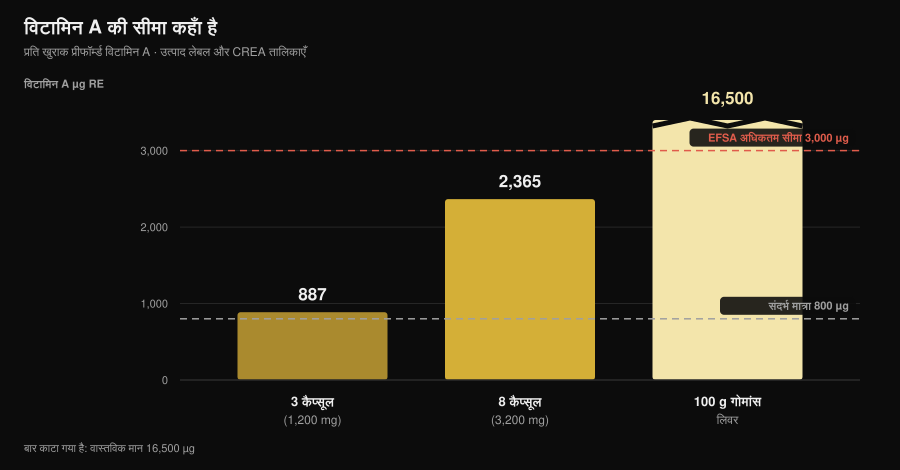
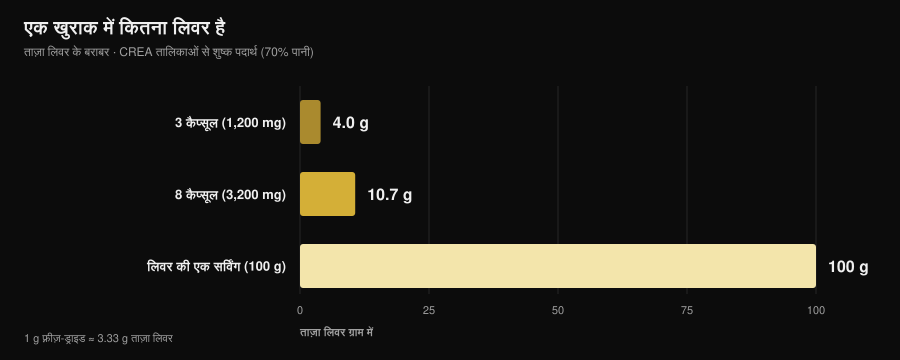

# बीफ़ लिवर सप्लीमेंट: क्या ये सच में काम करते हैं?

लेखक: [Giammaria Loi](/autore/giammaria-loi) · अपडेट 15 नवंबर 2026

कैप्सूल में सूखा लिवर इस समय सबसे तेज़ी से बढ़ने वाली सप्लीमेंट श्रेणी है, और इसे बेचा जाता है सिर्फ़ एक लाइन से: "प्रकृति का मल्टीविटामिन"। लिवर के बारे में यह लाइन सही है। दिक्कत यह है कि कैप्सूल में लिवर होता ही नहीं — उसमें एक हिस्से का छोटा-सा अंश होता है। और जिस एक चीज़ में मात्रा सचमुच मायने रखती है — विटामिन A — वहाँ "फ़ायदेमंद" और "बहुत ज़्यादा" के बीच का फ़ासला किसी भी लेबल के बताए से कम है।

## संक्षेप में

- **तीन कैप्सूल यानी करीब 4 ग्राम लिवर।** एक सामान्य खुराक में 1,200 mg फ़्रीज़-ड्राइड लिवर बताया जाता है। ताज़ा लिवर 70% पानी होता है (CREA तालिकाएँ), इसलिए 1,200 mg पाउडर करीब **4 ग्राम असली लिवर** के बराबर है: 100 ग्राम की एक सर्विंग का पच्चीसवाँ हिस्सा।
- **विटामिन A ही एकमात्र पोषक तत्व है जो सार्थक मात्रा में पहुँचता है।** यूरोप में बिकने वाला एक उत्पाद 3 कैप्सूल पर 887 µg बताता है, यानी दैनिक संदर्भ मान का 111%। कॉपर 0.38 mg (38%), B12 4.32 µg (172%)। बाकी सब नगण्य है।
- **सुरक्षा की सीमा पास है, दूर नहीं।** 2024 में EFSA ने प्रीफ़ॉर्म्ड विटामिन A के लिए **प्रतिदिन 3,000 µg RE** की सहनीय ऊपरी सीमा की पुष्टि की, जिसका आधार टेराटोजेनिसिटी है। कुछ लेबल पर छपी अधिकतम खुराक (8 कैप्सूल) ही करीब 2,400 µg तक पहुँच जाती है।
- **असली लिवर अकेले ही सीमा पार कर देता है।** 100 ग्राम बीफ़ लिवर में 16,500 µg विटामिन A होता है (CREA): दैनिक अधिकतम से **पाँच गुना से भी ज़्यादा**। इसीलिए EFSA लिवर और ऑर्गन मीट को महीने में एक बार या उससे कम तक सीमित रखने और गर्भावस्था में इनसे बचने की सलाह देता है।
- **ताक़त, एनर्जी और मसल्स पर एक भी नियंत्रित अध्ययन नहीं है।** सूखे लिवर सप्लीमेंट और ट्रेनिंग पर शोध है ही नहीं: शून्य रैंडमाइज़्ड ट्रायल। इस पर जो भी पढ़ने को मिलता है, वह निजी अनुभव है।

*Nurvan ग्राफ़। कैप्सूल: यूरोप में बिकने वाले एक फ़्रीज़-ड्राइड लिवर सप्लीमेंट के लेबल पर घोषित मान (3 कैप्सूल यानी 1,200 mg पर विटामिन A 887 µg; 8 कैप्सूल का आंकड़ा निर्माता द्वारा बताई अधिकतम खुराक के अनुपात में)। ताज़ा लिवर: CREA खाद्य संरचना तालिकाएँ, गोवंश का लिवर, प्रति 100 ग्राम 16,500 µg RE। अधिकतम सीमा: EFSA, 2024।*

## ये हैं क्या, और वादा क्या करते हैं

इन्हें *organ supplements* या सीधे *beef liver* कहकर बेचा जाता है: फ़्रीज़-ड्राइड या सुखाया हुआ गोवंश का लिवर, कैप्सूल में, अक्सर *grass-fed* लिखकर। तर्क आंशिक रूप से पुरखों वाला है — हमारे पूर्वज अंग खाते थे, हम नहीं — और आंशिक रूप से पोषण का: लिवर वाक़ई मौजूद सबसे अधिक सूक्ष्म-पोषक-सघन खाद्य पदार्थों में से एक है।

इस आख़िरी बात पर आंकड़े उनके पक्ष में हैं। CREA की खाद्य संरचना तालिकाओं के अनुसार, 100 ग्राम गोवंश लिवर देता है 16,500 µg विटामिन A (रेटिनॉल समतुल्य), 3.7 mg कॉपर, 3.30 mg राइबोफ़्लेविन, 8.8 mg आयरन, 42 µg सेलेनियम, 6 mg ज़िंक और 20 ग्राम प्रोटीन, 142 kcal में। कोई भी मल्टीविटामिन इस प्रोफ़ाइल की इतनी पूरी नक़ल नहीं करता।

जो तार्किक छलांग कभी नहीं बताई जाती, वह है भोजन से कैप्सूल तक की।

## एक खुराक में असल में कितना लिवर है

ताज़ा लिवर में प्रति 100 ग्राम 70 ग्राम पानी होता है। फ़्रीज़-ड्राई करने पर जो बचता है वह शुष्क पदार्थ है: हर 100 ग्राम में करीब 30 ग्राम। हिसाब एक लाइन में हो जाता है।

एक सामान्य खुराक — तीन कैप्सूल — में **1,200 mg फ़्रीज़-ड्राइड लिवर** बताया जाता है। 0.30 से भाग देने पर यह करीब **4 ग्राम ताज़ा लिवर** बैठता है। उसी निर्माता की बताई अधिकतम खुराक, आठ कैप्सूल, यानी 3,200 mg पाउडर: **11 ग्राम लिवर से भी कम**।

*Nurvan ग्राफ़। शुष्क पदार्थ से रूपांतरण: गोवंश लिवर में प्रति 100 ग्राम 70.0 ग्राम पानी (CREA तालिकाएँ), इसलिए 1 ग्राम फ़्रीज़-ड्राइड ≈ 3.33 ग्राम ताज़ा लिवर। लेबल खुराक: 3 कैप्सूल पर 1,200 mg, 8 कैप्सूल पर 3,200 mg।*

यह अनुपात याद रखने भर से इस उत्पाद के आधे सवाल अपने आप सुलझ जाते हैं। लिवर से आपको जो चीज़ें मात्रा में चाहिए — प्रोटीन, आयरन, ज़िंक — कैप्सूल वे कभी नहीं देंगे: एक सर्विंग की बराबरी के लिए पच्चीस खुराक लगेंगी। लेकिन लिवर में जो चीज़ अत्यधिक सघन है, उसकी इतनी मात्रा कैप्सूल दे देता है कि वह मायने रखे। और यह बात इनमें से सिर्फ़ एक पोषक तत्व पर लागू होती है।

## एकमात्र पोषक तत्व जो मायने रखता है: विटामिन A

यूरोपीय बाज़ार में एक फ़्रीज़-ड्राइड लिवर सप्लीमेंट तीन कैप्सूल पर घोषित करता है: विटामिन A 887 µg (संदर्भ मान का 111%), विटामिन B12 4.32 µg (172%), कॉपर 0.38 mg (38%)। आयरन तो घोषित ही नहीं किया जाता।

लिवर का विटामिन A रेटिनॉल है, यानी **प्रीफ़ॉर्म्ड** विटामिन A: यह गाजर का बीटा-कैरोटीन नहीं है, जिसे शरीर ज़रूरत भर ही बदलता है। रेटिनॉल आपके लिवर में जमा होता है, और इसका कोई सेफ़्टी वाल्व नहीं है।

2024 में EFSA के NDA पैनल ने पूरे साहित्य की समीक्षा की और वयस्कों के लिए प्रीफ़ॉर्म्ड विटामिन A की सहनीय ऊपरी सीमा की पुष्टि की: **प्रतिदिन 3,000 µg RE**, जो पुरुषों, प्रजनन आयु की महिलाओं, गर्भवती और स्तनपान कराने वाली महिलाओं सभी पर लागू है। जिस महत्वपूर्ण प्रभाव पर यह संख्या टिकी है वह है **टेराटोजेनिसिटी**, यानी भ्रूण के विकास को नुक़सान।

887 µg वाले तीन कैप्सूल एक स्वस्थ वयस्क के लिए समस्या नहीं हैं: यह सीमा का करीब एक-तिहाई है। समस्या तब शुरू होती है जब तीन चीज़ें जुड़ती हैं, और वे आसानी से जुड़ती हैं: कई निर्माताओं द्वारा लेबल पर ही छापी अधिकतम खुराक (8 कैप्सूल, करीब 2,400 µg), पहले से विटामिन A वाला मल्टीविटामिन, और थाली में असली लिवर। क्योंकि असली लिवर अकेले ही पैमाने से बाहर है: 100 ग्राम यानी 16,500 µg, **दैनिक अधिकतम का 5.5 गुना**। यह सैद्धांतिक बारीकी नहीं है — इसी वजह से EFSA लिखता है कि यूरोपीय आबादी सीमा के नीचे तभी रहती है जब लिवर और ऑर्गन मीट महीने में एक बार या उससे कम खाया जाए।

लिवर का एक भोजन वाक़ई शरीर की जैव-रसायन को हिला देता है, यह नापा जा चुका है: गैर-गर्भवती महिलाओं पर हुए एक अध्ययन में, उच्च विटामिन A वाले एक ही लिवर भोजन ने 24 घंटे में 13-सिस-रेटिनोइक एसिड और उसके 4-ऑक्सो मेटाबोलाइट — विषाक्तता के पीछे के यौगिक — के एक्सपोज़र को तीन से पाँच गुना बढ़ा दिया। अधिकता कोई अनुमान नहीं है, यह क्लिनिक दिखाता है: मार्सिले के ज़हर नियंत्रण केंद्र द्वारा बताए गए मछली के लिवर से विटामिन A विषाक्तता के तीन मामले, जिनमें सिरदर्द, मतली, त्वचा का छिलना और एक गर्भवती महिला में गर्भपात शामिल था।

और दीर्घकालिक अधिकता का निशाना कम दिखने वाला है: हड्डी। *Frontiers in Endocrinology* में 2024 की एक समीक्षा तस्वीर ईमानदारी से रखती है: प्री-क्लिनिकल अध्ययनों में विटामिन A की ऊँची खुराक कॉर्टिकल हड्डी का द्रव्यमान स्पष्ट रूप से घटाती है, जबकि मनुष्यों में क्लिनिकल संबंध असंगत हैं, और एक मेटा-विश्लेषण ने रक्त में विटामिन A के निम्न और उच्च दोनों स्तरों पर कूल्हे के फ्रैक्चर का जोखिम बढ़ा हुआ पाया। यह कोई फ़ैसला नहीं है — यह वजह है कि "जितना ज़्यादा उतना अच्छा" इस पोषक तत्व पर लागू नहीं होता।

> **गर्भावस्था में या गर्भधारण की कोशिश कर रहे हों, तो ये सप्लीमेंट अपने डॉक्टर से बात किए बिना न लें।** EFSA स्पष्ट रूप से गर्भावस्था में लिवर उत्पादों से बचने की सलाह देता है, और 3,000 µg की सीमा इसी जोखिम पर बनी है।

## शोध असल में क्या कहता है

| प्रचलित दावा | निष्कर्ष | स्रोत |
|---|---|---|
| "लिवर प्रकृति का मल्टीविटामिन है" | **पुष्ट** (भोजन के लिए): 100 ग्राम विटामिन A, कॉपर, B2, आयरन, सेलेनियम और ज़िंक को कवर करता है | CREA, संरचना तालिकाएँ |
| "तो कैप्सूल भी मल्टीविटामिन हुए" | **ग़लत**: 3 कैप्सूल ≈ 4 ग्राम लिवर। सार्थक मात्रा में सिर्फ़ विटामिन A पहुँचता है | उत्पाद लेबल + CREA |
| "यह तो बस खाना है, नुक़सान नहीं कर सकता" | **ग़लत**: प्रीफ़ॉर्म्ड विटामिन A की सीमा 3,000 µg/दिन है, आधार टेराटोजेनिसिटी, और लिवर से हाइपरविटामिनोसिस A क्लिनिकली दर्ज है | EFSA, 2024; Schmitt et al., 2020 |
| "जितना ज़्यादा लूँ उतना अच्छा" | **ग़लत**: लंबे समय तक विटामिन A की अधिकता पशु मॉडल में कॉर्टिकल हड्डी द्रव्यमान घटाती है, और मेटा-विश्लेषण दोनों छोरों पर अधिक कूल्हा फ्रैक्चर बताता है | Lerner, 2024 |
| "एनर्जी, टेस्टोस्टेरोन, रिकवरी, मसल्स देता है" | **अप्रमाणित**: सूखे लिवर सप्लीमेंट और प्रदर्शन या शरीर संरचना पर कोई नियंत्रित अध्ययन नहीं | PubMed खोज, कोई RCT नहीं |
| "आयरन की कमी की थकान में बढ़िया" | **स्पष्टीकरण चाहिए**: आयरन प्रदर्शन सिर्फ़ कमी वाले लोगों में सुधारता है, और अध्ययनों में रोज़ाना करीब 100 mg एलिमेंटल आयरन इस्तेमाल होता है। कैप्सूल आयरन घोषित तक नहीं करते | Pengelly et al., 2024 |
| "grass-fed मतलब ज़्यादा सुरक्षित" | **अप्रमाणित**: जानवर का आहार विटामिन A की मात्रा नहीं घटाता, और यही असल मुद्दा है | — |

### उससे पहले का सवाल: कैप्सूल में है क्या

एक सवाल बाकी सबसे पहले आता है: क्या लेबल सच बोल रहा है? इस ख़ास श्रेणी पर कोई स्वतंत्र प्रकाशित विश्लेषण नहीं है। जो मौजूद है वह दवा के रूप में स्वीकृत न किए गए सप्लीमेंट्स की एक सामान्य और कम आश्वस्त करने वाली तस्वीर है: 2025 के एक विश्लेषण में 13 देशों से ख़रीदे गए *Andrographis paniculata* के 40 उत्पादों में सक्रिय तत्व की वास्तविक मात्रा घोषित खुराक के 29% से 174% तक थी — सिर्फ़ दो उत्पाद सही लेबल वाले थे — और ऑनलाइन ख़रीदे गए तीन उत्पादों में पारा और कीटनाशक समेत विषाक्त संदूषक मिले।

यह बीफ़ लिवर पर अध्ययन नहीं है और इसे ऐसे पढ़ा भी नहीं जाना चाहिए। यह वजह है कि जिस उत्पाद के इकलौते सार्थक पोषक तत्व की सुरक्षा सीमा हो, उसमें स्रोत और बैच जाँच पैकेट के सामने लिखे दावे से ज़्यादा मायने रखते हैं।

## इसे कैसे लागू करें

1. **तय करें कि आप इसे क्यों ले रहे हैं।** अगर जवाब "विटामिन A और B12 के लिए" है, तो यह वजह मौजूद है और टिकती है। अगर "ताक़त के लिए" या "एनर्जी के लिए" है, तो नापने को कुछ नहीं: किसी अध्ययन ने इसे जाँचा ही नहीं।
2. **विटामिन A को जोड़ें, एहसासों का औसत न निकालें।** कैप्सूल, मल्टीविटामिन और महीने में कितनी बार लिवर खाते हैं — सब लिख लें। सीमा है रोज़ाना 3,000 µg प्रीफ़ॉर्म्ड विटामिन A, और असली लिवर उसे अकेले तोड़ देता है।
3. **बिना वजह बताई न्यूनतम खुराक से ऊपर न जाएँ।** कुछ पैकेट पर दिखने वाली "8 कैप्सूल" की अधिकतम खुराक करीब 2,400 µg तक ले जाती है: लगभग पूरी उपलब्ध गुंजाइश, और वह भी ऐसे उत्पाद पर जिसके प्रभाव के अध्ययन नहीं हैं।
4. **जिस दिन लिवर खाएँ, उस दिन को भरा हुआ मानें।** एक सामान्य सर्विंग ज़रूरत को कई गुना पूरा कर देती है: उस दिन कैप्सूल की ज़रूरत नहीं, और अगले हफ़्ते भी नहीं।
5. **गर्भावस्था, गर्भधारण की कोशिश, लिवर की बीमारी, हीमोक्रोमैटोसिस, रेटिनॉइड थेरेपी: पहले डॉक्टर से बात करें।** यहाँ बात ऑप्टिमाइज़ करने की नहीं, सुरक्षा की है, और यह फ़ैसला किसी लेख का नहीं है।
6. **अगर लक्ष्य मसल्स है, तो पहले प्रोटीन देखें।** चार ग्राम लिवर प्रोटीन का स्रोत नहीं है। मीट पाउडर व्हे के मुक़ाबले कहाँ ठहरते हैं, इस पर अलग लेख है: [बीफ़ प्रोटीन बनाम व्हे](/hi/blog/beef-protein-powder-ya-whey-protein)।

> **Nurvan: विटामिन A ऐप जोड़ता है, आपकी याददाश्त नहीं**
>
> इस श्रेणी का जोखिम एक कैप्सूल नहीं, कई स्रोतों का जोड़ है। Nurvan में आप सप्लीमेंट मॉड्यूल में खुराक और समय के साथ सप्लीमेंट दर्ज करते हैं, और CREA डेटा पर बना फ़ूड डायरी उस विटामिन A को भी गिनता है जो खाने से पहले ही आ रहा है — लिवर समेत। इस तरह दिन का कुल योग एक दिखने वाला आंकड़ा बन जाता है, अंदाज़ा नहीं। [Nurvan आज़माएँ](https://nurvan.app)

## अक्सर पूछे जाने वाले सवाल

**क्या बीफ़ लिवर सप्लीमेंट काम करते हैं?**
प्रीफ़ॉर्म्ड विटामिन A और विटामिन B12 के स्रोत के रूप में हाँ, और लेबल यही घोषित करता है। ताक़त, एनर्जी, रिकवरी या मसल मास के लिए कोई नियंत्रित अध्ययन नहीं है: सूखे लिवर और प्रदर्शन पर शोध मौजूद ही नहीं। एक खुराक में प्रोटीन, आयरन और ज़िंक की मात्रा इतनी कम है कि मायने नहीं रखती।

**दिन में कितने लिवर कैप्सूल लिए जा सकते हैं?**
निर्माता आम तौर पर 3 से 8 कैप्सूल बताते हैं। असली सीमा कैप्सूल नहीं, दिन भर का प्रीफ़ॉर्म्ड विटामिन A का कुल है, जो EFSA के अनुसार वयस्कों में 3,000 µg RE से ऊपर नहीं जाना चाहिए। तीन कैप्सूल पर 887 µg के हिसाब से आठ कैप्सूल ही करीब 2,400 µg दे देते हैं — मल्टीविटामिन और भोजन गिने बिना।

**कैप्सूल बेहतर हैं या लिवर खाना?**
ये दो अलग चीज़ें हैं। लिवर की एक सर्विंग पूरा सूक्ष्म-पोषक प्रोफ़ाइल देती है, लेकिन 100 ग्राम में 16,500 µg विटामिन A होता है, दैनिक सीमा से पाँच गुना ज़्यादा: इसीलिए EFSA महीने में एक बार या उससे कम की सलाह देता है। कैप्सूल प्रोफ़ाइल का एक अंश नियंत्रित खुराक में देते हैं। अगर आपको पोषक तत्व चाहिए, तो चुनाव इस आधार पर करें कि कितनी बार लेना है; अगर आपको भोजन चाहिए, तो लिवर चुनें और उसे कैलेंडर में रखें, रोज़ के रोटेशन में नहीं।

**क्या गर्भावस्था में ले सकते हैं?**
डॉक्टर से बात किए बिना नहीं। EFSA गर्भावस्था में और गर्भधारण की योजना बना रहे लोगों में लिवर उत्पादों से बचने की सलाह देता है, और प्रीफ़ॉर्म्ड विटामिन A की ऊपरी सीमा जन्मजात विकृति के जोखिम पर ही बनी है।

## यह भी पढ़ें

- [बीफ़ प्रोटीन पाउडर या व्हे प्रोटीन: शोध क्या कहता है](/hi/blog/beef-protein-powder-ya-whey-protein) — पुरखों वाले तर्कों से बिकने वाला दूसरा "गोवंश" उत्पाद, आंकड़ों पर परखा हुआ।
- [स्ट्रेंथ सप्लीमेंट टियर लिस्ट: शोध क्या कहता है](/hi/blog/strength-supplements-tier-list-hindi) — प्रमाण के क्रम में, ट्रेनिंग करने वालों के लिए जो सप्लीमेंट सच में मायने रखते हैं।
- [कौन-सा मैग्नीशियम चुनें और कितनी खुराक](/hi/blog/kaunsa-magnesium-chunein-khurak-aur-roop) — जब रूप और खुराक सब कुछ बदल देते हैं, तब लेबल कैसे पढ़ें।

## स्रोत

1. CREA — खाद्य एवं पोषण अनुसंधान केंद्र (इटली)। खाद्य संरचना तालिकाएँ, "Fegato di bovini" (गोवंश लिवर) प्रविष्टि (प्रति 100 ग्राम खाद्य भाग: पानी 70.0 g; प्रोटीन 20.0 g; विटामिन A रेटिनॉल समतुल्य 16,500 µg; राइबोफ़्लेविन 3.30 mg; आयरन 8.8 mg; कॉपर 3.7 mg; ज़िंक 6 mg; सेलेनियम 42 µg)। [alimentinutrizione.it](https://www.alimentinutrizione.it/tabelle-nutrizionali/115320)
2. EFSA Panel on Nutrition, Novel Foods and Food Allergens (NDA); Turck D, Bohn T, Castenmiller J, et al., 2024. Scientific opinion on the tolerable upper intake level for preformed vitamin A and β-carotene. *EFSA Journal* 22(6):e8814. [PMID 38846679](https://pubmed.ncbi.nlm.nih.gov/38846679/) · [DOI 10.2903/j.efsa.2024.8814](https://doi.org/10.2903/j.efsa.2024.8814)
3. Lerner UH, 2024. Vitamin A — discovery, metabolism, receptor signaling and effects on bone mass and fracture susceptibility. *Front Endocrinol* 15:1298851. [PMID 38711977](https://pubmed.ncbi.nlm.nih.gov/38711977/) · [DOI 10.3389/fendo.2024.1298851](https://doi.org/10.3389/fendo.2024.1298851)
4. Hartmann S, Brørs O, Bock J, Blomhoff R, Bausch J, Wiegand UW, Hartmann D, Hornig DH, 2005. Exposure to retinoic acids in non-pregnant women following high vitamin A intake with a liver meal. *Int J Vitam Nutr Res* 75(3):187-194. [PMID 16028634](https://pubmed.ncbi.nlm.nih.gov/16028634/) · [DOI 10.1024/0300-9831.75.3.187](https://doi.org/10.1024/0300-9831.75.3.187)
5. Schmitt C, Domangé B, Torrents R, de Haro L, Simon N, 2020. Hypervitaminosis A Following the Ingestion of Fish Liver: Report on 3 Cases from the Poison Control Center in Marseille. *Wilderness Environ Med* 31(4):454-456. [PMID 32861618](https://pubmed.ncbi.nlm.nih.gov/32861618/) · [DOI 10.1016/j.wem.2020.06.003](https://doi.org/10.1016/j.wem.2020.06.003)
6. Pengelly M, Pumpa K, Pyne DB, Etxebarria N, 2024. Iron deficiency, supplementation, and sports performance in female athletes: A systematic review. *J Sport Health Sci* 14:101009. [PMID 39536912](https://pubmed.ncbi.nlm.nih.gov/39536912/) · [DOI 10.1016/j.jshs.2024.101009](https://doi.org/10.1016/j.jshs.2024.101009)
7. Bourqui A, Morin H, Huber R, Csajka C, Podmore C, Wolfender JL, Queiroz Ferreira E, Rodondi PY, 2025. Quality assessment of Andrographis paniculata products reveals significant labelling inaccuracies and contaminations. *Swiss Med Wkly* 155:4728. [PMID 41397381](https://pubmed.ncbi.nlm.nih.gov/41397381/) · [DOI 10.57187/s.4728](https://doi.org/10.57187/s.4728)

पाठ और ग्राफ़ में उद्धृत लेबल मान: यूरोप में बिकने वाले एक फ़्रीज़-ड्राइड बीफ़ लिवर सप्लीमेंट का उत्पाद पेज (प्रति 3 कैप्सूल: 1,200 mg फ़्रीज़-ड्राइड लिवर, विटामिन A 887 µg, कॉपर 0.38 mg, विटामिन B12 4.32 µg; बताई गई अधिकतम दैनिक खुराक 8 कैप्सूल)। प्रमाण-अभाव की जाँच: सूखे लिवर सप्लीमेंट और ट्रेनिंग या प्रदर्शन पर PubMed खोज, कोई रैंडमाइज़्ड ट्रायल नहीं मिला। विषय नवंबर 2026 के ऑर्गन सप्लीमेंट श्रेणी के ट्रेंड संकेतों से चुना गया, जहाँ प्रतिस्पर्धी सामग्री लगभग पूरी तरह उत्पाद पेजों की है। वैज्ञानिक स्रोत PubMed के माध्यम से देखे गए।

**Giammaria Loi** Nurvan के संस्थापक हैं। वे 2012 से वेट ट्रेनिंग करते हैं, 2013 से FIPE-प्रमाणित पर्सनल ट्रेनर और कोच के रूप में काम करते हैं और 2018 से राष्ट्रीय स्तर पर पावरलिफ़्टिंग में हिस्सा लेते हैं। उनके हर लेख की शुरुआत वैज्ञानिक अध्ययनों से होती है और अंत इस पर कि जिम में असल में क्या काम करता है। [लेखक पेज](/autore/giammaria-loi)

> नोट: यह सूचनात्मक सामग्री है, यह डॉक्टर या योग्य पेशेवर की सलाह का विकल्प नहीं है।
