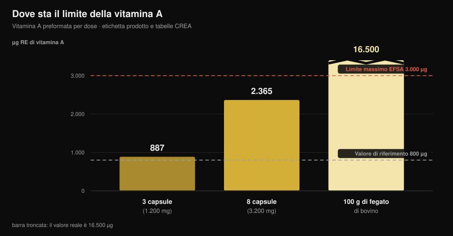
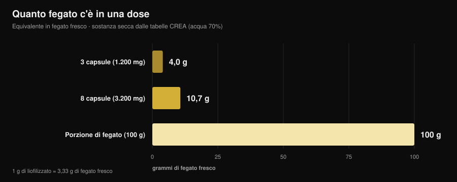

# Integratori di fegato bovino: servono davvero?

Di [Giammaria Loi](/autore/giammaria-loi) · aggiornato il 15 novembre 2026

Il fegato essiccato in capsule è la categoria di integratori che sta crescendo più in fretta, ed è venduta con una frase sola: "il multivitaminico della natura". La frase è vera per il fegato. Il problema è che in una capsula non c'è il fegato: c'è qualche centesimo di porzione. E nell'unico punto in cui le quantità contano davvero — la vitamina A — il margine fra "utile" e "troppo" è più stretto di quanto chiunque ti dica sull'etichetta.

## In breve

- **Tre capsule valgono circa 4 grammi di fegato.** Una dose tipica dichiara 1.200 mg di fegato liofilizzato. Il fegato fresco è acqua al 70% (dati CREA), quindi 1.200 mg di polvere corrispondono a circa **4 g di fegato vero**: un venticinquesimo di una porzione da 100 g.
- **La vitamina A è l'unico nutriente che arriva in dose rilevante.** Un prodotto in vendita in Italia dichiara 887 µg per 3 capsule, cioè il 111% del valore di riferimento giornaliero. Rame 0,38 mg (38%), B12 4,32 µg (172%). Tutto il resto è ininfluente.
- **Il limite di sicurezza è vicino, non lontano.** L'EFSA nel 2024 ha confermato per la vitamina A preformata un livello massimo tollerabile di **3.000 µg RE al giorno**, basato sulla teratogenicità. La dose massima dichiarata su alcune confezioni (8 capsule) arriva già a circa 2.400 µg.
- **Il fegato vero supera il limite da solo.** 100 g di fegato di bovino contengono 16.500 µg di vitamina A (CREA): oltre **cinque volte** il massimo giornaliero. Per questo l'EFSA raccomanda di limitare fegato e frattaglie a una volta al mese o meno, e di evitarli in gravidanza.
- **Su forza, energia e muscoli non esiste un solo studio controllato.** La ricerca su integratori di fegato essiccato nell'allenamento è assente: zero trial randomizzati. Tutto ciò che leggi in merito è aneddoto.

*Grafico Nurvan. Capsule: valori dichiarati in etichetta di un integratore di fegato liofilizzato in vendita in Italia (887 µg di vitamina A per 3 capsule da 1.200 mg; la stima a 8 capsule è proporzionale alla dose massima indicata dal produttore). Fegato fresco: tabelle di composizione CREA, fegato di bovini, 16.500 µg RE per 100 g. Limite massimo tollerabile: EFSA, 2024.*

## Che cosa sono, e che cosa promettono

Si chiamano *organ supplements* o *beef liver*: fegato di bovino liofilizzato o essiccato e incapsulato, spesso con la dicitura *grass-fed*. L'argomento di vendita è ancestrale — i nostri antenati mangiavano gli organi, noi no — e nutrizionale: il fegato è davvero uno degli alimenti più densi di micronutrienti che esistano.

Su quest'ultimo punto i numeri sono dalla loro parte. Secondo le tabelle di composizione degli alimenti del CREA, 100 g di fegato di bovino forniscono 16.500 µg di vitamina A come retinolo equivalente, 3,7 mg di rame, 3,30 mg di riboflavina, 8,8 mg di ferro, 42 µg di selenio, 6 mg di zinco e 20 g di proteine per 142 kcal. È un profilo che nessun integratore multivitaminico riesce a imitare in modo così completo.

Il salto logico che non viene mai dichiarato è il passaggio dall'alimento alla capsula.

## Quanto fegato c'è, davvero, in una dose

Il fegato fresco contiene 70 g di acqua ogni 100 g. Quando lo liofilizzi resta la sostanza secca: circa 30 g ogni 100 g di partenza. Il conto si fa in una riga.

Una dose tipica — tre capsule — dichiara **1.200 mg di fegato liofilizzato**. Diviso 0,30, corrisponde a circa **4 g di fegato fresco**. La dose massima indicata da quello stesso produttore, otto capsule, vale 3.200 mg di polvere, cioè **meno di 11 g di fegato**.

*Grafico Nurvan. Conversione dalla sostanza secca: fegato di bovini con 70,0 g di acqua per 100 g (tabelle CREA), quindi 1 g di liofilizzato ≈ 3,33 g di fegato fresco. Dosi dichiarate in etichetta: 1.200 mg per 3 capsule, 3.200 mg per 8 capsule.*

Tenere a mente questa proporzione risolve metà delle domande sul prodotto. Se qualcosa nel fegato ti serve in quantità — le proteine, il ferro, lo zinco — le capsule non te lo daranno mai: dovresti prenderne venticinque dosi per arrivare a una porzione. Se invece una cosa nel fegato è concentratissima, la capsula te ne dà abbastanza per contare. Ed è il caso di uno solo di quei nutrienti.

## L'unico nutriente che conta: la vitamina A

Un integratore di fegato liofilizzato venduto in Italia dichiara, per tre capsule: vitamina A 887 µg (111% del valore nutritivo di riferimento), vitamina B12 4,32 µg (172%), rame 0,38 mg (38%). Il ferro non è nemmeno dichiarato.

La vitamina A del fegato è retinolo, cioè vitamina A **preformata**: non è il beta-carotene delle carote, che il corpo converte solo per la quota che gli serve. Il retinolo si accumula nel fegato — il tuo — e non ha una valvola di sfogo.

Nel 2024 il panel NDA dell'EFSA ha riesaminato tutta la letteratura e ha confermato il livello massimo tollerabile per la vitamina A preformata negli adulti: **3.000 µg RE al giorno**, valido per uomini, donne in età fertile, donne in gravidanza e in allattamento. L'effetto critico su cui è costruito quel numero è la **teratogenicità**, cioè il danno allo sviluppo embrionale.

Tre capsule a 887 µg non sono un problema per un adulto sano: sono circa un terzo del limite. Il problema nasce quando si sommano tre cose che si sommano facilmente: la dose massima che molti produttori stessi indicano in etichetta (8 capsule, circa 2.400 µg), un multivitaminico che contiene già vitamina A, e il fegato vero a tavola. Perché il fegato vero, da solo, è fuori scala: 100 g valgono 16.500 µg, cioè **5,5 volte il massimo giornaliero**. Non è un dettaglio teorico — è la ragione per cui l'EFSA scrive che le popolazioni europee restano sotto il limite solo se fegato e frattaglie si mangiano una volta al mese o meno.

Che un pasto di fegato muova davvero la biochimica è stato misurato: in uno studio su donne non in gravidanza, un singolo pasto di fegato ad alto contenuto di vitamina A ha fatto salire da tre a cinque volte l'esposizione nelle 24 ore all'acido 13-cis-retinoico e al suo metabolita 4-osso, i composti dietro la tossicità. Che l'eccesso non sia un'ipotesi lo mostrano i casi clinici: tre avvelenamenti da vitamina A per ingestione di fegato di pesce descritti dal centro antiveleni di Marsiglia, con mal di testa, nausea, desquamazione della pelle e, in una donna incinta, un aborto spontaneo.

E l'eccesso cronico, non acuto, ha un bersaglio meno visibile: l'osso. Una revisione del 2024 su *Frontiers in Endocrinology* riassume il quadro con onestà: negli studi preclinici dosi elevate di vitamina A riducono in modo univoco la massa ossea corticale, mentre nell'uomo le associazioni cliniche sono discordanti, e una meta-analisi ha trovato un rischio di frattura dell'anca aumentato sia ai livelli bassi sia a quelli alti di vitamina A nel sangue. Non è una condanna: è il motivo per cui "più ne prendo meglio è" non si applica a questo nutriente.

> **In gravidanza o se stai cercando di concepire, questi integratori non vanno presi senza parlarne prima con il tuo medico o ginecologo.** L'EFSA raccomanda esplicitamente di evitare i prodotti a base di fegato in gravidanza, e il limite di 3.000 µg è costruito proprio su quel rischio.

## Cosa dice davvero la ricerca

| Affermazione diffusa | Verdetto | Fonte |
|---|---|---|
| "Il fegato è il multivitaminico della natura" | **Confermato** per l'alimento: 100 g coprono vitamina A, rame, B2, ferro, selenio e zinco | CREA, tabelle di composizione |
| "Quindi le capsule sono un multivitaminico" | **Smentito**: 3 capsule = circa 4 g di fegato. Solo la vitamina A arriva in dose rilevante | Etichetta prodotto + CREA |
| "È solo cibo, non può far male" | **Smentito**: la vitamina A preformata ha un limite massimo di 3.000 µg/die per teratogenicità, e l'ipervitaminosi A da fegato è documentata in clinica | EFSA, 2024; Schmitt et al., 2020 |
| "Più ne prendo, meglio è" | **Smentito**: l'eccesso cronico di vitamina A riduce la massa ossea corticale nei modelli animali e una meta-analisi segnala più fratture d'anca agli estremi | Lerner, 2024 |
| "Danno energia, testosterone, recupero, massa" | **Non verificabile**: nessuno studio controllato su integratori di fegato essiccato e prestazione o composizione corporea | Ricerca su PubMed, nessun RCT |
| "Ottimi contro la stanchezza da carenza di ferro" | **Da precisare**: il ferro migliora la prestazione solo in chi è carente, e negli studi servono circa 100 mg al giorno di ferro elemento. Le capsule non dichiarano nemmeno il ferro | Pengelly et al., 2024 |
| "Grass-fed significa più sicuro" | **Non verificabile**: l'alimentazione dell'animale non riduce il contenuto di vitamina A, che è il punto critico | — |

### Il problema a monte: cosa c'è dentro la capsula

C'è una domanda che precede tutte le altre: l'etichetta dice il vero? Per questa categoria specifica non esistono analisi indipendenti pubblicate. Ciò che esiste è un quadro generale poco rassicurante sugli integratori non autorizzati come medicinali: in un'analisi del 2025 su 40 prodotti a base di *Andrographis paniculata* acquistati in 13 paesi, il contenuto effettivo del principio attivo andava dal 29% al 174% di quanto dichiarato — solo due prodotti erano etichettati in modo accurato — e tre prodotti comprati online contenevano contaminanti tossici, fra cui mercurio e pesticidi.

Non è uno studio sul fegato bovino e non va letto come tale. È il motivo per cui, su un prodotto il cui unico nutriente rilevante ha un limite di sicurezza, la provenienza e i controlli di lotto contano più del claim in copertina.

## Come applicarlo

1. **Decidi perché lo stai prendendo.** Se la risposta è "per la vitamina A e la B12", esiste e ha senso. Se è "per la forza" o "per l'energia", non c'è niente da misurare: nessuno studio lo ha testato.
2. **Fai la somma della vitamina A, non la media delle sensazioni.** Metti su carta capsule, multivitaminico e quante volte al mese mangi fegato. Il tetto è 3.000 µg al giorno di vitamina A preformata, e il fegato vero da solo lo sfonda.
3. **Non superare la dose minima indicata senza un motivo.** Le "8 capsule" di dose massima che compaiono su alcune confezioni portano a circa 2.400 µg: quasi tutto il margine disponibile, speso in un prodotto che non ha studi di efficacia.
4. **Se mangi fegato, tratta quel giorno come giorno pieno.** Una porzione normale copre più volte il fabbisogno: quel giorno le capsule non servono, e nella settimana successiva nemmeno.
5. **Gravidanza, ricerca di gravidanza, epatopatie, emocromatosi, terapie con retinoidi: parlane con il medico prima.** Qui non si tratta di ottimizzare, si tratta di sicurezza, e la decisione non è di un articolo.
6. **Se il tuo obiettivo è la massa, guarda prima le proteine.** Quattro grammi di fegato non sono una fonte proteica. Su cosa resti a confronto fra le polveri di carne e le whey ne abbiamo scritto a parte: [beef protein, le proteine della carne valgono le whey](/blog/beef-protein-proteine-carne-polvere).

> **Nurvan: la vitamina A la somma l'app, non la memoria**
>
> Il rischio di questa categoria non è una capsula, è la somma di più fonti. In Nurvan registri gli integratori con dose e orario nel modulo integrazione, e il diario alimentare costruito sui dati CREA conta la vitamina A che arriva già dal cibo — fegato compreso. Così il totale della giornata è un numero che vedi, non una stima. [Prova Nurvan](https://nurvan.app)

## Domande frequenti

**Gli integratori di fegato bovino funzionano?**
Come fonte di vitamina A preformata e di vitamina B12 sì, e l'etichetta lo dichiara. Come aiuto per forza, energia, recupero o massa muscolare non esistono studi controllati: la ricerca su integratori di fegato essiccato e prestazione è assente. Le quantità di proteine, ferro e zinco in una dose sono troppo basse per contare.

**Quante capsule di fegato al giorno si possono prendere?**
La dose dichiarata dai produttori va in genere da 3 a 8 capsule. Il vincolo vero non è la capsula ma il totale di vitamina A preformata della giornata, che per l'EFSA non dovrebbe superare 3.000 µg RE negli adulti. Con 887 µg ogni tre capsule, otto capsule portano già a circa 2.400 µg, senza contare multivitaminici e alimenti.

**Meglio le capsule o mangiare il fegato?**
Sono due cose diverse. Una porzione di fegato dà tutto il profilo di micronutrienti, ma 100 g contengono 16.500 µg di vitamina A, oltre cinque volte il limite giornaliero: per questo l'EFSA suggerisce di limitarlo a una volta al mese o meno. Le capsule danno una frazione del profilo in una dose controllabile. Se cerchi il nutriente, scegli in base alla frequenza con cui lo vuoi assumere; se cerchi il pasto, scegli il fegato e mettilo in agenda, non in rotazione.

**Si possono prendere in gravidanza?**
Non senza parlarne con il medico. L'EFSA raccomanda di evitare i prodotti a base di fegato in gravidanza e in chi sta programmando una gravidanza, e il limite massimo per la vitamina A preformata è costruito proprio sul rischio di malformazioni.

## Leggi anche

- [Beef protein: le proteine della carne valgono le whey?](/blog/beef-protein-proteine-carne-polvere) — l'altro prodotto "di origine bovina" venduto con argomenti ancestrali, misurato sui dati.
- [Tier list integratori forza: cosa dice la ricerca](/blog/classifica-integratori-forza-tier-list) — dove stanno, in ordine di evidenza, gli integratori che contano per chi si allena.
- [Quale magnesio scegliere e quanto ne serve](/blog/quale-magnesio-scegliere-dosaggio-forme) — come si legge un'etichetta quando la forma e la dose cambiano tutto.

## Fonti

1. CREA — Centro di ricerca Alimenti e Nutrizione. Tabelle di composizione degli alimenti, scheda "Fegato di bovini" (per 100 g di parte edibile: acqua 70,0 g; proteine 20,0 g; vitamina A retinolo equivalente 16.500 µg; riboflavina 3,30 mg; ferro 8,8 mg; rame 3,7 mg; zinco 6 mg; selenio 42 µg). [alimentinutrizione.it](https://www.alimentinutrizione.it/tabelle-nutrizionali/115320)
2. EFSA Panel on Nutrition, Novel Foods and Food Allergens (NDA); Turck D, Bohn T, Castenmiller J, et al., 2024. Scientific opinion on the tolerable upper intake level for preformed vitamin A and β-carotene. *EFSA Journal* 22(6):e8814. [PMID 38846679](https://pubmed.ncbi.nlm.nih.gov/38846679/) · [DOI 10.2903/j.efsa.2024.8814](https://doi.org/10.2903/j.efsa.2024.8814)
3. Lerner UH, 2024. Vitamin A — discovery, metabolism, receptor signaling and effects on bone mass and fracture susceptibility. *Front Endocrinol* 15:1298851. [PMID 38711977](https://pubmed.ncbi.nlm.nih.gov/38711977/) · [DOI 10.3389/fendo.2024.1298851](https://doi.org/10.3389/fendo.2024.1298851)
4. Hartmann S, Brørs O, Bock J, Blomhoff R, Bausch J, Wiegand UW, Hartmann D, Hornig DH, 2005. Exposure to retinoic acids in non-pregnant women following high vitamin A intake with a liver meal. *Int J Vitam Nutr Res* 75(3):187-194. [PMID 16028634](https://pubmed.ncbi.nlm.nih.gov/16028634/) · [DOI 10.1024/0300-9831.75.3.187](https://doi.org/10.1024/0300-9831.75.3.187)
5. Schmitt C, Domangé B, Torrents R, de Haro L, Simon N, 2020. Hypervitaminosis A Following the Ingestion of Fish Liver: Report on 3 Cases from the Poison Control Center in Marseille. *Wilderness Environ Med* 31(4):454-456. [PMID 32861618](https://pubmed.ncbi.nlm.nih.gov/32861618/) · [DOI 10.1016/j.wem.2020.06.003](https://doi.org/10.1016/j.wem.2020.06.003)
6. Pengelly M, Pumpa K, Pyne DB, Etxebarria N, 2024. Iron deficiency, supplementation, and sports performance in female athletes: A systematic review. *J Sport Health Sci* 14:101009. [PMID 39536912](https://pubmed.ncbi.nlm.nih.gov/39536912/) · [DOI 10.1016/j.jshs.2024.101009](https://doi.org/10.1016/j.jshs.2024.101009)
7. Bourqui A, Morin H, Huber R, Csajka C, Podmore C, Wolfender JL, Queiroz Ferreira E, Rodondi PY, 2025. Quality assessment of Andrographis paniculata products reveals significant labelling inaccuracies and contaminations. *Swiss Med Wkly* 155:4728. [PMID 41397381](https://pubmed.ncbi.nlm.nih.gov/41397381/) · [DOI 10.57187/s.4728](https://doi.org/10.57187/s.4728)

Valori di etichetta citati nel testo e nei grafici: scheda prodotto di un integratore di fegato di manzo liofilizzato in vendita in Italia (per 3 capsule: 1.200 mg di fegato liofilizzato, vitamina A 887 µg, rame 0,38 mg, vitamina B12 4,32 µg; dose massima giornaliera indicata 8 capsule). Verifica di assenza di studi: ricerca su PubMed per integratori di fegato essiccato e allenamento o prestazione, nessun trial randomizzato trovato. Tema scelto da segnali di tendenza di novembre 2026 sulla categoria *organ supplements*, con contenuti concorrenti costituiti quasi solo da schede prodotto. Fonti scientifiche consultate tramite PubMed.

**Giammaria Loi** è il fondatore di Nurvan. Si allena con i pesi dal 2012, lavora come personal trainer e coach certificato FIPE dal 2013 e gareggia nel powerlifting a livello nazionale dal 2018. Ogni articolo che firma parte dagli studi scientifici e arriva a ciò che funziona davvero in palestra. [Pagina autore](/autore/giammaria-loi)

> Nota: contenuto informativo, non sostituisce il parere di un medico o di un professionista qualificato.
